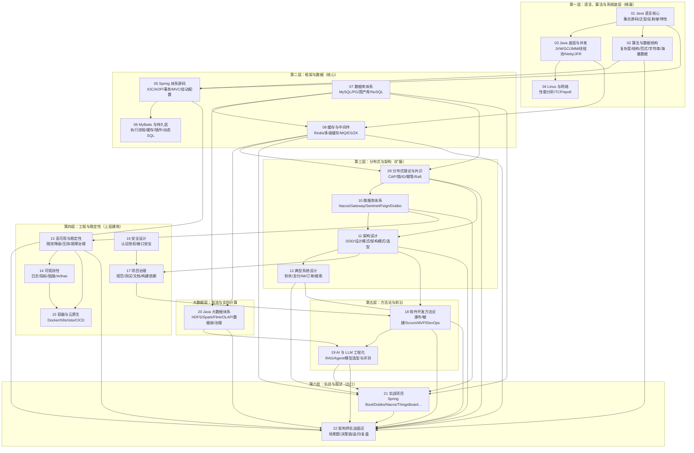

# 知识全景地图

> 定位：一张图看清 Java 高级/架构知识体系的全貌，以及各板块之间的依赖关系。建议先收藏这张图，每学完一个板块回来对照一次。

这套知识体系分 22 个板块，但**它们不是并列的 22 座孤岛，而是一棵有依赖关系的树**。理解依赖顺序，比逐个知识点死磕更重要——很多「看不懂源码」的痛苦，其实是前置知识没补齐。

## 一、全景图

下面这张图把板块按「语言/算法与底层 → 框架与数据 → 分布式与架构 → 工程与稳定 → 方法论与前沿 → 大数据与实战 → 面试」组织。箭头表示「应该先学」的依赖方向。第 22 板块（面试实战）是其余板块的**综合应用出口**——它需要你先有技术底子，才能答出有深度的场景题；第 21 板块（实战项目）则是「原理 → 真实代码」的桥。

## 二、九条学习主线

图看着复杂，其实可以拆成九条清晰的主线。你可以按自己的目标选择切入顺序。

### 主线 A：面试突击线

目标是短期补齐面试高频考点，顺序：

1. **算法与数据结构**（`02 板块`）——手写题、复杂度、链表/树/DP，面试第一道门槛
2. **Java 语言核心**（`01 板块`）——集合源码、泛型、反射，面试第一高频
3. **JVM 与并发**（`03 板块`）——八股密度最高，也是区分度所在
4. **数据库**（`07 板块`）——索引、事务、锁，面试必问
5. **Redis 与缓存**（`08 板块`）——数据结构、三大问题、一致性
6. **分布式理论**（`09 板块`）——CAP、锁、ID、幂等、Raft
7. **Spring**（`05 板块`）——IOC/AOP/事务/循环依赖/MVC

### 主线 B：源码进阶线

目标是读懂框架源码，顺序：

1. Java 语言核心（`01 板块`）——集合源码打底
2. Spring IOC / AOP / 事务 / MVC（`05 板块`）
3. MyBatis 执行流程与插件（`06 板块`）——和设计模式篇对照读
4. Netty Reactor 模型（`03 板块`）——很多中间件的底层
5. Redis / RocketMQ 底层（`08 板块`）

### 主线 C：架构落地线

目标是做方案设计和技术选型，顺序：

1. 分布式理论与共识（`09 板块`）
2. 微服务体系（`10 板块`）
3. 高可用与稳定性（`13 板块`）
4. DDD 与架构模式、技术选型（`11 板块`）
5. 典型系统设计（`12 板块`）——把前面的知识用到具体场景

### 主线 D：线上运维线

目标是能排查线上问题，顺序：

1. GC 调优与诊断（`03 板块`）
2. Linux 性能分析与 TCP（`04 板块`）——OS 层才是根因所在
3. Arthas 线上诊断（`14 板块`）
4. 监控告警 / 链路追踪 / 日志（`14 板块`）
5. 线上故障排查与复盘（`13 板块`）
6. 容器与云原生（`15 板块`）

### 主线 E：面试实战线（推荐最后走）

目标是把技术知识转化成架构师面试的应答能力。前置是前面几条主线的技术积累——没有底子，场景题答不深。

1. 先读 [架构师面试的底层逻辑](../22-架构师实战面试/01-架构师面试的底层逻辑.md)——搞清 STAR-L 框架和「诚实表达」原则
2. 高并发 / 分布式事务 / 缓存 / 数据库场景（`22 板块`）
3. 微服务治理 / 中间件选型 / 故障排查场景（`22 板块`）
4. 架构演进 / 稳定性 / 技术选型答辩 / 失败复盘场景（`22 板块`）
5. 每道题用自己真实项目套一遍框架，内化成自己的表达

### 主线 F：方法论落地线（带团队 / 做架构师必走）

目标是从「自己写代码」升级到「带团队交付」。技术再强，不懂流程和协作也做不好架构师。

1. 先读 [软件开发生命周期与模式全景](../18-软件开发方法论/01-软件开发生命周期与模式全景.md)——搞清瀑布/敏捷/迭代的关系，以及怎么选
2. 敏捷核心（`18 板块`）——敏捷宣言、和瀑布的本质区别、常见误解
3. 落地框架——Scrum / Kanban / XP（`18 板块`）
4. 精益与 MVP、规模化、DevOps（`18 板块`）
5. 需求管理、估算与度量、落地反模式（`18 板块`）

### 主线 G：AI 工程化线（面向未来）

目标是把 LLM 从「玩具」变成「企业系统的一部分」。

1. 先读 RAG 检索增强生成（`19 板块`）——解决「私有知识 + 幻觉」
2. Agent 与工具调用（`19 板块`）——让 LLM 能行动
3. LLM 应用架构与 AI 辅助编程（`19 板块`）——成本、安全、可观测
4. 结合已有能力：向量库选型参考数据库篇、流式响应参考 Netty/Web 篇

### 主线 H：Java 大数据线（转数据平台 / 实时数仓）

目标是让 Java 工程师能读懂并落地大数据链路，而不是只会调 API。

1. 先读 [Java 大数据技术全景](../20-Java大数据体系/01-Java大数据技术全景.md)——建立存储/计算/查询/消息/调度/湖仓的全局地图
2. 存储与计算基础——HDFS/MapReduce（`20 板块`）、Hive 与 Spark SQL 数仓开发（`20 板块`）
3. Spark 核心与调优（`20 板块`）——Stage、Shuffle、内存、AQE、数据倾斜
4. 实时链路——Flink 流计算与状态管理、Kafka 与实时数仓（`20 板块`）
5. 数据集成与调度——DataX / Flink CDC / DolphinScheduler，全量与增量同步、断点续跑（`20 板块`）
6. 查询与湖仓——OLAP 引擎选型（ClickHouse/Doris/StarRocks）、数据湖与湖仓一体（`20 板块`）
7. 治理收尾——数据治理与数据质量（`20 板块`）
8. 横向补充：Kafka 基础看 `08 板块`，CDC 与 binlog 看 `07 板块`，任务监控看 `14 板块`

> 读法：每学一个组件，回到自己的业务找一条真实数据链路（如订单日志 → Kafka → Flink → OLAP）画出来；画不出就说明还没掌握。

### 主线 I：开源项目精读线（从原理到代码）

目标是让「看过的原理」在真实项目里落地。不要 10 个项目平均用力：选 1 个基础设施 + 1 个完整应用精读。

1. 先读 [Spring Boot](../21-实战项目/01-SpringBoot.md)——看清自动配置/起步依赖，建立「框架怎么长出来」的认知
2. 再按方向选：RPC/注册中心（Dubbo、Nacos）、消息（RocketMQ）、可观测（SkyWalking）
3. 完整应用选一个：电商（Mall）、企业后台（RuoYi-Vue-Pro）、IoT（ThingsBoard）、内容站（Halo）、低代码（JeecgBoot）
4. 每篇按「架构图 → 关键设计 → 上手跑通 → 边界与风险」走，别停在读 README

> 读法：先画架构图，再定位核心模块，最后跑一个最小链路（一次 RPC、一条消息、一个设备上报）。

## 三、板块与能力对照

| 板块 | 学完你能做什么 | 面试权重 | 落地权重 |
|---|---|---|---|
| 01 Java 语言核心 | 集合源码、List/TreeMap 选型、泛型擦除、反射代理、异常日志、Java 8–21 与 JDK 22–25 新特性 | ★★★★★ | ★★★★ |
| 02 算法与数据结构 | 复杂度分析、数组/链表/树/图、排序/DP、海量数据、算法范式、高级结构与字符串 | ★★★★★ | ★★★★ |
| 03 Java 底层与并发 | JVM/GC/并发/IO/ThreadLocal/Netty 原理与排查，JFR + async-profiler 性能剖析 | ★★★★★ | ★★★★ |
| 04 Linux 与网络 | OS 层排查、TCP 调优、epoll、HTTP/1.1-3、TLS、Nginx | ★★★★ | ★★★★★ |
| 05 Spring 体系源码 | IOC/AOP/事务/MVC、Boot 3/4 与 AOT、WebFlux | ★★★★★ | ★★★★ |
| 06 MyBatis 与持久层 | 执行链路、缓存/插件、动态 SQL、连接池、JPA | ★★★★ | ★★★★ |
| 07 数据库体系 | SQL 优化、分库分表、PostgreSQL、归档迁移、NoSQL/NewSQL 选型、国产数据库适配与迁移 | ★★★★★ | ★★★★★ |
| 08 缓存与中间件 | Redis/MQ（含 RabbitMQ）/ES 选型、调优、故障排查，多级缓存与 Caffeine 本地缓存 | ★★★★★ | ★★★★★ |
| 09 分布式理论与共识 | 锁、ID、幂等、事务、Raft 共识、任务调度 | ★★★★★ | ★★★★★ |
| 10 微服务体系 | Nacos/Gateway/Sentinel/Seata/Dubbo 体系，OpenFeign 与组件全景 | ★★★★ | ★★★★★ |
| 11 架构设计 | DDD 建模、设计模式、架构模式、技术选型 | ★★★ | ★★★★★ |
| 12 典型系统设计 | 秒杀/支付/IM/订单/搜索/推送/存储/LBS/多租户 SaaS 的完整方案 | ★★★★★ | ★★★★ |
| 13 高可用与稳定性 | 容量规划、压测、限流降级、故障治理、多活、混沌工程 | ★★★★ | ★★★★★ |
| 14 可观测性 | 监控、链路追踪、日志、线上诊断、OpenTelemetry | ★★★ | ★★★★★ |
| 15 容器与云原生 | Docker/K8s/Istio 部署、K8s 网络、GitOps、Serverless | ★★★ | ★★★★ |
| 16 安全设计 | 认证授权、接口安全、密码学、供应链安全、合规 | ★★★ | ★★★★ |
| 17 项目治理 | 规范、测试、文档、技术风险管理、Maven/Gradle 构建与依赖治理 | ★★ | ★★★★ |
| 18 软件开发方法论 | 敏捷/Scrum/Kanban/MVP/DevOps 落地、带团队 | ★★★ | ★★★★★ |
| 19 AI 与 LLM 工程化 | RAG/Agent/LLM 架构、RAG 进阶、Prompt 评测、向量库、模型选型与 Agent 护栏 | ★★★★ | ★★★★ |
| 20 Java 大数据体系 | HDFS/Spark/Flink/实时数仓/数据集成与调度/OLAP/湖仓/治理的选型与排障 | ★★★★ | ★★★★ |
| 21 实战项目 | 10 个活跃开源项目的技术栈、架构、关键设计与落地边界 | ★★★★ | ★★★★★ |
| 22 架构师实战面试 | 场景题应答、决策链、层层追问、白板与手写代码 | ★★★★★ | ★★★★★ |

## 四、怎么用这套知识库

1. **不要从头线性读**。先看全景图，按当前目标选一条主线切入。
2. **每篇都要动手**。GC 参数自己跑一次，锁自己写并发demo，命令自己在测试环境敲一遍。
3. **带着问题读**。每篇的「面试高频」和「生产坑点」两节是精华，先扫这两节建立问题意识，再回头看原理。
4. **用图建立心智模型**。每篇的 Mermaid 图是骨架，先记住图，再填充细节。
5. **缩写查术语表**。跨板块出现的 CAP、AQS、AQE、RRF、SLO 等，统一见 [术语表](04-术语表.md)；版本差异见 [版本基线与更新说明](05-版本基线与更新说明.md)。

## 小结

- 22 个板块分层组织，语言/算法与底层是地基，第 18/19 板块是方法论与前沿，第 20 板块是 Java 大数据体系，第 21 板块是开源项目实战，第 22 板块是综合应用出口。
- 按目标选主线：面试、源码、架构、运维、面试实战、方法论、AI 工程化、Java 大数据、开源项目精读，九种切入方式。
- 面试权重看 Java 语言/算法/并发/数据库/Redis/分布式；落地权重看微服务/中间件/高可用/架构/系统设计/实战项目。
- **Java 语言核心（01）是所有 Java 问题的地基**——集合源码、泛型、反射，比 JVM 参数更常被问；**算法（02）是手写题与复杂度分析的地基**。
- **Linux 与网络（04）是排查的最后一公里**——Java 层查不出问题时，根因往往在 OS。
- **大数据（20）是 Java 能力的横向扩展**——Hadoop/Spark/Flink 都是 JVM 生态，懂 JVM 就是优势。
- **实战项目（21）是原理到代码的桥**——先画架构图，再定位核心模块，最后跑通最小链路。
- 每篇的「坑点」和「面试高频」是注意力锚点。
- 准备架构师面试走主线 E；带团队走主线 F；面向未来走主线 G；做数据平台走主线 H；想读真实代码走主线 I。
