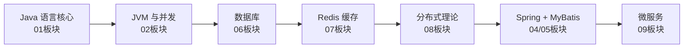

# 学习路线与阅读建议

> 定位：按你的当下目标，给出具体的阅读顺序和时间投入建议。不要从头线性读——选对路线，效率差三倍。

## 一、先判断你在哪个阶段

| 阶段 | 特征 | 建议主线 |
|---|---|---|
| 初中级 → 高级（1-3 年） | 会写业务，原理模糊，面试常卡壳 | 路线 A：面试突击 + 基础夯实 |
| 高级 → 资深（3-5 年） | 能独立负责模块，想读源码、做设计 | 路线 B：源码 + 架构 |
| 想转架构师 | 做技术选型、搭体系、扛稳定性 | 路线 C：架构落地 |
| 负责线上系统 | 天天救火，想系统提升排查能力 | 路线 D：线上运维 |
| 准备架构师面试 | 技术懂，但答不出深度、经不起追问 | 路线 E：架构师面试实战 |
| 开始带团队 / 转架构师 | 技术强，但推动落地、团队协作吃力 | 路线 F：方法论落地 |
| 要做 AI 应用 | 想用 LLM 但不知道怎么工程化落地 | 路线 G：AI 工程化 |
| 要转大数据 / 做实时数仓 | Java 基础在，但不懂 HDFS/Spark/Flink 与数据链路 | 路线 H：Java 大数据 |

## 二、八条路线

### 路线 A：面试突击（约 2-3 周）

按面试出现频率排序，高频先行：

1. **第 1 周**：Java 语言核心（集合源码、泛型、反射——**面试第一高频**）+ JVM 板块（内存、GC、JMM、线程池）
2. **第 2 周**：数据库（索引、事务、锁）+ Redis 与缓存 + 分布式理论（CAP、锁、ID、幂等）
3. **第 3 周**：Spring 高频点（循环依赖、事务失效、AOP、MVC 请求链路）+ MyBatis（缓存、插件）+ 微服务（Seata、Sentinel）

读法：每篇先看「面试高频问法」和「生产坑点」，建立问题清单；再回头读原理。

> 为什么把 Java 语言核心放最前：HashMap 源码、泛型擦除、动态代理是**每场 Java 面试的必问项**，而且它们比 JVM 参数更容易答深——面试官问「HashMap 为什么容量是 2 的幂」，答得出位运算优化的人和背「数组+链表」的人，差距一眼可见。

### 路线 B：源码进阶（约 1-2 个月）

1. Java 语言核心（01 板块）——集合源码是「数据结构 + 并发」的浓缩教材，先读它打底
2. Spring IOC / AOP / 事务 / MVC（04 板块）
3. Spring Boot 自动配置 + 启动流程（04 板块）
4. MyBatis 执行流程、缓存装饰器链、插件机制（05 板块）——和设计模式篇对照着读
5. Netty Reactor 模型（02 板块）——理解它的价值在于：Dubbo、RocketMQ、Gateway 底层都是它
6. Redis 数据结构与持久化、RocketMQ 架构（07 板块）

读法：**边读边跟源码**。装一个 IDE，断点打进去，看调用栈。光读文章不动手写 Demo，源码永远读不进去。

### 路线 C：架构落地（约 2 个月）

1. 分布式理论全板块（04）——这是架构决策的理论基础
2. 微服务体系（03）——Nacos/Gateway/Sentinel/Seata 如何组成体系
3. 高可用高性能（07）——限流降级、容量规划、压测、故障治理
4. DDD 与架构模式、技术选型（08）

读法：每学完一个板块，找一个你正在做的项目，**写一份改造方案**。架构能力是设计出来的，不是读出来的。

### 路线 D：线上运维（约 3-4 周）

1. GC 调优与诊断（02 板块）
2. Linux 性能分析与 TCP（03 板块）——Java 层查不出问题时，根因往往在 OS
3. Arthas 线上诊断（13 板块）
4. 监控告警 / 链路追踪 / 日志体系（13 板块）
5. 线上故障排查与复盘（12 板块）
6. 容器与云原生（14 板块）

读法：把文章里的命令（`jstat`、`jmap`、Arthas）整理成自己的 cheat sheet，在测试环境全部敲一遍。

### 路线 E：架构师面试实战（建议放在最后走）

前提：前面 A-D 的技术积累。没有底子，场景题答不深。这是把「知道」变成「答得出」的关键一步。

1. 先读《架构师面试的底层逻辑》（20 板块）——理解架构师面试考的是什么、STAR-L 答题框架、诚实表达原则
2. 按场景刷第 20 板块：高并发、分布式事务、缓存、数据库 → 微服务、中间件选型、故障排查 → 架构演进、稳定性、技术选型、失败复盘
3. 每道题**三遍法**：第一遍看答题骨架，第二遍遮住答案自己答，第三遍对照追问链补全
4. 用自己真实项目套框架——把 STAR-L 的每一段填上你的真实经历和数字

读法：**不要背答案**。面试官考的是判断力，背出来的答案经不起三层追问。这套题库的价值是训练你的决策思维。凡是让你编造经历的地方，都要警惕——没做过就坦诚说没做过，用清晰的推理证明能力。文中引用的公开案例都标了来源，可以拿来当答题素材。

### 路线 F：方法论落地（带团队 / 转架构师，约 2-3 周）

前提：有一定技术积累，开始带团队或要往架构师走。技术再强，不懂流程和协作也做不好架构师——因为架构师一半的工作是「推动方案落地」。

1. 先读 [软件开发生命周期与模式全景](../17-软件开发方法论/01-软件开发生命周期与模式全景.md)——搞清瀑布/敏捷/迭代的关系，以及怎么选
2. 敏捷核心（03）——敏捷宣言、12 原则、和瀑布的本质区别、六个常见误解
3. 落地框架：Scrum（04）、Kanban（05）、XP（06）——选一个贴合你团队的深入
4. 精益与 MVP（07）——怎么用最小成本验证假设，别闷头做半年
5. 规模化与交付：SAFe/LeSS（08）、DevOps/DORA（09）
6. 需求与度量：用户故事（10）、估算与度量（11）
7. 最后读落地与反模式（12）——避免「僵尸 Scrum」

读法：**结合你团队的真实痛点读**。比如「站会开成汇报会」就重点看 12 篇的反模式，「需求总做不完」就看 10 篇的故事拆分。方法论不是背概念，是解决你眼前的协作问题。

### 路线 G：AI 工程化（面向未来，约 2-3 周）

前提：有 Java 后端基础，想把 LLM 集成进企业系统（不是研究模型原理）。

1. 先读 [RAG 检索增强生成](../18-AI与LLM工程化/01-RAG检索增强生成.md)——解决「私有知识 + 幻觉」，这是企业落地最常见形态
2. Agent 与工具调用（18 板块）——Function Calling / ReAct / MCP，让 LLM 能「行动」
3. LLM 应用架构与 AI 辅助编程（18 板块）——多模型路由、成本控制、Prompt 注入防护
4. 横向补充：向量库选型看数据库篇（06）、流式响应看 Netty/Web 篇（02/04）

读法：**边读边动手搭一个最小 RAG**。用 Spring AI 或 LangChain4j，拿自己的文档做知识库，跑通「切分 → 向量化 → 检索 → 生成」全链路。AI 工程化的坑，光看文章体会不到，动手踩一遍才记得住。

### 路线 H：Java 大数据（转数据平台 / 实时数仓，约 1-2 个月）

前提：Java 基础扎实，懂 JVM、多线程、Kafka 基本概念。大数据组件大多是 JVM 生态，你的 Java 功底是优势，不要从零学一门新语言。

1. 先读 [Java 大数据技术全景](../19-Java大数据体系/01-Java大数据技术全景.md)——建立存储/计算/查询/消息/调度/湖仓的全局地图，搞清批处理、流处理、实时数仓的关系
2. 存储与计算基础——HDFS 与 MapReduce（19 板块）、Hive 与 Spark SQL 数仓开发（19 板块）
3. Spark 核心与调优（19 板块）——Stage、Shuffle、内存模型、AQE、数据倾斜，这是面试和生产的分水岭
4. 实时链路——Flink 流式计算与状态管理（19 板块）、Kafka 与实时数仓链路（19 板块）
5. OLAP 与湖仓——OLAP 引擎选型（ClickHouse/Doris/StarRocks）、数据湖与湖仓一体（Iceberg/Hudi/Paimon）
6. 治理收尾——数据治理与数据质量（19 板块）
7. 横向补充：Kafka 底层看 [Kafka 架构与原理](../07-缓存与中间件/05-Kafka架构与原理.md)，CDC/binlog 看 [读写分离与主从复制](../06-数据库体系/06-读写分离与主从复制.md)，任务监控看 [可观测性三大支柱](../13-可观测性/01-可观测性三大支柱.md)

读法：**找一条真实业务链路画出来**，例如「订单 binlog → Kafka → Flink 实时聚合 → ClickHouse → 报表」。每学一个组件，就把它填到这条链路上；填不进去说明还没真正理解它的位置。不要只背引擎参数，先想清楚「这批数据从哪来、延迟要求多少、谁在查」。

## 三、通用阅读建议

### 1. 二八法则

每个板块，80% 的价值集中在 20% 的篇目。如果时间紧，优先读：

- 02 板块：GC、JMM、线程池
- 04 板块：IOC、循环依赖、事务、自动配置
- 08 板块：CAP、分布式锁、幂等、分布式事务
- 06 板块：索引、MVCC、锁、SQL 优化
- 07 板块：Redis 三大问题、MQ 生产问题
- 12 板块：限流降级、故障排查
- 19 板块：技术全景、Spark 调优、Flink 状态、实时数仓链路、OLAP 选型

### 2. 图优先

每篇的 Mermaid 图是骨架。先花 1 分钟看懂图，再读文字细节。看完一篇，合上页面，试着自己把图画出来——画不出来说明还没真正理解。

### 3. 带着问题读

每篇的「生产坑点」是最好的问题清单。先读坑点，问自己「我能解决吗」，带着这个问题读原理，印象会深很多。

### 4. 动手验证

- JVM 参数：写个程序，用不同参数跑，看 `jstat` 输出
- 并发：写个多线程 Demo，复现线程安全问题
- Redis：本地起一个，亲手制造缓存穿透、击穿
- 数据库：造百万级数据，看执行计划差异

### 5. 用费曼技巧检验

学完一个知识点，试着用自己的话讲给别人（或假装讲）。讲不清楚的地方，就是你没懂的地方，回去重读。

## 四、持续更新

技术在演进，建议：

- 关注所用框架的官方文档和 Release Notes
- 每半年回看一次知识全景图，检查自己哪些板块还是空白
- 把工作中遇到的真实问题，补充成自己的笔记

## 小结

- 按阶段选路线：面试 / 源码 / 架构 / 运维 / 面试实战 / 方法论 / AI 工程化 / Java 大数据，不要线性通读
- 时间紧就用二八法则，抓每板块的高频核心篇
- 图优先、带问题读、动手验证、费曼检验
- 架构能力靠设计方案练出来，不靠读出来
- 准备架构师面试走路线 E，用真实项目套 STAR-L 框架，不背答案不编经历
- 带团队 / 转架构师走路线 F，方法论结合团队真实痛点读，解决眼前问题
- 做 AI 应用走路线 G，动手搭一个最小 RAG，坑要自己踩一遍
- 转大数据走路线 H，先画一条真实数据链路，再把组件逐个填进去
