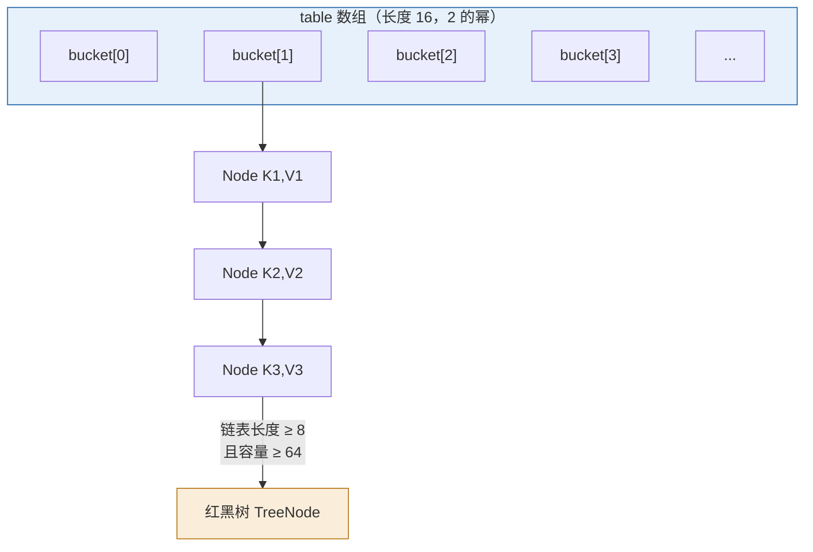
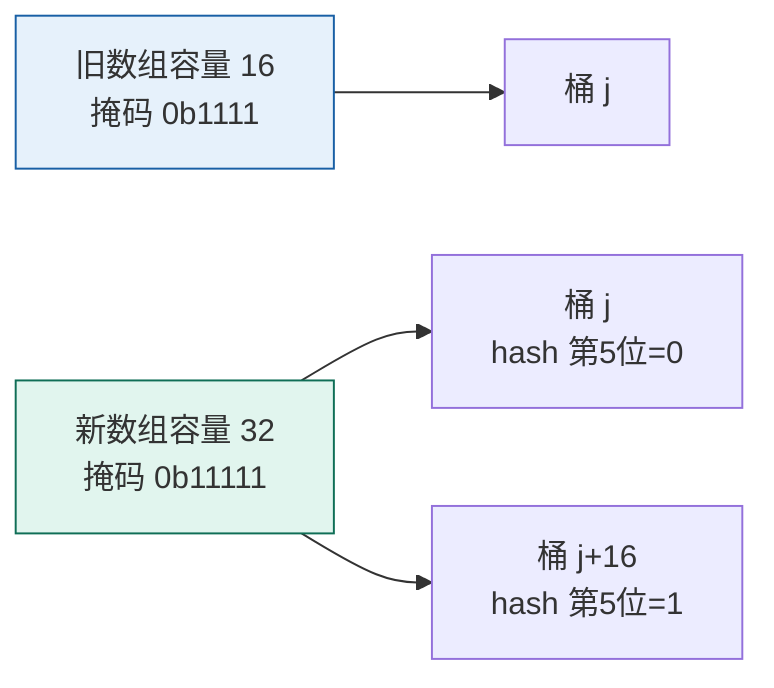
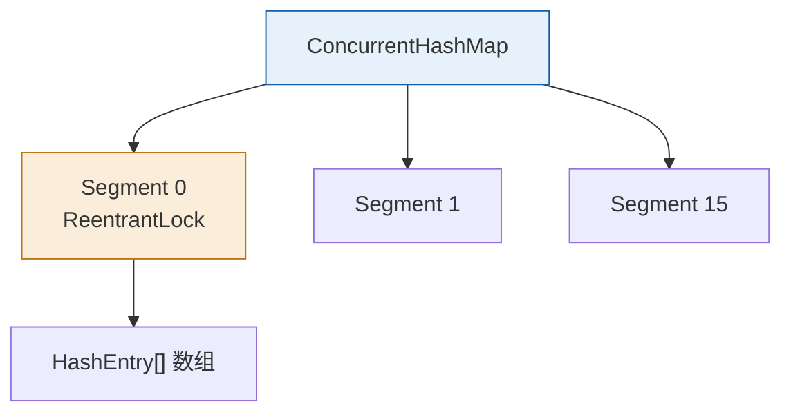

# 集合框架源码：HashMap 与 ConcurrentHashMap

> 定位：这是 Java 面试出现频率最高的题，没有之一。但大部分人只能背「数组+链表+红黑树」，一问「为什么容量是 2 的幂」「为什么树化阈值是 8」「JDK 8 为什么改成尾插」就卡住。这篇带你读源码，把这些「为什么」讲透，顺便把 ConcurrentHashMap 的分段锁演进、CAS 加锁、协助扩容一并拆开。

## 一、为什么 HashMap 值得逐行读

先说结论：**HashMap 是 Java 里「数据结构 + 算法 + 并发」的浓缩教材**。它用到了：

- 数组 + 链表 + 红黑树（数据结构）
- 位运算优化取模（算法技巧）
- 扰动函数降低哈希冲突（概率与分布）
- 扩容时的 rehash（空间换时间）
- 从线程不安全到 ConcurrentHashMap 的并发演进（并发设计）

读懂它，你顺带就懂了「哈希表」这个数据结构的全部工程细节。而且面试官问 HashMap，从来不是想听定义，是想验证你**有没有真的想过「为什么这么设计」**。

> 先记住三个数字：**16（默认容量）、0.75（负载因子）、8（树化阈值）**。这篇会解释它们为什么是这三个值。

## 二、HashMap 的整体结构

### 2.1 数据结构：数组 + 链表 + 红黑树



- **数组（table）**：哈希桶，长度永远是 2 的幂。
- **链表（Node）**：哈希冲突时，同一个桶里的元素串成链表。
- **红黑树（TreeNode）**：链表过长时转成红黑树，把查找从 O(n) 降到 O(log n)。

**为什么用红黑树而不是 AVL 树**：红黑树的插入/删除旋转次数更少（最多 3 次旋转），虽然查找略慢于 AVL，但综合性能更好——HashMap 是「写多读也多」的场景，要平衡。

### 2.2 关键字段

```java
public class HashMap<K,V> {
    transient Node<K,V>[] table;        // 哈希桶数组
    transient int size;                 // 元素个数
    int threshold;                      // 扩容阈值 = capacity * loadFactor
    final float loadFactor;             // 负载因子，默认 0.75
    static final int DEFAULT_INITIAL_CAPACITY = 1 << 4;  // 16
    static final float DEFAULT_LOAD_FACTOR = 0.75f;
    static final int TREEIFY_THRESHOLD = 8;      // 树化阈值
    static final int UNTREEIFY_THRESHOLD = 6;    // 退化阈值
    static final int MIN_TREEIFY_CAPACITY = 64;  // 最小树化容量
}
```

注意：**`threshold` 在初始化时是「初始容量」，第一次 put 后才变成「容量 × 负载因子」**。这是个容易踩的点——`new HashMap(16)` 并不会立刻创建数组，而是等到第一次 put 才 `resize()` 初始化。

## 三、五个「为什么」（面试深水区）

### 3.1 为什么容量必须是 2 的幂？

因为要把「取模」优化成「位与」。正常情况下，计算桶下标是 `hash % n`，但取模运算慢。当 `n` 是 2 的幂时：

```
hash % n  ==  hash & (n - 1)
```

比如 `n = 16`，`n - 1 = 15 = 0b1111`，`hash & 15` 就只保留低 4 位，效果等同 `hash % 16`，但位运算快得多。

**为什么必须是 2 的幂**：如果 `n = 15`（不是 2 的幂），`n - 1 = 14 = 0b1110`，位与之后最低位永远是 0，下标只能是偶数——一半的桶永远用不到，冲突翻倍。所以 `HashMap` 的 `tableSizeFor()` 会把传入的容量「向上取整到最近的 2 的幂」：

```java
static final int tableSizeFor(int cap) {
    int n = cap - 1;
    n |= n >>> 1;
    n |= n >>> 2;
    n |= n >>> 4;
    n |= n >>> 8;
    n |= n >>> 16;
    return (n < 0) ? 1 : (n >= MAXIMUM_CAPACITY) ? MAXIMUM_CAPACITY : n + 1;
}
```

这段位运算的意思是：把 `n` 最高位的 1 后面全部填 1，再 +1 就得到 2 的幂。比如 `cap = 10` → `n = 9 = 0b1001` → 填满后 `0b1111 = 15` → +1 = 16。

### 3.2 为什么要有扰动函数？

```java
static final int hash(Object key) {
    int h;
    return (key == null) ? 0 : (h = key.hashCode()) ^ (h >>> 16);
}
```

因为下标只用了 hash 的**低几位**（`& (n-1)`），如果两个 key 的 hashCode 只有高位不同、低位相同，就会冲突。扰动函数把高 16 位异或到低 16 位，让高位也参与运算，降低冲突概率。

**为什么要异或而不是直接移位**：异或能保留两边的信息，而 `|` 会让结果偏向 1、`&` 偏向 0，分布不均。异或的结果 0/1 概率各半，分布最均匀。

### 3.3 为什么负载因子是 0.75？

这是个「空间 vs 时间」的权衡：

- **太小（如 0.5）**：冲突少、查询快，但数组利用率低，浪费内存，且频繁扩容。
- **太大（如 1.0）**：数组利用率高，但冲突多、链表长、查询慢。

0.75 是 HashMap 注释里给出的「泊松分布」权衡点——在 0.75 负载下，桶中元素个数服从参数约 0.5 的泊松分布，链表长度达到 8 的概率约为 **0.00000006**（千万分之六）。也就是说，正常使用下几乎不会树化。

### 3.4 为什么树化阈值是 8、退化是 6？

- **树化阈值 8**：由上面的泊松分布得出——链表长度到 8 的概率极低，一旦到了 8，说明哈希函数或数据分布有问题，此时链表查询已经退化，转红黑树能救回来。
- **退化阈值 6**：比 8 小，是为了**避免「反复树化/退化」的抖动**。如果退化阈值也是 8，那么链表长度在 7~8 之间来回变化时会频繁转换，浪费性能。留一个缓冲区间（6~8）。
- **最小树化容量 64**：如果数组容量小于 64，即使链表到 8 也不树化，而是**先扩容**——因为小容量时冲突多是因为数组太短，扩容比树化更有效。

```java
final void treeifyBin(Node<K,V>[] tab, int hash) {
    int n, index;
    if (tab == null || (n = tab.length) < MIN_TREEIFY_CAPACITY)
        resize();                        // 容量 < 64，优先扩容
    else if ((e = tab[index]) != null) {
        // 转红黑树
    }
}
```

### 3.5 为什么 JDK 8 把头插改成尾插？

JDK 7 的 `HashMap` 在**扩容迁移时用头插法**，导致链表顺序反转。在并发扩容时，两个线程同时迁移可能形成**环形链表**，之后 `get` 就会死循环（CPU 100%）。这是著名的「HashMap 并发死循环」问题。

JDK 8 改成**尾插法**，迁移时保持相对顺序，不会成环。但注意：**JDK 8 的 HashMap 仍然线程不安全**，只是从「死循环」变成了「数据覆盖/丢失」——多个线程同时 put 到同一个空桶，后写的会覆盖先写的。

> 所以结论是：**任何情况下都不该在多线程下用 HashMap**，要么用 `ConcurrentHashMap`，要么加锁。

## 四、put 流程（源码级）

```java
final V putVal(int hash, K key, V value, boolean onlyIfAbsent, boolean evict) {
    Node<K,V>[] tab; Node<K,V> p; int n, i;
    // ① 数组为空，先初始化（懒加载）
    if ((tab = table) == null || (n = tab.length) == 0)
        n = (tab = resize()).length;
    // ② 目标桶为空，直接放新节点
    if ((p = tab[i = (n - 1) & hash]) == null)
        tab[i] = newNode(hash, key, value, null);
    else {
        Node<K,V> e; K k;
        // ③ 桶首节点 key 相同，覆盖
        if (p.hash == hash && ((k = p.key) == key || (key != null && key.equals(k))))
            e = p;
        // ④ 是红黑树，走树的插入
        else if (p instanceof TreeNode)
            e = ((TreeNode<K,V>)p).putTreeVal(this, tab, hash, key, value);
        // ⑤ 是链表，遍历
        else {
            for (int binCount = 0; ; ++binCount) {
                if ((e = p.next) == null) {
                    p.next = newNode(hash, key, value, null);  // 尾插
                    if (binCount >= TREEIFY_THRESHOLD - 1)     // 链表长度 ≥ 8
                        treeifyBin(tab, hash);
                    break;
                }
                if (e.hash == hash && ((k = e.key) == key || (key != null && key.equals(k))))
                    break;                                     // 找到相同 key
                p = e;
            }
        }
        if (e != null) {                    // 已存在 key，覆盖 value
            V oldValue = e.value;
            if (!onlyIfAbsent || oldValue == null)
                e.value = value;
            return oldValue;
        }
    }
    ++modCount;
    if (++size > threshold)                 // ⑥ 超过阈值，扩容
        resize();
    return null;
}
```

**六个步骤**：初始化 → 空桶直放 → 首节点匹配 → 红黑树插入 → 链表遍历插入 → 扩容检查。

**注意 `key == key` 的短路判断**：`(k = p.key) == key || key.equals(k)` —— 先用 `==` 比引用（快），引用不同再 `equals`（慢）。这是性能优化。

## 五、扩容（resize）—— 最精妙的部分

### 5.1 扩容做了什么

容量翻倍（`oldCap << 1`），阈值也翻倍。然后遍历旧数组，把每个节点重新分配到新数组。

**关键优化**：JDK 8 不需要重新计算 hash。因为容量翻倍后，元素的新位置只有两种可能：

- **留在原位置**（`j`）
- **移动到「原位置 + oldCap」**（`j + oldCap`）

判断依据是 `hash & oldCap` 这一位是 0 还是 1：

```java
if ((e.hash & oldCap) == 0) {
    // 低位链：留在原位置 j
} else {
    // 高位链：移动到 j + oldCap
}
```

**为什么**：容量从 `n` 变 `2n`，下标掩码从 `n-1` 变 `2n-1`，多出来的正好是最高位。如果 hash 在这一位是 0，下标不变；是 1，下标 +n。这样**把链表一分为二，不需要重新 hash**，效率极高。



### 5.2 为什么扩容是 2 倍

因为「2 的幂」和「位与取模」的配合——只有翻倍，才能用「看最高位」这一招把链表一分为二。如果扩 1.5 倍，这个优化就不成立，必须全部 rehash。

## 六、ConcurrentHashMap：从分段锁到 CAS

### 6.1 JDK 7：分段锁（Segment）

JDK 7 的 CHM 把数据分成 16 个 `Segment`（继承 `ReentrantLock`），每个 Segment 是一个小 HashMap。写操作只锁对应的 Segment，不同 Segment 可以并发写。



**问题**：并发度受限于 Segment 数量（默认 16），锁粒度还是「段」级别，不够细。

### 6.2 JDK 8：CAS + synchronized 锁头节点

JDK 8 抛弃了 Segment，改成和 HashMap 一样的「数组 + 链表 + 红黑树」，但并发控制更细：

- **空桶插入**：用 `CAS` 直接放（无锁）
- **非空桶**：`synchronized` 锁住桶的**头节点**
- **扩容**：多线程协助迁移

```java
final V putVal(K key, V value, boolean onlyIfAbsent) {
    if (key == null || value == null) throw new NullPointerException();
    int hash = spread(key.hashCode());
    int binCount = 0;
    for (Node<K,V>[] tab = table;;) {
        Node<K,V> f; int n, i, fh;
        if (tab == null || (n = tab.length) == 0)
            tab = initTable();                          // ① 初始化
        else if ((f = tabAt(tab, i = (n - 1) & hash)) == null) {
            if (casTabAt(tab, i, null, new Node<K,V>(hash, key, value, null)))
                break;                                  // ② 空桶 CAS 插入
        }
        else if ((fh = f.hash) == MOVED)
            tab = helpTransfer(tab, f);                 // ③ 正在扩容，协助迁移
        else {
            synchronized (f) {                          // ④ 锁头节点
                if (tabAt(tab, i) == f) {
                    // 链表或红黑树插入
                }
            }
        }
    }
    addCount(1L, binCount);                             // ⑤ 更新 size
    return null;
}
```

**四个关键点**：

1. **`tabAt`/`casTabAt` 用 `Unsafe` 直接操作内存**，保证可见性和原子性。
2. **空桶 CAS**：大多数 put 落在空桶，完全无锁，性能极高。
3. **锁粒度是「桶」**：只锁冲突的那个桶，并发度 = 数组长度，比 JDK 7 的 16 段细得多。
4. **`MOVED` 标记**：正在扩容的桶会被放一个 `ForwardingNode`（hash = MOVED），其他线程看到就帮忙迁移。

### 6.3 关键字段 sizeCtl

`sizeCtl` 是一个「多义」的 volatile int，不同取值含义不同：

| 取值 | 含义 |
|---|---|
| 0 | 未初始化 |
| -1 | 正在初始化（有线程在 `initTable`） |
| -N | 正在扩容，高 16 位是扩容戳，低 16 位是参与迁移的线程数 + 1 |
| 正数 | 扩容阈值（容量 × 0.75） |

这个「一个变量多种含义」的设计是为了省内存——用一个 int 表达「初始化中/扩容中/阈值」三种状态。

### 6.4 get 为什么完全无锁

```java
public V get(Object key) {
    Node<K,V>[] tab; Node<K,V> e, p; int n, eh; K ek;
    int h = spread(key.hashCode());
    if ((tab = table) != null && (n = tab.length) > 0 &&
        (e = tabAt(tab, (n - 1) & h)) != null) {
        if ((eh = e.hash) == h) {
            if ((ek = e.key) == key || (ek != null && key.equals(ek)))
                return e.val;
        }
        else if (eh < 0)
            return (p = e.find(h, key)) != null ? p.val : null;  // 树/ForwardingNode
        while ((e = e.next) != null) {                           // 遍历链表
            if (e.hash == h && ((ek = e.key) == key || (ek != null && key.equals(ek))))
                return e.val;
        }
    }
    return null;
}
```

**get 无锁的原因**：

1. `Node.val` 和 `Node.next` 都是 `volatile`，保证可见性。
2. 扩容时旧桶的节点**不会被修改**（只会在新数组里重新组织），所以读旧桶也能读到正确值。
3. 如果桶是 `ForwardingNode`，`find()` 会转发到新数组查。

### 6.5 size 统计：baseCount + CounterCell

CHM 的 size 不是用一个 AtomicLong 计数（那样高并发下 CAS 会大量失败），而是用类似 `LongAdder` 的思路：

- `baseCount`：基础计数
- `CounterCell[]`：分散计数数组，不同线程 CAS 到不同的 cell，减少竞争
- `size()` = `baseCount` + 所有 `CounterCell` 的和

**为什么这样设计**：高并发下，所有线程 CAS 同一个变量会疯狂失败重试。分散到多个 cell，每个线程尽量操作自己的 cell，冲突概率大幅降低。

## 七、ArrayList 与 LinkedHashMap 速览

### 7.1 ArrayList

- **底层**：`Object[] elementData`
- **默认容量**：10（但 `new ArrayList()` 时是空数组，第一次 add 才扩到 10）
- **扩容**：`newCapacity = oldCapacity + (oldCapacity >> 1)`，即 **1.5 倍**
- **与 LinkedList 对比**：

| 操作 | ArrayList | LinkedList |
|---|---|---|
| 随机访问 get(i) | O(1) | O(n) |
| 头部插入 | O(n) | O(1) |
| 尾部插入 | 均摊 O(1) | O(1) |
| 内存 | 紧凑 | 每个节点多两个指针 |

**实践建议**：99% 的场景用 ArrayList，LinkedList 只在「频繁头部插入/删除」且数据量大时才有优势（而且它的缓存不友好，实际常常更慢）。

### 7.2 LinkedHashMap 实现 LRU

`LinkedHashMap` 在 HashMap 基础上加了双向链表维护顺序。关键在构造参数 `accessOrder`：

```java
// accessOrder = true：按访问顺序（get 也会把节点移到链表尾）
public LinkedHashMap(int initialCapacity, float loadFactor, boolean accessOrder)

// 重写 removeEldestEntry 实现 LRU 淘汰
public class LRUCache<K,V> extends LinkedHashMap<K,V> {
    private final int capacity;
    public LRUCache(int capacity) {
        super(capacity, 0.75f, true);   // accessOrder = true
        this.capacity = capacity;
    }
    @Override
    protected boolean removeEldestEntry(Map.Entry<K,V> eldest) {
        return size() > capacity;        // 超过容量就淘汰最久未用的（链表头）
    }
}
```

这就是「十行代码实现 LRU」的经典写法。生产里更推荐 `Caffeine`（W-TinyLFU 算法，命中率更高）。

## 八、生产坑点与排查

### 坑点 1：用可变对象当 key

**现象**：put 进去后 get 不到。
**原因**：key 的 `hashCode` 依赖可变字段，put 后修改了字段，hash 变了，再 get 时定位到别的桶。
**解法**：key 用不可变对象（String、Integer、或 final 字段的自定义类）。

### 坑点 2：HashMap 并发下数据丢失

**现象**：多线程 put，最终 size 比预期少。
**原因**：两个线程同时往同一个空桶 CAS/赋值，后写的覆盖先写的（JDK 8）；JDK 7 还会死循环。
**解法**：用 `ConcurrentHashMap`，或外部加锁。

### 坑点 3：初始容量给错导致频繁扩容

**现象**：已知要放 1000 个元素，`new HashMap<>()` 默认 16，会扩容 7 次。
**解法**：`new HashMap<>(expectedSize / 0.75 + 1)`，或用 Guava 的 `Maps.newHashMapWithExpectedSize`。

### 坑点 4：ConcurrentHashMap 的复合操作不是原子的

**现象**：`if (!map.containsKey(k)) map.put(k, v)` 仍然有并发问题。
**原因**：`containsKey` 和 `put` 是两次操作，中间可能被插队。
**解法**：用 `putIfAbsent`、`computeIfAbsent`、`merge` 这些原子方法。

### 坑点 5：CHM 不允许 null key/value

**现象**：`map.put(null, "x")` 抛 NPE。
**原因**：并发场景下无法区分「key 不存在」和「key 存在但值为 null」（`get` 返回 null 有歧义）。
**解法**：用特殊值（如 `Optional` 或哨兵对象）代替 null。

## 九、最佳实践与调优

1. **预估容量**：`new HashMap<>((int)(expected / 0.75) + 1)`，避免扩容。
2. **key 不可变**：用 String/Integer/不可变对象。
3. **并发场景用 CHM**，并优先用 `computeIfAbsent` 等原子方法。
4. **缓存用 Caffeine**，别手写 LRU（除非面试）。
5. **遍历时删除**用 `Iterator.remove()` 或 `removeIf`，别在 for-each 里 `map.remove`（会 `ConcurrentModificationException`）。
6. **大 Map 注意内存**：`HashMap` 每个 Node 有 32 字节开销（对象头 + hash + key + value + next），百万级元素要算内存。

## 十、面试高频问法

> 这一节的答案按「面试时能讲透」的标准写：先给一句话结论，再展开机制、原因和坑点。

**Q1：HashMap 的底层数据结构是什么？**

**一句话结论**：JDK 8 是「数组 + 链表 + 红黑树」，JDK 7 是「数组 + 链表」（无红黑树）。

展开：

- 数组是哈希桶，长度 2 的幂；链表解决冲突；链表长度 ≥ 8 且容量 ≥ 64 时转红黑树，查找从 O(n) 降到 O(log n)。
- JDK 7 只有数组+链表，且用头插法（并发扩容会死循环）；JDK 8 改尾插 + 红黑树。

加分点：说"JDK 8 的树化不是「链表一到 8 就转」，而是「链表到 8 且数组容量 ≥ 64」——容量不够时优先扩容，因为小容量下冲突多是因为数组太短"。

**Q2：为什么 HashMap 的容量必须是 2 的幂？**

**一句话结论**：为了把取模 `hash % n` 优化成位与 `hash & (n-1)`，位运算快得多；而且只有 2 的幂才能保证下标分布均匀。

展开：

- `n = 16`，`n-1 = 15 = 0b1111`，`hash & 15` 只保留低 4 位，等价于 `hash % 16`。
- 如果 `n` 不是 2 的幂（如 15），`n-1 = 0b1110`，最低位永远是 0，一半的桶用不到。

加分点：说"`tableSizeFor()` 会把任意传入容量向上取整到 2 的幂，所以 `new HashMap(10)` 实际容量是 16"。

**Q3：HashMap 的 hash 扰动函数为什么这么写？**

**一句话结论**：`(h = key.hashCode()) ^ (h >>> 16)` 把高 16 位异或到低 16 位，让高位也参与下标计算，降低冲突。

展开：

- 下标只用低几位（`& (n-1)`），如果两个 key 只有高位不同，低位相同就会冲突。
- 异或能把高位信息「混」到低位；用异或而不是 `|`/`&`，是因为异或的 0/1 分布最均匀。

加分点：说"这是「用一次位运算换冲突率下降」的典型工程优化——成本极低，收益明显"。

**Q4：为什么负载因子是 0.75？**

**一句话结论**：空间与时间的权衡点——0.75 下冲突概率低、数组利用率也高，是泊松分布算出的较优值。

展开：

- 太小（0.5）：冲突少但浪费内存、频繁扩容。
- 太大（1.0）：省内存但冲突多、链表长、查询慢。
- 0.75 时，链表长度到 8 的概率约千万分之六，正常几乎不树化。

加分点：说"负载因子可以在构造时改，但除非有明确压测数据，否则别动默认值"。

**Q5：为什么树化阈值是 8，退化是 6？**

**一句话结论**：8 来自泊松分布（链表到 8 概率极低，到了说明哈希有问题）；6 比 8 小是为了留缓冲，避免 7~8 之间反复树化/退化抖动。

加分点：说"还有个 `MIN_TREEIFY_CAPACITY = 64`——容量小于 64 时不树化而是扩容，因为小容量冲突多是因为数组太短"。

**Q6：JDK 7 的 HashMap 为什么会死循环？JDK 8 修复了吗？**

**一句话结论**：JDK 7 扩容用头插法，并发迁移会形成环形链表，get 时死循环；JDK 8 改尾插法避免了成环，但仍然线程不安全（数据覆盖）。

展开：

- JDK 7：两个线程同时 resize，头插导致 A→B→A 的环，之后遍历链表永不结束，CPU 100%。
- JDK 8：尾插保持顺序，不成环，但并发 put 同一空桶仍会覆盖。

加分点：说"所以结论不是「JDK 8 的 HashMap 线程安全」，而是「从死循环降级为数据丢失」——多线程必须用 ConcurrentHashMap"。

**Q7：HashMap 扩容时元素怎么重新分配？**

**一句话结论**：容量翻倍，每个元素要么留在原位置 `j`，要么移到 `j + oldCap`，判断依据是 `hash & oldCap` 这一位是 0 还是 1。

展开：

- 因为掩码从 `n-1` 变 `2n-1`，只多了一位，所以不需要重新 hash。
- `hash & oldCap == 0` 留原位，否则 +oldCap。

加分点：说"这是 JDK 8 相对 JDK 7 的重要优化——JDK 7 要重新计算每个元素的 hash 和下标，JDK 8 只用看一位，效率高很多"。

**Q8：ConcurrentHashMap 在 JDK 8 是怎么保证线程安全的？**

**一句话结论**：空桶用 CAS 插入，非空桶用 `synchronized` 锁头节点，扩容时多线程协助迁移。

展开：

- JDK 7 是 Segment 分段锁（默认 16 段），并发度受限于段数。
- JDK 8 锁粒度细到「桶」，并发度 = 数组长度；且空桶完全无锁。
- `tabAt`/`casTabAt` 用 Unsafe 保证原子性和可见性。

加分点：说"JDK 8 的锁是「悲观锁（synchronized）+ 乐观锁（CAS）」结合——大部分操作落在空桶，CAS 就够了；只有冲突才升级为 synchronized"。

**Q9：ConcurrentHashMap 的 get 为什么不需要加锁？**

**一句话结论**：`Node.val` 和 `next` 是 volatile（保证可见性），扩容时旧桶节点不被修改，所以读旧桶也能读到正确值。

展开：

- 扩容时旧数组的桶会放 `ForwardingNode`，`find()` 自动转发到新数组。
- 读操作不会修改结构，所以无锁安全。

加分点：说"这是「读写分离」的思路——写用锁保证互斥，读靠 volatile 保证可见，读多写少的场景性能极好"。

**Q10：ConcurrentHashMap 的 size 怎么实现的？为什么不用 AtomicLong？**

**一句话结论**：用 `baseCount` + `CounterCell[]` 分散计数（类似 LongAdder），避免高并发下 CAS 同一个变量疯狂失败。

展开：

- 线程尽量 CAS 到自己的 cell，冲突少。
- `size()` 把所有 cell 求和。
- 所以 `size()` 是「近似值」，并发下不一定精确。

加分点：说"这体现了「减少共享、分散热点」的并发优化思路，LongAdder 也是同理"。

**Q11：HashMap 和 ConcurrentHashMap 有什么区别？**

**一句话结论**：HashMap 线程不安全、允许 null key/value；CHM 线程安全、不允许 null、并发性能高。

| 维度 | HashMap | ConcurrentHashMap |
|---|---|---|
| 线程安全 | 否 | 是 |
| null 支持 | key/value 都可以 null | 都不允许 |
| 并发控制 | 无 | CAS + synchronized |
| 性能 | 单线程最快 | 并发下远优于加锁 HashMap |
| 迭代器 | fail-fast | 弱一致（不抛 CME） |

加分点：说"CHM 的迭代器是「弱一致」的——遍历时其他线程修改不会抛异常，但不保证看到最新数据；这是为了并发性能做的取舍"。

## 小结

- HashMap = 数组 + 链表 + 红黑树；容量 2 的幂、负载因子 0.75、树化阈值 8、退化 6、最小树化容量 64。
- 容量 2 的幂是为了 `hash & (n-1)` 替代取模；扰动函数让高位参与下标；0.75 是空间时间权衡。
- put 六步：初始化 → 空桶直放 → 首节点匹配 → 红黑树 → 链表遍历 → 扩容检查。
- 扩容翻倍，靠 `hash & oldCap` 把链表一分为二，不用重新 hash。
- JDK 7 头插并发死循环，JDK 8 尾插修复但仍有数据覆盖——多线程必须用 CHM。
- CHM：JDK 7 分段锁 → JDK 8 CAS + synchronized 锁头节点 + 协助扩容；get 无锁靠 volatile；size 用分散计数。
- 坑：可变 key、并发丢数据、初始容量、CHM 复合操作非原子、CHM 不支持 null。
- 实践：预估容量、key 不可变、并发用 CHM 的原子方法、缓存用 Caffeine。
