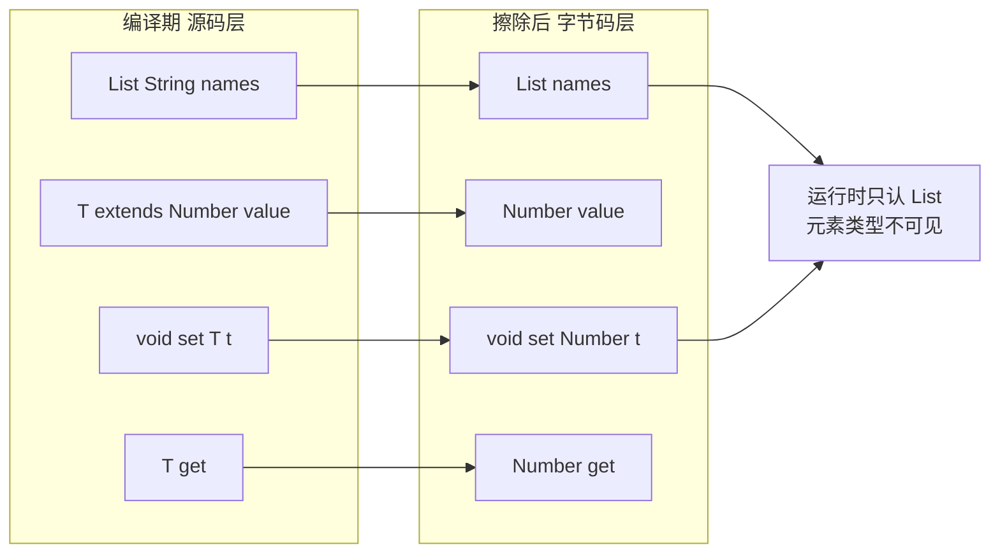
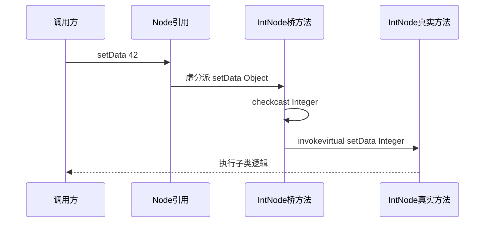
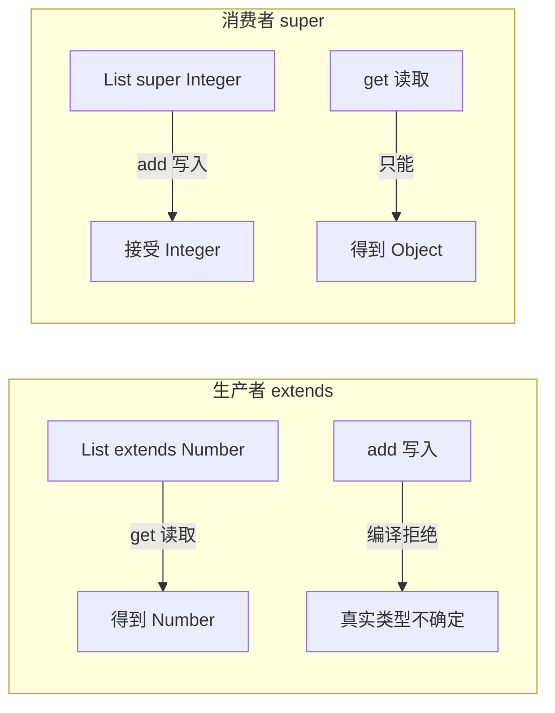

# 泛型与类型擦除

> 定位：泛型是 Java 语言层最容易被"会用但讲不清"的一块。你能写 `List<String>`，但未必能解释为什么 `new T()` 编译不过、为什么 `List<String>` 和 `List<Integer>` 不能重载、为什么擦除之后多态还没断。这篇从 JLS 的擦除规则讲到 `javap` 里的桥方法字节码，再落到 PECS、泛型数组、`TypeReference` 这些生产和面试都会撞上的点。看完你应该能对着字节码讲泛型，而不是背"泛型会擦除"这五个字。

## 一、为什么需要泛型

Java 5 之前，集合就是 `Object` 的垃圾桶：

```java
List list = new ArrayList();
list.add("hello");
list.add(Integer.valueOf(1));       // 编译器不管，什么都能塞

String s = (String) list.get(1);    // 运行时才炸：ClassCastException
```

这段代码在 Java 1.4 里完全合法，错误要等到运行、等到那一行被执行才暴露。它带来三个问题：

- **类型不安全**：容器不知道自己装什么，谁都能往里塞任何东西
- **到处强转**：每次 `get` 都要写 `(String)`，转换代码比业务代码还多
- **错误暴露太晚**：编译期查不出来的问题，推到生产环境才炸

泛型的承诺是：**把类型检查从运行时提前到编译期，同时不给运行时增加任何开销**。

第二句话是关键，也是理解整个泛型设计的前提。C++ 的模板是"真泛型"——`vector<int>` 和 `vector<string>` 是两份独立的机器码，编译期展开（模板实例化）。Java 选择了另一条路：**只在编译期做类型检查，编译完把类型参数全部擦掉，运行时根本不存在 `List<String>` 这个类型，只有 `List`。**

这不是 Java 偷懒，是历史包袱：Java 5 必须能让泛型代码和 1.4 的老库、老字节码互相调用。如果运行时真的有 `List<String>` 和 `List` 两个类，老代码加载新库就会炸。擦除是"向后兼容"这个约束下几乎唯一的解。

代价是一连串的"不能"和一堆反直觉的坑，这就是这篇要讲透的东西。

## 二、核心原理：类型擦除

### 2.1 擦除规则

JLS 第 4.6 节定义了擦除（erasure）。规则不复杂，但必须精确：

| 源码中的类型 | 擦除后 | 说明 |
|---|---|---|
| `List<String>`、`List<Integer>` | `List` | 类型参数直接丢弃 |
| `T`（无界类型变量） | `Object` | 没有边界就擦到 Object |
| `T extends Number` | `Number` | 擦到最左边界 |
| `T extends A & B & C` | `A` | 多个边界只保留第一个 |
| `T[]` | `Object[]` 或 `Number[]` | 跟着类型变量的边界走 |
| `List<T>` | `List` | 嵌套也照样擦 |
| `Map.Entry<K, V>` | `Map.Entry` | 同上 |

记住一句话：**擦除擦的是"类型参数"，不是"容器本身"**。`List<String>` 擦完还是 `List`，`ArrayList<String>` 擦完还是 `ArrayList`——类的身份没变，变的是它内部元素的静态类型信息。

### 2.2 擦除前后对比



看图注意两件事：一是类型参数 `T` 不是"消失"，而是"被替换成它的边界"；二是替换发生在**编译产物**里，源码里你写的东西一个没少。所以"擦除"发生在 `javac` 阶段，不是运行时临时抹掉。

### 2.3 用 javap 验证

```java
public class ErasureDemo<T extends Number> {
    private T value;

    public void set(T t) {
        this.value = t;
    }

    public T get() {
        return value;
    }

    public static void main(String[] args) {
        ErasureDemo<Integer> demo = new ErasureDemo<>();
        demo.set(42);
        Number n = demo.get();
        System.out.println(n);
    }
}
```

编译后看字节码：

```bash
javac ErasureDemo.java
javap -p -v ErasureDemo
```

关键片段：

```
  private T value;
    descriptor: Ljava/lang/Number;
    flags: ACC_PRIVATE
    Signature: #13                         // TT;

  public void set(T);
    descriptor: (Ljava/lang/Number;)V
    flags: ACC_PUBLIC
    Code:
       0: aload_0
       1: aload_1
       2: putfield      #2                  // Field value:Ljava/lang/Number;
       5: return

  public T get();
    descriptor: ()Ljava/lang/Number;
    flags: ACC_PUBLIC
    Code:
       0: aload_0
       1: getfield      #2                  // Field value:Ljava/lang/Number;
       4: areturn
```

注意字段描述符是 `Ljava/lang/Number;`，方法描述符是 `(Ljava/lang/Number;)V`——`T` 已经变成 `Number` 了。这就是擦除的铁证。

但同一段输出里还有一行 `Signature: #13 // TT;`。这一行非常关键，下一节讲。

### 2.4 泛型信息没有"完全消失"：Signature 属性

很多文章说"泛型在运行时完全丢失"，这句话**不准确**，面试时说错会被追问。

class 文件里其实有两套东西：

| 结构 | 内容 | 谁在用 |
|---|---|---|
| `descriptor`（描述符） | 擦除后的类型，如 `(Ljava/lang/Number;)V` | JVM 链接、方法调用、校验 |
| `Signature` 属性 | 完整的泛型签名，如 `<T:Ljava/lang/Number;>Ljava/lang/Object;` | 反射 API（`getGenericXxx`）、编译器读 class 文件时 |

`Signature` 是编译器额外写进去的**可选属性**。JVM 自己完全无视它——方法调用只看 descriptor；但 `java.lang.reflect` 会读它，这就是 `getGenericSuperclass()`、`getGenericParameterTypes()`、`getGenericReturnType()` 能拿到泛型的原因。

所以准确的说法是：

> **擦除擦掉的是"运行时的类型检查与调用协议"，不是"所有泛型字符串"。泛型签名以元数据形式留在 class 文件里，仅供反射和编译期使用。**

这个区别有巨大的实用价值——`Jackson` 的 `TypeReference`、`Spring` 的 `ParameterizedTypeReference`、`MyBatis` 的泛型 Mapper 解析，全靠这个 `Signature` 属性活着。如果泛型信息真的一点不剩，这些框架全都写不出来。

### 2.5 擦除带来的五个"不能"

这五个是面试必问，也是写代码时最容易踩的。每一个都要能推导，不能只背结论。

#### 不能 1：`new T()`

```java
class Box<T> {
    T create() {
        return new T();   // 编译错误
    }
}
```

编译器报：

```
error: unexpected type
  required: class
  found:    type variable T
```

三层原因：

1. 擦除后 `new T()` 会变成 `new Object()`，可 `T` 的实际类型是调用方决定的，创建 `Object` 语义就错了
2. `T` 可能是接口或抽象类，根本无法实例化
3. 编译器不知道 `T` 有没有无参构造器——`T` 的边界里没有构造器信息

正确做法是传类型令牌，用反射创建：

```java
class Box<T> {
    private final Class<T> type;

    Box(Class<T> type) {
        this.type = type;
    }

    T create() throws ReflectiveOperationException {
        return type.getDeclaredConstructor().newInstance();
    }
}
```

#### 不能 2：`new T[10]`

```java
T[] arr = new T[10];   // 编译错误：generic array creation
```

原因更硬：数组在 JVM 里是**具体化（reified）**的，创建数组的字节码 `anewarray` 需要一个运行时的组件类型（`Class` 对象）。`T` 被擦掉了，JVM 拿不到这个 Class，指令没法生成。

变通写法（都有代价）：

```java
// 1. 用 Object[] 顶着，取出时强转
@SuppressWarnings("unchecked")
T[] arr = (T[]) new Object[10];

// 2. 反射创建，保留真实组件类型（推荐）
@SuppressWarnings("unchecked")
T[] arr2 = (T[]) Array.newInstance(type, 10);
```

#### 不能 3：`instanceof T` / `instanceof List<String>`

```java
if (obj instanceof T) { }             // 编译错误
if (obj instanceof List<String>) { }  // 编译错误
if (obj instanceof List<?>) { }       // 合法
```

`instanceof` 的右操作数必须是 **reifiable type**（可具体化类型）——运行时能确定表示的类型。`List<String>` 擦除后只剩 `List`，运行时无法区分 `List<String>` 和 `List<Integer>`，所以不允许。`List<?>` 是例外，无界通配符是 reifiable 的。

#### 不能 4：靠泛型参数重载

```java
void print(List<String> list) { }
void print(List<Integer> list) { }   // 编译错误
```

编译器报：

```
error: name clash: print(List<String>) and print(List<Integer>)
  have the same erasure
```

因为擦除后两个方法都是 `print(List)`，JVM 的方法签名（名字 + 参数描述符）完全一样，没法区分。**重载看的是擦除后的签名，不是源码里的泛型。**

如果确实要"按类型分派"，只能改方法名，或者加一个类型令牌参数：

```java
void print(List<String> list, Class<String> type) { }
void print(List<Integer> list, Class<Integer> type) { }
```

#### 不能 5：静态成员用类类型参数

```java
class Box<T> {
    static T value;             // 编译错误
    static T get() { return null; }  // 编译错误
    static <U> U getU() { return null; }  // 合法：自己声明类型参数
}
```

`T` 是**实例级**的类型参数——每个 `Box<String>`、`Box<Integer>` 有自己的 `T`；而静态成员属于类本身，全类共享一份，没法确定该用哪个 `T`。所以静态方法要用泛型，必须自己声明 `<U>`。

同理，`catch (T e)` 非法（catch 的参数必须是具体的异常类，类型变量不行），但 `<T extends Throwable> void f() throws T` 合法（擦除成 `Throwable`）；`class MyEx<T> extends Exception` 也非法——JLS 明确规定泛型类不能直接或间接继承 `Throwable`。

### 2.6 为什么泛型数组非法——一个必须会推的证明

这是"擦除"这一节最值得讲透的地方，因为它把**数组的协变**和**泛型的不变**这两个特性撞到了一起。

先假设允许 `new List<String>[10]`，会发生什么：

```java
List<String>[] arr = new List<String>[10];   // 假设合法
Object[] objs = arr;                         // 数组协变，合法
objs[0] = List.of(1, 2, 3);                  // 存进去一个 List<Integer>
String s = arr[0].get(0);                    // 期望 String，实际 Integer
```

最后一行会在运行时炸，但**炸的地方太晚了**——数组在 `objs[0] = ...` 这一刻本该拦住，可它拦不住。因为数组的运行时类型检查只看"组件类型是不是 `List`"，而 `List<Integer>` 确实是 `List`，检查通过。

对比普通数组为什么能拦住：

```java
Object[] objs = new String[1];   // 协变，合法
objs[0] = Integer.valueOf(1);    // 运行时 ArrayStoreException
```

因为 `String[]` 的组件类型 `String` 是**可具体化**的，JVM 在 `aastore` 时能拿到并校验。而泛型数组的组件类型 `List<String>` 擦除后是 `List`，校验粒度不够，`List<Integer>` 也能过。

所以语言设计者做了一个取舍：**与其给你一个检查不住的数组，不如直接禁止创建泛型数组。**

结论一句话：**数组是协变 + 具体化的，泛型是不变 + 擦除的，两套类型系统语义冲突，所以 `new List<String>[10]` 非法。**

三种绕法：

```java
// 1. 通配符数组：合法，因为 List<?> 是 reifiable
List<?>[] a = new List<?>[10];

// 2. 强转，本质还是 Object[]，风险自负
@SuppressWarnings("unchecked")
List<String>[] b = (List<String>[]) new List<?>[10];

// 3. 反射创建，组件类型是 List
@SuppressWarnings("unchecked")
List<String>[] c = (List<String>[]) Array.newInstance(List.class, 10);
```

工程上的建议更简单：**别用泛型数组，用 `List<List<String>>`。** 集合比数组好用，也没有这些坑。

## 三、桥方法：擦除之后多态为什么没断

这是泛型里最"深水"的一块，也是区分"背过八股"和"真读过字节码"的分水岭。

### 3.1 问题：擦除会打断覆盖关系

```java
class Node<T> {
    private T data;

    public void setData(T data) {
        this.data = data;
    }

    public T getData() {
        return data;
    }
}

class IntNode extends Node<Integer> {
    @Override
    public void setData(Integer data) {
        System.out.println("IntNode.setData: " + data);
        super.setData(data);
    }

    @Override
    public Integer getData() {
        return super.getData();
    }
}
```

擦除之后：

- 父类的方法变成 `void setData(Object)` 和 `Object getData()`
- 子类的方法是 `void setData(Integer)` 和 `Integer getData()`

**参数类型不一样，就不是覆盖（override），而是重载（overload）。**

那么问题来了：

```java
Node<Integer> node = new IntNode();
node.setData(42);   // 走父类的 setData(Object)，还是子类的 setData(Integer)？
```

如果按擦除后的签名做虚方法分派，`Node` 引用调用的是 `setData(Object)`，子类只有 `setData(Integer)`，两者签名不匹配——子类的方法不会被调用，多态就断了，`IntNode` 里打印的那行永远不会执行。

这显然不能接受。**泛型是编译期的东西，不能让它在运行时破坏面向对象的基本语义。**

### 3.2 编译器生成桥方法

`javac` 的解法是：在子类里**偷偷生成一个 `setData(Object)` 方法**，它的唯一职责是把参数强转成 `Integer`，然后转调真正的 `setData(Integer)`。这个方法叫**桥方法（bridge method）**。

```bash
javap -p -c -v IntNode
```

输出（节选，保留了关键部分）：

```
  public void setData(java.lang.Integer);
    descriptor: (Ljava/lang/Integer;)V
    flags: ACC_PUBLIC
    Code:
       0: aload_0
       1: aload_1
       2: invokespecial #2    // Method Node.setData:(Ljava/lang/Object;)V
       5: return

  public void setData(java.lang.Object);
    descriptor: (Ljava/lang/Object;)V
    flags: ACC_PUBLIC, ACC_BRIDGE, ACC_SYNTHETIC
    Code:
       0: aload_0
       1: aload_1
       2: checkcast     #3    // class java/lang/Integer
       5: invokevirtual #4    // Method setData:(Ljava/lang/Integer;)V
       8: return
```

看第二个方法：`ACC_BRIDGE` + `ACC_SYNTHETIC`，参数是 `Object`，方法体就三步——`aload_1` 取参数、`checkcast Integer` 强转、`invokevirtual setData(Integer)` 转调。这就是桥方法。

`getData` 也有对应的桥方法，而且更直观地体现了"协变返回"：

```
  public java.lang.Integer getData();
    descriptor: ()Ljava/lang/Integer;
    flags: ACC_PUBLIC
    Code:
       0: aload_0
       1: invokespecial #5    // Method Node.getData:()Ljava/lang/Object;
       4: checkcast     #3    // class java/lang/Integer
       7: areturn

  public java.lang.Object getData();
    descriptor: ()Ljava/lang/Object;
    flags: ACC_PUBLIC, ACC_BRIDGE, ACC_SYNTHETIC
    Code:
       0: aload_0
       1: invokevirtual #6    // Method getData:()Ljava/lang/Integer;
       4: areturn
```

注意 `Node.getData()` 擦除后返回 `Object`，所以子类 `super.getData()` 之后要 `checkcast Integer`；桥方法则反过来，把 `Integer` 当 `Object` 返回。

### 3.3 桥方法的调用链



这张图要看懂的是：**桥方法是虚方法分派能命中的那个"签名正确的入口"**。JVM 只认 `setData(Object)`，桥方法正好提供了这个签名；进去之后再把调用"桥接"到真正带泛型语义的方法上。多态因此保住了，代价是多一次方法调用和一次 `checkcast`。

### 3.4 桥方法的四个副作用

桥方法是编译器生成的"影子方法"，它不会被源码感知，但会出现在反射和字节码工具面前，于是有了这些坑：

**副作用 1：反射拿到重复方法**

```java
for (Method m : IntNode.class.getMethods()) {
    if (m.getName().equals("setData")) {
        System.out.println(m + " bridge=" + m.isBridge());
    }
}
```

输出：

```
public void IntNode.setData(java.lang.Integer) bridge=false
public void IntNode.setData(java.lang.Object) bridge=true
```

框架里遍历方法时必须过滤：

```java
if (method.isBridge() || method.isSynthetic()) {
    continue;
}
```

**副作用 2：`getMethod` 可能拿到桥方法**

```java
Method m = IntNode.class.getMethod("setData", Object.class);
m.invoke(node, "not an integer");   // ClassCastException
```

`getMethod("setData", Object.class)` 精确匹配到的是桥方法，进去第一件事就是 `checkcast Integer`，传 `String` 立刻 CCE。这是很多"通用 Bean 工具"在泛型类上莫名其妙报 CCE 的根因。

**副作用 3：桥方法里的 `checkcast` 是 CCE 的现场**

用 raw type 往泛型容器塞错类型时，错误往往不在塞的那一行，而在**读出来或者经过桥方法**的时候炸。栈顶会显示一个看起来"不该存在"的方法签名（参数是 `Object`，但源码里你写的是 `Integer`），看到这种栈要立刻想到桥方法。

**副作用 4：协变返回值也会生成桥方法**

这跟泛型无关，是 Java 5 引入协变返回类型时一起做的：

```java
class Parent {
    public Object copy() { return this; }
}

class Child extends Parent {
    @Override
    public Child copy() { return this; }
}
```

`Child` 里会有一个 `public Object copy()` 的桥方法，转调 `copy()Child`。原因一样：父类引用调 `copy()` 时，签名是 `()Object`，得有个入口能命中子类。

顺带一提：桥方法在源码里**写不出来**。你手写一个 `setData(Object)` 会和编译器生成的冲突（或者覆盖失败），`ACC_BRIDGE` 是编译器专属的标志位。

### 3.5 擦除导致 CCE 的最小复现

理解了擦除，就能解释"为什么强转能骗过编译器，却骗不过运行时"：

```java
import java.util.ArrayList;
import java.util.List;

public class ErasureCce {
    @SuppressWarnings("unchecked")
    public static void main(String[] args) {
        List<Integer> ints = new ArrayList<>(List.of(1, 2, 3));

        // 双重强转：先转成 List<?>，再转成 List<String>
        // 编译器认为这是"未检查转换"，只给 warning
        List<String> strs = (List<String>) (List<?>) ints;

        System.out.println(strs.get(0));   // 运行时 CCE
    }
}
```

输出：

```
Exception in thread "main" java.lang.ClassCastException:
    class java.lang.Integer cannot be cast to class java.lang.String
```

看 `javap -c` 能定位到原因：`strs.get(0)` 之后紧跟一条 `checkcast java/lang/String`——**泛型的类型检查被编译器插在了"取值"这一侧**，因为 `get` 的返回类型擦除后是 `Object`，编译器必须插入强转才能赋给 `String`。

```java
List<String> strs = ...;
String s = strs.get(0);
// 等价于
String s = (String) strs.get(0);
```

所以泛型不是"运行时检查"，而是"编译器在读写点插 checkcast"。这也解释了为什么 `List<Integer>` 里混进一个 `String`，只要你从不取出来，就永远不会报错——它一直躺在那里，直到某次 `get` 触发 checkcast。

## 四、通配符与 PECS

### 4.1 Java 泛型是不变的

`List<Integer>` **不是** `List<Number>` 的子类型。这不是设计缺陷，是类型安全的必然：

```java
List<Integer> ints = new ArrayList<>();
List<Number> nums = ints;      // 编译错误：incompatible types
nums.add(Double.valueOf(3.14)); // 假如允许，ints 里就混进 Double 了
Integer i = ints.get(0);        // 然后这里 CCE
```

如果允许协变，`List<Integer>` 就能被当成 `List<Number>` 用，往里面塞 `Double`，`List<Integer>` 的类型承诺就被破坏了。所以泛型默认**不变（invariant）**。

但实际开发中我们经常需要"能接收 `List<Integer>` 也能接收 `List<Double>`"的方法，于是有了通配符，它提供了**受控的型变**。

### 4.2 `? extends T`：上界通配符，只能读

```java
List<? extends Number> list = new ArrayList<Integer>();

Number n = list.get(0);          // 合法：一定能当 Number 用
list.add(Integer.valueOf(1));    // 编译错误
list.add(null);                  // 只有 null 可以
```

编译器报：

```
error: incompatible types: Integer cannot be converted to CAP#1
  where CAP#1 is a fresh type-variable:
    CAP#1 extends Number from capture of ? extends Number
```

**为什么不能 add？** 推导如下：

`list` 的静态类型是 `List<? extends Number>`，它的真实类型可能是 `List<Integer>`、`List<Double>`、`List<Long>`、`List<Number>` 中的任意一个。编译器只知道"元素是 `Number` 的某个子类型"，但**不知道具体是哪个**。

如果允许 `add(Integer)`，那当真实类型是 `List<Double>` 时，就往一个只装 `Double` 的列表里塞了 `Integer`——类型安全被破坏。编译器无法证明这个 `add` 对**所有可能的真实类型**都安全，所以一律拒绝。

**为什么能读？** 因为不管真实类型是哪个子类，元素都能安全地向上转型成 `Number`。读取是"协变安全"的。

一句话：**`extends` 只给了上界，给不出确切类型；写入需要确切类型，所以禁止；读取只需要上界，所以允许。**

### 4.3 `? super T`：下界通配符，只能写

```java
List<? super Integer> list = new ArrayList<Number>();

list.add(Integer.valueOf(1));    // 合法
Object o = list.get(0);          // 合法，但只能当 Object
Integer i = list.get(0);         // 编译错误
```

**为什么能 add？** 真实类型可能是 `List<Integer>`、`List<Number>`、`List<Object>`。`Integer` 是这三种类型的元素类型的子类型，往任何一个里塞 `Integer` 都安全。编译器能证明"对所有可能的真实类型都安全"，所以放行。注意 `add` 的参数类型是 `Integer` 及其子类，`add(3.14)` 依然不行。

**为什么读出来只能当 Object？** 因为真实类型可能是 `List<Object>`，里面装的可能是任何东西，编译器给不出比 `Object` 更强的保证。

### 4.4 PECS 原则



**PECS = Producer Extends, Consumer Super。**

- 如果这个容器是给你**读**的（生产者，提供数据），用 `? extends T`
- 如果这个容器是给你**写**的（消费者，接收数据），用 `? super T`
- 如果既读又写，别用通配符，用精确类型 `T`

### 4.5 PECS 在 JDK 里的样子

```java
// java.util.Collections
public static <T> void copy(List<? super T> dest, List<? extends T> src)
public static <T> T max(Collection<? extends T> coll, Comparator<? super T> comp)

// java.util.stream.Stream
<R, A> R collect(Collector<? super T, A, R> collector)
```

逐个对照：

| 方法 | 参数 | 角色 | 为什么 |
|---|---|---|---|
| `Collections.copy` | `src: ? extends T` | 生产者 | 只从 src 读 |
| `Collections.copy` | `dest: ? super T` | 消费者 | 只往 dest 写 |
| `Collections.max` | `coll: ? extends T` | 生产者 | 只遍历读元素 |
| `Collections.max` | `comp: ? super T` | 消费者 | comparator 消费 T 去比较 |

`Comparator<? super T>` 这个写法值得单独说：它允许你用一个"能比较父类"的比较器来比较子类。比如 `Comparator<Animal>` 可以传给 `max(List<Dog>, comparator)`，因为能比较 `Animal` 就一定能比较 `Dog`。

### 4.6 `List<?>`、`List<Object>`、`List<? extends Object>` 的区别

这是经典面试题，三者看着像，实际完全不同：

| 类型 | 能接收 `List<String>` | 能 add | 读出的静态类型 | 本质 |
|---|---|---|---|---|
| `List<Object>` | 否 | 任意 `Object` | `Object` | 精确类型是 `Object` 的列表 |
| `List<?>` | 是 | 只能 `null` | `Object` | 无界通配符，任意类型的列表 |
| `List<? extends Object>` | 是 | 只能 `null` | `Object` | 与 `List<?>` 语义等价 |

`List<?>` 和 `List<? extends Object>` 基本等价，但前者更简洁，是推荐写法。`List<Object>` 是"元素类型为 Object 的列表"，它和 `List<String>` 没有子类型关系——这就是为什么 `List<String>` 不能赋给 `List<Object>`。

### 4.7 通配符捕获（capture conversion）

看一个"看起来应该能编译"的代码：

```java
public static void swap(List<?> list, int i, int j) {
    Object tmp = list.get(i);
    list.set(i, list.get(j));   // 编译错误
    list.set(j, tmp);           // 编译错误
}
```

`List<?>` 不能写（只能写 null），所以直接实现不了。标准解法是引入一个泛型 helper，让编译器做**通配符捕获**：

```java
public static void swap(List<?> list, int i, int j) {
    swapHelper(list, i, j);
}

private static <T> void swapHelper(List<T> list, int i, int j) {
    T tmp = list.get(i);
    list.set(i, list.get(j));
    list.set(j, tmp);
}
```

原理：调用 `swapHelper(list, i, j)` 时，编译器把 `?` **捕获**成一个新的类型变量 `CAP#1`，于是 `List<?>` 在这个调用点被当成 `List<CAP#1>`，读写都合法。JDK 的 `Collections.swap` 用的是另一招——把 `List<?>` 赋给 raw type 的局部变量 `List l = list;` 绕过检查。两者本质相同：**都是让编译器在某个点上看到一个"确定的"类型**。前者类型安全，后者靠 raw type 的 unchecked 语义，自己写代码优先用 helper。

### 4.8 递归边界：`T extends Comparable<? super T>`

JDK 里大量出现这个签名：

```java
public static <T extends Comparable<? super T>> T max(Collection<? extends T> coll)
```

为什么不写 `Comparable<T>`？考虑这个继承关系：

```java
class Animal implements Comparable<Animal> {
    public int compareTo(Animal o) { return 0; }
}

class Dog extends Animal {
    // Dog 继承 compareTo(Animal)，所以 Dog 是 Comparable<Animal>，不是 Comparable<Dog>
}
```

`Dog` 实现了 `Comparable<Animal>`，不是 `Comparable<Dog>`。如果签名要求 `T extends Comparable<T>`，`Dog` 就不满足（`Comparable<Animal>` 不是 `Comparable<Dog>` 的子类型）。用 `? super T` 放宽成"能比较 T 或 T 的父类"，`Dog` 就通过了。

这是 PECS 在类型边界上的应用：**`Comparable` 是消费者（它消费一个 T 去比较），所以用 `super`。**

## 五、类型推断与 var

### 5.1 推断能力的演进

| 版本 | 能力 | 例子 |
|---|---|---|
| Java 5 | 泛型，但调用处常需显式类型见证 | `Collections.<String>emptyList()` |
| Java 7 | diamond 语法 | `new ArrayList<>()` |
| Java 8 | target typing（目标类型推断） | `List<String> l = Collections.emptyList();` |
| Java 9 | diamond 可用于匿名类 | `new ArrayList<>() {}` |
| Java 10 | `var` 局部变量类型推断 | `var list = new ArrayList<String>();` |
| Java 11 | lambda 形参可用 `var`（配合注解） | `(@NonNull var x) -> ...` |

### 5.2 target typing

Java 8 的推断是"看上下文"：

```java
// 赋值目标提供了类型信息，emptyList() 推断为 List<String>
List<String> list = Collections.emptyList();

// 方法参数位置也能推断
Map<String, List<String>> map = new HashMap<>();
map.computeIfAbsent("k", k -> new ArrayList<>());   // ArrayList<String>

// lambda 形参从函数式接口推断
list.forEach(s -> System.out.println(s.length()));
```

Java 7 里第一行必须写 `Collections.<String>emptyList()`——方法调用自己推断不出 `T`，得靠调用方显式指定。这就是"类型见证"（type witness）。

### 5.3 var 与泛型的坑

`var` 只做**局部变量**推断，规则是"看右边表达式的类型"，**不会从左边的用法反推**。这导致一个高频坑：

```java
var list = new ArrayList<>();   // 推断为 ArrayList<Object>！
list.add("hello");
String s = (String) list.get(0);  // 取出来是 Object，要强转
```

因为 `new ArrayList<>()` 的 diamond 需要 target type，而 `var` 不提供 target type，编译器只能退化成 `Object`。

正确写法是右边写全：

```java
var list = new ArrayList<String>();          // ArrayList<String>
var map = new HashMap<String, List<Integer>>();  // 完整类型
```

`var` 的限制清单：

- 不能用于字段、方法参数、方法返回值、`catch` 参数
- 不能用 `null` 初始化（推断不出类型）
- 不能用数组初始化器 `var a = {1, 2, 3}`（必须 `new int[]{1,2,3}`）
- 三元表达式两侧类型不同时，推断结果可能是公共父类型（甚至 `Object`），容易丢精度

`var` 的一个正面用法是配合匿名类：

```java
var obj = new Object() {
    void hello() { System.out.println("hi"); }
};
obj.hello();   // Java 10 起合法，obj 的静态类型就是匿名类
```

Java 10 之前，匿名类只能赋给它的父类型，额外方法调不到；`var` 保留了匿名类的真实类型。

## 六、生产坑点与排查

### 坑 1：JSON 反序列化类型丢失

**现象**：

```java
List<User> users = objectMapper.readValue(json, List.class);
User u = users.get(0);
// ClassCastException: LinkedHashMap cannot be cast to User
```

**原因**：`List.class` 只告诉 Jackson"目标是个 List"，元素类型在运行时不可见，Jackson 只能把 JSON 对象反序列化成 `LinkedHashMap`。等你按 `User` 取的时候才炸。

**解法**：用 `TypeReference` 把泛型信息"捕获"下来：

```java
List<User> users = objectMapper.readValue(
        json, new TypeReference<List<User>>() {});
```

原理是**匿名子类 + `Signature` 属性**：

```java
public abstract class TypeReference<T> {
    private final Type type;

    protected TypeReference() {
        Type superClass = getClass().getGenericSuperclass();
        if (!(superClass instanceof ParameterizedType)) {
            throw new IllegalStateException("缺少泛型参数");
        }
        this.type = ((ParameterizedType) superClass).getActualTypeArguments()[0];
    }

    public Type getType() {
        return type;
    }
}
```

`new TypeReference<List<User>>() {}` 创建的是 `TypeReference` 的匿名子类，它的父类签名被编译器写进了 `Signature` 属性，`getGenericSuperclass()` 读出来就是 `TypeReference<List<User>>`，`getActualTypeArguments()[0]` 就是 `List<User>`。

`java.lang.reflect.Type` 有五个实现，反序列化框架就是靠它们还原类型：

| 实现 | 例子 | 用途 |
|---|---|---|
| `Class` | `String.class` | 普通类型 |
| `ParameterizedType` | `List<User>`、`Map<String, User>` | 带泛型参数 |
| `GenericArrayType` | `T[]`、`List<String>[]` | 泛型数组 |
| `TypeVariable` | `T` | 类型变量 |
| `WildcardType` | `? extends Number` | 通配符 |

Spring 的 `ParameterizedTypeReference<T>` 是同一套思路：捕获的也是 `Type`，只是额外用 `ResolvableType` 包了一层，能继续解析嵌套泛型和继承链上的类型变量。

### 坑 2：`toArray` 的 ClassCastException

**现象**：

```java
static <T> T[] toArray(List<T> list) {
    return (T[]) new Object[list.size()];
}

String[] arr = toArray(list);   // ClassCastException
```

**原因**：`(T[]) new Object[n]` 在擦除后就是 `(Object[]) new Object[n]`，返回的真实对象是 `Object[]`。但调用方拿到返回值后，编译器插入了 `checkcast [Ljava/lang/String;`——`Object[]` 不是 `String[]`，当场 CCE。

**解法**：

```java
// 1. 用集合自带的 toArray，传入目标类型数组
String[] arr = list.toArray(new String[0]);

// 2. 反射创建，保留真实组件类型
@SuppressWarnings("unchecked")
static <T> T[] toArray(List<T> list, Class<T> type) {
    T[] arr = (T[]) Array.newInstance(type, list.size());
    return list.toArray(arr);
}
```

`list.toArray(new String[0])` 里的空数组只是"类型模板"，JDK 6 之后 `toArray` 会用 `Array.newInstance` 按需创建正确长度的数组，传空数组比传等长数组更快（`new String[0]` 是个常量，可能被 JIT 优化掉）。

### 坑 3：泛型可变参数的堆污染

**现象**：

```java
static <T> List<T> listOf(T... items) {
    return Arrays.asList(items);
}
```

编译时有警告：

```
warning: [unchecked] Possible heap pollution from parameterized vararg type T
```

**原因**：可变参数在调用点会被编译成数组。泛型可变参数擦除后是 `Object[]`，但编译器为了"看起来类型正确"，可能会把它伪装成 `T[]`。如果调用方传的是一个真实数组（比如 `String[]`），而方法内部又往里写了别的类型，就污染了那个数组。

**解法**：如果方法只读不写，加 `@SafeVarargs` 声明"我保证安全"：

```java
@SafeVarargs
static <T> List<T> listOf(T... items) {
    return List.of(items);   // 只读，不修改数组
}
```

`@SafeVarargs` 只是**压制编译器的警告**，不做任何运行时检查。可用位置：`static` 方法、`final` 实例方法、`private` 实例方法（Java 9+）、构造器。非 final 的实例方法不行——因为可能被继承重写，编译器无法确认子类不会污染。

### 坑 4：泛型参数重载冲突

```java
void print(List<String> list) { }
void print(List<Integer> list) { }
```

编译直接失败：`have the same erasure`。

**解法**：改方法名（最干净），或者加类型令牌参数（能接受但难看）。**不要**试图用"返回值不同"来区分，返回值不参与重载决议。

### 坑 5：`remove` 的重载陷阱

```java
List<Integer> list = new ArrayList<>(List.of(10, 20, 30));
list.remove(1);                    // 删的是下标 1，剩下 [10, 30]
list.remove(Integer.valueOf(1));   // 删的是值 1，如果没有就什么都不删
```

`List` 有两个 `remove`：`remove(int index)` 和 `remove(Object o)`。`remove(1)` 里的 `1` 是 `int` 字面量，精确匹配 `remove(int)`，所以删下标。想删值必须显式装箱成 `Integer`。

这是"泛型 + 重载 + 自动装箱"三者叠加的坑，编译器不会给任何警告。

### 坑 6：`Arrays.asList` 与基本类型数组

```java
int[] arr = {1, 2, 3};
List<int[]> list = Arrays.asList(arr);
System.out.println(list.size());   // 1，不是 3
```

`Arrays.asList(T... a)` 的 `T` 被推断成 `int[]`（基本类型数组本身是一个对象），整个数组成了**一个元素**。要用包装类型或流：

```java
List<Integer> list = Arrays.stream(arr).boxed().collect(Collectors.toList());
```

同理，`List.of(new int[]{1,2,3})` 也会得到 `List<int[]>`。

### 坑 7：泛型与静态上下文

```java
class Box<T> {
    static T value;                  // 编译错误
    static T get() { return null; }  // 编译错误
    static <U> U getU() { return null; }  // 合法
}
```

报错是 `non-static type variable T cannot be referenced from a static context`。记住：**类上的 `T` 是实例级的，静态成员要用泛型必须自己声明 `<U>`。**

## 七、最佳实践

1. **API 设计按 PECS 走**：参数是数据源用 `? extends T`，是数据汇用 `? super T`，JDK 的 `Collections.copy` 就是范本
2. **不要返回通配符类型**：`List<? extends Foo> getFoos()` 对调用方几乎没用（不能 add，读出来只能当 Foo），要么返回 `List<Foo>`，要么写成泛型方法 `<T extends Foo> List<T> getFoos()`
3. **消灭 raw type**：`List` 是 raw type，会关掉所有泛型检查；想表达"任意类型的 List"用 `List<?>`
4. **别用泛型数组**：用 `List` 替代；非要用就用 `Array.newInstance` 并把 `@SuppressWarnings` 收敛到最小作用域
5. **泛型可变参数加 `@SafeVarargs` 且保证只读**
6. **打开 `-Xlint:unchecked`**，把 unchecked 警告当错误看——每一个 unchecked 警告背后都是一次潜在的 CCE
7. **需要运行时类型就传 `Class<T>` 类型令牌**，别指望 `T.class` 或 `instanceof T`
8. **命名约定**：`T` 类型、`E` 元素、`K`/`V` 键值、`R` 返回值、`?` 通配符

## 八、面试高频问法

**Q1：什么是类型擦除？擦到什么程度？**

**一句话结论**：泛型只存在于编译期，编译后类型参数被替换成它的最左边界（无界则 `Object`），运行时 JVM 看到的只有原始类型。

展开：`List<String>` 擦成 `List`，`T extends Number` 擦成 `Number`，`T extends A & B` 擦成 `A`，`T[]` 擦成 `Object[]` 或 `Number[]`。擦除发生在 `javac` 生成字节码时，方法描述符和字段描述符里已经没有类型参数了。

加分点：补一句"但泛型签名没完全丢，编译器会把它写进 class 文件的 `Signature` 属性，反射的 `getGenericXxx` 和 Jackson 的 `TypeReference` 就靠它"，这一句能立刻把你和背八股的人区分开。

**Q2：为什么不能 `new T()`、不能 `new T[10]`？**

**一句话结论**：擦除后 `T` 变成了它的边界（默认 `Object`），编译器既不知道真实类型、也不知道构造器签名，JVM 创建数组还需要运行时的组件类型。

展开：`new T()` 会退化成 `new Object()`，语义错误；`T` 可能是接口或抽象类；边界里没有构造器信息。`new T[10]` 更硬——`anewarray` 指令需要 `Class` 对象作为组件类型，`T` 擦掉后拿不到。

加分点：说"正确姿势是传 `Class<T>` 类型令牌，用 `type.getDeclaredConstructor().newInstance()` 或 `Array.newInstance(type, n)`"。

**Q3：桥方法是什么？为什么需要它？**

**一句话结论**：桥方法是编译器在子类里生成的、带 `ACC_BRIDGE | ACC_SYNTHETIC` 标志的"影子方法"，作用是把擦除后签名不匹配的调用转接到真正的泛型方法上，保住多态。

展开：`Node<T>.setData(T)` 擦除后是 `setData(Object)`，子类 `IntNode.setData(Integer)` 参数不同，不构成覆盖。编译器于是在 `IntNode` 里生成 `setData(Object)`，内部 `checkcast Integer` 后转调 `setData(Integer)`。`javap -v` 能看到 `flags: ACC_PUBLIC, ACC_BRIDGE, ACC_SYNTHETIC`。

加分点：说"协变返回值也会生成桥方法，这跟泛型无关，是 Java 5 协变返回类型的实现方式"；再说"反射遍历方法要过滤 `isBridge()`，否则会拿到两个同名方法，`getMethod(name, Object.class)` 可能命中桥方法导致 CCE"。

**Q4：`List<String>` 和 `List<Integer>` 能作为重载参数吗？**

**一句话结论**：不能，擦除后签名都是 `List`，编译器报 `name clash ... have the same erasure`。

展开：重载决议看的是擦除后的方法描述符（名字 + 参数类型），泛型参数不参与。同理，`f(List<String>)` 和 `f(ArrayList<Integer>)` 可以重载（擦除后是 `List` 和 `ArrayList`，不同），但这属于"能写但不该写"的代码。

加分点：说"这也是为什么 `Collections.removeAll` 之类的方法不按元素类型重载，而是靠参数类型区分"。

**Q5：PECS 是什么？为什么 `List<? extends Number>` 不能 add？**

**一句话结论**：Producer Extends, Consumer Super——生产者用 `extends` 只读，消费者用 `super` 只写。

展开：`List<? extends Number>` 的真实类型可能是 `List<Integer>`、`List<Double>`、`List<Long>`。编译器只知道元素是 `Number` 的某个子类型，不知道具体是哪个。`add(Integer)` 在真实类型为 `List<Double>` 时会破坏类型安全，编译器无法证明对"所有可能类型"都安全，所以拒绝。读则安全，因为任何子类都能当 `Number` 用。

加分点：说"`extends` 给的是上界，写入需要确切类型；`super` 给的是下界，写入安全但读出来只能当 `Object`"；再举 `Collections.copy(List<? super T> dest, List<? extends T> src)` 佐证。

**Q6：`List<?>`、`List<Object>`、`List<? extends Object>` 有什么区别？**

**一句话结论**：`List<?>` 和 `List<? extends Object>` 等价，能接收任意 `List<X>` 但只能读、只能写 null；`List<Object>` 是元素类型为 `Object` 的列表，不能接收 `List<String>`。

展开：`List<String>` 可以赋给 `List<?>`，不能赋给 `List<Object>`——因为泛型不变。`List<?>` 的读出的静态类型是 `Object`，写入除 null 外一律拒绝。

加分点：说"`List<?>` 是 API 里表达'我不关心元素类型'的标准写法，比 raw type `List` 安全得多，raw type 会关掉全部泛型检查"。

**Q7：为什么泛型数组非法？怎么创建泛型数组？**

**一句话结论**：数组是协变 + 具体化的，泛型是不变 + 擦除的，`new List<String>[10]` 会让"存 `List<Integer>`"通过运行时检查，造成堆污染，所以语言直接禁止。

展开：`Object[] objs = new List<String>[10]; objs[0] = List.of(1);` —— 数组只检查组件类型是 `List`，`List<Integer>` 能过，但后续按 `String` 取就 CCE。对比 `Object[] o = new String[1]; o[0] = 1;` 会立刻 `ArrayStoreException`，因为 `String` 是可具体化的。

加分点：给三种绕法——`new List<?>[10]`（合法）、`(List<String>[]) new List<?>[10]`（unchecked）、`Array.newInstance(List.class, 10)`（推荐）；再补一句"工程上直接用 `List<List<String>>`"。

**Q8：`@SafeVarargs` 是干什么的？**

**一句话结论**：它只是告诉编译器"这个泛型可变参数方法不会往数组里写"，从而压制 `possible heap pollution` 警告，不做任何运行时检查。

展开：泛型可变参数在调用点会创建数组，如果方法内部往里写就可能污染调用方的数组。`@SafeVarargs` 是程序员的安全承诺。只能用在 `static`、`final`、`private` 实例方法（Java 9+）和构造器上。

加分点：说"它不改变字节码，只是编译期注解，`Retention` 是 `RUNTIME`；如果方法内部真的写了数组，加了它就是把警告藏起来，事故照旧"。

**Q9：反射怎么拿到泛型信息？`TypeReference` 的原理是什么？**

**一句话结论**：靠 class 文件的 `Signature` 属性；`TypeReference` 用匿名子类把 `List<User>` 写进父类签名，再用 `getGenericSuperclass()` 读出来。

展开：`new TypeReference<List<User>>() {}` 的 `getClass().getGenericSuperclass()` 返回 `ParameterizedType`，`getActualTypeArguments()[0]` 就是 `List<User>`。`Type` 有五个实现：`Class`、`ParameterizedType`、`GenericArrayType`、`TypeVariable`、`WildcardType`。

加分点：说"这也是为什么 `readValue(json, List.class)` 会得到 `List<LinkedHashMap>`——`List.class` 没带元素类型，Jackson 只能退化成 Map"。

**Q10：`List<Integer>` 是 `List<Number>` 的子类型吗？**

**一句话结论**：不是，Java 泛型不变（invariant），`List<Integer>` 和 `List<Number>` 没有任何继承关系。

展开：如果允许，就能把 `List<Integer>` 当 `List<Number>` 用，往里塞 `Double`，破坏 `List<Integer>` 的类型承诺。需要"接受多种元素类型"时用通配符 `List<? extends Number>`。

加分点：说"数组是协变的（`String[]` 是 `Object[]` 的子类型），泛型不是，这是数组和泛型最本质的区别，也是泛型数组被禁的根源"。

**Q11：擦除导致的 `ClassCastException` 是怎么发生的？**

**一句话结论**：编译器在"取值/赋值"处插入 `checkcast`，泛型本身不做运行时检查；用 raw type 或双重强转骗过编译器后，错误类型能进容器，直到某次 `get` 才炸。

展开：`List<String> s = (List<String>)(List<?>) intList;` 是 unchecked 转换，运行时 `List` 内部不校验元素。`String x = s.get(0)` 编译成 `(String) s.get(0)`，此时 CCE。

加分点：说"栈里如果出现参数是 `Object`、但你源码写的是具体类型的方法，先怀疑桥方法的 `checkcast`"。

**Q12：泛型能用于基本类型吗？为什么？**

**一句话结论**：不能，类型参数只能是引用类型，`List<int>` 非法，必须用 `List<Integer>`。

展开：擦除后类型参数要变成 `Object` 或其边界，基本类型不是 `Object` 的子类型，没法参与这套体系。所以 Java 用包装类型 + 自动装箱。代价是装箱开销和 `null` 问题。

加分点：说"这也是 Java 泛型比 C# 泛型弱的地方——C# 的泛型在运行时保留，`List<int>` 是真的一点不装箱；Java 靠擦除换兼容，牺牲了基本类型支持和运行时类型信息"。

## 小结

- **擦除擦的是"运行时类型参数"**：`List<String>` → `List`，`T extends Number` → `Number`，多边界取最左。但泛型签名留在 `Signature` 属性里，反射能读。
- **五个不能要会推导**：`new T()`、`new T[]`、`instanceof T`、按泛型重载、静态成员用 `T`。
- **桥方法是擦除后多态的补丁**：`ACC_BRIDGE | ACC_SYNTHETIC`，`checkcast` + 转调；反射要过滤 `isBridge()`，`getMethod` 可能命中桥方法。
- **PECS 一句话**：生产者 `extends` 只读，消费者 `super` 只写；`extends` 不能 add 是因为真实类型不确定。
- **泛型数组非法的根因**是数组协变 + 具体化与泛型不变 + 擦除冲突，绕法是 `List` 或 `Array.newInstance`。
- **类型信息丢了就传令牌**：`Class<T>` 救运行时类型，`TypeReference`/`ParameterizedType` 救泛型类型。
