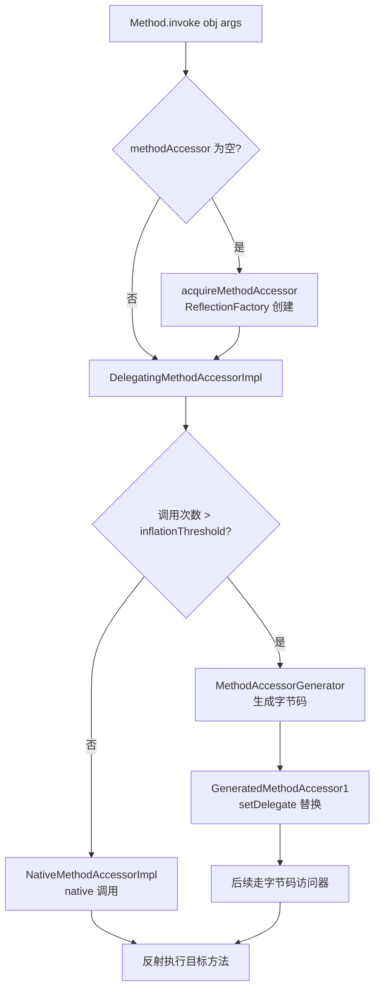
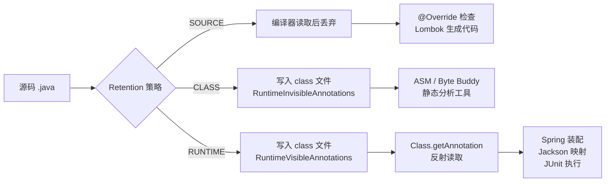
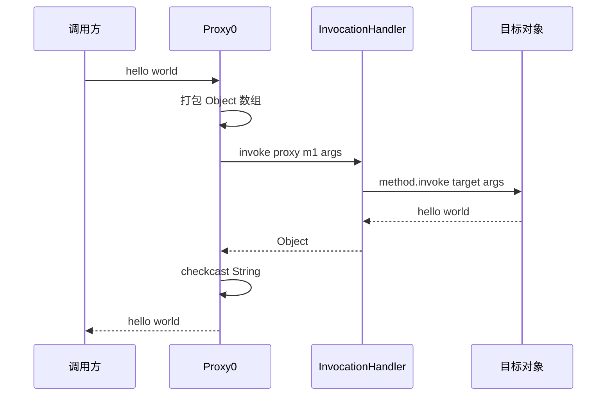

# 反射注解与动态代理

> 定位：Spring 的依赖注入、MyBatis 的 Mapper 接口、JUnit 的 `@Test`、Jackson 的字段映射——这些"魔法"背后只有三样东西：反射（运行时自省）、注解（声明式元数据）、动态代理（无侵入增强）。会用这三个 API 的人很多，能讲清 `Method.invoke` 为什么慢、`inflation` 阈值是多少、`$Proxy0` 长什么样、`@Inherited` 为什么在接口上失效的人很少。这篇从字节码和 JDK 源码层面把它们拆开，最后手写一个能跑的重试框架。

## 一、为什么需要这三件套

先看三个真实场景，它们分别对应一个机制：

**场景一：Spring 的依赖注入。** 你的 `OrderService` 里有个 `@Autowired private OrderDao orderDao;`，Spring 在启动时扫描所有 Bean，发现这个字段有注解，于是用反射往私有字段里塞一个实例。没有反射，就得让你手写 setter，框架无法做到"零侵入"。

**场景二：MyBatis 的 Mapper。** 你只写了一个 `UserMapper` 接口，没有任何实现类，但 `userMapper.selectById(1)` 能跑。原因是 MyBatis 用 JDK 动态代理在运行时生成了一个实现类，把所有方法调用拦截下来，翻译成 SQL 执行。

**场景三：JUnit 的 `@Test`。** 你写个方法加个注解，测试框架就能找到它、创建实例、调用它。框架不认识你的类，只能靠"运行时读注解 + 反射调用"。

三个场景的共同点：**框架代码在编译时不知道你的类，必须在运行时才发现、才调用。** 这就是反射存在的理由。注解负责"声明"，反射负责"发现和执行"，动态代理负责"在不改你代码的前提下插入逻辑"。三者合起来，才有了"框架"这个概念。

代价也很明确：反射绕过了编译期的类型检查，牺牲了性能和封装性；注解容易因为保留策略、继承规则写错而静默失效；动态代理有"必须实现接口""不能代理 final"这类硬限制。这篇就是把这些代价讲清楚。

## 二、反射：运行时自省

### 2.1 Class 对象的获取方式与初始化时机

反射的入口是 `java.lang.Class`。拿到 Class 对象有四种方式，**它们对类初始化的影响不一样**，这是面试高频点：

| 方式 | 示例 | 是否触发静态初始化 |
|---|---|---|
| 类字面量 | `Foo.class` | **否**（只加载、链接，不初始化） |
| 实例方法 | `obj.getClass()` | 对象都创建了，必然已初始化 |
| `Class.forName(String)` | `Class.forName("com.Foo")` | **是**（默认 `initialize=true`） |
| `Class.forName(name, false, loader)` | 显式传 `false` | 否 |
| `ClassLoader.loadClass(name)` | `loader.loadClass("com.Foo")` | 否 |

写代码验证一下：

```java
class A { static { System.out.println("A 静态初始化"); } }
class B { static { System.out.println("B 静态初始化"); } }
class C { static { System.out.println("C 静态初始化"); } }

public class ClassInitDemo {
    public static void main(String[] args) throws Exception {
        Class<?> a = A.class;
        System.out.println("A.class 执行完");

        Class<?> b = Class.forName("B");
        System.out.println("Class.forName 执行完");

        Class<?> c = ClassInitDemo.class.getClassLoader().loadClass("C");
        System.out.println("loadClass 执行完");

        System.out.println(a + " / " + b + " / " + c);
    }
}
```

输出：

```
A.class 执行完
B 静态初始化
Class.forName 执行完
loadClass 执行完
class A / class B / class C
```

只有 `Class.forName("B")` 打印了静态块。这个差异在生产上有实际影响：

- **加载 JDBC 驱动**必须用 `Class.forName("com.mysql.cj.jdbc.Driver")`，因为驱动的静态块里会 `DriverManager.registerDriver(new Driver())`。用 `loadClass` 就不会注册，连接会失败（JDBC 4.0 之后有 SPI 自动发现，但老代码和老驱动仍依赖这行）。
- **只做类型检查、不想触发副作用**时，用 `Class.forName(name, false, loader)` 或 `loadClass`。

`Class.forName` 内部其实就是 `Class.forName(name, true, currentLoader)`，第二个参数叫 `initialize`。

### 2.2 一次反射调用的完整链路

`method.invoke(obj, args)` 这一行背后是一条不短的链路：



这条链路的关键是**两个实现类的切换**：一开始用 native 版本，调用够多次之后换成动态生成的字节码版本。这就是下一节的 inflation 机制。

### 2.3 MethodAccessor 与 inflation 阈值

JDK 8 的 `Method.invoke` 源码（简化）：

```java
public Object invoke(Object obj, Object... args) throws ... {
    MethodAccessor ma = methodAccessor;   // volatile 字段
    if (ma == null) {
        ma = acquireMethodAccessor();
    }
    return ma.invoke(obj, args);
}
```

`acquireMethodAccessor()` 会调 `ReflectionFactory.newMethodAccessor(this)`，返回一个 `DelegatingMethodAccessorImpl`，里面包着 `NativeMethodAccessorImpl`。真正的判断在 `NativeMethodAccessorImpl.invoke`：

```java
public Object invoke(Object obj, Object[] args) throws IllegalArgumentException,
        InvocationTargetException {
    if (++numInvocations > ReflectionFactory.inflationThreshold()
            && !ReflectUtil.isVMAnonymousClass(method.getDeclaringClass())) {
        MethodAccessorImpl acc = (MethodAccessorImpl)
            new MethodAccessorGenerator()
                .generateMethod(method.getDeclaringClass(),
                                method.getName(),
                                method.getParameterTypes(),
                                method.getReturnType(),
                                method.getExceptionTypes(),
                                method.getModifiers());
        parent.setDelegate(acc);
    }
    return invoke0(method, obj, args);
}
```

三个关键数字和开关：

| 项 | 值 | 说明 |
|---|---|---|
| `sun.reflect.inflationThreshold` | **默认 15** | 前 15 次走 native，第 16 次开始生成字节码 |
| `sun.reflect.noInflation` | 默认 `false` | 设为 `true` 则跳过 native 阶段，直接生成 |
| 生成类名 | `GeneratedMethodAccessor1`、`2`… | 由 `MethodAccessorGenerator` 用 ASM 风格手写字节码生成 |
| 类加载方式 | `ClassDefiner` 定义在 `sun.reflect` 包 | 每个 Accessor 一个类，避免命名冲突 |

**为什么要两套实现？** 这是一个典型的启动 vs 峰值权衡：

- native 版本：第一次调用就能用，不需要生成类、不需要类加载，**启动快**；但每次调用都要跨越 JNI 边界，**执行慢**
- 字节码版本：生成和加载有一次性成本（毫秒级），但生成出来的方法就是普通 Java 方法，**JIT 能内联、能优化**，**执行快**

所以策略是"先慢后快"：前 15 次用 native 保证启动速度，热起来之后自动切换。这也解释了一个常见现象——**压测时反射的第一次调用特别慢，跑几万次之后性能会明显变好**。

两个调优开关：

```bash
# 直接生成字节码访问器，适合确定会高频调用的场景（如框架启动时预热）
-Dsun.reflect.noInflation=true

# 调低阈值，更早切换
-Dsun.reflect.inflationThreshold=5
```

> 版本提醒：JDK 18 的 JEP 416 用 MethodHandle 重写了核心反射，`NativeMethodAccessorImpl` 和字节码生成的路径不再是主路径（老实现保留做兼容）。上面这套机制以 JDK 8/11 为准；在 JDK 17+ 上"反射前几次慢、热了变快"的结论仍然成立，但内部实现已经换了。面试时说清"以 JDK 8/11 为例"就不会错。

### 2.4 反射为什么慢

很多人只会说"反射慢"，但说不出慢在哪。拆开看是四笔账：

**第一笔：调用点无法内联。** 直接调用 `target.hello("world")` 编译成 `invokevirtual`，目标类型在常量池里是确定的，JIT 看到这是热点就能内联展开。反射调用是 `method.invoke(target, args)`，`method` 是个变量，JIT 面对的是"调用哪个方法运行时才知道"，内联的收益和可行性都大幅下降。这是最主要的原因。

**第二笔：参数数组和装箱。** `invoke(Object obj, Object... args)` 的签名决定了每次调用都要：

- 把参数打包成 `Object[]`（哪怕只有一个参数，也要 `anewarray`）
- 基本类型要装箱（`int` → `Integer`）
- 返回值也要装箱，调用方再拆箱

一次 `invoke(int)` 可能产生 2~3 个临时对象，高频调用会给 GC 增加压力。

**第三笔：访问权限检查。** 每次 `invoke` 都要走 `Reflection.verifyMemberAccess`，检查调用方类是否有权限访问目标成员（public/protected/package/private、模块是否 open）。`setAccessible(true)` 会把 `override` 标志置位，后续走快速路径跳过检查——这也是 `setAccessible` 能提速的原因之一。

**第四笔：异常包装。** 目标方法抛的任何异常都会被包进 `InvocationTargetException`，多一次对象创建和栈展开；调用方还得 `getCause()` 解包。

量级参考（不是精确 benchmark，只说明数量级）：

| 调用方式 | 相对耗时 | 说明 |
|---|---|---|
| 直接调用 | 1x | JIT 内联后接近零开销 |
| 反射（未预热，前 15 次） | 20~100x | native 路径 + 参数数组 |
| 反射（预热后） | 2~5x | 字节码访问器，仍无法内联 |
| `MethodHandle`（static final，可内联） | 接近 1x | JIT 能把它当直接调用优化 |
| `LambdaMetafactory` 生成的函数式接口 | 接近 1x | 生成真实调用点，最适合固定签名 |

想自己验证就上 JMH（不要用 `System.currentTimeMillis` 手写循环，JIT 会把死代码消掉）：

```java
@State(Scope.Thread)
@BenchmarkMode(Mode.AverageTime)
@OutputTimeUnit(TimeUnit.NANOSECONDS)
public class ReflectBenchmark {
    private final UserServiceImpl target = new UserServiceImpl();
    private Method method;
    private MethodHandle handle;

    @Setup
    public void setup() throws Exception {
        method = UserServiceImpl.class.getMethod("hello", String.class);
        method.setAccessible(true);
        handle = MethodHandles.lookup().findVirtual(
                UserServiceImpl.class, "hello",
                MethodType.methodType(String.class, String.class));
    }

    @Benchmark
    public String direct() {
        return target.hello("world");
    }

    @Benchmark
    public Object reflect() throws Exception {
        return method.invoke(target, "world");
    }

    @Benchmark
    public String methodHandle() throws Throwable {
        return (String) handle.invokeExact(target, "world");
    }
}
```

结论：**如果反射在热点路径上（QPS 上万的核心接口），别用 `Method.invoke`，换 `MethodHandle` 或 `LambdaMetafactory`；如果只是启动时装配、配置解析、低频调用，反射完全够用，不必过度优化。**

### 2.5 `setAccessible(true)` 做了什么，代价是什么

`AccessibleObject.setAccessible(true)` 的本质是把对象里的 `override` 标志置为 `true`，告诉 JVM：**后续访问这个成员时，跳过 Java 语言的访问控制检查**（private/protected/package 不再拦）。

它能做到平时做不到的事：

```java
class Singleton {
    private Singleton() { }
}

Constructor<Singleton> ctor = Singleton.class.getDeclaredConstructor();
ctor.setAccessible(true);          // 没有这行会抛 IllegalAccessException
Singleton s = ctor.newInstance();  // 私有构造也能调
```

代价有四个：

**代价 1：破坏封装，绕过不变量。** 单例、不可变对象、`final` 字段的语义都可能被破坏。框架用它做"合法的坏事"（注入依赖），业务代码用它往往是给自己埋雷。

**代价 2：模块系统会拦。** JDK 9 之后，`java.base` 等模块的包默认不 open。反射 JDK 内部 API 会抛：

```
java.lang.reflect.InaccessibleObjectException:
  Unable to make field private final byte[] java.lang.String.value accessible:
  module java.base does not "opens java.lang" to unnamed module
```

要么加启动参数，要么在 `module-info.java` 里 `opens`：

```bash
--add-opens java.base/java.lang=ALL-UNNAMED
--add-opens java.base/java.util=ALL-UNNAMED
```

这也是为什么升级 JDK 17 时一堆老框架（字节码增强、序列化、Mock 工具）会集体报错——它们都在反射 JDK 内部字段。

**代价 3：`static final` 常量改不动。** 编译期常量（`static final int`、`static final String` 字面量）会被**内联到调用方字节码**，你在运行时用反射改了字段，别处读到的还是旧值。而且 JDK 12 之后，对 `static final` 字段调 `Field.set` 即使 `setAccessible(true)` 也会抛 `IllegalAccessException`。这个坑在"想改常量做测试"时特别常见。

**代价 4：安全和可维护性。** 代码与字段名、方法名强耦合，改个名字编译不报错、运行才炸；`SecurityManager`（已废弃）时代还会被安全检查拦。

实践建议：`setAccessible(true)` 只在框架/工具层用，并且**只调一次、把结果缓存起来**，不要在循环里反复调（虽然它本身不贵，但和 `getDeclaredField` 一起放在循环里就是灾难）。

### 2.6 反射的常用代码骨架

**创建实例**（`Class.newInstance()` 从 Java 9 起已废弃，别再用）：

```java
Foo foo = Foo.class.getDeclaredConstructor().newInstance();
```

`Class.newInstance()` 被废弃的原因：它会绕过编译期的异常检查（可能抛出未声明的受检异常）、对构造器可见性的处理不一致。`getDeclaredConstructor().newInstance()` 会把异常统一包成 `InvocationTargetException`，行为更可预期。

**查找字段（含父类）**——这是 Spring `ReflectionUtils.findField` 的思路：

```java
static Field findField(Class<?> type, String name) throws NoSuchFieldException {
    for (Class<?> c = type; c != null && c != Object.class; c = c.getSuperclass()) {
        try {
            return c.getDeclaredField(name);
        } catch (NoSuchFieldException ignored) {
            // 继续往父类找
        }
    }
    throw new NoSuchFieldException(name);
}
```

`getDeclaredField` 只看当前类，`getField` 只看 public（含继承）。想要"任意可见性 + 含继承"，必须自己循环。

**调用私有方法**：

```java
Method m = Target.class.getDeclaredMethod("secret", String.class);
m.setAccessible(true);
Object result = m.invoke(target, "arg");
```

注意 `invoke` 的异常是 `InvocationTargetException`，真实异常在 `getCause()` 里：

```java
try {
    m.invoke(target, "arg");
} catch (InvocationTargetException e) {
    Throwable real = e.getCause();   // 这里才是目标方法抛的异常
    throw real;
}
```

生产上最常见的错误就是日志里只打了 `InvocationTargetException`，把真正的业务异常吞了。

## 三、注解：声明式元数据

### 3.1 注解的本质是一个接口

```java
@Retention(RetentionPolicy.RUNTIME)
@Target(ElementType.METHOD)
public @interface Retry {
    int maxAttempts() default 3;
}
```

`javap -v Retry` 一看就明白了：

```
public interface Retry extends java.lang.annotation.Annotation {
  public abstract int maxAttempts();
    descriptor: ()I
    flags: ACC_PUBLIC, ACC_ABSTRACT
    AnnotationDefault:
      default_value: I#8(3)
}
```

三个事实：

1. **`@interface` 编译后就是 `interface`，并且隐式 `extends java.lang.annotation.Annotation`**
2. **注解的"属性"就是抽象方法**，`int maxAttempts()` 是一个无参、返回 `int` 的抽象方法
3. **默认值存在 `AnnotationDefault` 属性里**，反射用 `Method.getDefaultValue()` 读

那运行时 `retry.maxAttempts()` 是怎么返回 3 的？因为**注解实例是一个动态代理对象**：

```java
Retry retry = method.getAnnotation(Retry.class);
System.out.println(retry.getClass().getName());
// JDK 8:  com.sun.proxy.$Proxy1
// JDK 9+: jdk.proxy1.$Proxy1
System.out.println(retry.annotationType());   // interface Retry
```

JDK 内部用 `AnnotationParser` 解析 class 文件里的 `RuntimeVisibleAnnotations`，然后 `Proxy.newProxyInstance` 生成一个实现 `Retry` 接口的代理，`InvocationHandler` 是 `AnnotationInvocationHandler`。这个 handler 内部维护一个 `Map<String, Object>`（成员名 → 值），`invoke` 时直接查表；`equals`/`hashCode`/`toString` 按 JLS 规定的语义实现（两个注解相等 = 类型相同且所有成员值相等）。

这也解释了一个细节：**注解成员只能是基本类型、String、Class、枚举、注解、以及它们的数组**。因为值要能被写进 class 文件的常量池，还要能被 `AnnotationInvocationHandler` 的 Map 装下。

### 3.2 元注解：`@Retention` 三档的区别

这是注解里最容易被写错的地方。**不写 `@Retention` 时默认是 `CLASS`，反射读不到**——每年都有人栽在这上面。

| 保留策略 | 保留到哪 | 反射能读到 | 典型用途 |
|---|---|---|---|
| `SOURCE` | 只在源码，编译后丢弃 | 否 | `@Override`、`@SuppressWarnings`、Lombok 的 `@Data` |
| `CLASS` | 写进 class 文件，运行时不可见 | **否** | 默认值；给字节码工具、静态分析、APT 用 |
| `RUNTIME` | 写进 class 文件，运行时可见 | **是** | `@Transactional`、`@RequestMapping`、`@Test`、`@Autowired` |

在 class 文件里的体现：

- `SOURCE`：什么都不留下
- `CLASS`：`RuntimeInvisibleAnnotations` 属性
- `RUNTIME`：`RuntimeVisibleAnnotations` 属性

注意 `CLASS` 那档的名字叫"不可见"，不是"不存在"——字节码增强工具（ASM、Byte Buddy）能读到，只是 `Class.getAnnotation()` 读不到。所以"反射读不到"和"信息丢了"是两回事。

三档怎么选：

- **只给编译器看**（检查、生成代码）→ `SOURCE`，零运行时开销
- **给字节码工具看**（AOP 织入、混淆、静态检查）→ `CLASS`
- **给框架运行时看**（Spring、Jackson、JUnit）→ `RUNTIME`

`@Target` 限定注解能贴在哪：

| 取值 | 可标注位置 |
|---|---|
| `TYPE` | 类、接口、枚举、注解类型 |
| `FIELD` | 字段（含枚举常量） |
| `METHOD` | 方法 |
| `PARAMETER` | 方法参数 |
| `CONSTRUCTOR` | 构造器 |
| `LOCAL_VARIABLE` | 局部变量（反射读不到） |
| `ANNOTATION_TYPE` | 注解类型（用于写组合注解） |
| `PACKAGE` | 包声明（`package-info.java`） |
| `TYPE_PARAMETER` | 类型参数 `<T>`（Java 8+） |
| `TYPE_USE` | 任何类型使用处（Java 8+，可写 `List<@NonNull String>`） |
| `RECORD_COMPONENT` | 记录组件（Java 16+） |

不写 `@Target` 表示"哪都能贴"，这是最宽松也最容易滥用的写法，自定义注解建议显式限定。

### 3.3 `@Inherited` 的三个限制

`@Inherited` 只对**类上的注解**生效，而且只沿**继承（extends）**传播，不沿接口（implements）传播。

```java
@Inherited
@Retention(RetentionPolicy.RUNTIME)
@interface Marker { }

@Marker
class Parent { }

class Child extends Parent { }

System.out.println(Child.class.getAnnotation(Marker.class));  // 能拿到
```

三个限制：

1. **只对类有效**：把 `@Inherited` 加在方法注解上，方法不会继承，加了也没用
2. **只沿 extends**：`class Child implements ParentInterface` 拿不到接口上的注解
3. **`getDeclaredAnnotation` 不继承**：只有 `getAnnotation` 会往上找

Spring 的 `@Transactional` 就没有 `@Inherited`，但 Spring 自己用 `AnnotatedElementUtils.findMergedAnnotation` 做了更复杂的搜索（父类、接口、元注解都找），所以"接口上的 `@Transactional` 生效"是 Spring 的能力，不是 Java 的。

### 3.4 注解的生效时机



这张图要记住的是：**注解本身不产生任何行为**。它只是元数据，行为来自"读它的那个人"——编译器、字节码工具、或者运行时框架。很多人问"为什么我的注解不生效"，本质是"读注解的那段代码没跑，或者它读不到"。

### 3.5 APT 与运行时反射的区别

| 维度 | 注解处理器（APT） | 运行时反射 |
|---|---|---|
| 执行时机 | 编译期 | 运行期 |
| 能读的保留策略 | SOURCE / CLASS / RUNTIME 都能读 | 只能读 RUNTIME |
| 运行时开销 | 零 | 有（反射调用） |
| 能否生成新代码 | 能（`Filer` 写新源文件） | 不能 |
| 典型框架 | MapStruct、Dagger、ButterKnife | Spring、Jackson、JUnit |
| 调试难度 | 高（在编译器进程里跑） | 低 |

一个最小的处理器：

```java
@SupportedAnnotationTypes("com.example.Retry")
@SupportedSourceVersion(SourceVersion.RELEASE_17)
public class RetryProcessor extends AbstractProcessor {
    @Override
    public boolean process(Set<? extends TypeElement> annotations,
                           RoundEnvironment roundEnv) {
        for (Element e : roundEnv.getElementsAnnotatedWith(Retry.class)) {
            processingEnv.getMessager().printMessage(
                    Diagnostic.Kind.NOTE, "发现 @Retry: " + e);
        }
        return true;   // 声明已处理，别的处理器不用再看
    }
}
```

通过 `META-INF/services/javax.annotation.processing.Processor` 注册。注意：**Lombok 不是标准 APT**，它直接调用了 `javac` 的内部 API 修改 AST，所以能在编译期"给类加 getter/setter"——标准 APT 只能生成新文件，不能改已有类。

### 3.6 读注解的 API 与坑

| 方法 | 范围 | 是否含继承 |
|---|---|---|
| `getAnnotation(Class)` | 当前元素 | 含 `@Inherited` 的父类注解 |
| `getAnnotations()` | 当前元素 | 含 `@Inherited` |
| `getDeclaredAnnotation(Class)` | 仅当前元素 | 不含 |
| `getDeclaredAnnotations()` | 仅当前元素 | 不含 |
| `getAnnotationsByType(Class)` | 当前元素 | 处理 `@Repeatable`，返回数组 |
| `Method.getDefaultValue()` | 注解成员方法 | 读 `AnnotationDefault` |

`@Repeatable` 的例子：

```java
@Retention(RetentionPolicy.RUNTIME)
@Repeatable(Schedules.class)
@interface Schedule { String cron(); }

@Retention(RetentionPolicy.RUNTIME)
@interface Schedules { Schedule[] value(); }

@Schedule(cron = "0 0 1 * * ?")
@Schedule(cron = "0 0 2 * * ?")
class Job { }

Schedule[] arr = Job.class.getAnnotationsByType(Schedule.class);  // 长度 2
```

编译器会把两个 `@Schedule` 包进一个 `@Schedules` 容器，`getAnnotationsByType` 负责拆开。直接 `getAnnotation(Schedule.class)` 会返回 null——这是另一个常见坑。

## 四、动态代理

### 4.1 JDK 动态代理：基于接口

```java
public interface UserService {
    String hello(String name);
}

public class UserServiceImpl implements UserService {
    @Override
    public String hello(String name) {
        return "hello " + name;
    }
}

public class JdkProxyDemo {
    public static void main(String[] args) {
        UserService target = new UserServiceImpl();

        UserService proxy = (UserService) Proxy.newProxyInstance(
                UserService.class.getClassLoader(),
                new Class<?>[]{UserService.class},
                (p, method, a) -> {
                    System.out.println("before " + method.getName());
                    Object result = method.invoke(target, a);
                    System.out.println("after " + method.getName());
                    return result;
                });

        System.out.println(proxy.hello("world"));
        System.out.println("代理类: " + proxy.getClass().getName());
    }
}
```

输出：

```
before hello
after hello
hello world
代理类: $Proxy0
```

注意这里打印的是 `$Proxy0` 而不是 `com.sun.proxy.$Proxy0`——因为 `UserService` 在默认包里，代理类也被定义在默认包。如果接口在 `com.example` 包下，JDK 8 的类名是 `com.sun.proxy.$Proxy0`，JDK 9+ 会放进动态模块，类名变成 `jdk.proxy1.$Proxy0`。类名不重要，"代理类没有包/在 `com.sun.proxy`/在 `jdk.proxyN`"这三种形态要能对上。

### 4.2 `$Proxy0` 长什么样

用 `-Djdk.proxy.ProxyGenerator.saveGeneratedFiles=true` 把生成的类 dump 出来（JDK 8 是 `-Dsun.misc.ProxyGenerator.saveGeneratedFiles=true`），再 `javap -p -c`。下面是 JDK 8 生成在 `com.sun.proxy` 包下的形态，JDK 9+ 除了包名换成 `jdk.proxyN`，方法体字节码是一样的：

```
public final class com.sun.proxy.$Proxy0 extends java.lang.reflect.Proxy
        implements com.example.UserService {

  private static java.lang.reflect.Method m1;
  private static java.lang.reflect.Method m3;

  public final java.lang.String hello(java.lang.String);
    Code:
       0: aload_0
       1: getfield      #2    // Field java/lang/reflect/Proxy.h:Ljava/lang/reflect/InvocationHandler;
       4: aload_0
       5: getstatic     #3    // Field m1:Ljava/lang/reflect/Method;
       8: iconst_1
       9: anewarray     #4    // class java/lang/Object
      12: dup
      13: iconst_0
      14: aload_1
      15: aastore
      16: invokeinterface #5,  3  // InterfaceMethod java/lang/reflect/InvocationHandler.invoke
      21: checkcast     #6    // class java/lang/String
      24: areturn

  public final boolean equals(java.lang.Object);
  public final int hashCode();
  public final java.lang.String toString();
}
```

从字节码能读出五件事：

1. **`public final class`，`extends Proxy`，`implements` 你传的接口**——所以它不能再继承别的类，也不能被代理
2. **构造器只有一个 `(InvocationHandler)`**，`Proxy.newProxyInstance` 内部就是 `new $Proxy0(h)`
3. **每个接口方法都是"打包参数 → 调 handler.invoke → 强转返回值"**，`checkcast String` 是返回值转型
4. **`equals`/`hashCode`/`toString` 也被生成了**，而且同样走 `handler.invoke`
5. **`m1`、`m3` 这些静态字段**在静态初始化块里通过 `Class.forName("com.example.UserService").getMethod(...)` 拿到，避免每次调用都查找

方法编号从 `m0` 开始，`hashCode`/`equals`/`toString` 各占一个，所以第一个接口方法是 `m3`。

### 4.3 调用链



注意 `H->>T` 这一步：`method.invoke(target, args)` 里的 `method` 是**接口方法**（`UserService.hello`），`target` 是实现类实例，所以最终还是虚分派到 `UserServiceImpl.hello`。代理本身不关心实现，它只负责"拦截 → 决定是否/如何调用目标"。

### 4.4 生成代理类的规则与缓存

`Proxy.newProxyInstance` 的约束：

| 约束 | 说明 |
|---|---|
| 必须是接口 | `Class` 数组里每个都必须是 interface，否则 `IllegalArgumentException` |
| 接口对 ClassLoader 可见 | 否则 `IllegalArgumentException` |
| 非 public 接口必须同包 | 所有非 public 接口必须在同一个包里，代理类会被定义在那个包 |
| 类加载器 | 可以为 `null`（表示 bootstrap loader），但此时接口必须对 bootstrap 可见 |
| 数量限制 | 65535 个接口是理论上限（常量池限制） |
| 受检异常 | handler 抛出的受检异常如果接口方法没声明，会被包成 `UndeclaredThrowableException` |

代理类是**缓存复用**的。`Proxy` 内部有个 `WeakCache<ClassLoader, Class<?>[], Class<?>> proxyClassCache`，key 是（类加载器，接口数组）。同样的接口组合只会生成一次 `$Proxy0`，第二次直接拿缓存。缓存是弱引用，类加载器被回收后代理类也能被卸载。

这也是为什么"每次请求都 `newProxyInstance`"通常不是问题——生成只发生一次，后续是查缓存。但 `getProxyClass` 会做接口数组的排序和校验，仍有开销，高频场景还是自己缓存代理实例。

### 4.5 CGLIB：基于继承

CGLIB 的思路完全不同：**用 ASM 生成目标类的子类，重写所有非 final 方法，在重写方法里回调 `MethodInterceptor`。**

```java
Enhancer enhancer = new Enhancer();
enhancer.setSuperclass(UserServiceImpl.class);
enhancer.setCallback((MethodInterceptor) (obj, method, args, proxy) -> {
    System.out.println("before " + method.getName());
    Object result = proxy.invokeSuper(obj, args);   // 调父类原方法
    System.out.println("after " + method.getName());
    return result;
});
UserServiceImpl proxy = (UserServiceImpl) enhancer.create();
```

生成的类名形如 `UserServiceImpl$$EnhancerByCGLIB$$1a2b3c4d`，它 `extends UserServiceImpl`，重写了 `hello`：

```java
public class UserServiceImpl$$EnhancerByCGLIB$$xxx extends UserServiceImpl {
    private MethodInterceptor CGLIB$CALLBACK_0;

    @Override
    public String hello(String name) {
        MethodInterceptor interceptor = this.CGLIB$CALLBACK_0;
        if (interceptor == null) {
            return super.hello(name);
        }
        return (String) interceptor.intercept(this,
                CGLIB$hello$0$Method, new Object[]{name}, CGLIB$hello$0$Proxy);
    }
}
```

CGLIB 的硬限制全部来自"继承"这个前提：

| 限制 | 原因 |
|---|---|
| 不能代理 final 类 | final 类不能被继承 |
| 不能代理 final 方法 | final 方法不能被重写 |
| 不能代理 private 方法 | private 方法不参与继承，子类里是另一个方法 |
| 不能代理 static 方法 | 静态方法没有虚分派 |
| 需要能调构造器 | 子类实例化要先构造父类；无无参构造时要用 Objenesis 绕过 |

最后一条经常被忽略：`enhancer.create()` 会调用父类构造器，如果父类只有带参构造器，要么用 `create(Class[], Object[])` 传参，要么用 Objenesis（Spring 就是这么干的）不调构造器直接分配内存。

### 4.6 JDK 代理 vs CGLIB

| 维度 | JDK 动态代理 | CGLIB |
|---|---|---|
| 前提 | 目标必须实现接口 | 目标不能是 final 类/方法 |
| 生成方式 | `ProxyGenerator` 生成 `$Proxy0` | ASM 生成子类 |
| 创建开销 | 低（生成一次后缓存） | 高（ASM 生成 + 类加载，通常比 JDK 慢几倍） |
| 调用开销 | 一次 handler 调用 + 参数数组 + 强转 | 一次 interceptor 调用 + 参数数组；两者同量级 |
| 方法范围 | 仅接口方法 | 所有可重写的实例方法 |
| 依赖 | JDK 内置 | 第三方（Spring 已内置 repackage） |
| 适用 | 有接口的 Service、MyBatis Mapper、RPC 客户端 | 无接口的类、需要代理具体方法 |

性能上的常见误解：**"CGLIB 比 JDK 代理快"**。这个结论在 JDK 6 时代成立，现代 JDK（8+）上两者调用开销同量级，JDK 代理通常不慢甚至更快（生成的字节码很直接，JIT 也能优化）。CGLIB 真正的价值是**能代理没有接口的类**，而不是"更快"。它的代价是启动期生成慢、Metaspace 占用高。

Spring AOP 的选择策略：

| 配置 | 行为 |
|---|---|
| 默认（Spring Framework） | 有接口用 JDK 代理，无接口用 CGLIB |
| `proxy-target-class=true` | 强制 CGLIB |
| Spring Boot 2.x 起 | **默认 `spring.aop.proxy-target-class=true`**，即默认 CGLIB |

Spring Boot 改成默认 CGLIB 的原因是：JDK 代理只能注入接口类型，而很多项目直接 `@Autowired` 具体类，用 JDK 代理会启动失败（`BeanNotOfRequiredTypeException`）。统一用 CGLIB 能避免这类"为什么我的注入报错"的问题，代价是 final 方法不能被增强。

### 4.7 手写一个基于注解 + 动态代理的重试框架

下面这段代码可以直接 `javac` 编译运行，完整演示三件套怎么协作：

```java
import java.lang.annotation.ElementType;
import java.lang.annotation.Retention;
import java.lang.annotation.RetentionPolicy;
import java.lang.annotation.Target;
import java.lang.reflect.InvocationHandler;
import java.lang.reflect.InvocationTargetException;
import java.lang.reflect.Method;
import java.lang.reflect.Proxy;

@Retention(RetentionPolicy.RUNTIME)
@Target(ElementType.METHOD)
@interface Retry {
    int maxAttempts() default 3;
    long backoffMillis() default 100;
    Class<? extends Throwable>[] retryOn() default {Exception.class};
}

interface OrderService {
    String query(String orderId);
}

class OrderServiceImpl implements OrderService {
    private int attempts = 0;

    @Override
    @Retry(maxAttempts = 3, backoffMillis = 50, retryOn = IllegalStateException.class)
    public String query(String orderId) {
        attempts++;
        System.out.println("  第 " + attempts + " 次调用 query(" + orderId + ")");
        if (attempts < 3) {
            throw new IllegalStateException("下游超时");
        }
        return "order-" + orderId;
    }
}

class RetryInvocationHandler implements InvocationHandler {
    private final Object target;

    RetryInvocationHandler(Object target) {
        this.target = target;
    }

    @Override
    public Object invoke(Object proxy, Method method, Object[] args) throws Throwable {
        // Object 的方法不代理，避免 equals/hashCode 递归
        if (method.getDeclaringClass() == Object.class) {
            return method.invoke(target, args);
        }

        Method implMethod = target.getClass()
                .getMethod(method.getName(), method.getParameterTypes());
        Retry retry = implMethod.getAnnotation(Retry.class);
        if (retry == null) {
            return method.invoke(target, args);
        }

        int max = retry.maxAttempts();
        Throwable last = null;
        for (int i = 1; i <= max; i++) {
            try {
                return method.invoke(target, args);
            } catch (InvocationTargetException e) {
                last = e.getCause();
                if (!retryable(last, retry.retryOn()) || i == max) {
                    throw last;
                }
                System.out.println("  失败: " + last.getMessage()
                        + "，准备第 " + (i + 1) + " 次");
                Thread.sleep(retry.backoffMillis() * i);   // 线性退避
            }
        }
        throw last;
    }

    private boolean retryable(Throwable t, Class<? extends Throwable>[] types) {
        for (Class<? extends Throwable> type : types) {
            if (type.isInstance(t)) {
                return true;
            }
        }
        return false;
    }
}

public class RetryDemo {
    @SuppressWarnings("unchecked")
    static <T> T wrap(Object target, Class<T> iface) {
        return (T) Proxy.newProxyInstance(
                iface.getClassLoader(),
                new Class<?>[]{iface},
                new RetryInvocationHandler(target));
    }

    public static void main(String[] args) {
        OrderService service = wrap(new OrderServiceImpl(), OrderService.class);
        System.out.println("结果: " + service.query("1001"));
        System.out.println("代理类: " + service.getClass().getName());
    }
}
```

输出：

```
  第 1 次调用 query(1001)
  失败: 下游超时，准备第 2 次
  第 2 次调用 query(1001)
  失败: 下游超时，准备第 3 次
  第 3 次调用 query(1001)
结果: order-1001
代理类: $Proxy0
```

这个 100 行的框架已经具备生产级骨架的四个要素：

1. **声明**：`@Retry` 用 `RUNTIME` 保留，才能被反射读到
2. **发现**：`implMethod.getAnnotation(Retry.class)` 从实现类方法上读配置（注意不能从接口方法读，接口上没写）
3. **拦截**：`InvocationHandler.invoke` 拿到方法名、参数、目标对象
4. **兜底**：`method.getDeclaringClass() == Object.class` 时直接放行，否则 `equals`/`hashCode` 会进重试逻辑，可能递归

要扩展成生产可用，还需要：异常白名单/黑名单、指数退避 + 抖动、最大总耗时、重试上下文透传（traceId）、幂等性校验。但骨架就是这四步。

### 4.8 同样的骨架就是 RPC 客户端

把"重试"换成"发网络请求"，就是 RPC 框架的客户端代理：

```java
class RpcInvocationHandler implements InvocationHandler {
    private final Class<?> interfaceType;
    private final RpcClient client;

    RpcInvocationHandler(Class<?> interfaceType, RpcClient client) {
        this.interfaceType = interfaceType;
        this.client = client;
    }

    @Override
    public Object invoke(Object proxy, Method method, Object[] args) throws Throwable {
        if (method.getDeclaringClass() == Object.class) {
            return method.invoke(this, args);
        }
        // 1. 用接口名 + 方法名 + 参数类型定位服务和方法
        String service = interfaceType.getName();
        String methodName = method.getName();
        Class<?>[] paramTypes = method.getParameterTypes();

        // 2. 序列化请求（实际框架会处理泛型、超时、路由、负载均衡）
        RpcRequest request = new RpcRequest(service, methodName, paramTypes, args);

        // 3. 发请求，拿结果
        Object result = client.send(request, 3000);

        // 4. 转成接口声明的返回类型
        return result;
    }
}
```

Dubbo、gRPC-Java、Feign 的客户端代理都是这个结构。**为什么 RPC 必须用 JDK 代理？** 因为客户端只有接口，没有实现类——CGLIB 要继承一个类，而这里根本没有类可继承。

### 4.9 MyBatis Mapper 就是这么实现的

`sqlSession.getMapper(UserMapper.class)` 的调用链：

```mermaid
flowchart LR
    A["getMapper UserMapper.class"] --> B["MapperRegistry.getMapper"]
    B --> C["MapperProxyFactory.newInstance"]
    C --> D["Proxy.newProxyInstance<br/>handler = MapperProxy"]
    D --> E["$Proxy0 implements UserMapper"]
    E --> F["调用 selectById"]
    F --> G["MapperProxy.invoke"]
    G --> H["MapperMethod.execute"]
    H --> I["SqlSession.selectOne<br/>statement = 接口名.方法名"]
```



`MapperProxy` 的 `invoke` 做了三件事：缓存 `MapperMethod`、判断是不是 `default` 方法（是就直接调）、否则走 `SqlSession` 执行。**Mapper 接口没有实现类，所以只能用 JDK 代理**——这是 JDK 代理最经典的生产案例。

## 五、生产坑点与排查

### 坑 1：JDK 代理的 `equals`/`hashCode` 也走 `invoke`

**现象**：把代理对象放进 `HashMap` 当 key，或者用 `contains` 判断，出现死循环、`StackOverflowError` 或性能骤降。

**原因**：`$Proxy0` 生成了 `equals`/`hashCode`/`toString`，它们同样调用 `handler.invoke`。如果 handler 里写了 `map.get(proxy)` 或 `list.contains(proxy)`，就会再次触发 `hashCode` → `invoke` → `hashCode`……递归。

**解法**：handler 第一行拦截 `Object` 的方法：

```java
if (method.getDeclaringClass() == Object.class) {
    return method.invoke(target, args);   // 或按需实现
}
```

注意 `method.invoke(target, args)` 对 `equals` 来说语义是"用目标对象的 equals"，通常正是你要的。

### 坑 2：CGLIB 代理 final 方法，事务不生效

**现象**：`@Transactional` 加在一个 `final` 方法上，方法执行了但事务没回滚，也没报错。

**原因**：CGLIB 靠生成子类重写方法实现增强，`final` 方法不能被重写，代理类里根本没有这个方法，调用直接走父类原方法，拦截器完全不参与。

**解法**：去掉 `final`；或者把事务方法抽到接口 + 用 JDK 代理；排查时看代理类字节码里有没有目标方法（`javap` 一下），没有就是这个问题。

同类问题：`private` 方法、`static` 方法上的 `@Transactional`/`@Cacheable`/`@Async` 全部无效，原因相同——它们不参与继承和虚分派。

### 坑 3：反射破坏单例

**现象**：明明是单例，却出现了两个实例，状态不一致。

**原因**：私有构造器挡不住 `setAccessible(true)`：

```java
Constructor<Singleton> c = Singleton.class.getDeclaredConstructor();
c.setAccessible(true);
Singleton evil = c.newInstance();   // 第二个实例
```

**解法**：

- 构造器里做防御：`if (INSTANCE != null) throw new IllegalStateException("单例被反射破坏");`
- 用**枚举单例**——`Constructor.newInstance` 对枚举类型会直接抛 `IllegalArgumentException: Cannot reflectively create enum objects`，这是 JVM 层面的保护
- 序列化场景实现 `readResolve()`

### 坑 4：注解写在接口上，实现类读不到

**现象**：`@Transactional` 写在接口方法上，用 CGLIB 代理（Spring Boot 默认）后事务失效。

**原因**：CGLIB 代理的是实现类，`method.getAnnotation()` 从实现类方法上读，接口上的注解不会继承到方法上。`@Inherited` 也救不了——它只对类生效，且只沿 extends。

**解法**：注解写在实现类/实现方法上；或者用 Spring 的 `AnnotatedElementUtils.findMergedAnnotation`，它会沿接口和父类搜索。

这也是"Spring 事务为什么不建议写在接口上"的根本原因——不是规范问题，是代理机制决定的。

### 坑 5：JDK 17 反射 JDK 内部类报 `InaccessibleObjectException`

**现象**：升级 JDK 17 后，老框架启动报：

```
Unable to make field private final byte[] java.lang.String.value accessible:
module java.base does not "opens java.lang" to unnamed module
```

**原因**：JDK 9 引入模块系统，JDK 内部包默认不对外 open，`setAccessible(true)` 被强封装挡住。

**解法**：加 `--add-opens`，并写进启动脚本/Dockerfile，别只加在 IDE 里：

```bash
java --add-opens java.base/java.lang=ALL-UNNAMED \
     --add-opens java.base/java.util=ALL-UNNAMED \
     -jar app.jar
```

升级前用 `jdeps --jdk-internals` 扫一遍依赖，能提前发现哪些库在反射 JDK 内部。

### 坑 6：`getMethods()` 拿到桥方法和合成方法

**现象**：遍历方法做映射时，同一个方法名出现两次，或者 `getMethod(name, Object.class)` 拿到的不是你想要的那个。

**原因**：泛型擦除会生成桥方法（`ACC_BRIDGE`），编译器还会生成合成方法（`ACC_SYNTHETIC`，如内部类访问外部类字段的 `access$000`）。

**解法**：

```java
for (Method m : type.getDeclaredMethods()) {
    if (m.isBridge() || m.isSynthetic()) {
        continue;
    }
    // ...
}
```

### 坑 7：`Class.forName` 触发静态初始化，带来副作用

**现象**：只是想检查一个类存不存在，结果把数据库驱动注册了、把静态配置加载了，甚至抛异常。

**原因**：`Class.forName(name)` 默认 `initialize=true`，会执行静态块。

**解法**：用 `Class.forName(name, false, loader)` 或 `loader.loadClass(name)`。JDBC 4.0 之后驱动可以靠 SPI 自动发现，不一定非要 `Class.forName`。

### 坑 8：反射热点没缓存

**现象**：一个"通用转换工具"在 QPS 高的接口里每次 `getDeclaredField` + `setAccessible`，CPU 飙高。

**原因**：`getDeclaredFields()` 每次调用都会复制一份 `Field[]`，`getMethod` 要遍历方法表并做签名匹配，`setAccessible` 也有开销。这些操作本该只做一次。

**解法**：用 `ConcurrentHashMap<Class<?>, Map<String, Field>>` 缓存，或者直接用 `ClassValue`（随类卸载自动清理，比 `ConcurrentHashMap` 更适合放 Class 相关的缓存）：

```java
private static final ClassValue<Map<String, Field>> FIELD_CACHE =
        new ClassValue<>() {
            @Override
            protected Map<String, Field> computeValue(Class<?> type) {
                Map<String, Field> map = new HashMap<>();
                for (Field f : type.getDeclaredFields()) {
                    f.setAccessible(true);
                    map.put(f.getName(), f);
                }
                return map;
            }
        };
```

### 坑 9：`InvocationTargetException` 没解包

**现象**：日志里全是 `InvocationTargetException`，看不到业务异常类型和 message，排查时完全抓瞎。

**原因**：`Method.invoke` 把目标方法抛的异常包了一层，真实异常在 `getCause()`。

**解法**：统一解包再抛：

```java
try {
    return method.invoke(target, args);
} catch (InvocationTargetException e) {
    Throwable cause = e.getCause();
    throw cause != null ? cause : e;
}
```

## 六、最佳实践

**反射部分**

1. **缓存一切元数据**：`Class`、`Method`、`Field`、`Constructor` 都别在热点路径重复查找；用 `ClassValue` 或 `ConcurrentHashMap`
2. **`setAccessible(true)` 只调一次**，跟着缓存一起做
3. **热点路径换 `MethodHandle` 或 `LambdaMetafactory`**，前者可内联，后者生成真正的调用点，性能接近直接调用
4. **统一解包 `InvocationTargetException`**，别让包装异常污染日志
5. **优先 `getDeclaredConstructor().newInstance()`**，不用已废弃的 `Class.newInstance()`

**注解部分**

6. **自定义注解必须显式写 `@Retention`**，默认 `CLASS` 反射读不到，这是最高频的"注解不生效"原因
7. **只给编译器看就用 `SOURCE`**，零运行时开销；给字节码工具用 `CLASS`；框架运行时用 `RUNTIME`
8. **显式写 `@Target`**，别让注解"哪都能贴"
9. **别指望 `@Inherited` 解决接口/方法继承**，需要的话自己写搜索逻辑，或直接用 Spring 的 `AnnotatedElementUtils`
10. **重复注解用 `getAnnotationsByType`**，`getAnnotation` 会返回 null

**代理部分**

11. **有接口优先 JDK 代理**：生成快、无第三方依赖、不会因为 final 失效
12. **无接口或必须代理类才用 CGLIB**，并且确保类和方法不是 final
13. **handler 里拦截 `Object` 的方法**，避免 `equals`/`hashCode` 递归
14. **不要代理 `final`/`private`/`static` 方法**，注解类增强（事务、缓存、异步）在这三类方法上一定失效
15. **代理对象别乱序列化**：`$Proxy0` 持有 handler 和目标对象，序列化容易失败或体积巨大

**选型速查**

| 需求 | 方案 |
|---|---|
| 给接口做增强（RPC、Mapper、事务） | JDK `Proxy` |
| 给无接口的类做增强 | CGLIB / Byte Buddy |
| 高频反射调用 | `MethodHandle` / `LambdaMetafactory` |
| 编译期生成代码 | APT（`AbstractProcessor`） |
| 需要修改已有类结构 | 字节码增强（ASM / Byte Buddy），不是标准 APT |

## 七、面试高频问法

**Q1：获取 Class 对象有哪几种方式？哪种会触发类初始化？**

**一句话结论**：四种——`Foo.class`、`obj.getClass()`、`Class.forName("Foo")`、`loader.loadClass("Foo")`；只有 `Class.forName` 默认触发静态初始化。

展开：类字面量只完成加载和链接，不执行静态块；`Class.forName(name)` 等价于 `Class.forName(name, true, loader)`，会执行静态初始化；`loadClass` 只加载不初始化。`obj.getClass()` 时对象已存在，类必然初始化过了。

加分点：说"JDBC 老代码必须 `Class.forName` 就是因为驱动在静态块里注册自己；只想探测类是否存在就用 `Class.forName(name, false, loader)`，避免副作用"。

**Q2：反射为什么慢？慢在哪几个环节？**

**一句话结论**：核心是调用点无法内联，再加上参数数组分配、基本类型装箱、每次访问权限检查、异常包装四笔额外开销。

展开：`method.invoke` 的目标方法在运行时才确定，JIT 无法像 `invokevirtual` 那样内联；参数要打包成 `Object[]`，`int` 要装箱；`Reflection.verifyMemberAccess` 每次调用都查权限；目标异常被包进 `InvocationTargetException`。

加分点：说"预热后反射大约是直接调用的 2~5 倍，未预热可能 20~100 倍；真要优化就换 `MethodHandle` 或 `LambdaMetafactory`，能接近直接调用"。

**Q3：什么是 inflation？阈值是多少？**

**一句话结论**：JDK 为反射访问器设计的"先 native 后字节码"的自适应机制，默认调用 15 次后从 `NativeMethodAccessorImpl` 切换到动态生成的 `GeneratedMethodAccessor`。

展开：native 版本启动快但执行慢（跨 JNI），字节码版本生成有一次性成本但能被 JIT 优化。`sun.reflect.inflationThreshold` 默认 15，`sun.reflect.noInflation=true` 可跳过 native 阶段直接生成。切换由 `DelegatingMethodAccessorImpl.setDelegate` 完成。

加分点：说"这就是为什么压测时反射第一次很慢、跑热了会变快；JDK 18 的 JEP 416 用 MethodHandle 重写了核心反射，老机制不再是主路径，但'预热'这个现象还在"。

**Q4：`setAccessible(true)` 做了什么？有什么代价？**

**一句话结论**：它把 `AccessibleObject` 的 `override` 标志置位，跳过 Java 访问控制检查；代价是破坏封装、受模块系统限制、`static final` 常量依然改不动。

展开：设置后 private 字段/方法/构造器都能访问，后续调用也走快速路径不再做权限检查。JDK 9+ 对未 open 的模块会抛 `InaccessibleObjectException`，需要 `--add-opens`。编译期常量被内联，反射改了也没用；JDK 12+ 对 `static final` 的 `Field.set` 还会抛 `IllegalAccessException`。

加分点：说"框架用它做依赖注入是合理的，业务代码用它改 private 字段就是给自己埋雷；而且 `setAccessible` 要缓存，别在循环里反复调"。

**Q5：注解的本质是什么？运行时是什么对象？**

**一句话结论**：注解本质是一个继承 `java.lang.annotation.Annotation` 的接口，成员是抽象方法，默认值存在 `AnnotationDefault` 属性；运行时实例是 JDK 用 `Proxy` 生成的代理对象，handler 是 `AnnotationInvocationHandler`。

展开：`javap` 能看到 `public interface Retry extends java.lang.annotation.Annotation`；`method.getAnnotation(Retry.class).getClass()` 打印出来是 `$Proxy1`；handler 内部用一个 Map 存"成员名 → 值"，`invoke` 时查表。

加分点：说"注解成员只能是基本类型、String、Class、枚举、注解及其数组，因为值要写进常量池并放进 Map"。

**Q6：`@Retention` 的三种策略有什么区别？**

**一句话结论**：`SOURCE` 编译后丢弃，`CLASS` 写进 class 文件但反射不可见（默认值），`RUNTIME` 写进 class 文件且反射可见。

展开：对应 class 文件里的"不保留 / `RuntimeInvisibleAnnotations` / `RuntimeVisibleAnnotations`"。`@Override` 是 SOURCE，`@Transactional`、`@Test` 是 RUNTIME。

加分点：说"自定义注解不写 `@Retention` 就是 CLASS，`getAnnotation` 永远返回 null——这是'注解不生效'最常见的原因，而且不报错，极难排查"。

**Q7：`@Inherited` 有什么用？有什么坑？**

**一句话结论**：它让类上的注解能被子类通过 `getAnnotation` 继承到，但只对类有效、只沿 extends 传播、不沿接口传播。

展开：加在方法注解上无效；`class Child implements ParentInterface` 拿不到接口注解；`getDeclaredAnnotation` 不继承，只有 `getAnnotation` 会往上找。

加分点：说"Spring 的 `@Transactional` 没加 `@Inherited`，但 Spring 用 `AnnotatedElementUtils.findMergedAnnotation` 自己做了沿父类和接口的搜索，所以'接口上的注解生效'是 Spring 的能力不是 Java 的"。

**Q8：JDK 动态代理的原理？`$Proxy0` 长什么样？**

**一句话结论**：`Proxy.newProxyInstance` 用 `ProxyGenerator` 生成一个 `public final class $Proxy0 extends Proxy implements 你的接口`，每个方法都打包参数调 `InvocationHandler.invoke`。

展开：类里有 `(InvocationHandler)` 构造器，静态字段缓存 `Method` 对象；方法体是 `getfield h` → `anewarray Object` → `invokeinterface invoke` → `checkcast` 返回。类按（ClassLoader，接口数组）缓存在 `WeakCache` 里，只生成一次。

加分点：说"`equals`/`hashCode`/`toString` 也被生成且走 `invoke`，所以 handler 里必须判 `declaringClass == Object.class` 直接放行，否则容易递归"。

**Q9：为什么 JDK 代理必须基于接口？CGLIB 为什么能代理类？**

**一句话结论**：JDK 代理生成的类要 `extends Proxy`，Java 单继承，所以只能用 `implements` 接口；CGLIB 生成的是目标类的子类，所以能代理类，但要求类和方法不是 final。

展开：`$Proxy0 extends Proxy implements UserService`——继承位被 `Proxy` 占了。CGLIB 用 ASM 生成 `UserServiceImpl$$EnhancerByCGLIB$$xxx extends UserServiceImpl`，重写非 final 方法。

加分点：说"CGLIB 的限制全来自继承：final 类不能继承、final/private/static 方法不能被重写；另外子类实例化要调父类构造器，无无参构造时要用 Objenesis"。

**Q10：JDK 代理和 CGLIB 怎么选？性能谁好？**

**一句话结论**：有接口用 JDK 代理，无接口或必须代理类用 CGLIB；现代 JDK 上两者调用开销同量级，"CGLIB 更快"是过时结论。

展开：JDK 代理创建快、无依赖、不受 final 限制；CGLIB 创建慢（ASM 生成 + 类加载）、占 Metaspace，但能代理具体类。Spring Framework 默认"有接口 JDK、无接口 CGLIB"，Spring Boot 2.x 起默认强制 CGLIB，因为按具体类注入更常见。

加分点：说"选型的第一维度是'有没有接口'，不是性能；性能上真正的差别在创建期，不在调用期"。

**Q11：动态代理里 `equals`/`hashCode` 会走 `invoke` 吗？会有什么问题？**

**一句话结论**：会，`$Proxy0` 生成了这三个方法且都调 `handler.invoke`；如果 handler 里再对代理对象做 Map/List 操作，可能递归到 `StackOverflowError`。

展开：`proxy.hashCode()` → `handler.invoke(proxy, m0, null)` → handler 里 `map.get(proxy)` → 又调 `proxy.hashCode()` → 递归。

加分点：说"标准写法是 handler 开头 `if (method.getDeclaringClass() == Object.class) return method.invoke(target, args);`，MyBatis 的 `MapperProxy`、Spring 的 `JdkDynamicAopProxy` 都有类似处理"。

**Q12：反射能破坏单例吗？怎么防？**

**一句话结论**：能，`setAccessible(true)` 后私有构造器也能调；枚举单例免疫，因为 JVM 禁止反射创建枚举实例。

展开：`Singleton.class.getDeclaredConstructor().newInstance()` 会得到第二个实例。防御手段：构造器里判 `INSTANCE != null` 抛异常；用枚举；序列化场景加 `readResolve`。

加分点：说"枚举单例不仅防反射，还防序列化和克隆破坏，是《Effective Java》推荐的单例写法"。

**Q13：注解处理器（APT）和运行时反射读注解有什么区别？**

**一句话结论**：APT 在编译期跑，能读所有保留策略的注解、零运行时开销、还能生成新代码；运行时反射在运行期跑，只能读 RUNTIME 注解、有性能开销、不能生成代码。

展开：APT 通过 `AbstractProcessor` + `RoundEnvironment` 工作，用 `Filer` 写新源文件；典型是 MapStruct、Dagger。反射典型是 Spring、Jackson。

加分点：说"Lombok 不是标准 APT，它用 javac 内部 API 改 AST，所以能给已有类加方法；标准 APT 只能生成新文件"。

**Q14：Spring AOP 用的是哪种代理？什么时候会失效？**

**一句话结论**：有接口默认 JDK 代理，无接口用 CGLIB；Spring Boot 2.x 起默认 CGLIB。final 类、final 方法、private 方法、static 方法、自调用都会让增强失效。

展开：`JdkDynamicAopProxy` 实现 `InvocationHandler`，`CglibAopProxy` 用 `DynamicAdvisedInterceptor`。自调用（`this.method()`）不经过代理对象，所以事务/缓存注解失效。

加分点：说"自调用的解法是注入自身代理、用 `AopContext.currentProxy()`，或者把方法拆到另一个 Bean；根治办法是理解'注解只是元数据，增强靠代理拦截'"。

## 小结

- **反射的入口是 Class**：`Foo.class` 不初始化，`Class.forName` 初始化，`loadClass` 不初始化；这个差异决定了 JDBC 驱动怎么加载。
- **`Method.invoke` 是两段式**：前 15 次走 `NativeMethodAccessorImpl`（启动快），之后生成 `GeneratedMethodAccessor`（执行快），阈值由 `sun.reflect.inflationThreshold` 控制。
- **反射慢在"不能内联 + 参数数组 + 装箱 + 权限检查"**；热点路径换 `MethodHandle`/`LambdaMetafactory`，非热点路径缓存 `Method` 就够了。
- **注解是接口，运行时是 Proxy**：`@interface` 编译成 `extends Annotation` 的接口，默认值在 `AnnotationDefault`，实例由 `AnnotationInvocationHandler` 支撑。
- **`@Retention` 默认 CLASS，反射读不到**；`@Inherited` 只管类、只沿 extends；方法注解永远不继承。
- **JDK 代理基于接口**（`$Proxy0 extends Proxy implements X`），**CGLIB 基于继承**（生成子类），前者胜在通用，后者胜在能代理类。
- **三件套的组合方式**：注解声明 → 反射发现 → 代理拦截，这就是 RPC、MyBatis Mapper、重试/限流/事务框架的共同骨架。
