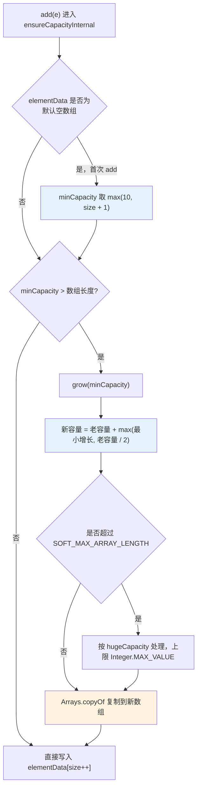
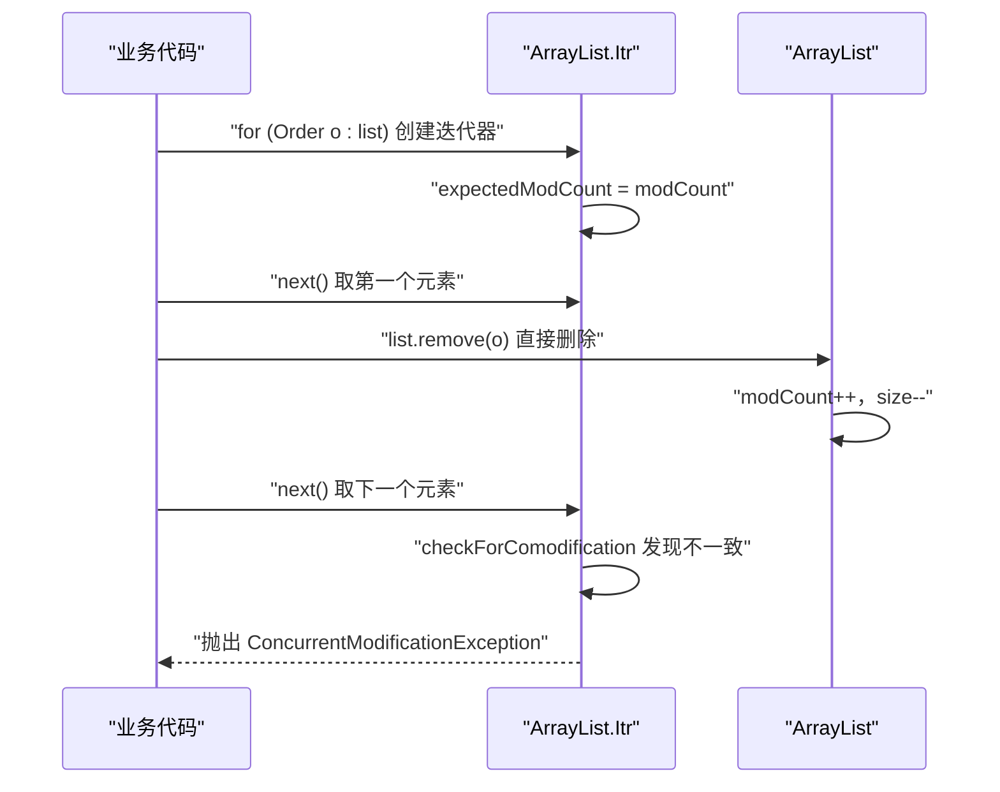
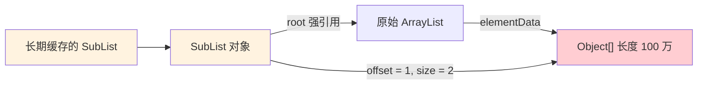
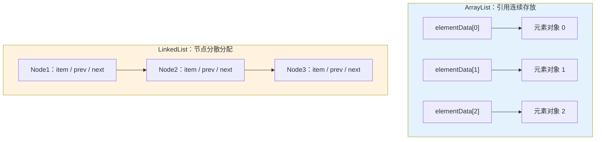
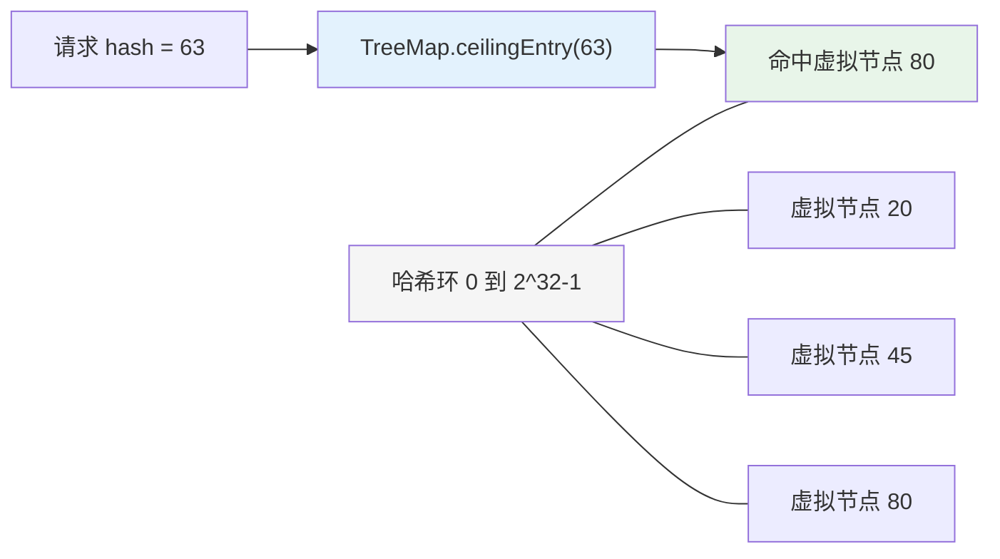

# 集合体系补全：ArrayList、LinkedList 与 TreeMap

> 定位：HashMap 只是集合框架的一张脸。线上真正翻车的是「ArrayList 扩容没估准」「subList 拿着不放把整张大表钉在内存里」「foreach 里删元素抛 CME」「LinkedList 当随机访问用把 CPU 打满」。这篇补齐 List 家族与 TreeMap 的机制、坑点和选型，读完能对着业务代码说出「这里该用哪个容器、为什么」。

## 一、为什么需要它

大部分人的集结知识止于「HashMap = 数组 + 链表 + 红黑树」，而生产事故集中在另外几类：

1. 返回 `list.subList(0, 10)` 被调用方缓存，百万级数组无法回收。
2. `Arrays.asList(...)` 之后 `add`，上线抛 `UnsupportedOperationException`。
3. `for (Order o : orders) { if (cond) orders.remove(o); }`，单线程也抛 `ConcurrentModificationException`。
4. `LinkedList` 用 `get(i)` 遍历几万条数据，接口耗时从毫秒涨到秒级。
5. 需要「按时间区间查」「按分数排行」，还在 HashMap 全量扫描。

这些不是 API 不熟，而是没搞清容器的**数据结构、视图语义和适用边界**。哈希表源码细节见 [集合框架源码](01-集合框架源码-HashMap与ConcurrentHashMap.md)，这篇只补 List 与有序 Map。

## 二、核心原理

### 2.1 ArrayList：连续数组与 1.5 倍扩容

底层是 `Object[] elementData` 加 `size`，`modCount` 继承自 `AbstractList`：

```java
public class ArrayList<E> extends AbstractList<E> {
    transient Object[] elementData;   // 实际存储
    private int size;                 // 有效元素个数
    private static final int DEFAULT_CAPACITY = 10;
}
```

两个易错点：`new ArrayList<>()` 不会立刻创建长度 10 的数组，而是共享空数组 `DEFAULTCAPACITY_EMPTY_ELEMENTDATA`，首次 `add` 才分配 10；扩容也不是精确 1.5 倍，而是「至少满足本次需求，再尽量按 1.5 倍」。



读图要点：扩容发生在「容量不够」的那次 add 上，动作本身包含一次**全量数组复制**，所以提前给容量是值得的。容量序列：10 → 15 → 22 → 33 → 49（第 11、16、23、34 个元素时触发）。

**为什么是 1.5 倍而不是 2 倍**：空间与时间的折中。2 倍在大容量时浪费更明显，1.5 倍在「扩容次数」与「空间浪费」间更均衡；也有观点认为 1.5 倍更容易复用之前释放的内存块。需要强调：**增长因子是实现细节，不是规范承诺**（JDK 8 写 `old + (old >> 1)`，JDK 17/21 用 `ArraysSupport.newLength`，逻辑等价）。

其他高频细节：`remove(int)` 要 `System.arraycopy` 搬移后续元素，O(n)，删尾部 O(1)；`set(int, e)` 不算结构性修改，**不改变 `modCount`**，只有 add/remove/clear 这类操作才会。

### 2.2 modCount 与 fail-fast

迭代器 `Itr` 创建时把 `modCount` 拷贝为 `expectedModCount`，`next()` 前调用 `checkForComodification()`，不相等就抛 CME：

```java
final void checkForComodification() {
    if (modCount != expectedModCount)
        throw new ConcurrentModificationException();
}
```

所以「foreach 里删元素」抛异常，跟多线程无关：



读图要点：CME 是「结构性修改检测」，不是线程安全机制。它只在 `next()` / `remove()` 等入口检查，多线程下完全可能漏检，**不能用它判断集合是否线程安全**。

正确删除姿势：

```java
// 1. 迭代器删除：内部会同步 expectedModCount
Iterator<Order> it = orders.iterator();
while (it.hasNext()) if (it.next().isExpired()) it.remove();

// 2. removeIf（JDK 8+）：批量压缩，只做一次结构性修改
orders.removeIf(Order::isExpired);

// 3. 倒序下标删除：不打乱未遍历部分
for (int i = orders.size() - 1; i >= 0; i--)
    if (orders.get(i).isExpired()) orders.remove(i);

// 4. 先收集再批量删：适合删除条件要查库/调远程的场景
List<Order> toRemove = orders.stream().filter(Order::isExpired).toList();
orders.removeAll(toRemove);
```

与之对应的是 fail-safe 容器，例如 `CopyOnWriteArrayList`：迭代器拿的是创建时的数组快照，不抛 CME，但可能读到旧数据。**不抛异常不等于数据实时一致**。

### 2.3 subList：视图，不是快照

`subList(from, to)` 返回 `SubList` 视图，内部持有 root、offset、size：

```java
private static class SubList<E> extends AbstractList<E> {
    private final AbstractList<E> root;  // 指向原列表
    private final SubList<E> parent;
    private final int offset;
    private int size;
}
```

四个后果：读写穿透到原列表；原列表结构性修改后，subList 再访问会因 `root.modCount` 不一致抛 CME；**SubList 强引用 root，进而钉住整个 `elementData`**；嵌套 subList 形成 parent 链。



读图要点：只要 SubList 活着，整个父数组就活着——哪怕你只想要其中两条数据。跨层返回切片必须显式拷贝：

```java
List<Order> slice = new ArrayList<>(orders.subList(0, 100)); // 或 stream().limit(100).toList()
```

反向的高效用法：`list.subList(from, to).clear()` 一次数组搬移删除整段，比循环 remove 快得多。

### 2.4 Arrays.asList 与 List.of：三种「List」三种行为

| 写法 | 实际类型 | 长度可变 | 元素可改 | 允许 null | 与原数组关系 |
|---|---|---|---|---|---|
| `Arrays.asList(arr)` | `Arrays$ArrayList` | 否，add/remove 抛 UOE | 是 | 是 | 共享，set 写回原数组 |
| `new ArrayList<>(Arrays.asList(arr))` | `ArrayList` | 是 | 是 | 是 | 拷贝 |
| `List.of(a, b)` | `ImmutableCollections` | 否 | 否 | 否，NPE | 独立不可变 |
| `Collections.unmodifiableList(list)` | 包装视图 | 否 | 否 | 跟随原列表 | 视图，原列表变它也变 |

两个高频细节：`Arrays.asList` 内部是 `private final E[] a`，没有扩容逻辑，所以 add 必抛 UOE，但 set 只是替换数组元素；`Arrays.asList(new int[]{1,2,3})` 得到的是 `List<int[]>`，`size()` 为 1，因为基本类型数组整体被当成一个对象。

`List.of` 是 JDK 9 引入的不可变工厂：结构不可变、拒绝 null、天然线程安全，能在边界处尽早暴露脏数据。

### 2.5 LinkedList：双向链表、缓存不友好与 Deque 用法

每个元素是独立 `Node`（item / prev / next）。复杂度与真实性能是两回事：`get(i)` 会判断从近端遍历，但仍是 O(n)；头尾插入 O(1) 但要 `new Node`；按值删除要先 `indexOf` 定位。

**缓存友好性才是它经常更慢的根因**：



读图要点：数组引用连续，CPU 预取和空间局部性都能发挥作用；链表每次 `next` 都是指针跳转，很可能一次 cache miss，且每个 Node 还要多付对象头和两个指针（64 位压缩指针下约 24 字节，外加元素对象）。「几万条数据用 LinkedList 遍历」实测常慢一个数量级，是架构层面的差距。

**LinkedList 作为 Deque 才是相对合理的用法**：`offerFirst` / `offerLast` / `pollFirst` / `pollLast`。但即便做双端队列，**ArrayDeque 通常更优**：循环数组、无 Node 分配、头尾均摊 O(1)，只是不允许 null。JDK 文档也建议优先用 ArrayDeque 实现栈和队列；LinkedList 的剩余价值是「同时需要 List 和 Deque 接口」的少数场景。

### 2.6 TreeMap：红黑树、比较器与 NavigableMap

TreeMap 底层是红黑树，节点带 `left` / `right` / `parent` / `color`。红黑树用五点性质保证树高 O(log n)：节点非红即黑、根黑、叶子黑、红节点的子节点必黑、任一节点到叶子路径上黑节点数相同；插入删除后靠变色与旋转修复。

它和 HashMap 的差异不是「有序无序」，而是**能力边界**：

| 能力 | HashMap | TreeMap |
|---|---|---|
| 单点查找 | O(1) 平均 | O(log n) |
| 有序遍历 / 范围查询 | 不支持 | 支持，原生区间与前后驱 |
| 最小 / 最大 key | 不支持 | `firstKey` / `lastKey` |
| null key | 允许一个 | 不允许，自然排序会 NPE |
| 线程安全 | 否 | 否 |

**比较规则是 TreeMap 的生命线**：不传 Comparator 时 key 必须实现 `Comparable`，否则运行时 `ClassCastException`；`compare(a, b) == 0` 会被视为**同一个 key**，后 put 覆盖前者；Comparator 应与 equals 语义一致，否则出现「不相等却被当成同一个 key」。

NavigableMap 核心方法：`floorKey` / `ceilingKey` / `lowerKey` / `higherKey`、`subMap(from, true, to, false)`、`headMap` / `tailMap`、`descendingMap()`、`firstEntry` / `lastEntry` / `pollFirstEntry`。两个典型场景：

```java
// 一致性哈希：key 是虚拟节点哈希，value 是物理节点
public Node route(long hash) {
    Map.Entry<Long, Node> e = ring.ceilingEntry(hash);
    if (e == null) e = ring.firstEntry();   // 环回绕
    return e.getValue();
}

// 排行榜：同分要共存，value 用集合
TreeMap<Integer, Set<Long>> rank = new TreeMap<>(Comparator.reverseOrder());
rank.computeIfAbsent(score, k -> new LinkedHashSet<>()).add(userId);
List<Long> top10 = rank.values().stream().flatMap(Set::stream).limit(10).toList();
```



读图要点：`ceilingEntry` 找顺时针第一个节点，找不到回绕 `firstEntry`，这就是 TreeMap 实现一致性哈希的全部核心；配额虚拟节点是为了避免数据倾斜。并发场景用 `ConcurrentSkipListMap`（跳表，同样有序、支持范围查询，写并发远好于锁整棵树）。

## 三、关键机制与源码要点

### 3.1 ArrayList.grow 的真实写法

```java
private Object[] grow(int minCapacity) {
    int oldCapacity = elementData.length;
    if (oldCapacity > 0 || elementData != DEFAULTCAPACITY_EMPTY_ELEMENTDATA) {
        int newCapacity = ArraysSupport.newLength(
                oldCapacity,
                minCapacity - oldCapacity,   // 最小增长
                oldCapacity >> 1             // 期望增长：一半
        );
        return elementData = Arrays.copyOf(elementData, newCapacity);
    }
    return elementData = new Object[Math.max(DEFAULT_CAPACITY, minCapacity)];
}
```

`newLength` 取最小增长与期望增长的较大值；超过 `Integer.MAX_VALUE - 8` 走 `hugeLength`，最终上限 `Integer.MAX_VALUE`。工程上不该把容量推到那个量级，遇到应分片或换存储。容量 API：`new ArrayList<>(n)` 预设初始容量、`ensureCapacity(n)` 批量前预留、`trimToSize()` 大量删除后收缩。

### 3.2 fail-fast 的边界

`modCount` 检测是**尽力而为**：单线程下结构性修改后继续用旧迭代器基本必抛；多线程下可能漏检，因为 `modCount` 读写本身不是原子的；`set` 不改 modCount，遍历时替换元素不会抛；`ArrayList.removeIf` / `replaceAll` 内部自行维护 modCount，所以能安全使用。

### 3.3 TreeMap 的写入路径

```java
while (t != null) {
    int cmp = compare(key, t.key);   // 有 Comparator 用 Comparator，否则 key.compareTo
    if (cmp < 0)      t = t.left;
    else if (cmp > 0) t = t.right;
    else              return t.setValue(value);  // 相等即覆盖
}
// 插入后 fixAfterInsertion：变色 + 旋转
```

写入成本 = 比较次数（取决于比较器成本）+ 旋转修复。若 Comparator 里做正则、IO 或远程调用，TreeMap 性能会立刻崩掉。

## 四、生产坑点与排查

### 坑点 1：subList 被长期持有，大列表无法回收

**现象**：接口返回 `list.subList(0, 10)`，调用方缓存后堆持续上涨，MAT 里看到 `ArrayList$SubList` 引用着大 `Object[]`。
**原因**：SubList 持有 root 强引用，整个 `elementData` 无法回收。
**解法**：对外返回切片一律拷贝 `new ArrayList<>(list.subList(...))`；DTO 转换直接用 Stream 生成新列表。

### 坑点 2：Arrays.asList 之后 add，抛 UnsupportedOperationException

**现象**：`Arrays.asList("a", "b").add("c")` 上线报错。
**原因**：返回固定长度的 `Arrays$ArrayList`，没有扩容逻辑。
**解法**：需要可变用 `new ArrayList<>(Arrays.asList(...))`；只读用 `List.of(...)` 明确不可变语义。

### 坑点 3：foreach 中 remove，单线程也抛 CME

**现象**：`for (X x : list) { if (cond) list.remove(x); }` 抛 `ConcurrentModificationException`，日志里只有单线程。
**原因**：增强 for 编译成迭代器，集合自身 remove 使 `modCount` 变化，`expectedModCount` 不匹配。
**解法**：用 `iterator.remove()`、`removeIf`、倒序下标删除或先收集再 `removeAll`；排查看堆栈是否有 `ArrayList$Itr.checkForComodification`。

### 坑点 4：LinkedList 当随机访问列表用，CPU 飙升

**现象**：几万条数据用 `for (int i = 0; i < list.size(); i++) list.get(i)` 遍历，耗时从毫秒涨到秒级。
**原因**：每次 `get(i)` 都从头或尾遍历，整体退化为 O(n²)，同时节点分散导致 cache miss。
**解法**：随机访问用 ArrayList；确需链表用增强 for 或迭代器顺序遍历；队列/栈换 ArrayDeque。

### 坑点 5：TreeMap 比较器不一致，元素「消失」

**现象**：put 了 100 个对象，`size()` 只有 80。
**原因**：Comparator 对某些不同对象返回 0（只比金额没比订单号），TreeMap 视为同一个 key 并覆盖。
**解法**：比较器要能区分所有业务上不同的 key，通常用「主字段 + 唯一 ID」兜底；对比 `size()` 与源数据量排查。

### 坑点 6：remove(int) 与 remove(Object) 重载误用

**现象**：`List<Integer> list = new ArrayList<>(List.of(10, 20, 30)); list.remove(1);` 期望删元素 1，实际删了下标 1 的元素 20。
**原因**：`remove(int index)` 与 `remove(Object o)` 是两个重载，传 `int` 优先匹配下标版本。
**解法**：删对象用 `list.remove(Integer.valueOf(1))`，或先 `indexOf` 再按语义删除；代码评审对 `List<Integer>.remove` 保持敏感。

## 五、选型与最佳实践

### 5.1 按场景选容器

| 场景 | 首选 | 说明 |
|---|---|---|
| 随机读多、尾部追加 | `ArrayList` | 默认选择，绝大多数 List 场景 |
| 频繁头尾进出（队列/栈） | `ArrayDeque` | 不用 `LinkedList`，更不用遗留的 `Stack` |
| 遍历中需要删除 | `ArrayList` + `removeIf` / `Iterator` | 不要边 foreach 边 remove |
| 需要长期保存切片 | `new ArrayList<>(subList)` | 不要直接缓存 subList |
| 只读常量列表 | `List.of(...)` | 拒绝 null，天然线程安全 |
| 排序 / 范围查询 / 前后驱 | `TreeMap` | 并发场景换 `ConcurrentSkipListMap` |
| 需要插入顺序 | `LinkedHashSet` / `LinkedHashMap` | 底层多一条双向链表 |
| 读多写极少、允许弱一致 | `CopyOnWriteArrayList` | 写操作全量复制，写多会灾难 |
| 键值缓存 | `HashMap` / `ConcurrentHashMap` | 见 [集合框架源码](01-集合框架源码-HashMap与ConcurrentHashMap.md) |

### 5.2 参数与做法清单

1. **能预估就传初始容量**：`new ArrayList<>(expectedSize)`；ArrayList 没有负载因子，不需要像 HashMap 那样除以 0.75。
2. **批量写入前 `ensureCapacity`**：一次扩容胜过多次复制。
3. **大量删除后 `trimToSize`**：避免只剩 10 个元素却占着 100 万容量。
4. **Comparator 要便宜且稳定**：不要在比较器里做 IO、正则、远程调用。
5. **优先按接口声明**（`List` / `Map` / `Deque`），方便替换实现。

### 5.3 明确不推荐的场景

- **把 `LinkedList` 当默认 List**：随机访问、遍历、内存占用三项都吃亏，只有「持有迭代器做大量中间删除」有理论优势。
- **用 `Vector` / `Stack`**：方法级 synchronized，锁粒度粗，已被 `ArrayList` + `ArrayDeque` 取代。
- **用 `subList` 做跨层数据传递**：视图会随原列表修改而失效，跨层必须拷贝。
- **用 `Collections.unmodifiableList` 当防御性拷贝**：它只是视图，原列表仍然可变。
- **长期持有 `Arrays.asList` 的结果并依赖其内容稳定**：外部改数组，列表跟着变。

## 六、面试高频问法

**Q1：ArrayList 的扩容机制是怎样的？为什么是 1.5 倍？**

**一句话结论**：默认空数组，首次 add 扩到 10；之后按「老容量 + max(最小需求, 老容量的一半)」增长，约 1.5 倍，并通过 `Arrays.copyOf` 全量复制。

展开：`new ArrayList<>()` 不分配数组，首次 add 才分配 10；`grow` 取最小增长与期望增长（`oldCapacity >> 1`）的较大值；1.5 倍是空间与时间的折中，2 倍在大容量时浪费更明显；增长因子是实现细节，不是规范。

加分点：主动补「知道要放多少就 `new ArrayList<>(n)`；ArrayList 没有负载因子，不需要像 HashMap 那样除以 0.75」。

**Q2：fail-fast 的原理是什么？一定会抛 ConcurrentModificationException 吗？**

**一句话结论**：迭代器创建时记录 `expectedModCount`，每次 `next()` / `remove()` 前与集合的 `modCount` 比较，不等就抛 CME；它只是尽力检测，多线程下可能漏检，不能当线程安全保证。

展开：`modCount` 定义在 `AbstractList`，add/remove/clear 自增，`set` 不自增；增强 for 本质是迭代器，所以单线程「边遍历边 remove」也会抛；`CopyOnWriteArrayList` 是 fail-safe，迭代快照不抛 CME，但可能读到旧数据。

加分点：点出「CME 不是并发包里的异常，只表示检测到结构性修改；真正的线程安全要么用并发容器，要么外部加锁」。

**Q3：subList 有什么坑？为什么会导致 OOM？**

**一句话结论**：`subList` 返回持有 root 强引用的**视图**，不是拷贝；长期持有会让整个父列表的 `elementData` 无法回收，只取几条数据也可能钉住百万级数组。

展开：读写穿透，改 subList 会改原列表；原列表结构性修改后 subList 再访问会因 `root.modCount` 不一致抛 CME；解决是 `new ArrayList<>(list.subList(from, to))`；高效用法是 `subList(from, to).clear()` 一次搬移删除整段。

加分点：说清「视图 vs 快照」，并对比 `Collections.unmodifiableList` 也是视图——两者都容易和防御性拷贝混淆。

**Q4：Arrays.asList、List.of、new ArrayList 有什么区别？**

**一句话结论**：`Arrays.asList` 是共享底层数组的固定长度视图（可 set、不可 add/remove、允许 null）；`List.of` 完全不可变且拒绝 null；`new ArrayList<>(...)` 才是独立可变的拷贝。

展开：`Arrays.asList` 内部是 `final E[] a`，没有扩容逻辑；`List.of` 的 set 也抛 UOE，传 null 抛 NPE；`Collections.unmodifiableList` 只是包装视图，原列表变了它也跟着变。

加分点：补一个坑「`Arrays.asList(new int[]{1,2,3})` 得到 `List<int[]>`，size 为 1」，这是基本类型数组与可变参数共同作用的陷阱。

**Q5：LinkedList 插入删除是 O(1)，为什么实际常常比 ArrayList 慢？**

**一句话结论**：O(1) 只在**已定位到节点**时成立；LinkedList 每次操作都要分配 Node、遍历定位，节点分散导致 cache miss，综合性能通常不如连续数组。

展开：`get(i)` 是 O(n)，按值删除还要先 `indexOf`；每个 Node 有对象头加两个指针，压缩指针下约 24 字节；数组连续内存对 CPU 预取友好；队列栈优先 `ArrayDeque`。

加分点：指出「ArrayList 头插是 O(n)，但 `System.arraycopy` 是高度优化的内存搬移，中低数据量下经常比链表更快」。

**Q6：TreeMap 的底层是什么？什么时候该用它而不是 HashMap？**

**一句话结论**：TreeMap 是红黑树，查找/插入/删除 O(log n)，但支持有序遍历和范围查询；需要排序、区间、前后驱、排行榜时用它，纯键值查找用 HashMap。

展开：key 必须实现 Comparable 或传入 Comparator，`compare == 0` 视为同一个 key；HashMap 平均 O(1) 但无序、不支持范围查询；并发有序用 `ConcurrentSkipListMap`。

加分点：提到「TreeMap 不允许 null key（自然排序会 NPE），但允许 null value；HashMap 允许一个 null key」。

**Q7：怎么用 TreeMap 实现一致性哈希或排行榜？**

**一句话结论**：一致性哈希用 `TreeMap<Long, Node>` 存虚拟节点哈希，`ceilingEntry(hash)` 取顺时针第一个节点、找不到回绕 `firstEntry`；排行榜用 `TreeMap<分数, Set<用户>>` 配合 `descendingMap` 取 Top N。

展开：一致性哈希要配虚拟节点避免倾斜，节点增减只影响相邻区间；排行榜要处理同分，value 用集合而不是单值；并发写多换 `ConcurrentSkipListMap`。

加分点：说清「ceiling/floor 语义正好对应哈希环上的顺时针查找」，并能补充「虚拟节点数量决定均衡度」。

**Q8：HashSet 和 HashMap 是什么关系？LinkedHashSet 怎么保证顺序？**

**一句话结论**：HashSet 内部就是一个 HashMap，元素当 key、value 统一放静态占位对象 `PRESENT`；LinkedHashSet 继承 HashSet，但构造时让内部 map 变成 `LinkedHashMap`，靠额外双向链表维护插入顺序。

展开：`HashSet.add(e)` 等价于 `map.put(e, PRESENT) == null`；去重规则就是 key 的 `hashCode` + `equals`；LinkedHashSet 维护插入顺序，需要 LRU 用 `LinkedHashMap(accessOrder=true)`。

加分点：补一句「HashSet 允许一个 null 元素，但 List.of 不允许 null，混用时要注意」。

**Q9：List 家族怎么选型？**

**一句话结论**：默认 ArrayList；队列/栈用 ArrayDeque；只读常量用 List.of；需要有序键值或范围查询用 TreeMap；读多写极少的共享列表才考虑 CopyOnWriteArrayList。

展开：先问「需不需要随机访问、需不需要有序、写多还是读多、是否跨线程」；LinkedList 只在「持有迭代器做大量中间删除」等少数场景有优势；Vector/Stack 属于遗留类，新代码不应使用。

加分点：补一句「选型先看访问模式，不要看名字；LinkedList 名字里带 List，但它更适合当 Deque」。

## 小结

- **ArrayList 扩容是「至少满足本次需求，再按 1.5 倍增长」**，首次 add 才分配 10，能预估就提前给容量。
- **fail-fast 是 modCount 快照校验，只做尽力检测**，不是线程安全机制；遍历删除用 `Iterator.remove` 或 `removeIf`。
- **subList 是视图不是快照**，长期持有会钉住整个父数组，跨层传递必须拷贝。
- **`Arrays.asList` 固定长度且共享数组，`List.of` 完全不可变且拒绝 null**，需要可变就 `new ArrayList<>`。
- **LinkedList 的 O(1) 有前提**，缓存不友好使它常常慢于 ArrayList；队列栈优先 ArrayDeque。
- **TreeMap 用 O(log n) 换来有序与范围查询**，比较器必须能区分所有业务 key，并发有序换 ConcurrentSkipListMap。

## 参考资料

- OpenJDK 源码（JDK 21）：`java.util.ArrayList`、`java.util.AbstractList`、`java.util.Arrays`、`java.util.ImmutableCollections`
- OpenJDK 源码（JDK 21）：`java.util.TreeMap`、`java.util.NavigableMap`、`java.util.ArrayDeque`
- Java Platform SE 21 API 文档：`java.util.List`、`java.util.Deque`、`java.util.NavigableMap` 章节
- 《算法导论》第 13 章「红黑树」
- 《Effective Java》（第 3 版）第 54 条「返回空集合或空数组，而不是 null」
- Oracle Java Tutorials：The Collections Framework 章节
