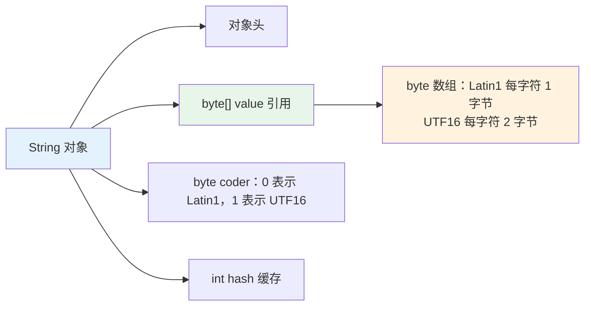
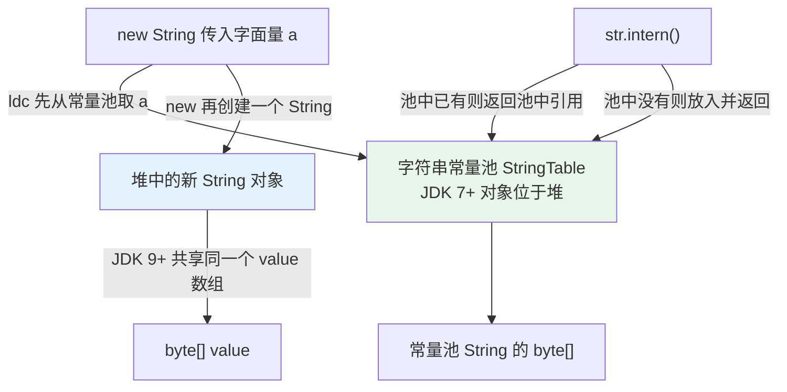
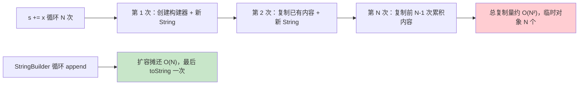
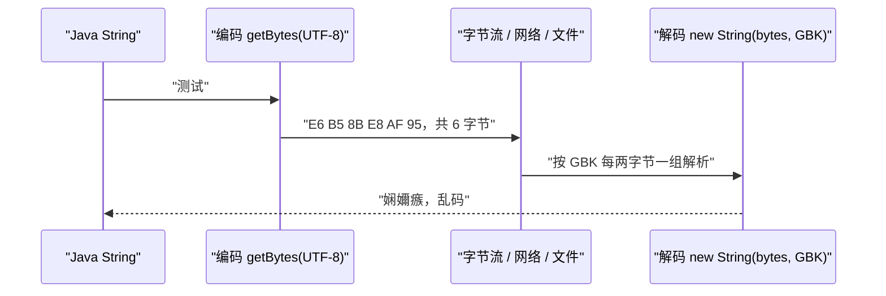

# String 与字符串池：不可变、Compact Strings 与内存陷阱

> 定位：String 是写得最多、也最容易被低估的类型。循环里 `s += x` 把接口拖慢十倍、日志里打一整段报文把堆打满、密码用 String 存着无法擦除、跨平台 `getBytes()` 出来一堆乱码、`intern()` 用成「缓存」把常量池撑爆——这些都不是语法问题，而是对不可变性、常量池和编码的误解。这篇把 String 的内存模型与工程坑一次讲清。

## 一、为什么需要它

String 的特殊性在于：它是**唯一被语言级别特殊对待的引用类型**——有字面量、有常量池、有编译期常量折叠，还实现了 `CharSequence` 和 `Constable`。这些设计带来便利，也带来了一批只在生产环境暴露的问题：

1. **性能**：循环里拼接字符串，时间复杂度 O(n²)，CPU 和 GC 一起报警。
2. **内存**：一次请求把 2MB 报文拼成 String 再打日志，几十个并发就能把堆打满。
3. **安全**：密码、密钥、身份证号放在 String 里，字符串池和日志都可能留下副本，且无法主动擦除。
4. **正确性**：`getBytes()` 不指定编码，开发机（UTF-8）正常、服务器（GBK）乱码。
5. **认知**：`new String("a")` 到底创建几个对象、`intern()` 到底把字符串放哪，面试常问，线上误用更多。

## 二、核心原理

### 2.1 不可变性与它的代价

JDK 9 之后，String 的核心字段是 `byte[] value` 加一个 `byte coder`：

```java
public final class String implements java.io.Serializable, Comparable<String>, CharSequence {
    private final byte[] value;   // JDK 9+ 用 byte[]，JDK 8 是 char[]
    private final byte coder;     // 0 = LATIN1，1 = UTF16
    private int hash;             // 懒计算并缓存
    private boolean hashIsZero;
}
```

`final class` + `private final` 字段，且不提供任何修改方法，保证了**对象创建后内容不可变**。



读图要点：String 对象本身很轻（对象头 + 一个数组引用 + coder + hash），真正占内存的是它引用的 `byte[]`；这也是「String 的内存占用要按字符数估算」的原因。

不可变带来四个实打实的好处：

| 好处 | 说明 |
|---|---|
| 线程安全 | 状态不可变，天然可安全共享，无需同步 |
| 可缓存 hash | `hash` 只需算一次，适合做 HashMap 的 key |
| 支持常量池 | 相同字面量可以共享同一个实例 |
| 安全性 | 类名、URL、SQL、文件路径不会被中途篡改 |

代价同样明确：

- **每次修改都产生新对象**：`concat`、`replace`、`substring` 都返回新 String，原对象不变。
- **敏感信息无法擦除**：密码转成 String 后就只能等 GC，在此之前可能已进入常量池、日志、堆转储。
- **大字符串无法原地修改**：想改一个字符也要整体复制。

### 2.2 JDK 9 Compact Strings：为什么要 byte[] + coder

JDK 8 及以前，String 内部是 `char[]`，每个字符固定 2 字节。但绝大多数业务字符串是 ASCII（英文、数字、JSON 的标点），用 2 字节存 1 字节的信息，**内存浪费近一半**。

JEP 254（Compact Strings，JDK 9 落地）改成：

- 内部用 `byte[] value` 存储。
- 用 `coder` 标记编码：`LATIN1`（0）表示每个字节就是一个字符，`UTF16`（1）表示按 UTF-16 双字节存放。
- 如果字符串所有字符都能用 Latin1 表示（码点 ≤ 0xFF），就用 1 字节/字符；否则整体退化为 2 字节/字符。

```java
// 概念性示意，真实实现在 StringLatin1 / StringUTF16 中
String s = "hello";        // coder = LATIN1，value.length = 5
String cn = "中文";         // coder = UTF16，value.length = 4（2 个 char × 2 字节）
```

工程含义有三点：

1. **纯英文场景内存显著下降**，JDK 官方在 JEP 中给出的预期是堆占用下降，具体幅度取决于字符串内容分布。
2. **`length()` 与 `value.length` 不再相等**：`length()` 返回字符数（UTF-16 code unit 数），Latin1 下 `value.length` 恰好等于它，UTF16 下 `value.length` 是字节数。
3. **`StringBuilder` 同步改造**：内部也是 `byte[]` + coder，append 时如果混入非 Latin1 字符，会整体升级为 UTF16。

注意：Compact Strings 优化的是**内存布局**，不是「用 UTF-8 存储」。String 的字符语义仍然是 UTF-16 code unit，`charAt` 返回的也是 code unit，不是 Unicode 码点。

### 2.3 字符串常量池、运行时常量池与 intern

先区分两个概念：

- **运行时常量池（Runtime Constant Pool）**：每个 class 文件一份，随类加载进入方法区（JDK 8+ 在 Metaspace），存放字面量和符号引用。
- **字符串常量池（String Pool / StringTable）**：JVM 全局唯一，存放被 intern 的 String 实例，本质是一个哈希表。

两者的关系是：class 文件里的 `CONSTANT_String` 只是常量池中的一项，真正执行 `ldc` 时，JVM 会去 StringTable 里查找/创建对应的 String 对象并返回引用。

**JDK 7 是一个关键分水岭**：字符串常量池从永久代（PermGen）搬到了 Java 堆。这带来两个直接影响：

- JDK 6 时代，大量 `intern()` 会撑爆 PermGen，报 `OutOfMemoryError: PermGen space`。
- JDK 7+ 常量池对象在堆里，`intern()` 过多表现为**堆增长**，而不是 Metaspace 增长。如果线上看到 Metaspace 持续上涨，优先怀疑动态生成类（CGLIB、动态代理、脚本引擎、热部署），而不是 `intern()`——这是一个常见的误判。



读图要点：`new String(...)` 一定会在堆里创建一个新对象，但它可以和常量池中的 String **共享底层 `byte[]`**（JDK 8 共享 `char[]`），所以「创建几个对象」要分「String 对象」和「底层数组」两层来看。

`intern()` 的语义是：如果池中已有 equals 相等的字符串，返回池中那个引用；否则把当前字符串放入池中并返回。它常用于**减少重复大字符串的内存**，但有两个风险：

- 池没有容量控制，大量**不同**的字符串 intern 会让池持续膨胀；字符串不可达时虽可能被回收，但不能指望它自动瘦身。
- `intern()` 是一次哈希查找，在高频路径上不是免费的；`-XX:StringTableSize` 只能调整桶数量，不能控制条目数。

`StringTableSize` 默认值约 6 万（不同版本可能调整，以 `-XX:+PrintFlagsFinal` 为准），桶太少会让 intern 退化为长链表。

### 2.4 拼接的三种命运

同一句 `a + b`，在不同上下文里编译结果完全不同：

| 场景 | 编译/运行结果 | 说明 |
|---|---|---|
| 两侧都是编译期常量 | 直接折叠成一个常量 | `"a" + "b"` 在 class 文件里就是 `"ab"` |
| 含 `final` 修饰的编译期常量 | 同样折叠 | `final String A = "a"; A + "b"` |
| 含运行时变量 | JDK 8 生成 `StringBuilder`；JDK 9+ 生成 `invokedynamic` | 每次执行都创建新 String |

```java
String a = "a" + "b";                       // 编译期折叠为 "ab"
final String P = "pre";
String b = P + "fix";                       // 仍是常量折叠
String c = getPrefix() + "fix";             // 运行时拼接，JDK 9+ 走 StringConcatFactory
```

**循环拼接为什么慢**：`s += x` 等价于 `s = s + x`，每次迭代都要把「之前累积的全部内容」复制进新对象，总复制量约为 1+2+...+n，即 O(n²)，同时产生 n 个临时 String 和 n 个构建器对象。



读图要点：慢的不是「加法」这个动作，而是**每次都要复制历史内容**；StringBuilder 把「多次小复制」变成「一次扩容 + 一次成串」，所以是 O(N)。

补充：JDK 9+ 的 `invokedynamic` 拼接是 JIT 友好的优化，让编译器不必为每个 `+` 生成显式的 StringBuilder 链，但**它不会把循环内的 O(n²) 变成 O(n)**——循环里的每次迭代仍然是一次独立的拼接。

### 2.5 编码、UTF-8/UTF-16/GBK 与乱码排查

Java 的字符模型是 UTF-16：

- `char` 是 16 位，表示一个 UTF-16 code unit。
- 基本多文种平面（BMP）内的字符一个 char 搞定；emoji、部分生僻字是**代理对**，占两个 char。
- `String.length()` 返回 code unit 数，不是「用户感知的字符数」。

编码是「字符到字节」的映射：

| 编码 | 特点 | 典型用途 |
|---|---|---|
| UTF-8 | 变长 1-4 字节，ASCII 兼容，中文通常 3 字节 | 网络传输、文件、数据库（utf8mb4） |
| UTF-16 | 定长 2 或 4 字节，Java 内部语义 | JVM 内部、部分 Windows API |
| GBK | 变长 1-2 字节，中文 2 字节 | 国内老系统、Windows 默认代码页 |

**乱码的本质只有一个：编码和解码用了不同的字符集**。



读图要点：UTF-8 的 6 个字节被按 GBK 的 2 字节切分，映射到了完全不同的汉字；字节没坏，坏的是「解码规则」。

排查乱码的标准步骤：

1. **确认字节源头**：`getBytes()` 不传参数就用平台默认编码。JDK 18 起（JEP 400）默认 UTF-8；JDK 17 及以前在中文 Windows 上通常是 GBK，在 Linux 上取决于 locale。
2. **确认链路每一跳**：HTTP 的 `Content-Type: charset`、HTML 的 `<meta charset>`、数据库连接串的 `characterEncoding`、MySQL 的 `utf8`（3 字节）与 `utf8mb4`（4 字节）、文件读取的 `InputStreamReader`。
3. **不要用 `new String(bytes)` 猜**：显式指定 `StandardCharsets.UTF_8`，让错误在第一次出现时就暴露。
4. **谨慎用 ISO-8859-1 修复**：`new String(s.getBytes("ISO-8859-1"), "UTF-8")` 只在「错误解码是无损的」时有效；如果已经解码成替换字符 `�`，原始字节就丢了，无法恢复。

### 2.6 大字符串的内存占用与截断

String 的内存可以粗略拆成三块：

| 部分 | 近似大小（64 位、压缩指针） | 说明 |
|---|---|---|
| String 对象头 | 12 字节 | Mark Word + 类型指针 |
| 字段 | 约 10 字节 | value 引用 4 + coder 1 + hash 4 + hashIsZero 1 |
| 对齐填充 | 到 8 字节边界 | 整个 String 通常 24 字节左右 |
| `byte[]` 对象头 + 长度 | 16 字节 | 数组对象固定开销 |
| 字符数据 | Latin1 1 字节/字符，UTF16 2 字节/字符 | 真正的大头 |

所以 10 万个 ASCII 字符的 String，字符数据约 100KB，连同对象和数组头约 100KB 出头；同样的中文内容（UTF16 存储）约 200KB。**注意这不等于 UTF-8 编码后的字节数**——UTF-8 只在 `getBytes` 时出现。

大字符串的三条工程建议：

1. **不要整段入日志**：截断到固定长度（如 1KB），并标注原始长度。
2. **按 code point 截断，不要按 char 截断**：直接从中间切可能把代理对劈开，产生半个 emoji 或半个汉字。
3. **能流式处理就不要整串**：大文件、大报文用 `Reader`/`InputStream`、`JsonParser` 流式 API，避免一次性 `readLine`/`readAllBytes` 成 String。

```java
// 按码点安全截断，避免劈开代理对
public static String truncateByCodePoint(String s, int maxCodePoints) {
    if (s == null) return null;
    int count = s.codePointCount(0, s.length());
    if (count <= maxCodePoints) return s;
    int end = s.offsetByCodePoints(0, maxCodePoints);
    return s.substring(0, end);
}
```

## 三、关键机制与源码要点

### 3.1 构造与共享数组

```java
// JDK 9+ 的拷贝构造函数：注意它共享底层数组，不复制内容
public String(String original) {
    this.value = original.value;
    this.coder = original.coder;
    this.hash = original.hash;
    this.hashIsZero = original.hashIsZero;
}
```

这解释了一个常被问错的结论：`new String("a")` 创建的是**一个新的 String 对象**，但底层 `byte[]` 与常量池中的 `"a"` 共享。若 `"a"` 此前从未出现过，`ldc` 会先创建并 intern 一个，最终是「2 个 String 对象 + 1 个共享数组」；若常量池已有 `"a"`，则只有「1 个新 String 对象」。具体计数依赖 HotSpot 实现，面试时说明前提比背数字更重要。

### 3.2 intern 的典型写法与边界

```java
// 适合：大量重复的城市名、状态码等枚举型字符串
String city = new String(bytes, StandardCharsets.UTF_8).intern();

// 不适合：用户 ID、订单号、随机 token 等几乎不重复的字符串
// 每个不同值都会向池中新增条目，池只增不减，最终表现为堆增长
```

判断标准很简单：**重复率高、取值范围有限**才考虑 intern；把 intern 当本地缓存用，是对它最大的误解。

### 3.3 StringBuilder 的扩容

`StringBuilder` 继承 `AbstractStringBuilder`，默认容量 16，扩容逻辑：

```java
private int newCapacity(int minCapacity) {
    int oldCapacity = value.length >> coder;
    int newCapacity = (oldCapacity << 1) + 2;   // 约 2 倍 + 2
    if (newCapacity - minCapacity < 0) newCapacity = minCapacity;
    if (newCapacity - MAX_ARRAY_SIZE > 0) newCapacity = hugeCapacity(minCapacity);
    return newCapacity;
}
```

工程做法：`new StringBuilder(expectedLength)` 预估长度，避免反复扩容复制。`StringBuffer` 的 API 与 StringBuilder 基本一致，但方法加了 `synchronized`，单线程下没有任何收益。

### 3.4 相关参数与配置

| 参数/配置 | 作用 | 建议 |
|---|---|---|
| `-Dfile.encoding=UTF-8` | 指定 JVM 默认字符集 | JDK 18+ 默认已是 UTF-8（JEP 400），老版本显式指定 |
| `-XX:StringTableSize=N` | 调整字符串池桶数量 | 大量 intern 且冲突严重时可调大，用 `-XX:+PrintFlagsFinal` 看默认值 |
| 数据库 `utf8mb4` | MySQL 真正的 4 字节 UTF-8 | 不要用 `utf8`（最多 3 字节，存不了 emoji） |
| 连接串 `characterEncoding` | JDBC 编解码字符集 | 与库表编码保持一致 |

## 四、生产坑点与排查

### 坑点 1：循环里 `s += x`，接口耗时随数据量平方增长

**现象**：导出 5000 条数据时接口 200ms，5 万条时涨到十几秒，GC 日志频繁 Young GC。
**原因**：每次 `+=` 都新建 String 并复制历史内容，总复制量 O(n²)，临时对象暴增。
**解法**：循环外建一个 `StringBuilder`，循环内 `append`，结束后 `toString()`；批量 SQL 用 `StringJoiner` 或框架提供的拼接工具。

### 坑点 2：`getBytes()` 不指定编码，跨环境乱码

**现象**：本地 Windows 开发正常，Linux 容器部署后中文变问号或乱码。
**原因**：`getBytes()` 使用平台默认字符集；JDK 17 及以前不同系统默认值不同。
**解法**：所有编解码显式传 `StandardCharsets.UTF_8`；HTTP、数据库、文件读写逐跳确认 charset；升级到 JDK 18+ 可默认 UTF-8，但仍建议显式声明。

### 坑点 3：密码用 String 保存，无法擦除且可能落盘

**现象**：安全扫描报告「敏感信息以字符串形式驻留内存」，堆转储里能搜到明文密码。
**原因**：String 不可变，无法主动清零；可能进入常量池、日志、异常信息、堆转储。
**解法**：密码/密钥用 `char[]` 或 `byte[]`，用完立即 `Arrays.fill(arr, '\0')`；日志脱敏；避免把凭据拼进异常消息。

### 坑点 4：大报文整串打日志，堆和磁盘一起爆

**现象**：某个接口偶发 OOM，或日志文件一天几十 GB。
**原因**：把几 MB 的请求/响应体完整 `toString()` 后 `log.info`，字符串常驻年轻代，异步日志队列再复制一份。
**解法**：日志只打长度、摘要、关键字段；必须打全文时截断到 1KB；大报文用流式解析，不构造整体 String。

### 坑点 5：`intern()` 当缓存用，字符串池持续膨胀

**现象**：服务运行几天后老年代持续上涨，堆转储里大量 String 被 StringTable 引用。
**原因**：对用户 ID、订单号等几乎不重复的字符串调用 `intern()`，每个新值都进入池；池没有容量控制，字符串不可达前不会回收。
**解法**：只对高重复、有限枚举的字符串 intern；真正的缓存用 Caffeine/Redis 并设置容量与过期；排查时看堆中 String 的重复率与来源。

### 坑点 6：按 char 截断，切出半个 emoji 或半个汉字

**现象**：日志或消息截断后出现 `�`，或前端显示乱码方块。
**原因**：`substring(0, n)` 按 UTF-16 code unit 切，可能把代理对劈开；按字节截断还可能切在多字节 UTF-8 序列中间。
**解法**：按 `codePointCount` / `offsetByCodePoints` 截断；按字节截断时用 `CharsetEncoder` 或回退到完整字符边界。

## 五、选型与最佳实践

### 5.1 String / StringBuilder / StringBuffer 怎么选

| 场景 | 选择 | 理由 |
|---|---|---|
| 不可变的值、Map key、常量 | `String` | 可共享、hash 可缓存、线程安全 |
| 单线程循环拼接 | `StringBuilder` | 无锁、扩容可控 |
| 多线程共享同一个缓冲区 | `StringBuffer` | 方法级 synchronized，实际很少需要 |
| 拼接少量固定片段 | `String.join` / `StringJoiner` | 语义清晰，自动处理分隔符 |
| 多行常量 | 文本块 `"""`（JDK 15+） | 可读性好，编译期仍是常量 |
| 格式化输出 | `String.format` / `formatted` | 注意热路径性能，必要时预编译 `Formatter` |

### 5.2 明确不推荐的场景

- **在循环里用 `+` 拼接**：哪怕 JDK 9+ 有 indy 优化，循环内仍是 O(n²)。
- **单线程用 StringBuffer**：多了一层锁，没有任何收益。
- **用 `intern()` 做业务缓存**：没有容量控制和淘汰，容易把堆撑大。
- **用 String 保存密码/密钥**：无法擦除，容易进日志和堆转储。
- **依赖平台默认编码做 IO**：跨环境必炸，显式指定 `StandardCharsets.UTF_8`。
- **在热路径用 `String.format` 拼日志**：格式化开销大，日志框架的参数化写法更合适。

### 5.3 参数清单

1. 编解码一律显式 `StandardCharsets.UTF_8`。
2. StringBuilder 预估容量 `new StringBuilder(expectedLength)`。
3. 日志截断到固定长度，并记录原始长度。
4. 大文件/大报文用流式 API，不构造整体 String。
5. 敏感数据用 `char[]` / `byte[]`，用后清零。
6. intern 只用于高重复枚举值，并监控堆中 String 分布。

## 六、面试高频问法

**Q1：String 为什么设计成不可变？**

**一句话结论**：不可变换来线程安全、hash 可缓存、常量池可共享和安全性；代价是每次修改都产生新对象、敏感信息无法擦除。

展开：`final class` + `private final byte[]` 且不暴露修改方法；`hash` 懒计算后缓存，适合做 HashMap key；相同字面量可共享池中实例；类名、URL、SQL 不会被中途篡改。代价是 concat/replace/substring 都返回新对象。

加分点：补一句「不可变不等于底层数组不可变——`value` 引用是 final，但数组内容理论上可反射修改，所以 JDK 用模块系统限制反射访问 `java.base`」。

**Q2：`new String("a")` 创建几个对象？`"a" + "b"` 呢？**

**一句话结论**：常量池已有 `"a"` 时，`new String("a")` 创建 1 个堆中 String 对象，且与池中实例共享底层 `byte[]`；池中没有时，`ldc` 先创建并 intern 一个，再加 new 的一个，共 2 个 String 对象。`"a" + "b"` 在编译期折叠成常量 `"ab"`。

展开：`new String(String)` 构造函数直接赋值 `this.value = original.value`，不复制数组；`"a"+"b"` 两侧都是编译期常量，javac 直接写入常量池；含运行时变量的 `+` 才在运行期拼接（JDK 8 用 StringBuilder，JDK 9+ 用 invokedynamic）。

加分点：强调「对象计数依赖 HotSpot 实现和常量池初始状态，面试时先说前提，比背『两个』更专业」。

**Q3：JDK 9 为什么引入 Compact Strings？**

**一句话结论**：JDK 8 的 `char[]` 每个字符固定 2 字节，纯 ASCII 字符串浪费近一半内存；JDK 9 改成 `byte[] + coder`，Latin1 字符 1 字节/字符，非 Latin1 才用 UTF16，显著降低堆占用。

展开：JEP 254；`coder` 为 0 表示 Latin1、1 表示 UTF16；`length()` 仍是字符数，`value.length` 是字节数；StringBuilder 同步改造，混入非 Latin1 字符时整体升级。

加分点：指出「Compact Strings 优化的是内存布局，不是把 String 改成用 UTF-8 存储；Java 的字符语义仍是 UTF-16 code unit」。

**Q4：`intern()` 的原理是什么？有什么风险？**

**一句话结论**：`intern()` 在字符串池中查找 equals 相等的实例，有则返回池中引用，无则把当前字符串放入池并返回；池没有容量控制，大量不同字符串 intern 会让堆持续增长，字符串不可达时虽可能被回收，但不能依赖它控制容量。

展开：JDK 6 池在永久代，滥用会 `PermGen space` OOM；JDK 7+ 池移到堆，表现为堆增长而非 Metaspace 增长；`-XX:StringTableSize` 只调桶数量，不控制条目数；intern 是哈希查找，高频路径有成本。

加分点：纠正一个常见误判「JDK 7+ 看到 Metaspace 上涨别先怪 intern，优先查动态生成类和类加载器泄漏」。

**Q5：StringBuilder 和 StringBuffer 有什么区别？怎么选？**

**一句话结论**：API 基本一致，StringBuffer 的方法加了 `synchronized`，线程安全但有锁开销；单线程一律 StringBuilder，多线程共享同一缓冲区才考虑 StringBuffer（更常见的是每个线程各自 StringBuilder）。

展开：两者都继承 `AbstractStringBuilder`，默认容量 16，扩容约 2 倍 + 2；StringBuilder 非线程安全，并发 append 可能丢数据或抛异常；实际工程里几乎不需要共享可变缓冲区。

加分点：补一句「如果确实需要线程安全拼接，用 `ThreadLocal<StringBuilder>` 或每个线程独立构建，通常比共享 StringBuffer 更快」。

**Q6：字符串常量池在哪里？JDK 7 有什么变化？**

**一句话结论**：JDK 6 及以前在永久代（PermGen），JDK 7 起移到 Java 堆；JDK 8 用 Metaspace 取代永久代后，常量池对象仍在堆里，方法区的运行时常量池则在 Metaspace。

展开：运行时常量池是每个 class 一份，存字面量和符号引用；字符串常量池是 JVM 全局的 StringTable，存 intern 后的 String 实例；`ldc` 会触发池查找或创建。

加分点：说清「运行时常量池 ≠ 字符串常量池」，很多资料把两者混为一谈，能区分是加分项。

**Q7：为什么循环里拼接字符串很慢？JDK 9 的优化解决了这个问题吗？**

**一句话结论**：`s += x` 每次都要复制之前累积的全部内容，总复制量 O(n²)，并产生大量临时对象；JDK 9 的 invokedynamic 只是优化单次拼接的实现，不会把循环内的 O(n²) 变成 O(n)。

展开：循环内应改用 StringBuilder，扩容摊还 O(N)，最后 toString 一次；JDK 9+ 的 `StringConcatFactory` 让编译器不必生成显式 StringBuilder 链，但每次迭代仍是一次独立拼接。

加分点：补充「`String.join` 适合固定分隔符的集合拼接，内部用 StringJoiner，比自己手写更清晰」。

**Q8：遇到乱码怎么排查？**

**一句话结论**：乱码只有一个根因——编码和解码用了不同字符集；排查要点是逐跳确认 charset，并在所有边界显式指定 `StandardCharsets.UTF_8`。

展开：`getBytes()` 默认用平台编码，JDK 18+ 才是 UTF-8；检查 HTTP `Content-Type`、HTML meta、JDBC `characterEncoding`、MySQL `utf8` 与 `utf8mb4`、文件 `InputStreamReader`；`new String(bytes, charset)` 必须显式传 charset。

加分点：说明「ISO-8859-1 回转修复只在错误解码无损时有效，出现 `�` 就说明原始字节已丢，无法恢复」。

**Q9：String 占多少内存？大字符串怎么处理？substring 会泄漏吗？**

**一句话结论**：String 对象约 24 字节，真正占内存的是 `byte[]`（Latin1 1 字节/字符，UTF16 2 字节/字符）；大字符串应截断或流式处理；JDK 7u6 之后 `substring` 会复制字符数组，不再共享原数组，旧版本的「substring 泄漏」已不存在。

展开：按字符数估算内存，不要和 UTF-8 字节数混淆；截断按 code point，避免劈开代理对；大文件/大报文用流式 API；JDK 6 的 substring 共享 `char[]` 并持有 offset/count，小切片会钉住大数组，JDK 7u6+ 改为 `Arrays.copyOfRange` 复制。

加分点：补一句「虽然 substring 不再泄漏，但 `subSequence` 返回的仍是 String，语义一样；真正需要视图时用 `CharSequence` 自定义实现或直接处理区间」。

## 小结

- **String 不可变是设计与性能的交换**：换来线程安全、hash 缓存、常量池和安全性，代价是每次修改都复制、敏感信息无法擦除。
- **JDK 9 Compact Strings 用 `byte[] + coder`**，Latin1 字符 1 字节、其他 UTF16 2 字节；字符语义仍是 UTF-16 code unit。
- **常量池 JDK 7 从永久代搬到堆**，JDK 7+ 的 intern 表现为堆增长，不是 Metaspace 增长。
- **`new String("a")` 至少 1 个新 String 对象**，底层数组与常量池实例共享；`"a"+"b"` 编译期折叠。
- **循环拼接是 O(n²)**，用 StringBuilder 预估容量；JDK 9 的 indy 优化不改变循环的复杂度。
- **乱码只源于编码/解码不一致**，所有边界显式 `UTF_8`；大字符串按 code point 截断或流式处理。

## 参考资料

- OpenJDK 源码（JDK 21）：`java.lang.String`、`java.lang.StringLatin1`、`java.lang.StringUTF16`、`java.lang.AbstractStringBuilder`
- JEP 254: Compact Strings
- JEP 400: UTF-8 by Default
- Java Platform SE 21 API 文档：`java.lang.String`、`java.nio.charset.Charset`、`java.nio.charset.StandardCharsets`
- 《深入理解 Java 虚拟机》第 2 章「Java 内存区域与内存溢出异常」（字符串常量池位置变迁）
- Oracle Java Tutorials：Characters 与 Strings 章节
