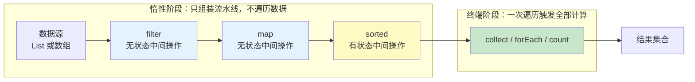
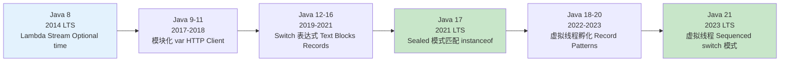
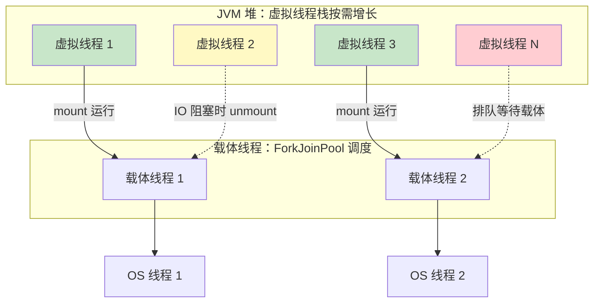

# Java 8 到 21 新特性

> 定位：Java 8 的 Lambda/Stream 改变了写代码的方式，Java 9-17 的 `var`/Record/Sealed 改变了建模方式，Java 21 的虚拟线程改变了并发模型，22–25 的收尾与转正另篇展开。但新特性用错比不用更糟——并行流在 IO 场景越跑越慢、`Collectors.toMap` 遇到重复 key 直接抛异常、`Optional` 当字段用导致序列化失败。这篇按「语言语义 → 运行时实现 → 生产坑」三层，把 Java 8 到 21 真正影响架构决策的特性讲透。

> **版本提示（2026-11）**：本篇按 JDK 8–21 讲；JDK 22–25 的语言与运行时变化见 [JDK 22–25 新特性](08-JDK22到25新特性.md)，做升级决策时两篇对照阅读。

## 一、为什么需要关注新特性

很多团队的 Java 版本停留在 8，理由通常是「稳定、够用」。但 8 之后的每一次 LTS 都在解决 8 留下的硬伤：

- **表达力**：一个排序要写 6 行匿名内部类，Lambda 一行；一个 DTO 要写几十行 getter/setter，Record 一行。
- **建模精度**：`Sealed` 让「这个接口只允许这三个实现」变成编译期约束；模式匹配让「类型判断 + 强转」不再样板化。
- **并发模型**：平台线程 1:1 映射 OS 线程，一个线程约 1MB 栈，几千个就到顶；虚拟线程把「一请求一线程」从奢侈品变成默认选项，不必为了吞吐把代码写成回调地狱。
- **生态倒逼**：Spring Boot 3 最低 Java 17，Spring Framework 6 全面拥抱 17，新中间件客户端也在跟进。停留在 8 意味着放弃大量现代库的支持。

版本节奏要心里有数：

| 版本 | 发布时间 | 地位 | 代表特性 |
|---|---|---|---|
| Java 8 | 2014 | LTS | Lambda、Stream、Optional、`java.time` |
| Java 11 | 2018 | LTS | `var`（10）、HTTP Client、String 增强 |
| Java 17 | 2021 | LTS | Record、Sealed、模式匹配 `instanceof`、Text Blocks |
| Java 21 | 2023 | LTS | 虚拟线程、Sequenced Collections、switch 模式匹配 |

新特性的学习重点不是「API 怎么调」，而是三件事：**它解决了什么旧问题、运行时到底怎么实现、什么场景下不该用**。下面逐个拆。

## 二、Lambda 与函数式接口

### 2.1 函数式接口：只有一个抽象方法

函数式接口（SAM，Single Abstract Method）是 Lambda 的类型基础：**只有一个抽象方法的接口**，就可以用 Lambda 来「赋值」。

```java
@FunctionalInterface
public interface DiscountStrategy {
    BigDecimal apply(BigDecimal price);

    // default 方法不算抽象方法
    default DiscountStrategy andThen(DiscountStrategy next) {
        return price -> next.apply(this.apply(price));
    }

    // static 方法也不算
    static DiscountStrategy none() {
        return price -> price;
    }
}
```

`@FunctionalInterface` 的作用是**编译期校验**：一旦你加了第二个抽象方法，编译直接失败。它不影响 Lambda 的使用——不加这个注解，只要接口结构满足 SAM，Lambda 照样能用。但建议加，理由有两个：一是文档价值，告诉维护者「这是给 Lambda 用的」；二是防止后人随手加方法把调用方全部编译破坏。

两个容易忽略的细节：

- `Object` 的 `public` 方法（`equals`、`hashCode`、`toString`）**不算**抽象方法，因为任何实现类都从 `Object` 继承了它们。
- 接口里的 `default` 方法和 `static` 方法**不算**抽象方法。

### 2.2 四种内置函数式接口

`java.util.function` 包提供了几十个接口，但核心只有四个，其余都是为了避免装箱而做的特化：

| 接口 | 抽象方法 | 语义 | 典型用途 | 常用变体 |
|---|---|---|---|---|
| `Function<T,R>` | `R apply(T t)` | 转换 | `map`、`computeIfAbsent` | `BiFunction`、`UnaryOperator`、`IntFunction` |
| `Consumer<T>` | `void accept(T t)` | 消费 | `forEach`、`ifPresent` | `BiConsumer`、`IntConsumer` |
| `Supplier<T>` | `T get()` | 生产 | `orElseGet`、懒初始化 | `BooleanSupplier`、`IntSupplier` |
| `Predicate<T>` | `boolean test(T t)` | 判断 | `filter`、`removeIf` | `BiPredicate`、`IntPredicate` |

几个高频用法：

```java
// Function：缓存不存在才计算
Map<String, User> cache = new ConcurrentHashMap<>();
User user = cache.computeIfAbsent("1001", id -> userRepository.findById(id));

// Consumer：存在才消费
optionalUser.ifPresent(u -> log.info("user={}", u.getName()));

// Supplier：延迟创建
User lazy = optionalUser.orElseGet(() -> userRepository.findDefault());

// Predicate：组合条件
Predicate<User> isActive = u -> u.getStatus() == 1;
Predicate<User> isAdult = u -> u.getAge() >= 18;
users.removeIf(isActive.negate().and(isAdult));
```

**装箱陷阱**：`Function<Integer, Integer>` 每次 `apply` 都会把 `int` 装箱成 `Integer`。在百万级数据的流里，这会凭空产生大量短命对象。JDK 为此提供了 `IntUnaryOperator`、`ToIntFunction`、`IntPredicate` 等特化接口，配合 `mapToInt`、`IntStream` 使用可以彻底避开装箱。

### 2.3 方法引用的四种形式

方法引用是 Lambda 的语法糖：当 Lambda 体**只有一行方法调用**，且参数顺序能对上时，可以写成 `类::方法`。四种形式必须分清：

| 形式 | 语法 | 等价 Lambda | 例子 |
|---|---|---|---|
| 静态方法引用 | `类::静态方法` | `(a, b) -> 类.静态方法(a, b)` | `Integer::parseInt` |
| 绑定实例方法引用 | `实例::方法` | `(a) -> 实例.方法(a)` | `System.out::println` |
| 未绑定实例方法引用 | `类::实例方法` | `(obj, a) -> obj.方法(a)` | `String::length` |
| 构造器引用 | `类::new` | `(a) -> new 类(a)` | `ArrayList::new` |

第三种最容易懵：`String::length` 等价于 `s -> s.length()`，而不是「某个 String 实例的 length」。编译器会把第一个参数当作方法接收者。数组构造器也支持：`int[]::new` 等价于 `len -> new int[len]`。

```java
List<String> names = users.stream()
    .map(User::getName)              // 未绑定实例方法：u -> u.getName()
    .map(String::trim)               // 未绑定实例方法：s -> s.trim()
    .map(String::toUpperCase)
    .collect(Collectors.toList());

Supplier<List<String>> factory = ArrayList::new;   // 构造器引用
Function<Integer, int[]> arrayFactory = int[]::new; // 数组构造器
```

还有两个不常见但合法的写法：`this::method`（引用当前对象的实例方法）和 `super::method`（引用父类方法）。

### 2.4 Lambda 的底层：invokedynamic，不是匿名内部类

这是面试区分度很高的一题。很多人以为 Lambda 编译后就是一个匿名内部类，**错**。

匿名内部类的实现方式：编译器为每个匿名类生成一个独立的 class 文件（`Outer$1.class`、`Outer$2.class`……），运行时需要类加载、验证、占用元空间。一个项目里几百个 Lambda 就是几百个 class，启动扫描和 JIT 都是负担。

Lambda 的实现方式：编译期生成一条 `invokedynamic` 指令，并在 class 文件的 `BootstrapMethods` 表里登记一个引导方法 `LambdaMetafactory.metafactory`。第一次执行到这条指令时，JVM 调用引导方法，动态生成一个实现函数式接口的类（HotSpot 用隐藏类/`LambdaForm`），拿到 `CallSite`；之后的调用直接走这个调用点。

```java
public class LambdaBytecode {
    public static void main(String[] args) {
        Runnable r = () -> System.out.println("hi");
        r.run();
    }
}
```

`javap -c -p LambdaBytecode` 的关键输出：

```text
InvokeDynamic #0:run:()Ljava/lang/Runnable;
BootstrapMethods:
  0: #18 REF_invokeStatic java/lang/invoke/LambdaMetafactory.metafactory
```

三个关键差异：

| 维度 | 匿名内部类 | Lambda |
|---|---|---|
| 类文件数量 | 每个一个 class | 零个额外 class |
| 首次调用 | 类加载后即可用 | 需要 `invokedynamic` 链接，首次有开销 |
| `this` 语义 | 指匿名类实例 | 指外层实例 |
| 实例复用 | 每次 `new` 都是新对象 | 非捕获 Lambda 在 HotSpot 中通常复用同一实例 |
| 序列化 | 天然可序列化（如果接口允许） | 默认不可序列化 |

`this` 的差异很实际：

```java
public class ThisDemo {
    public void run() {
        Runnable anon = new Runnable() {
            @Override public void run() {
                System.out.println(this);  // ThisDemo$1 实例
            }
        };
        Runnable lambda = () -> System.out.println(this);  // ThisDemo 实例
    }
}
```

**捕获**是另一个重点。Lambda 访问局部变量时，变量必须是 `effectively final`（即事实上的 final，不能再赋值）。原因是 Lambda 捕获的是**值**，不是引用——JVM 把变量值作为参数传给 Lambda 的合成方法，而不是维持一个指向栈帧的指针。这样即使外层方法返回，Lambda 依然能安全执行。

```java
int base = 100;
Function<Integer, Integer> add = x -> x + base;  // 捕获 base 的值
// base = 200;  // 编译错误：base 必须是 effectively final
```

非捕获 Lambda 每次求值通常返回同一实例，捕获 Lambda 每次求值都会生成新对象：

```java
Function<String, String> f1 = String::trim;      // 非捕获，可复用
String prefix = "user-";
Function<String, String> f2 = s -> prefix + s;  // 捕获 prefix，每次新建
```

所以在极端热路径上（比如每秒百万次的循环），如果 Lambda 捕获了变量，可以考虑把它提取成静态常量或字段，避免重复分配。但绝大多数业务代码不需要这种微优化——**先保证可读性，再用 JMH 证明这里有瓶颈**。

如果需要序列化 Lambda（比如作为 RPC 参数、写入磁盘），要用交集类型显式声明：

```java
Runnable r = (Runnable & Serializable) () -> System.out.println("serializable");
```

## 三、Stream：声明式数据流水线

### 3.1 惰性求值：没有终端操作，什么都不会发生

Stream 最重要的语义是**惰性**：中间操作只是把操作「记」到流水线上，不执行任何计算；只有终端操作被调用时，才真正开始遍历数据。

```java
List<String> names = Arrays.asList("alice", "bob", "charlie");

Stream<String> stream = names.stream()
    .filter(n -> {
        System.out.println("filter: " + n);
        return n.length() > 3;
    })
    .map(n -> {
        System.out.println("map: " + n);
        return n.toUpperCase();
    });
// 到这里一行日志都不会打印

List<String> result = stream.collect(Collectors.toList());
// 这时才会打印 filter/map 日志
```



这张图要看的重点是：中间操作只是「登记」，终端操作才是「点火」。而且执行时不是「先把所有元素 filter 完，再对所有元素 map」，而是**每个元素垂直走完整条流水线**——元素 1 走完 filter→map→sorted 的入参，元素 2 再走。这种设计叫循环融合（loop fusion），好处是只需要一次遍历，且中间结果不用落地成集合。

### 3.2 中间操作 vs 终端操作

| 类别 | 操作 | 特点 |
|---|---|---|
| 中间操作 | `filter`、`map`、`flatMap`、`peek`、`distinct`、`sorted`、`limit`、`skip`、`takeWhile`、`dropWhile` | 返回新 Stream，惰性 |
| 终端操作 | `forEach`、`collect`、`reduce`、`count`、`min`、`max`、`anyMatch`、`allMatch`、`noneMatch`、`findFirst`、`findAny`、`toArray` | 触发执行，返回非 Stream 结果 |

**短路操作**是终端操作里的一类特殊存在：`anyMatch`、`allMatch`、`noneMatch`、`findFirst`、`findAny`，以及中间操作 `limit`。它们遇到满足条件的结果就停止遍历，因此可以配合无限流使用：

```java
// 生成无限流，取前 5 个偶数
List<Integer> evens = Stream.iterate(0, n -> n + 2)
    .limit(5)
    .collect(Collectors.toList());

// 找到第一个成年用户就停，不会遍历全表
Optional<User> adult = users.stream()
    .filter(u -> u.getAge() >= 18)
    .findFirst();
```

**有状态 vs 无状态**决定了并行流的成本：

- 无状态：`filter`、`map`、`flatMap`、`peek`——每个元素独立处理，容易并行。
- 有状态：`sorted`、`distinct`、`limit`、`skip`——需要缓冲全部或部分元素，并行时要合并、排序，代价高。

`peek` 要特别小心。它的设计意图是调试（看一眼流水线中间值），不是业务逻辑。JDK 9 之后对 `SIZED` 流的 `count()` 可能直接返回 `spliterator.getExactSizeIfKnown()`，**完全跳过上游**，导致 `peek` 不执行：

```java
long count = Stream.of(1, 2, 3)
    .peek(System.out::println)  // Java 9+ 可能什么都不打印
    .count();
```

不要把「发消息」「记流水」这类副作用放进 `peek`，用 `forEach` 或 `map` 显式处理。

### 3.3 flatMap vs map：一对一还是一对多

`map` 是 1→1 的转换：一个元素映射成另一个元素。`flatMap` 是 1→N：每个元素映射成一个 Stream，再把所有 Stream「拍平」成一个。

```java
// map：List<List<Integer>> 变成 Stream<List<Integer>>，嵌套还在
List<List<Integer>> nested = List.of(List.of(1, 2), List.of(3, 4));
List<List<Integer>> stillNested = nested.stream()
    .map(list -> list)          // 还是两层
    .collect(Collectors.toList());

// flatMap：拍平成一维
List<Integer> flat = nested.stream()
    .flatMap(List::stream)      // 每个 List 变成一个 Stream，再合并
    .collect(Collectors.toList());  // [1, 2, 3, 4]
```

典型场景：订单 → 订单项、文章 → 标签、用户 → 角色。

```java
List<String> allTags = articles.stream()
    .flatMap(a -> a.getTags().stream())
    .distinct()
    .collect(Collectors.toList());
```

两个坑：

1. **`flatMap` 的映射函数返回 `null` 会 NPE**。如果某个元素可能没有子集合，先 `filter(Objects::nonNull)`，或用 Java 9 的 `Optional.stream()`：

```java
List<String> tags = articles.stream()
    .flatMap(a -> Optional.ofNullable(a.getTags()).stream())
    .flatMap(Collection::stream)
    .collect(Collectors.toList());
```

2. **`flatMap` 会把所有子流合并成一个顺序流**，如果子流本身很大，注意内存。Java 16 的 `mapMulti` 提供了更底层的「一个元素产出零到多个元素」的写法，避免为每个元素创建 Stream 对象，但可读性不如 `flatMap`，只在性能敏感时考虑。

### 3.4 Collectors：把流收成想要的结构

`Collectors` 是 Stream 的「出口工具箱」，常用的大致分四类：

| 分类 | 收集器 | 作用 |
|---|---|---|
| 收成集合 | `toList`、`toSet`、`toMap`、`toCollection` | 转成 List/Set/Map/指定集合 |
| 字符串 | `joining` | 拼接，可指定分隔符、前缀、后缀 |
| 分组 | `groupingBy`、`partitioningBy` | 按 key 分组、按布尔条件分区 |
| 聚合 | `counting`、`summingInt`、`averagingInt`、`minBy`、`maxBy`、`reducing` | 计数、求和、平均、最值 |

`groupingBy` 的强大在于**下游收集器**（downstream collector），可以嵌套组合：

```java
// 按部门分组，统计每个部门的人数
Map<String, Long> countByDept = users.stream()
    .collect(Collectors.groupingBy(User::getDept, Collectors.counting()));

// 按部门分组，取每个部门工资最高的员工
Map<String, Optional<User>> topByDept = users.stream()
    .collect(Collectors.groupingBy(
        User::getDept,
        Collectors.maxBy(Comparator.comparing(User::getSalary))));

// 按部门分组，把姓名拼成字符串
Map<String, String> namesByDept = users.stream()
    .collect(Collectors.groupingBy(
        User::getDept,
        Collectors.mapping(User::getName, Collectors.joining(","))));

// 按是否成年分区，只有 true/false 两个 key
Map<Boolean, List<User>> partitioned = users.stream()
    .collect(Collectors.partitioningBy(u -> u.getAge() >= 18));
```

`toMap` 有三个重载，第三个参数是**冲突合并函数**，第四个参数是 **Map 工厂**：

```java
Map<Long, String> idToName = users.stream()
    .collect(Collectors.toMap(
        User::getId,
        User::getName,
        (oldVal, newVal) -> newVal,      // key 冲突时保留新值
        LinkedHashMap::new));            // 保持插入顺序
```

不传合并函数时，遇到重复 key 会直接抛 `IllegalStateException: Duplicate key`——这是生产最常见的 Stream 事故之一，后面坑点章节细讲。

### 3.5 并行流：不是加个 parallel() 就变快

并行流底层是 `ForkJoinPool.commonPool()`，默认并行度是 `Runtime.getRuntime().availableProcessors() - 1`。它有三个硬约束：

1. **commonPool 是全 JVM 共享的**。你的并行流、`CompletableFuture`（未指定线程池时）、其他库的并行计算都挤在这几个线程里。一个阻塞任务就能把整个 commonPool 饿死。
2. **只有可高效拆分的结构才快**。`ArrayList`、数组、`IntStream.range` 支持随机访问，拆分成本低；`LinkedList`、`Stream.iterate` 拆分困难，并行反而更慢。
3. **有状态操作和顺序依赖会抵消收益**。`sorted`、`distinct`、`limit` 在并行下需要合并；`findFirst` 要维护 encounter order，代价远高于 `findAny`；`forEach` 不保证顺序，要顺序必须用 `forEachOrdered`。

```java
// 适合并行：大数组、CPU 密集、无状态
long count = IntStream.range(0, 10_000_000)
    .parallel()
    .filter(n -> n % 3 == 0)
    .count();

// 不适合并行：IO 阻塞、LinkedList、有状态
List<String> result = linkedList.parallelStream()
    .map(this::callRemote)   // 每个线程都阻塞在 IO 上，commonPool 线程少，吞吐反降
    .collect(Collectors.toList());
```

如果确实要用自定义线程池跑并行流，有两种方式：

```java
// 方式一：把任务提交到自定义 ForkJoinPool，在池内调用 parallel
ForkJoinPool pool = new ForkJoinPool(16);
List<Result> results = pool.submit(() ->
    list.parallelStream().map(this::callRemote).collect(Collectors.toList())
).get();

// 方式二：不用并行流，用 CompletableFuture + Executor
ExecutorService executor = Executors.newFixedThreadPool(16);
List<CompletableFuture<Result>> futures = list.stream()
    .map(item -> CompletableFuture.supplyAsync(() -> callRemote(item), executor))
    .collect(Collectors.toList());
```

**结论**：并行流适合「纯 CPU 计算 + 大数组 + 无共享状态」；IO 密集场景用虚拟线程或专用线程池，不要用并行流。任何并行优化都要用 JMH 测量，不要凭感觉。

## 四、Optional：表达「可能没有值」

### 4.1 设计意图与正确用法

`Optional<T>` 是一个「可能包含值，也可能为空」的容器。它的设计目的是**让方法的返回值在类型上就声明「可能没有结果」**，强迫调用方处理，而不是拿到一个可能为 `null` 的引用。

正确用法只有一个：**作为返回值**。

```java
public Optional<User> findById(Long id) {
    User user = userMapper.selectById(id);
    return Optional.ofNullable(user);
}

// 调用方必须显式处理
String name = userService.findById(1L)
    .map(User::getName)
    .filter(n -> !n.isBlank())
    .orElse("匿名用户");
```

常用方法：

| 方法 | 作用 | 备注 |
|---|---|---|
| `of` | 包装非空值 | 传 `null` 直接 NPE |
| `ofNullable` | 包装可能为空的值 | 推荐 |
| `empty` | 返回空 Optional | 单例 |
| `map` | 有值时转换 | 返回 `Optional<U>` |
| `flatMap` | 有值时转换，且转换结果已是 Optional | 避免嵌套 `Optional<Optional<U>>` |
| `filter` | 有值且满足条件才保留 | |
| `orElse` | 有值返回值，否则返回默认值 | **默认值总会求值** |
| `orElseGet` | 有值返回值，否则调用 Supplier | 惰性 |
| `orElseThrow` | 有值返回值，否则抛异常 | Java 10 有无参重载 |
| `ifPresent` | 有值时消费 | 无返回值 |
| `ifPresentOrElse` | 有值消费，无值执行另一逻辑 | Java 9 |

### 4.2 四种典型误用

`Optional` 被滥用得很厉害，下面四种写法都应该避免：

| 误用 | 问题 | 正确做法 |
|---|---|---|
| 作为字段 | `Optional` 未实现 `Serializable`，JSON 序列化、JPA 映射、RPC 传输都会出问题；还多一层对象开销 | 字段用普通引用 + 校验，返回值再包 Optional |
| 作为方法参数 | 调用方还是要判空，且 API 更难用；无法阻止传 `null` | 参数用普通类型 + `Objects.requireNonNull` 或校验注解 |
| 作为集合元素 | `List<Optional<T>>` 让消费方多一层拆包 | 用空集合代替空元素，或 `filter` 掉 |
| `isPresent()` + `get()` | 退化回 `if (x != null)`，完全没利用 Optional 的表达力 | 用 `map`/`orElse`/`ifPresent` |

```java
// 反例：字段用 Optional
public class UserDto {
    private Optional<String> nickname;  // 序列化框架可能直接报错
}

// 反例：参数用 Optional
public void update(Long id, Optional<String> name) { ... }

// 反例：isPresent + get
if (optional.isPresent()) {
    return optional.get().getName();
}
return "unknown";

// 正例
return optional.map(User::getName).orElse("unknown");
```

### 4.3 orElse 与 orElseGet：一个立刻求值，一个惰性求值

这是 `Optional` 最高频的面试题，也是真实事故来源。

```java
public User getUser(Long id) {
    return userRepository.findById(id)
        .orElse(loadDefaultUser());   // 无论找没找到，loadDefaultUser() 都会执行
}
```

`orElse(T other)` 的参数是**值**，Java 在调用方法前必须先把这个值算出来——所以即使 Optional 里有值，`loadDefaultUser()` 也已经被执行了。如果它是查库、调 RPC、甚至抛异常，就是白白浪费一次资源，甚至直接报错。

```java
public User getUser(Long id) {
    return userRepository.findById(id)
        .orElseGet(() -> loadDefaultUser());  // 只有为空才执行
}
```

`orElseGet(Supplier<? extends T>)` 接收的是**工厂**，只在 Optional 为空时才调用。

| 方法 | 参数 | 求值时机 | 适用 |
|---|---|---|---|
| `orElse` | 具体值 | 立即求值 | 常量、已经算好的简单值 |
| `orElseGet` | `Supplier` | 惰性，为空才调用 | 查库、RPC、创建对象、有副作用 |

几个衍生坑：

- `Optional.of(null)` 直接 NPE，包装可能为 null 的值必须用 `ofNullable`。
- `orElseGet(null)` 会 NPE（Supplier 为 null），不要传 null。
- `orElseThrow()` 无参版本是 Java 10 才有的，Java 8 必须传 `Supplier`。
- `Optional` 不适合做「空值传播」的万能工具，链式调用超过三四层就该考虑拆方法，否则可读性急剧下降。

## 五、java.time：不可变、线程安全、时区明确

### 5.1 为什么必须替代 Date/Calendar

`java.util.Date` 和 `Calendar` 有四个原罪，每一个都在生产里捅过娄子：

| 问题 | `Date`/`Calendar` | `java.time` |
|---|---|---|
| 可变性 | `Date.setTime()` 能改，作为参数或字段被意外修改 | 全部不可变，修改返回新对象 |
| 月份 | `Calendar.MONTH` 从 0 开始，0 是一月 | `Month.JANUARY` 或 1-12 |
| 年份 | `Date.getYear()` 返回「年份 - 1900」 | `getYear()` 返回真实年份 |
| 线程安全 | `SimpleDateFormat` 非线程安全，共享会解析错乱 | `DateTimeFormatter` 不可变、线程安全 |
| 时区 | `Date` 本身无时区，`toString()` 用默认时区，极易误读 | `Instant` 明确 UTC，`ZonedDateTime` 明确时区 |

`SimpleDateFormat` 的坑值得单独看：

```java
// 错误：静态共享 SimpleDateFormat
private static final SimpleDateFormat SDF = new SimpleDateFormat("yyyy-MM-dd");

// 多线程并发调用，可能出现日期错乱、NumberFormatException，甚至死循环
String s = SDF.format(new Date());
```

`SimpleDateFormat` 内部用 `Calendar` 做可变状态，`format`/`parse` 都会修改它，没有同步。正确做法要么每次 new（浪费），要么 ThreadLocal（繁琐），要么换 `DateTimeFormatter`：

```java
private static final DateTimeFormatter FMT = DateTimeFormatter.ofPattern("yyyy-MM-dd");
String s = LocalDate.now().format(FMT);  // 线程安全，可静态复用
```

### 5.2 核心类型怎么选

| 类型 | 含义 | 是否带时区 | 典型场景 |
|---|---|---|---|
| `Instant` | 时间戳，UTC 下的一个瞬间 | UTC | 机器间通信、日志、审计 |
| `LocalDate` | 日期（年月日） | 无 | 生日、账单日 |
| `LocalTime` | 时间（时分秒纳秒） | 无 | 营业时间、闹钟 |
| `LocalDateTime` | 日期 + 时间 | 无 | 数据库 `DATETIME`、表单输入 |
| `ZonedDateTime` | 日期 + 时间 + 时区 | 有 | 跨时区会议、航班 |
| `OffsetDateTime` | 日期 + 时间 + 偏移量 | 有（固定偏移） | 需要保留偏移但不涉及时区规则 |
| `Duration` | 时间量（秒 + 纳秒） | — | 超时、耗时 |
| `Period` | 日期量（年 + 月 + 日） | — | 「三个月后」这类日历运算 |
| `ZoneId` | 时区 ID | — | `Asia/Shanghai`、`America/New_York` |

选择口诀：**机器通信用 `Instant`，人看的时间用 `LocalDateTime`，跨时区用 `ZonedDateTime`，时间段用 `Duration`/`Period`。**

转换要经过 `ZoneId`，不能直接 `LocalDateTime.toInstant()`：

```java
// Date ↔ Instant
Instant instant = new Date().toInstant();
Date date = Date.from(instant);

// Instant ↔ LocalDateTime，必须指定时区
ZoneId zone = ZoneId.of("Asia/Shanghai");
LocalDateTime ldt = LocalDateTime.ofInstant(instant, zone);
Instant back = ldt.atZone(zone).toInstant();

// 字符串 ↔ 时间
LocalDate d = LocalDate.parse("2026-11-22");
String s = d.format(DateTimeFormatter.ISO_LOCAL_DATE);

// 计算
LocalDateTime nextMonth = LocalDateTime.now().plusMonths(1);
Duration timeout = Duration.ofSeconds(30);
```

### 5.3 DateTimeFormatter 的细节

`DateTimeFormatter` 是线程安全的，可以定义为 `static final` 常量复用。几个容易踩的点：

1. **大小写敏感**：`MM` 是月，`mm` 是分；`HH` 是 24 小时制，`hh` 是 12 小时制；`ss` 是秒，`SSS` 是毫秒。
2. **`yyyy` vs `uuuu`**：`yyyy` 是 year-of-era（纪元年），`uuuu` 是 proleptic year（实际年份）。默认 `ResolverStyle.SMART` 下 `yyyy-MM-dd` 能正常解析；一旦改成 `STRICT`，`yyyy` 需要配合纪元（如 `G`）才能解析，否则报错。严格模式下请用 `uuuu-MM-dd`。
3. **严格校验日期合法性**：默认 SMART 会把 `2026-02-30` 调成 `2026-02-28`，如果业务要求拒绝非法日期，用 `STRICT`：

```java
DateTimeFormatter strict = DateTimeFormatter
    .ofPattern("uuuu-MM-dd")
    .withResolverStyle(ResolverStyle.STRICT);

LocalDate.parse("2026-02-30", strict);  // 抛 DateTimeParseException
```

数据库映射也要注意语义：

- MySQL `DATETIME` 不带时区，对应 `LocalDateTime`。
- MySQL `TIMESTAMP` 会按时区转换，对应 `Instant` 或 `OffsetDateTime` 更合适。
- JDBC 4.2 起支持 `LocalDateTime`/`OffsetDateTime` 直接读写，MyBatis 3.4.5+ 内置了对应的 `TypeHandler`。
- Jackson 序列化 `java.time` 需要 `JavaTimeModule`；Spring Boot 自动注册，并默认输出 ISO-8601 字符串而不是时间戳数组。原生 Jackson 要手动 `objectMapper.registerModule(new JavaTimeModule())`，否则报 `InvalidDefinitionException`。

## 六、Java 9-17：让建模更精确



这张时间线要看的不是年份，而是**特性的成熟路径**：很多特性先以 preview 出现，经过一两个版本迭代才转正（虚拟线程 19 预览、21 转正；Record 14 预览、16 转正）。生产使用要认准「转正」的版本，preview 特性需要加 `--enable-preview`，不适合作为团队基线。

### 6.1 var（Java 10）：局部变量类型推断

```java
var list = new ArrayList<String>();       // 推断为 ArrayList<String>
var map = new HashMap<String, List<User>>();
for (var entry : map.entrySet()) { ... }
try (var reader = Files.newBufferedReader(path)) { ... }
```

`var` 是**编译期类型推断**，不是动态类型，字节码里类型是确定的。限制：

- 只能用于局部变量、增强 for 循环变量、try-with-resources 变量。
- 不能用于字段、方法参数、方法返回值。
- 声明时必须初始化，不能 `var x;`。
- 不能直接赋 `null`（无法推断），也不能用 Lambda/方法引用（需要目标类型）。

可读性判断标准：**类型从右侧一眼可见时用 `var`，否则写全**。

```java
var users = new ArrayList<User>();     // 好：右侧清楚
var result = service.process(input);   // 差：看不出 result 是什么
```

### 6.2 Text Blocks（Java 15）：多行字符串

```java
String sql = """
        SELECT id, name, email
        FROM users
        WHERE status = ?
          AND created_at > ?
        ORDER BY id DESC
        """;
```

三个规则：

- 开头 `"""` 后必须换行，内容从下一行开始。
- 结束 `"""` 的位置决定「incidental whitespace」的裁剪基准，所有行会去掉公共缩进。
- `\` 放在行尾表示「不换行」，`\s` 表示一个不被裁剪的空格。

```java
String json = """
        {
          "name": "Alice",\
          "age": 18
        }
        """;
```

Text Blocks 适合 SQL、JSON、HTML 模板，但**不要用它拼接用户输入**——SQL 注入和字符串拼接是两回事，参数仍然要用 `?` 或 `#{}`。

### 6.3 Records（Java 16）：不可变数据载体

```java
public record Point(int x, int y) {}

public record UserDto(Long id, String name, String email) {
    // 紧凑构造器：做参数校验，不用写 this.x = x
    public UserDto {
        Objects.requireNonNull(name, "name");
        if (email != null && !email.contains("@")) {
            throw new IllegalArgumentException("invalid email");
        }
    }

    // 可以加额外方法
    public String displayName() {
        return name + " <" + email + ">";
    }
}
```

一个 Record 自动生成：

- 全参构造器（规范构造器）
- 每个组件的 accessor（`x()`、`y()`，注意不是 `getX()`）
- `equals`/`hashCode`（逐组件比较）
- `toString`（`Point[x=1, y=2]`）

限制与注意：

- 组件字段都是 `private final`，Record 本身是 `final`，不能继承其他类（但可以实现接口）。
- 不能声明实例字段，只能有静态字段。
- 数组组件的 `equals` 是**引用比较**（`Objects.equals` 对数组退化为 `equals`），需要值比较时自己重写。
- 适合 DTO、值对象、多返回值、方法内部临时聚合；**不适合 JPA 实体**（JPA 需要无参构造和可变字段），也不适合需要大量可变状态的领域对象。

与 Lombok 的对比：

| 维度 | Record | Lombok `@Data` |
|---|---|---|
| 实现方式 | 编译器原生支持 | 注解处理器在编译期生成字节码 |
| 可变性 | 不可变 | 默认可变，有 setter |
| 继承 | 不能继承类，可实现接口 | 普通类，可继承 |
| 额外字段 | 不允许实例字段 | 允许 |
| 序列化 | Jackson 2.12+ 原生支持 | 依赖 getter/setter |
| 团队成本 | 无插件、无 IDE 依赖 | 需要 IDE 装 Lombok 插件 |
| 魔法程度 | 语言级，行为明确 | 生成代码不可见，调试略麻烦 |

新项目建议：**DTO/值对象优先 Record，需要可变或复杂映射的实体再用 Lombok 或手写**。

### 6.4 Sealed Classes（Java 17）：受控继承

```java
public sealed interface Shape permits Circle, Square, Rectangle {}

public record Circle(double radius) implements Shape {}
public record Square(double side) implements Shape {}
public final class Rectangle implements Shape {
    private final double width, height;
    // ...
}
```

规则：

- `sealed` 类/接口用 `permits` 列出允许的直接子类型。
- 子类型必须是 `final`、`sealed` 或 `non-sealed` 三者之一。
- 子类型必须与父类型在同一个模块（未命名模块则同一个包）中。
- `permits` 在子类型与父类型同文件时可以省略。

它的价值在于**穷尽性检查**：编译器知道 `Shape` 只有三个实现，配合 switch 模式匹配时，少写一个分支会编译报错。这让「新增一个子类型」变成一次可控的全局变更，而不是运行时的 `default` 兜底。

与 enum 的区别：

| 维度 | enum | sealed |
|---|---|---|
| 实例数量 | 固定常量实例 | 每个子类型可有任意多实例 |
| 状态 | 所有常量共享字段结构 | 每个子类型可有不同字段 |
| 适用 | 状态机、类型码 | 代数数据类型、领域建模 |

### 6.5 Pattern Matching for instanceof（Java 16）

```java
// 旧写法
if (obj instanceof String) {
    String s = (String) obj;
    if (s.length() > 5) { ... }
}

// 新写法：绑定变量，自动强转
if (obj instanceof String s && s.length() > 5) {
    System.out.println(s.toUpperCase());
}
```

绑定变量的作用域是**流敏感**（flow scoping）：

```java
if (!(obj instanceof String s)) {
    return;
}
// 这里 s 可用，因为前面的分支已经排除了「不是 String」的情况
System.out.println(s.length());
```

但 `||` 右侧不能用：

```java
if (obj instanceof String s || s.length() > 5) { }  // 编译错误，s 可能未绑定
```

### 6.6 Switch 表达式（Java 14）

```java
// 旧写法：穿透、break、容易漏
switch (day) {
    case MONDAY:
    case FRIDAY:
    case SUNDAY:
        numLetters = 6;
        break;
    default:
        numLetters = 0;
}

// 新写法：箭头不穿透，表达式有返回值
int numLetters = switch (day) {
    case MONDAY, FRIDAY, SUNDAY -> 6;
    case TUESDAY -> 7;
    case THURSDAY, SATURDAY -> 8;
    case WEDNESDAY -> 9;
};

// 需要多行逻辑时用 yield
int result = switch (type) {
    case "A" -> 1;
    case "B" -> {
        int base = computeBase();
        yield base * 2;
    }
    default -> throw new IllegalArgumentException("unknown: " + type);
};
```

关键点：

- 箭头标签**不会穿透**，不需要 `break`。
- 作为表达式使用时必须**穷尽**：enum 要覆盖所有常量，或提供 `default`；sealed 类型在模式匹配下由编译器检查。
- `yield` 用于从代码块返回表达式的值，和 `return` 不同——`return` 是退出方法。
- 语句形式的 switch 仍然可以用传统冒号写法，但新代码建议统一箭头。

## 七、Java 21：虚拟线程与模式匹配

### 7.1 虚拟线程：把「线程」从 OS 资源变成 JVM 对象

平台线程是 OS 线程的 1:1 包装：创建要走内核、每个线程预留约 1MB 栈、上下文切换由内核调度。一台 8 核 16G 的机器，撑几千个平台线程就到极限，所以传统高并发服务只能用「线程池 + 队列」把并发数压住，或者改用响应式编程。

虚拟线程（JEP 444，Java 21 转正）把线程的调度权从 OS 收回 JVM：

- 虚拟线程是 JVM 堆上的对象，栈按需增长（以 chunk 为单位），初始只占几百字节，可以创建百万级。
- 多个虚拟线程**挂载**（mount）到少量**载体线程**（carrier thread）上运行，载体线程是真正的平台线程，默认由 `ForkJoinPool` 提供。
- 虚拟线程遇到阻塞 IO 时**卸载**（unmount），载体线程被释放去跑别的虚拟线程；IO 完成后虚拟线程重新排队等待挂载。



这张图的核心是 **M:N 调度**：N 个虚拟线程复用 M 个载体线程（M 约等于 CPU 核数），阻塞不再占用载体线程。所以「一请求一线程」的同步阻塞代码重新变得可扩展——你不需要为了吞吐把业务写成 `CompletableFuture` 链或 Reactor。

平台线程 vs 虚拟线程：

| 维度 | 平台线程 | 虚拟线程 |
|---|---|---|
| 映射 | 1:1 OS 线程 | M:N 挂载到载体线程 |
| 创建成本 | 高，内核参与，栈约 1MB | 低，堆对象，栈按需增长 |
| 数量级 | 几千 | 百万级 |
| 阻塞代价 | 占用 OS 线程 | unmount，释放载体线程 |
| 调度 | OS 调度器 | JVM 调度器 |
| 适用 | CPU 密集、需要线程局部存储 | IO 密集、thread-per-request |
| 池化 | 必须池化 | **不要池化**，用完即弃 |

创建和使用：

```java
// 方式一：直接启动
Thread vt = Thread.ofVirtual()
    .name("order-vt-", 0)
    .start(() -> handleOrder(orderId));
vt.join();

// 方式二：每任务一个虚拟线程的执行器（推荐）
try (ExecutorService executor = Executors.newVirtualThreadPerTaskExecutor()) {
    List<Future<Result>> futures = orders.stream()
        .map(o -> executor.submit(() -> process(o)))
        .toList();
    for (Future<Result> f : futures) {
        f.get();
    }
}
```

四个必须知道的坑：

1. **不要池化虚拟线程**。虚拟线程创建成本极低，池化只会增加复杂度，还破坏了「一个任务一个线程」的语义。需要限制并发时用 `Semaphore`，而不是固定大小的线程池：

```java
Semaphore limit = new Semaphore(100);
try (var executor = Executors.newVirtualThreadPerTaskExecutor()) {
    for (Order o : orders) {
        executor.submit(() -> {
            limit.acquire();
            try { return process(o); }
            finally { limit.release(); }
        });
    }
}
```

2. **`synchronized` 块内阻塞会导致 pinning**。JDK 21 里虚拟线程在 `synchronized` 中阻塞时无法卸载，会一直占着载体线程；如果大量虚拟线程都卡在这里，载体线程被耗尽，整个调度器停滞。JDK 24（JEP 491）已解决这个问题；在 21 上，把 `synchronized` 换成 `ReentrantLock`。
3. **`ThreadLocal` 要慎用**。每个虚拟线程一份 ThreadLocal，百万线程就是百万份拷贝，容易 OOM。能用参数传递就用参数，必须用上下文时考虑 `ScopedValue`（Java 21 预览）。
4. **CPU 密集型任务没有收益**。虚拟线程的优势在「阻塞时让出载体线程」，纯计算任务不会阻塞，用虚拟线程和平台线程一样，反而多了挂载/卸载开销。

### 7.2 Sequenced Collections（Java 21）

Java 集合一直缺一个统一的「有序集合」抽象：`List` 有 `get(0)` 但没有 `getLast()`；`Deque` 有 `getFirst/getLast`；`LinkedHashSet` 想取最后一个元素只能遍历。Java 21 引入了三个接口：

- `SequencedCollection<E>`：`getFirst()`、`getLast()`、`addFirst()`、`addLast()`、`reversed()`
- `SequencedSet<E>`：继承 `SequencedCollection`，`reversed()` 返回 `SequencedSet`
- `SequencedMap<K,V>`：`firstEntry()`、`lastEntry()`、`putFirst()`、`putLast()`、`pollFirstEntry()`、`pollLastEntry()`、`sequencedKeySet()`、`sequencedValues()`、`sequencedEntrySet()`、`reversed()`

`List`、`Deque`、`LinkedHashSet`、`SortedSet`、`LinkedHashMap`、`SortedMap` 都实现了对应接口。

```java
List<String> list = new ArrayList<>(List.of("a", "b", "c"));
System.out.println(list.getFirst());   // a
System.out.println(list.getLast());    // c
System.out.println(list.reversed());   // [c, b, a]

LinkedHashMap<String, Integer> map = new LinkedHashMap<>();
map.put("one", 1);
map.put("two", 2);
System.out.println(map.firstEntry());  // one=1
System.out.println(map.lastEntry());   // two=2
```

### 7.3 Pattern Matching for switch（Java 21）

Java 21 把模式匹配扩展到了 switch，支持类型模式、守卫条件（`when`）、`null` 分支和记录模式：

```java
sealed interface Shape permits Circle, Square, Rectangle {}
record Circle(double radius) implements Shape {}
record Square(double side) implements Shape {}
record Rectangle(double width, double height) implements Shape {}

double area(Shape shape) {
    return switch (shape) {
        case Circle c -> Math.PI * c.radius() * c.radius();
        case Square s -> s.side() * s.side();
        case Rectangle r -> r.width() * r.height();
        // 不需要 default：sealed 类型已穷尽，编译器会检查
    };
}

// 守卫条件
String describe(Object obj) {
    return switch (obj) {
        case null -> "null";
        case Integer i when i < 0 -> "negative";
        case Integer i -> "integer: " + i;
        case String s when s.isBlank() -> "blank";
        case String s -> "string: " + s;
        default -> "other";
    };
}

// 记录模式：直接解构
String pointInfo(Object obj) {
    return switch (obj) {
        case Point(int x, int y) when x == 0 && y == 0 -> "origin";
        case Point(int x, int y) -> "(" + x + ", " + y + ")";
        default -> "not a point";
    };
}
```

关键变化：

- `case null` 合法了。Java 21 之前，switch 的表达式为 null 直接 NPE；现在可以显式处理。
- `when` 做守卫，避免在 `case` 里写复杂的 `if`。
- 对 sealed 类型，编译器做**穷尽性检查**；对非 sealed 类型，仍然需要 `default`。
- 记录模式可以直接解构 Record 的组件，配合嵌套模式做深层匹配。

## 八、Java 22-25：已拆为独立篇

22-25 的 FFM API、未命名变量、Gatherers、pinning 修复、Scoped Values、紧凑对象头、32 位端口移除等内容较多，且涉及升级路线与参数清理，已独立成篇：[JDK 22–25 新特性：从「能用虚拟线程」到「能放心用」](08-JDK22到25新特性.md)。

本节只留一句判断：**21 是「能用虚拟线程」，25 是「虚拟线程能放心用」**；22-24 可以学、可以试点，生产基线不必逐个追。具体 JEP 编号、版本状态与升级清单见该篇。

## 九、生产坑点与排查

### 坑点 1：Collectors.toMap 重复 key 直接抛异常

**现象**：服务在某个时间点开始报 `IllegalStateException: Duplicate key 1001`，堆栈指向一行 `Collectors.toMap`。

**原因**：`toMap` 默认用 `HashMap.merge` 写入，遇到重复 key 且没有提供合并函数时，直接抛异常。另外，**value 为 null 也会 NPE**——`HashMap.merge` 不允许 null value，而很多 DTO 的字段可能为空。

**解法**：

```java
// 提供合并函数：保留后出现的值
Map<Long, String> map = users.stream()
    .collect(Collectors.toMap(User::getId, User::getName, (a, b) -> b));

// 过滤 null value
Map<Long, String> map2 = users.stream()
    .filter(u -> u.getName() != null)
    .collect(Collectors.toMap(User::getId, User::getName, (a, b) -> b));
```

排查时先确认「业务上 key 是否应该唯一」：如果不唯一，用 `groupingBy` 才是正确建模；如果唯一，说明上游数据有问题，合并函数只是掩盖。

### 坑点 2：Stream 只能消费一次

**现象**：`IllegalStateException: stream has already been operated upon or closed`。

**原因**：Stream 不是集合，它是一次性的流水线。终端操作执行后，`AbstractPipeline` 会把 `linkedOrConsumed` 置为 true，再次操作直接抛异常。

```java
Stream<String> stream = list.stream();
long count = stream.count();
List<String> names = stream.collect(Collectors.toList());  // 抛异常
```

**解法**：每次从数据源重新创建流，或用 `Supplier<Stream<T>>` 封装：

```java
Supplier<Stream<String>> supplier = () -> list.stream();
long count = supplier.get().count();
List<String> names = supplier.get().collect(Collectors.toList());
```

更好的做法是**一次终端操作拿到所有需要的结果**，比如用 `Collectors.teeing`（Java 12）同时算两个聚合。

### 坑点 3：并行流在 IO 场景越跑越慢

**现象**：把 `stream()` 改成 `parallelStream()` 后，接口 RT 反而上升，CPU 不高但吞吐上不去。

**原因**：并行流默认跑在 `ForkJoinPool.commonPool()`，并行度是 CPU-1。IO 任务会阻塞载体线程，线程数本来就少，一阻塞就排队；而且 commonPool 是全 JVM 共享的，别的业务也在抢。

**解法**：

- IO 密集不要用并行流，用虚拟线程（Java 21）或专用线程池 + `CompletableFuture`。
- 纯 CPU 计算确认数据源可高效拆分（ArrayList/数组），避免 `LinkedList`、`Stream.iterate`。
- 必须用并行流时，提交到自定义 `ForkJoinPool`，并设置合理的并行度。
- 用 JMH 做基准测试，别在生产靠猜。

### 坑点 4：Optional 作为字段导致序列化失败

**现象**：DTO 里写了 `private Optional<String> nickname`，接口返回 500，日志报 `InvalidDefinitionException` 或 `NotSerializableException`。

**原因**：`Optional` 没有实现 `Serializable`，Jackson 默认也不支持直接序列化 Optional 字段（需要 `Jdk8Module`）；RPC 框架、JPA 同样不支持。

**解法**：Optional 只用于返回值。字段用普通类型，序列化时自然处理 null；需要区分「未传」和「传了空」时，用包装类或明确的标志位。

### 坑点 5：SimpleDateFormat 并发解析错乱

**现象**：线上偶发日期解析成 1970 年、月份错乱，或抛 `NumberFormatException`。

**原因**：`SimpleDateFormat` 内部 `Calendar` 是可变共享状态，多线程并发 `format`/`parse` 会互相覆盖。

**解法**：换成 `DateTimeFormatter`（不可变、线程安全）；存量代码至少用 `ThreadLocal<SimpleDateFormat>` 隔离。

### 坑点 6：无限流忘记 limit

**现象**：接口卡死、CPU 打满，或 OOM。

**原因**：`Stream.iterate`/`Stream.generate` 是无限流，没有 `limit` 或短路操作就会一直算下去。

**解法**：无限流必须配 `limit`、`findFirst`、`anyMatch` 等短路操作；代码评审时重点看 `iterate`/`generate` 的调用点。

### 坑点 7：peek 里的副作用没执行

**现象**：用 `peek` 发监控埋点，发现数据对不上。

**原因**：`peek` 是调试用中间操作，JDK 可能因为短路、`count` 优化、流水线融合而跳过它。

**解法**：副作用放 `forEach`/`map`，或者干脆在流之外显式处理。

## 十、最佳实践

1. **Lambda 保持短小**：超过三行就抽方法，用方法引用替代 `x -> foo(x)`。
2. **函数式接口优先用内置的**，需要语义化时再自定义，并加 `@FunctionalInterface`。
3. **Stream 只做数据转换，不做业务副作用**；复杂逻辑拆成方法，别写成一屏链式调用。
4. **`Collectors.toMap` 永远考虑重复 key 和 null value**，不确定就用 `groupingBy`。
5. **并行流只用于纯 CPU、大数组、无状态场景**；IO 用虚拟线程或专用线程池。
6. **Optional 只做返回值**，字段/参数/集合元素用普通类型；`orElseGet` 替代有成本的 `orElse`。
7. **时间统一用 `java.time`**，跨时区传输用 `Instant`，展示层再转 `ZonedDateTime`；格式化用 `DateTimeFormatter` 常量。
8. **DTO/值对象优先 Record**，需要可变状态或框架映射时再用普通类。
9. **用 Sealed + 模式匹配表达封闭类型层次**，让编译器帮你检查穷尽性。
10. **虚拟线程不池化、不限流靠 Semaphore、避开 `synchronized` 长阻塞**；CPU 密集任务仍用平台线程池。
11. **升级版本先看 preview 状态**，生产基线只选转正特性；用 `--release` 编译保证字节码兼容。
12. **新特性上线前用 JMH 或压测验证**，尤其是并行流、虚拟线程这类「看起来免费」的优化。

## 面试高频问法

**Q1：Lambda 和匿名内部类有什么区别？底层是怎么实现的？**

**一句话结论**：Lambda 用 `invokedynamic` 动态生成实现类，不产生额外 class 文件；匿名内部类在编译期生成 `Outer$1.class`。

展开：

- 编译产物：匿名内部类每个一个 class；Lambda 只有一条 `invokedynamic` 指令 + `BootstrapMethods` 表。
- 链接时机：Lambda 首次执行时由 `LambdaMetafactory.metafactory` 链接，之后走 `CallSite`；匿名内部类类加载后即可用。
- `this` 语义：匿名内部类的 `this` 是匿名对象；Lambda 的 `this` 是外层实例。
- 复用：非捕获 Lambda 在 HotSpot 中通常复用同一实例；匿名内部类每次 `new` 都是新对象。

加分点：说「Lambda 默认不可序列化，需要 `(Runnable & Serializable)` 交集类型；捕获的局部变量必须是 effectively final，因为捕获的是值不是引用」。

**Q2：什么是函数式接口？Java 内置的四种核心接口是什么？**

**一句话结论**：只有一个抽象方法的接口；核心是 `Function`、`Consumer`、`Supplier`、`Predicate`。

展开：

| 接口 | 方法 | 语义 |
|---|---|---|
| `Function<T,R>` | `R apply(T)` | 转换 |
| `Consumer<T>` | `void accept(T)` | 消费 |
| `Supplier<T>` | `T get()` | 生产 |
| `Predicate<T>` | `boolean test(T)` | 判断 |

加分点：说「`Object` 的 public 方法、default 方法、static 方法都不算抽象方法；`@FunctionalInterface` 只是编译期校验，不加也能用 Lambda」。

**Q3：方法引用有哪几种形式？**

**一句话结论**：四种——静态方法、绑定实例方法、未绑定实例方法、构造器引用。

展开：

- `Integer::parseInt` → `s -> Integer.parseInt(s)`
- `System.out::println` → `x -> System.out.println(x)`
- `String::length` → `s -> s.length()`（第一个参数当接收者）
- `ArrayList::new` → `() -> new ArrayList<>()`

加分点：说「方法引用要求 Lambda 体只有一行调用且参数能对上，否则编译器无法推断；`int[]::new` 是数组构造器引用」。

**Q4：Stream 的惰性求值是怎么回事？中间操作和终端操作有什么区别？**

**一句话结论**：中间操作只组装流水线不执行，终端操作才触发一次遍历；没有终端操作，Stream 什么也不做。

展开：

- 中间操作返回新 Stream，记录到 `AbstractPipeline` 的双向链表里。
- 终端操作调用 `evaluate()`，把流水线包装成 `Sink` 链，数据元素依次经过每个 Sink。
- 执行是「垂直」的：每个元素走完整条流水线，不是先全部 filter 再全部 map。
- 短路操作（`findFirst`、`anyMatch`、`limit`）可以提前终止遍历。

加分点：说「Stream 只能消费一次，第二次操作抛 `IllegalStateException`；`peek` 是调试用的，不能依赖它执行副作用」。

**Q5：map 和 flatMap 的区别？**

**一句话结论**：`map` 是一对一转换，`flatMap` 是一对多转换并把结果拍平。

展开：

- `map`：`Stream<T>` → `Stream<R>`，每个元素产出一个元素。
- `flatMap`：`Stream<T>` → `Stream<R>`，每个元素产出一个 `Stream<R>`，再合并成一个流。
- 典型场景：`List<List<Integer>>` 拍平、订单展开订单项、文章展开标签。

加分点：说「`flatMap` 的映射函数返回 null 会 NPE，可以用 `Optional.stream()` 或先 filter；Java 16 的 `mapMulti` 可以避免为每个元素创建 Stream 对象」。

**Q6：并行流有什么坑？什么场景不该用？**

**一句话结论**：并行流共享 `ForkJoinPool.commonPool`，IO 阻塞会饿死线程；只适合纯 CPU、大数组、无状态的计算。

展开：

- commonPool 并行度是 CPU-1，全 JVM 共享，一个阻塞任务拖垮所有并行流和未指定线程池的 `CompletableFuture`。
- 数据结构：ArrayList/数组拆分高效；LinkedList、`Stream.iterate` 拆分困难。
- 有状态操作（`sorted`、`distinct`、`limit`）并行成本高；`findFirst` 有顺序约束，用 `findAny` 更好。
- `forEach` 不保证顺序，要顺序用 `forEachOrdered`。

加分点：说「并行流不是『加个 parallel 就快』，要用 JMH 测；IO 场景用虚拟线程或专用线程池，不要用 commonPool」。

**Q7：Collectors.toMap 遇到重复 key 会怎样？怎么解决？**

**一句话结论**：没有合并函数时抛 `IllegalStateException: Duplicate key`；value 为 null 还会 NPE。

展开：

- 默认实现用 `HashMap.merge`，重复 key 且无合并函数直接抛异常。
- 解决：三参 `toMap(keyMapper, valueMapper, mergeFunction)`，如 `(a, b) -> b`。
- 如果 key 本来就不唯一，应该用 `groupingBy` 建模成 `Map<K, List<V>>`。
- value 为 null 时先 `filter(Objects::nonNull)`，或改用 `HashMap` 手动 put。

加分点：说「合并函数只是掩盖数据问题，先确认业务上 key 是否应该唯一；`toMap` 还可以传第四个参数指定 `LinkedHashMap`/`TreeMap`」。

**Q8：Optional 的正确用法是什么？orElse 和 orElseGet 有什么区别？**

**一句话结论**：Optional 只用作返回值；`orElse` 无论是否为空都求值，`orElseGet` 只在为空时调用 Supplier。

展开：

- 正确：返回值表达「可能没有」；链式 `map`/`filter`/`orElse`。
- 误用：字段（不可序列化）、参数（调用方仍要判空）、集合元素、`isPresent()+get()`。
- `orElse(loadFromDb())` 每次都会查库；`orElseGet(() -> loadFromDb())` 才惰性。
- `Optional.of(null)` NPE，用 `ofNullable`。

加分点：说「`orElse` 的参数是值，Java 必须先求值再传参；这也是为什么有副作用的默认值必须用 `orElseGet`」。

**Q9：为什么用 LocalDateTime 替代 Date？DateTimeFormatter 为什么线程安全？**

**一句话结论**：`Date` 可变、月份 0 基、`SimpleDateFormat` 非线程安全；`java.time` 全部不可变，`DateTimeFormatter` 也是不可变对象。

展开：

- `Date.setTime()` 能改值，作为共享字段容易被意外修改。
- `Calendar.MONTH` 从 0 开始；`Date.getYear()` 返回年份减 1900。
- `SimpleDateFormat` 内部 `Calendar` 是可变状态，并发 `format`/`parse` 会错乱。
- `DateTimeFormatter` 所有字段 final，格式化时状态放在局部变量，天然线程安全。

加分点：说「严格校验用 `ResolverStyle.STRICT` + `uuuu-MM-dd`，因为 `yyyy` 是纪元年，严格模式需要纪元信息」。

**Q10：Record 和 Lombok 有什么区别？各自适合什么场景？**

**一句话结论**：Record 是语言级不可变数据载体，Lombok 是编译期注解处理器生成可变 POJO。

展开：

| 维度 | Record | Lombok |
|---|---|---|
| 可变性 | 不可变 | 默认可变 |
| 实现 | 编译器原生 | 注解处理器 |
| 继承 | 不能继承类 | 可继承 |
| 额外字段 | 不允许实例字段 | 允许 |
| 依赖 | 无 | 需要插件 |

加分点：说「Record 的数组组件 equals 是引用比较，需要自己重写；JPA 实体不适合 Record，因为需要无参构造和可变字段」。

**Q11：虚拟线程和平台线程有什么区别？什么场景适合用？**

**一句话结论**：平台线程 1:1 映射 OS 线程，虚拟线程 M:N 挂载到载体线程；虚拟线程适合 IO 密集，不适合 CPU 密集。

展开：

- 平台线程创建成本高、栈约 1MB、数量几千；虚拟线程是堆对象、栈按需增长、可百万级。
- 虚拟线程阻塞时 unmount，释放载体线程；载体线程默认是 `ForkJoinPool`。
- 适合 thread-per-request、大量阻塞 IO；CPU 密集任务没有收益。
- 不要池化虚拟线程，限流用 `Semaphore`。

加分点：说「JDK 21 里 `synchronized` 中阻塞会 pin 住载体线程，JDK 24 已修复；在 21 上优先用 `ReentrantLock`；`ThreadLocal` 在百万虚拟线程下会放大内存」。

**Q12：Sealed Classes 有什么用？和 enum 有什么区别？**

**一句话结论**：Sealed 限制一个类型只允许指定的子类型继承，配合模式匹配做编译期穷尽性检查；enum 是固定实例，sealed 是固定类型层次。

展开：

- 语法：`sealed interface Shape permits Circle, Square`；子类必须 `final`/`sealed`/`non-sealed`。
- 价值：新增子类型时编译器强制你更新所有 switch，避免漏分支。
- 与 enum：enum 的实例数量和状态固定；sealed 的每个子类型可以有不同字段和任意多实例。
- 适用：代数数据类型、领域建模、状态机。

加分点：说「sealed 的子类型必须与父类型同模块（未命名模块则同包）；Record 天然适合做 sealed 的子类型，两者常配合使用」。

## 小结

- **Lambda** 是 `invokedynamic` 动态生成的函数式接口实现，不是匿名内部类；捕获变量必须 effectively final。
- **Stream** 的核心是惰性 + 一次遍历：中间操作只组装，终端操作才执行；并行流只适合纯 CPU、大数组、无状态场景。
- **Optional** 只做返回值；`orElse` 立即求值、`orElseGet` 惰性求值，有成本的默认值必须用后者。
- **java.time** 用不可变和显式时区解决了 `Date`/`SimpleDateFormat` 的可变性与线程安全问题；格式化统一用 `DateTimeFormatter`。
- **Java 9-17** 的 `var`/Text Blocks/Record/Sealed/模式匹配，核心价值是让建模更精确、样板代码更少；Record 优先于 Lombok 用于不可变 DTO。
- **Java 21** 的虚拟线程把「一请求一线程」重新变成可行方案，但不要池化、不要用于 CPU 密集、注意 `synchronized` 导致的 pinning。
