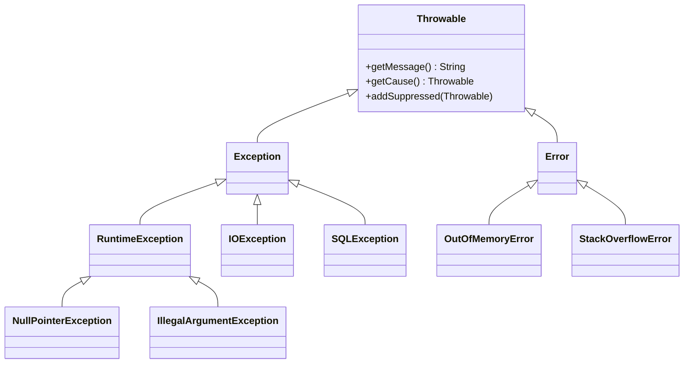
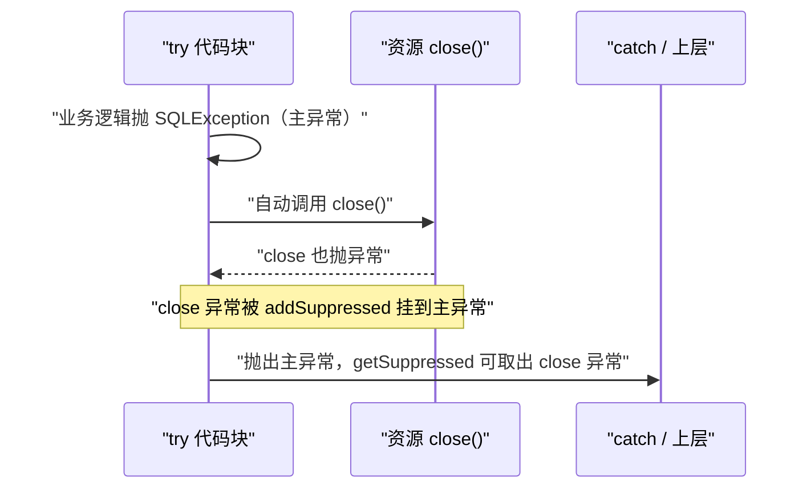
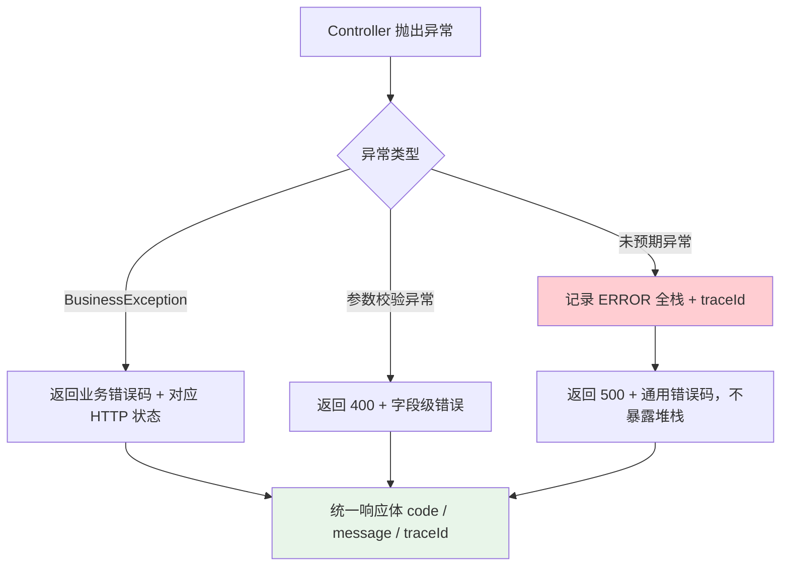

# 异常体系与日志规范

> 定位：线上故障时，你手里只有两样东西——异常堆栈和日志。但大量代码在主动毁掉这两样证据：`catch` 后只打 `e.getMessage()`、`printStackTrace()` 打进 stderr、日志没有 traceId、异步队列满了悄悄丢、异常被包装后 cause 消失。这篇把异常体系、性能边界、日志规范和统一错误码串起来，读完能写出「故障时能自证清白」的代码。

## 一、为什么需要它

异常和日志经常被当成「顺手写一下」的东西，直到出事：

1. 线上 500，日志里只有一行 `null`，因为只打了 `e.getMessage()`。
2. `e.printStackTrace()` 输出到 `System.err`，容器采集不到，重启后彻底消失。
3. 空 `catch` 块吞掉异常，数据不一致了三天没人发现。
4. 日志里没有 traceId，一次请求跨 8 个服务，无法串起来。
5. 异步日志队列满后静默丢弃，恰好丢掉最关键的那条 ERROR。
6. 用异常做流程控制，10 万次循环抛 10 万次异常，CPU 全耗在填栈上。

这些问题的共同点是：**平时看不出来，故障时集中要命**。异常体系决定「错误怎么表达」，日志规范决定「错误怎么留证」，两者必须一起设计。

## 二、核心原理

### 2.1 Throwable 三兄弟：Error、Exception、RuntimeException



读图要点：`Error` 和 `Exception` 是两条分支——`Error` 表示 JVM 层面的严重问题，`Exception` 才是应用该处理的；`RuntimeException` 及其子类是非受检异常，其余 `Exception` 子类是受检异常。

关键认知：**`Error` 不是给你 catch 的**。`OutOfMemoryError` 捕获后往往连日志都分配不出内存；`StackOverflowError` 捕获后栈已经接近耗尽。顶层可以记录，但不要试图「恢复」。业务异常统一继承 `RuntimeException`，由边界处的统一处理器兜底。

### 2.2 受检 vs 非受检的取舍

| 维度 | 受检异常 | 非受检异常 |
|---|---|---|
| 编译期检查 | 必须 catch 或 throws | 不强制 |
| 表达语义 | 可预期的外部失败，调用方有能力处理 | 编程错误、业务规则拒绝 |
| 对签名的影响 | 污染方法签名，层层向上传染 | 无侵入 |
| Spring 事务默认回滚 | 不回滚 | 回滚 |

Spring 的 `@Transactional` 默认只在抛出 `RuntimeException` 或 `Error` 时回滚，受检异常默认**不回滚**——这是「事务莫名没生效」的高频原因之一，详见 [Spring 事务原理与失效场景](../04-Spring体系源码/04-Spring事务原理与失效场景.md)。需要回滚受检异常时必须显式写 `@Transactional(rollbackFor = Exception.class)`。

工程上的主流取舍：业务异常继承 `RuntimeException` 并带错误码；受检异常只用于「调用方确实能恢复」的场景（重试、降级、切换备用通道）；不要让受检异常层层穿透到 Controller，在边界转换成统一响应。

### 2.3 try-with-resources 与 suppressed 异常

```java
try (Connection conn = dataSource.getConnection();
     PreparedStatement ps = conn.prepareStatement(SQL)) {
    ps.setLong(1, orderId);
    ps.executeUpdate();
} catch (SQLException e) {
    log.error("update order failed, orderId={}", orderId, e);
    throw new BusinessException(ErrorCode.SYSTEM_ERROR, e);
}
```

编译器会展开成 try/finally，并在 finally 里调用 `close()`。关键细节：**如果 try 块和 close 同时抛异常，close 的异常会被 `addSuppressed` 挂到主异常上，主异常继续向外抛**，不会覆盖原始失败原因。



读图要点：主异常永远优先，close 异常作为 suppressed 附加；SLF4J 打印异常时会一并输出 suppressed 段，所以**不要手工只打 `getMessage()`**。自定义资源只需实现 `AutoCloseable`，把清理逻辑放进 `close()`，且 `close()` 自身不要再抛异常。

### 2.4 异常表与性能：为什么不要用异常控流

**「try-catch 本身几乎不花钱，抛异常才花钱」**。JVM 在方法字节码里维护一张异常表，记录 `from / to / target / type`：没有异常时正常执行，不做额外检查；异常发生时才按表查找 handler 并跳转。

成本主要是三块：**对象分配**（异常对象本身）；**`fillInStackTrace`**（默认构造时遍历并填充整个调用栈，最贵的部分）；**栈展开与 JIT 影响**（异常路径通常不被内联优化，频繁抛出会干扰 JIT 的乐观假设）。

所以「用异常表示『查不到』」在循环里是灾难：10 万次循环抛 10 万次异常，等于 10 万次填栈。

一个容易被忽略的坑是 **fast throw**：JIT 对 NPE、数组越界等隐式异常，在同一位置抛出很多次后会改为抛一个预分配的、**没有堆栈**的异常实例。日志里就会看到 `java.lang.NullPointerException` 后面空空如也。排查时加 `-XX:-OmitStackTraceInFastThrow` 可关闭该优化，拿到完整堆栈。

### 2.5 日志规范：级别、参数化、MDC、异步与脱敏

| 级别 | 用途 | 示例 | 线上默认 |
|---|---|---|---|
| ERROR | 需要人介入的失败，影响主流程 | 支付回调失败、连接池耗尽 | 输出 |
| WARN | 可自愈或已降级，但值得关注 | 重试成功、缓存击穿回源 | 输出 |
| INFO | 关键业务里程碑，量可控 | 订单创建、状态流转 | 输出 |
| DEBUG | 诊断细节，默认关闭 | 方法入参、SQL 与耗时 | 关闭 |

三条硬规则：**用参数化日志**（`log.info("order={}", id)`，级别未开启时参数不会执行 `toString()`）；**异常对象作为最后一个参数**（`log.error("pay failed, orderId={}", id, e)`，框架才会打印 cause 链和 suppressed）；**不要在循环里打 INFO**（批量处理只打汇总）。

**MDC** 本质是一个绑定在线程上的 `Map<String, String>`，日志框架输出时把键值填进 pattern。典型用法是在 Filter 里放 traceId，`finally` 里清理：

```java
public class TraceFilter extends OncePerRequestFilter {
    protected void doFilterInternal(HttpServletRequest req, HttpServletResponse resp,
                                    FilterChain chain) throws ServletException, IOException {
        String traceId = Optional.ofNullable(req.getHeader("X-Trace-Id"))
                .orElse(UUID.randomUUID().toString().replace("-", ""));
        MDC.put("traceId", traceId);
        try {
            chain.doFilter(req, resp);
        } finally {
            MDC.clear();   // 线程复用，必须清理
        }
    }
}
```

MDC 底层是 ThreadLocal，线程池复用线程时如果不清理，下个请求会带着上个请求的 traceId。这和控制台日志「串号」是同一个根因，详见 [ThreadLocal 原理与内存泄漏](../02-Java底层与并发/12-ThreadLocal原理与内存泄漏.md)。

**结构化日志**：把日志输出为 JSON（如 LogstashEncoder），字段可被采集端直接索引，MDC 里的 traceId 会成为独立字段，而不是靠正则从文本中抠；代价是体积略大、可读性下降，通常采集链路用 JSON、本地开发用文本。

**异步日志与丢日志**：同步写盘阻塞业务线程，生产一般配 AsyncAppender（Logback）或 AsyncLogger（Log4j2），代价是队列满时必须取舍：`neverBlock=false` 阻塞业务线程保证不丢；`neverBlock=true` 直接丢弃保证延迟；`discardingThreshold` 在剩余容量低于阈值时丢弃 INFO/DEBUG/TRACE，ERROR/WARN 仍保留。

**脱敏**：手机号、身份证、银行卡、密码、token 必须在日志边界处理。最可靠的是**在打日志的源头就不打敏感字段**，其次才是日志框架 converter 做正则替换——后者容易漏，且无法处理已拼进消息体的内容。

### 2.6 统一异常处理与错误码分层

Spring MVC 的异常处理是一条责任链：`@ExceptionHandler` → `ResponseStatusExceptionResolver` → `DefaultHandlerExceptionResolver` → 容器兜底。`@RestControllerAdvice` 把 `@ExceptionHandler` 提升为全局。



读图要点：业务异常「可预期、可展示」，直接映射错误码；未预期异常「不可展示、必须留证」，日志打全栈、响应只给通用提示。**永远不要把堆栈返回给调用方**，那既是信息泄露，也是无效信息。

错误码按「谁的责任」分层：

| 段位 | 含义 | 示例 | 调用方动作 |
|---|---|---|---|
| `A0xxx` | 客户端/参数问题 | `A0400` 参数不合法 | 修正请求后重试 |
| `B1xxx` | 业务规则拒绝 | `B1001` 订单不存在 | 提示用户，不重试 |
| `C2xxx` | 第三方/依赖失败 | `C2001` 支付通道超时 | 可重试或降级 |
| `S5xxx` | 系统内部错误 | `S5000` 系统繁忙 | 稍后重试并告警 |

HTTP 状态码表达**传输/协议层结果**，业务码表达**业务语义**：参数错误用 400、鉴权用 401/403、未预期异常用 500、业务拒绝用 200 或 409，响应体里始终带业务码。

## 三、关键机制、代码与配置

### 3.1 错误码枚举与业务异常

```java
public enum ErrorCode {
    PARAM_INVALID("A0400", "参数不合法", 400),
    ORDER_NOT_FOUND("B1001", "订单不存在", 404),
    PAY_TIMEOUT("C2001", "支付通道超时", 504),
    SYSTEM_ERROR("S5000", "系统繁忙，请稍后重试", 500);

    private final String code;
    private final String message;
    private final int httpStatus;

    ErrorCode(String code, String message, int httpStatus) {
        this.code = code; this.message = message; this.httpStatus = httpStatus;
    }
    public String getCode() { return code; }
    public String getMessage() { return message; }
    public int getHttpStatus() { return httpStatus; }
}
```

```java
public class BusinessException extends RuntimeException {
    private final ErrorCode errorCode;

    public BusinessException(ErrorCode errorCode) {
        super(errorCode.getMessage());
        this.errorCode = errorCode;
    }
    public BusinessException(ErrorCode errorCode, Throwable cause) {
        super(errorCode.getMessage(), cause);   // 保留 cause，排查时能追溯根因
        this.errorCode = errorCode;
    }
    public ErrorCode getErrorCode() { return errorCode; }
}
```

业务异常继承 `RuntimeException`，既能被 `@Transactional` 默认回滚，也不会污染方法签名。

### 3.2 全局异常处理器

```java
@RestControllerAdvice
public class GlobalExceptionHandler {
    private static final Logger log = LoggerFactory.getLogger(GlobalExceptionHandler.class);

    @ExceptionHandler(BusinessException.class)
    public ResponseEntity<ApiResponse<Void>> handleBusiness(BusinessException e) {
        ErrorCode ec = e.getErrorCode();
        log.warn("business error code={} msg={}", ec.getCode(), e.getMessage());
        return ResponseEntity.status(ec.getHttpStatus())
                .body(ApiResponse.fail(ec.getCode(), ec.getMessage(), MDC.get("traceId")));
    }

    @ExceptionHandler(MethodArgumentNotValidException.class)
    public ResponseEntity<ApiResponse<Void>> handleValidation(MethodArgumentNotValidException e) {
        String detail = e.getBindingResult().getFieldErrors().stream()
                .map(f -> f.getField() + ": " + f.getDefaultMessage())
                .collect(Collectors.joining("; "));
        return ResponseEntity.badRequest().body(ApiResponse.fail("A0400", detail, MDC.get("traceId")));
    }

    @ExceptionHandler(Exception.class)
    public ResponseEntity<ApiResponse<Void>> handleUnknown(Exception e) {
        log.error("unexpected error traceId={}", MDC.get("traceId"), e);  // 异常作最后一个参数
        return ResponseEntity.status(500)
                .body(ApiResponse.fail("S5000", "系统繁忙，请稍后重试", MDC.get("traceId")));
    }
}
```

注意两个细节：更具体的异常类型会被优先匹配（Spring 选最贴近的 handler）；`handleUnknown` 只记录、不把 `e.getMessage()` 返回给调用方，避免泄露 SQL、表名、内网地址。

### 3.3 Logback 配置示例

```xml
<configuration>
    <property name="PATTERN" value="%d{yyyy-MM-dd HH:mm:ss.SSS} %-5level [%thread] [%X{traceId}] %logger{36} - %msg%n"/>

    <appender name="FILE" class="ch.qos.logback.core.rolling.RollingFileAppender">
        <rollingPolicy class="ch.qos.logback.core.rolling.SizeAndTimeBasedRollingPolicy">
            <fileNamePattern>logs/app.%d{yyyy-MM-dd}.%i.log.gz</fileNamePattern>
            <maxFileSize>200MB</maxFileSize>
            <maxHistory>7</maxHistory>
            <totalSizeCap>20GB</totalSizeCap>
        </rollingPolicy>
        <encoder><pattern>${PATTERN}</pattern></encoder>
    </appender>

    <appender name="ASYNC" class="ch.qos.logback.classic.AsyncAppender">
        <queueSize>1024</queueSize>
        <discardingThreshold>0</discardingThreshold>
        <neverBlock>false</neverBlock>
        <appender-ref ref="FILE"/>
    </appender>

    <root level="INFO"><appender-ref ref="ASYNC"/></root>
</configuration>
```

取舍是「不丢日志优先」：`neverBlock=false` + `discardingThreshold=0`（队列压力下也不丢低级别日志），代价是极端流量下业务线程可能被日志阻塞。反过来，延迟敏感的业务可以把 `neverBlock` 设为 `true`，并给 ERROR 单独配同步 appender 兜底。

### 3.4 参数速查

| 配置 | 作用 | 建议 |
|---|---|---|
| `discardingThreshold` | 队列压力下丢弃低级别的阈值 | 关键业务设 0 |
| `-XX:-OmitStackTraceInFastThrow` | 关闭 fast throw | 排查「空堆栈 NPE」时临时开启 |
| `rollbackFor` | 指定回滚的异常类型 | 有受检异常时显式写 `Exception.class` |

## 四、生产坑点与排查

### 坑点 1：`e.printStackTrace()` 打到 stderr，日志系统收不到

**现象**：本地能看到的异常，线上日志文件里完全没有。
**原因**：`printStackTrace()` 默认写到 `System.err`，多数日志采集只收 stdout 或指定文件；容器重启后 stderr 也可能丢失。
**解法**：全部替换为 `log.error("context...", e)`；用静态检查规则禁止 `printStackTrace`；确认容器 stdout/stderr 都被采集。

### 坑点 2：只打 `e.getMessage()`，堆栈丢失

**现象**：日志里只有一行 `null` 或 `Invalid bound statement`，不知道哪一行、哪个参数。
**原因**：`getMessage()` 只有简短描述，异常类型、调用栈、cause 链全都没有；NPE 的 message 在旧版本还可能是 null。
**解法**：异常对象作为日志最后一个参数传入；需要上下文就加参数化占位符；排查时临时加 `-XX:-OmitStackTraceInFastThrow`。

### 坑点 3：吞异常或包装时丢掉 cause

**现象**：业务报「系统异常」，但没有任何底层错误信息；或者 catch 后 `throw new RuntimeException(e.getMessage())`。
**原因**：空 catch 块；包装时只传 message，没传 cause，异常链断裂。
**解法**：至少 `log.error` 并保留异常；包装用 `new BusinessException(ec, e)`；禁止空 catch，确实要忽略时也必须记录并说明原因。

### 坑点 4：大报文整串打日志，堆和磁盘一起爆

**现象**：接口偶发 OOM，或日志一天几十 GB；GC 日志显示大量 char[]/byte[]。
**原因**：把几 MB 的请求/响应体完整拼成 String 后打 INFO，异步队列再复制一份。
**解法**：只打长度、摘要、关键字段；必须打全文时截断到 1KB 并记录原长度；大报文用流式解析，避免构造整体字符串。

### 坑点 5：异步日志队列满，静默丢日志

**现象**：压测或大促时日志缺段，恰好缺失 ERROR；没有任何报错。
**原因**：`neverBlock=true` 或 `discardingThreshold` 设置过大，队列满后直接丢弃。
**解法**：关键业务 `neverBlock=false`、`discardingThreshold=0`；ERROR 单独配同步 appender；监控 AsyncAppender 的丢弃计数。

### 坑点 6：日志未脱敏，敏感信息落盘

**现象**：安全审计发现日志里有明文手机号、身份证、银行卡、token。
**原因**：直接 `log.info("req={}", request)` 打印整个对象；异常消息里拼了 SQL 参数。
**解法**：源头不打印敏感字段；统一脱敏工具处理手机号/证件号；日志采集侧再加一层 mask；禁止把密码、密钥写入任何日志。

## 五、规范与最佳实践

### 5.1 异常设计检查清单

1. **业务异常继承 `RuntimeException`**，携带错误码而不是只有字符串。
2. **保留 cause**：包装异常必须传原始异常，否则异常链断裂。
3. **不要在异常消息里拼敏感信息**：密码、token、完整身份证都不该出现。
4. **不要用异常控流**：可预期分支用返回值或 `Optional`，异常只表达「异常」。
5. **不要 catch `Throwable`**：除非顶层兜底，且必须把 `Error` 重新抛出。
6. **不要 log-and-throw**：同一异常只在一处记录，通常在最外层边界。
7. **不要让受检异常穿透到 Controller**：在边界转换成业务异常或统一响应。

### 5.2 日志使用规范

| 场景 | 做法 |
|---|---|
| 方法入口/出口 | DEBUG，参数化，避免大对象 `toString` |
| 关键业务节点 | INFO，包含业务主键、状态变化 |
| 可恢复失败 | WARN，包含重试次数、降级策略 |
| 需要人介入 | ERROR，必须带异常堆栈和 traceId |

### 5.3 明确不推荐的场景

- **用异常实现「未找到」分支**：高频路径应返回 `Optional` 或空集合。
- **给每个方法都 `throws Exception`**：等于放弃受检异常的检查价值。
- **在 finally 里 return 或抛异常**：会覆盖 try 块的返回值/异常。
- **把日志当审计**：日志会被轮转清理，关键操作要落库或发消息。
- **只靠日志排障**：链路追踪、指标、堆转储要配合，见 [链路追踪](../13-可观测性/02-链路追踪.md)。

## 六、面试高频问法

**Q1：Error 和 Exception 有什么区别？**

**一句话结论**：都继承 `Throwable`；`Error` 表示 JVM 层面无法恢复的严重问题（OOM、栈溢出），应用不应尝试恢复；`Exception` 表示应用可处理的异常，又分受检与非受检。

展开：`Error` 常见子类有 `OutOfMemoryError`、`StackOverflowError`、`NoClassDefFoundError`；`Exception` 下 `RuntimeException` 是非受检，其余是受检；`Error` 捕获后往往连日志都分配不出内存，顶层记录即可。

加分点：补充「`StackOverflowError` 是 Error 不是 Exception，因为它表示栈空间耗尽，捕获后继续执行是不安全的」。

**Q2：受检异常和非受检异常怎么选？**

**一句话结论**：业务异常用非受检（继承 `RuntimeException`），可预期的外部失败且调用方确实能恢复时才用受检；受检异常会污染签名、对 Lambda 不友好，且 Spring 事务默认不回滚。

展开：受检异常强制处理，但常被 `catch` 后原样包装，失去意义；`@Transactional` 默认只回滚 `RuntimeException` 和 `Error`；Stream/Lambda 的函数式接口不声明受检异常，只能包装。

加分点：点出「不是『受检更安全』，而是『受检更适合调用方有能力恢复的场景』；业务规则拒绝不是可恢复错误」。

**Q3：try-with-resources 的原理是什么？suppressed 异常是什么？**

**一句话结论**：编译器把它展开为 try/finally 并在 finally 调 `close()`；若 try 和 close 同时抛异常，close 异常被 `addSuppressed` 挂到主异常上，主异常优先抛出。

展开：资源需实现 `AutoCloseable`；关闭顺序与声明顺序相反；`getSuppressed()` 可取回被抑制的异常；日志框架会打印 suppressed 段，所以不要只打 message。

加分点：说清「主异常不能被 close 异常覆盖，否则真正的失败原因就丢了」，这是它相对手写 finally 的核心价值。

**Q4：异常影响性能吗？为什么不要用异常控流？**

**一句话结论**：try-catch 在没有异常时几乎零成本（异常表机制）；抛异常才贵，主要贵在对象分配和 `fillInStackTrace` 遍历调用栈，所以高频分支不能用异常表达。

展开：JVM 用异常表定位 handler，正常路径无额外检查；`fillInStackTrace` 是 native 调用并分配数组；异常路径通常不被 JIT 内联优化；隐式异常还会触发 fast throw，导致堆栈为空。

加分点：提到 `-XX:-OmitStackTraceInFastThrow`，并说明「日志里 NPE 没堆栈不一定是日志配置问题，可能是 JIT 的 fast throw」。

**Q5：为什么不能吞异常？**

**一句话结论**：吞异常会让失败「静默通过」，调用方以为成功，数据可能已经不一致；至少要以 ERROR/WARN 记录并保留堆栈，能处理则处理，不能处理就向上抛。

展开：空 catch 是最危险的写法；「记录后忽略」也要说明为什么不影响主流程；吞掉 `InterruptedException` 还会丢失中断信号，必须 `Thread.currentThread().interrupt()`。

加分点：指出「吞异常不是『避免报错』，而是把可观测的失败变成了不可观测的数据损坏」。

**Q6：异步日志会丢日志吗？怎么避免？**

**一句话结论**：会。异步 Appender 队列满时会按配置阻塞或丢弃；`discardingThreshold` 还会在队列压力下丢弃低级别日志。避免方式是调大队列、关键业务关闭丢弃、ERROR 单独同步兜底，并监控丢弃计数。

展开：`neverBlock=false` 阻塞保不丢但影响延迟；`neverBlock=true` 丢弃保延迟但缺日志；进程崩溃时队列中未落盘的事件也会丢。

加分点：补充「日志不是审计，关键操作要落库或发消息，不能只依赖日志文件」。

**Q7：MDC 的原理是什么？线程池里为什么会丢？**

**一句话结论**：MDC 底层是 ThreadLocal，绑定在当前线程上；线程池复用线程时，如果任务开始前没有重新设置、结束后没有清理，就会丢 traceId 甚至串到别的请求。

展开：Filter 里 `MDC.put`，finally 里 `MDC.clear`；异步任务、`@Async`、`CompletableFuture` 默认不传递 MDC；需要在任务包装时捕获并恢复，或用 TTL 类方案。

加分点：把 MDC 和链路追踪连起来——traceId 只是最小实现，完整方案见 [链路追踪](../13-可观测性/02-链路追踪.md)。

**Q8：统一异常处理怎么做？HTTP 状态码和业务错误码怎么设计？**

**一句话结论**：用 `@RestControllerAdvice` + `@ExceptionHandler` 按异常类型分别处理；HTTP 状态码表达协议层结果，业务码表达业务语义，响应体统一带 code/message/traceId，未预期异常只记录全栈、不返回细节。

展开：业务异常映射到对应 HTTP 状态和业务码；参数校验异常返回 400 + 字段错误；未知异常返回 500 + 通用提示；错误码按「客户端/业务/第三方/系统」分段；不要泄露堆栈、SQL、内网地址。

加分点：补充「错误码要稳定、可检索、可告警，不能把异常 message 直接当错误码，否则前端无法分支处理」。

**Q9：自定义异常应该怎么设计？什么时候该包装异常？**

**一句话结论**：自定义异常继承 `RuntimeException`，携带错误码和必要上下文，保留 cause；在跨越边界（DAO → Service → Controller、内部 → 外部协议）时包装，把技术异常翻译成业务语义。

展开：异常类按领域划分，避免一个 `BizException` 打天下；包装必须传 cause；同一异常只记录一次，通常在边界；异常消息面向排障，响应消息面向用户，两者分离。

加分点：指出「包装不是掩盖，cause 必须保留；如果包装后连原始异常都拿不到，等于人为制造了『无根因故障』」。

## 小结

- **Error 不该捕获，Exception 才该处理**；业务异常继承 `RuntimeException`，受检异常只用于调用方确实能恢复的场景。
- **try-with-resources 保证主异常优先**，close 异常作为 suppressed 附加，日志要打异常对象而不是只打 message。
- **异常的成本在抛出而非 try 块**，`fillInStackTrace` 是主要开销，高频分支不要用异常控流；注意 JIT fast throw 导致的空堆栈。
- **日志三原则：参数化、带异常对象、带 traceId**；异步日志要在「丢」与「阻塞」之间显式取舍。
- **统一异常处理 + 分层错误码**：业务异常可展示，未知异常只留证；HTTP 状态码与业务码是两个维度。
- **不吞异常、不丢 cause、不 log-and-throw、不打印敏感信息**，这四条是排障能力的底线。

## 参考资料

- Java Language Specification（SE 21）第 11 章「Exceptions」、第 14.20 节「The try statement」
- Java Platform SE 21 API 文档：`java.lang.Throwable`、`java.lang.AutoCloseable`、`java.lang.StackTraceElement`
- SLF4J 2.x 用户手册：Parameterized messages、MDC 章节
- Logback 手册：AsyncAppender、RollingFileAppender、MDC 章节
- Spring Framework Reference：Exception Handling（`@ExceptionHandler`、`@ControllerAdvice`）
- 《Effective Java》（第 3 版）第 69-77 条「只针对异常的情况才使用异常」等
