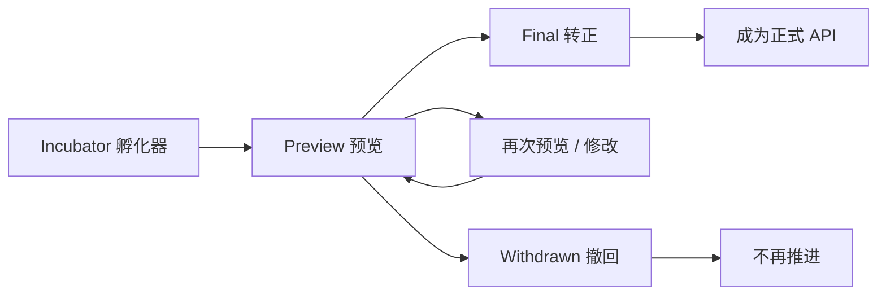

# JDK 22–25 新特性：从「能用虚拟线程」到「能放心用」

> 定位：JDK 21 解决了「虚拟线程存不存在」的问题，JDK 22–25 解决的是「敢不敢在生产用」的问题——`synchronized` 不再钉住载体线程、请求上下文有了比 `ThreadLocal` 更省内存的传递方式、对象头开始压缩、AOT 把启动时间往下压。这篇按版本逐年拆开：哪些特性已转正、哪些还在预览、升级时哪些默认值变了，最后给一份可执行的升级路线与踩坑清单。

## 一、为什么值得单独讲 22–25

很多人对 Java 版本的记忆停在「8 → 11 → 17 → 21」四个 LTS，中间的 22、23、24 直接被当成「过渡版本」跳过。这个判断在**选 LTS 基线**时是对的，但在**做技术决策**时是错的，原因有三点：

1. **非 LTS 版本里的特性会先于下一个 LTS 进入生态**。Spring Boot、Micrometer、各类 Agent（Arthas、SkyWalking）通常在新版本发布后 1–2 个季度内跟进。你在 21 上遇到的「虚拟线程一压测就卡住」，答案就在 24 的 JEP 491 里，而不是在 25 的发布公告里。
2. **默认值在 22–25 之间改了好几处**，最典型的是分代 ZGC 在 23 成为默认、32 位 x86 端口在 25 被移除、`SecurityManager` 在 24 被永久禁用。这些变化不看版本说明就会在升级当天炸。
3. **25 是 LTS，但它的大部分「新东西」其实是 22–24 的延续**。把 22–24 看懂了，25 的升级评估工作量会下降一大半；反过来，只读 25 的 release notes，很容易把「24 就已转正」的 JEP 误判成「25 才有的新特性」。

先给结论：**21 是「能用虚拟线程」，25 是「虚拟线程能放心用」**。中间的 22–24 特性可以学、可以试点，但生产基线不必逐个追。

### 1.1 版本节奏与支持窗口

| 版本 | 发布时间 | 类型 | 关键意义 | 建议 |
|---|---|---|---|---|
| 21 | 2023-09 | LTS | 虚拟线程、分代 ZGC、Record 模式转正 | 存量系统的主力基线 |
| 22 | 2024-03 | 非 LTS | FFM API 转正、未命名变量转正 | 学特性、做试点 |
| 23 | 2024-09 | 非 LTS | Markdown 注释、分代 ZGC 默认、原始类型模式首预览 | 观望，注意 GC 默认值变化 |
| 24 | 2025-03 | 非 LTS | pinning 修复、Gatherers、Class-File API、SecurityManager 永久禁用 | 虚拟线程重度用户优先评估 |
| 25 | 2025-09 | LTS | Scoped Values、四个语言特性转正、紧凑对象头产品化 | 新项目基线、存量系统升级目标 |

> 支持窗口提醒：Oracle JDK 25 提供至少 8 年支持（NFTC 免费条款下的季度更新至 2028-09，之后 OTN 至 2033-09）。具体条款以你实际使用的发行版（Oracle、Temurin、Zulu、Dragonwell 等）为准，不要拿一个发行版的政策套另一个。

## 二、版本地图：先分清「转正」和「预览」

Java 的特性状态不是二元的，升级评估时必须先分清五种状态，否则就会出现「文档里写了、代码里编译不过」的尴尬。



| 状态 | 含义 | 使用条件 | 典型例子 |
|---|---|---|---|
| Incubator | 独立模块，API 可能大改 | 显式引入模块 | Vector API（第 10 轮孵化） |
| Preview | 语言/库特性，需开关 | `--enable-preview` + `--release` 对齐 | 原始类型模式、结构化并发 |
| Final | 正式特性，长期维护 | 直接使用 | Scoped Values、Gatherers |
| Experimental | JVM 实现层实验 | `-XX:+UnlockExperimentalVMOptions` | 紧凑对象头（24） |
| Withdrawn | 撤回，不再推进 | 不可用 | 字符串模板（JEP 465） |

三个容易踩的点：

- **预览特性必须整体编译、整体运行**。`javac --release 25 --enable-preview` 编出来的 class，JVM 启动也必须带 `--enable-preview`，否则直接 `UnsupportedClassVersionError`。
- **预览特性的 class 文件版本号带 `0xFFFF` 后缀**，很多字节码工具（ASM、部分 Agent、部分 APM 探针）不认识，会在类加载阶段报错。生产别用预览特性，这条不是保守，是被坑出来的。
- **Experimental 不等于可用**。紧凑对象头在 24 需要 `-XX:+UnlockExperimentalVMOptions -XX:+UseCompactObjectHeaders`，到 25 不再需要 unlock 参数，但**默认仍是关闭**——「产品化」和「默认开启」是两件事。

## 三、JDK 22：把「能用」补成「好用」

JDK 22 没有引爆点，但有两个长期价值很高的转正：FFM API 和未命名变量。

### 3.1 FFM API 转正（JEP 454）：JNI 的替代路径

`java.lang.foreign` 在 22 转正，意味着**不用写一行 C 代码**就能调用本地库、访问堆外内存。它不是「JNI 的语法糖」，而是把本地调用从「编译器 + 头文件 + 手工引用管理」变成「纯 Java + Arena 作用域」。

```java
// 调用 strlen：MethodHandle + Arena，内存生命周期由 try-with-resources 兜住
try (Arena arena = Arena.ofConfined()) {
    SymbolLookup stdlib = Linker.nativeLinker().defaultLookup();
    MethodHandle strlen = Linker.nativeLinker().downcallHandle(
        stdlib.find("strlen").orElseThrow(),
        FunctionDescriptor.of(ValueLayout.JAVA_LONG, ValueLayout.ADDRESS));

    MemorySegment cString = arena.allocateFrom("hello ffi");
    long len = (long) strlen.invokeExact(cString);
    System.out.println(len); // 9
}
```

工程上的意义：

| 场景 | 旧做法 | FFM 之后 | 收益 |
|---|---|---|---|
| 调用加密机/硬件 SDK | JNI + C 胶水层 | 纯 Java 绑定 | 去掉编译链，跨平台打包简单 |
| 大文件/Mmap 读取 | `FileChannel.map` + 手工清理 | `MemorySegment` + Arena | 越界访问有边界检查，不易踩内存 |
| 高性能序列化 | 堆内 byte[] 拷贝 | 堆外 segment 直接读写 | 少一次拷贝，GC 压力下降 |
| 替换 `sun.misc.Unsafe` | 反射拿 Unsafe | 标准 API | 25 之后 Unsafe 内存方法将逐步移除 |

> 注意：FFM 的 `downcallHandle` 每次调用都有约几十纳秒的边界开销，**适合「调用次数少、单次较重」的本地库**（加密、压缩、图像处理），不适合把逐条记录的处理下沉到本地调用。批量化仍然是第一原则。

### 3.2 未命名变量与模式（JEP 456）

`_` 表示「这个值我不关心」，替代 `ignored`、`unused` 这类靠命名表达意图的写法：

```java
try (var _ = ScopedResource.open()) {   // 只关心副作用，不关心句柄
    handle();
}

switch (obj) {
    case Point(int x, int _) -> System.out.println("x=" + x);  // y 不关心
    case null -> System.out.println("null");
    default -> System.out.println("other");
}
```

它看起来只是省了一个变量名，实际收益是**消除「命名即承诺」的误导**——`ignored` 会被后来的人当成「可以删但不敢删」，`_` 明确告诉你这里就是占位。

### 3.3 字符串模板为什么被撤回

JDK 21 引入字符串模板（JEP 430），22 是第二轮预览（JEP 459），23 之后被 **JEP 465 撤回**。原因不是「不好用」，而是设计上难以同时满足「安全插值」和「模板处理器可扩展」——尤其是 SQL 注入防护场景，模板处理器需要理解目标语法，这个抽象没收敛。

工程结论：**不要基于预览版字符串模板写业务代码**，用 `String.format`、`MessageFormat` 或模板引擎（Freemarker、Thymeleaf）。等官方给出最终形态再迁。

### 3.4 其他值得记一笔的 22 变化

- **JEP 458 多文件源码程序**：`java Main.java` 可以自动编译同目录的其他源文件，脚本化场景不用再先 `javac`。
- **JEP 423 G1 区域固定（Region Pinning）**：G1 在 JNI 临界区不再需要禁用 GC，降低本地调用期间的停顿风险。
- **JEP 447 构造器前语句（预览）**：`super()` 之前可以写参数校验，这条最终在 25 转正（JEP 513）。

## 四、JDK 23：默认值开始变，别按旧经验调参

JDK 23 最容易被忽略，但它改了两个「默认值」，直接影响生产。

### 4.1 分代 ZGC 成为默认（JEP 474）

从 23 起，`-XX:+UseZGC` 默认就是**分代模式**，不再需要 `-XX:+ZGenerational`。这打破了一个流传很广的旧结论：「ZGC 不分代、对吞吐不友好」。

| 旧认知 | 23 之后的现实 | 影响 |
|---|---|---|
| ZGC 单代，适合低延迟不适合高吞吐 | 默认分代，短命对象在小代回收 | 大多数 Web 服务可以直接用 ZGC 替代 G1 |
| `-XX:+ZGenerational` 必须显式加 | 默认开启，参数已废弃 | 旧启动脚本里的参数要清理，否则告警 |
| ZGC 内存开销大 | 分代后回收更及时，堆占用更可控 | 容器内存 limit 可以重新评估 |

> 25 的 JEP 490 进一步**移除非分代模式**，`-XX:-ZGenerational` 之类的参数彻底失效。升级到 25 前，务必把启动脚本里的 ZGC 相关参数清一遍，否则 JVM 直接起不来。

### 4.2 Markdown 文档注释（JEP 467）

javadoc 支持 CommonMark：`**加粗**`、`| 表格 |`、围栏代码块直接写，不用再拼 `<table>`、`<pre>`。

```java
/// 计算订单的可退金额
///
/// 规则：
/// 1. 未发货全额退
/// 2. 已发货扣除运费
///
/// | 状态 | 可退 |
/// |------|------|
/// | 未发货 | 100% |
public BigDecimal refundableAmount(Order order) { ... }
```

对团队的实际价值：**文档和代码在同一个 diff 里评审**，API 文档不再依赖「谁记得去改 wiki」。

### 4.3 原始类型模式首预览（JEP 455）

`instanceof` 和 `switch` 开始支持 `int`、`long`、`double` 等原始类型，配合 `when` 做范围判断：

```java
// 预览特性，需 --enable-preview
double score = 87.5;
String level = switch (score) {
    case double d when d >= 90 -> "A";
    case double d when d >= 80 -> "B";
    default -> "C";
};
```

它的长期意义是**让模式匹配覆盖全部类型系统**，而不是「对象一套、原始类型一套」。但到 25 仍是第三轮预览，API 还有调整可能，核心链路不要用。

### 4.4 其他 23 变化

- **JEP 471 弃用 `sun.misc.Unsafe` 内存访问方法**：开始给警告，为后续移除铺路；这也是 FFM 必须尽早接管的原因。
- **JEP 476 模块导入声明（预览）**、**JEP 482 灵活构造器体（第三次预览）**：两条都在 25 转正。
- **JEP 480 结构化并发（第三次预览）**：API 继续收敛，25 是第五轮预览。

## 五、JDK 24：虚拟线程的「最后一公里」

如果只挑一个版本升级，虚拟线程重度用户应该选 24，因为 JEP 491 修掉了 21 上最难受的 pinning 问题。

### 5.1 JEP 491：`synchronized` 不再钉住载体线程

21 上的规则是「虚拟线程里别用 `synchronized` 包阻塞调用，要换 `ReentrantLock`」。原因：虚拟线程在 `synchronized` 块内阻塞时，会**钉住（pin）载体线程**，平台线程被占住无法调度其他虚拟线程，并发度瞬间退化。

24 之后的行为变化：

| 场景 | JDK 21 | JDK 24+ |
|---|---|---|
| `synchronized` 块内 `Thread.sleep` | 钉住载体线程 | 释放载体线程，可调度 |
| `synchronized` 块内阻塞 IO | 钉住，并发度塌陷 | 正常卸载 |
| 大量虚拟线程争同一把锁 | 载体线程池被打满 | 锁竞争仍在，但不占载体 |
| `Object.wait()` | 仍有限制 | 仍需注意（wait/notify 语义特殊） |

```java
// 21 上的写法：为了不 pin，被迫换锁
private final ReentrantLock lock = new ReentrantLock();
public void handle() {
    lock.lock();
    try { blockingIo(); } finally { lock.unlock(); }
}

// 24+ 可以回到 synchronized，但不要「故意」用它包长 IO
public synchronized void handle() {
    blockingIo();
}
```

**别过度解读这条修复**：它解决的是「不能用」，不是「推荐用」。`synchronized` 仍然是重量级互斥，临界区越短越好；把 10 秒的 HTTP 调用塞进 `synchronized`，即使不 pin，也会把所有竞争者排队排死。

### 5.2 Stream Gatherers（JEP 485）

`Stream` 的中间操作终于可以自定义了。`Gatherers` 提供 `map`、`filter`、`windowFixed`、`windowSliding`、`scan`、`fold` 等内置实现，也能自己写 `Gatherer`。

```java
// 滑动窗口求均值：原生 Stream 写不出来
List<Double> avg = IntStream.rangeClosed(1, 10).boxed()
    .gather(Gatherers.windowSliding(3))
    .map(w -> w.stream().mapToInt(Integer::intValue).average().orElse(0))
    .toList();

// 有状态扫描：累计求和，类似 reduce 但保留中间结果
List<Integer> running = Stream.of(1, 2, 3, 4)
    .gather(Gatherers.scan(() -> 0, Integer::sum))
    .toList(); // [1, 3, 6, 10]
```

适用场景：**报表聚合、指标滑窗、事件去重、限流采样**。不适合把「需要跨元素全局状态」的逻辑硬塞进 Stream——那种场景用普通循环更清楚。

### 5.3 Class-File API 转正（JEP 484）

`java.lang.classfile` 提供标准的 class 文件读写 API，替代 ASM 的部分场景。对普通业务开发者影响不大，但对**框架、Agent、字节码增强**意义重大：不再依赖第三方库的版本兼容。

### 5.4 紧凑对象头（JEP 450，实验）

对象头从 96/128 位压到 64 位，直接减少每个对象的堆开销。24 里需要：

```bash
-XX:+UnlockExperimentalVMOptions -XX:+UseCompactObjectHeaders
```

到 25（JEP 519）不再需要 unlock 参数，但**默认关闭**，且官方明确说「可能在未来版本成为默认」。收益量级：对象密集的应用堆占用可降几个百分点，具体取决于对象大小与对齐；**不要拿它当「免费提速」**，先在小流量实例上对比 heap dump 与 GC 停顿。

### 5.5 其他 24 变化（升级必查）

| JEP | 内容 | 升级动作 |
|---|---|---|
| 486 | 永久禁用 SecurityManager | 代码/启动参数里的 `SecurityManager`、`-Djava.security.manager` 全部清理 |
| 472 | 预备限制 JNI 调用 | 启动加 `--enable-native-access=ALL-UNNAMED`，否则未来版本告警变报错 |
| 496/497 | ML-KEM、ML-DSA 后量子算法 | 有国密/PQC 需求的团队可评估，普通业务暂不急 |
| 498 | 使用 Unsafe 内存方法给警告 | 排查依赖里的 Unsafe 调用，规划迁 FFM |
| 479 | 移除 Windows 32 位 x86 | 清点 32 位 JNI 依赖 |

## 六、JDK 25 LTS：把「预览」收成「标准」

25 是 LTS，也是 22–24 的收口版本。它的语言特性几乎全是「前几轮预览转正」，真正的新增能力集中在并发上下文、运行时与工具链。

### 6.1 Scoped Values 转正（JEP 506）

`ScopedValue` 替代 `ThreadLocal` 传递「一次调用内只读的上下文」：租户 ID、TraceId、用户身份、灰度标记。

```java
static final ScopedValue<Tenant> TENANT = ScopedValue.newInstance();

void handle(Request req) {
    ScopedValue.where(TENANT, req.tenant()).run(() -> {
        service.process();          // 同一线程内可读
        executor.submit(() -> {     // 子线程可继承（结构化作用域内）
            Tenant t = TENANT.get(); // 不需要显式传参
        });
    });
}
```

为什么它比 `ThreadLocal` 更适合虚拟线程：

| 维度 | ThreadLocal | ScopedValue |
|---|---|---|
| 可变性 | 可 set/remove，易泄漏 | 不可变，作用域结束自动失效 |
| 内存 | 每个线程一份 Map，百万虚拟线程放大 | 共享同一份绑定，按作用域压栈 |
| 传递 | 子线程需 `InheritableThreadLocal` 或手工拷贝 | 作用域内子线程自动可见 |
| 推理难度 | 任何地方都能改，难追踪 | 只能在其作用域内读 |

迁移建议：**先迁「只读上下文」**（TraceId、租户、用户），`ThreadLocal` 里那些需要中途修改的（比如缓冲区、计数器）继续留着。不要在 `ScopedValue` 里塞可变对象——它的价值就来自不可变。

### 6.2 三个语言特性转正

```java
// 1) 模块导入（JEP 511）：一行导入整个模块
import module java.base;

// 2) 紧凑源文件与实例 main（JEP 512）：单文件脚本
void main() {
    IO.println("hello");   // IO 在 java.lang，自动可见
}

// 3) 灵活构造器体（JEP 513）：super() 之前做校验
class User extends Base {
    User(String name) {
        if (name == null || name.isBlank()) {
            throw new IllegalArgumentException("name required");
        }
        super(name.trim());
    }
}
```

三个特性各有边界：

- **模块导入**适合小工具、教学、示例；**大型工程慎用**，它会让依赖来源变得模糊，`import module java.base` 之后你很难说清某个类来自哪个包。
- **紧凑源文件**适合脚本、验证代码、教学；不适合作为生产代码组织方式，它没有包声明，无法被其他类正常引用。
- **灵活构造器体**要注意：`super()` 之前的语句**不能引用正在构造的对象**（不能读 `this` 字段、不能调实例方法），只能做参数校验和静态计算。

### 6.3 紧凑对象头产品化（JEP 519）

25 里 `-XX:+UseCompactObjectHeaders` 不再需要 `-XX:+UnlockExperimentalVMOptions`，但仍默认关闭。官方同时提供了 `classes_coh.jsa` 这类 CDS 归档，保证开启后的启动性能不明显退化。

评估方法（别拍脑袋）：

1. 固定堆大小与流量，跑 30 分钟基线与 30 分钟开启后对比；
2. 看 `jcmd GC.heap_info` 的堆占用、GC 次数与 P99 延迟；
3. 重点看**小对象密集**的模块（DTO、日志事件、缓存 entry），大对象为主的模块收益有限；
4. 注意 32 位压缩指针（compressed oops）的交互，堆小于 32G 时收益更明显。

### 6.4 JFR 与工具链增强

25 给 JFR 补了三块，直接提升排障能力：

| JEP | 能力 | 排障场景 |
|---|---|---|
| 518 | JFR 协作采样（Cooperative Sampling） | 采样更均匀，减少 safepoint bias，火焰图更可信 |
| 509 | JFR CPU 时间剖析（实验） | 区分「墙钟耗时」与「真正吃 CPU」，定位 IO 等待 |
| 520 | JFR 方法计时与追踪 | 不依赖字节码增强就能拿到方法级耗时 |

配合 `02-13 JVM 性能剖析：JFR、async-profiler 与火焰图` 一起看：JFR 负责「低开销常开」，async-profiler 负责「现场深挖」，两者不是替代关系。

### 6.5 安全与运行时

- **JEP 510 密钥派生函数 API（KDF）**：标准化的 HKDF、PBKDF2 等，避免各团队自己拼 `Mac` 实现。
- **JEP 496/497 后量子算法**（24 已落地，25 延续）：ML-KEM（密钥封装）、ML-DSA（签名）。金融、政企有 PQC 合规要求的可以开始评估，普通业务先关注不动。
- **JEP 503 移除 32 位 x86 端口**：还有 32 位 JNI 库的系统，25 直接不可用。这是 25 升级里最容易漏的一项。
- **JEP 490 移除 ZGC 非分代模式**：启动参数里的 `-XX:-ZGenerational` 必须删。
- **JEP 521 分代 Shenandoah**：使用 Shenandoah 的团队可评估，低延迟场景多一个选项。
- **AOT 三件套（JEP 514/515/483）**：命令行易用性、方法剖析、类加载与链接缓存，目标是把「Java 启动慢」往下压。它和 Spring AOT / Native Image 是不同路线：前者是 JVM 侧缓存，后者是提前编译，不要混谈。

## 七、性能视角：怎么量化，而不是「感觉快了」

新版本带来的性能收益，必须用同一套基准去量，否则很容易把「JIT 预热差异」当成「版本红利」。

### 7.1 四类收益与验证方法

| 收益类型 | 机制 | 验证方法 | 常见误判 |
|---|---|---|---|
| 并发度 | JEP 491 解除 pinning | 虚拟线程压测，观察载体线程数与吞吐 | 只测 QPS 不看 P99，忽略锁竞争 |
| 内存 | 紧凑对象头、分代 ZGC | heap dump 对比、GC 日志、RSS | 只开参数不控流量，堆变小但对象更多 |
| 启动 | AOT 缓存、CDS | 冷启动 20 次取 P50/P95 | 热机后测，收益被 JIT 掩盖 |
| 排障效率 | JFR 采样、方法追踪 | 故障复现时长、定位到根因的耗时 | 把工具开销当成业务变慢 |

### 7.2 一个可复用的压测脚本骨架

```bash
# 基线：JDK 21 / G1
java -Xms8g -Xmx8g -XX:+UseG1GC -XX:StartFlightRecording=filename=base.jfr,duration=600s -jar app.jar

# 对比：JDK 25 / 分代 ZGC + 紧凑对象头
java -Xms8g -Xmx8g -XX:+UseZGC -XX:+UseCompactObjectHeaders \
     -XX:StartFlightRecording=filename=coh.jfr,duration=600s -jar app.jar
```

对比时至少固定：堆大小、容器 CPU limit、流量模型、预热时长、观测窗口。**变量一次只改一个**，否则结论不可归因。

## 八、升级路线：从评估到回滚

升级 JDK 不是「改个 `JAVA_HOME`」，而是一次跨构建、运行时、框架、依赖的联合变更。建议按下面的顺序推进，每步都有明确的出口条件。

### 8.1 五阶段路线

| 阶段 | 动作 | 出口条件 |
|---|---|---|
| 1. 盘点 | 列出 JDK 版本、GC 参数、JNI/Agent、字节码工具、预览特性使用情况 | 形成「阻塞项清单」，每项有 owner |
| 2. 构建 | 升级 `maven-compiler-plugin`/`gradle toolchain`，统一 `--release` | 全模块编译通过，字节码版本一致 |
| 3. 单测 | 跑全量单测 + 集成测试，重点覆盖反射、序列化、字节码增强 | 失败用例归因为「版本行为变化」而非「环境差异」 |
| 4. 灰度 | 1 个低流量实例 → 10% → 50% → 全量，每档观察 24h | P99、错误率、GC 停顿不回退 |
| 5. 回滚预案 | 保留旧镜像与旧 `JAVA_HOME`，参数开关化 | 15 分钟内可回退 |

### 8.2 构建工具配置要点

Maven：

```xml
<properties>
  <maven.compiler.release>25</maven.compiler.release>
</properties>
```

Gradle（推荐 toolchain，避免依赖本机 JDK）：

```kotlin
java {
    toolchain { languageVersion = JavaLanguageVersion.of(25) }
}
```

要点：

- 统一用 `--release` 而不是 `source/target`，后者不会校验 JDK 内部 API 的使用。
- 多模块项目里，**父 POM 的 release 版本必须与 CI 的 JDK 一致**，否则会出现「本地能编、CI 编不过」。
- 有 Annotation Processor 的项目，先确认处理器兼容 25（很多老版本处理器依赖 `com.sun.tools.javac` 内部 API）。

### 8.3 启动参数清理清单

升级到 25 时，这些参数必须逐条确认：

| 参数 | 状态 | 处理 |
|---|---|---|
| `-XX:+ZGenerational` | 已废弃（分代是默认） | 删除 |
| `-XX:-ZGenerational` | 25 已移除非分代 | 删除，否则启动失败 |
| `-Djava.security.manager=...` | 24 起永久禁用 | 删除，改用其他沙箱方案 |
| `--illegal-access=...` | 早已废弃 | 删除 |
| `-XX:+UnlockExperimentalVMOptions`（为紧凑对象头） | 25 不再需要 | 可保留但无意义，建议删 |
| `--enable-native-access` | 24 起建议显式声明 | 补上 `ALL-UNNAMED` 或具体模块 |

## 九、兼容性坑与排障

### 坑点 1：`UnsupportedClassVersionError`

**现象**：`class file version 69.0`，当前 JVM 只支持到 65.0。

**原因**：编译用 25（major 69），运行用 21（major 65）。常见于 CI 用新 JDK 构建、镜像里还是旧 JRE。

**排查**：`javap -verbose X.class | grep major`，对比 `java -version`。**修复**：镜像基础层与构建 JDK 对齐，或用 toolchain 固定。

### 坑点 2：升级后 `SecurityManager` 相关启动失败

**现象**：`java.lang.UnsupportedOperationException: The Security Manager is deprecated and will be removed`，或 `-Djava.security.manager` 直接报错。

**原因**：24 的 JEP 486 永久禁用 SecurityManager，`System.setSecurityManager` 抛异常。

**修复**：删掉启动参数；代码里依赖 SecurityManager 做权限控制的（老中间件、老插件框架），改用 `AccessController` 替代方案或进程级隔离（容器 + 非 root + seccomp）。

### 坑点 3：升级 25 后本地库加载失败

**现象**：`UnsatisfiedLinkError`，或启动时提示 native access。

**原因**：两种可能——32 位 JNI 库（25 移除 32 位端口），或 24 起 JNI 限制预备（JEP 472）要求显式声明。

**修复**：`ldd`/`dumpbin` 确认库位数；启动参数补 `--enable-native-access=ALL-UNNAMED`（或精确到模块）；32 位依赖必须替换。

### 坑点 4：虚拟线程「升级后反而更慢」

**现象**：JDK 24+ 上把 `ReentrantLock` 换回 `synchronized`，QPS 没涨反降。

**原因**：pinning 修复只解决「载体线程被占」，不解决「锁竞争」。临界区里如果有长 IO，`synchronized` 会让所有线程排队；`ReentrantLock` 至少还能配 `tryLock` 超时。

**修复**：临界区只包必要的共享状态读写，IO 移到锁外；需要超时就继续用 `ReentrantLock`。

### 坑点 5：预览特性在 Agent 下崩

**现象**：接入 APM/字节码增强 Agent 后，类加载报 `Unsupported class file major version 65535`。

**原因**：预览编译的 class 版本号是 `0xFFFF`，ASM 等工具未适配。

**修复**：**生产禁用预览特性**；必须在测试环境用预览时，选用已适配的 Agent 版本，或把预览代码隔离到独立模块。

## 十、团队落地：30 天清单

| 周 | 目标 | 交付物 |
|---|---|---|
| 第 1 周 | 盘点阻塞项 | JDK/GC/Agent/JNI/预览特性清单，每项 owner 与结论 |
| 第 2 周 | 构建与单测 | 全模块 `--release 25` 编译通过，单测通过率与基线一致 |
| 第 3 周 | 预发灰度 | 1 个实例 24h，P99/错误率/GC 停顿对比报告 |
| 第 4 周 | 决策与推广 | 升级评审结论（升/不升/条件升），回滚演练记录 |

三条硬规则：

1. **不为了「新特性」升级**，只为「解决具体问题」升级——pinning、启动时间、内存占用，问题写清楚再动。
2. **预览特性不进生产**，哪怕只用在边缘模块。
3. **每次只改一个变量**：先升 JDK 不改 GC，再单独评估 GC 变更，否则出事无法归因。

## 面试高频问法

**Q1：JDK 21 到 25，你认为最重要的变化是什么？**

**一句话结论**：24 的 JEP 491 让虚拟线程在生产真正可用；25 的 Scoped Values 补上了「上下文传递」这块短板。

展开：21 解决了虚拟线程的「有」，但 `synchronized` pinning 让大量存量代码不敢用；24 解除 pinning 后，迁移成本才真正降下来。25 的 ScopedValue 解决了百万虚拟线程下 `ThreadLocal` 的内存放大与传递问题。其余特性多是开发体验与工具链优化。

加分点：能说出「25 仍是 LTS，但 22–24 的特性已经在 25 生效」，说明真的看过版本说明，而不是只背 JEP 编号。

**Q2：ScopedValue 和 ThreadLocal 怎么选？**

**一句话结论**：只读上下文用 ScopedValue，需要可变状态或跨作用域修改才用 ThreadLocal。

展开：ScopedValue 不可变、按作用域绑定、子线程自动继承、无泄漏；ThreadLocal 灵活但每个线程一份副本，虚拟线程下内存放大。迁移时先迁 TraceId/租户/用户身份这类只读数据。

加分点：指出「ScopedValue 的价值来自不可变，塞可变对象等于自废优势」。

**Q3：JEP 491 之后，虚拟线程里可以放心用 synchronized 了吗？**

**一句话结论**：可以「用」，但不该「滥用」；pinning 修复不等于锁竞争消失。

展开：24 之前 `synchronized` 内阻塞会钉住载体线程，导致调度器停摆；24 之后载体线程可被释放。但临界区过长仍会让竞争者排队，IO 应在锁外。

加分点：能区分「pinning（载体线程被占）」与「锁竞争（线程排队）」两个不同问题。

**Q4：升级 JDK 25 有哪些必须清理的启动参数？**

**一句话结论**：ZGC 非分代相关参数、SecurityManager 参数、32 位 JNI 依赖，这三类必须处理。

展开：`-XX:-ZGenerational` 在 25 已移除、`-Djava.security.manager` 在 24 永久禁用、32 位 x86 端口在 25 移除。另外 JNI 需要 `--enable-native-access` 显式声明。

加分点：补充「参数清理要写进升级 checklist，而不是靠启动报错才发现」。

**Q5：紧凑对象头能带来多少收益？怎么评估？**

**一句话结论**：对象密集应用堆占用可降几个百分点，必须用 heap dump + GC 日志量化，默认关闭。

展开：JEP 450 在 24 实验、JEP 519 在 25 产品化但默认关闭；收益取决于对象大小、对齐、压缩指针；评估要固定堆与流量，对比 RSS、GC 次数、P99。

加分点：指出「它不是免费提速，小对象密集才明显，大对象为主收益有限」。

**Q6：为什么字符串模板被撤回？**

**一句话结论**：模板处理器需要理解目标语法（尤其 SQL 防注入），抽象没收敛，官方撤回（JEP 465）。

展开：21 首预览、22 二轮预览、23 后撤回；工程上不要基于预览写业务代码，用成熟模板引擎。

加分点：能说明「撤回不是失败，而是避免把不安全的设计固化进标准」。

## 小结

- **JDK 22–25 是一条连续的线**：22 补 FFM/未命名变量，23 改默认值，24 修 pinning，25 收口成 LTS。只看 25 的 release notes 会漏掉大量已生效的变化。
- **分清五种状态**：Incubator、Preview、Final、Experimental、Withdrawn；预览特性必须整体开关、class 版本号特殊、Agent 常不兼容，生产不用。
- **24 的核心是 JEP 491**：`synchronized` 不再钉住载体线程，虚拟线程迁移成本大幅下降；但锁竞争是另一回事，临界区仍要短。
- **25 的核心是 ScopedValue + 语言特性转正**：只读上下文别再塞 ThreadLocal；模块导入、紧凑源文件、灵活构造器体都有明确适用边界，别在大型工程里滥用。
- **默认值变化是升级最大的坑**：分代 ZGC 默认、非分代移除、SecurityManager 永久禁用、32 位端口移除，任何一条没清理都会在启动时炸。
- **升级要可归因**：一次只改一个变量，固定堆/流量/预热，用 JFR + heap dump + P99 说话，不靠「感觉快了」。
