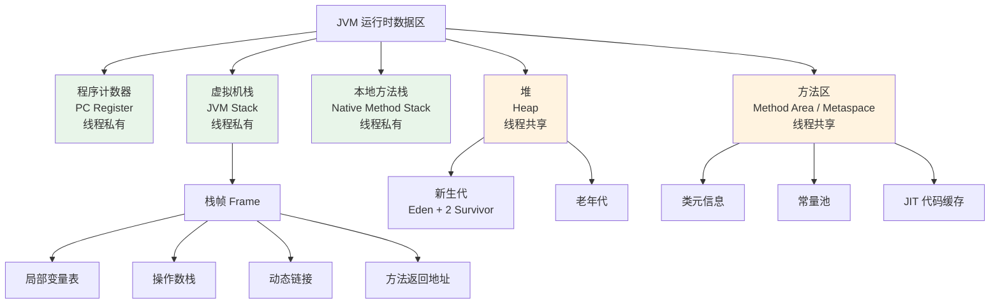
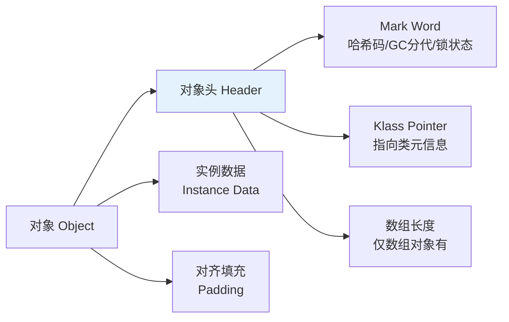

# JVM 内存区域

> 定位：搞清 JVM 运行时数据区到底有哪些、各存什么、哪些线程私有、哪些会 OOM。这是 GC 调优、内存泄漏排查、并发理解的公共前置——很多人 graduated 多年仍在「堆」「栈」「方法区」之间混淆，根源就在这里。

## 一、为什么必须先搞清内存区域

线上一个 `java.lang.OutOfMemoryError`，报错信息可能是 `Java heap space`、`Metaspace`、`unable to create new native thread`、`Direct buffer memory`……**不同的报错对应完全不同的内存区域，排查方向天差地别**。

- 报 `Java heap space` → 堆满了，去看大对象、内存泄漏
- 报 `Metaspace` → 元数据区满了，去看类加载是否失控
- 报 `unable to create new native thread` → 线程创建太多，可能是线程池配置问题或系统线程数限制

如果连每块区域存什么都不清楚，你只能百度报错、照搬参数，永远在碰运气。这一篇就是把这张「内存地图」刻进脑子里。

## 二、运行时数据区全景

JVM 在执行 Java 程序时，会把内存划分为若干区域。按**线程是否私有**分成两大类：

- **线程私有**：程序计数器、虚拟机栈、本地方法栈——随线程生灭，不需要 GC
- **线程共享**：堆、方法区——所有线程共用，是 GC 和 OOM 的主战场



绿色是线程私有，橙色是线程共享。记住这个颜色区分，后面所有 GC 和并发问题都建立在这之上。

### 2.1 程序计数器（PC Register）

一块很小的内存，记录**当前线程正在执行的字节码指令地址**。

- 为什么线程私有？因为多线程切换时，必须记住每个线程执行到哪一行，切回来才能接着执行
- 执行 native 方法时值为空（Undefined）
- **唯一一个不会 OOM 的区域**

### 2.2 虚拟机栈（JVM Stack）

每个方法执行时创建一个**栈帧（Stack Frame）**，入栈、执行完出栈。栈帧里存：

| 组成部分 | 作用 |
|---|---|
| 局部变量表 | 存放方法参数和方法内定义的局部变量（基本类型值 / 引用） |
| 操作数栈 | 字节码指令执行的运算区，类似 CPU 寄存器 |
| 动态链接 | 指向运行时常量池的方法引用，支持多态 |
| 方法返回地址 | 方法退出后回到哪里继续执行 |

两个经典异常：

- **`StackOverflowError`**：栈深度超过虚拟机允许的最大深度。典型场景：无限递归、过深的调用链
- **`OutOfMemoryError`**：栈扩展时申请不到足够内存。典型场景：创建线程太多（线程栈也是内存）

关键参数：`-Xss1m`（默认 1MB 左右）。**调大 Xss 会让单线程能递归更深，但能创建的线程数变少**——这是个权衡。

### 2.3 本地方法栈（Native Method Stack）

和虚拟机栈类似，只不过服务的是 `native` 方法（C/C++ 写的）。HotSpot 里它和虚拟机栈合二为一。

### 2.4 堆（Heap）

**JVM 管理的最大一块内存，线程共享，几乎所有对象实例都在这里分配**。是 GC 的核心区域。

按分代模型划分：

- **新生代（Young）**：新创建的对象。内部再分 Eden 区和两个 Survivor 区（From / To）
- **老年代（Old）**：熬过多次 GC 仍存活的对象

参数：`-Xms`（初始堆）、`-Xmx`（最大堆）。生产环境通常设成相等，避免堆动态扩展带来的抖动。

> 注意：「几乎」所有对象都在堆上——由于 JIT 的**逃逸分析**和**标量替换**，某些未逃逸的对象可能被优化成栈上分配，不进堆。这是后面的进阶内容。

### 2.5 方法区（Method Area）

线程共享，存储**已被加载的类信息、常量、静态变量、JIT 编译后的代码**等。

- JDK 7 及以前：用「永久代（PermGen）」实现，`-XX:PermSize` / `-XX:MaxPermSize`
- JDK 8 起：改用**元空间（Metaspace）**，使用**本地内存**而非堆内存，参数 `-XX:MetaspaceSize` / `-XX:MaxMetaspaceSize`

这个变化很重要：**JDK 8 之后，「方法区 OOM」不再受 `-Xmx` 限制，而是吃机器的物理内存**。动态生成类（如 CGLIB、反射、Groovy 脚本）不加限制，可能把机器内存吃光。

### 2.6 直接内存（Direct Memory）

严格来说不属于运行时数据区，但常被一起讨论。它由 `ByteBuffer.allocateDirect()` 分配，使用本地内存，Netty/NIO 大量使用。

- 不受 `-Xmx` 限制，但受 `-XX:MaxDirectMemorySize` 限制（默认约等于 `-Xmx`）
- 分配和回收成本高，通常配内存池复用
- 报 `Direct buffer memory` OOM 时，去看直接内存是否泄漏

## 三、一个对象在内存里长什么样

理解了「区域」，再看对象本身。以 HotSpot 为例，堆里的一个对象由三部分组成：



- **对象头**：Mark Word（哈希码、GC 分代年龄、锁标志位）+ 类型指针 + （数组才有）长度
- **实例数据**：真正的字段内容，含父类字段
- **对齐填充**：HotSpot 要求对象大小是 8 字节的整数倍，不足则补齐

**指针压缩**（`-XX:+UseCompressedOops`，默认开启）：在 64 位机器上把对象引用压缩成 32 位，省内存。堆小于 32GB 时有效，超过 32GB 自动失效——这也是为什么堆设到 32GB 以上会「突然变慢、内存暴涨」的一个隐藏原因。

用 `jol`（Java Object Layout）工具可以看到精确大小：

```java
// 引入 org.openjdk.jol:jol-core
System.out.println(ClassLayout.parseInstance(new Object()).toPrintable());
```

## 四、生产坑点与排查

### 坑点 1：报 OOM 却找不到是哪块区域

**现象**：`OutOfMemoryError`，但不知道该调哪个参数。
**原因**：没看报错后缀。
**解法**：读完整报错信息，对照下表定位。

| 报错后缀 | 区域 | 排查方向 |
|---|---|---|
| `Java heap space` | 堆 | 大对象、内存泄漏、Xmx 太小 |
| `GC overhead limit exceeded` | 堆 | GC 太频繁且回收甚微，通常是泄漏 |
| `Metaspace` | 方法区 | 类加载失控、动态代理过多 |
| `Direct buffer memory` | 直接内存 | NIO/Netty 直接内存泄漏 |
| `unable to create new native thread` | 线程栈 | 线程数过多、Xss 过大、系统限制 |
| `Requested array size exceeds VM limit` | 堆 | 数组过大 |

**务必加 `-XX:+HeapDumpOnOutOfMemoryError -XX:HeapDumpPath=/data/dump`**，OOM 时自动 dump，事后用 MAT 分析。

### 坑点 2：线程池导致 `unable to create new native thread`

**现象**：服务运行几天后突然无法创建线程，报 OOM。
**原因**：线程池无限扩张（如 `Executors.newCachedThreadPool()` 上限是 Integer.MAX_VALUE），或每次请求都建线程不复用。线程栈默认 1MB，几千个线程就几个 G。
**解法**：
- 用固定大小线程池并配置有界队列 + 拒绝策略
- 合理设置 `-Xss`（不必盲目调大）
- 监控线程数：`jstack` 或 `top -H -p <pid>`

### 坑点 3：Metaspace 持续增长直到 OOM

**现象**：JDK 8+ 服务，Metaspace 缓慢增长最终 OOM。
**原因**：运行时不断生成新类。常见于：滥用 CGLIB 动态代理（每次生成新代理类）、Groovy/脚本引擎反复编译、反射缓存。
**解法**：
- 复用代理类，避免重复生成
- 设置 `-XX:MaxMetaspaceSize` 兜底
- 用 `jcmd <pid> GC.class_histogram` 看哪些类在暴涨

### 坑点 4：把 Xmx 设成物理内存的 90%

**现象**：容器里 `-Xmx` 接近内存上限，结果频繁被 OOM Killer 杀掉。
**原因**：JVM 总内存 = 堆 + 元空间 + 直接内存 + 线程栈 + JIT + JVM 自身开销，堆只是其中一部分。堆占满了，其他区域就没空间了。
**解法**：容器环境下堆一般设为容器内存的 **60%-75%**，为其他区域留余量。JDK 10+ 可用 `-XX:+UseContainerSupport` 让 JVM 感知容器限制（默认开启）。

## 五、调优与排查清单

1. **堆大小**：`-Xms` = `-Xmx`，设为容器内存的 60%-75%
2. **OOM 兜底**：永远加 `-XX:+HeapDumpOnOutOfMemoryError`
3. **线程栈**：`-Xss` 默认 512KB-1MB，按线程数和递归深度权衡
4. **元空间**：`-XX:MaxMetaspaceSize` 设上限，防动态类失控
5. **直接内存**：`MaxDirectMemorySize` 按 Netty 用量设
6. **诊断工具箱**：
   - `jps` 看进程
   - `jstat -gcutil <pid> 1000` 看 GC 实时状态
   - `jmap -dump:format=b,file=heap.hprof <pid>` dump 堆
   - `jstack <pid>` 看线程栈
   - MAT / JProfiler 分析 dump
   - Arthas 在线诊断（不中断服务）

## 六、面试高频问法

> 这一节的答案按「面试时能讲透」的标准写：先给一句话结论，再展开机制、原因和坑点。建议先自己答一遍，再对照补全。

**Q1：JVM 运行时数据区有哪些？哪些线程私有、哪些共享？哪些会 OOM？**

**一句话结论**：程序计数器、虚拟机栈、本地方法栈线程私有；堆、方法区线程共享；除程序计数器外都可能 OOM。

展开：

| 区域 | 线程私有/共享 | 是否 OOM |
|---|---|---|
| 程序计数器 | 私有 | 唯一不会 OOM |
| 虚拟机栈 | 私有 | StackOverflowError / OOM |
| 本地方法栈 | 私有 | StackOverflowError / OOM |
| 堆 | 共享 | OOM（Java heap space） |
| 方法区（元空间） | 共享 | OOM（Metaspace） |

关键点：线程私有区随线程生灭，生命周期和线程绑定，不需要 GC；堆和方法区是所有线程共享的，是 GC 和 OOM 的主战场。

加分点：主动提「直接内存」——它不属于运行时数据区，但由 `ByteBuffer.allocateDirect()` 分配、被 Netty/NIO 大量使用，不受 `-Xmx` 限制而受 `MaxDirectMemorySize` 限制，OOM 时报 `Direct buffer memory`，面试官很吃这个边界区分。

**Q2：程序计数器为什么是线程私有的？为什么是唯一不会 OOM 的区域？**

**一句话结论**：它记录当前线程执行的字节码行号，线程切换后要能恢复，所以必须私有；它只存一个地址、不随数据增长，所以不会 OOM。

展开：

1. **作用**：记录当前线程正在执行的字节码指令地址。分支、循环、跳转、异常恢复、线程上下文切换都靠它定位「执行到哪一行」。
2. **为什么私有**：多线程交替执行，CPU 在线程间切换，切回来必须知道这条线程上次执行到哪，因此每条线程要各存一份，不能共享。
3. **为什么不会 OOM**：它只是一小块固定大小的内存（存一个地址或 undefined），不会动态扩张，JVM 规范里也是唯一没有规定 OOM 的区域。
4. **执行 native 方法时**：它的值为空（Undefined），因为 native 方法不在字节码层面执行。

加分点：补一句「如果程序计数器是共享的，线程切换就会互相覆盖执行位置，整个并发模型就崩了」——把「为什么私有」讲成因果，而不是背诵。

**Q3：虚拟机栈的栈帧里有什么？StackOverflowError 和 OutOfMemoryError 有何区别？**

**一句话结论**：栈帧存局部变量表、操作数栈、动态链接、方法返回地址；栈深度超限报 StackOverflowError，扩展时内存不足报 OOM。

展开：

- **栈帧结构**：每调用一个方法就入栈一个栈帧。局部变量表存参数和局部变量（基本类型值或引用）；操作数栈是字节码运算的工作区；动态链接指向运行时常量池的方法引用、支撑多态；返回地址记录方法退出后回到哪里。
- **StackOverflowError**：栈**深度**超过虚拟机允许上限。典型是无限递归、过深调用链——栈帧太多，深度不够。
- **OutOfMemoryError**：栈**扩展**时申请不到内存。典型是创建线程太多——每个线程都有独立虚拟机栈，几千个线程 × 默认 1MB 就几个 G。

关键参数 `-Xss`（默认 512KB~1MB）：调大能让单线程递归更深，但能创建的线程数变少，这是此消彼长的权衡。

加分点：说清「同一个区域两种错误，根因不同——SOE 是深度不够、OOM 是空间不够」，并提一句`unable to create new native thread` 往往是线程数或 Xss 的问题，体现生产视角。

**Q4：堆的结构是怎样的？为什么要分代？**

**一句话结论**：堆分新生代（Eden + 两个 Survivor）和老年代；分代基于「大部分对象朝生夕死」的经验假设，让不同代用不同 GC 算法提升效率。

展开：

1. **结构**：新生代占约 1/3，内部是 Eden（80%）+ Survivor From/To（各 10%）；老年代占约 2/3。
2. **对象晋升路径**：新对象在 Eden 分配 → Eden 满触发 Minor GC，存活对象进 Survivor、年龄+1 → 年龄达到阈值（默认 **15**，`-XX:MaxTenuringThreshold` 可设）晋升老年代 → 老年代满触发 Full GC。
3. **为什么分代**：弱分代假说（绝大多数对象朝生夕死）+ 强分代假说（熬过越多次 GC 越难消亡）。新生代每次回收率高，用**复制算法**只复制少量存活对象；老年代存活率高，用**标记-清除/整理**，避免频繁复制。
4. **收益**：GC 可以按代针对性回收，不必每次扫全堆，吞吐和停顿都得到优化。

加分点：提「跨代引用问题」——老年代对象可能引用新生代对象，回收新生代时要扫老年代代价太大，于是用**记忆集（Remembered Set）/ 卡表**记录跨代引用，G1 正是这套思路。这是高级答法。

**Q5：JDK 7 和 JDK 8 的方法区实现有什么区别？为什么这么改？**

**一句话结论**：JDK 7 及以前用永久代（PermGen，在堆内），JDK 8 改为元空间（Metaspace，用本地内存），避免了永久代大小难设定、易 OOM 的问题。

展开：

| 维度 | 永久代 PermGen（≤JDK7） | 元空间 Metaspace（JDK8+） |
|---|---|---|
| 位置 | 堆内连续空间 | 本地内存（Native Memory） |
| 参数 | `-XX:PermSize` / `MaxPermSize` | `-XX:MetaspaceSize` / `MaxMetaspaceSize` |
| 上限 | 受 `-Xmx` 间接限制 | 默认受物理内存限制 |
| OOM 风险 | 动态类多时很容易 PermGen OOM | 不受堆限，但仍需设上限兜底 |

**为什么改**：永久代大小必须在启动时定死，动态生成类的应用（CGLIB、反射、Groovy、JSP 编译）很容易撑爆；而且永久代的 GC 效率低、调优困难。元空间改用本地内存后，类元数据随实际负载动态扩张，不再受 `-Xmx` 制约。

加分点：指出「JDK 8 之后方法区 OOM 不再受 `-Xmx` 限制，而是吃机器物理内存，所以必须设 `MaxMetaspaceSize` 兜底，否则动态类失控会把整机内存吃光」——这是生产真实事故点。

**Q6：运行时常量池和字符串常量池在哪个区域？JDK 版本间有什么变化？**

**一句话结论**：运行时常量池 JDK 7 起在堆中（之前在永久代）；字符串常量池 JDK 7 也移到了堆里。

展开：

- **运行时常量池**：`.class` 文件里的常量池（字面量、符号引用）在类加载后进入方法区的运行时常量池。JDK 6 及以前它在永久代；**JDK 7 起移到堆中**。
- **字符串常量池**：专门存放字符串字面量和 `intern()` 的字符串。JDK 6 在永久代；**JDK 7 起移到堆中**。这解释了为什么 JDK 7+ 里 `String.intern()` 的行为和之前不同——常量池进堆后，可以容纳更多字符串，且和堆对象共享内存。
- **注意区分**：JDK 8 用元空间替代永久代后，类的**元数据**（Klass、方法元信息）在元空间，但**运行时常量池、字符串常量池**仍在堆里——很多人误以为跟着元数据一起进了元空间，这是错的。

加分点：能说清「JDK 7 是一次重要分水岭：运行时常量池、字符串常量池、静态变量都从永久代搬到了堆，为 JDK 8 彻底移除永久代铺路」——体现版本演进的全局观。

**Q7：对象的内存布局是怎样的？指针压缩了解吗？**

**一句话结论**：对象 = 对象头（Mark Word + Klass Pointer）+ 实例数据 + 对齐填充；指针压缩把 64 位引用压成 32 位省内存，堆超过 32GB 时失效。

展开：

- **对象头**：Mark Word 存 hashCode、GC 分代年龄、锁标志位（synchronized 的锁状态就在这里）；Klass Pointer 指向类元信息；数组对象还多一个长度字段。
- **实例数据**：真正的字段内容，包含从父类继承的字段。
- **对齐填充**：HotSpot 要求对象大小是 **8 字节的整数倍**，不足则补齐。
- **指针压缩**（`-XX:+UseCompressedOops`，默认开启）：64 位机器上把对象引用压成 32 位，能省大量内存、提升缓存命中。但只在堆 **小于 32GB** 时有效；堆设到 32GB 以上后压缩失效，引用变回 64 位，内存占用突然增大、性能下降——这就是「堆超过 32GB 会突然变慢」的隐藏原因。

加分点：提一句用 `jol`（Java Object Layout）工具可以打印对象的精确布局，并说出「int[] 这类数组对象头还含 4 字节长度」这类细节，证明你真看过对象内存。

**Q8：`String s = new String("abc")` 创建了几个对象？**

**一句话结论**：常量池没有 "abc" 时创建 2 个（常量池 1 个 + 堆 1 个），已有则只创建 1 个（堆上），`s` 只是栈上的引用。

展开：

1. 先检查**字符串常量池**里有没有 "abc"：没有就在常量池创建 1 个（编译期字面量已有则跳过）。
2. `new String(...)` 一定在**堆**上新建一个 String 对象，内容是 "abc" 的拷贝。
3. `s` 是**虚拟机栈局部变量表**里的一个引用，指向堆上那个对象，不算「创建的对象」。

所以：常量池无 "abc" → 2 个对象；常量池已有 → 1 个对象。这和 `String s = "abc"` 只用到常量池对象（1 个或 0 个新建）形成对比。

加分点：顺带说 `s.intern()` 的作用——把堆上字符串尝试放入常量池、返回池中引用；并提「String 是不可变的，常量池才安全」。面试官常追问，能接住就稳了。

**Q9：线上报 OutOfMemoryError，怎么判断是哪块区域、如何排查？**

**一句话结论**：看 OOM 报错后缀定位区域——不同后缀对应堆、元空间、直接内存或线程栈，排查方向完全不同。

展开：

| 报错后缀 | 区域 | 首要怀疑 |
|---|---|---|
| `Java heap space` | 堆 | 内存泄漏 / 大对象 / Xmx 太小 |
| `GC overhead limit exceeded` | 堆 | GC 占 98% 时间只回收 2%，严重泄漏 |
| `Metaspace` | 方法区 | 动态类生成失控 |
| `Direct buffer memory` | 直接内存 | Netty/NIO 堆外内存泄漏 |
| `unable to create new native thread` | 线程栈 | 线程数过多 / Xss 过大 |

**解法**：务必加 `-XX:+HeapDumpOnOutOfMemoryError -XX:HeapDumpPath=/data/dump`，OOM 时自动 dump，事后用 MAT 看 Dominator Tree 找持有链；元空间看 `jcmd GC.class_histogram`，直接内存查 Netty 配置。

加分点：强调「先看后缀再调参，别看到 OOM 就无脑加 `-Xmx`——元空间和直接内存 OOM 调堆完全无效」，这是新手和老手的分水岭。

**Q10：容器环境里 -Xmx 该怎么设？为什么不能设成物理内存的 90%？**

**一句话结论**：容器里堆一般设为容器内存的 60%~75%，因为 JVM 总内存 = 堆 + 元空间 + 直接内存 + 线程栈 + JIT + JVM 自身开销，堆只是其中一部分。

展开：

- **错误的做法**：把 `-Xmx` 设成接近容器内存上限（如 90%）。堆占满后，元空间、直接内存、线程栈、JIT 代码缓存就没空间了，进程总内存突破容器 limit，被 **OOM Killer 直接杀掉**——表现是进程突然消失，而不是 Java OOM。
- **正确做法**：堆设为容器内存的 60%~75%，为其他区域留余量。JDK 10+ 默认开启 `-XX:+UseContainerSupport`，JVM 能感知容器的 cgroup 内存限制（而不是读到宿主机的巨大内存）。
- **配套**：`-Xms` = `-Xmx` 避免堆动态扩展抖动；设 `MaxMetaspaceSize`、`MaxDirectMemorySize` 兜底；线程数多时评估 `-Xss`。

加分点：说出「JDK 8u131 之后才逐步支持容器感知，老版本 JVM 在容器里会按宿主机内存算默认值，必须手动设 `-Xmx`」——版本差异细节很加分。

## 小结

- 内存分 6 区：PC、虚拟机栈、本地方法栈（私有）+ 堆、方法区、直接内存（共享/特殊）。
- 线程私有区随线程生灭，不需 GC；堆和方法区是 GC 与 OOM 主战场。
- 报错后缀决定排查方向，OOM 一定要配 HeapDump。
- 对象 = 对象头 + 实例数据 + 对齐填充；理解指针压缩和 32GB 边界。
- 总内存 ≠ 堆，容器环境堆设 60%-75%，给其他区域留空间。
