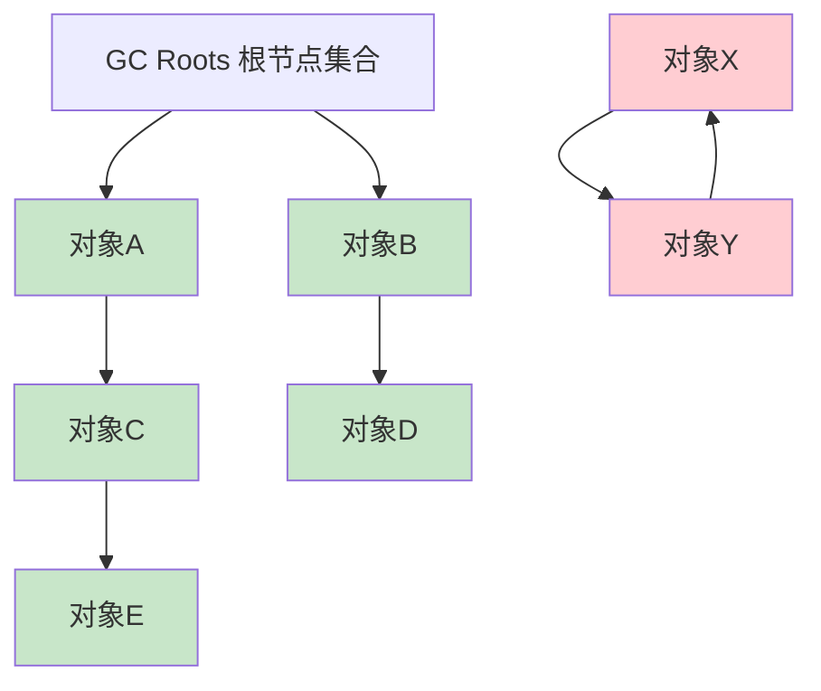
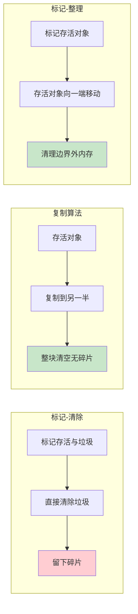
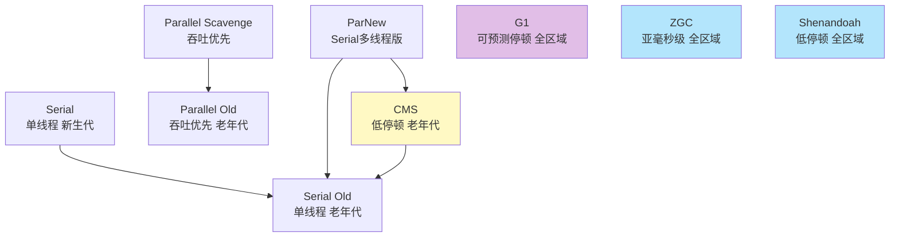

# JVM 垃圾回收算法与收集器

> 定位：GC 是 Java 的灵魂，也是高级开发绕不开的硬门槛。这篇讲清「哪些对象该回收、用什么算法回收、不同收集器怎么取舍」——搞懂这些，你才能解释线上那次停顿到底是谁造成的，以及为什么选 G1 而不是 CMS。

## 一、为什么需要垃圾回收

手动管理内存的语言（C/C++）里，你要么 `free` 忘记调用导致内存泄漏，要么重复释放导致崩溃。Java 把这件事交给 JVM：**你只管 new，JVM 自动回收不再使用的对象**。

但"自动"不代表"免费"。GC 要暂停应用线程（Stop The World，简称 STW）来做标记和整理，停顿时间直接影响接口响应。一次线上 P99 飙到 2 秒，很可能就是一次 Full GC。所以你要回答三个问题：

- **回收谁**：怎么判断一个对象是"垃圾"？
- **怎么收**：标记-清除、复制、整理，各自代价是什么？
- **用哪个收集器**：CMS、G1、ZGC、Shenandoah 分别适合什么场景？

## 二、垃圾判定：怎么确定一个对象可以回收

### 2.1 引用计数法（Java 不用）

给对象加一个引用计数器，被引用一次 +1，引用失效 -1，计数为 0 就可回收。简单高效，但有一个致命问题：**循环引用**。A 引用 B、B 引用 A，两个对象计数永远不为 0，却谁也用不到。Java 虚拟机没有采用这种算法。

### 2.2 可达性分析（Java 采用）

思路是"从根出发，顺藤摸瓜"：以一系列称为 **GC Roots** 的对象为起点，沿着引用链向下搜索，能被搜索到的对象都是"存活"的，搜索不到的就是"垃圾"。

图里绿色 A~E 都能从 GC Roots 到达，是存活对象；红色 X、Y 虽然互相引用，但和 GC Roots 没有任何联系，会被判定为垃圾。这就是可达性分析解决循环引用的方式——**看的是"能不能从根走到"，而不是"有没有被引用"**。

**哪些对象可以作为 GC Roots？**

| 类型 | 举例 |
|---|---|
| 虚拟机栈中引用的对象 | 正在执行的方法的局部变量、参数 |
| 方法区中静态属性引用的对象 | `static` 字段指向的对象 |
| 方法区中常量引用的对象 | 字符串常量池里的引用 |
| 本地方法栈中 JNI 引用的对象 | native 方法引用的对象 |
| JVM 内部引用 | 基本类型对应的 Class 对象、常驻异常对象、类加载器 |

### 2.3 再谈引用：强、软、弱、虚

JDK 1.2 之后，Java 把引用分成了四档，回收策略各不同：

| 引用类型 | 表现 | 典型用途 |
|---|---|---|
| **强引用 Strong** | `Object o = new Object()`，只要还在就绝不回收 | 日常 99% 的代码 |
| **软引用 Soft** | `SoftReference`，内存不足时才会被回收 | 缓存（内存敏感型） |
| **弱引用 Weak** | `WeakReference`，下一次 GC 无论内存是否充足都回收 | `ThreadLocalMap` 的 key、WeakHashMap |
| **虚引用 Phantom** | `PhantomReference`，随时可能被回收，必须配合引用队列，仅用于收到回收通知 | Netty 的堆外内存释放监听 |

理解这四档对排查内存泄漏很关键：很多「莫名其妙对象回收不掉」的问题，都是强引用被无意中长期持有（比如静态集合、未关闭的 ThreadLocal）。

### 2.4 对象"死"之前：finalize

即使可达性分析判定不可达，对象也不是立刻被回收，还要经历**两次标记**：第一次筛选是否有必要执行 `finalize()`（没重写或已执行过则跳过）；如果重写了，对象会被放进 F-Queue，由低优先级线程触发 `finalize()`，之后再做第二次标记，仍不可达才真正回收。

> `finalize()` 运行代价高昂、不确定性大，**早已被官方标记为废弃（deprecated）**。别指望用它做资源释放，用 `try-with-resources` 代替。

## 三、经典垃圾收集算法

### 3.1 标记-清除（Mark-Sweep）

最基础的算法，分两步：**标记**出所有要回收的对象，然后**统一清除**。

- 优点：简单，不需要移动对象
- 缺点：① 效率不高，标记和清除都慢；② 产生**内存碎片**——清除后剩下大量不连续空间，导致大对象找不到连续内存，提前触发下一次 GC

### 3.2 复制算法（Copying）

把内存分成两块大小相等的区域，每次只用其中一块。用满时把还活着的对象**复制到另一块**，然后一次性清掉整块。

- 优点：没有碎片，实现简单，运行高效
- 缺点：**内存利用率只有一半**，代价太大

现代商业虚拟机用改进的复制算法：不必按 1:1 划分。HotSpot 的新生代把内存分为 **Eden（80%）+ 两个 Survivor（各 10%）**，每次用 Eden 和一块 Survivor，回收时把存活对象复制到另一块 Survivor。这样只用浪费 10% 的空间。

### 3.3 标记-整理（Mark-Compact）

针对老年代特点设计。标记后不直接清除，而是让**所有存活对象向一端移动**，然后清理掉边界以外的内存。

- 优点：无碎片，适合老年代大量对象存活的场景
- 缺点：移动对象需要暂停应用（STW），代价更高

### 3.4 三种算法对比

| 算法 | 是否移动对象 | 内存碎片 | 适用场景 |
|---|---|---|---|
| 标记-清除 | 否 | 有 | 老年代（CMS 使用） |
| 复制 | 是 | 无 | 新生代（大部分对象朝生夕死） |
| 标记-整理 | 是 | 无 | 老年代（Serial Old、Parallel Old） |

## 四、分代收集理论：为什么把堆分成新生代和老年代

分代收集建立在两条经验法则上：

1. **弱分代假说**：绝大多数对象都是朝生夕死的（比如方法里的临时对象）
2. **强分代假说**：熬过越多次 GC 的对象，越难消亡（比如缓存、单例）

基于这两点，HotSpot 把堆分成新生代和老年代：

- **新生代**：对象频繁创建，GC 频繁但每次回收率高，用**复制算法**（只复制少量存活对象，成本低）
- **老年代**：对象存活率高，GC 次数少，用**标记-清除或标记-整理**

新生代的 GC 叫 **Minor GC / Young GC**，老年代的 GC 叫 **Major GC / Full GC**。一次对象从新生代晋升到老年代的典型路径：

1. 新对象在 Eden 区分配
2. Eden 满了触发 Minor GC，存活对象移到 Survivor From，年龄 +1
3. 多次 Minor GC 后仍在 Survivor 中，年龄达到阈值（默认 **15**，可由 `-XX:MaxTenuringThreshold` 设置）就晋升老年代
4. 老年代满了触发 Full GC，STW 时间远长于 Minor GC

> **跨代引用问题**：老年代对象可能引用新生代对象，那回收新生代时怎么知道它是否存活？如果扫描整个老年代代价太大。解决方法是**记忆集（Remembered Set）**——在新生代维护一个结构，记录"老年代哪些区域引用了新生代"，回收时只扫这些区域。G1 的卡表（Card Table）就是这种思路的实现。

## 五、主流收集器原理与适用场景

### 5.1 收集器全景

收集器的发展史，本质上是一部**"如何在吞吐量和停顿时间之间取舍"**的历史。下图按年代和特点梳理了主流收集器的关系：

### 5.2 CMS（Concurrent Mark Sweep）

目标：**获取最短回收停顿时间**。它让 GC 线程和用户线程**并发执行**，是第一款真正意义上的并发收集器。

工作流程分四步：

| 阶段 | 是否 STW | 做什么 |
|---|---|---|
| 初始标记 | 是 | 只标记 GC Roots 直接关联的对象，很快 |
| 并发标记 | 否 | 从直接关联对象往下追溯，耗时最长，但和用户线程一起跑 |
| 重新标记 | 是 | 修正并发标记期间用户线程改动的那部分对象 |
| 并发清除 | 否 | 清除垃圾，和用户线程一起跑 |

**只有初始标记和重新标记需要短暂 STW**，其余阶段并发，所以整体停顿很短。

**CMS 的三个著名缺点**：

1. **对 CPU 资源敏感**：并发阶段 GC 线程和用户线程抢 CPU，用户线程吞吐量会下降
2. **无法处理浮动垃圾**：并发清除时用户线程还在产生新垃圾，只能留到下次 GC——所以不能等老年代满了才回收，要预留空间（`-XX:CMSInitiatingOccupancyFraction` 控制触发阈值，JDK 6 默认 68%）
3. **内存碎片**：用标记-清除，不整理，碎片多了大对象分配失败会触发 Full GC

> CMS 在 JDK 9 被标记为 deprecated，JDK 14 被**移除**。新项目别再选 CMS。

### 5.3 G1（Garbage First）

目标：**可预测的停顿时间**，JDK 9 起成为默认收集器，JDK 14 起彻底取代 CMS。

G1 颠覆了传统的连续分代布局。它把堆切成约 **2048 个大小相等的 Region**（默认由堆大小除以 2048 决定，可通过 `-XX:G1HeapRegionSize` 设置 1~32MB）。每个 Region 可以是 Eden、Survivor、Old 或 Humongous（大对象区，对象大小超过 Region 一半时直接放这里）。

G1 的核心思想：**不再追求一次把整个新生代或老年代收完，而是优先回收垃圾最多、收益最高的 Region**（Garbage First 名字的由来）。它维护每个 Region 的回收收益（回收能释放多少空间、预计耗时多少），根据你设定的停顿目标 `-XX:MaxGCPauseMillis` 选择一批 Region 来回收。

工作流程：

- **Young GC**：只回收 Eden 和 Survivor Region，存活对象复制到新的 Region
- **Mixed GC**：回收所有新生代 + 部分收益高的老年代 Region
- 四个子阶段：初始标记（STW）→ 并发标记 → 最终标记（STW）→ 筛选回收（STW）

G1 同时采用了标记-整理（整体）和复制（局部），**基本没有内存碎片**。

关键参数：

| 参数 | 作用 | 默认值 |
|---|---|---|
| `-XX:+UseG1GC` | 启用 G1 | JDK 9+ 默认开启 |
| `-XX:MaxGCPauseMillis` | 期望最大停顿时间（软目标，不保证） | 200ms |
| `-XX:G1HeapRegionSize` | Region 大小 | 自动计算 |
| `-XX:InitiatingHeapOccupancyPercent` | 堆占用达到多少触发并发标记 | 45% |

### 5.4 ZGC

目标：**亚毫秒级（<1ms）停顿**，且停顿时间与堆大小无关。JDK 11  experimental 引入，JDK 15 转为生产可用。

ZGC 的杀手锏是**并发整理**——连对象移动都和用户线程并发进行，这是最难做到的。它靠两项核心技术：

- **染色指针（Colored Pointer）**：把对象存活状态信息直接编码到指针的高位里，GC 只需改指针不用读对象
- **读屏障（Load Barrier）**：用户线程读对象引用时，JVM 插入一段代码，发现对象被移动了就自动修正到新地址

代价是：并发阶段多，需要额外内存（染色指针占用地址空间，堆不能太大也不能太小），且读屏障有轻微性能损耗（通常 <15%）。

适用场景：**超大堆（TB 级）、对停顿极度敏感**的服务。ZGC 的停顿时间基本不随堆增大而增长，这是 G1 做不到的。

### 5.5 Shenandoah

由 Red Hat 主导，JDK 12  experimental 引入。目标和 ZGC 类似——低停顿，通过**并发压缩**实现。它用的是**读屏障 +  Brooks 指针**（对象头 forwarding pointer）方案。与 ZGC 定位高度重合，选型时通常二选一，国内使用 ZGC 更多。

### 5.6 收集器选型对比表

| 收集器 | 年代 | 算法 | 特点 | 适用场景 |
|---|---|---|---|---|
| Serial | JDK 1.3 | 复制 | 单线程，简单 | 客户端小应用、单核 |
| Parallel Scavenge/Old | JDK 1.4 | 复制/整理 | 吞吐量优先 | 后台批处理、计算密集型 |
| ParNew + CMS | JDK 1.5 | 复制/清除 | 低停顿 | JDK 8 老系统的 Web 服务 |
| G1 | JDK 7u/9 默认 | 复制/整理 | 可预测停顿、无碎片 | JDK 8+ 通用服务端（默认推荐） |
| ZGC | JDK 11/15 | 复制/整理 + 染色指针 | 亚毫秒停顿、超大堆 | JDK 17+ 大堆、极致低延迟 |
| Shenandoah | JDK 12 | 复制/整理 + 读屏障 | 低停顿 | Red Hat 生态、超大堆 |

> **一句话选型**：JDK 8 老系统先用 G1 替代 CMS；JDK 11/17 新项目直接用 G1；超大堆且停顿要求亚毫秒再上 ZGC。

## 六、生产坑点与排查

### 坑点 1：CMS "concurrent mode failure" 导致漫长 Full GC

**现象**：线上突然一次 Full GC 停顿好几秒，日志里出现 `concurrent mode failure`。

**原因**：CMS 并发清理时，用户线程产生的浮动垃圾把预留空间占满了，CMS 无法在老年代腾出空间，退化成 Serial Old 单线程 Full GC。本质是触发阈值设太高或老年代太小。

**解法**：
- 降低 `-XX:CMSInitiatingOccupancyFraction`（如从 80% 调到 68%），更早触发 CMS
- 启用 `-XX:+UseCMSCompactAtFullCollection` 和 `-XX:CMSFullGCsBeforeCompaction` 缓解碎片
- 最根本的：迁移到 G1

### 坑点 2：大对象直接进入老年代，频繁 Full GC

**现象**：每次批量导出/大 JSON 反序列化后，老年代突然涨一大截，随后 Full GC。

**原因**：超过 `-XX:PretenureSizeThreshold` 的大对象直接分配到老年代；或者 Survivor 区太小放不下，提前晋升。这些大对象用完即弃，却在老年代堆积。G1 里表现为 Humongous 区对象。

**解法**：
- 调大 `-XX:G1HeapRegionSize`（G1），让大对象不至于成为 Humongous
- 优化代码：流式处理替代一次性加载大对象
- 排查是不是内存泄漏（大对象被长期引用）

### 坑点 3：MaxGCPauseMillis 设得太激进反而吞吐暴跌

**现象**：把 `-XX:MaxGCPauseMillis` 设成 20ms，结果 GC 次数暴增，CPU 飙升，整体吞吐下降一半。

**原因**：G1 为了达到停顿目标，只能更频繁地回收、每次少收一点。停顿目标是**软目标**，过度追求低停顿必然牺牲吞吐量。

**解法**：设一个合理值（一般 100-200ms 够用），G1 会自适应。除非真的有亚毫秒需求，否则别盲目调低。

### 坑点 4：元空间/直接内存 OOM 误当成堆 GC 问题

**现象**：报 `OutOfMemoryError: Metaspace` 或 `Direct buffer memory`，却一直在调 `-Xmx`。

**原因**：这两块不在堆里，GC 调参无效。Metaspace OOM 多为动态生成类失控；直接内存 OOM 多为 Netty/NIO 的堆外内存没释放。

**解法**：见第 03 篇《GC 调优与线上排查》和范文《JVM 内存区域》。设 `-XX:MaxMetaspaceSize`、`-XX:MaxDirectMemorySize` 兜底。

## 七、调优、选型与最佳实践

1. **默认优先用 G1**：JDK 8 用 `-XX:+UseG1GC` 显式开启，JDK 9+ 默认就是。别再新上 CMS。
2. **堆大小**:`-Xms` = `-Xmx`，设为容器内存的 60%-75%。
3. **停顿目标适度**:`-XX:MaxGCPauseMillis` 设 100-200ms，别追求极端低值。
4. **开 GC 日志**:`-Xlog:gc*:file=gc.log:time,uptime:filecount=5,filesize=100m`（JDK 9+）或 `-XX:+PrintGCDetails`（JDK 8）。
5. **看指标调优**：关注吞吐量（应用线程时间占比）、停顿时间、GC 频率三者平衡，别只盯一个。
6. **超大堆再考虑 ZGC**：堆 > 几十 GB 且停顿要求亚毫秒时，JDK 17+ 上 ZGC。
7. **先优化代码再调参**：绝大多数 GC 问题是对象创建太多或泄漏，调参只是延缓。

## 八、面试高频问法

> 这一节的答案按「面试时能讲透」的标准写：先给一句话结论，再展开机制、原因和坑点。建议先自己答一遍，再对照补全。

**Q1：怎么判断一个对象是否该被回收？引用计数法为什么不行？**

**一句话结论**：Java 用**可达性分析**——从 GC Roots 出发沿引用链搜索，不可达的对象判定为垃圾；不用引用计数是因为它解决不了循环引用。

展开：

- **引用计数法**：给对象加计数器，被引用 +1、失效 -1，归 0 回收。简单高效，但有致命缺陷——**循环引用**：A 引用 B、B 引用 A，两个对象计数永不为 0，却谁也访问不到。Java 虚拟机没采用它。
- **可达性分析**：以 GC Roots 为起点顺藤摸瓜，能搜索到的对象是存活，搜索不到的是垃圾。它看的是「能不能从根走到」，而不是「有没有被引用」，因此天然解决循环引用——前面那对互相引用的 A、B，只要和 GC Roots 没有连接，就一起被回收。

加分点：补一句「可达性分析必须在一致性快照里做，这就是 GC 要 STW 的根本原因之一——标记期间引用关系不能变，否则会误判」。把垃圾判定和 STW 串起来，体现体系感。

**Q2：哪些对象可以作为 GC Roots？**

**一句话结论**：GC Roots 是「肯定活着」的对象，主要包括虚拟机栈引用的对象、方法区静态属性和常量引用的对象、本地方法栈 JNI 引用的对象，以及 JVM 内部引用。

展开：

| 类型 | 举例 |
|---|---|
| 虚拟机栈中引用的对象 | 正在执行的方法的局部变量、参数 |
| 方法区静态属性引用的对象 | `static` 字段指向的对象 |
| 方法区常量引用的对象 | 字符串常量池里的引用 |
| 本地方法栈 JNI 引用的对象 | native 方法引用的对象 |
| JVM 内部引用 | 基本类型的 Class 对象、常驻异常对象、类加载器 |

核心逻辑：GC Roots 必须是「绝对不会被回收」的——栈里的局部变量是当前线程正在用的，static 字段随类一直活着，它们作为起点才可靠。

加分点：说一句「面试时记牢'栈 + 方法区静态/常量 + JNI + JVM 内部'四类，基本就能覆盖；注意**堆里的普通对象不是 GC Roots**」——帮面试官确认你没有基本概念混淆。

**Q3：Java 的四种引用是什么？有什么区别和用途？**

**一句话结论**：强、软、弱、虚四档，区别在于「什么时候被回收」——强引用绝不回收，软引用内存不足才回收，弱引用下次 GC 就回收，虚引用随时可回收且必须配合引用队列。

展开：

| 引用类型 | 回收时机 | 典型用途 |
|---|---|---|
| 强引用 Strong | 只要引用链还在，绝不回收 | 日常 99% 的代码 |
| 软引用 Soft | 内存不足时才回收 | 内存敏感型缓存 |
| 弱引用 Weak | 下一次 GC 无论内存是否充足都回收 | ThreadLocalMap 的 key、WeakHashMap |
| 虚引用 Phantom | 随时可能回收，必须配合引用队列，仅用于收到回收通知 | Netty 堆外内存释放监听 |

**关键理解**：很多「对象莫名回收不掉」的泄漏问题，根源是**强引用被无意中长期持有**（静态集合、未关闭的 ThreadLocal）。软引用适合做「内存够就留着、不够就释放」的缓存；虚引用拿不到对象本身，唯一作用是对象被回收时收到通知，比如 Netty 用它监听 DirectBuffer 的释放。

加分点：讲 ThreadLocal 内存泄漏时接这句——「ThreadLocalMap 的 key 是弱引用，key 被 GC 后变 null，但 value 还是强引用挂在线程上，线程不结束就一直泄漏，所以用完要 remove()」。这是四档引用最经典的生产落点。

**Q4：三种基础垃圾收集算法是什么？各自优缺点？**

**一句话结论**：标记-清除（有碎片）、复制（无碎片但浪费空间）、标记-整理（无碎片但移动对象 STW 久）；三者分别适配不同存活率场景。

展开：

| 算法 | 是否移动对象 | 内存碎片 | 适用场景 |
|---|---|---|---|
| 标记-清除 | 否 | 有 | 老年代（CMS 使用） |
| 复制 | 是 | 无 | 新生代（存活率低，复制成本低） |
| 标记-整理 | 是 | 无 | 老年代（Serial Old、Parallel Old） |

- **标记-清除**：标记出要回收的对象再统一清除。简单，但产生**内存碎片**——大对象找不到连续空间会提前触发下一次 GC。
- **复制**：内存分两块，把存活对象复制到另一块再整块清空。无碎片、高效，但原始 1:1 划分浪费一半内存。HotSpot 改进为 **Eden 80% + 两个 Survivor 各 10%**，只浪费 10%。
- **标记-整理**：标记后让存活对象向一端移动，再清理边界外。无碎片，但移动对象要暂停应用，代价更高。

加分点：点出「算法选择本质是看存活率——新生代 90% 对象朝生夕死，复制少量存活对象最划算；老年代对象大多存活，复制代价大，所以用清除或整理」。讲清因果比背表格强。

**Q5：什么是分代收集理论？为什么要分新生代和老年代？**

**一句话结论**：基于弱分代假说（对象朝生夕死）和强分代假说（熬过越多次 GC 越难消亡），按存活特征分代，对不同代用不同算法提升 GC 效率。

展开：

- **两条假说**：弱分代——绝大多数对象朝生夕死（方法里的临时对象）；强分代——熬过越多次 GC 的对象越难消亡（缓存、单例）。
- **分代做法**：新生代对象频繁创建、GC 频繁但每次回收率高，用**复制算法**，只复制少量存活对象；老年代对象存活率高、GC 次数少，用**标记-清除/整理**。
- **晋升路径**：Eden 分配 → Minor GC 存活进 Survivor、年龄+1 → 年龄达阈值（默认 15）晋升老年代 → 老年代满触发 Full GC，STW 远长于 Minor GC。

加分点：主动讲**跨代引用问题**——老年代对象可能引用新生代对象，回收新生代时若扫描整个老年代太慢。解法是**记忆集（Remembered Set）/ 卡表（Card Table）**：在新生代记录「老年代哪些区域引用了新生代」，回收时只扫这些区域，G1 正是这套思路。这是区分初中级的关键题。

**Q6：CMS 收集器的工作流程？它有什么著名缺点？**

**一句话结论**：CMS 以最短停顿为目标，四步中只有初始标记和重新标记 STW；缺点是对 CPU 敏感、有浮动垃圾、产生内存碎片，已在 JDK 14 被移除。

展开：

| 阶段 | 是否 STW | 做什么 |
|---|---|---|
| 初始标记 | 是 | 只标记 GC Roots 直接关联的对象，很快 |
| 并发标记 | 否 | 从直接关联对象向下追溯，耗时最长 |
| 重新标记 | 是 | 修正并发期间用户线程改动的对象 |
| 并发清除 | 否 | 清除垃圾，和用户线程一起跑 |

**三个缺点**：
1. **对 CPU 敏感**：并发阶段 GC 线程和用户线程抢 CPU，吞吐下降。
2. **浮动垃圾**：并发清除时用户线程还在造新垃圾，只能留到下次 GC——所以不能等老年代满了才收，要靠 `-XX:CMSInitiatingOccupancyFraction`（JDK 6 默认 68%）提前触发。若预留空间不够，会报 `concurrent mode failure` 退化成 Serial Old 单线程 Full GC，停顿几秒。
3. **内存碎片**：用标记-清除不整理，碎片多了大对象分配失败触发 Full GC。

加分点：说「CMS 在 JDK 9 被标记 deprecated、JDK 14 移除，新项目别再选它，JDK 8 老系统也建议用 G1 替代」——版本演进是高频追问。

**Q7：G1 收集器为什么叫 Garbage First？它的核心思想是什么？**

**一句话结论**：G1 把堆切成约 2048 个 Region，摒弃连续分代，优先回收「垃圾最多、收益最高」的 Region，按用户设定的停顿目标选择回收集，因此可预测停顿且基本无碎片。

展开：

- **Region 化布局**：堆被切成约 **2048 个**等大 Region（`-XX:G1HeapRegionSize` 设 1~32MB）。每个 Region 可以是 Eden、Survivor、Old 或 Humongous（对象超过 Region 一半直接放这）。
- **Garbage First**：G1 维护每个 Region 的回收收益（能释放多少、预计耗时），根据 `-XX:MaxGCPauseMillis`（默认 **200ms，软目标**）挑一批收益最高的 Region 回收——「垃圾优先」由此得名。
- **回收模式**：Young GC 只收 Eden/Survivor；Mixed GC 收全部新生代 + 部分高收益老年代。四个子阶段：初始标记（STW）→ 并发标记 → 最终标记（STW）→ 筛选回收（STW）。
- **无碎片**：整体用标记-整理、局部用复制，基本没有内存碎片。

加分点：提「`-XX:InitiatingHeapOccupancyPercent`（默认 45%）控制何时触发并发标记」，并强调「MaxGCPauseMillis 是软目标，设太激进（如 20ms）会导致 GC 次数暴增、吞吐暴跌」——生产坑点，面试官很吃。

**Q8：CMS 和 G1 的核心区别是什么？实际怎么选？**

**一句话结论**：CMS 是老年代专用、标记-清除、低停顿但有碎片和浮动垃圾；G1 面向全堆、Region 化、复制+整理、无碎片且停顿可预测，是 JDK 9+ 默认。

展开：

| 维度 | CMS | G1 |
|---|---|---|
| 回收范围 | 老年代（配 ParNew 收新生代） | 全堆，Region 化管理 |
| 算法 | 标记-清除（有碎片） | 复制+整理（无碎片） |
| 停顿控制 | 追求短停顿，不可预测 | `-XX:MaxGCPauseMillis` 可预测 |
| 浮动垃圾 | 有，可能 concurrent mode failure | 有但要预留 Region |
| 版本 | JDK 9 deprecated，14 移除 | JDK 9+ 默认，14 取代 CMS |

**怎么选**：JDK 8 老系统先用 `-XX:+UseG1GC` 替代 CMS；JDK 11/17 新项目直接用默认的 G1；只有超大堆（几十 GB 以上）且要求亚毫秒停顿，才考虑 ZGC。

加分点：一句总结镇场——「CMS 是被淘汰的过渡方案，G1 是现在的默认答案，ZGC 是超大堆低延迟的终极方案，选型看 JDK 版本和堆大小」。这条主线讲清楚，选型题基本满分。

**Q9：ZGC 为什么能做到亚毫秒停顿？它靠什么技术？**

**一句话结论**：ZGC 靠**染色指针 + 读屏障**实现并发整理——连对象移动都和用户线程并发，停顿时间基本不随堆大小增长，做到亚毫秒级。

展开：

- **难点**：传统 GC 移动对象必须先 STW，因为要改所有指向它的引用。ZGC 的突破是让整理（对象移动）也并发。
- **染色指针（Colored Pointer）**：把对象存活状态等信息直接编码到**指针的高位**里，GC 只需改指针、不用读对象头，就能知道对象是否存活、是否被移动。
- **读屏障（Load Barrier）**：用户线程读对象引用时，JVM 插入一小段代码，发现对象被移动了就自动把引用修正到新地址——这样对象可以在用户线程运行时被搬走。
- **代价**：并发阶段多，需要额外内存（染色指针占地址空间，堆不能太大也不能太小），读屏障有轻微损耗（通常 <15%）。

加分点：说清「ZGC 的停顿时间和堆大小无关，这是 G1 做不到的——G1 堆越大停顿越难控制」，并提版本：JDK 11 experimental、JDK 15 转生产可用，超大堆（TB 级）才用得上，别在 4G 小堆上盲目上 ZGC。

**Q10：线上一次 Full GC 停顿好几秒，可能是什么原因？怎么系统性调优？**

**一句话结论**：先确认是不是 GC 问题（看日志），再区分是泄漏、大对象、还是参数不合理；调优是在停顿、吞吐、内存占用间找平衡，且优先优化代码而非调参。

展开：

**常见根因**：
1. **CMS concurrent mode failure**：浮动垃圾占满预留空间，退化单线程 Full GC —— 降低触发阈值或迁 G1。
2. **大对象直接进老年代**：超过 `PretenureSizeThreshold` 或 G1 的 Humongous 对象堆积 —— 流式处理替代一次性加载、调大 Region。
3. **元空间/直接内存 OOM 误当堆问题**：调 `-Xmx` 无效 —— 设 `MaxMetaspaceSize`、`MaxDirectMemorySize`。
4. **显式 `System.gc()`**：框架调用触发 —— `-XX:+DisableExplicitGC`（用堆外内存时慎用）。

**系统性调优**：默认优先 G1；`-Xms`=`-Xmx` 设容器内存 60%~75%；`MaxGCPauseMillis` 设 100~200ms 别追求极端；开 GC 日志（JDK 9+ `-Xlog:gc*`）；看吞吐量、停顿、频率三者平衡。

加分点：强调「绝大多数 GC 问题是对象创建太多或泄漏，调参只是延缓——**先优化代码再调参**，一次只改一个变量、压测验证」。这是资深工程师的态度，面试官很看重。

## 小结

- 垃圾判定用**可达性分析**，从 GC Roots 出发，不可达即垃圾；引用分强软弱虚四档。
- 三种基础算法：标记-清除（有碎片）、复制（浪费空间但快）、标记-整理（无碎片但 STW 久）。
- **分代收集**基于"朝生夕死"假说：新生代用复制算法，老年代用标记-清除/整理。
- **CMS**=低停顿但有浮动垃圾和碎片；**G1**=Region 化、可预测停顿、无碎片，是默认首选；**ZGC**=染色指针+读屏障实现亚毫秒停顿。
- 选型记住：JDK 8 上 G1 替 CMS，JDK 11/17 用 G1，超大堆极致低延迟上 ZGC。
