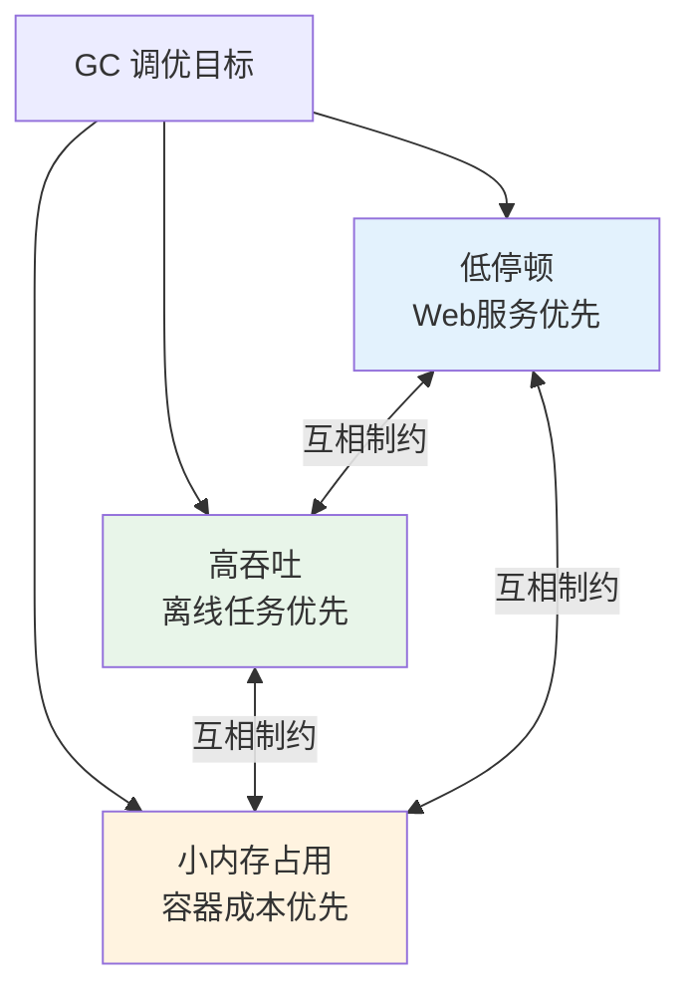
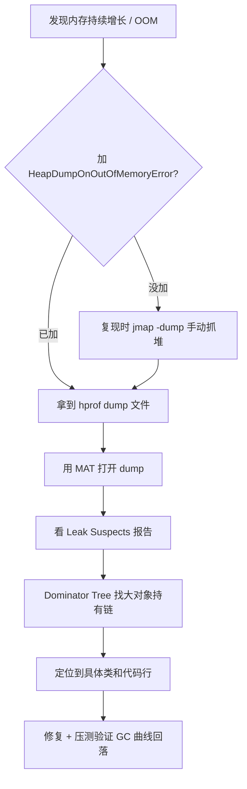

# GC 调优与线上排查

> 定位：上一讲你把收集器原理背得滚瓜烂熟，但线上真出了问题还是手忙脚乱——日志不会看、dump 不会分析、命令记不全。这篇给你一套**可落地的排查路径和工具箱**：从指标定义到日志解读，从 OOM 定位到 MAT/Arthas 实战，让"GC 出问题"从玄学变成流程。

## 一、为什么需要系统化的 GC 排查

很多人的 GC 排查是这样的：接口慢了 → 怀疑 Full GC → 百度一个 `-Xmx` 参数改大 → 重启 → 好像好了 → 过两天又炸。这是碰运气，不是排查。

真正的排查要回答三个问题：

1. **是不是 GC 的问题**？—— 用指标和日志确认，而不是猜
2. **是哪里的问题**？—— 是泄漏、是大对象、还是参数不合理
3. **怎么解决并验证**？—— 有明确动作，且能用数据证明改善

这篇就是给你这条从"现象"到"根因"再到"验证"的完整链路。

## 二、GC 性能指标：先搞清要优化什么

调优不是把某个数字调到最小，而是在几个互相制约的指标间找平衡。先认识三个核心指标：

| 指标 | 定义 | 关注点 |
|---|---|---|
| **停顿时间（Pause Time）** | GC 期间 STW 的时长 | 直接影响接口延迟，越短越好 |
| **吞吐量（Throughput）** | 应用线程运行时间 / 总时间（含 GC） | 单位时间处理多少请求，越高越好 |
| **GC 频率** | 单位时间内 GC 次数 | 过于频繁说明内存分配有问题 |

这三者是**不可能三角**：想停顿短，往往要更频繁地 GC（频率上升），或每次少收点（吞吐下降）；想吞吐高，往往放任堆涨到很大才 GC（停顿变长）。调优的本质是**根据业务特点确定优先级**：

- Web 服务：优先低停顿（用户体验）
- 离线批处理/数据计算：优先高吞吐（跑得快就行，停顿无所谓）

还有一个容易忽略的指标：**Footprint（内存占用）**。给同样的负载，堆越小、GC 越省内存越好——容器化场景下直接影响成本。



图里三个目标两两制约。你不可能三者都要最优，先想清楚业务到底要什么，再决定调哪个旋钮。

## 三、GC 日志：线上排查的第一手证据

GC 日志是排查的基础。没有日志，一切分析都是猜测。

### 3.1 开启 GC 日志

**JDK 9+**（推荐，统一日志框架）：

```bash
-Xlog:gc*:file=/data/logs/gc.log:time,uptime,level,tags:filecount=5,filesize=100m
```

- `gc*`：记录所有 gc 相关标签的日志
- `time,uptime,level,tags`：每条日志带时间戳、启动时长、级别、标签
- `filecount=5,filesize=100m`：滚动 5 个文件，每个 100MB，避免日志撑爆磁盘

**JDK 8**：

```bash
-XX:+PrintGCDetails -XX:+PrintGCDateStamps -XX:+PrintGCTimeStamps \
-Xloggc:/data/logs/gc.log -XX:+UseGCLogFileRotation \
-XX:NumberOfGCLogFiles=5 -XX:GCLogFileSize=100M
```

### 3.2 读懂一次 GC 日志

以 JDK 8 + G1 的一次 Young GC 为例：

```
2024-03-15T10:23:01.123+0800: 12.456: [GC pause (G1 Evacuation Pause) (young), 0.0234560 secs]
   [Parallel Time: 18.2 ms, GC Workers: 8]
   [Eden: 128.0M(128.0M)->0.0B(120.0M) Survivors: 16.0M->24.0M Heap: 500.0M(1024.0M)->396.0M(1024.0M)]
 [Times: user=0.12 sys=0.01, real=0.02 secs]
```

逐段拆解：

- `12.456`：JVM 启动后 12.456 秒
- `GC pause (G1 Evacuation Pause) (young)`：一次 Young GC
- `0.0234560 secs`：**本次 STW 停顿 23.4ms**
- `Parallel Time: 18.2 ms, GC Workers: 8`：8 个 GC 线程并发工作 18.2ms
- `Eden: 128.0M -> 0.0B`：Eden 从 128M 清空到 0
- `Survivors: 16.0M -> 24.0M`：存活对象 16M 晋升到 Survivor
- `Heap: 500.0M -> 396.0M`：**堆从 500M 降到 396M，回收了约 104M**
- `real=0.02 secs`：真实墙钟停顿 20ms（约等于 STW）

### 3.3 用工具看日志

肉眼看单行没意义，要看**趋势和分布**。推荐两个在线分析工具：

- **GCeasy**（gceasy.io）：上传日志，自动生成停顿分布、吞吐量、GC 原因统计图
- **GCViewer**：本地开源工具，画 GC 时间序列图

> 提示：把日志上传到第三方工具前，确认日志里没有敏感信息（一般 GC 日志本身不含业务数据，但养成习惯）。敏感场景用本地 GCViewer。

## 四、OOM 与内存泄漏定位

### 4.1 OOM 分类速查

不同 OOM 对应不同排查方向，这是第 01 篇的延伸：

| 报错 | 含义 | 首要怀疑对象 |
|---|---|---|
| `Java heap space` | 堆满 | 内存泄漏 / 大对象 / Xmx 太小 |
| `GC overhead limit exceeded` | GC 占用 98% 时间却只回收 2% | 严重内存泄漏 |
| `Metaspace` | 元空间满 | 动态类生成失控 |
| `Direct buffer memory` | 直接内存满 | Netty/NIO 堆外内存泄漏 |
| `unable to create new native thread` | 线程创建失败 | 线程数过多 |
| `Out of swap space` | 系统内存+swap 耗尽 | 进程总内存失控 |

### 4.2 内存泄漏的典型模式

内存泄漏 = 对象已经没用了，但因为还被引用着，GC 收不掉。常见模式：

1. **静态集合**：`static Map` 不断 put  never remove，key 还可能是自定义对象
2. **ThreadLocal 未清理**：线程池复用线程，ThreadLocal 的 value 一直挂在线程上，尤其配合弱引用 key 变成 null 后 value 永远无法访问
3. **未关闭的资源**：Connection、Stream、ResultSet 不 close
4. **监听器/回调未注销**：注册到全局监听器上但从不移除
5. **缓存无淘汰策略**：自己写的 Map 当缓存用，没有 LRU/过期机制

### 4.3 定位流程



这张图是内存泄漏排查的标准流程：先拿到堆快照，再用 MAT 找"是谁在持有这些对象"，最后顺着引用链定位到代码。

## 五、诊断工具箱实战

### 5.1 命令行工具

这是你必须刻进肌肉记忆的命令：

| 命令 | 用途 | 典型用法 |
|---|---|---|
| `jps` | 看 Java 进程 PID | `jps -l` |
| `jstat` | 实时看 GC 统计 | `jstat -gcutil <pid> 1000 10`（每秒一次，共 10 次） |
| `jmap` | dump 堆 / 看对象分布 | `jmap -dump:format=b,file=heap.hprof <pid>` |
| `jstack` | 看线程栈（死锁、卡死） | `jstack <pid>` 或 `jstack -l <pid>` |
| `jcmd` | 多功能诊断（JDK 7+ 首选） | `jcmd <pid> GC.class_histogram` |
| `jinfo` | 查看/动态调整参数 | `jinfo -flag UseG1GC <pid>` |

**jstat 输出解读**：

```
$ jstat -gcutil 12345 1000
  S0     S1     E      O      M     CCS    YGC     YGCT    FGC    FGCT     GCT
  0.00  98.50  65.20  72.10  95.30  90.10   156    2.345     3    1.234    3.579
```

- `E` 65.20%：Eden 使用率
- `O` 72.10%：老年代使用率
- `M` 95.30%：Metaspace 使用率（接近满要警惕）
- `YGC` 156 / `YGCT` 2.345s：Young GC 156 次，累计耗时 2.345 秒（平均 15ms）
- `FGC` 3 / `FGCT` 1.234s：Full GC 3 次，累计耗时 1.234 秒（平均 411ms！**Full GC 比 Young GC 慢一个数量级**）

> 经验：如果 FGC 在短时间内快速增长，或 FGCT 占比很高，基本可以确定有问题。

### 5.2 MAT（Memory Analyzer Tool）

MAT 是分析堆 dump 的神器。核心功能：

- **Leak Suspects Report**：一键生成"疑似泄漏点"报告
- **Dominator Tree**：按"保留大小（Retained Heap）"排序，找到"如果这个对象被回收，能释放多少内存"的最大持有者
- **Histogram**：按类统计对象数量和占用，快速发现异常多的类
- **OQL**：类 SQL 查询对象

关键概念：
- **Shallow Heap**：对象自身占用的内存
- **Retained Heap**：对象 + 它唯一持有的对象链加起来占用的内存——**排查泄漏看这个**

### 5.3 Arthas：在线诊断不中断服务

Arthas 是阿里开源的在线诊断工具，最大好处是**不用重启、不用改代码**就能看线上状态。

常用命令：

```bash
# 启动并 attach 到目标进程
java -jar arthas-boot.jar

# 看 JVM 实时状态（内存、线程、GC）
dashboard

# 反编译类，确认线上代码是不是你以为的版本
jad com.example.OrderService

# 方法执行耗时统计，找慢方法
trace com.example.OrderService getOrder '#cost>100'

# 观察方法入参和返回值
watch com.example.OrderService getOrder '{params, returnObj}' -x 3

# 看线程栈，找死锁
thread -b

# 类加载情况、ClassLoader 泄漏排查
classloader -l
```

**场景**：线上某个接口偶发超时，用 `trace` 一看发现某个内部方法耗时 800ms，再 `watch` 看入参，发现是某个查询条件没走索引——整个定位过程不用重启服务。

### 5.4 JProfiler

商业工具（收费），强项是**CPU 和内存采样分析**，界面友好。适合做性能剖析（profiling）：看哪个方法最耗 CPU、对象在哪里分配。预算充足可以用，开源方案一般是 MAT + Arthas + async-profiler 组合。

## 六、生产坑点与排查

### 坑点 1：Full GC 频繁但堆看起来没满

**现象**：jstat 显示 FGC 每分钟几十次，但 `O` 老年代使用率只有 50%。

**原因**：① System.gc() 被代码显式调用（有些框架/库会调）；② 元空间不足触发 Full GC；③ 堆外内存达到 `MaxDirectMemorySize` 触发 System.gc()。

**解法**：
- `-XX:+DisableExplicitGC` 禁用 System.gc()（注意：用了堆外内存时别轻易开，会导致堆外内存无法及时回收）
- 查 `jstat` 的 `M` 列确认元空间
- 检查 Netty 堆外内存配置

### 坑点 2：GC 日志没开，出问题无从查起

**现象**：接口卡顿，想看 GC 记录，发现日志根本没开。

**原因**：JVM 参数里漏配了 GC 日志。

**解法**：所有服务上线前强制加上 GC 日志参数（见 3.1），并纳入部署模板。这是 0 成本、高回报的保险。

### 坑点 3：dump 文件把磁盘打满，或 dump 时服务卡死

**现象**：OOM 时自动 dump，但 hprof 文件几十 GB 撑爆磁盘；或手动 jmap dump 时服务长时间停顿。

**原因**：hprof 是二进制全量快照，大小和堆占用成正比；jmap dump 会 STW，堆越大停顿越久。

**解法**：
- 用 `jcmd <pid> GC.heap_dump` 替代 jmap（更快）
- 控制 dump 频率，磁盘预留空间
- 容器里把 dump 写到挂载卷，别写容器临时层
- 大堆场景考虑用 JFR（Java Flight Recorder）做低开销采样，而非全量 dump

### 坑点 4：把 GC 停顿当成接口慢的全部原因

**现象**：接口 P99 高，一口咬定是 GC，调了半天参数没用。

**原因**：没用数据验证。可能是下游依赖慢、锁竞争、线程池排队、数据库慢查询。

**解法**：先看 GC 日志确认停顿时间和频率是否和 P99 尖刺吻合。用 Arthas `trace`/`watch` 拆解方法耗时，用链路追踪（SkyWalking/Zipkin）定位瓶颈。用数据说话，别先入为主。

## 七、调优、排查清单与最佳实践

### 7.1 排查六步法

1. **确认现象**：P99 尖刺？FGC 频繁？OOM？用监控数据量化
2. **看 GC 日志**：停顿时长、频率、回收量、触发原因
3. **看 JVM 状态**：`jstat -gcutil` 看各区使用率趋势
4. **抓证据**：必要时 dump 堆 / 看线程栈
5. **定根因**：泄漏？大对象？参数？代码？
6. **验证**：改完压测，看 GC 曲线是否改善

### 7.2 调优参数清单

| 目标 | 参数/手段 |
|---|---|
| 开 GC 日志 | `-Xlog:gc*:file=gc.log...`（JDK 9+） |
| OOM 自动 dump | `-XX:+HeapDumpOnOutOfMemoryError -XX:HeapDumpPath=/data/dump` |
| 堆大小 | `-Xms=-Xmx`，容器内存 60%-75% |
| 选 G1 | `-XX:+UseG1GC` |
| 停顿目标 | `-XX:MaxGCPauseMillis=200` |
| 元空间上限 | `-XX:MaxMetaspaceSize=256m` |
| 直接内存上限 | `-XX:MaxDirectMemorySize=1g` |

### 7.3 最佳实践

1. **先测量再调优**：没有数据支撑的调参都是赌博
2. **一次只改一个变量**：同时改一堆参数，好了也不知道是哪个起作用
3. **压测验证**：改动前后用相同负载对比 GC 指标
4. **代码优先**：减少临时对象、复用大对象、及时释放引用，效果远好于调参
5. **工具组合**：命令行（jstat/jcmd）快速看 + MAT 深度分析 + Arthas 在线诊断

## 八、面试高频问法

> 这一节的答案按「面试时能讲透」的标准写：先给一句话结论，再展开机制、原因和坑点。建议先自己答一遍，再对照补全。

**Q1：GC 调优到底在调什么？有哪些核心指标？**

**一句话结论**：调优不是把某个数字调到最小，而是在**停顿时间、吞吐量、内存占用**三者间找平衡，先明确业务优先级再动手。

展开：

| 指标 | 定义 | 关注点 |
|---|---|---|
| 停顿时间 Pause Time | GC 期间 STW 的时长 | 直接影响接口延迟，越短越好 |
| 吞吐量 Throughput | 应用线程时间 / 总时间 | 单位时间处理多少请求，越高越好 |
| GC 频率 | 单位时间 GC 次数 | 过于频繁说明内存分配有问题 |

这三者是**不可能三角**：想停顿短，往往要更频繁 GC（频率上升）或每次少收点（吞吐下降）；想吞吐高，往往放任堆涨到很大才 GC（停顿变长）。还有容易被忽略的 **Footprint（内存占用）**——容器化场景下直接影响成本。

**优先级判断**：Web 服务优先低停顿（用户体验）；离线批处理优先高吞吐（跑得快就行）。

加分点：一句镇场——「调优前先问自己：这个服务到底怕停顿还是怕吞吐低？没想清楚就调参都是赌博」。面试官很喜欢这种「先定目标再动手」的思路。

**Q2：线上 CPU 飙到 100%，你的排查思路是什么？**

**一句话结论**：先把高 CPU 的线程定位出来、换算成线程 ID，再看它的栈在干什么；关键要区分是 GC 线程还是业务线程。

展开（标准五步）：

1. `top` 找到高 CPU 的 Java 进程 PID。
2. `top -H -p <pid>` 找出该进程里高 CPU 的线程，记下线程 ID（十进制，如 12345）。
3. `printf '%x' 12345` 转成 16 进制（如 3039）——因为 jstack 里线程 ID 是 16 进制的 nid。
4. `jstack <pid> | grep -A 20 3039` 看这个线程在干什么。
5. 或直接用 Arthas：`thread -n 3` 列出最忙的 3 个线程的栈。

**区分线程类型**：如果栈顶是 `VM Thread` / `GC task thread`，说明是 GC 在疯狂回收——转去看 GC 日志；如果是业务方法栈，就优化那个方法（死循环、正则回溯、序列化等）。

加分点：强调「线程 ID 要转 16 进制再 grep jstack，这是很多人卡住的地方」，并提一句「native 线程高 CPU 可以用 `perf` 或 async-profiler 看热点」——体现工具的广度和深度。

**Q3：GC 日志怎么开？一次 Young GC 日志怎么读？**

**一句话结论**：JDK 9+ 用统一的 `-Xlog:gc*` 参数开启，日志里重点看 STW 时长、各区容量变化、回收量和触发原因。

展开：

**开启方式**：
- JDK 9+：`-Xlog:gc*:file=/data/logs/gc.log:time,uptime,level,tags:filecount=5,filesize=100m`（滚动 5 个文件、每个 100MB，避免撑爆磁盘）。
- JDK 8：`-XX:+PrintGCDetails -XX:+PrintGCDateStamps -Xloggc:... -XX:+UseGCLogFileRotation`。

**读一次 G1 Young GC**（逐段拆解）：

```
12.456: [GC pause (G1 Evacuation Pause) (young), 0.0234560 secs]
  [Parallel Time: 18.2 ms, GC Workers: 8]
  [Eden: 128.0M->0.0B Survivors: 16.0M->24.0M Heap: 500.0M->396.0M]
```

- `12.456`：JVM 启动后 12.456 秒。
- `0.0234560 secs`：**本次 STW 停顿 23.4ms**（面试直接报这个数）。
- `GC Workers: 8`：8 个 GC 线程并行。
- `Eden: 128M->0`：Eden 清空；`Heap: 500M->396M`：**回收约 104M**。
- `Times: real=0.02s`：墙钟时间，约等于 STW。

加分点：提「肉眼看单行没意义，要看趋势和分布——把日志丢给 GCeasy / GCViewer 生成停顿分布图和吞吐统计，才能发现'偶发长尾停顿'这种单次看不出来的问题」。

**Q4：jstat 的 YGC/FGC/YGCT/FGCT 分别是什么意思？怎么判断有问题？**

**一句话结论**：YGC/FGC 是 Young/Full GC 的**次数**，YGCT/FGCT 是累计**耗时**；重点看 FGC 增长速度、FGCT 在总 GC 时间中的占比。

展开：

```
  S0     S1     E      O      M      YGC   YGCT    FGC   FGCT    GCT
  0.00  98.50  65.20  72.10  95.30   156   2.345    3    1.234   3.579
```

- `E` 65.20%：Eden 使用率；`O` 72.10%：老年代使用率；`M` 95.30%：Metaspace 使用率（接近满要警惕）。
- `YGC` 156 / `YGCT` 2.345s：Young GC 156 次、累计 2.345 秒，**平均约 15ms**。
- `FGC` 3 / `FGCT` 1.234s：Full GC 3 次、累计 1.234 秒，**平均约 411ms**。

**怎么判断有问题**：正常情况下 Full GC 平均耗时应远小于 Young GC 才对，且 FGC 次数应该很少。这里 FGC 平均 411ms，是 YGC 的近 30 倍——**Full GC 比 Young GC 慢一个数量级**就是危险信号。如果 FGC 在短时间内快速增长、或 FGCT 占 GCT 比例很高，基本确定有问题。

加分点：给一个经验阈值——「Full GC 频率超过每小时几次，或单次超过 1 秒，就要介入排查」，让答案有可落地的判断标准，而不是只解读字段。

**Q5：线上内存泄漏怎么定位？说说完整流程。**

**一句话结论**：先拿到堆快照（OOM 自动 dump 或手动抓），再用 MAT 找「是谁在持有这些对象」，顺着引用链定位到代码，最后修复并压测验证。

展开（标准流程）：

1. **拿证据**：上线前配 `-XX:+HeapDumpOnOutOfMemoryError -XX:HeapDumpPath=/data/dump`，OOM 时自动 dump；没加的话在内存增长时手动 `jcmd <pid> GC.heap_dump`（比 jmap 快）抓堆。
2. **看报告**：用 MAT 打开 hprof，先看 **Leak Suspects** 报告给出的疑似泄漏点。
3. **找持有者**：看 **Dominator Tree**，按 Retained Heap 排序，找到「如果这个对象被回收能释放最多内存」的最大持有者。
4. **定位代码**：顺着引用链找到具体的类和代码行。
5. **修复验证**：改完压测，看 GC 曲线是否回落、内存是否稳定。

**常见泄漏模式**：静态集合只 put 不 remove、ThreadLocal 用完没 remove、Connection/Stream 未关闭、监听器未注销、自写 Map 缓存无淘汰策略。

加分点：强调「内存泄漏的本质是'对象已经没用了，但因为还被强引用持有而收不掉'，所以排查的核心永远是'找出那条意外的强引用链'」——一句话点透本质。

**Q6：MAT 里的 Shallow Heap 和 Retained Heap 有什么区别？Dominator Tree 怎么用？**

**一句话结论**：Shallow Heap 是对象自身占用的内存，Retained Heap 是「它 + 它唯一持有的对象链」加起来占用的内存——排查泄漏看 Retained Heap。

展开：

- **Shallow Heap**：对象自身的大小，只算自己的字段和对象头，不含它引用的其他对象。
- **Retained Heap**：如果这个对象被回收，能连带释放的所有内存（即它「支配」的对象集）。它反映对象的「真实影响力」。
- **Dominator Tree（支配树）**：描述对象间的支配关系——如果对象 A 被回收必然导致 B 也被回收，就说 A 支配 B。树里父节点的 Retained Heap 包含所有子节点。

**实战心法**：按 Retained Heap 排序，排在最前面的往往就是泄漏源头。比如一个 `static Map` 占了 500MB 的 Retained Heap，但 Shallow Heap 只有几十 KB——说明它持有了海量对象，这就是典型的泄漏点。

加分点：补一句「Histogram 按类统计对象数量，适合快速发现'某个类实例数异常多'（比如重复创建的代理类）；OQL 可以像写 SQL 一样查对象」——把 MAT 的四把武器都点出来。

**Q7：Arthas 常用哪些命令？它解决什么问题？**

**一句话结论**：Arthas 是阿里开源的在线诊断工具，最大价值是**不重启、不改代码**就能看线上状态、定位慢方法和异常。

展开（必记命令）：

```bash
dashboard                                          # 看 JVM 实时全局状态
jad com.example.OrderService                       # 反编译，确认线上代码是不是你以为的版本
trace com.example.OrderService getOrder '#cost>100'  # 统计方法内部各调用耗时，找慢方法
watch com.example.OrderService getOrder '{params, returnObj}' -x 3  # 观察入参和返回值
thread -b                                          # 找出阻塞其他线程的线程（查死锁）
classloader -l                                     # 看类加载器层级，排查类加载泄漏
```

**典型场景**：线上接口偶发超时，用 `trace` 发现某个内部方法耗时 800ms，再 `watch` 看入参，发现是某个查询条件没走索引——整个定位过程不用重启服务。

加分点：强调「`jad` 确认代码版本」这个容易被忽略的用法——「很多时候'明明改了却没生效'是部署的还是旧包，jad 一下立刻见分晓」，这是生产经验，不是死记命令。

**Q8：`GC overhead limit exceeded` 是什么意思？怎么解决？**

**一句话结论**：JVM 花了 98% 以上的时间做 GC 却只回收不到 2% 的内存，说明堆里几乎全是活对象，通常是严重内存泄漏的信号。

展开：

- **机制**：这是 JVM 的「保护性自杀」——它预测按当前趋势继续 GC 也收不回多少内存，与其一直卡着不如尽早抛错。JDK 6+ 默认开启。
- **本质原因**：堆里对象几乎都可达（被强引用持有），GC 白忙活。最常见就是无界缓存、静态集合泄漏，导致内存被慢慢占满。
- **解法**：**根本解决是修泄漏**——用 MAT 分析 dump 找到持有链。可以用 `-XX:-UseGCMOverheadLimit` 关掉这个检查，但**不推荐**——关了只是让应用继续卡死在 GC 里，症状更隐蔽。

加分点：把它和 `Java heap space` 对比——「前者说明'一直在 GC 但收不回'，后者说明'分配时没空间了'，都是堆问题，但前者往往意味着更严重、更慢性子的泄漏」。

**Q9：Full GC 很频繁，但堆看起来没满，可能是什么原因？**

**一句话结论**：堆没满却频繁 Full GC，通常不是堆的事——常见是显式 `System.gc()`、元空间不足、或堆外内存达到上限触发了 `System.gc()`。

展开：

| 可能原因 | 机制 | 排查/解法 |
|---|---|---|
| 显式 `System.gc()` | 框架/库代码主动调用 | `-XX:+DisableExplicitGC` 禁用 |
| 元空间不足 | Metaspace 达到 `MaxMetaspaceSize` | 看 `jstat` 的 M 列，调大上限或查动态类 |
| 堆外内存触顶 | 直接内存达 `MaxDirectMemorySize` 会触发 System.gc() | 检查 Netty 配置、调大上限 |

**重要权衡**：用堆外内存（Netty）时**别轻易开** `-XX:+DisableExplicitGC`——因为堆外内存正是靠 `System.gc()` 触发的 Full GC 顺带回收 DirectBuffer 的，禁掉后堆外内存可能无法及时回收，反而 OOM。

加分点：说出「`System.gc()` 只是'建议'JVM 做 Full GC，不保证立即执行，但多数实现会响应——这也是为什么框架乱调它会造成灾难」。把语义讲准，体现功底。

**Q10：dump 时把磁盘打满或服务卡死怎么办？接口慢一定是 GC 的锅吗？**

**一句话结论**：大堆 dump 要控制频率、用更快的工具、写到挂载卷；而接口慢不能先入为主归咎 GC，必须用数据验证。

展开：

**dump 的坑与解法**：
- hprof 是**全量二进制快照**，大小和堆占用成正比，几十 GB 很常见——磁盘要预留空间，容器里写到**挂载卷**别写临时层。
- `jmap -dump` 会 STW，堆越大停顿越久——改用 `jcmd <pid> GC.heap_dump`（更快）。
- 大堆场景用 **JFR（Java Flight Recorder）** 做低开销采样，替代全量 dump。

**别把锅都甩给 GC**：
- 接口 P99 高，先**看 GC 日志**，确认停顿时间和频率是否和 P99 尖刺在时间上吻合。
- 不吻合就往别处查：下游依赖慢、锁竞争、线程池排队、数据库慢查询。用 Arthas `trace`/`watch` 拆方法耗时，用链路追踪（SkyWalking/Zipkin）定位瓶颈。

加分点：总结一句方法论——「先测量再调优、一次只改一个变量、压测验证」——这十二字是排查的铁律，也是资深工程师和新手最明显的区别。

## 小结

- 调优是在**停顿、吞吐、内存占用**间找平衡，先明确业务优先级再动手。
- **GC 日志是排查基础**，JDK 9+ 用 `-Xlog:gc*`，上线必配。
- 定位 OOM 看报错后缀确定区域，`Java heap space` 用 MAT 分析 dump 的 Dominator Tree 找泄漏。
- 工具组合：`jstat` 看趋势 → `jcmd`/`jmap` 抓证据 → MAT 深度分析 → Arthas 在线诊断。
- 排查切记**用数据说话**，别把接口慢都归咎于 GC；一次只改一个变量，压测验证。
