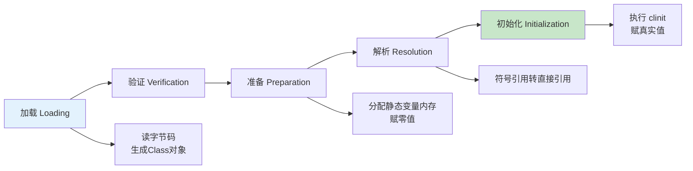
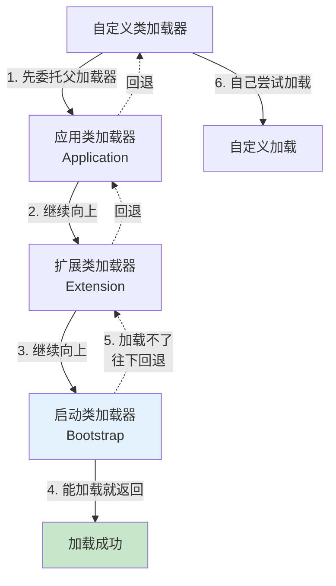
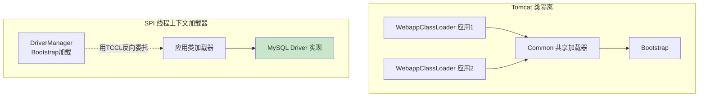

# 类加载机制

> 定位：你写的 `.java` 编译成 `.class`，JVM 怎么把它变成能运行的类？中间经历了哪些阶段、谁负责加载、为什么 Tomcat 能做到多个应用隔离、SPI 凭什么能加载服务实现？这些问题的答案都在类加载机制里——它也是理解热部署、OSGi、插件化的地基。

## 一、为什么需要理解类加载

类加载看起来是" JVM 自己做的事"，离日常业务很远，但一旦你要做这些事，它就变成拦路虎：

- **Spring 的动态代理、MyBatis 的 Mapper 代理**：运行时生成类，需要自定义类加载器
- **Tomcat 部署多个 Web 应用**：同名类（比如两个应用都有 `com.xxx.UserService`）互不冲突，靠的是每个应用独立的类加载器
- **SPI 机制**：JDBC 驱动、Dubbo 扩展点，服务实现类不在启动类路径上，怎么被加载
- **热部署 / 热修复**：不重启 JVM 替换类，本质是换类加载器
- **线上诡异的 `ClassNotFoundException` / `NoClassDefFoundError` / `ClassCastException`**：多数是类加载器的锅

搞懂类加载，你才能从"背双亲委派定义"进阶到"能设计类隔离方案"。

## 二、类加载的全过程：五个阶段

一个类从 `.class` 文件到能被 JVM 使用，要经过 **加载 → 验证 → 准备 → 解析 → 初始化** 五个阶段。其中验证、准备、解析三步合称"连接（Linking）"。



图里要特别留意**准备和初始化**的分工——这是面试高频陷阱：准备阶段给静态变量分配内存并赋"零值"，初始化阶段才赋你写的真实值。

### 2.1 加载（Loading）

做三件事：

1. 通过类的全限定名（如 `com.example.User`）获取类的二进制字节流（来源可以是 class 文件、jar 包、网络、动态生成）
2. 把字节流中的静态存储结构转换成方法区的运行时数据结构
3. 在堆中生成一个 `java.lang.Class` 对象，作为访问方法区数据的入口

> 注意：Class 对象在**堆**里（JDK 8+），类的元数据在**方法区（元空间）**里。这个在第 01 篇讲过。

### 2.2 验证（Verification）

确保 class 文件的字节流符合 JVM 规范，不会破坏虚拟机安全。包括文件格式验证、元数据验证、字节码验证、符号引用验证。这是 JVM 的一道防线——防止你用十六进制编辑器改写 class 文件搞破坏。

### 2.3 准备（Preparation）

**为类的静态变量分配内存，并赋默认零值**，注意不是你写的值。

```java
public class Demo {
    static int a = 10;           // 准备阶段 a = 0，初始化阶段才变成 10
    static final int b = 20;     // 编译期常量，准备阶段就是 20
    static String s = "hello";   // 准备阶段 s = null
}
```

`final static` 的基本类型/字符串常量比较特殊，编译期就放进常量池，准备阶段直接赋真实值。

### 2.4 解析（Resolution）

把常量池中的**符号引用**转换成**直接引用**。

- 符号引用：用一组符号描述目标，比如"类名 `com.example.User` 的 `getName` 方法"，和内存地址无关
- 直接引用：直接指向目标的指针、相对偏移量或句柄，能定位到实际内存

解析不一定在初始化前完成，也可能延迟到首次使用（运行时解析）。

### 2.5 初始化（Initialization）

类加载的最后一步，真正执行类中代码：

- 编译器把静态变量的赋值语句和静态代码块收集到 **`<clinit>()` 方法**中，初始化就是执行它
- JVM 保证子类的 `<clinit>()` 执行前，父类的 `<clinit>()` 已执行完
- **单线程执行**：JVM 会加锁保证一个类的 `<clinit>()` 只被执行一次

**触发初始化的时机（主动引用）**——记住这几种：

1. `new` 一个对象、读取/设置类的静态字段、调用类的静态方法
2. 反射调用（`Class.forName()`）
3. 初始化一个类时，父类未初始化会先触发父类初始化
4. 包含 `main` 方法的类，启动时先初始化
5. JDK 7+ 的 `MethodHandle` 调用

**不会触发初始化的情况（被动引用）**：

- 通过子类引用父类的静态字段，只初始化父类
- 通过数组定义引用类（`Demo[] arr = new Demo[10]`），不初始化 Demo
- 访问编译期常量（`static final`），不初始化

## 三、类加载器与双亲委派模型

### 3.1 类加载器家族

JVM 内置了三层类加载器，加上自定义加载器：

| 加载器 | 加载内容 | 说明 |
|---|---|---|
| **启动类加载器（Bootstrap ClassLoader）** | `JAVA_HOME/lib` 下的核心类，如 `java.lang.*` | C++ 实现，Java 里看不到（返回 null） |
| **扩展类加载器（Extension ClassLoader）** | `JAVA_HOME/lib/ext` | JDK 9 后被平台类加载器取代 |
| **应用类加载器（Application ClassLoader）** | classpath 下的类 | 默认加载器，你写的类都归它 |
| **自定义类加载器（Custom ClassLoader）** | 你指定的路径 | 继承 `ClassLoader` 实现 |

### 3.2 双亲委派模型

这是类加载的核心机制。工作过程：

1. 一个类加载器收到加载请求，**先不自己加载**，而是**委托给父类加载器**去加载
2. 父类加载器继续向上委托，直到启动类加载器
3. 如果父类加载器都加载不了（它的搜索范围里没有这个类），才由自己尝试加载



图里实线是"向上委托"，虚线是"加载不了往回退"。这个模型像公司里的请示流程：下属先问上级，上级搞不定再自己干。

**双亲委派的好处有两个**：

1. **避免类重复加载**：一个类只会被父加载器加载一次，不会加载出多份
2. **保证 Java 核心库的安全**：你没法自定义一个 `java.lang.String` 来替换核心类——因为 `java.lang.String` 永远会被启动类加载器加载。这叫**沙箱安全机制**

### 3.3 双亲委派的实现源码

核心逻辑在 `ClassLoader.loadClass()` 里，非常简洁：

```java
protected Class<?> loadClass(String name, boolean resolve) throws ClassNotFoundException {
    synchronized (getClassLoadingLock(name)) {
        // 1. 先检查是否已加载
        Class<?> c = findLoadedClass(name);
        if (c == null) {
            try {
                // 2. 有父加载器就委托父加载器
                if (parent != null) {
                    c = parent.loadClass(name, false);
                } else {
                    // 父加载器为 null 则委托启动类加载器
                    c = findBootstrapClassOrNull(name);
                }
            } catch (ClassNotFoundException e) {
                // 父加载器加载失败，忽略
            }
            if (c == null) {
                // 3. 父加载器都失败，自己加载
                c = findClass(name);
            }
        }
        if (resolve) {
            resolveClass(c);
        }
        return c;
    }
}
```

关键启示：**想打破双亲委派，就重写 `loadClass()`**；想保留双亲委派但自定义加载逻辑，就只重写 `findClass()`。

## 四、打破双亲委派：经典场景

双亲委派不是铁律，很多框架需要"反向"加载类。三种典型场景：

### 4.1 Tomcat：应用隔离

Tomcat 里每个 Web 应用有自己的 `WebappClassLoader`，**优先自己加载应用目录下的类**，加载不到才委托父加载器。这和双亲委派正好相反。

为什么？假设两个应用都用了不同版本的 Spring，如果都委托给父加载器（common 加载器），只能加载一份，版本就冲突了。Tomcat 的做法是：

- 应用自己的类（`/WEB-INF/classes`、`/WEB-INF/lib`）由 `WebappClassLoader` 优先加载，应用间隔离
- Java 核心类（`java.*`）仍然委托给启动类加载器，保证安全
- 共享类（如 Servlet API）由父加载器加载

这样每个应用的同名类互不干扰，实现部署隔离。

### 4.2 SPI：服务发现

JDBC 是典型例子。核心接口 `java.sql.Driver` 由启动类加载器加载，但具体实现（如 `com.mysql.cj.jdbc.Driver`）在应用的 classpath 里，由应用类加载器加载。

问题来了：启动类加载器加载的 `DriverManager` 要加载实现类加载不了（父加载器看不到子加载器的类）。怎么破？

Java 引入了**线程上下文类加载器（Thread Context ClassLoader，TCCL）**：

```java
// DriverManager 初始化时，用线程上下文类加载器加载驱动实现
ClassLoader cl = Thread.currentThread().getContextClassLoader();
// 默认就是应用类加载器，能看到 classpath 下的驱动类
```

Spring、Dubbo 的 SPI 扩展加载都大量使用 TCCL。这是一种"父加载器委托子加载器"的反向机制。

### 4.3 OSGi：模块化热部署

OSGi 是 Java 模块化规范（Eclipse 的插件体系就是基于它）。每个模块（Bundle）有自己的类加载器，模块间通过显式声明 import/export package 来共享类。它实现了真正的**动态模块化**：模块可以在运行时安装、启动、停止、卸载，而不用重启 JVM。

代价是模型复杂、类加载关系网状化，调试困难。随着 JPMS（JDK 9 的模块系统）出现，OSGi 的使用在减少，但它的类隔离思想影响深远。



左边是 Tomcat 的隔离模型：每个应用独立加载器，共享类上交给 common；右边是 SPI：父加载器通过线程上下文加载器反向委托子加载器。两者都是对双亲委派的"破例"，但目的不同——一个是隔离，一个是反向发现。

## 五、生产坑点与排查

### 坑点 1：`NoClassDefFoundError` 和 `ClassNotFoundException` 分不清

**现象**：线上报这两个错，不知道差在哪。

**原因与区别**：

- `ClassNotFoundException`：类加载器**主动加载时找不到**类（`Class.forName()`、`loadClass()`）。编译期不报错，运行时按需加载才失败。
- `NoClassDefFoundError`：类**之前成功加载过**，但后续再找时找不到了（典型：类初始化失败后，JVM 标记为不可用；或依赖的类在运行时缺失）。这是 Error，更严重。

**解法**：检查 classpath/jar 包是否完整、依赖是否冲突（用 `mvn dependency:tree`）、类初始化块是否抛异常导致类被标记为失败。

### 坑点 2：自定义类加载器导致 `ClassCastException`

**现象**：明明是同一个类，强转却报 `ClassCastException`，报信息里类名一模一样。

**原因**：**不同类加载器加载的同名类是不同的类**！JVM 判定两个类是否相同，看的是"全限定名 + 加载它的类加载器"。两个加载器各加载一份 `User`，它们互不兼容。

**解法**：确保协作的类由同一个加载器加载；避免在多个加载器间传递对象；排查是不是重复创建了加载器实例。

### 坑点 3：`LinkageError: loader constraint violation`

**现象**：复杂应用（尤其热部署/插件化）里出现加载器约束冲突。

**原因**：某个类被两个加载器加载，而它们的公共父类型（接口/父类）却要求一致，产生冲突。

**解法**：梳理类加载器层次，确保接口/父类由共同的父加载器加载；用线程上下文加载器统一；谨慎做热部署。

### 坑点 4：Metaspace OOM——动态类生成失控

**现象**：JDK 8+ 服务 Metaspace 缓慢增长直到 `OutOfMemoryError: Metaspace`。

**原因**：运行时不断生成新类。常见：每次请求都用 CGLIB 生成新的代理类、Groovy 脚本反复编译、反射没缓存。

**解法**：复用代理类、设置 `-XX:MaxMetaspaceSize` 兜底、用 `jcmd <pid> GC.class_histogram` 看哪些类暴涨。

## 六、最佳实践与选型

1. **默认遵循双亲委派**：写自定义加载器时，优先只重写 `findClass()`，保留双亲委派。
2. **需要隔离才打破**：只有做容器、插件化、热部署时才重写 `loadClass()` 改变委派顺序。
3. **核心类不自定义**：永远不要把 `java.*` 开头的类交给自定义加载器，交给 Bootstrap 保证安全。
4. **注意资源释放**：自定义加载器持有的类和资源，在卸载时要能释放，否则元空间泄漏。
5. **排查工具**：
   - `-verbose:class` 或 `-Xlog:class+load=info`（JDK 9+）看类加载日志
   - `jcmd <pid> VM.classloader_stats` 看类加载器统计
   - Arthas `classloader` 命令看加载器层级和加载的类

## 七、面试高频问法

> 这一节的答案按「面试时能讲透」的标准写：先给一句话结论，再展开机制、原因和坑点。建议先自己答一遍，再对照补全。

**Q1：讲讲类加载的五个阶段？准备和初始化的区别是什么？**

**一句话结论**：加载 → 验证 → 准备 → 解析 → 初始化（后三步中的验证、准备、解析合称连接）；准备阶段给静态变量赋**零值**，初始化阶段才赋你写的**真实值**。

展开：

1. **加载**：用类的全限定名获取二进制字节流（来源可以是 class 文件、jar、网络、动态生成），把静态存储结构转成方法区运行时结构，并在**堆里生成一个 `Class` 对象**作为访问入口。
2. **验证**：检查字节流符合 JVM 规范，防止破坏虚拟机安全（文件格式、元数据、字节码、符号引用四类验证）。
3. **准备**：为**静态变量**分配内存并赋默认零值——这是高频陷阱。
4. **解析**：把常量池里的**符号引用**转成**直接引用**（能定位 actual 内存地址的指针/偏移量）。
5. **初始化**：执行 `<clinit>()`，真正给静态变量赋真实值、执行静态代码块。

**关键代码**：

```java
static int a = 10;         // 准备阶段 a=0，初始化阶段才=10
static final int b = 20;   // 编译期常量，准备阶段就=20
static String s = "hello"; // 准备阶段 s=null
```

加分点：点出「`static final` 基本类型/字符串常量在编译期就进了常量池，所以准备阶段直接是真实值，不用等初始化」——这个例外是面试官验证你是否真懂的经典追问。

**Q2：哪些操作会触发类初始化？哪些不会？**

**一句话结论**：`new`、读写静态字段、调用静态方法、反射、`main` 类启动、子类初始化触发父类等**主动引用**会触发初始化；数组定义、访问父类静态字段、访问编译期常量等**被动引用**不会。

展开：

**会触发初始化（主动引用，共 6 种）**：
1. `new` 一个对象、读取/设置类的静态字段、调用类的静态方法
2. 反射调用（`Class.forName()` 默认 initialize=true）
3. 初始化一个类时，父类未初始化会先触发父类初始化
4. 包含 `main` 方法的类，启动时先初始化
5. JDK 7+ 的 `MethodHandle` 调用
6. 接口中定义了默认方法时，该接口会在实现类初始化前被初始化

**不会触发（被动引用）**：
- 通过**子类**引用父类的静态字段——只初始化父类，不初始化子类
- 数组定义引用类（`Demo[] arr = new Demo[10]`）——不初始化 Demo
- 访问**编译期常量**（`static final`）——常量在常量池，不触发初始化

加分点：提一句「`Class.forName(name)` 默认会初始化，而 `ClassLoader.loadClass(name)` 只加载不初始化（默认 resolve=false），这个差异常被用来做'延迟初始化'」——把这个知识点和类加载器 API 关联起来，很加分。

**Q3：`<clinit>()` 方法是什么？为什么它只执行一次且线程安全？**

**一句话结论**：`<clinit>()` 是编译器把静态变量赋值和静态代码块收集起来生成的方法，JVM 保证它在多线程环境下**只被执行一次**。

展开：

- **来源**：编译器按源码顺序，把所有静态变量的赋值语句和 `static {}` 块收集到 `<clinit>()` 中。没有静态赋值和静态块的类，就没有 `<clinit>()`。
- **父类优先**：JVM 保证子类 `<clinit>()` 执行前，父类的 `<clinit>()` 已经执行完。所以父类静态块先于子类执行。
- **线程安全**：JVM 在 `<clinit>()` 执行时加锁（通过 `Class` 对象的初始化锁），保证同一个类只被初始化一次。多个线程同时初始化同一个类，只有一个能执行，其他的阻塞等待。

**经典应用**：利用「`<clinit>()` 只执行一次」实现线程安全的单例——静态内部类/holder 模式，既是懒加载又天然线程安全，不需要 synchronized。

加分点：说清一个坑——「如果 `<clinit>()` 里抛异常，类会被标记为' erroneous（不可用）'，后续再初始化会直接抛 `NoClassDefFoundError`，不会重试」。这正好过渡到下一个高频错误题。

**Q4：JVM 里有哪些类加载器？各自加载什么？**

**一句话结论**：Bootstrap（启动）、Extension（扩展，JDK 9 后为平台类加载器）、Application（应用）、Custom（自定义）四层；其中 Bootstrap 用 C++ 实现，在 Java 里返回 `null`。

展开：

| 加载器 | 加载内容 | 说明 |
|---|---|---|
| Bootstrap ClassLoader | `JAVA_HOME/lib` 下核心类（java.lang.* 等） | C++ 实现，Java 里获取为 null |
| Extension ClassLoader | `JAVA_HOME/lib/ext` | JDK 9 后被平台类加载器（Platform）取代 |
| Application ClassLoader | classpath 下的类 | 默认加载器，你写的类归它 |
| Custom ClassLoader | 你指定的路径 | 继承 `ClassLoader` 实现 |

**注意层次关系**：它们不是继承关系，而是**组合/委派关系**——每个加载器持有一个 parent 引用（Bootstrap 的 parent 是 null）。这点很多人会答错成「父子继承」。

加分点：提「JDK 9 模块系统后，Extension 被 Platform ClassLoader 取代，加载模型从三层变为新的层次，但双亲委派的核心思想没变」——版本演进意识加分。

**Q5：什么是双亲委派模型？它的工作流程和好处是什么？**

**一句话结论**：类加载器收到请求先委托父加载器，父加载器都加载不了才自己尝试；好处是**避免类重复加载**和**保护 Java 核心类库安全（沙箱）**。

展开：

**工作流程（三步）**：
1. 收到加载请求，先检查是否已加载过；没有就**委托父加载器**。
2. 父加载器继续向上委托，直到 Bootstrap。
3. 父加载器都加载不了（它们的搜索范围里没有这个类），才由自己 `findClass()` 加载。

像公司请示流程：下属先问上级，上级搞不定再自己干。

**两大好处**：
1. **避免重复加载**：一个类只会被父加载器加载一次，不会加载出多份。
2. **沙箱安全**：你无法自定义一个 `java.lang.String` 来替换核心类——因为 `java.lang.String` 永远由 Bootstrap 加载。这防止了核心 API 被篡改。

加分点：主动说「源码在 `ClassLoader.loadClass()`：先 `findLoadedClass` → 有 parent 就 `parent.loadClass()` → 否则 `findBootstrapClassOrNull()` → 都失败才 `findClass()`」。能背出这个流程，面试官就知道你是真看过源码的。

**Q6：怎么打破双亲委派？重写 `loadClass()` 和 `findClass()` 有什么区别？**

**一句话结论**：想保留双亲委派、只自定义加载逻辑，就**只重写 `findClass()`**；想改变委派顺序（打破双亲委派），才**重写 `loadClass()`**。

展开：

`ClassLoader.loadClass()` 的核心逻辑：

```java
protected Class<?> loadClass(String name, boolean resolve) {
    synchronized (getClassLoadingLock(name)) {
        Class<?> c = findLoadedClass(name);          // 1. 查缓存
        if (c == null) {
            try {
                if (parent != null) c = parent.loadClass(name, false);  // 2. 委托父
                else c = findBootstrapClassOrNull(name);
            } catch (ClassNotFoundException e) {}
            if (c == null) c = findClass(name);       // 3. 父失败，自己来
        }
        return c;
    }
}
```

- **只重写 `findClass()`**：双亲委派的骨架（`loadClass`）不动，只在第 3 步「自己加载」时实现从自定义路径读字节流——**这是推荐做法**。
- **重写 `loadClass()`**：连委派顺序一起改，比如 Tomcat 让应用类**优先自己加载**、加载不到才委托父——这才是真正"打破"双亲委派。

加分点：强调「重写 `loadClass()` 时要小心别破坏 `java.*` 的委托——核心类必须交给 Bootstrap，否则会有安全风险」，体现你理解「打破」是有边界的，不是蛮干。

**Q7：哪些经典场景打破了双亲委派？**

**一句话结论**：Tomcat（应用隔离）、SPI（线程上下文类加载器反向委托）、OSGi（模块化热部署）三大场景——都是为了突破双亲委派「只能父加载子」的单向限制。

展开：

**① Tomcat：应用隔离**
每个 Web 应用有自己的 `WebappClassLoader`，**优先加载应用目录下的类**，加载不到才委托父。因为两个应用可能用不同版本的 Spring，若都委托父只能加载一份，会版本冲突。但 `java.*` 核心类仍交给 Bootstrap 保证安全。

**② SPI：服务发现**
JDBC 是典型：接口 `java.sql.Driver` 由 Bootstrap 加载，但实现 `com.mysql.cj.jdbc.Driver` 在应用 classpath。父加载器看不到子加载器的类，怎么破？用**线程上下文类加载器（TCCL）**：

```java
ClassLoader cl = Thread.currentThread().getContextClassLoader();
// 默认就是应用类加载器，能看到 classpath 下的驱动实现
```

`DriverManager` 用 TCCL 反向委托子加载器加载驱动。Spring、Dubbo 的 SPI 也大量用 TCCL。

**③ OSGi**：每个 Bundle 独立加载器，通过 import/export package 共享类，实现运行时模块安装/卸载。

加分点：一句话对比三者目的——「Tomcat 是**隔离**（各应用互不干扰），SPI 是**反向发现**（父用子加载器找实现），OSGi 是**模块化热部署**」——目的不同、手法不同，讲清这个对比就是满分。

**Q8：`ClassNotFoundException` 和 `NoClassDefFoundError` 有什么区别？**

**一句话结论**：前者是**主动加载时找不到类**（Exception，可恢复），后者是**之前能加载、后来找不到或类初始化失败**导致（Error，更严重）。

展开：

- **`ClassNotFoundException`**：类加载器主动加载时找不到类——`Class.forName()`、`ClassLoader.loadClass()`。编译期不报错，运行时按需加载才失败。是受检异常，通常可以 catch 后走兜底逻辑。
- **`NoClassDefFoundError`**：类之前成功加载过，后续再找时找不到了。典型两种：① 类的**静态初始化块抛异常**，JVM 把它标记为不可用，之后再引用直接抛这个 Error；② 运行时依赖的 jar 缺失（编译时有、运行时没有）。这是 Error，一般不应该 catch。

**排查**：检查 classpath/jar 完整性、用 `mvn dependency:tree` 查依赖冲突、看静态初始化块是否抛异常。

加分点：补一句「很多人以为 `NoClassDefFoundError` 只是'找不到类的 Error 版本'，其实它的关键在'**曾经能找到**'——这个'曾经'暗示要么是初始化失败被标记，要么是运行时类路径变了」。抓住这个语义差别就超过大多数候选人。

**Q9：两个不同类加载器加载的同名类，是同一个类吗？为什么？**

**一句话结论**：**不是**。JVM 判定两个类是否相同，看的是「**全限定名 + 加载它的类加载器**」——加载器不同，即使类名一模一样，也是两个互不兼容的类。

展开：

- **判定规则**：类的唯一性 = 全限定名 + 定义它的类加载器（Defining Loader）。两个加载器各加载一份 `com.example.User`，这是两个独立的类，各自有独立的静态变量、Class 对象。
- **典型翻车**：把一个加载器加载的对象，强转成另一个加载器加载的同名类型，会抛 `ClassCastException`——报错信息里类名一模一样，让人一头雾水。
- **相关错误**：`LinkageError: loader constraint violation`——某个类被两个加载器加载，而它们的公共父类型要求一致，产生冲突，常见于热部署/插件化。

**解法**：确保协作的类由**同一个加载器**加载；避免在多个加载器之间传递对象；排查是不是重复创建了加载器实例。

加分点：接一句「这正是 Tomcat 能实现应用隔离的底层原理——每个应用的同名类由各自的 WebappClassLoader 加载，所以互不冲突；但也意味着跨应用传对象要小心」——把坑点和前面的隔离场景串起来。

**Q10：Metaspace 持续增长直到 OOM，是什么原因？怎么排查？**

**一句话结论**：JDK 8+ 的 Metaspace OOM 几乎都是**运行时不断生成新类**导致的——CGLIB 代理重复生成、Groovy 脚本反复编译、反射没缓存。

展开：

**常见原因**：
1. 每次请求都用 CGLIB 生成新的代理类（没复用）
2. Groovy/脚本引擎反复编译生成类
3. 反射、Lambda 没缓存，重复生成
4. 自定义类加载器没释放，类无法卸载

**为什么危险**：JDK 8 起方法区用元空间、吃本地内存，不受 `-Xmx` 限制——动态类失控会把整机内存吃光，而不只是堆 OOM。

**排查与解法**：
- 设 `-XX:MaxMetaspaceSize` 兜底，别让它无限涨。
- `jcmd <pid> GC.class_histogram` 看哪些类实例数在暴涨。
- `-Xlog:class+load=info`（JDK 9+）或 `-verbose:class` 看类加载日志。
- Arthas `classloader` 看加载器层级和加载的类。
- 根本解决：复用代理类、缓存反射结果、确保自定义加载器能卸载。

加分点：讲清「类什么时候才能卸载」——需要满足三个条件：该类的所有实例都已回收、加载它的 ClassLoader 已回收、该类没被任何地方引用。这个条件很苛刻，所以**元空间里的类通常很难卸载**，一旦持续生成新类就是只增不减——这就是 Metaspace OOM 的根源。

## 小结

- 类加载五阶段：**加载→验证→准备→解析→初始化**；准备赋零值，初始化才赋真实值。
- 双亲委派：先委托父加载器，加载不了再自己来；好处是**避免重复加载 + 保护核心类库**。
- 打破双亲委派三大场景：**Tomcat**（应用隔离）、**SPI**（线程上下文加载器反向委托）、**OSGi**（模块化热部署）。
- 类名相同 ≠ 同一个类，**全限定名 + 加载器**才唯一，踩坑会报诡异的 `ClassCastException`。
- 排查用 `-Xlog:class+load`、Arthas `classloader`，警惕动态生成类导致的 Metaspace OOM。
