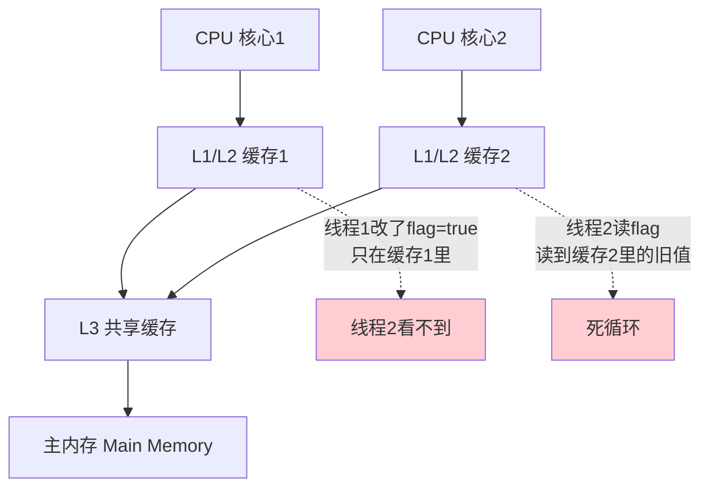
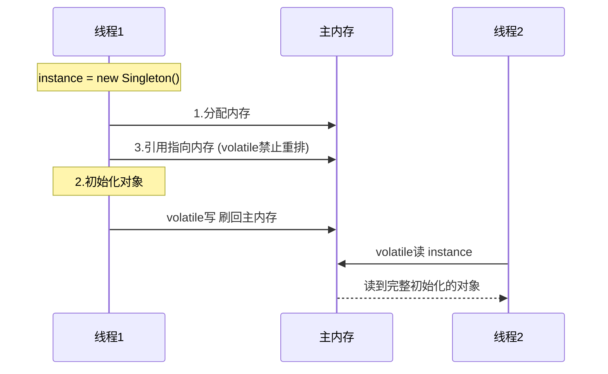

# JMM 与 happens-before

> 定位：并发 Bug 最诡异的地方在于"同样的代码，有时对有时错"。根源是多线程下的可见性、有序性问题，而 Java 内存模型（JMM）就是 JVM 给你的一套"保证规则"。搞懂 happens-before，你才能解释 volatile 凭什么能保证可见性、DCL 单例为什么要加 volatile、final 为什么是线程安全的——这是从"会写并发代码"到"懂并发"的分水岭。

## 一、为什么需要 Java 内存模型

先看一段经典代码：

```java
// 线程1
flag = true;

// 线程2
while (!flag) {
    // 空转
}
System.out.println("结束");
```

线程 1 把 `flag` 设为 true，线程 2 却可能永远卡在循环里。为什么？因为线程 1 改的是自己**工作内存**里的副本，没及时刷回主内存；线程 2 一直读自己工作内存里的旧值。

这就是 JMM 要解决的问题：**定义线程和主内存之间的交互规则，明确什么时候一个线程对共享变量的修改能被另一个线程看到**。

在单线程里，你写的代码看起来是按顺序执行的（as-if-serial：只要结果不变，编译器和处理器可以重排序优化）。但到了多线程，重排序 + 缓存就会导致各种诡异结果。JMM 就是在硬件优化和程序员直觉之间立的契约。

## 二、硬件基础：为什么会有可见性和有序性问题

要理解 JMM，先得知道底层发生了什么。

### 2.1 CPU 缓存导致的可见性问题

现代 CPU 有多级缓存（L1/L2/L3）。每个线程运行在某个 CPU 核上，读取变量时先从自己的缓存读，不一定每次都去主内存。多个线程各改各的缓存，就出现了"我改了你却看不见"。



图里线程 1 把 flag 改成 true 只写进自己的 L1/L2 缓存，没刷回主内存；线程 2 从自己的缓存读到旧值 false，于是死循环。这就是可见性问题的物理根源。

### 2.2 指令重排序导致的有序性问题

编译器和 CPU 为了性能，会在不改变单线程执行结果的前提下，调整指令执行顺序。比如：

```java
// 源码顺序
a = 1;      // 语句1
b = 2;      // 语句2
flag = true; // 语句3
```

编译器可能重排成 2→1→3 或 1→3→2（只要单线程结果对）。单线程没问题，但多线程下，另一个线程可能看到 `flag=true` 时 `a`、`b` 还没赋值，导致逻辑错乱。

### 2.3 内存屏障：硬件给的解决方案

CPU 提供了**内存屏障（Memory Barrier）**指令来禁止特定类型的重排序、强制刷新缓存。JMM 把底层复杂的屏障操作封装成 Java 层面的规则，你用 `volatile`、`synchronized` 时，JVM 会在合适位置插入内存屏障，你不用直接操作硬件。

## 三、JMM 的三大特性

JMM 围绕三个核心特性构建：**原子性、可见性、有序性**。

| 特性 | 含义 | 谁来保证 |
|---|---|---|
| **原子性** | 一个操作要么全做要么不做，不可中断 | `synchronized`（ monitorenter/monitorexit）、`Atomic` 类（CAS） |
| **可见性** | 一个线程修改共享变量，其他线程能立刻看到 | `volatile`、`synchronized`、final |
| **有序性** | 程序按代码顺序执行（禁止特定重排序） | `volatile`（内存屏障）、`synchronized`、`happens-before` 规则 |

一句话:**synchronized 全能（原子+可见+有序），volatile 只能保证可见性和有序性，不能保证复合操作的原子性。**

> 经典坑：`volatile int count; count++;` 不是线程安全的。因为 `count++` 是"读-改-写"三步，volatile 管不住这三步的原子性。要用 `AtomicInteger` 或 `synchronized`。

## 四、volatile 原理与内存屏障

### 4.1 volatile 的两个作用

1. **保证可见性**：对一个 volatile 变量的写，立刻刷新到主内存；读时从主内存读最新值
2. **禁止指令重排序**：在 volatile 读写前后插入内存屏障，保证有序性

底层实现是 JVM 在 volatile 操作前后插入**内存屏障（LoadBarrier / StoreBarrier）**：

| 屏障类型 | 作用 |
|---|---|
| LoadLoad | 禁止后面的普通读与前面的 volatile 读重排序 |
| StoreStore | 禁止后面的普通写与前面的 volatile 写重排序 |
| LoadStore | 禁止后面的普通写与前面的 volatile 读重排序 |
| StoreLoad | 禁止后面的 volatile 读/写与前面的 volatile 写重排序（开销最大） |

规则简化记忆：

- 写 volatile 变量时，在写之前插入 **StoreStore**，写之后插入 **StoreLoad**（强制把前面所有普通写一起刷回主内存）
- 读 volatile 变量时，在读之后插入 **LoadLoad** 和 **LoadStore**（禁止后面的操作重排到读之前）

### 4.2 volatile 经典场景：DCL 单例

双重检查锁（Double-Checked Locking）单例**必须给 instance 加 volatile**：

```java
public class Singleton {
    // 必须 volatile，禁止 new Singleton() 的重排序
    private static volatile Singleton instance;

    public static Singleton getInstance() {
        if (instance == null) {                    // 第一次检查
            synchronized (Singleton.class) {
                if (instance == null) {            // 第二次检查
                    instance = new Singleton();    // 问题就在这一行
                }
            }
        }
        return instance;
    }
}
```

为什么 `new Singleton()` 会出问题？它其实分三步：

1. 分配对象内存空间
2. 初始化对象（调用构造方法）
3. 把 instance 引用指向这块内存

编译器可能把 2 和 3 重排成 1→3→2。此时另一个线程在第一次检查时看到 `instance != null`（已经指向内存，但对象还没初始化），直接拿去用，就访问到一个"半初始化"的对象。加 volatile 后禁止这个重排序，避免问题。



图里 volatile 保证了"引用指向内存"发生在"对象初始化"之后且对线程 2 可见，避免半初始化对象被使用。

## 五、happens-before 规则

### 5.1 什么是 happens-before

happens-before 是 JMM 定义的一套**偏序关系**：如果操作 A happens-before 操作 B，那么 A 的结果对 B 可见，且 A 的执行顺序排在 B 之前。

它是判断"线程间操作是否可见、是否有序"的依据。你不用理解底层屏障细节，只要看两个操作是否满足 happens-before，就能判断可见性。

### 5.2 八大 happens-before 规则

| 规则 | 内容 |
|---|---|
| **程序顺序规则** | 一个线程内，前面的操作 happens-before 后面的操作 |
| **volatile 变量规则** | 对 volatile 变量的写 happens-before 后续对它的读 |
| **传递性规则** | A hb B，B hb C，则 A hb C |
| **锁规则** | unlock 操作 happens-before 后续的 lock 操作 |
| **线程启动规则** | `Thread.start()` happens-before 新线程的第一个操作 |
| **线程终止规则** | 线程的所有操作 happens-before 其他线程检测到它终止（`join()` 返回） |
| **线程中断规则** | `interrupt()` happens-before 被中断线程检测到中断 |
| **对象终结规则** | 对象构造完成 happens-before 它的 `finalize()` 开始 |

### 5.3 用 happens-before 分析可见性

回到开头那段代码：

```java
// 线程1
flag = true;

// 线程2
while (!flag) {}
```

`flag` 不是 volatile，也不满足其他 happens-before 规则，所以线程 1 的写**不保证**对线程 2 可见——线程 2 可能死循环。

改成 volatile 后，满足"volatile 变量规则"，写 happens-before 读，可见性得到保证。

### 5.4 综合案例：为什么 synchronized 能保证可见性

```java
synchronized (lock) {
    x = 1;       // 操作A
}
// unlock

synchronized (lock) {
    print(x);    // 操作B，能看到 x=1
}
// 根据锁规则：unlock happens-before 后续 lock
// 根据程序顺序规则：A hb unlock，lock hb B
// 根据传递性：A hb B，所以 x=1 对 B 可见
```

这就是 synchronized 保证可见性的逻辑——本质是 happens-before 规则的组合推导。

## 六、final 的内存语义

final 字段有特殊保证：**正确构造的对象，其 final 字段对任何线程都可见，无需同步**。

### 6.1 final 的可见性保证

JMM 对 final 的规定：

- 在构造方法内对 final 字段的写入，happens-before 其他线程读取该对象的 final 字段
- 只要对象"正确构造"（构造过程中没有把 `this` 逃逸出去），其他线程看到的就是初始化好的 final 值

```java
public class FinalDemo {
    final int x;
    int y;

    public FinalDemo() {
        x = 1;   // final 字段
        y = 2;   // 普通字段
    }
}
// 线程1创建 FinalDemo 对象并发布给线程2
// 线程2读 obj.x 一定是 1（final保证）
// 线程2读 obj.y 不一定能看到 2（普通字段无保证）
```

### 6.2 this 逃逸：破坏 final 保证

如果在构造方法里把 `this` 发布出去，就破坏了 final 的保证：

```java
public class EscapeDemo {
    final int x;

    public EscapeDemo() {
        x = 1;
        // 危险：构造还没完成就把 this 发布出去
        SomeStatic.list.add(this);
        // 另一个线程可能在这里读到 x，此时还没赋值（看到 0）
    }
}
```

所以原则是：**构造方法里不要让 `this` 逃逸**，这是写出线程安全类的基本纪律。

## 七、生产坑点与排查

### 坑点 1：以为 volatile 能保证复合操作原子性

**现象**：用 `volatile int count` 做计数器，多线程累加后结果小于预期。

**原因**：`count++` 是读-改-写三步，volatile 只保证每次读到最新值，但多个线程可能同时读到同一个值再各自加，导致丢失更新。

**解法**：用 `AtomicInteger.incrementAndGet()`（CAS）或 `synchronized`/`LongAdder`（高并发下 LongAdder 更优）。

### 坑点 2：DCL 单例忘记 volatile

**现象**：单例偶发空指针或状态不对，难以复现。

**原因**：指令重排序导致其他线程拿到半初始化对象。

**解法**：instance 加 volatile；或改用静态内部类、枚举单例（天然安全，代码更简单）。

### 坑点 3：发布对象时 this 逃逸

**现象**：对象在某些线程里读到 final 字段的默认值（0/null）。

**原因**：构造方法里启动了线程或注册了监听器/回调，把未构造完的 `this` 发布出去。

**解法**：构造完成后再发布；不要在构造方法中启动线程；用工厂方法返回完整构造的对象。

### 坑点 4：误用 double-checked locking 的双层判断顺序

**现象**：加了 volatile 还是有问题，或性能不升反降。

**原因**：把 volatile 用在了错误变量上，或内层判断逻辑写错。

**解法**：仔细核对 volatile 修饰的是 instance 引用本身；或者直接放弃 DCL，用静态内部类/枚举。

## 八、最佳实践与选型

1. **能不共享就不共享**：线程封闭（ThreadLocal、局部变量）是最简单的线程安全策略
2. **优先用不可变对象**：final 字段 + 无 setter，天然线程安全
3. **volatile 适用场景**：状态标志位、一次性安全发布（如配置初始化）；不适合复合操作
4. **计数器用 LongAdder/Atomic**：`AtomicInteger` 适合一般并发，`LongAdder` 适合高并发写多读少
5. **单例推荐枚举**：`enum Singleton { INSTANCE; }` 天然防重排序、防反射、防序列化破坏
6. **排查工具**：用 jcstress（OpenJDK 的并发压力测试框架）验证并发假设，别靠"跑几次没问题"。

## 九、面试高频问法

> 这一节的答案按「面试时能讲透」的标准写：先给一句话结论，再展开机制、原因和坑点。建议先自己答一遍，再对照补全。

**Q1：什么是 JMM？它解决了什么问题？**

**一句话结论**：JMM（Java 内存模型）是一套**规范**，定义了多线程下共享变量的可见性、有序性和原子性规则，让 Java 程序在不同硬件平台上表现一致。

展开：

- **它不是什么**：JMM 不是 JVM 运行时内存区域（堆/栈那些），而是一套**抽象的内存访问规则**。区分这两个概念是面试第一个坑。
- **它解决什么**：不同 CPU 有各自的缓存和指令重排策略，如果不加约束，同一份 Java 代码在不同机器上可能跑出不同结果。JMM 规定了线程如何与主内存交互，屏蔽硬件差异。
- **核心抽象**：每个线程有自己的**工作内存**（对应 CPU 缓存/寄存器），共享变量存在**主内存**。线程读写变量要经过工作内存，这就埋下了可见性问题的根。

加分点：说一句"JMM 的三大特性——原子性、可见性、有序性，分别对应 synchronized/volatile/happens-before 这套工具链"，把问题引到体系上。

**Q2：volatile 能保证什么？不能保证什么？**

**一句话结论**：volatile 保证**可见性**和**有序性**，**不保证原子性**。

展开：

- **可见性**：对一个 volatile 变量的写，会立刻刷新到主内存；读时强制从主内存读最新值，不走线程本地缓存。
- **有序性**：volatile 读写前后会插入**内存屏障**，禁止指令重排序。
- **不保证原子性**：`volatile int count; count++` 依然线程不安全——因为 `count++` 是"读-改-写"三步，volatile 管不住这三步之间被其他线程插入。

典型正确用法：
- 状态标志位：`volatile boolean running`，一个线程改、其他线程立即感知
- 双重检查锁单例：`private volatile static Singleton instance`，用 volatile 禁止"分配内存→初始化→赋值引用"的重排序，防止其他线程拿到半初始化对象

加分点：能说出 volatile 的底层是**四种内存屏障**（LoadLoad/StoreStore/LoadStore/StoreLoad），比只说"保证可见性"深一层。

**Q3：happens-before 是什么？有哪些规则？**

**一句话结论**：happens-before 是 JMM 定义的一套**偏序规则**，如果 A happens-before B，那么 A 的结果对 B 可见，且 A 在 B 之前执行（在可见性意义上）。

展开（记 6 条核心规则就够）：

| 规则 | 含义 |
|---|---|
| 程序顺序规则 | 同一线程内，前面的操作 happens-before 后面的 |
| 监视器锁规则 | 解锁 happens-before 后续对同一锁的加锁 |
| volatile 规则 | 对 volatile 变量的写 happens-before 后续的读 |
| 线程启动规则 | `Thread.start()` happens-before 新线程的任何操作 |
| 线程终止规则 | 线程的所有操作 happens-before 其他线程检测到它结束（join） |
| 传递性 | A hb B，B hb C，则 A hb C |

**关键理解**：happens-before 不是"时间上先发生"，而是"**结果必须可见**"。两个操作即使物理上并行，只要满足 hb 规则，就保证前者的内存写入对后者可见。

加分点：举例"用 volatile 写 + 普通变量读，能保证普通变量的可见性吗？"——能，只要它们之间有 hb 关系（比如写 volatile 前的普通写，对读该 volatile 后的普通读可见）。

**Q4：指令重排序是什么？为什么需要它？**

**一句话结论**：编译器和 CPU 为了提升性能，会在不改变**单线程语义**的前提下调整指令执行顺序，这就是重排序；它在多线程下会破坏可见性和有序性。

展开：

- **三种重排序**：编译器重排序、CPU 指令级并行重排序、内存系统重排序。
- **为什么允许**：现代 CPU 是多核多级流水线，严格按序执行会浪费大量并行能力。只要不改变单线程结果，就允许乱序。
- **问题所在**：单线程没问题，但多线程下，另一个线程可能观察到"半成品"状态。

经典案例——双重检查锁：
```java
instance = new Singleton();
// 实际分三步：
// 1. 分配内存
// 2. 初始化对象
// 3. instance 指向内存
// 2 和 3 可能重排 → 别的线程拿到未初始化的对象
```

加分点：说清"重排序不是 bug，是优化；volatile 和 synchronized 通过内存屏障**禁止特定重排序**"。

**Q5：synchronized 如何保证可见性？**

**一句话结论**：synchronized 通过**加锁前清空工作内存、解锁前把修改刷回主内存**的 happens-before 规则保证可见性。

展开：

- **加锁时**：线程会清空自己的工作内存，从主内存重新读取共享变量——保证看到最新值。
- **解锁时**：线程会把工作内存里的修改刷新到主内存。
- **happens-before 视角**：一个线程的解锁 happens-before 另一个线程对同一锁的加锁，所以前者的所有写入对后者可见。

对比记忆：volatile 是"每次读写都直连主内存"，synchronized 是"进出临界区时同步一次"。前者粒度细、开销小；后者能保证原子性、范围大。

加分点：强调"可见性和原子性是两回事——volatile 有可见性没原子性，synchronized 两个都有"。

**Q6：final 关键字的内存语义是什么？**

**一句话结论**：final 保证**对象构造完成后，其他线程能看到 final 字段的正确初始化值**，即使没有同步。

展开：

- **写 final 字段**：在构造函数内对 final 字段的写，禁止重排序到构造函数之外——保证对象引用发布时，final 字段已经初始化好。
- **读 final 字段**：首次读对象引用后，后续读 final 字段一定是最新值。
- **意义**：这就是为什么"不可变对象"（所有字段 final）天然线程安全，不需要额外同步。

对比：普通字段没有这个保证，可能因重排序出现"引用可见了但字段还没初始化"。

加分点：提一句"final 的这个语义是 JSR-133 在 JDK 5 才明确的，JDK 5 之前有漏洞"——展示版本意识。

**Q7：什么是原子性、可见性、有序性？三者关系？**

**一句话结论**：原子性=操作不可分割；可见性=一个线程的修改其他线程能看到；有序性=程序按代码顺序执行。三者是并发安全的三个维度。

展开：

| 特性 | 破坏它的原因 | 保证手段 |
|---|---|---|
| 原子性 | 线程切换、复合操作 | synchronized、Lock、Atomic 类 |
| 可见性 | CPU 缓存、工作内存 | volatile、synchronized、final |
| 有序性 | 指令重排序 | volatile（内存屏障）、synchronized |

**关系**：三者缺一不可。一个 `count++` 可能同时踩中三个问题——不是原子（读改写三步）、可能不可见（缓存）、可能乱序。

加分点：能指出"`i++` 在字节码层面是四条指令（getfield/iconst_1/iadd/putfield），所以不是原子的"——用字节码说话，很有说服力。

**Q8：volatile 和 synchronized 有什么区别？怎么选？**

**一句话结论**：volatile 轻量、无锁、只保证可见性和有序性；synchronized 重量、有锁、保证三者。简单状态标志用 volatile，复合操作用 synchronized。

| 维度 | volatile | synchronized |
|---|---|---|
| 原子性 | 不保证 | 保证 |
| 可见性 | 保证 | 保证 |
| 有序性 | 保证 | 保证 |
| 阻塞 | 不阻塞 | 可能阻塞 |
| 适用 | 状态标志、DCL 单例 | 复合操作、临界区 |

**选择原则**：能用 volatile 解决的（单纯读写共享状态）就别用锁；涉及"读-改-写"复合操作，volatile 不够，必须用锁或原子类。

加分点：说"volatile 适合'一写多读'的场景，多个线程同时写 volatile 变量仍然有竞争问题"。

**Q9：什么是内存屏障？有哪几种？**

**一句话结论**：内存屏障是 CPU 或编译器插入的**指令**，用来禁止特定类型的重排序、保证内存可见性；JMM 定义了四种。

展开：

| 屏障 | 作用 |
|---|---|
| LoadLoad | 禁止后面的普通读与前面的 volatile 读重排 |
| StoreStore | 禁止后面的普通写与前面的 volatile 写重排 |
| LoadStore | 禁止后面的普通写与前面的 volatile 读重排 |
| StoreLoad | 禁止后面的 volatile 读与前面的 volatile 写重排（最重） |

volatile 写的实现：在写前插 StoreStore，写后插 StoreLoad；volatile 读：读后插 LoadLoad 和 LoadStore。

加分点：指出"StoreLoad 屏障开销最大，因为要清空写缓冲，这也是 volatile 写比读贵的原因"。

**Q10：JMM 里"工作内存"是真实存在的内存吗？**

**一句话结论**：不是。工作内存是 JMM 的**抽象概念**，对应 CPU 寄存器、缓存、写缓冲区等硬件结构的统称，不是一个独立的内存区域。

展开：

- **为什么抽象**：Java 要跨平台，不能绑定具体硬件。JMM 用"工作内存"统一描述"线程私有的数据副本"。
- **真实对应**：在 x86 上，工作内存可能对应 L1/L2 缓存和 store buffer；在 ARM 上结构又不同。JMM 屏蔽了这些差异。
- **实践意义**：理解"工作内存是抽象"能解释为什么"代码看起来顺序执行，实际可能乱序"——因为线程操作的是各自的副本。

加分点：能说"JMM 是规范，HotSpot 是实现；不同 JVM 实现可以不一样，但都要满足 JMM 的可见性和有序性约束"。

## 小结

- JMM 定义线程与主内存的交互规则，解决**可见性、原子性、有序性**三大问题。
- 根源是 **CPU 多级缓存**（可见性）和 **指令重排序**（有序性），JMM 用内存屏障封装底层处理。
- **volatile** = 可见性 + 禁止重排序，但不保证复合操作原子性；典型应用是 DCL 单例。
- **happens-before** 是判断可见性的偏序规则，八大规则；synchronized 的可见性靠"锁规则 + 传递性"推导。
- **final** 保证正确构造对象的字段可见，但构造方法里不能让 `this` 逃逸。
