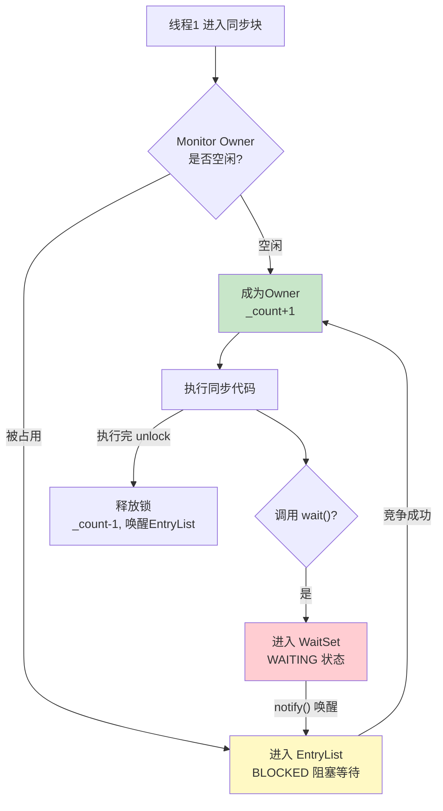
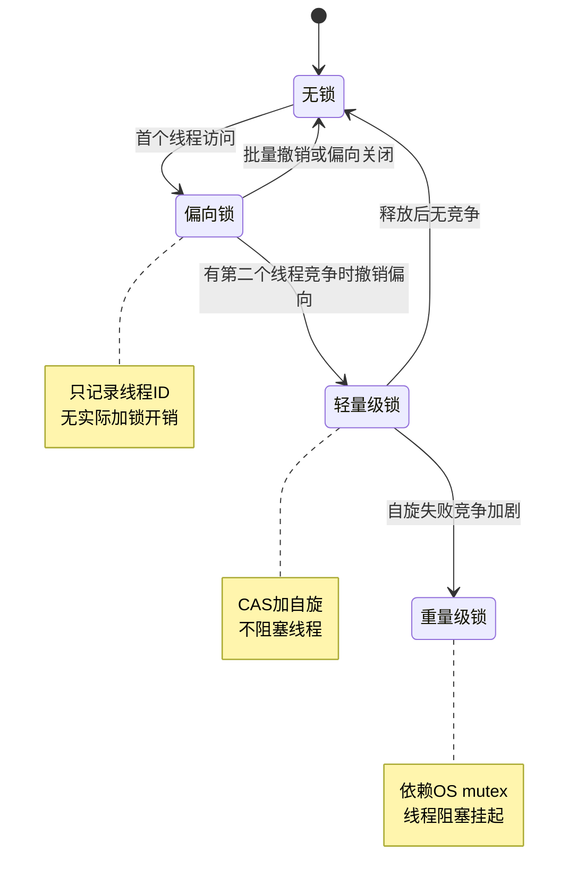

# synchronized 与锁升级

> 定位：synchronized 是 Java 最基础的锁，很多人用了多年却说不清它"到底锁的是什么、底层怎么实现、为什么 JDK 6 之后性能突飞猛进"。答案藏在对象头 Mark Word 和锁升级机制里。搞懂它，CAS、AQS、ConcurrentHashMap 的底层你才能串起来——这是并发学习的必经关口。

## 一、为什么需要理解 synchronized 底层

` synchronized` 用起来很简单：

```java
public synchronized void method() {
    count++;
}
```

但面试和线上问题会追问：

- `synchronized` 锁的是什么？（对象？类？）
- 它凭什么保证原子性、可见性、有序性？
- 为什么说它"很重"？JDK 6 之后又为什么变快了？
- 偏向锁、轻量级锁、重量级锁到底怎么回事？
- CAS 又是什么，ABA 问题如何解决？

只会用 API 答不上来。这篇从对象头一路讲到锁升级，给你完整答案。

## 二、synchronized 的用法与锁的对象

`synchronized` 三种用法，锁的对象各不同：

| 用法 | 锁的对象 |
|---|---|
| 修饰实例方法 | 当前实例对象 `this` |
| 修饰静态方法 | 当前类的 Class 对象 |
| 修饰代码块 `synchronized(obj)` | 括号里指定的对象 |

```java
public class SyncDemo {
    // 锁 this
    public synchronized void instanceMethod() {}

    // 锁 SyncDemo.class
    public static synchronized void staticMethod() {}

    public void block() {
        // 锁 lock 对象
        synchronized (lock) {}
    }
    private final Object lock = new Object();
}
```

**核心原则**：`synchronized` 锁的是**对象**，更准确说是锁对象的**对象头里的 Mark Word**。要互斥，多个线程必须用**同一把锁**（同一个对象）。这是很多并发 Bug 的根源——用不同的锁对象，线程各锁各的，等于没锁。

## 三、底层原理：Monitor 与 Mark Word

### 3.1 Monitor（管程）

`synchronized` 的底层靠 **Monitor（监视器锁）** 实现。每个对象都关联一个 Monitor（不是每个对象都有一个，而是每个对象头里有个指针指向 Monitor，HotSpot 里是 ObjectMonitor）。

Monitor 内部有几个关键字段：

- `_Owner`：当前持有锁的线程
- `_EntryList`：竞争锁失败的线程队列（ BLOCKED 状态）
- `_WaitSet`：调用 `wait()` 后等待的线程队列
- `_count`：锁的重入次数

图里可以看到线程竞争锁的过程：线程进来先尝试成为 Owner，成功就执行代码；失败就进 EntryList 阻塞；调用 wait() 的线程进 WaitSet，被 notify() 唤醒后重新竞争。



### 3.2 Mark Word：锁状态的载体

回顾第 01 篇：对象头里的 **Mark Word** 存储哈希码、GC 分代年龄、锁标志位。锁信息就存在这里。

Mark Word（64 位）在不同锁状态下复用同一块空间，布局如下：

| 锁状态 | 25bit | 31bit | 1bit | 4bit | 2bit 锁标志 |
|---|---|---|---|---|---|
| 无锁 | unused | hashCode | unused | 分代年龄 | 01 |
| 偏向锁 | 线程ID(54bit) | epoch(2bit) | unused | 分代年龄 | 01 |
| 轻量级锁 | 指向栈中锁记录的指针 | | | | 00 |
| 重量级锁 | 指向 Monitor 的指针 | | | | 10 |
| GC 标记 | 空 | | | | 11 |

关键看**锁标志位**（最后 2 bit）：01 是无锁/偏向锁，00 是轻量级锁，10 是重量级锁。JVM 通过它判断当前锁状态。

### 3.3 字节码层面的实现

```java
synchronized (obj) {
    doSomething();
}
```

编译后大致是：

```
monitorenter    // 尝试获取锁，_count+1
...             // 同步代码
monitorexit     // 释放锁，_count-1
```

- 执行到 `monitorenter` 时尝试获取 Monitor 所有权
- 由于 synchronized 是**可重入锁**，同一个线程再次进入时 `_count` 累加，不会死锁
- 执行 `monitorexit` 时 `_count` 减 1，减到 0 才真正释放锁

方法级的 synchronized 没有 monitorenter/monitorexit 字节码，而是在方法访问标志里加 `ACC_SYNCHRONIZED`，方法调用时 JVM 自动加锁/释放。

## 四、锁升级：JDK 6 的性能革命

JDK 6 之前，synchronized 是"重量级锁"——只要加锁就调用操作系统内核的 mutex，涉及用户态到内核态的切换，性能很差。JDK 6 引入了**锁升级（锁膨胀）** 优化：根据竞争程度，锁会逐步从低开销状态升级到高开销状态。

四种锁状态：



图中箭头是升级方向（单向，不可降级——这是为了性能权衡，锁升级后不会退回）。下面逐个拆解。

### 4.1 偏向锁

**场景**：锁总是被同一个线程访问，没有竞争。

**原理**：第一个线程访问时，用 CAS 把线程 ID 记录到 Mark Word，并把锁标志设为偏向模式（01）。之后这个线程再进入同步块，只需检查 Mark Word 里的线程 ID 是不是自己——是就直接执行，**连 CAS 都不用，几乎零开销**。

**撤销**：一旦有另一个线程尝试竞争，偏向锁就被撤销，升级为轻量级锁。撤销需要等到全局安全点（STW），有一定开销。

> JDK 15 起偏向锁默认关闭（`-XX:-UseBiasedLocking`），因为现代应用多线程竞争普遍，偏向锁收益有限、撤销成本反而明显。以你使用的版本为准。

### 4.2 轻量级锁

**场景**：有竞争，但竞争不激烈，且线程持有锁的时间很短。

**原理**：

1. 线程执行同步块前，在**自己的栈帧**中创建一块空间叫 **Lock Record（锁记录）**，把 Mark Word 复制过去（叫 Displaced Mark Word）
2. 用 **CAS** 尝试把对象头的 Mark Word 替换成指向 Lock Record 的指针
3. CAS 成功 → 获得锁，锁标志变 00（轻量级锁）
4. CAS 失败 → 说明有竞争，先**自旋**重试（不阻塞线程，避免内核态切换）

自旋：线程在用户态空转循环等待锁释放，不挂起。如果锁很快释放，自旋比阻塞成本低。但自旋浪费 CPU，所以有次数限制。

### 4.3 重量级锁

**场景**：竞争激烈，或线程持有锁时间长。

轻量级锁自旋超过阈值（默认 10 次，可用 `-XX:PreBlockSpin` 调整，JDK 6 后引入自适应自旋）仍拿不到锁，就升级为重量级锁：Mark Word 指向 Monitor，未抢到锁的线程进入 EntryList **被挂起（阻塞）**，涉及用户态到内核态切换，开销最大。

**自适应自旋**（JDK 6+）：自旋次数不再固定，而是根据"同一个锁上次自旋的成功率"动态调整——上次成功就多自旋几次，上次失败就少自旋甚至不自旋。这叫"智能"自旋。

### 4.4 三种锁对比

| 锁状态 | 优点 | 缺点 | 适用场景 |
|---|---|---|---|
| 偏向锁 | 无锁开销，几乎零成本 | 撤销需 STW | 单线程访问（JDK 15 默认关） |
| 轻量级锁 | 不阻塞，CAS+自旋 | 自旋耗 CPU | 竞争少、锁持有时间短 |
| 重量级锁 | 不自旋，线程阻塞不耗 CPU | 内核态切换，开销大 | 竞争激烈、锁持有时间长 |

## 五、CAS 与 ABA 问题

锁升级的底层靠 CAS，理解它才能理解轻量级锁。

### 5.1 CAS 原理

**CAS（Compare And Swap）** 是一条 CPU 原子指令。它有三个操作数：

- `V`：要更新的变量的内存地址
- `A`：预期的旧值
- `B`：要写入的新值

逻辑：**如果内存位置 V 的值等于预期值 A，就把它改成 B；否则不改，返回失败。**

```java
// 伪代码
boolean compareAndSwap(int V, int A, int B) {
    if (V == A) {
        V = B;
        return true;
    }
    return false;
}
```

整个过程是 CPU 原子指令（`cmpxchg`），不会被打断。Java 里通过 `sun.misc.Unsafe` 或 `VarHandle` 调用 CAS，`AtomicInteger` 等原子类就是基于它。

**CAS 的典型应用——原子累加**：

```java
public final int incrementAndGet() {
    for (;;) {                          // 自旋
        int current = get();            // 读当前值
        int next = current + 1;
        if (compareAndSet(current, next)) {  // CAS 成功才退出
            return next;
        }
        // 失败说明被别的线程改了，重试
    }
}
```

### 5.2 CAS 的三大问题

1. **ABA 问题**：一个值从 A 改成 B，又改回 A，CAS 检查时会认为"没变过"，但实际上中间发生了变化。
2. **自旋开销**：CAS 失败会一直自旋重试，竞争激烈时耗 CPU。
3. **只能保证一个变量的原子操作**：多个变量需要原子更新时 CAS 无能为力。

### 5.3 ABA 问题与解决

ABA 的经典场景：无锁栈。线程 1 读到栈顶是 A，准备把它换成 B； meanwhile 线程 2 把 A 弹出栈，又压回一个 A（可能是新分配的），栈顶地址又变回 A。线程 1 CAS 成功，但栈顶的 A 已经不是原来的 A 了。

**解法：版本号（Stamp）**。不能只比较值，还要比较版本。Java 提供 `AtomicStampedReference`，它把"值 + 版本号"打包，每次修改版本号 +1，CAS 时同时校验值和版本号。

```java
AtomicStampedReference<Integer> ref = new AtomicStampedReference<>(100, 0);
// 比较并交换：期望值100、期望版本0，新值200、新版本1
ref.compareAndSet(100, 200, ref.getStamp(), ref.getStamp() + 1);
```

如果只关心"值是否变过"、不关心中间过程，用 `AtomicMarkableReference`（只标记是否被改过）更轻量。

### 5.4 synchronized  vs  CAS（Lock-Free）

| 维度 | synchronized | CAS（无锁） |
|---|---|---|
| 实现方式 | 悲观锁，先加锁再操作 | 乐观锁，冲突了重试 |
| 线程阻塞 | 会阻塞（重量级锁） | 不阻塞，自旋 |
| 开销 | 锁升级后可控 | 无锁开销，但自旋耗 CPU |
| 适用场景 | 复杂临界区、竞争激烈 | 简单原子操作、竞争少 |
| 典型代表 | — | Atomic 类、ConcurrentHashMap |

## 六、锁优化：锁粗化与锁消除

JDK 6 除了锁升级，还有两项编译期优化：

### 6.1 锁粗化（Lock Coarsening）

**原则**：如果虚拟机检测到一串操作都对**同一个对象**反复加锁/解锁，会把加锁范围**扩大（粗化）** 到整个操作序列外面，避免频繁加锁解锁的开销。

```java
// 优化前：循环里每次都加锁
for (int i = 0; i < 100; i++) {
    synchronized (obj) {
        doSomething();
    }
}
// 优化后：JIT 粗化成一次加锁
synchronized (obj) {
    for (int i = 0; i < 100; i++) {
        doSomething();
    }
}
```

### 6.2 锁消除（Lock Elimination）

**原则**：JIT 编译时通过**逃逸分析**，如果发现某段同步代码里使用的对象**不可能被其他线程访问**（对象没逃逸出当前线程），就把锁消除掉。

```java
// StringBuffer 是线程安全的（内部 synchronized）
// 但 sb 只在方法内部使用，没逃逸，JIT 会消除掉 append 里的锁
public String concat(String a, String b) {
    StringBuffer sb = new StringBuffer();
    sb.append(a);
    sb.append(b);
    return sb.toString();
}
```

这也是为什么现代 JVM 里，局部变量用 `StringBuffer` 和 `StringBuilder` 性能差别不大——锁被消除了。但习惯上还是用 `StringBuilder`，别依赖 JIT 优化。

## 七、生产坑点与排查

### 坑点 1：用不同的锁对象，以为锁住了

**现象**：加了 synchronized 但并发问题依旧。

**原因**：多个线程用了不同的锁对象（比如每次 `new Object()` 当锁，或锁的是不同的实例）。synchronized 锁的是对象，对象不同就不互斥。

**解法**：确保用同一个共享的锁对象；实例方法 synchronized 要确认操作的是同一个实例；分布式场景要用分布式锁（Redisson 等），synchronized 只在单 JVM 内有效。

### 坑点 2：锁粒度太大导致性能差

**现象**：整个方法都 synchronized，并发度极低，吞吐量上不去。

**原因**：锁的范围覆盖了不需要同步的代码（如 IO、耗时计算），线程串行执行。

**解法**：缩小锁粒度，只锁真正的共享数据修改部分；能锁代码块就别锁整个方法；读写分离场景用读写锁（见 AQS 篇的 `ReentrantReadWriteLock`）。

### 坑点 3：死锁

**现象**：线程全部卡住，jstack 看到 `Found one Java-level deadlock`。

**原因**：多个线程互相持有对方需要的锁，形成环路等待。经典例：线程 1 持有锁 A 等锁 B，线程 2 持有锁 B 等锁 A。

**解法**：保证加锁顺序一致（都先 A 后 B）；用 `tryLock(timeout)` 超时放弃；用 jstack 定位死锁后修复代码。

### 坑点 4：在 synchronized 块里做慢操作

**现象**：一个线程持有锁做远程调用/数据库查询，其他线程全部阻塞等待，接口雪崩。

**原因**：临界区里包含耗时操作，锁持有时间过长，轻量级锁迅速膨胀成重量级锁，大量线程阻塞。

**解法**：慢操作移到锁外面；缩小临界区；必要时用超时锁避免无限等待。

## 八、最佳实践与调优

1. **明确锁的对象**：用 `private final Object lock` 作为专用锁，避免暴露出去被意外修改。
2. **缩小临界区**：锁内只放必须同步的代码，越快释放越好。
3. **避免嵌套锁**：必须嵌套时保证全局加锁顺序一致，防死锁。
4. **读多写少用读写锁**：允许多个读线程并发，提升读性能。
5. **简单计数用原子类**：`AtomicInteger`/`LongAdder` 比 synchronized 更轻量。
6. **监控锁竞争**：`jstack` 看 BLOCKED 线程、`-XX:+PrintFlagsFinal` 看锁优化参数、Arthas `thread` 看线程状态。
7. **偏向锁取舍**：JDK 15+ 默认关闭，高并发场景不必纠结；特定单线程场景可评估是否开启。

## 九、面试高频问法

> 这一节的答案按「面试时能讲透」的标准写：先给一句结论，再展开机制、原因和坑点。建议先自己答一遍，再对照补全。

**Q1：synchronized 的底层原理是什么？**

**一句话结论**：synchronized 锁的是**对象**，靠 JVM 的 **Monitor（监视器）** 实现，可重入靠 Monitor 里的计数器。

展开讲三层：

1. **锁的是什么**：普通方法锁的是 `this`，静态方法锁的是 `Class` 对象，同步块锁的是括号里指定的对象。锁的信息存在对象头的 **Mark Word** 里。
2. **字节码层面**：同步块编译后是一对 `monitorenter` / `monitorexit` 指令；方法级的同步没有这两条指令，而是在方法表里的 `ACC_SYNCHRONIZED` 标志位体现——JVM 调用方法时看到这个标志就自动加锁。
3. **Monitor 内部**：每个对象关联一个 Monitor，里面有三个关键结构——`Owner`（当前持锁线程）、`EntryList`（阻塞等待锁的线程队列）、`WaitSet`（调用 wait() 后等待被唤醒的线程队列）。线程执行到 `monitorenter` 时尝试成为 Owner，已经持有则计数器 +1（这就是可重入），退出时 -1，归零才释放锁。

面试加分点：主动补一句"JDK 6 之后 synchronized 引入了锁升级，不再是直接进入重量级锁，性能大幅提升"——把这个问题自然引到下一个话题。

**Q2：锁升级过程讲一下？为什么这样设计？**

**一句话结论**：无锁 → 偏向锁 → 轻量级锁 → 重量级锁，单向不可逆，目的是**根据竞争程度动态调整加锁成本**。

有个背景必须先讲：早期 synchronized 是重量级锁，直接向 OS 申请 mutex，线程阻塞/唤醒都要陷入内核态，上下文切换成本高。但实践中大部分同步代码**根本没竞争**，为这极少数竞争付这么大代价不值。JDK 6 于是引入分级：

| 阶段 | 适用场景 | 实现 | 开销 |
|---|---|---|---|
| 偏向锁 | 只有一个线程访问 | Mark Word 记录线程 ID，下次直接进入 | 几乎为零 |
| 轻量级锁 | 少量线程交替访问 | CAS 把 Mark Word 换成锁记录指针，失败就自旋 | 低，不阻塞线程 |
| 重量级锁 | 多线程激烈竞争 | 膨胀为 Monitor，未抢到的线程阻塞 | 高，涉及内核态切换 |

关键要点：
- **升级是单向的**：竞争激烈时升级到重量级锁后不会降级。因为频繁升降级本身就是开销，且高竞争场景下退回低级锁只会不断失败重试。
- **自旋的目的**：轻量级锁失败时线程不立即阻塞，而是空转几轮等持锁线程释放——因为锁通常很快释放，阻塞+唤醒的成本比空转几十次更高。但自旋有次数限制，超过就升级为重量级锁，避免白白耗 CPU。

加分点：能说出"偏向锁在 JDK 15 后被默认禁用"——因为现代应用多为线程池，偏向锁撤销的成本反而高于收益。

**Q3：CAS 是什么？有什么问题？**

**一句话结论**：CAS（Compare And Swap）是一条 CPU 原子指令，用"预期值"比对内存值，相等才更新；它有 ABA、自旋开销、只能保证单变量原子三个经典问题。

展开：

- **原理**：三个操作数——内存位置 V、预期原值 A、新值 B。只有当 V 的值等于 A 时，才把 V 改成 B，否则什么都不做（或重试）。整个过程是硬件级原子操作。`AtomicInteger`、`Unsafe` 类、轻量级锁都基于它。
- **问题一：ABA**。一个值从 A 改成 B 又改回 A，CAS 检查时发现还是 A，就误以为"没变过"。解法是用版本号：`AtomicStampedReference` 把值配一个 stamp，每次修改 stamp+1，CAS 时同时校验值和版本。
- **问题二：自旋开销**。CAS 失败通常靠循环重试，竞争严重时线程一直空转，白白耗 CPU。
- **问题三：只能保证单个变量的原子**。对多个变量需要整体原子时，CAS 无能为力（可考虑锁，或用 `AtomicReference` 把多个变量封装成一个对象）。

加分点：提一句 CAS 是"乐观锁"思路、synchronized 是"悲观锁"思路——面试官很吃这个对比。

**Q4：什么是 ABA 问题？怎么解决？**

**一句话结论**：值从 A→B→A，CAS 误以为没变化，从而错误地执行了更新；用版本号或带戳引用解决。

举个真实场景让你秒懂：

> 线程 1 读到链表头是 A，准备用 CAS 把头改成 B。就在这期间，线程 2 把 A 删了、又插入了一个新节点也恰好叫 A。线程 1 的 CAS 一看"头还是 A"，就放心地改成了 B——但它改的是**新的 A**，旧 A 后面的节点可能全丢了。

这就是 ABA 的危害：CAS 只比较值，比较不出"中间发生过变化"。

**解法**：
- `AtomicStampedReference<V>`：给值绑一个 int 版本号，每次更新版本+1，CAS 时值和版本都要匹配。
- `AtomicMarkableReference<V>`：不关心改了几次、只关心"是否被改过"，用一个 boolean 标记，更轻量。

加分点：主动说"大部分业务场景其实不需要处理 ABA，因为引用对象即使值相同也不是同一个对象；只有无状态的数值或复用对象才需要关心"——体现你不是死记硬背。

**Q5：锁粗化和锁消除是什么？**

**一句话结论**：两者都是 JIT 编译器在运行时做的锁优化，目的是消除不必要的加锁开销。

- **锁粗化**：如果编译器发现一串操作反复对**同一个对象**加锁/解锁（典型是循环内加锁），会把锁的范围**扩大**到整个操作序列外面，只加一次锁。因为反复加解锁的开销远大于锁住一大段代码。
  ```java
  // 优化前：循环里加 100 次锁
  for (int i = 0; i < 100; i++) { synchronized(lock) { doSomething(); } }
  // 优化后：只加 1 次
  synchronized(lock) { for (int i = 0; i < 100; i++) { doSomething(); } }
  ```
- **锁消除**：编译器通过**逃逸分析**发现某个锁对象根本不可能被其他线程访问（比如方法内部的局部变量），就把这个锁**去掉**。例如 `StringBuffer` 的 append 是同步方法，但如果 StringBuffer 只在方法内使用、没逃逸出去，JIT 会消除这些锁。

加分点：能说出"这些优化发生在 JIT 编译期，不是字节码阶段；且依赖逃逸分析，关闭逃逸分析（`-XX:-DoEscapeAnalysis`）就没了"。

**Q6：synchronized 和 ReentrantLock 有什么区别？**

**一句话结论**：synchronized 是 JVM 关键字、自动释放、不可中断、非公平；ReentrantLock 是 JDK 类、手动释放、可中断、可公平、支持条件队列。JDK 6 后 synchronized 性能已大幅优化，多数场景优先用它。

| 维度 | synchronized | ReentrantLock |
|---|---|---|
| 层面 | JVM 关键字，语法层面 | JDK 类，API 层面 |
| 释放锁 | 代码块结束自动释放 | 必须手动 `unlock()`，要放 finally |
| 可中断 | 不可中断，等锁时不能退出 | `lockInterruptibly()` 可响应中断 |
| 公平性 | 只能非公平 | 可指定公平/非公平 |
| 条件队列 | 一个锁只有一个等待队列 | 可创建多个 `Condition`，精细控制 |
| 超时 | 不支持 | `tryLock(timeout)` 可超时 |
| 性能 | JDK 6 优化后差别不大 | 高竞争下略优（可避免死锁、更灵活） |

**什么时候用哪个**：
- 简单同步、临界区小 → synchronized（简洁、不容易忘记释放）
- 需要超时、可中断、公平锁、多个条件队列、尝试加锁 → ReentrantLock

加分点：说一句"选 ReentrantLock 就必须用 finally 释放锁，忘了 unlock 会导致锁永远不释放——这是生产常见事故"。

**Q7：什么是可重入锁？为什么需要可重入？**

**一句话结论**：同一个线程可以重复获取同一把锁而不会死锁，叫可重入；synchronized 和 ReentrantLock 都是可重入锁。

**为什么需要**：如果一个方法 A 加了锁，内部又调用了同样加锁的方法 B，如果锁不可重入，线程持有着锁去请求同一把锁，就会自己等自己——死锁。可重入锁允许线程再次进入。

**实现原理**：
- synchronized：Monitor 内部有计数器 `_count`，同一线程每进入一次 +1，退出一次 -1，归零才真正释放。
- ReentrantLock：内部 AQS 的 `state` 记录重入次数，同一线程重复获取时 state+1。

**注意点**：重入多少次就要释放多少次。synchronized 靠代码块自动匹配，ReentrantLock 手动 unlock 时若少调用一次，锁就一直被占着。

**Q8：wait()、notify() 和 sleep() 有什么区别？**

**一句话结论**：wait/notify 是 Object 的方法、配合 synchronized 用于线程间协作（会释放锁）；sleep 是 Thread 的静态方法，只是让线程暂停执行（不释放锁）。

| 维度 | wait/notify | sleep |
|---|---|---|
| 归属 | Object 类的方法 | Thread 类的静态方法 |
| 锁 | 调用 wait 会**释放**锁 | **不释放**锁，抱着锁睡 |
| 使用条件 | 必须在 synchronized 块内调用 | 任何地方都能调用 |
| 唤醒 | 靠 notify/notifyAll 或超时 | 时间到了自动醒 |
| 语义 | 线程协作（等待某个条件） | 单纯暂停执行 |

**关键坑**：
- wait() 必须用 `while` 循环检查条件，不能用 `if`——因为线程被唤醒后条件可能又被其他线程改变了（虚假唤醒）。
  ```java
  synchronized (lock) {
      while (!condition) {   // 必须是 while
          lock.wait();
      }
      // 处理业务逻辑
  }
  ```
- notify() 只唤醒一个线程，且不确定是哪个；多数场景应该用 notifyAll()。

**Q9：volatile 和 synchronized 有什么区别？**

**一句话结论**：volatile 保证可见性和有序性、不保证原子性、无锁、轻量；synchronized 保证原子性+可见性+有序性、是锁、重量。

| 维度 | volatile | synchronized |
|---|---|---|
| 原子性 | 不保证（`count++` 仍不安全） | 保证 |
| 可见性 | 保证（写立即刷主内存） | 保证 |
| 有序性 | 保证（禁止指令重排序） | 保证 |
| 是否阻塞 | 不阻塞 | 可能阻塞 |
| 适用 | 状态标志位、双重检查锁的单例 | 复合操作的线程安全 |

典型用法：
- `volatile boolean flag`：一个线程改标志、其他线程立即看到
- 双重检查锁单例：`private volatile static Singleton instance`——volatile 禁止重排序，防止其他线程拿到"初始化了一半"的对象

加分点：说清 volatile 的底层是**内存屏障**（LoadLoad/StoreStore 等），synchronized 的可见性来自"加锁前把工作内存清空、解锁前把修改刷回主内存"的 happens-before 规则。

**Q10：synchronized 用错了会有什么问题？生产中怎么避免？**

**一句话结论**：最常见的问题是锁粒度不当（太大导致性能差、太小导致线程不安全）和锁对象用错（导致锁不住或死锁）。

**典型坑与解法**：

1. **锁的对象被改变**：用 `String`、`Integer` 等不可变但可能被重新赋值的对象当锁，`lock = "new"` 后就锁不住了。解法：用 `private final Object lock = new Object()`。
2. **锁范围太大**：把整个方法、甚至包含 IO/远程调用的代码都锁住，并发度暴跌。解法：只锁真正需要互斥的共享数据部分，慢操作移出锁外。
3. **锁多把锁顺序不一致导致死锁**：线程 A 先锁 1 再锁 2，线程 B 先锁 2 再锁 1，互相等待。解法：保证所有线程按同一顺序加锁，或用 `tryLock` 超时退出。
4. **用 `String` 常量或 `this` 当锁导致意外竞争**：不同模块用同一个字符串常量当锁会互相干扰。解法：用私有专属锁对象。

自查清单：锁对象是不是 private final？临界区是不是最小？有没有在锁里做耗时操作？多把锁的顺序是否一致？

## 小结

- `synchronized` 锁的是**对象**（Mark Word），靠 **Monitor** 实现，可重入靠 _count。
- JDK 6 引入**锁升级**：偏向锁（零开销）→ 轻量级锁（CAS+自旋）→ 重量级锁（OS 阻塞），单向不可降级。
- **CAS** 是原子指令，支撑轻量级锁和原子类；三大问题是 ABA、自旋开销、单变量限制，ABA 用版本号解决。
- **锁粗化/锁消除**是 JIT 优化，减少不必要的加锁。
- 生产要点：用同一把锁、缩小临界区、保证加锁顺序防死锁、慢操作移出锁外。
