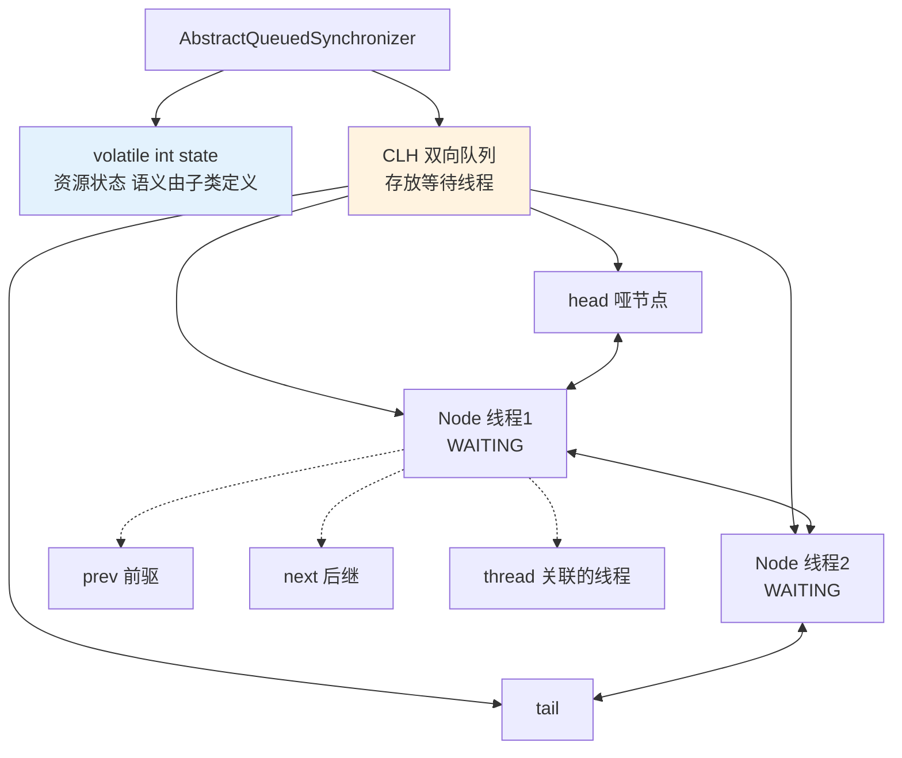
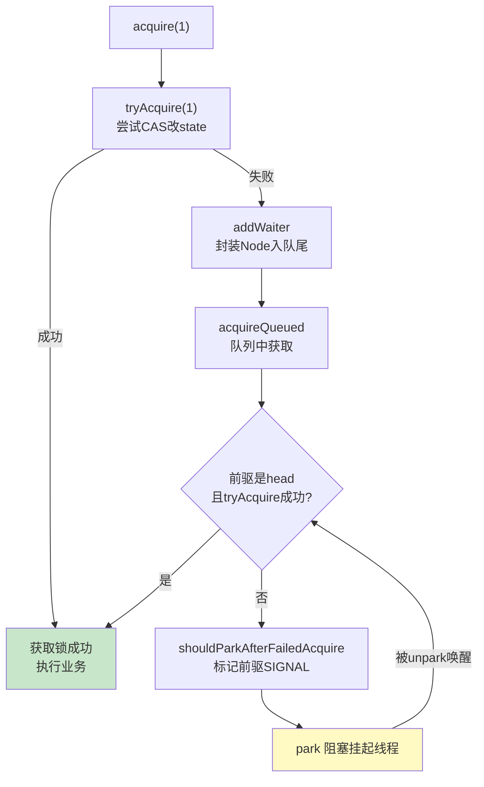
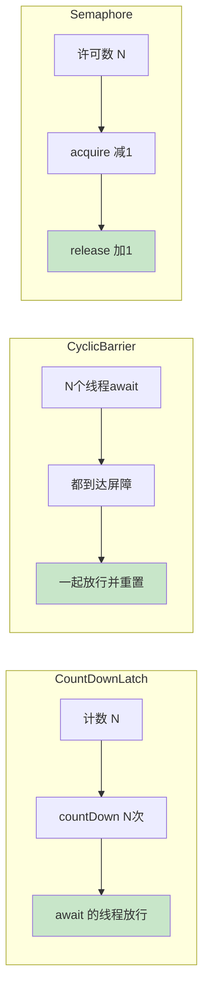

# AQS 与并发工具

> 定位：ReentrantLock、CountDownLatch、Semaphore 这些并发工具看似各不相干，其实共享同一个骨架——AQS（AbstractQueuedSynchronizer）。搞懂 AQS 的 `state` 和 CLH 队列，你就能一眼看穿这些工具的本质，甚至自己写一个同步器。这是并发进阶的"任督二脉"。

## 一、为什么需要 AQS

JDK 提供了一堆并发工具：可重入锁、读写锁、倒计时门闩、信号量、循环屏障……它们的语义完全不同，但底层有共通的需求：

- 都要维护一个**共享状态**（锁是否被持有、计数还剩多少）
- 都要管理**等待线程的队列**（获取资源失败的线程挂起排队）
- 都要支持**线程的阻塞与唤醒**

如果每个工具各写一套队列管理、线程挂起唤醒代码，重复且易错。Doug Lea 把这些共性抽象成 **AQS**——一个用于构建锁和同步器的框架。你熟悉的这些类都基于它：

| 工具类 | 基于 AQS 的什么状态 |
|---|---|
| `ReentrantLock` | state = 锁的持有次数（重入计数） |
| `CountDownLatch` | state = 计数器值 |
| `Semaphore` | state = 可用许可数 |
| `ReentrantReadWriteLock` | state 高 16 位读锁、低 16 位写锁 |
| `ThreadPoolExecutor` 的 Worker | state = 锁状态 |

## 二、AQS 核心原理：state + CLH 队列

AQS 内部有两个核心组件：

1. **`volatile int state`**：共享资源状态，语义由子类定义
2. **CLH 同步队列**：一个双向链表，存放等待获取资源的线程节点（Node）



图里 CLH 队列是一个 FIFO 双向链表。head 是哑节点（不存线程），真正等待的线程从 head 后面排队，新来的线程从 tail 入队。每个 Node 关联一个线程，通过 prev/next 连接。

### 2.1 资源获取的两种方式

AQS 定义了两种获取资源的方式，子类按需实现：

- **独占式（Exclusive）**：同一时刻只有一个线程能获取资源，如 `ReentrantLock`
- **共享式（Shared）**：多个线程可同时获取资源，如 `Semaphore`、`CountDownLatch`

子类通过重写以下方法定义 state 的语义和获取/释放逻辑：

| 方法 | 作用 |
|---|---|
| `tryAcquire(int)` | 独占式尝试获取资源 |
| `tryRelease(int)` | 独占式尝试释放资源 |
| `tryAcquireShared(int)` | 共享式尝试获取 |
| `tryReleaseShared(int)` | 共享式尝试释放 |
| `isHeldExclusively()` | 是否被独占持有 |

### 2.2 独占模式的获取流程

以 `ReentrantLock.lock()` 为例，线程获取锁的流程：



图中的关键步骤：

1. **tryAcquire**：先尝试用 CAS 改 state（从 0 改成 1），成功就直接拿到锁
2. **入队**：失败就用 `addWaiter` 把当前线程封装成 Node 加到队尾
3. **acquireQueued**：在队列里的线程检查——如果自己的前驱是 head 且能 tryAcquire 成功，就出队拿到锁；否则用 `LockSupport.park()` 阻塞挂起
4. **唤醒**：持有锁的线程释放时调用 `unpark` 唤醒后继节点，被唤醒的线程回到步骤 3 重试

这套机制保证：**拿不到锁的线程不会忙等（自旋浪费 CPU），而是挂起阻塞，等被唤醒再竞争**。

### 2.3 state 的语义由子类决定

AQS 只管队列和阻塞唤醒，`state` 的具体含义由子类定义。这是 AQS 设计最精妙的地方——同一个框架能表达各种同步语义：

- `ReentrantLock`：state=0 表示锁空闲，state=1 表示被持有，state>1 表示重入次数
- `CountDownLatch`：state 表示计数，每次 countDown() 让 state-1，减到 0 时唤醒所有等待线程
- `Semaphore`：state 表示许可数，acquire() 减 1，release() 加 1

## 三、ReentrantLock：可重入独占锁

`ReentrantLock` 是 AQS 独占模式最典型的实现。

### 3.1 核心特性

- **可重入**：同一个线程可以多次 lock，state 记录重入次数，unlock 对应次数才真正释放
- **可中断**：`lockInterruptibly()` 支持响应中断
- **可超时**：`tryLock(timeout, unit)` 超时放弃，避免死锁
- **公平/非公平**：构造参数 `fair` 决定，`new ReentrantLock(true)` 是公平锁

**公平锁 vs 非公平锁**：

- 公平锁：线程按等待顺序获得锁（先来后到），吞吐量较低但避免线程饥饿
- 非公平锁：新来的线程可以直接抢锁（即使队列里有人等着），吞吐量高但可能造成线程饥饿。默认是非公平锁。

### 3.2 必须配合 finally 释放锁

```java
ReentrantLock lock = new ReentrantLock();
lock.lock();
try {
    // 业务代码
} finally {
    lock.unlock();  // 必须在 finally 里，确保异常时也释放
}
```

忘记在 finally 里 unlock 是 ReentrantLock 最常见的坑——一旦业务代码抛异常，锁永远不释放，其他线程全部阻塞。而 synchronized 由 JVM 自动释放，没这个问题。

### 3.3 与 synchronized 对比

| 维度 | synchronized | ReentrantLock |
|---|---|---|
| 实现 | JVM 关键字 | JDK 类（AQS） |
| 释放锁 | 自动 | 手动（必须 finally） |
| 可中断 | 否 | 是 |
| 超时 | 否 | 是（tryLock） |
| 公平性 | 非公平 | 可选公平/非公平 |
| 条件队列 | 单一 | 多个 Condition |
| 性能 | JDK 6 后优化，接近 | 相当 |

选择建议：简单同步用 synchronized（简洁、自动释放）；需要超时、可中断、公平锁、多条件队列时用 ReentrantLock。

## 四、ReentrantReadWriteLock：读写分离锁

### 4.1 读写锁的思想

很多场景是**读多写少**，且读操作之间不需要互斥（并发读没问题）。用独占锁会把所有读串行化，性能差。读写锁允许：

- **读锁（共享锁）**：多个线程可同时持有，并发读
- **写锁（独占锁）**：同一时刻只有一个线程持有，且和读锁互斥

```java
ReentrantReadWriteLock rw = new ReentrantReadWriteLock();
Lock readLock = rw.readLock();
Lock writeLock = rw.writeLock();

// 读
readLock.lock();
try { return cache.get(key); } finally { readLock.unlock(); }

// 写
writeLock.lock();
try { cache.put(key, value); } finally { writeLock.unlock(); }
```

### 4.2 state 的高低位设计

AQS 的 state 是 int（32 位），读写锁把它**拆成两半**：

- **高 16 位**：读锁的持有次数（共享）
- **低 16 位**：写锁的重入次数（独占）

这样用一个 int 就同时表示了读写两种锁状态，非常精巧。

### 4.3 锁降级

读写锁支持**锁降级**：持有写锁的线程可以降级为读锁（先获取写锁 → 获取读锁 → 释放写锁）。但不支持锁升级（读锁升级写锁会死锁）。

```java
writeLock.lock();
try {
    // 修改数据
    readLock.lock();    // 获取读锁
} finally {
    writeLock.unlock(); // 释放写锁，降级为读锁
}
// 此时持有读锁，可以继续读刚改的数据
try {
    // 读操作
} finally {
    readLock.unlock();
}
```

### 4.4 StampedLock：读写锁的加强

`StampedLock`（JDK 8 引入）是对读写锁的改进：

- 写锁、读锁类似，但返回 **stamp（邮戳）**，释放时传 stamp
- 新增**乐观读**：不阻塞写线程，读完后检查 stamp 是否有效，无效则重试

```java
StampedLock sl = new StampedLock();
long stamp = sl.tryOptimisticRead();  // 乐观读，不阻塞
int v = x + y;                         // 读数据
if (!sl.validate(stamp)) {             // 检查期间是否有写操作
    stamp = sl.readLock();             // 升级为悲观读锁重试
    try { v = x + y; } finally { sl.unlockRead(stamp); }
}
```

乐观读适合读多写极少的场景，性能比读写锁更高，但注意它**不可重入**，且没有 Condition 支持。

## 五、CountDownLatch、CyclicBarrier、Semaphore

### 5.1 CountDownLatch：倒计时门闩

**作用**：一个或多个线程等待其他线程完成一组操作后再继续。

- `CountDownLatch(count)`：初始化计数
- `countDown()`：计数减 1
- `await()`：阻塞等待计数减到 0

典型场景：并行计算后汇总结果。

```java
CountDownLatch latch = new CountDownLatch(10);
for (int i = 0; i < 10; i++) {
    executor.submit(() -> {
        try { doWork(); } finally { latch.countDown(); }
    });
}
latch.await();  // 等 10 个任务都完成
System.out.println("全部完成");
```

**特点**：计数**一次性**，减到 0 后不能再重置复用。

### 5.2 CyclicBarrier：循环屏障

**作用**：让一组线程互相等待，直到所有线程都到达某个屏障点，再一起继续。

- `CyclicBarrier(parties)`：需要等待的线程数
- `await()`：线程到达屏障点，阻塞等待其他线程
- 最后一个线程到达时，所有线程一起放行

**特点**：**可循环复用**（Cyclic 名字由来）——所有线程通过后，屏障重置，可以再用一轮。还支持 `barrierAction`（最后一个线程到达时执行的回调），适合分阶段并行计算。

| 对比 | CountDownLatch | CyclicBarrier |
|---|---|---|
| 计数方向 | 递减到 0 | 递增到 parties |
| 复用性 | 一次性 | 可循环 |
| 等待方 | 一个或多个线程等others | 线程互相等 |
| 回调 | 无 | 有 barrierAction |

### 5.3 Semaphore：信号量

**作用**：控制同时访问某个资源的线程数量，用于**限流**。

- `Semaphore(permits)`：初始化许可数
- `acquire()`：获取一个许可，没有就阻塞
- `release()`：归还一个许可

典型场景：数据库连接池限流、接口并发控制。

```java
Semaphore semaphore = new Semaphore(5);  // 最多 5 个线程并发
void handleRequest() {
    semaphore.acquire();  // 获取许可
    try {
        doBusiness();
    } finally {
        semaphore.release();  // 归还许可
    }
}
```

AQS state 在这里表示**可用许可数**。支持公平/非公平模式。



图里三种工具的 state 语义一目了然：CountDownLatch 是递减计数、CyclicBarrier 是到达屏障、Semaphore 是许可增减。

## 六、Condition：更灵活的条件等待

`synchronized` 配合 `wait()/notify()` 实现线程间协作，但一个锁对象只有一个等待队列。Condition 提供了更灵活的方案——**一个锁可以创建多个 Condition（条件队列）**。

```java
ReentrantLock lock = new ReentrantLock();
Condition notFull = lock.newCondition();   // 队列未满条件
Condition notEmpty = lock.newCondition();  // 队列非空条件

// 生产者
lock.lock();
try {
    while (queue.isFull()) {
        notFull.await();      // 等待"不满"条件
    }
    queue.put(item);
    notEmpty.signal();        // 唤醒等待"非空"的消费者
} finally {
    lock.unlock();
}
```

核心方法：

- `await()`：当前线程等待并释放锁（类似 wait()）
- `signal()`：唤醒一个等待在该 Condition 上的线程（类似 notify()）
- `signalAll()`：唤醒所有（`notifyAll()`）

Condition 的底层是 AQS 的**条件队列**（一个单向链表），await() 时线程从同步队列移到条件队列，signal() 时再移回同步队列竞争锁。BlockedQueue 的实现就是这套机制。

## 七、生产坑点与排查

### 坑点 1：ReentrantLock 忘记 finally 释放锁

**现象**：服务运行一段时间后所有线程 BLOCKED，接口全部超时。

**原因**：业务代码抛异常，unlock() 没执行，锁永久被占用。

**解法**：永远在 finally 里 unlock；或用 try-with-resources 包装（需要自定义 AutoCloseable 的锁封装）。

### 坑点 2：CountDownLatch 的 countDown 没在 finally 里

**现象**：await() 的线程永久阻塞，程序挂住。

**原因**：某个工作线程执行任务时抛异常，countDown() 没被调用，计数永远减不到 0。

**解法**：countDown() 必须放 finally；或用带超时的 `await(timeout, unit)` 兜底，避免永久等待。

### 坑点 3：误把 CountDownLatch 当可复用

**现象**：第二次想用同一个 latch，发现直接放行，逻辑错误。

**原因**：CountDownLatch 计数减到 0 后不可重置。

**解法**：需要复用改用 CyclicBarrier 或 `Phaser`；每次用新建 CountDownLatch 实例。

### 坑点 4：读写锁死锁——锁升级

**现象**：线程持有读锁时想获取写锁，结果自己等自己，死锁。

**原因**：读写锁不支持锁升级（读→写）。持读锁时其他线程也持读锁，写锁需要所有读锁释放，而当前线程自己就占着读锁不放，形成死锁。

**解法**：需要写操作时先释放读锁再获取写锁；或一开始就获取写锁；或用 StampedLock 的乐观读。

### 坑点 5：Semaphore 许可不归还导致限流失效

**现象**：限流形同虚设，并发越来越低最后全部阻塞。

**原因**：acquire() 后由于异常没 release()，许可被" leaks" 掉了，可用许可越来越少。

**解法**：release() 放 finally；用带超时的 tryAcquire() 避免无限等待；监控许可数。

## 八、最佳实践与选型

1. **简单同步优先 synchronized**：简洁、自动释放、JVM 优化到位。
2. **需要高级特性用 ReentrantLock**：超时、可中断、公平锁、多 Condition。
3. **读多写少用读写锁或 StampedLock**：显著提升并发读性能。
4. **资源释放放 finally**：这是 AQS 工具使用的第一铁律。
5. **await/acquire 用超时版本**：避免永久阻塞，`tryLock(timeout)`、`await(timeout)`。
6. **选型速查**：
   - 等多线程完成 → CountDownLatch
   - 多线程分阶段汇合 → CyclicBarrier
   - 控制并发数 → Semaphore
   - 多条件队列协作 → Condition
   - 读多写少 → ReadWriteLock / StampedLock

## 九、面试高频问法

> 这一节的答案按「面试时能讲透」的标准写：先给一句话结论，再展开机制、原因和坑点。

**Q1：AQS 是什么？它的核心原理是什么？**

**一句话结论**：AQS（AbstractQueuedSynchronizer）是 JUC 里锁和同步器的**基础框架**，核心是"一个 volatile 的 state 变量 + 一个 CLH 双向队列"，用模板方法把"是否获得锁"的判断交给子类实现。

展开：

- **state**：一个 `volatile int`，表示同步状态。ReentrantLock 用它记录重入次数（0=未锁，>0=持有次数）；CountDownLatch 用它表示剩余计数；Semaphore 用它表示可用许可数。
- **CLH 队列**：没抢到锁的线程被包装成 Node 节点，加入一个双向 FIFO 队列，然后 park 阻塞；释放锁时唤醒队首节点。
- **模板方法**：AQS 定义了 acquire/release 的骨架，子类只需实现 `tryAcquire` / `tryRelease` 等几个钩子，决定"能不能拿到锁"。

加分点：说"AQS 把'排队、阻塞、唤醒'这些复杂逻辑统一了，子类只关心'锁状态怎么判断'，这是典型的模板方法模式"。

**Q2：ReentrantLock 的公平锁和非公平锁有什么区别？**

**一句话结论**：公平锁严格按照请求顺序（FIFO 队列）分配锁；非公平锁允许新来的线程**插队**抢锁。非公平锁吞吐更高，但可能饿死。

展开：

- **公平锁**：线程获取锁时，先看队列里有没有排队的，有就乖乖排队。保证先来先得。
- **非公平锁**：新线程直接尝试 CAS 抢锁，抢不到才排队。这样刚释放锁的瞬间，新线程可能"截胡"。
- **为什么非公平吞吐高**：避免了线程唤醒的开销（唤醒一个排队线程要 park/unpark，有延迟）；而且刚释放的锁，新线程往往能立刻拿到，CPU 缓存还热。
- **代价**：队列里的线程可能长时间抢不到（饥饿）。

默认是**非公平锁**（`new ReentrantLock()`）。要公平传 `new ReentrantLock(true)`。

加分点：说"非公平锁不是完全不公平，只是允许插队，队列里的线程最终仍会被调度"。

**Q3：ReentrantLock 怎么实现可重入？**

**一句话结论**：靠 AQS 的 state 记录重入次数，同一线程每次获取锁 state+1，释放时 -1，减到 0 才真正释放。

展开：

- 线程首次 `lock()`：CAS 把 state 从 0 改成 1，并记录当前持有线程 `exclusiveOwnerThread = 当前线程`。
- 同一线程再次 `lock()`：发现 `exclusiveOwnerThread` 就是自己，直接把 state+1（不阻塞）。
- `unlock()`：state-1，减到 0 才清空持有线程、唤醒队列。

**为什么需要可重入**：方法 A 持锁调用同样加锁的方法 B，若不可重入会自己等自己死锁。

加分点：强调"重入几次就要 unlock 几次，ReentrantLock 必须手动配对，少 unlock 一次锁就永远不释放"。

**Q4：CountDownLatch 和 CyclicBarrier 有什么区别？**

**一句话结论**：CountDownLatch 是"一个线程等 N 个线程完成"（一次性）；CyclicBarrier 是"N 个线程互相等待到齐"（可循环）。

| 维度 | CountDownLatch | CyclicBarrier |
|---|---|---|
| 语义 | 等待计数归零 | 等待所有线程到齐 |
| 方向 | 主线程等子线程 | 线程之间互等 |
| 复用 | 一次性，归零后不能重置 | 可循环使用（reset） |
| 实现 | 基于 AQS 共享模式 | 基于 ReentrantLock + Condition |
| 典型场景 | 主线程等所有初始化完成 | 多阶段任务，每阶段同步 |

**关键区别**：CountDownLatch 是"减法"（countDown 减到 0 放行），CyclicBarrier 是"加法"（await 到齐数放行）。

加分点：说"CountDownLatch 不能重置，想复用要用 CyclicBarrier 或自己 new 一个"。

**Q5：Semaphore 是什么？和锁有什么区别？**

**一句话结论**：Semaphore 是**信号量**，控制同时访问某资源的线程数量；锁（如 ReentrantLock）本质是许可数为 1 的信号量。

展开：

- **原理**：内部维护一个许可数（AQS 的 state）。`acquire()` 拿许可（state-1），拿不到就阻塞；`release()` 还许可（state+1）。
- **和锁的区别**：锁是**互斥**（同一时刻只允许 1 个），Semaphore 是**限流**（允许 N 个并发）。
- **典型场景**：连接池限流、接口并发控制、停车场（N 个车位）。

加分点：说"Semaphore 的 release 不一定由 acquire 的线程调用，这点和锁不同——锁必须谁加谁解，信号量可以跨线程释放"。

**Q6：Condition 是什么？和 Object 的 wait/notify 有什么区别？**

**一句话结论**：Condition 是 ReentrantLock 版的等待/通知机制，比 wait/notify 更灵活——一个锁可以创建多个 Condition，实现**精准唤醒**。

| 维度 | Object wait/notify | Condition await/signal |
|---|---|---|
| 依赖 | synchronized | ReentrantLock |
| 队列数 | 一个锁只有一个等待队列 | 一个锁可多个 Condition |
| 唤醒精度 | notify 随机唤醒一个 | 可指定唤醒某个 Condition 的线程 |
| 超时 | wait(timeout) | await(timeout) |

**典型用法**——生产者消费者用两个 Condition：`notFull` 和 `notEmpty`，生产者只唤醒消费者、消费者只唤醒生产者，避免无效唤醒。

加分点：说"wait/notify 只能随机唤醒，容易唤醒错对象；Condition 能精确唤醒，这是 ArrayBlockingQueue 用它的原因"。

**Q7：AQS 的独占模式和共享模式有什么区别？**

**一句话结论**：独占模式同一时刻只允许一个线程持有（如 ReentrantLock）；共享模式允许多个线程同时持有（如 Semaphore、CountDownLatch）。

展开：

- **独占（Exclusive）**：`tryAcquire` 返回 true 表示抢到，其他线程全部排队。释放时唤醒一个。
- **共享（Shared）**：`tryAcquireShared` 返回剩余许可数，≥0 表示成功。释放时可能连续唤醒多个（因为还有剩余许可）。

**实现差异**：共享模式在 `setHeadAndPropagate` 里会传播唤醒——如果还有许可，继续唤醒后面的节点。

加分点：说"ReentrantReadWriteLock 的读锁是共享模式（多个读可并发），写锁是独占模式，一个 AQS 同时支持两种"。

**Q8：ReentrantReadWriteLock 的读写锁怎么工作？**

**一句话结论**：读锁是共享锁（多个线程可同时读），写锁是独占锁（写时排斥所有读写）；适合**读多写少**的场景。

展开：

- **互斥规则**：读读不互斥、读写互斥、写写互斥。
- **实现**：用 AQS 的一个 state 拆成高 16 位（读锁计数）和低 16 位（写锁计数），一个变量同时记录两种锁的状态。
- **锁降级**：持有写锁 → 获取读锁 → 释放写锁，这个顺序允许（降级）；反过来"读锁升级写锁"不允许（会死锁）。

加分点：说"读多写少才用它，读写差不多时它的复杂度反而拖累性能；而且它不支持锁升级，想升级只能先释放读锁再抢写锁"。

**Q9：StampedLock 是什么？比读写锁好在哪？**

**一句话结论**：StampedLock 是 JDK 8 引入的读写锁改进版，用**乐观读**大幅提升读性能，但不可重入、不支持 Condition。

展开：

- **三种模式**：写锁、悲观读锁、**乐观读**（tryOptimisticRead）。乐观读不加锁，读完校验 stamp 有没有变，没变就成功——读多写少时几乎零开销。
- **优势**：读性能比 ReentrantReadWriteLock 高很多，因为没有真正的锁竞争。
- **代价**：不可重入（同一线程重复获取会死锁）、不支持 Condition、API 更复杂（要手动校验 stamp）。

加分点：说"乐观读适合'读极多、写极少'的场景，比如缓存元数据；写频繁时乐观读经常校验失败，反而要重试"。

**Q10：AQS 为什么要用 CLH 队列？它有什么特点？**

**一句话结论**：CLH 是一个**双向 FIFO 队列**，用来管理等待锁的线程；它把"自旋"改成了"阻塞+唤醒"，避免大量线程空转耗 CPU。

展开：

- **结构**：每个等待线程是一个 Node，有 prev/next 指针，头节点是当前持有锁的（或虚拟的）节点。
- **为什么用双向**：需要从尾部加入（入队）、从头部唤醒（出队），还要能取消节点（从中间删除），所以必须双向。
- **和原始 CLH 的区别**：原始 CLH 是自旋锁（前驱节点上自旋），AQS 改成了阻塞（park），更适合锁竞争激烈的场景。

加分点：说"AQS 的队列是'变种的 CLH'——原版 CLH 用于自旋锁，AQS 加了阻塞和取消机制，更适合 Java 的线程模型"。

## 小结

- **AQS** = `state`（资源状态，子类定义语义）+ **CLH 队列**（等待线程 FIFO），是众多并发工具的共同骨架。
- 获取资源失败用 `park()` 阻塞挂起，释放时用 `unpark()` 唤醒，避免忙等。
- **ReentrantLock**=独占锁，state 记重入次数，可中断/超时/公平；必须 finally 释放。
- **ReadWriteLock** 用 state 高低 16 位分读写锁，读共享写独占；StampedLock 加乐观读。
- 三大工具：**CountDownLatch**（一次性递减）、**CyclicBarrier**（可循环屏障）、**Semaphore**（许可限流）；**Condition** 提供多条件队列。
