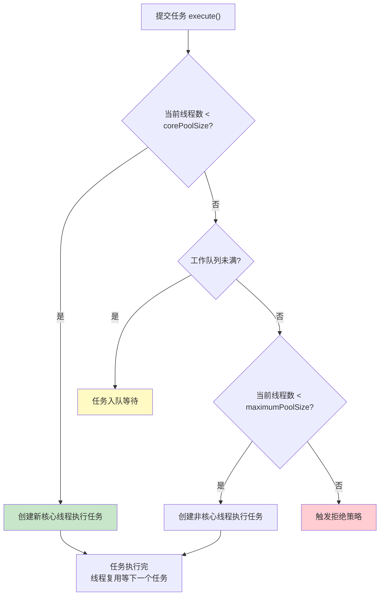
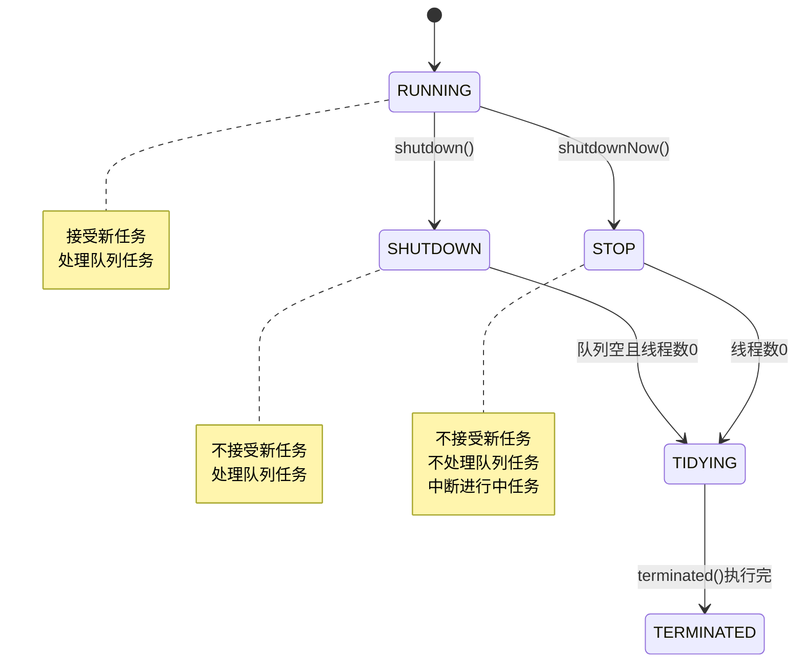
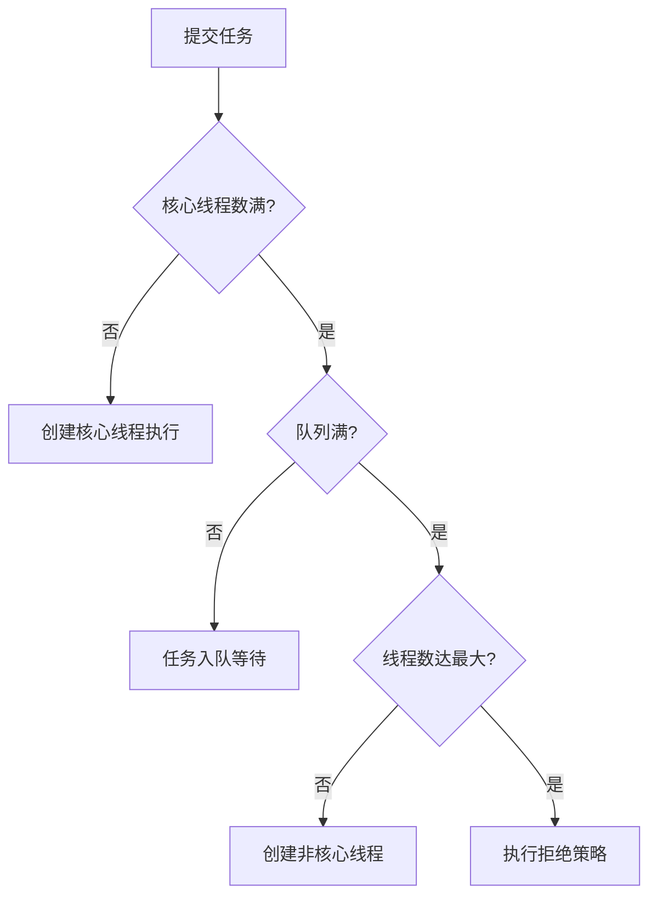

# 线程池原理与调优

> 定位：线程是稀缺资源，无节制创建线程会拖垮服务。线程池是 Java 并发落地到工程里最重要的一块——但 `Executors` 那几个"方便"的工厂方法埋着坑，参数配错了要么 OOM 要么吞吐上不去。这篇讲透 ThreadPoolExecutor 的执行流程、状态机、拒绝策略、调优计算和优雅关闭，让你能理直气壮地拒绝 `Executors.newFixedThreadPool()`。

## 一、为什么需要线程池

每来一个任务就 `new Thread()`，问题一堆：

- **创建/销毁线程有开销**：涉及内核态切换、内存分配，高频创建浪费 CPU
- **线程数量失控**：几千个线程把内存吃光（`unable to create new native thread`），上下文切换开销巨大
- **无法统一管理**：没有排队、没有限流、没有失败策略

线程池的价值：**复用线程**降低创建销毁开销、**控制并发数**保护系统、**提供排队和拒绝策略**削峰填谷。它是"用固定数量的工人处理无限的任务流"这一模型的实现。

## 二、ThreadPoolExecutor 核心参数与执行流程

`ThreadPoolExecutor` 的构造方法有 7 个参数，每个都关键：

```java
public ThreadPoolExecutor(
    int corePoolSize,               // 核心线程数
    int maximumPoolSize,            // 最大线程数
    long keepAliveTime,             // 非核心线程空闲存活时间
    TimeUnit unit,                  // 时间单位
    BlockingQueue<Runnable> workQueue,  // 工作队列
    ThreadFactory threadFactory,    // 线程工厂
    RejectedExecutionHandler handler     // 拒绝策略
)
```

### 2.1 各参数含义

| 参数 | 含义 | 说明 |
|---|---|---|
| `corePoolSize` | 核心线程数 | 长期维持的线程数，即使空闲也不销毁（除非 allowCoreThreadTimeOut） |
| `maximumPoolSize` | 最大线程数 | 线程池能创建线程的上限 |
| `keepAliveTime` | 空闲线程存活时间 | 超过 core 的线程空闲这么久后被回收 |
| `workQueue` | 阻塞队列 | 存放等待执行的任务 |
| `threadFactory` | 线程工厂 | 定制线程创建（命名、优先级、异常处理） |
| `handler` | 拒绝策略 | 队列满且线程数达上限时如何处理新任务 |

### 2.2 任务提交的执行流程

这是最关键的逻辑，记住这个顺序（很多人背错）：



流程拆解：

1. 当前线程数 **< corePoolSize**：直接创建新线程（核心线程）执行任务
2. 达到核心线程数后：新任务进入**工作队列**排队
3. 队列也满了，且线程数 **< maximumPoolSize**：创建**非核心线程**执行任务（相当于临时工救火）
4. 线程数到了 maximumPoolSize 且队列满：执行**拒绝策略**

**关键点**：很多人以为"先开到 max 再入队"，其实是**先 core → 再入队 → 再 max**。这个顺序直接决定了队列和最大线程数如何配合。

### 2.3 execute() 与 submit() 的区别

- `execute(Runnable)`：无返回值，异常直接抛到线程
- `submit(Callable/Runnable)`：返回 `Future`，异常被封装进 Future，需 `get()` 才会抛出

```java
// submit 的异常会"吞掉"，直到 get() 才暴露
Future<?> f = executor.submit(() -> { throw new RuntimeException("boom"); });
try {
    f.get();  // 这里才抛 ExecutionException
} catch (ExecutionException e) {
    // 处理
}
```

这是生产大坑：用 submit 提交任务，任务里抛异常却没有任何日志，因为异常被藏在 Future 里没人 get。

## 三、工作队列与拒绝策略

### 3.1 工作队列的选择

| 队列 | 特点 | 风险 |
|---|---|---|
| `ArrayBlockingQueue` | 数组实现，有界，必须指定容量 | 无 |
| `LinkedBlockingQueue` | 链表实现，可无界 | **默认无界是坑**，可能 OOM |
| `SynchronousQueue` | 不存储元素，每个 put 必须等 take | 常配大 maxPoolSize（如 cachedThreadPool） |
| `PriorityBlockingQueue` | 优先级队列，无界 | 无界风险 |
| `DelayedWorkQueue` | 延迟队列 | 用于 ScheduledThreadPool |

**强烈建议用有界队列**——无界队列在任务生产速度大于消费速度时无限堆积，最终 OOM。

### 3.2 四种拒绝策略

当队列满且线程数达上限，触发 `RejectedExecutionHandler`：

| 策略 | 行为 | 适用场景 |
|---|---|---|
| `AbortPolicy`（默认） | 抛 `RejectedExecutionException` | 需要感知失败，快速失败 |
| `CallerRunsPolicy` | 由调用者线程自己执行任务 | 削峰，减缓提交速度 |
| `DiscardPolicy` | 直接丢弃，不报错 | 不重要的任务 |
| `DiscardOldestPolicy` | 丢弃队列最老的任务，重试提交 | 允许丢弃旧任务 |

```java
// 自定义拒绝策略：记录日志 + 告警
RejectedExecutionHandler handler = (r, executor) -> {
    log.warn("线程池拒绝任务，active={}, queue={}",
             executor.getActiveCount(), executor.getQueue().size());
    throw new RejectedExecutionException("task rejected");
};
```

`CallerRunsPolicy` 很有意思：它让提交任务的线程（如 Tomcat 的 worker 线程）自己执行任务，这样提交速度自然减慢，形成一种"反压"，适合不能丢任务又能削峰的场景。

## 四、线程池状态机

线程池用一个 AtomicInteger `ctl` 同时存储**运行状态**（高 3 位）和**工作线程数**（低 29 位）——又是一个"一个变量两种语义"的精巧设计。

五种状态：



| 状态 | 含义 |
|---|---|
| **RUNNING** | 接受新任务、处理队列任务 |
| **SHUTDOWN** | 不接受新任务，但处理队列里的任务（`shutdown()` 触发） |
| **STOP** | 不接受新任务、不处理队列任务、中断正在执行的任务（`shutdownNow()` 触发） |
| **TIDYING** | 所有任务结束，workCount=0，准备执行 `terminated()` |
| **TERMINATED** | `terminated()` 执行完，线程池彻底关闭 |

理解状态机对"优雅关闭"至关重要：`shutdown()` 是温和关闭（处理完存量任务），`shutdownNow()` 是粗暴关闭（尝试中断正在执行的任务）。

## 五、Executors 工厂方法的坑

`Executors` 提供了几个"方便"的工厂方法，但阿里《Java 开发手册》明确**禁止使用**，原因如下：

### 5.1 newFixedThreadPool / newSingleThreadExecutor

```java
// 底层用了无界队列 LinkedBlockingQueue
Executors.newFixedThreadPool(n);
Executors.newSingleThreadExecutor();
```

**坑**：队列无界（`Integer.MAX_VALUE`），任务堆积会 OOM。生产必须用有界队列的 `ThreadPoolExecutor` 构造。

### 5.2 newCachedThreadPool / newScheduledThreadPool

```java
// 最大线程数是 Integer.MAX_VALUE
Executors.newCachedThreadPool();
Executors.newScheduledThreadPool(n);
```

**坑**：maximumPoolSize 是 `Integer.MAX_VALUE`，高并发下创建海量线程，耗尽资源。

### 5.3 正确做法：手动构造

```java
ThreadPoolExecutor executor = new ThreadPoolExecutor(
    8,                              // corePoolSize
    16,                             // maximumPoolSize
    60, TimeUnit.SECONDS,           // keepAliveTime
    new ArrayBlockingQueue<>(1000), // 有界队列，容量根据业务定
    new ThreadFactoryBuilder().setNameFormat("order-pool-%d").build(),  // 命名线程
    new ThreadPoolExecutor.CallerRunsPolicy()  // 拒绝策略
);
```

线程命名很重要——出问题时 jstack 里一眼看出是哪个线程池的线程，便于排查。

## 六、线程池隔离与参数调优

### 6.1 线程池隔离

不要用**一个线程池处理所有业务**。不同业务混在一个池子里，一个慢任务会拖垮整个池（线程都被它占着）。按业务隔离：

- 按业务类型：订单池、支付池、查询池分开
- 按任务特性：CPU 密集型和 IO 密集型分开
- 按优先级：核心业务和非核心业务分开

这也是 Hystrix、Sentinel 等熔断降级组件做资源隔离的思路（舱壁模式）。

### 6.2 核心线程数怎么算

这是面试和生产都常问的。公式：

**CPU 密集型**（如加密、计算、压缩）：

```
corePoolSize = CPU 核数 或 CPU 核数 + 1
```
Threads = CPU cores / (1 - blocking coefficient)

**IO 密集型**（如数据库查询、RPC 调用、文件 IO）：

```
corePoolSize = CPU 核数 * 2  （经验值）
```

更精确的公式（来自《Java 并发编程实战》）：

```
最佳线程数 = CPU 核数 × (1 + IO耗时 / CPU耗时)
```

举例：8 核 CPU，一个任务中 IO 耗时 90ms、CPU 耗时 10ms，则 `8 × (1 + 90/10) = 80` 个线程较合适。

> 这些公式是**起点不是终点**，最终要通过压测调整——观察 CPU 使用率、线程数、队列长度、响应时间来找到最优值。

### 6.3 队列容量怎么定

队列容量影响系统的"削峰"能力和响应时间。太小容易触发拒绝，太大导致任务等待时间过长。一般根据**业务能容忍的最大等待时间 × 任务处理速率**估算，然后压测校准。

## 七、生产坑点与排查

### 坑点 1：线程池里的异常"消失"了

**现象**：submit 提交的任务抛异常，没有任何日志，任务静默失败。

**原因**：submit 把异常封装进 Future，没人调用 get() 就看不到。execute 的异常会直接打印到控制台。

**解法**：
- 用 execute 时给线程设置 `UncaughtExceptionHandler`
- 用 submit 时要处理 Future.get() 的异常
- 自定义 ThreadPoolExecutor 重写 `afterExecute()` 统一捕获异常记录日志

### 坑点 2：任务堆积导致 OOM

**现象**：用 `Executors.newFixedThreadPool()`，流量高峰后服务 OOM。

**原因**：无界队列 `LinkedBlockingQueue` 无限堆积任务，每个任务对象 + 队列节点占内存。

**解法**：改用有界 `ArrayBlockingQueue` + 合理拒绝策略；监控队列长度，设置告警。

### 坑点 3：线程池共享导致雪崩

**现象**：一个慢 RPC 调用占满所有线程，其他业务全部卡死。

**原因**：所有业务共用一个线程池，慢任务耗尽线程资源。

**解法**：按业务隔离线程池；给慢调用设置超时；用熔断降级（Sentinel/Hystrix）。

### 坑点 4：shutdown() 后还提交任务

**现象**：应用关闭时报 `RejectedExecutionException`，任务丢失。

**原因**：调用了 `shutdown()` 后线程池不再接受新任务，但还有其他线程在提交。

**解法**：确保关闭顺序——先停止接收外部请求，再关闭线程池；用优雅关闭流程（见下）。

### 坑点 5：核心线程数设太大导致上下文切换严重

**现象**：线程数几百个，CPU 使用率高但吞吐量低。

**原因**：线程过多，CPU 大量时间花在线程上下文切换上，真正干活的时间少。

**解法**：按公式估算 + 压测调优；CPU 密集型控制线程数接近核数；用 `vmstat`/`pidstat -w` 看上下文切换次数。

## 八、优雅关闭与最佳实践

### 8.1 优雅关闭四步

```java
// 1. 停止接收新任务
executor.shutdown();
try {
    // 2. 等待存量任务执行完，最多等 60 秒
    if (!executor.awaitTermination(60, TimeUnit.SECONDS)) {
        // 3. 超时则强制关闭，中断正在执行的任务
        executor.shutdownNow();
        // 4. 再等一会儿，确保线程退出
        if (!executor.awaitTermination(60, TimeUnit.SECONDS)) {
            log.error("线程池未能完全关闭");
        }
    }
} catch (InterruptedException e) {
    executor.shutdownNow();
    Thread.currentThread().interrupt();
}
```

结合 Spring 的 `@PreDestroy` 或 `DisposableBean` 在应用关闭时执行这套流程。

### 8.2 最佳实践清单

1. **不用 Executors 工厂方法**，手动构造 ThreadPoolExecutor，用有界队列
2. **给线程起名字**，便于排查（`ThreadFactoryBuilder` 或 Spring 的 `CustomizableThreadFactory`）
3. **设置 UncaughtExceptionHandler** 或重写 afterExecute 捕获异常
4. **按业务隔离线程池**，避免互相拖累
5. **用 submit 时处理 Future 的异常**
6. **监控线程池指标**：activeCount、queue.size()、taskCount、completedTaskCount，接入 Prometheus + Grafana
7. **压测定参数**，公式只是起点
8. **优雅关闭**，应用退出时按四步流程

## 九、面试高频问法

> 这一节的答案按「面试时能讲透」的标准写：先给一句话结论，再展开机制、原因和坑点。

**Q1：线程池的核心参数有哪些？分别什么作用？**

**一句话结论**：7 个核心参数——核心线程数、最大线程数、空闲存活时间、时间单位、工作队列、线程工厂、拒绝策略。

| 参数 | 作用 |
|---|---|
| corePoolSize | 常驻核心线程数，即使空闲也不回收（除非开 allowCoreThreadTimeOut） |
| maximumPoolSize | 线程池允许的最大线程数 |
| keepAliveTime | 非核心线程空闲存活时间，超时回收 |
| unit | 时间单位 |
| workQueue | 任务队列，核心线程满了之后任务先入队 |
| threadFactory | 创建线程的工厂，可自定义线程名（排查问题时很重要） |
| handler | 拒绝策略，队列满且线程达上限时的兜底 |

加分点：说"线程名一定要自定义，否则线上 dump 出来全是 pool-1-thread-1，根本分不清哪个业务"。

**Q2：线程池的任务提交和执行流程是怎样的？**

**一句话结论**：核心线程未满→创建核心线程；核心满了→入队；队列满了→创建非核心线程到最大；还满→执行拒绝策略。



**关键理解**：注意顺序——**先入队，队列满了才扩容线程**。很多人以为"核心满了就扩线程"，这是错的。这个设计是因为队列通常能缓冲，扩容线程成本更高。

加分点：说"这个流程意味着如果用了无界队列（如 LinkedBlockingQueue 默认），maximumPoolSize 永远用不上，线程数最多就是 core"。

**Q3：Executors 提供的四种线程池有什么坑？为什么阿里规约禁止用？**

**一句话结论**：四种线程池（Fixed/Single/Cached/Scheduled）都有资源耗尽风险——要么队列无界导致 OOM，要么线程数无界导致 OOM。应该手动 new ThreadPoolExecutor。

| 线程池 | 坑 |
|---|---|
| newFixedThreadPool | 队列是**无界** LinkedBlockingQueue，任务堆积会 OOM |
| newSingleThreadExecutor | 同样无界队列，OOM |
| newCachedThreadPool | 最大线程数是 **Integer.MAX_VALUE**，线程暴涨会 OOM |
| newScheduledThreadPool | 队列无界，且最大线程数极大 |

**正确做法**：手动创建，明确指定有界队列和拒绝策略。

加分点：说"阿里规约禁止的是 Executors 工厂方法，不是禁止线程池本身；核心是让你显式控制边界"。

**Q4：线程池的拒绝策略有哪几种？**

**一句话结论**：四种——AbortPolicy（抛异常，默认）、CallerRunsPolicy（调用者执行）、DiscardPolicy（丢弃）、DiscardOldestPolicy（丢最老的）。

| 策略 | 行为 | 适用 |
|---|---|---|
| AbortPolicy | 抛 RejectedExecutionException | 默认，需要感知失败 |
| CallerRunsPolicy | 提交任务的线程自己执行 | 降级，让调用方变慢 |
| DiscardPolicy | 静默丢弃 | 不重要任务 |
| DiscardOldestPolicy | 丢队列最老的，再提交 | 时效性任务 |

**生产建议**：核心业务用 AbortPolicy + 监控告警（不能静默丢），非核心用 CallerRunsPolicy 降级。绝不推荐 DiscardPolicy——任务丢了没人知道。

加分点：说"CallerRunsPolicy 有个副作用：它会让提交任务的线程（可能是 Tomcat 工作线程）变慢，从而把背压传导到上游——这其实是好事，防止无限堆积"。

**Q5：线程池的线程数怎么设置？**

**一句话结论**：CPU 密集型设为 CPU 核数 + 1；IO 密集型设为 CPU 核数 × (1 + 平均等待时间/平均计算时间)，通常 2 倍核数起步。

展开：

- **CPU 密集型**：线程大部分时间在计算，线程数超过核数只会增加上下文切换开销。设 `N+1`（+1 是为了在偶发缺页时替补）。
- **IO 密集型**：线程大量时间在等 IO（数据库、RPC、磁盘），可以开更多线程让 CPU 不闲。经验公式 `N × (1 + W/C)`，W 是等待时间、C 是计算时间。
- **现实**：公式只是起点，**必须压测**。不同业务 IO 占比差异巨大，拍脑袋的数字不可靠。

加分点：说"线程数不是越多越好，线程多了上下文切换、内存（每线程约 1MB 栈）都是成本；最终要靠压测找拐点"。

**Q6：线程池的线程是怎么复用的？**

**一句话结论**：核心是 Worker 循环——每个工作线程执行完一个任务后，不销毁，而是从队列里取下一个任务继续执行，直到取不到且超时才退出。

展开：

- **Worker**：线程池内部把线程和任务包装成 Worker，Worker 本身是一个 Runnable，`run()` 里是一个 `while` 循环：`getTask()` 取任务 → `run()` 执行 → 循环。
- **复用**：线程执行完任务后回到 `getTask()`，阻塞在队列的 `take()` 或 `poll(timeout)` 上，有新任务就被唤醒执行。线程对象本身一直活着。
- **退出条件**：取不到任务且满足超时/池关闭，Worker 才退出，线程销毁。

加分点：说"线程复用避免了频繁创建销毁线程的开销（创建线程要分配栈、陷入内核），这是线程池最大的价值"。

**Q7：线程池的队列怎么选？**

**一句话结论**：看业务——要削峰用有界队列（ArrayBlockingQueue/LinkedBlockingQueue 指定容量），要优先级用 PriorityBlockingQueue，要延迟用 DelayQueue。

| 队列 | 特点 | 场景 |
|---|---|---|
| ArrayBlockingQueue | 有界、数组、FIFO | 通用，推荐 |
| LinkedBlockingQueue | 默认无界（可指定）、链表 | 注意别用默认无界 |
| SynchronousQueue | 不存储、直接移交 | CachedThreadPool 用，高吞吐 |
| PriorityBlockingQueue | 优先级排序 | 任务有优先级 |
| DelayQueue | 延迟到期才能取 | 定时任务 |

**核心原则**：生产必须用**有界队列**。无界队列在流量突增时会无限堆积任务，最终 OOM——而且 OOM 前系统已经假死（任务都在排队）。

加分点：说"队列容量要结合内存和任务大小估算，比如每任务 1KB、队列 1 万、100 个线程池，就是 1GB 内存，要算进去"。

**Q8：线程池怎么优雅关闭？**

**一句话结论**：`shutdown()` 平滑关闭（不再接新任务、执行完队列里的），`shutdownNow()` 立即关闭（中断线程、返回未执行任务）。生产用 shutdown + awaitTermination。

展开：

```java
pool.shutdown();  // 不再接受新任务
if (!pool.awaitTermination(60, TimeUnit.SECONDS)) {
    pool.shutdownNow();  // 超时强制中断
}
```

**区别**：
- `shutdown()`：状态变 SHUTDOWN，继续执行已提交的任务，队列执行完才真正终止。
- `shutdownNow()`：状态变 STOP，中断所有线程，返回队列里没执行的任务。**注意：它不保证能中断正在执行的任务**（取决于任务是否响应中断）。

加分点：说"shutdownNow 返回的未执行任务列表要处理，否则任务就静默丢了；关闭线程池是应用停机的关键路径，必须配超时兜底"。

**Q9：线程池里的异常会被吞掉吗？怎么捕获？**

**一句话结论**：会。`execute()` 提交的任务抛异常，异常会被 Worker 捕获但不打印（除非设置 UncaughtExceptionHandler）；`submit()` 提交的异常被封装在 Future 里，不 get 就看不到。

展开：

- **execute vs submit**：execute 直接跑任务，异常走线程的 UncaughtExceptionHandler（默认打印到 stderr）；submit 把任务包成 FutureTask，异常存进 Future，不调用 `future.get()` 就永远不知道。
- **捕获方式**：
  1. 任务内部 try-catch（最可靠）
  2. 设置 `ThreadFactory` 的 `UncaughtExceptionHandler`
  3. 用 submit 时记得 get() 检查

加分点：说"生产事故常见：用 submit 提交任务，任务抛异常了，日志里什么都没有，以为执行成功了——其实 Future 里躺着异常"。

**Q10：什么是线程池隔离？为什么需要？**

**一句话结论**：给不同业务/依赖分配**独立的线程池**，避免一个业务把线程池打满拖垮其他业务。

展开：

- **问题**：所有业务共用一个线程池，某个慢接口（比如调外部服务超时）把线程全占满，其他正常接口也拿不到线程——**故障扩散**。
- **隔离方案**：按业务线、按下游依赖拆分线程池，各自独立。类似船舱的隔水舱（舱壁模式）。
- **代价**：线程池多了，总线程数上升，内存和上下文切换成本增加；需要更精细的监控。

**典型实践**：Hystrix/Sentinel 的线程池隔离就是这么做的——每个依赖一个独立线程池，一个依赖挂了不影响其他。

加分点：说"隔离的粒度要权衡，拆太细管理成本高，拆太粗起不到隔离作用；通常按'核心依赖'拆，非核心共用"。

## 小结

- 执行流程：**core → 入队 → max → 拒绝**，顺序别记反。
- 7 大参数中队列和拒绝策略最关键：**用有界队列**、自定义拒绝策略带告警。
- **Executors 禁用**（无界队列/海量线程坑），手动构造 ThreadPoolExecutor + 线程命名 + 异常捕获。
- 线程数：CPU 密集型≈核数，IO 密集型≈核数×2 或公式计算，压测校准；队列有界；按业务隔离。
- 优雅关闭四步：shutdown → awaitTermination → shutdownNow → awaitTermination；submit 要处理 Future 异常。
