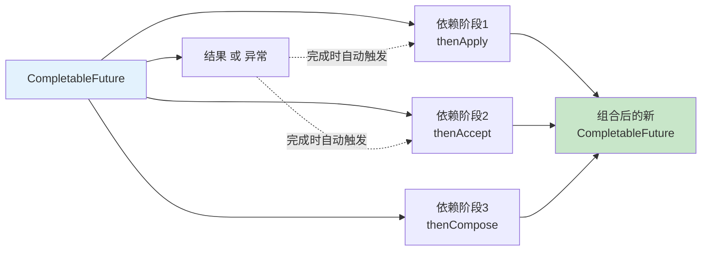
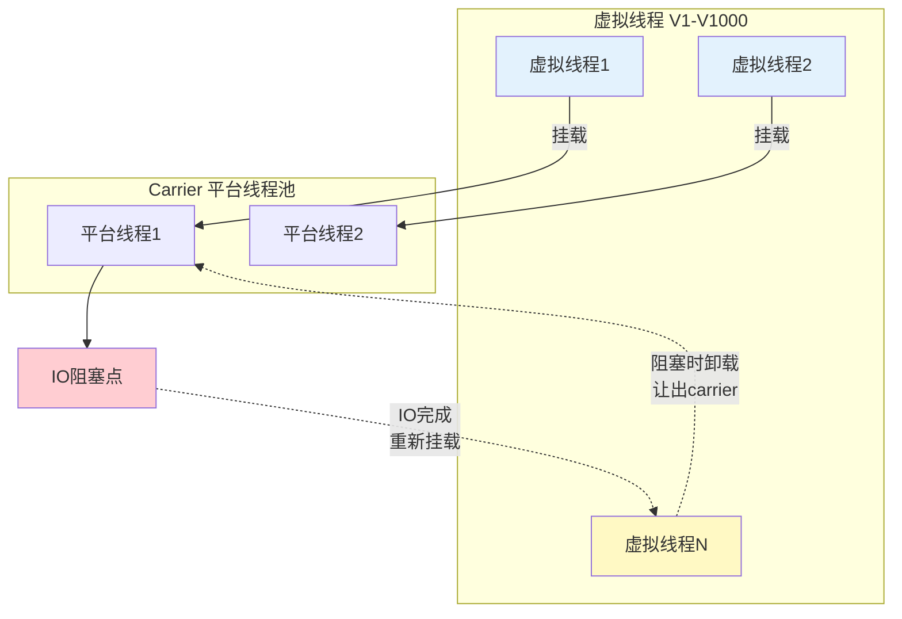

# CompletableFuture 与虚拟线程

> 定位：异步编程从"回调地狱"到"组合式未来"，再到 Java 21 的虚拟线程，正在经历一场范式变革。这篇讲清 Future 为什么不够用、CompletableFuture 怎么把异步任务像搭积木一样编排、异常怎么处理，以及虚拟线程凭什么能用同步代码的写法拿到异步的性能——这是现代 Java 并发编程的演进主线。

## 一、为什么需要 CompletableFuture

传统 `Future` 有两个致命局限：

1. **无法组合**：多个异步任务有依赖关系时，你只能 `get()` 阻塞等待前一个，再提交后一个——又变回同步了
2. **只能阻塞获取结果**：`Future.get()` 会阻塞当前线程，拿不到结果只能干等

看个痛点场景：查商品详情需要分别调用商品服务、价格服务、库存服务，然后汇总。用 Future：

```java
Future<Item> itemF = executor.submit(() -> getItem(id));
Future<Price> priceF = executor.submit(() -> getPrice(id));
Future<Stock> stockF = executor.submit(() -> getStock(id));

// 三个 get 各自阻塞，且无法表达"三者都好后汇总"
Item item = itemF.get();      // 阻塞
Price price = priceF.get();   // 阻塞
Stock stock = stockF.get();   // 阻塞
return combine(item, price, stock);
```

代码啰嗦、阻塞等待、难以表达任务间的依赖和组合。CompletableFuture 就是来解决这些的——它让你用**声明式**的方式描述"任务完成后做什么",自动回调，无需阻塞。

## 二、CompletableFuture 核心原理

`CompletableFuture` 实现了 `Future` 和 `CompletionStage` 两个接口：

- `Future`：提供 `get()`、`isDone()` 等基本能力
- `CompletionStage`：提供**组合式** API——一个阶段完成后触发下一个阶段，支持串行、并行、汇聚、异常处理

它的本质是一个**结果容器 + 监听器列表**：当结果就绪时，自动触发（或异步执行）注册在其上的依赖动作。



图里每个 `thenXxx` 都返回一个新的 CompletableFuture，可以链式编排。上游完成后自动触发下游回调，这就是"组合式"的核心——像流水线一样把异步任务串起来。

### 2.1 创建与异步执行

```java
// supplyAsync：有返回值的异步任务
CompletableFuture<Item> cf = CompletableFuture.supplyAsync(() -> getItem(id));

// runAsync：无返回值的异步任务
CompletableFuture<Void> cf2 = CompletableFuture.runAsync(() -> doSomething());

// completedFuture：直接用已知结果创建
CompletableFuture<String> cf3 = CompletableFuture.completedFuture("done");
```

默认用 `ForkJoinPool.commonPool()` 执行。可以传自定义 executor：

```java
CompletableFuture.supplyAsync(() -> getItem(id), myExecutor);
```

> 坑点：所有 CompletableFuture 默认共享 commonPool，如果整个应用大量使用且任务有阻塞，会把公共池耗尽，拖垮所有异步任务。**生产建议传自定义线程池**，按业务隔离。

### 2.2 常用 API 分类

CompletableFuture 的 API 很多（50+ 个方法），按用途分类记忆：

**① 转换结果（串行）**

| 方法 | 作用 |
|---|---|
| `thenApply` | 对结果做转换，返回新值 `T → U` |
| `thenAccept` | 消费结果，无返回值 `T → void` |
| `thenRun` | 不关心结果，执行 Runnable |

```java
CompletableFuture<String> cf = CompletableFuture
    .supplyAsync(() -> getItem(id))
    .thenApply(item -> item.getName())       // Item → String
    .thenApply(name -> "商品名:" + name);
```

**② 组合两个 Future**

| 方法 | 作用 |
|---|---|
| `thenCombine` | 两个结果都好后，合并 ` (T,U) → V` |
| `thenCompose` | 一个结果作为下一个异步任务的输入（扁平化，避免嵌套 Future） |
| `thenAcceptBoth` | 两个结果都好后消费，无返回值 |

`thenCompose` vs `thenApply` 的区别很关键：

- `thenApply`：`T → U`，U 是普通值，结果变成 `CompletableFuture<U>`
- `thenCompose`：`T → CompletableFuture<U>`，结果**扁平化**成 `CompletableFuture<U>`，不会变成嵌套的 `CompletableFuture<CompletableFuture<U>>`

```java
// thenApply 会嵌套
CompletableFuture<CompletableFuture<Price>> nested =
    cf.thenApply(item -> getPriceAsync(item.getId()));  // 不推荐

// thenCompose 扁平化
CompletableFuture<Price> flat =
    cf.thenCompose(item -> getPriceAsync(item.getId()));  // 推荐
```

**③ 汇聚多个 Future**

| 方法 | 作用 |
|---|---|
| `allOf(cf1, cf2, ...)` | 所有都完成才返回，`Void` |
| `anyOf(cf1, cf2, ...)` | 任意一个完成就返回 |

```java
CompletableFuture<Void> all = CompletableFuture.allOf(cf1, cf2, cf3);
all.thenRun(() -> {
    // 三个都完成了，此时各自 get() 不会阻塞
});
```

注意 `allOf` 返回的是 `Void`，要拿各自结果还得对原始 cf 调用 `join()`。

**④ 异常处理**

| 方法 | 作用 |
|---|---|
| `exceptionally` | 出错时提供兜底值（类似 catch） |
| `handle` | 无论成功失败都执行，可做转换（类似 finally + catch） |
| `whenComplete` | 无论成功失败都执行，不改变结果 |

```java
CompletableFuture<Item> cf = CompletableFuture.supplyAsync(() -> getItem(id))
    .exceptionally(ex -> {
        log.error("查商品失败", ex);
        return new Item("默认商品");  // 兜底值
    });

// handle 能同时处理正常和异常结果
CompletableFuture<String> cf2 = supplyAsync(...)
    .handle((result, ex) -> ex != null ? "error" : result.toString());
```

### 2.3 同步方法与异步方法

CompletableFuture 的 API 大多有 `Xxx` 和 `XxxAsync` 两个版本：

- `thenApply(fn)`：回调在**上游完成的线程**或**调用线程**执行
- `thenApplyAsync(fn)`：回调提交到线程池**异步执行**

什么时候用 Async？如果回调本身很耗时，用 Async 避免阻塞上游线程。

## 三、异常处理深入

异常处理是 CompletableFuture 最容易踩坑的地方。

### 3.1 异常传播链

异常会沿组合链向后传播。如果中间某阶段抛异常，后续依赖阶段默认不会执行，直到遇到 `exceptionally`/`handle` 处理。

```java
CompletableFuture.supplyAsync(() -> {
    throw new RuntimeException("boom");
})
.thenApply(r -> r + "1")      // 不执行
.thenApply(r -> r + "2")      // 不执行
.exceptionally(ex -> "recovered")  // 这里处理，得到 "recovered"
```

### 3.2 get() 与 join() 的异常差异

- `get()`：抛受检异常 `ExecutionException`、`InterruptedException`，必须 try-catch
- `join()`：抛 unchecked 的 `CompletionException`，不用 try-catch

```java
try {
    cf.get();  // 受检异常
} catch (Exception e) {}

cf.join();  // 无受检异常，但异常包装在 CompletionException 里
```

### 3.3 异常吞噬坑

异常如果没被 `exceptionally`/`handle` 处理，也没人 `get()`/`join()`，会被**静默吞噬**——和你用 submit 不 get 一样。生产务必在链的末端加 `exceptionally` 或 `whenComplete` 记录日志。

## 四、虚拟线程：并发的范式革命

### 4.1 平台线程的困境

传统 Java 线程（平台线程，Platform Thread）是**1:1 映射到操作系统内核线程**的。这意味着：

- 创建成本高（默认栈 1MB）
- 上下文切换由 OS 内核调度，开销大
- 数量受限——几千个就吃光内存和 CPU 调度能力

IO 密集型服务里，线程大部分时间在等 IO（DB、RPC），却被独占着，非常浪费。为此才有了异步编程（CompletableFuture、Netty）——用少量线程处理大量请求，但代价是代码复杂、回调地狱、调试困难。

### 4.2 虚拟线程是什么

虚拟线程（Virtual Thread，Project Loom，Java 21 正式转正）是**轻量级线程**，由 JVM 调度而非 OS 内核：

- **M:N 调度**：大量虚拟线程（M）复用少量平台线程（N，叫 carrier thread）
- 创建成本极低：内存占用 KB 级，可以创建**百万级**
- 当虚拟线程执行 IO 阻塞时，JVM 把它**卸载（unmount）**，让 carrier 线程去执行其他虚拟线程；IO 完成后再**挂载（mount）** 回来



图里的关键是"卸载/挂载"：虚拟线程 3 遇到 IO 阻塞时从平台线程上卸载，平台线程空出来跑别的虚拟线程，IO 完成后虚拟线程 3 再挂载回来继续执行。这样少量平台线程就能支撑海量虚拟线程。

### 4.3 使用方式

```java
// 方式1：为每个任务启动一个虚拟线程
Thread.ofVirtual().start(() -> {
    System.out.println("hello from " + Thread.currentThread());
});

// 方式2：虚拟线程执行器（Java 21+）
try (ExecutorService executor = Executors.newVirtualThreadPerTaskExecutor()) {
    executor.submit(() -> doWork());
}

// 方式3：直接设置线程工厂
ThreadFactory factory = Thread.ofVirtual().factory();
```

**革命性意义**：你可以用**同步阻塞的写法**拿到异步的性能。以前要写 CompletableFuture 回调链的原因，现在可以用普通同步代码 + 虚拟线程解决：

```java
// 传统：需要 CompletableFuture 异步编排
// 虚拟线程：直接同步写法，每个请求一个虚拟线程，阻塞由 JVM 处理
try (var executor = Executors.newVirtualThreadPerTaskExecutor()) {
    Item item = executor.submit(() -> getItem(id)).get();
    Price price = executor.submit(() -> getPrice(id)).get();
    return combine(item, price);
}
```

代码回到了最直观的同步风格，但底层靠虚拟线程实现了高并发。

### 4.4 适用场景与限制

**适合**：
- IO 密集型：Web 服务、RPC 调用、数据库访问、爬虫——线程大量时间花在等待 IO
- 高并发请求处理：每个请求一个虚拟线程

**不适合**：
- CPU 密集型：计算、加密——虚拟线程不改变 CPU 核数限制，反而调度开销更大
- 长时间持有 `synchronized` 锁或 `ThreadLocal`：虚拟线程被固定（pinned）在 carrier 上，无法卸载，失去优势。Java 21 早期版本在 synchronized 内阻塞会 pinning，后续版本在改进——**以你使用的版本为准**

**注意**：虚拟线程不能替代所有异步场景。它是"用同步写法获得异步吞吐"，而不是让同步代码变快。

### 4.5 结构化并发（Structured Concurrency）

结构化并发（JDK 21 预览特性）是把一组并发任务当作一个工作单元管理：任务的生命周期被限定在一个作用域内，一个失败可以取消其他，所有任务完成作用域才结束。

```java
try (var scope = StructuredTaskScope.open()) {
    var itemFork = scope.fork(() -> getItem(id));
    var priceFork = scope.fork(() -> getPrice(id));

    scope.join();  // 等所有子任务
    return combine(itemFork.get(), priceFork.get());
    // 作用域关闭时，未完成的子任务自动取消
}
```

好处：避免线程泄漏、异常自动传播、取消更可靠，让并发代码的生命周期管理像结构化编程一样清晰。**注意这是预览 API，以你使用的版本为准。**

## 五、生产坑点与排查

### 坑点 1：CompletableFuture 默认用 commonPool，阻塞任务拖垮全局

**现象**：个别慢任务把 commonPool 耗尽，整个应用所有 CompletableFuture 都变慢。

**原因**：`supplyAsync` 默认用 `ForkJoinPool.commonPool()`，它是全局共享的。阻塞型任务（同步 RPC、DB）占满公共池线程后，其他异步任务排队。

**解法**：给 `supplyAsync`/`thenXxxAsync` 传自定义、按业务隔离的线程池；阻塞任务和 CPU 任务用不同的池。

### 坑点 2：异常被吞噬，任务静默失败

**现象**：异步任务失败，没有任何日志，数据不一致。

**原因**：异常没被 `exceptionally`/`handle` 处理，也没人 get()/join()，被 CompletableFuture 静默保存。

**解法**：每条异步链的末端加 `whenComplete`/`exceptionally` 记录日志；用统一的包装方法创建带异常处理的 CompletableFuture。

### 坑点 3：误用 thenApply 导致嵌套 Future

**现象**：返回值类型变成 `CompletableFuture<CompletableFuture<T>>`，逻辑错乱。

**原因**：应该用 `thenCompose` 的地方用了 `thenApply`。

**解法**：当回调返回的是另一个 CompletableFuture 时，用 `thenCompose` 扁平化；返回普通值时用 `thenApply`。

### 坑点 4：虚拟线程在 synchronized 内 IO 被 pinning

**现象**：用了虚拟线程但吞吐量没提升，carrier 线程被占满。

**原因**：虚拟线程在 `synchronized` 块内阻塞时会"固定（pin）"在 carrier 线程上，无法卸载，导致 carrier 耗尽。

**解法**：虚拟线程场景下用 `ReentrantLock` 替代 `synchronized`；避免在虚拟线程里长时间持有锁或 ThreadLocal；升级到改进了 pinning 的 JDK 版本。

### 坑点 5：虚拟线程用于 CPU 密集型任务反而更慢

**现象**：把加密/计算任务改成虚拟线程，性能下降。

**原因**：虚拟线程的优势在 IO 等待时让出 carrier，CPU 密集型任务不让出，反而多了 JVM 调度开销。

**解法**：CPU 密集型用固定大小线程池（按核数），虚拟线程只用于 IO 密集型。

## 六、最佳实践与选型

### 6.1 CompletableFuture 最佳实践

1. **传自定义线程池**，别用默认 commonPool
2. **异常必处理**：链末端加 `whenComplete`/`exceptionally`
3. **动作返回 Future 用 thenCompose**，普通值用 thenApply
4. **多任务汇聚用 allOf/anyOf**，配合超时控制
5. **耗时回调用 Async 版本**，避免阻塞上游线程

### 6.2 CompletableFuture vs 虚拟线程 选型

| 场景 | 推荐方案 |
|---|---|
| Java 8/11 老项目，复杂异步编排 | CompletableFuture |
| Java 21+，IO 密集，想要简单代码 | 虚拟线程 |
| 需要超时、重试、复杂依赖编排 | CompletableFuture（组合能力强） |
| CPU 密集型 | 固定大小线程池 |
| 追求代码可读性、降低心智负担 | 虚拟线程（同步写法） |

> 一句话：虚拟线程不是取代 CompletableFuture，而是给了你**另一种选择**——后者强在任务编排，前者强在简化并发模型。两者可以结合：用虚拟线程作为 CompletableFuture 的执行器。

## 七、面试高频问法

> 这一节的答案按「面试时能讲透」的标准写：先给一句话结论，再展开机制、原因和坑点。

**Q1：Future 有什么局限？为什么需要 CompletableFuture？**

**一句话结论**：Future 只能"阻塞式 get"或"轮询 isDone"，无法编排多个异步任务、无法回调、无法组合，CompletableFuture 补齐了这些能力。

展开：

- **Future 的四个局限**：
  1. 不能主动通知完成（只能阻塞 get 或轮询）
  2. 不能对结果做链式处理（没有 thenApply 这类）
  3. 不能组合多个 Future
  4. 没有异常处理的优雅方式
- **CompletableFuture 的改进**：支持回调（whenComplete）、转换（thenApply）、组合（thenCombine）、编排（allOf/anyOf）、异常处理（exceptionally）。

加分点：说"Future 是'提交任务然后等结果'，CompletableFuture 是'声明式地描述任务之间的依赖关系'，思维模式从命令式变成了函数式"。

**Q2：CompletableFuture 的常用 API 有哪些？**

**一句话结论**：核心分四类——创建、转换、组合、异常处理。

| 类别 | 方法 | 作用 |
|---|---|---|
| 创建 | `supplyAsync` / `runAsync` | 异步执行有/无返回值的任务 |
| 转换 | `thenApply` / `thenAccept` / `thenRun` | 对结果做映射/消费/后续动作 |
| 组合 | `thenCombine` / `thenCompose` / `allOf` / `anyOf` | 合并两个/多个任务 |
| 异常 | `exceptionally` / `handle` / `whenComplete` | 异常兜底/统一处理/完成回调 |

**关键区别**：
- `thenApply` vs `thenCompose`：前者是"结果映射"（T→R），后者是"扁平化"（T→CompletableFuture<R>），类似 map vs flatMap。
- `thenApply` vs `thenApplyAsync`：后者把后续任务提交到线程池异步执行，前者在完成线程里同步执行。

加分点：说"不指定 Executor 时用 ForkJoinPool.commonPool()，这个池子大小默认是 CPU-1，IO 密集型任务会把它占满，一定要传自定义线程池"。

**Q3：CompletableFuture 怎么处理异常？**

**一句话结论**：三种方式——`exceptionally`（只处理异常、返回兜底值）、`handle`（正常和异常都处理）、`whenComplete`（完成后回调，不改变结果）。

展开：

- **exceptionally**：`future.exceptionally(e -> 默认值)`，异常时返回兜底值，正常时不影响。
- **handle**：`future.handle((result, e) -> ...)`，无论成功失败都会执行，可以统一处理。
- **whenComplete**：`future.whenComplete((result, e) -> ...)`，完成后执行副作用（如记录日志），**不改变结果**，异常会继续传播。

**坑**：如果异常没被处理，调用 `get()` 时会抛 `ExecutionException`；如果连 get 都没有，异常就静默丢失了。

加分点：说"whenComplete 和 handle 的区别是——whenComplete 不吞异常（异常继续往下传），handle 会吞掉异常（返回新值）"。

**Q4：CompletableFuture.allOf 和 anyOf 有什么区别？**

**一句话结论**：allOf 等所有任务完成，anyOf 等任意一个完成。

展开：

- **allOf**：`CompletableFuture.allOf(f1, f2, f3)` 返回一个 CompletableFuture<Void>，所有都完成后才完成。**注意它不返回结果**，要自己从各个 future 里 get。
- **anyOf**：`anyOf(f1, f2, f3)` 返回第一个完成的结果（Object 类型）。

**典型用法**：并行调用多个下游服务，用 allOf 等全部返回再聚合；做"最快响应"（如多副本读）用 anyOf。

```java
CompletableFuture<Void> all = CompletableFuture.allOf(f1, f2, f3);
all.join();
// 再分别 f1.join() 拿结果
```

加分点：说"allOf 的一个坑——只要有一个任务异常，allOf 就异常完成，但其他任务仍在跑，结果可能丢；要自己处理部分失败"。

**Q5：CompletableFuture 的默认线程池是什么？有什么坑？**

**一句话结论**：默认用 `ForkJoinPool.commonPool()`，大小是 CPU 核数 - 1；IO 密集型任务会把它占满，必须传自定义线程池。

展开：

- **commonPool 的特点**：所有未指定 Executor 的 CompletableFuture 共享这一个池；大小默认 `Runtime.availableProcessors() - 1`。
- **坑**：如果任务里有阻塞 IO（数据库、RPC），线程会被卡住，commonPool 很快耗尽，导致**其他所有用默认池的异步任务都排队**——一个慢任务拖垮全站。
- **正确做法**：`supplyAsync(supplier, myExecutor)` 显式传业务线程池。

加分点：说"commonPool 是为 CPU 密集型计算设计的，拿它跑 IO 任务是用错了场景；而且它被整个 JVM 共享，污染影响面极大"。

**Q6：虚拟线程是什么？它解决了什么问题？**

**一句话结论**：虚拟线程是 JDK 21 正式引入的轻量级线程，由 JVM 调度而非 OS 调度，可以创建百万级而不耗尽资源，专门解决**高并发 IO 场景下平台线程太贵**的问题。

展开：

- **平台线程的瓶颈**：传统线程 1:1 映射到 OS 线程，每个约占 1MB 栈，几千个就到顶了；大量线程阻塞在 IO 上会浪费 OS 资源。
- **虚拟线程的原理**：M:N 调度——大量虚拟线程复用在少量平台线程（载体线程）上。虚拟线程阻塞时，JVM 把它"卸载"（unmount），载体线程去跑别的虚拟线程，IO 就绪后再"挂载"回来。
- **优势**：创建成本极低（几百字节），可以用"一个请求一个线程"的同步写法实现高并发，不用回调地狱。

加分点：说"虚拟线程不是让单线程变快，而是让'线程数'不再是瓶颈；它适合 IO 密集型，CPU 密集型用它没意义"。

**Q7：虚拟线程有什么使用限制和坑？**

**一句话结论**：虚拟线程不能用在需要线程本地状态、synchronized 阻塞、或线程池复用的场景；它不该被池化。

展开：

- **不要池化**：虚拟线程很便宜，用完即弃，池化反而增加复杂度。用 `Thread.ofVirtual().start()` 或 `Executors.newVirtualThreadPerTaskExecutor()`。
- **synchronized 的坑**：在 synchronized 块里阻塞会"钉住"载体线程（pinning），失去虚拟线程的优势；应改用 ReentrantLock。
- **ThreadLocal 慎用**：虚拟线程数量巨大，ThreadLocal 会占用大量内存；JDK 21 提供 ScopedValue 作为替代（预览）。
- **CPU 密集型不适用**：虚拟线程解决的是"等待"，计算密集还是受限于核数。

加分点：说"pinning 是虚拟线程最大的坑——JDK 21 里 synchronized 和 native 方法会钉住载体线程，JDK 24 才缓解了 synchronized 的 pinning"。

**Q8：CompletableFuture 和虚拟线程，该怎么选？**

**一句话结论**：CompletableFuture 适合"任务编排"（多个异步任务有依赖、要组合）；虚拟线程适合"高并发同步阻塞"（大量独立请求）。

展开：

| 场景 | 选择 |
|---|---|
| 多个异步任务有依赖、要组合 | CompletableFuture |
| 大量独立请求、每个都要等 IO | 虚拟线程（同步写法） |
| 需要超时、取消、异常编排 | CompletableFuture |
| 代码可读性优先 | 虚拟线程（同步代码更直观） |

**本质区别**：CompletableFuture 是**异步编程模型**（回调/链式），虚拟线程是**让同步代码也能高并发**。两者可以结合——用虚拟线程执行 CompletableFuture 里的任务。

加分点：说"虚拟线程让'一个请求一个线程'重新变得可行，很多以前必须用响应式/CompletableFuture 的场景，现在用同步写法就够了"。

**Q9：CompletableFuture 怎么实现超时控制？**

**一句话结论**：JDK 9+ 用 `orTimeout`（超时抛异常）或 `completeOnTimeout`（超时返回默认值）；JDK 8 要自己用 `ScheduledExecutorService` 实现。

展开：

```java
// JDK 9+
future.orTimeout(3, TimeUnit.SECONDS);          // 超时抛 TimeoutException
future.completeOnTimeout(默认值, 3, SECONDS);    // 超时返回默认值
```

**JDK 8 的做法**：起一个定时任务，到点调用 `future.complete(默认值)` 或 `completeExceptionally`。

**注意**：超时只是"不再等结果"，**底层任务不会自动取消**——如果任务还在跑，资源仍在消耗。要真正取消，得让任务响应中断。

加分点：说"orTimeout 不会中断正在执行的任务，只是让 CompletableFuture 提前完成；要真正停止任务，得配合 cancel 和任务内部的中断检查"。

**Q10：为什么说 CompletableFuture 容易写出 bug？**

**一句话结论**：因为它把"异步"藏起来了——异常静默、线程池污染、回调顺序、阻塞调用混入，都容易踩坑。

展开（四个高频坑）：

1. **异常被吞**：不调 get/join、不注册 exceptionally，异常就消失了。
2. **默认线程池污染**：忘了传 Executor，IO 任务占满 commonPool。
3. **在回调里做阻塞操作**：thenApply 里调了慢接口，把完成线程卡住。
4. **误以为 thenApply 是异步的**：它默认在完成线程同步执行，可能阻塞。

**防御**：每个 future 都配 exceptionally；显式传线程池；回调里不做重活；关键路径加超时。

加分点：说"CompletableFuture 的链式写法很优雅，但可读性差、调试难——线上排查时一个异常可能藏在好几层 then 里面，日志要打全"。

## 小结

- **Future 局限**：不能组合、只能阻塞 get；**CompletableFuture** 通过 CompletionStage 提供组合式异步编排。
- 常用 API：串行 `thenApply/thenAccept/thenRun`、组合 `thenCompose/thenCombine`、汇聚 `allOf/anyOf`、异常 `exceptionally/handle/whenComplete`。
- **回调返回 Future 用 thenCompose**（扁平化）；异常必处理否则静默吞噬；默认 commonPool 有坑，传自定义线程池。
- **虚拟线程**（Java 21）= JVM 调度的轻量线程，M:N 映射，IO 阻塞时卸载挂载，用同步写法拿异步吞吐；适合 IO 密集，CPU 密集别用。
- 注意 **pinning**（synchronized 内阻塞无法卸载）和结构化并发（预览特性，以版本为准）。
