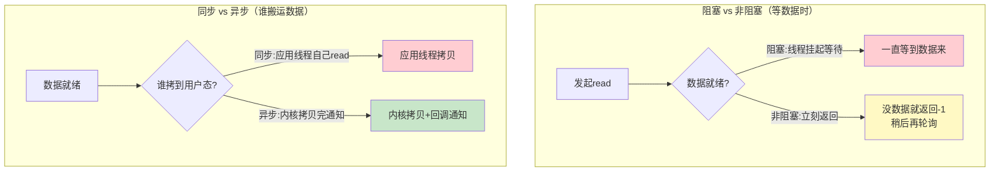
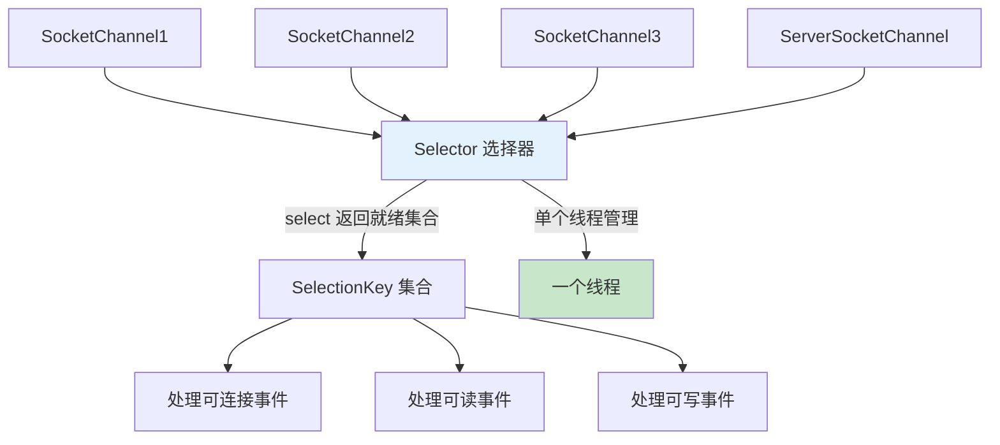
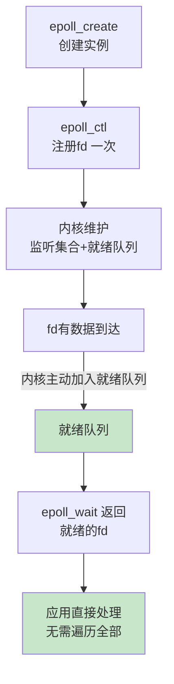
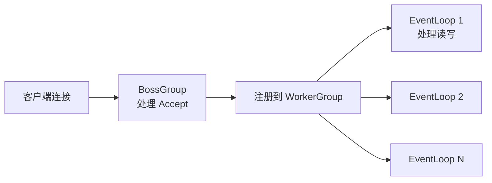

# BIO、NIO、AIO 与零拷贝

> 定位：为什么一个 Tomcat 用几百个线程，Netty 用几个线程就能扛住更高并发？答案在 IO 模型和零拷贝里。这篇讲清同步/异步、阻塞/非阻塞两组概念的辨微，BIO/NIO/AIO 的本质差异，NIO 三大组件、epoll 多路复用的原理，以及 sendfile/mmap 零拷贝为什么能省掉一半的数据搬运——这是理解一切高性能网络框架的地基。

## 一、先把两组概念掰清楚

很多人把"同步/异步"和"阻塞/非阻塞"混为一谈，其实它们是从**两个不同维度**描述 IO：

| 维度 | 关注点 |
|---|---|
| **阻塞 / 非阻塞** | 调用方发起 IO 后，在结果返回前**是否能去做别的事**（线程是否被挂起） |
| **同步 / 异步** | 数据就绪后，**谁负责把数据从内核缓冲区搬到用户缓冲区**（是应用线程自己读，还是内核帮你完成并回调通知） |

- **阻塞 IO**：调用后线程挂起，什么都干不了，一直等到数据来
- **非阻塞 IO**：调用后立刻返回（数据没好就返回个"没准备好"），线程可以去干别的，但要反复轮询
- **同步 IO**：应用线程亲自把数据从内核态拷到用户态
- **异步 IO**：内核把数据准备好并**拷贝到用户态**后，主动通知应用线程"搞定了"

一句话记忆：**阻塞/非阻塞看"等数据时的状态"，同步/异步看"数据搬运由谁做"**。



## 二、BIO、NIO、AIO 三种模型

### 2.1 BIO（Blocking IO，同步阻塞）

最传统的模型：一个连接一个线程。服务端 `ServerSocket.accept()` 阻塞等待连接，为每个连接创建一个线程处理，这个线程的 `read()` 又阻塞等待数据。

```java
ServerSocket server = new ServerSocket(8080);
while (true) {
    Socket socket = server.accept();          // 阻塞等连接
    new Thread(() -> {
        InputStream in = socket.getInputStream();
        int data = in.read();                  // 阻塞等数据
    }).start();
}
```

**问题**：并发 1 万连接就要 1 万线程，线程栈 + 上下文切换直接压垮系统。适合连接数小且固定的场景。

### 2.2 NIO（Non-blocking IO，同步非阻塞）

Java 1.4 引入。核心是**一个线程能处理多个连接**：Channel 注册到 Selector 上，Selector 轮询哪些 Channel 有事件（可读/可写/连接），有事件才处理，没事件线程可以去干别的或阻塞在 select 上。

```java
Selector selector = Selector.open();
ServerSocketChannel server = ServerSocketChannel.open();
server.configureBlocking(false);  // 非阻塞
server.register(selector, SelectionKey.OP_ACCEPT);

while (true) {
    selector.select();  // 阻塞直到有就绪的Channel
    Set<SelectionKey> keys = selector.selectedKeys();
    for (SelectionKey key : keys) {
        if (key.isAcceptable()) { /* 处理连接 */ }
        if (key.isReadable())   { /* 读数据 */ }
    }
    keys.clear();
}
```

NIO 是**同步非阻塞**——线程不傻等（非阻塞），但数据还是应用线程自己从内核拷到用户态（同步）。

### 2.3 AIO（Asynchronous IO，异步非阻塞）

Java 1.7 引入（NIO.2）。真正的异步：发起 `read` 后立刻返回，内核**把数据准备好并拷贝到用户缓冲区后**，通过回调通知你。

```java
AsynchronousServerSocketChannel server = AsynchronousServerSocketChannel.open();
server.accept(null, new CompletionHandler<AsynchronousSocketChannel, Void>() {
    public void completed(AsynchronousSocketChannel ch, Void att) {
        // 连接建立，异步读
        ByteBuffer buf = ByteBuffer.allocate(1024);
        ch.read(buf, null, new CompletionHandler<Integer, Void>() {
            public void completed(Integer result, Void att) {
                // 数据已经读到 buf 里了，直接处理
            }
            public void failed(Throwable exc, Void att) {}
        });
    }
    public void failed(Throwable exc, Void att) {}
});
```

AIO 理论最优，但在 Linux 下底层还是用 epoll 模拟，且回调模型复杂，实际使用远不如 NIO 广泛。Netty 用的也是 NIO 而非 AIO。

### 2.4 三种模型对比

| 模型 | 阻塞性 | 同步性 | 线程模型 | 适用场景 |
|---|---|---|---|---|
| **BIO** | 阻塞 | 同步 | 一连接一线程 | 连接少且固定 |
| **NIO** | 非阻塞 | 同步 | 一线程多连接（Selector） | 高并发网络（Netty、Redis） |
| **AIO** | 非阻塞 | 异步 | 系统完成后回调 | 连接多且长连接（Linux 下少用） |

## 三、NIO 三大组件

### 3.1 Channel（通道）

类似传统 IO 的"流"，但**双向的**（既能读也能写），且可以直接读/写 Buffer。主要实现：

- `FileChannel`：文件 IO
- `SocketChannel` / `ServerSocketChannel`：TCP 网络通信
- `DatagramChannel`：UDP 通信

### 3.2 Buffer（缓冲区）

一块可读写内存，本质是数组 + 三个关键位置指针：

| 属性 | 含义 |
|---|---|
| `capacity` | 缓冲区总容量 |
| `position` | 当前读/写位置 |
| `limit` | 当前可读/写的边界 |

写模式→读模式要调用 `flip()`（把 limit 设到 position，position 归零），否则读不到刚写的数据。这是 NIO 新手最常踩的坑。

```java
ByteBuffer buf = ByteBuffer.allocate(1024);
buf.put("hello".getBytes());  // 写模式，position=5
buf.flip();                    // 切读模式，limit=5, position=0
while (buf.hasRemaining()) {
    System.out.print((char) buf.get());  // 读到 hello
}
buf.clear();                   // 清空，回到写模式
```

### 3.3 Selector（选择器 / 多路复用器）

NIO 的核心，实现**一个线程监听多个 Channel**：

- 把多个 Channel 注册到 Selector 上，指定关心的事件（OP_ACCEPT/OP_CONNECT/OP_READ/OP_WRITE）
- `select()` 阻塞等待，直到某些 Channel 有就绪事件
- 通过 `selectedKeys()` 拿到就绪的 Channel 集合，逐一处理



图里多个 Channel 注册到一个 Selector，Selector 用一个线程轮询就绪事件，这就是"多路复用"——**一路线程复用给多个连接**。

## 四、epoll 与多路复用原理

Selector 在 Linux 上的底层实现是 **epoll**（早期是 select/poll）。理解 epoll 才能明白 NIO 为什么高效。

### 4.1 select/poll 的缺陷

- 每次调用 select 都要把所有 fd（文件描述符）**从用户态拷贝到内核态**，连接多时开销大
- select 返回后要**遍历所有 fd** 才能找出哪些就绪，O(n)
- select 支持的文件描述符数量有限（通常 1024）

### 4.2 epoll 的改进

epoll 用三个系统调用解决上述问题：

- `epoll_create`：创建一个 epoll 实例（内核里维护一个就绪列表）
- `epoll_ctl`：注册/修改要监听的 fd，**只注册一次**，不用每次重复传
- `epoll_wait`：阻塞等待，只返回**就绪的 fd**，不用全量遍历

关键改进：

1. **fd 只注册一次**，不用每次调用都从用户态拷贝全部 fd
2. **事件驱动**：内核维护就绪队列，fd 就绪时主动加入队列，`epoll_wait` 直接拿到就绪的，O(1)
3. **无 fd 数量限制**（受系统资源限制而非固定 1024）



图里 epoll 的核心是"内核维护就绪队列 + 事件驱动"：连接上的数据到达时，内核自动把它放进就绪队列，应用调用 `epoll_wait` 拿到的直接是"有事可做"的连接，不用像 select 那样逐个检查。**这就是 Netty/Redis/Nginx 能扛海量并发的底层原理。**

> **epoll 的 LT/ET 模式**：LT（水平触发，默认）只要 fd 有数据就持续通知；ET（边缘触发）只在状态变化时通知一次，要求一次性读完数据，效率更高但更易漏事件。Netty 默认用 LT。

## 五、零拷贝（Zero-Copy）

### 5.1 传统 IO 的数据搬运

考虑一个典型场景：从磁盘读文件，通过网络发送出去。传统方式：

```java
// 传统方式：4 次上下文切换 + 4 次数据拷贝
FileInputStream fis = new FileInputStream("data.txt");
Socket socket = new Socket();
OutputStream out = socket.getOutputStream();
byte[] buf = new byte[8192];
while (fis.read(buf) != -1) {
    out.write(buf);
}
```

数据路径：磁盘 → 内核缓冲区 → 用户缓冲区 → Socket 缓冲区 → 网卡。共 **4 次拷贝、4 次上下文切换**，CPU 大量时间浪费在搬运数据上。


图里红色的是**多余的**：数据从内核缓冲区拷到用户缓冲区（拷贝 2），又从用户缓冲区拷回内核 Socket 缓冲区（拷贝 3），绕了一大圈，而应用根本没修改数据。

### 5.2 mmap

`mmap`（内存映射）把内核缓冲区和用户缓冲区**映射成同一块内存**，省掉一次拷贝：

- 磁盘 → 内核缓冲区（mmap 映射到用户空间）→ Socket 缓冲区 → 网卡
- 数据从内核缓冲区**直接**到 Socket 缓冲区，少了"内核→用户"那次拷贝

Java 里 `MappedByteBuffer` 就是 mmap 的实现。适合大文件读写、随机访问。

### 5.3 sendfile

`sendfile` 更彻底：**数据完全在内核态流转，不经过用户态**：

- 磁盘 → 内核缓冲区 →（内核内直接转发）→ Socket 缓冲区 → 网卡
- 只有 2-3 次拷贝，2 次上下文切换

Linux 2.4+ 支持带 DMA gathering 的 sendfile，能做到只剩 2 次 DMA 拷贝（磁盘→内核、内核→网卡），CPU 拷贝次数降为 0。Java 里 `FileChannel.transferTo()` 底层就是 sendfile。

Kafka、Netty 的 `DefaultFileRegion` 都用 sendfile 来高效传输文件。

### 5.4 三种方式对比

| 方式 | 上下文切换 | 数据拷贝 | 说明 |
|---|---|---|---|
| 传统 IO | 4 次 | 4 次 | 最慢，CPU 搬运多 |
| mmap | 4 次 | 3 次 | 适合大文件读写 |
| sendfile | 2 次 | 2-3 次 | 适合文件直接发送，最快 |

> 严格说，"零拷贝"不是说数据完全不拷贝，而是**避免用户态和内核态之间的多余拷贝**，减少上下文切换和 CPU 消耗。

## 六、生产坑点与排查

### 坑点 1：BIO 模型导致线程数爆炸

**现象**：服务并发上来后创建几千个线程，OOM 或响应速度骤降。

**原因**：BIO 一连接一线程，线程数随并发线性增长，每个线程栈 1MB，上下文切换开销巨大。

**解法**：改用 NIO（Netty）或虚拟线程；限制线程池大小 + 有界队列。

### 坑点 2：NIO 的 Buffer flip() 忘记调用

**现象**：写出的数据是空的或乱码，读不到刚写入的内容。

**原因**：写完 Buffer 后没调用 `flip()` 切换到读模式，position 还在末尾，limit 是 capacity，读出来的是未定义区域。

**解法**：写→读必须 `flip()`，读→写必须 `clear()`/`compact()`。记住口诀："写完了翻一下（flip），读完了清一下（clear）"。

### 坑点 3：Selector 空轮询导致 CPU 100%

**现象**：NIO 服务的 Selector 线程 CPU 飙到 100%，但没多少请求。

**原因**：JDK NIO 的一个著名 Bug——`selector.select()` 在没有就绪事件时也可能被唤醒返回 0（空轮询），导致while(true) 疯狂空转。Netty 对此有专门修复（重建 Selector）。

**解法**：用 Netty 而非手写 NIO（Netty 内置了空轮询修复）；手写时统计空轮询次数，超过阈值重建 Selector。

### 坑点 4：误用零拷贝，文件被修改后数据错乱

**现象**：用 sendfile/mmap 传输文件时，源文件在传输中被修改，客户端拿到的数据不一致。

**原因**：零拷贝依赖内核缓冲区，如果文件在传输期间被修改，映射的内容会变。

**解法**：传输期间保证文件不变（先在内存快照、用临时副本）；对一致性要求高的场景校验文件内容。

### 坑点 5：混淆同步异步导致错误处理

**现象**：以为用了 NIO 就是异步，结果回调里阻塞了 Selector 线程。

**原因**：NIO 是同步非阻塞，Selector 线程是单线程，如果在里面做耗时操作（DB 查询、复杂计算），会阻塞所有连接。

**解法**：Selector 线程只做事件分发和轻量 IO，耗时业务逻辑丢到业务线程池（Netty 的 DefaultEventExecutorGroup）。

## 七、最佳实践与选型

1. **网络编程优先用 Netty**：别手写 NIO，Netty 封装了 epoll、空轮询修复、内存池等复杂细节。
2. **区分阻塞/非阻塞和同步/异步**：这是理解 IO 模型的基础，别混用。
3. **文件传输用零拷贝**：大文件发送用 `FileChannel.transferTo()`（sendfile），随机读写用 `MappedByteBuffer`（mmap）。
4. **Selector 线程只做轻量工作**：耗时业务逻辑交给业务线程池。
5. **Buffer 操作牢记 flip/clear**：这是 NIO 最基础也最容易错的点。
6. **选型速查**：
   - 低并发简单场景 → BIO
   - 高并发网络服务 → NIO（Netty）
   - 真正异步且 Linux 支持好 → AIO（少见）
   - 大量文件传输 → 零拷贝

## 八、面试高频问法

> 这一节的答案按「面试时能讲透」的标准写：先给一句话结论，再展开机制、原因和坑点。

**Q1：BIO、NIO、AIO 有什么区别？**

**一句话结论**：BIO 是同步阻塞（一连接一线程）、NIO 是同步非阻塞（多路复用，一个线程管多个连接）、AIO 是异步非阻塞（内核完成后回调）。

| 模型 | 同步/异步 | 阻塞/非阻塞 | 典型实现 |
|---|---|---|---|
| BIO | 同步 | 阻塞 | 传统 Socket，一连接一线程 |
| NIO | 同步 | 非阻塞 | Selector 多路复用 |
| AIO | 异步 | 非阻塞 | 回调/CompletionHandler |

**关键区别**：BIO 读写会阻塞线程；NIO 用 Selector 监听多个 Channel，有事件才处理；AIO 发起读写后立即返回，内核完成后通知。

加分点：说"很多人把 NIO 理解成'非阻塞'，其实 NIO 的'非阻塞'指的是可以用非阻塞模式，核心是**多路复用**——一个线程监听多个连接，这才是它能扛高并发的原因"。

**Q2：NIO 的三大核心组件是什么？**

**一句话结论**：Channel（通道）、Buffer（缓冲区）、Selector（选择器）。

展开：

- **Channel**：双向的数据通道（可读可写），对应文件或网络连接。和流不同，流是单向的。
- **Buffer**：数据容器，读写都经过 Buffer。核心属性：position（当前位置）、limit（可读写上限）、capacity（容量）。
- **Selector**：多路复用器，一个线程可以监听多个 Channel 的事件（连接、可读、可写）。

**协作方式**：Channel 注册到 Selector 上，Selector 轮询有事件的 Channel，然后从 Channel 读数据到 Buffer，或从 Buffer 写到 Channel。

加分点：说"Buffer 的 flip() 是新手最容易搞错的——写完要 flip 才能读，因为 position 要重置到 0、limit 设为写入量"。

**Q3：NIO 的 Buffer 三个核心属性是什么？flip/clear/compact 有什么区别？**

**一句话结论**：position（下一个读写位置）、limit（读写边界）、capacity（容量）；flip 切读模式、clear 重置写模式、compact 保留未读数据。

展开：

| 方法 | 作用 | 场景 |
|---|---|---|
| flip() | limit=position, position=0 | 写完准备读 |
| clear() | position=0, limit=capacity | 读完了准备重新写（丢弃未读） |
| compact() | 把未读数据移到开头，position=剩余量 | 读了一部分，想继续写（保留未读） |

**为什么需要 flip**：写模式 position 一直增长，读的时候要从头开始，所以要 flip 把 position 归零、limit 设成写入量。

加分点：说"clear 会丢弃未读数据，如果还有没读完的，要用 compact——这是网络编程里处理'半包'的关键"。

**Q4：什么是零拷贝？有哪几种实现方式？**

**一句话结论**：零拷贝是减少数据在用户态和内核态之间**不必要的拷贝**，主要有 mmap+write、sendfile、sendfile+DMA gather 三种。

展开：

- **传统 read+write 的四次拷贝**：磁盘→内核缓冲区→用户缓冲区→socket 缓冲区→网卡，共 4 次拷贝、4 次上下文切换。
- **mmap+write**：用 mmap 把内核缓冲区映射到用户空间，省掉"内核→用户"那次拷贝（3 次拷贝）。
- **sendfile**：数据直接从内核缓冲区送到 socket 缓冲区，不经过用户态（3 次拷贝、2 次切换）。
- **sendfile + DMA gather**：连"内核→socket 缓冲区"都省了，只传描述符（真正的零拷贝，2 次拷贝）。

加分点：说"Kafka 用 sendfile 实现高吞吐，这是它性能好的关键之一；但 sendfile 不能修改数据，需要处理数据时还是得走用户态"。

**Q5：什么是 IO 多路复用？select/poll/epoll 有什么区别？**

**一句话结论**：IO 多路复用是"一个线程监听多个 IO 事件"；epoll 比 select/poll 高效，因为它用事件驱动、不需要遍历全部 fd。

| 维度 | select | poll | epoll |
|---|---|---|---|
| 数据结构 | 数组，fd 数受限（1024） | 链表，无上限 | 红黑树+就绪链表 |
| 遍历 | 每次遍历全部 fd | 每次遍历全部 fd | 只返回就绪的 fd |
| 拷贝 | 每次把 fd 集合拷到内核 | 同 select | 只在注册时拷贝一次 |
| 触发 | 水平触发 | 水平触发 | 水平/边缘触发 |

**epoll 为什么快**：内核用红黑树管理 fd，有事件时把就绪的 fd 放入链表，用户只处理就绪的——复杂度从 O(n) 降到 O(1)（就绪数）。

加分点：说"epoll 的边缘触发（ET）效率更高但编程更复杂，必须一次读完数据，否则会丢事件；Netty 默认用水平触发（LT）保证正确性"。

**Q6：Netty 的线程模型是怎样的？**

**一句话结论**：Netty 用**主从 Reactor 多线程模型**——BossGroup 处理连接建立，WorkerGroup 处理 IO 读写，每个 EventLoop 绑定一个线程。

展开：



- **BossGroup**：负责接收连接（Accept），把新连接注册到 WorkerGroup。
- **WorkerGroup**：每个 EventLoop 是一个单线程的事件循环，管理多个 Channel 的读写。
- **一个 Channel 绑定一个 EventLoop**：保证同一连接的 IO 事件串行处理，避免并发问题。

加分点：说"Netty 默认 EventLoop 数量是 CPU 核数 × 2，一个 Channel 生命周期内只绑定一个 EventLoop，所以 ChannelHandler 不需要加锁（除非标记 @Sharable 被多个 Channel 共享）"。

**Q7：Netty 怎么解决粘包拆包？**

**一句话结论**：三种方案——固定长度、分隔符、长度字段（最常用）。Netty 提供对应的 Decoder。

展开：

- **粘包**：多个小包被合并成一个 TCP 包；**拆包**：一个大包被拆成多个 TCP 包。根因是 TCP 是**字节流**，没有消息边界。
- **解决方案**：
  1. `FixedLengthFrameDecoder`：固定长度
  2. `DelimiterBasedFrameDecoder`：分隔符（如换行）
  3. `LengthFieldBasedFrameDecoder`：长度字段（协议头里带长度，最通用）

**LengthFieldBasedFrameDecoder 的原理**：读前几个字节得到消息长度，然后等够这么多字节再交给业务——这是自定义协议的标准做法。

加分点：说"粘包拆包不是 Netty 的问题，是 TCP 协议本身的特性；HTTP 用 Content-Length 和 chunked 解决，自定义协议要自己定边界"。

**Q8：Netty 的 ByteBuf 和 JDK 的 ByteBuffer 有什么区别？**

**一句话结论**：ByteBuf 读写指针分离（不用 flip）、支持动态扩容、支持池化、支持引用计数。

| 维度 | ByteBuffer | ByteBuf |
|---|---|---|
| 读写切换 | 要 flip | 读写指针分离，不用 flip |
| 扩容 | 固定容量，不能扩 | 自动扩容 |
| 内存池 | 无 | 支持池化（PooledByteBufAllocator） |
| 引用计数 | 无 | 有（retain/release） |
| 零拷贝 | 有限 | 支持 slice/duplicate/composite |

**为什么读写分离好**：ByteBuffer 只有一个 position，读写切换必须 flip，容易出错；ByteBuf 有 readerIndex 和 writerIndex，读写互不干扰。

加分点：说"ByteBuf 用引用计数管理内存，用完必须 release，否则内存泄漏——这是 Netty 最常见的坑，可以用 `-Dio.netty.leakDetection.level=paranoid` 检测"。

**Q9：Netty 的内存池是怎么工作的？**

**一句话结论**：Netty 用 **PooledByteBufAllocator** 按不同大小分级管理内存——小对象用 PoolThreadCache（线程本地缓存），大对象用 Arena 管理的内存块。

展开：

- **分级策略**：Tiny（<512B）、Small（<8K）、Normal（<16M）、Huge（≥16M），不同级别用不同分配策略。
- **PoolThreadCache**：每个线程有自己的缓存，分配时先从本地缓存拿，减少锁竞争。
- **Arena**：多个线程共享的内存区域，用 buddy 算法管理内存块，减少碎片。

**为什么池化**：频繁分配/释放 ByteBuf 会产生大量 GC 压力，池化后复用内存，大幅降低 GC。

加分点：说"内存池的代价是内存占用上升（预分配）和调试变难（泄漏难查），小流量服务可以关掉池化用 Unpooled"。

**Q10：Netty 的 ChannelPipeline 和责任链是怎么工作的？**

**一句话结论**：Pipeline 是一条 Handler 链，入站事件（读）从 head 到 tail 传播，出站事件（写）从 tail 到 head 传播，每个 Handler 处理完可以选择继续传递或拦截。

展开：

- **入站（Inbound）**：连接建立、读数据、异常等，从 head 往 tail 走，经过 ChannelInboundHandler。
- **出站（Outbound）**：写数据、关闭连接等，从 tail 往 head 走，经过 ChannelOutboundHandler。
- **传播**：Handler 里调用 `ctx.fireChannelRead()` 传给下一个；不调用就截断。

**典型组合**：解码器（Inbound）→ 业务 Handler（Inbound）→ 编码器（Outbound）。

加分点：说"Pipeline 是双向链表，`ctx.write()` 会从当前 Handler 往前找 Outbound Handler，不是从头开始——这个细节很多人搞错"。

## 小结

- 两组概念：**阻塞/非阻塞**看等数据时线程状态，**同步/异步**看数据搬运由谁做。
- **BIO** 一连接一线程（低并发）；**NIO** Selector 多路复用（高并发，Netty 用）；**AIO** 内核完成回调（Linux 少用）。
- NIO 三组件：**Channel**（双向通道）、**Buffer**（flip/clear 别忘）、**Selector**（一线程管多连接）。
- **epoll** 靠"fd 只注册一次 + 内核维护就绪队列 + 事件驱动"碾压 select，是高并发的底层基石。
- **零拷贝**：mmap（映射省一次拷贝）、sendfile（内核态直转、CPU 零拷贝）；Kafka/Netty 都用它高效传文件。
