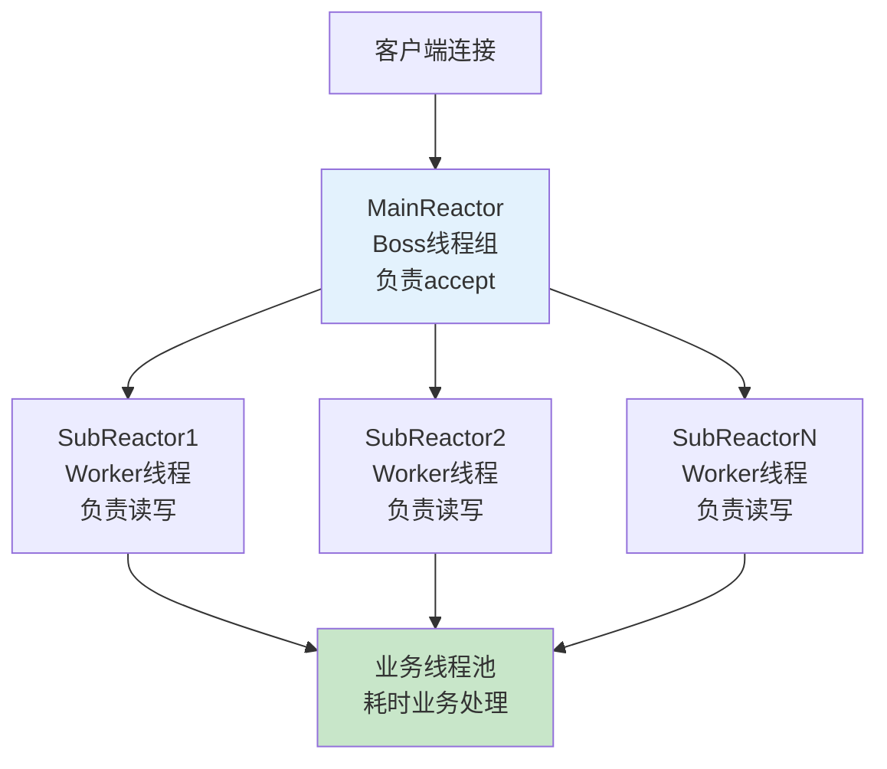
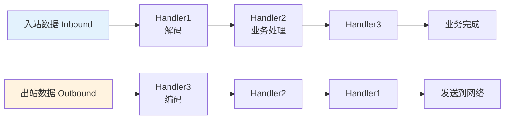
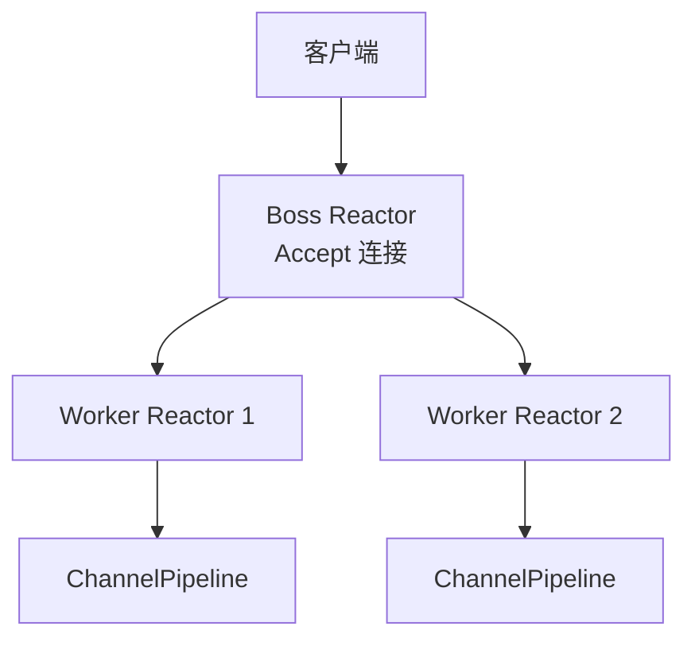

# Netty 原理

> 定位：Dubbo、RocketMQ、Gateway、Elasticsearch……几乎每一个你叫得出名字的高性能中间件，网络层都是 Netty。它凭什么这么流行？因为它把 NIO 的复杂度封装成了一套优雅的 Reactor 线程模型 + 责任链 Pipeline + 内存池 ByteBuf。这篇讲透 Netty 的核心设计，让你从"会用 Netty 写个 echo"进阶到"能读懂中间件网络层、能排查线上问题"。

## 一、为什么需要 Netty

直接用 JDK NIO 写网络程序，你要面对一堆痛点：

- API 繁琐，Buffer 的 flip/clear、Selector 的事件循环都要手写
- 要自己处理**粘包拆包**——TCP 是字节流，没有消息边界
- 有著名的 **Selector 空轮询 Bug**，CPU 飙到 100%
- 线程模型、编解码、心跳、重连都要自己实现
- 内存管理复杂，直接内存泄漏难排查

Netty 把这些全部封装好，并提供：

- 高性能的 **Reactor 线程模型**
- **ChannelPipeline 责任链**，编解码、业务逻辑可插拔组合
- **ByteBuf** 内存池化，高效且可控
- 丰富的**编解码器**，自带粘包拆包方案
- 修复 NIO Bug、零拷贝、心跳、SSL 等开箱即用

## 二、Reactor 线程模型

Netty 的线程模型基于 **Reactor 模式**（事件驱动）。先理解三种 Reactor 模型，再看 Netty 怎么用。

### 2.1 单 Reactor 单线程

一个线程既负责**监听连接/读写事件**（Reactor），又负责**处理业务逻辑**。简单，但业务耗时会阻塞整个事件循环，无法利用多核。

### 2.2 单 Reactor 多线程

一个 Reactor 线程负责监听和分发事件，**业务逻辑交给线程池**处理。业务处理不影响事件监听，但单个 Reactor 线程处理所有连接的 IO 事件，高并发下可能成为瓶颈。

### 2.3 主从 Reactor 多线程

**MainReactor** 负责接收连接（accept），把建立好的连接注册给 **SubReactor**；多个 **SubReactor** 各自负责一组连接的读写事件，业务逻辑交给线程池。这是高并发场景的最优模型，也是 Netty 默认采用的。



图里三层结构清晰：**Boss 线程组**只管接纳连接，**Worker 线程组**分工处理各连接的 IO 事件，**业务线程池**处理耗时逻辑。这种分工让每一层都专注，能扛住海量连接。

### 2.4 Netty 的线程模型落地

Netty 用 **BossGroup + WorkerGroup** 两组 EventLoopGroup 实现主从 Reactor：

```java
EventLoopGroup bossGroup = new NioEventLoopGroup(1);   // 1个Boss线程
EventLoopGroup workerGroup = new NioEventLoopGroup();  // 默认CPU核数*2

ServerBootstrap b = new ServerBootstrap();
b.group(bossGroup, workerGroup)
 .channel(NioServerSocketChannel.class)
 .childHandler(new ChannelInitializer<SocketChannel>() {
     protected void initChannel(SocketChannel ch) {
         ch.pipeline().addLast(new MyHandler());
     }
 });
```

关键组件：

- **EventLoop**：一个单线程事件循环，包含一个 Selector，负责处理注册到它上面的 Channel 的事件
- **EventLoopGroup**：一组 EventLoop（线程池）
- 一个 **Channel 一旦注册到某个 EventLoop，整个生命周期都绑定在这个线程上**——这保证了同一连接的处理是单线程的，无需加锁，避免并发问题

> **重要**：千万不要在 EventLoop 线程里做耗时操作（DB 查询、复杂计算），会阻塞整个事件循环，导致该 EventLoop 上所有连接都卡住。耗时逻辑要丢到业务线程池。

## 三、ChannelPipeline 与责任链

### 3.1 Pipeline 结构

每个 Channel 创建时都会分配一个 **ChannelPipeline**，它是一条**双向链表**，由一系列 **ChannelHandler** 组成。数据在 Pipeline 中流动，经过每个 Handler 处理。



图里两个方向：

- **入站（Inbound）**：数据从网络进来，从头到尾依次经过 `ChannelInboundHandler`（如解码器、业务 Handler）
- **出站（Outbound）**：数据要发出去，从尾到头经过 `ChannelOutboundHandler`（如编码器）

这就是**责任链模式**——每个 Handler 只做一件事，职责单一，可以像搭积木一样插拔组合。

### 3.2 Handler 的分类

| 类型 | 接口 | 触发方向 |
|---|---|---|
| 入站处理器 | `ChannelInboundHandler` / `ChannelInboundHandlerAdapter` | 数据进来时（channelRead、channelActive） |
| 出站处理器 | `ChannelOutboundHandler` / `ChannelOutboundHandlerAdapter` | 数据出去时（write、flush） |
| 编解码器 | `ByteToMessageDecoder`、`MessageToByteEncoder` | 入站解码 / 出站编码 |

**关键方法**：

- `channelActive()`：连接建立时调用
- `channelRead()`：收到数据时调用（最常用）
- `channelInactive()`：连接断开时调用
- `exceptionCaught()`：发生异常时调用，通常在这里关闭连接、记录日志

### 3.3 ChannelHandlerContext

每个 Handler 关联一个 `ChannelHandlerContext`，通过它可以：

- 把数据传给下一个 Handler：`ctx.fireChannelRead(msg)`
- 从当前位置写出站数据：`ctx.write(msg)`
- 获取 Channel、Pipeline 等

理解传播规则很重要：`ctx.write()` 从**当前 Handler 往前**找出站 Handler；`channel.write()` 从**Pipeline 尾部**开始找出站 Handler。如果只用了 ctx.write 忘了 flush，数据不会真正发出去。

## 四、ByteBuf 与内存池

### 4.1 ByteBuf 相比 JDK ByteBuffer 的优势

JDK 的 `ByteBuffer` 有几个痛点：长度固定、只有一个 position 指针（读写要 flip）、需要自己管理扩容。Netty 的 **ByteBuf** 解决了这些：

- **两个指针**：`readerIndex` 和 `writerIndex`，读写互不干扰，不用 flip
- **自动扩容**：写满时自动扩容
- **引用计数**：精确管理内存生命周期
- **零拷贝**：支持 slice、composite、retain 等
- **池化**：内存池复用，减少 GC

结构：

```
+-------------------+-------------------+-------------------+
|  discardable bytes|  readable bytes   |  writable bytes   |
|  (已读可丢弃)      |  (可读区域)        |  (可写区域)        |
+-------------------+-------------------+-------------------+
                    ^                   ^
              readerIndex           writerIndex
```

- 写数据推进 writerIndex，读数据推进 readerIndex，两者独立
- `readerIndex == writerIndex` 表示没有可读数据

### 4.2 引用计数与内存泄漏

Netty 用**引用计数**管理 ByteBuf 生命周期：

- `retain()`：引用 +1
- `release()`：引用 -1，减到 0 时归还内存池
- **谁最后持有，谁负责 release**

规则：入站消息传到业务 Handler，业务处理完必须 `ReferenceCountUtil.release(msg)`；如果继承 `SimpleChannelInboundHandler`，它会自动 release。

```java
public void channelRead(ChannelHandlerContext ctx, Object msg) {
    ByteBuf buf = (ByteBuf) msg;
    try {
        // 处理 buf
    } finally {
        ReferenceCountUtil.release(buf);  // 必须释放！
    }
}
```

**忘记 release = 内存泄漏**。Netty 提供泄漏检测：

```bash
-Dio.netty.leakDetection.level=paranoid
```

级别有 disabled/simple（默认）/advanced/paranoid。开启后泄漏会在日志里报 `LEAK:` 并打印分配栈。

### 4.3 内存池（PooledByteBufAllocator）

Netty 默认用**池化分配器**，从预先分配的大块内存中切出 ByteBuf，用完归还，避免每次 new 和 GC。

- **PooledByteBufAllocator**：池化，默认开启（Netty 4.1+ 默认）
- **UnpooledByteBufAllocator**：非池化，每次新分配

池化用 **jemalloc 风格**的分配算法（Arena + Chunk + Page + Subpage），按大小分级管理，减少内存碎片。

> 直接内存 vs 堆内存：`allocateDirect()` 分配堆外内存（减少 GC 压力，但分配成本高，适合网络 IO）；`allocate()` 分配堆内内存。Netty 网络传输默认优先用直接内存 + 池化。

## 五、粘包拆包与编解码

### 5.1 为什么会有粘包拆包

TCP 是**字节流协议**，没有消息边界。发送方 `write("ABC")` 和 `write("DEF")`，接收方可能：

- 一次收到 "ABCDEF"（**粘包**）
- 分两次收到 "AB" 和 "CDEF"（**拆包**）
- 收到 "ABCD" 和 "EF"（既有粘又有拆）

这是 TCP 特性（Nagle 算法、缓冲区大小、MTU）决定的，不是 Netty 的 Bug。应用层必须自己定义消息边界。

### 5.2 Netty 的四种常用解码器

Netty 内置了解决粘包拆包的解码器（都继承 `ByteToMessageDecoder`）：

| 解码器 | 原理 | 适用场景 |
|---|---|---|
| `FixedLengthFrameDecoder` | 固定长度 | 每条消息长度固定 |
| `LineBasedFrameDecoder` | 按换行符 `\n` 分割 | 文本行协议 |
| `DelimiterBasedFrameDecoder` | 按自定义分隔符分割 | 自定义分隔符 |
| `LengthFieldBasedFrameDecoder` | **消息头带长度字段** | 最通用，生产最常用 |

**LengthFieldBasedFrameDecoder** 是最强大的：消息格式是"长度字段 + 内容"，解码器读出长度字段，就知道该取多少字节作为一条完整消息。参数：

```java
new LengthFieldBasedFrameDecoder(
    maxFrameLength,        // 最大帧长度，超了抛异常防攻击
    lengthFieldOffset,     // 长度字段的偏移量
    lengthFieldLength,     // 长度字段占几个字节
    lengthAdjustment,      // 长度调整值
    initialBytesToStrip    // 解码后跳过几个字节（是否保留长度字段）
)
```

### 5.3 编解码器（Codec）

- **解码器**（入站）：`ByteToMessageDecoder`（字节→消息）、`MessageToMessageDecoder`（消息→消息）
- **编码器**（出站）：`MessageToByteEncoder`（消息→字节）、`MessageToMessageEncoder`
- **组合**：`ByteToMessageCodec`、`MessageToMessageCodec`

常见的开箱即用编解码：

- `StringDecoder` / `StringEncoder`：字符串
- `HttpServerCodec`：HTTP 协议
- `ObjectDecoder` / `ObjectEncoder`：Java 对象（不推荐，有安全问题和跨语言问题）
- Protobuf、JSON 编解码器：生产常用


图里展示了典型的 Pipeline：先拆包解决粘包，再字节转消息对象，然后业务处理，最后编码写回。每个环节都是独立 Handler，组合灵活。

## 六、Netty 在主流中间件中的应用

### 6.1 Dubbo

Dubbo 的 RPC 通信默认用 Netty 作为传输层。服务提供者启动一个 Netty Server 监听端口，消费者通过 Netty Client 发起调用。Dubbo 的编解码（Dubbo 协议头 + 序列化数据）基于 Netty 的编解码器实现，长连接 + 连接池复用提升性能。

### 6.2 RocketMQ

RocketMQ 的 NameServer 和 Broker 之间、Client 和 Broker 之间都用 Netty 通信。消息发送/拉取走 Netty 长连接，用自定义编解码器解析 RocketMQ 协议。

### 6.3 Spring Cloud Gateway

Gateway 基于 **Spring WebFlux（Reactor）+ Netty** 实现，是响应式、非阻塞的网关。每个请求在 Netty 的 EventLoop 上处理，配合 Reactor 的背压机制，用少量线程就能扛高并发，相比基于 Servlet 阻塞模型的 Zuul 1.x 性能大幅提升。

### 6.4 Elasticsearch / HBase / Cassandra

这些分布式系统内部节点通信也用 Netty，看中的是它的高性能和成熟稳定。

## 七、生产坑点与排查

### 坑点 1：在 EventLoop 线程里做耗时操作

**现象**：某个慢请求导致大量连接超时、心跳丢失、服务假死。

**原因**：业务逻辑（DB 查询、复杂计算、同步 RPC）写在 Handler 的 `channelRead()` 里，直接在 EventLoop 线程执行，阻塞了整个事件循环，该 EventLoop 上所有连接都处理不了。

**解法**：耗时逻辑封装成任务丢到业务线程池（`DefaultEventExecutorGroup` 或自定义线程池）；Handler 里只做轻量处理。

### 坑点 2：ByteBuf 忘记 release 导致内存泄漏

**现象**：服务运行一段时间后直接内存持续增长，最终 OOM（`Direct buffer memory`）。

**原因**：自定义 Handler 里 retain 了 ByteBuf 但没 release，或继承 `ChannelInboundHandlerAdapter` 但忘了手动释放 msg。

**解法**：继承 `SimpleChannelInboundHandler` 让它自动释放；手动管理时务必在 finally 里 release；开启泄漏检测 `-Dio.netty.leakDetection.level=paranoid` 定位。

### 坑点 3：粘包拆包处理不当

**现象**：偶发消息解析错乱、数据不完整、解码异常。

**原因**：没用帧解码器，直接按 `channelRead` 收到的数据当一条完整消息，而 TCP 字节流本身没有边界。

**解法**：Pipeline 头部加 `LengthFieldBasedFrameDecoder`（推荐）等帧解码器；设置合理的 maxFrameLength 防止超大包攻击。

### 坑点 4：出站数据只 write 没 flush

**现象**：调用了 `ctx.write(msg)` 但客户端收不到数据，或要等很久才收到。

**原因**：Netty 的 write 只是把数据放进缓冲区，必须 `flush()` 才会真正刷到网络。

**解法**：用 `writeAndFlush(msg)` 一步到位；或批量 write 后统一 flush 提升吞吐。

### 坑点 5：Channel 泄漏 / 连接数暴涨

**现象**：连接数持续增长不释放，端口耗尽。

**原因**：异常时没关闭 Channel；客户端重连逻辑失控；没有 idle 检测清理死连接。

**解法**：`exceptionCaught` 里关闭 Channel；加 `IdleStateHandler` 做心跳检测，超时关闭空闲连接；用 `ChannelGroup` 统一管理连接。

## 八、最佳实践与调优

1. **别阻塞 EventLoop**：耗时业务丢业务线程池，这是 Netty 使用的第一铁律。
2. **务必释放 ByteBuf**：用 SimpleChannelInboundHandler 或 finally 里 release，开泄漏检测。
3. **用帧解码器解决粘包**：生产首选 LengthFieldBasedFrameDecoder。
4. **writeAndFlush**：别只 write 不 flush。
5. **心跳检测**：用 IdleStateHandler 检测空闲连接，及时清理。
6. **合理设置线程数**：Boss 通常 1 个，Worker 默认 CPU×2，按压测调整。
7. **调优参数**：
   - `SO_BACKLOG`：连接队列大小
   - `SO_KEEPALIVE`：TCP 保活
   - `TCP_NODELAY`：禁用 Nagle 算法，降低小包延迟
   - `ALLOCATOR`：池化/非池化选择
8. **监控**：关注连接数、ByteBuf 内存、EventLoop 任务队列长度、GC 情况。

## 九、面试高频问法

> 这一节的答案按「面试时能讲透」的标准写：先给一句话结论，再展开机制、原因和坑点。

**Q1：Netty 的 Reactor 模型有哪几种？Netty 用的是哪种？**

**一句话结论**：单 Reactor 单线程、单 Reactor 多线程、主从 Reactor 多线程三种；Netty 用的是**主从 Reactor 多线程**。

展开：

- **单 Reactor 单线程**：一个线程既处理连接又处理读写，简单但无法利用多核，一个慢请求阻塞全部。
- **单 Reactor 多线程**：一个线程处理连接，业务交给线程池，但 IO 读写仍在一个线程。
- **主从 Reactor**：主 Reactor 处理连接，从 Reactor 组处理读写，充分利用多核——Netty 用这个。



加分点：说"Netty 的 BossGroup 通常只需 1 个线程（连接建立不频繁），WorkerGroup 默认 CPU×2，这是官方推荐的配置"。

**Q2：Netty 为什么性能高？**

**一句话结论**：核心是**异步非阻塞 + 零拷贝 + 内存池 + 事件驱动**的组合。

展开：

1. **IO 多路复用**：基于 epoll，一个线程管理大量连接，不阻塞。
2. **零拷贝**：ByteBuf 的 slice/composite、FileRegion 的 sendfile，减少数据拷贝。
3. **内存池**：PooledByteBufAllocator 复用内存，降低 GC。
4. **无锁串行化**：一个 Channel 绑定一个 EventLoop，Handler 串行执行，无需加锁。

加分点：说"Netty 的高性能不是单点优化，是整体设计——异步、池化、零拷贝、无锁，每一层都在省资源"。

**Q3：Netty 的 EventLoop 和线程是什么关系？**

**一句话结论**：一个 EventLoop 绑定**一个线程**，一个 EventLoop 管理**多个 Channel**，但一个 Channel 只属于一个 EventLoop。

展开：

- **1:N 关系**：EventLoop 是一个单线程的事件循环，内部有一个任务队列，不断轮询 IO 事件和执行任务。
- **Channel 绑定**：Channel 注册到 EventLoop 后终身绑定，所有 IO 事件都在这个 EventLoop 的线程上处理。
- **好处**：同一 Channel 的事件串行处理，天然线程安全，Handler 不用加锁。

**注意**：如果在 Handler 里做耗时操作，会阻塞这个 EventLoop 上的**所有 Channel**——耗时任务要丢到业务线程池。

加分点：说"Netty 的 EventLoop 线程不能被阻塞，一个 Handler 里 sleep 一下，这个 EventLoop 上几十个连接全卡住——这是新手最常见的性能事故"。

**Q4：Netty 的 ByteBuf 内存泄漏怎么排查？**

**一句话结论**：ByteBuf 基于引用计数，用完必须 `release()`；泄漏会导致堆外内存暴涨，用 Netty 的泄漏检测器定位。

展开：

- **根因**：ByteBuf 分配的是堆外内存，不受 GC 管理，靠引用计数（retain/release）回收。忘记 release 就泄漏。
- **检测**：启动参数 `-Dio.netty.leakDetection.level=paranoid`，Netty 会记录每次分配的调用栈，泄漏时打印。
- **常见场景**：自定义 Handler 里读了 ByteBuf 没 release；异常路径漏了 release；把 ByteBuf 传给异步线程后原线程又 release 了。

**正确姿势**：用 `SimpleChannelInboundHandler`（自动 release），或手动在 finally 里 release。

加分点：说"`SimpleChannelInboundHandler` 会自动释放消息，`ChannelInboundHandlerAdapter` 不会——用错基类是最常见的泄漏原因"。

**Q5：Netty 的 ChannelHandler 是线程安全的吗？@Sharable 是什么？**

**一句话结论**：默认**不是**线程安全的（一个 Handler 实例只属于一个 Channel）；加 `@Sharable` 后才能被多个 Channel 共享，但必须保证无状态。

展开：

- **默认**：每个 Channel 创建自己的 Pipeline，Handler 实例不共享，所以不需要线程安全。
- **@Sharable**：标记后可以复用一个 Handler 实例给多个 Channel（节省对象创建）。但因为它会被多个 EventLoop 线程并发调用，**必须无状态**（不能有成员变量）。
- **坑**：给有状态的 Handler 加了 @Sharable，会出现并发数据错乱。

加分点：说"编解码器（如 LengthFieldBasedFrameDecoder）通常标 @Sharable，因为它们是纯函数式的；业务 Handler 一般有状态，不能共享"。

**Q6：TCP 的粘包拆包是怎么产生的？**

**一句话结论**：TCP 是**面向字节流**的协议，没有消息边界，发送方的多次 write 可能被合并（粘包），一次 write 也可能被拆成多个包（拆包）。

展开：

- **粘包**：应用层发了 "Hello" 和 "World" 两次，TCP 可能合并成一个包发出去，接收方一次读到 "HelloWorld"。
- **拆包**：应用层发了一个大包，TCP 受 MSS 限制拆成多个小包，接收方分多次读到。
- **根因**：TCP 只保证字节有序到达，不保证"消息"边界。UDP 有边界（面向报文），所以没这个问题。

加分点：说"粘包拆包不是 bug，是 TCP 的正常行为；解决靠应用层协议自己定边界——长度字段、分隔符、固定长度"。

**Q7：Netty 的 write 和 writeAndFlush 有什么区别？**

**一句话结论**：write 只是把数据放入缓冲区（待发送队列），writeAndFlush 会立即刷到网络。

展开：

- **write**：数据写到 ChannelOutboundBuffer，但可能还在等待，不保证立即发出。
- **flush**：把缓冲区里的数据真正写到 socket。
- **writeAndFlush**：两者合一，写完立即刷。

**性能考虑**：批量写场景可以先多次 write，最后 flush 一次，减少系统调用。

加分点：说"忘了 flush 是新手常见 bug——数据写进去了但没发出去，对端一直等，看起来像'消息丢了'"。

**Q8：Netty 怎么做心跳检测？**

**一句话结论**：用 `IdleStateHandler` 检测读/写空闲，超时触发 `IdleStateEvent`，在 Handler 里处理（发心跳或断开）。

展开：

```java
pipeline.addLast(new IdleStateHandler(60, 0, 0, TimeUnit.SECONDS));
// 60 秒没读到数据 → 触发 READER_IDLE 事件
```

- **三个参数**：读空闲、写空闲、读写空闲时间。
- **处理**：在 `userEventTriggered` 里捕获 IdleStateEvent，读空闲就发心跳包，多次无响应就关闭连接。

加分点：说"心跳是为了检测'假连接'——TCP 连接还在，但对端进程已经死了；靠应用层心跳比 TCP keepalive 更及时（keepalive 默认 2 小时）"。

**Q9：Netty 的编解码器怎么用？**

**一句话结论**：入站用 Decoder（字节→对象），出站用 Encoder（对象→字节）；最常用的是 `LengthFieldBasedFrameDecoder` + 自定义 `MessageToMessageCodec`。

展开：

- **解码链**：`ByteToMessageDecoder`（字节→消息）→ `MessageToMessageDecoder`（消息→对象）。
- **编码链**：`MessageToMessageEncoder`（对象→消息）→ `MessageToByteEncoder`（消息→字节）。
- **组合**：通常一个 `MessageToMessageCodec` 同时处理编解码。

**关键**：`ByteToMessageDecoder` 要判断"数据够不够一个完整消息"，不够就等下次（这就是解决粘包的地方）。

加分点：说"解码器里不要 release 原始 ByteBuf 后还继续用——`ByteToMessageDecoder` 会在 decode 后自动释放，自己 retain 才需要手动管理"。

**Q10：为什么很多中间件（Dubbo/RocketMQ/Gateway）都用 Netty？**

**一句话结论**：因为 Netty 提供了**高性能、可定制协议、成熟的网络编程抽象**，让中间件作者不用重复造轮子。

展开：

- **性能**：异步非阻塞 + 零拷贝 + 内存池，扛高并发。
- **协议定制**：Dubbo 的 dubbo 协议、RocketMQ 的 remoting 协议都基于 Netty 自定义编解码。
- **成熟稳定**：经过大量生产验证，异常处理、连接管理、心跳都封装好了。
- **抽象好**：Pipeline、Handler、EventLoop 这套模型清晰，扩展方便。

加分点：说"Netty 是'网络编程的 Spring'——它把 NIO 的复杂性封装了，让业务代码只关注协议和逻辑；但代价是学习曲线陡，Pipeline 和引用计数是两大门槛"。

## 小结

- **Reactor 线程模型**：Netty 用主从多线程（Boss 接连接 + Worker 处理读写 + 业务线程池），EventLoop 单线程绑定 Channel 无锁。
- **Pipeline 责任链**：Inbound 从头到尾、Outbound 从尾到头，Handler 可插拔；**别在 EventLoop 里做耗时操作**。
- **ByteBuf**：双指针、自动扩容、引用计数、池化；**忘 release 会内存泄漏**，开泄漏检测。
- **粘包拆包**：TCP 字节流无边界，用 LengthFieldBasedFrameDecoder 等帧解码器解决。
- Netty 是 Dubbo/RocketMQ/Gateway/ES 的网络基石，核心优势是高性能 + 成熟稳定 + 编解码灵活。
