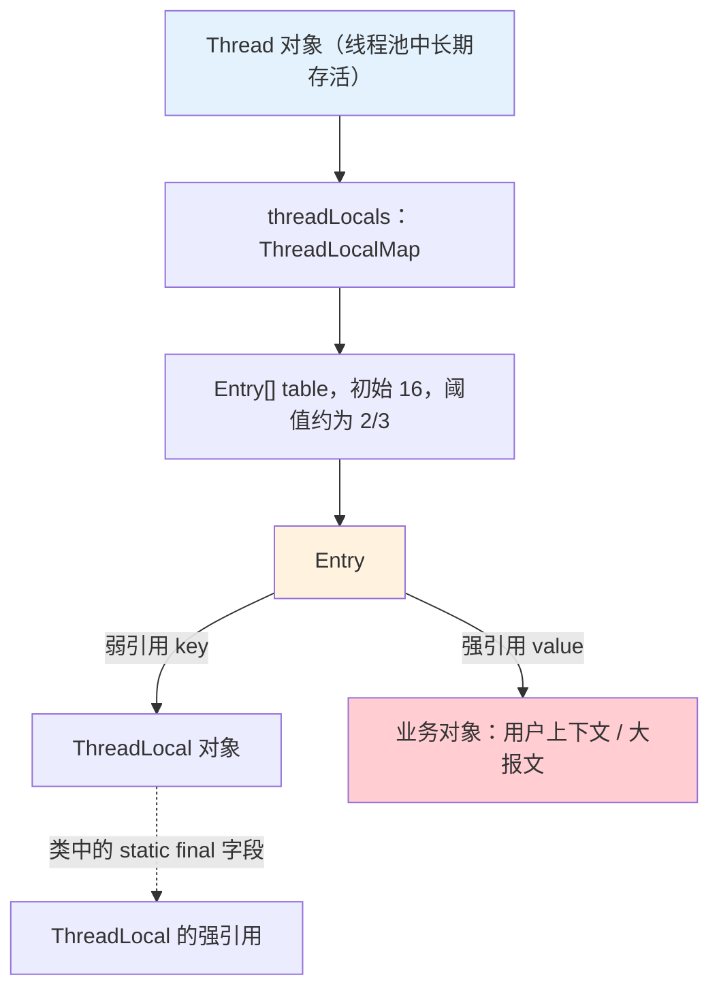
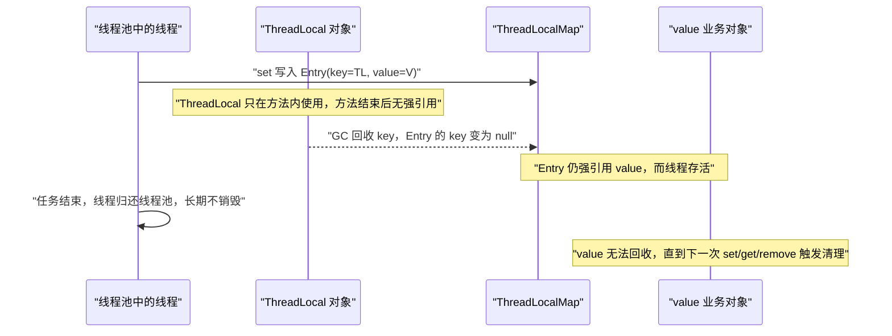
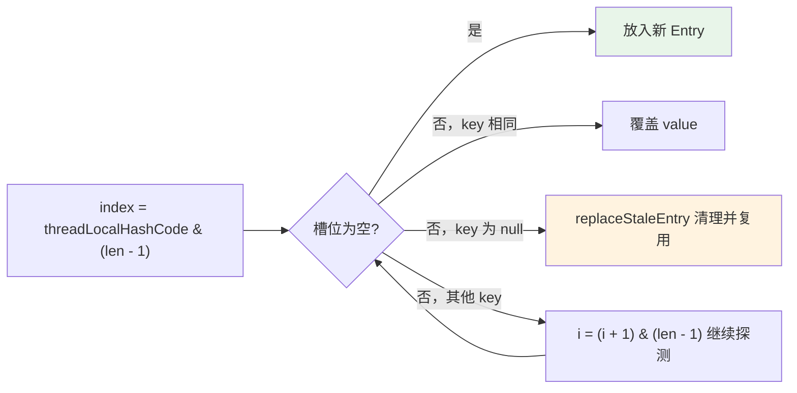
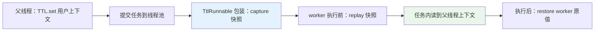

# ThreadLocal 原理与内存泄漏

> 定位：ThreadLocal 是「线程私有上下文」的标准实现，用户信息透传、MDC traceId、Spring 事务连接全靠它。但它也是线上最隐蔽的泄漏源之一：线程池复用线程、忘记 `remove`、存了大对象，轻则请求串号，重则 OOM。这篇拆开 ThreadLocalMap 的弱引用设计、泄漏链路、线性探测与 TTL 方案，让你能解释「为什么 key 是弱引用却仍然会泄漏」。

## 一、为什么需要它

多线程共享变量需要同步，但有些数据**天然属于单个线程**：当前登录用户、traceId、事务连接、请求语言。把这些数据在方法间一路传参，签名会被污染得不成样子；放进共享 Map 又要加锁、还要自己处理清理。

ThreadLocal 提供了第三种选择：**每个线程持有自己的一份副本**，读写无锁、互不干扰。代价是这份副本的生命周期跟着线程走——而线程池里的线程几乎永生，于是「谁负责清理」就成了必须回答的问题。

线上四类典型事故：

1. 线程池里没 `remove`，下一次请求读到了上一次请求的用户信息，出现越权。
2. ThreadLocal 里存了几 MB 的报文，线程池 200 个线程各存一份，堆被打满。
3. 子线程拿不到父线程的 traceId，因为 `InheritableThreadLocal` 只在创建线程时复制。
4. Web 应用热部署后旧类无法卸载，MAT 显示 `ThreadLocalMap` 引用着 WebappClassLoader。

## 二、核心原理

### 2.1 典型使用场景

| 场景 | 存什么 | 谁负责清理 |
|---|---|---|
| 用户上下文透传 | 当前用户 ID、租户 ID | 入口 Filter / 拦截器 |
| 日志 MDC | traceId、spanId | Filter 的 finally |
| 事务连接绑定 | `ConnectionHolder` | Spring 事务管理器 |
| 链路追踪 | TraceContext | 框架拦截器 |
| 非线程安全工具复用 | `SimpleDateFormat` | 线程自身长期持有 |

前四类的共同点是「一次请求/一次调用内有效」，所以必须在边界处清理；最后一类是「线程私有工具」，可以长期持有，但要注意它引用的对象本身不能太大。

### 2.2 ThreadLocalMap 的内存结构

很多人以为 ThreadLocal 是「一个 Map，key 是线程」，实际正好相反：**Map 存在 Thread 里，key 是 ThreadLocal 对象**。

```java
public class Thread implements Runnable {
    ThreadLocal.ThreadLocalMap threadLocals;
    ThreadLocal.ThreadLocalMap inheritableThreadLocals;
}

static class ThreadLocalMap {
    static class Entry extends WeakReference<ThreadLocal<?>> {
        Object value;   // 强引用
        Entry(ThreadLocal<?> k, Object v) { super(k); value = v; }
    }
    private Entry[] table;
}
```



读图要点：只要线程活着，`Thread -> ThreadLocalMap -> Entry -> value` 这条强引用链就成立；`Entry` 对 ThreadLocal 只有弱引用，所以「key 可能被回收」和「value 一定被线程钉住」同时存在。

这种设计有两个好处：线程销毁时 Map 随之回收；每个线程只存自己的数据，不需要全局锁。代价是**Map 的容量和清理责任转移给了线程**。

### 2.3 弱引用 key + 强引用 value 的泄漏机制

Entry 继承 `WeakReference<ThreadLocal<?>>`，`super(k)` 把 key 设为弱引用；但 `value` 是普通字段，是**强引用**。于是出现一种不对称：

- 当 ThreadLocal 对象**没有其他强引用**时（例如方法内的局部变量，方法结束就没人引用它），GC 会回收它，Entry 的 `get()` 变成 null。
- 但 Entry 本身还被 `ThreadLocalMap.table` 强引用，Entry 又强引用 value。
- 结果：**key 没了，value 还在**，这个 Entry 变成「stale entry」（过期条目），只能等下一次操作时顺带清理。



读图要点：泄漏的前提不是「key 弱引用」本身，而是「线程存活 + 无人清理」。如果线程很快结束，整个 Map 一起被回收，不会泄漏；线程池让「线程长期存活」成为常态，泄漏才被放大。

ThreadLocal 的清理动作发生在 `set` / `get` / `remove` 内部：`expungeStaleEntry` 会把 key 为 null 的 Entry 的 value 置空，并对后续冲突链做 rehash。关键限制是——**这些操作只由该线程自己触发**。线程如果长期不再操作这个 ThreadLocal，过期条目就一直留着。

### 2.4 为什么必须 remove

`remove()` 会显式删除当前线程中该 ThreadLocal 对应的 Entry，并清理冲突链。它是唯一不依赖「下一次操作」的主动清理手段。

三个必须 remove 的理由：

1. **线程池复用**：Tomcat、Dubbo、业务线程池的线程生命周期近似无限，value 会一直存活。
2. **数据串号**：不清理时，下一个任务可能读到上一个任务的用户、租户、traceId，比内存泄漏更危险。
3. **类加载器泄漏**：Web 容器热部署时，ThreadLocal value 若引用应用类（或 ThreadLocal 本身由应用类加载器加载），线程持有引用会让旧 ClassLoader 无法卸载，Metaspace 持续上涨。

标准写法是 `try/finally`：

```java
private static final ThreadLocal<UserContext> USER_CTX = new ThreadLocal<>();

public void handle(Request req) {
    USER_CTX.set(buildContext(req));
    try {
        doBusiness();
    } finally {
        USER_CTX.remove();   // 必须放在 finally，异常也要清理
    }
}
```

注意一个常见误解：**把 ThreadLocal 声明为 `static final` 并不能避免 value 泄漏**。static 只保证 key 不被回收，value 依然被 Entry 强引用；不 remove 一样会累积，只是不会产生 stale key 而已。

### 2.5 hash 冲突：线性探测与扩容

ThreadLocalMap 没有链表，也没有红黑树，它用的是**开放寻址法**：冲突了就往后找下一个空槽。

```java
private void set(ThreadLocal<?> key, Object value) {
    Entry[] tab = table;
    int len = tab.length;
    int i = key.threadLocalHashCode & (len - 1);
    for (Entry e = tab[i]; e != null; e = tab[i = nextIndex(i, len)]) {
        ThreadLocal<?> k = e.get();
        if (k == key) { e.value = value; return; }
        if (k == null) { replaceStaleEntry(key, value, i); return; }
    }
    tab[i] = new Entry(key, value);
    int sz = ++size;
    if (!cleanSomeSlots(i, sz) && sz >= threshold) rehash();
}
```



读图要点：开放寻址要求表长度是 2 的幂，这样 `(i + 1) & (len - 1)` 就能环形前进；删除不能简单置空，否则会截断后续冲突链，所以 `remove` 之后要调用 `expungeStaleEntry` 重新安置冲突链。

两个关键参数：

- **初始容量 16，阈值约为 `len * 2 / 3`**（负载因子 0.67），比 HashMap 的 0.75 更保守，因为开放寻址的冲突代价更高。
- **`HASH_INCREMENT = 0x61c88647`**，每个 ThreadLocal 创建时累加这个值作为 hash。它与黄金分割比相关，能让连续的 ThreadLocal 实例均匀散布在 2 的幂长度的表里，减少聚集。

扩容时容量翻倍，并顺带把 stale entry 清掉；`cleanSomeSlots` 采用启发式扫描，避免每次 set 都全表清理。

### 2.6 InheritableThreadLocal 的缺陷与 TTL

`InheritableThreadLocal` 解决「子线程继承父线程值」：`Thread` 构造时会把父线程的 `inheritableThreadLocals` 复制一份给子线程。

但它的语义是「**创建线程时复制一次**」，这在线程池下直接失效：

- 线程池的 worker 线程只在池初始化时创建一次，之后一直复用。
- 后续任务提交时不会再发生「创建线程」，也就不会再复制。
- 结果：子任务读到的是**第一次创建 worker 时**的上下文，或者干脆是 null。

`TransmittableThreadLocal`（TTL，阿里开源）的思路是「**任务提交时捕获快照，任务执行前回放，执行后恢复**」：

```java
private static final TransmittableThreadLocal<UserContext> CTX = new TransmittableThreadLocal<>();

// 包装线程池，提交任务时自动 capture / replay / restore
ExecutorService pool = TtlExecutors.getTtlExecutorService(rawPool);
CTX.set(context);
pool.submit(() -> {
    UserContext c = CTX.get();   // 能拿到提交线程的上下文
    // ...
});

// 也可以只包装单个任务
Runnable wrapped = TtlRunnable.get(task);
```



读图要点：TTL 把「继承时机」从「线程创建时」改成了「任务提交时」，并在执行后恢复 worker 原本的值，避免污染线程池。前提是任务必须被 TTL 包装——直接 `rawPool.submit` 不会生效。

### 2.7 ForkJoinPool 与虚拟线程下的注意点

- **ForkJoinPool**：worker 线程同样长期复用。`ThreadLocal` 在递归任务间共享，容易串数据；`InheritableThreadLocal` 对后来创建的 worker 不生效。并行流（`parallelStream`）默认用公共 ForkJoinPool，在任务里读写 ThreadLocal 要格外小心。
- **虚拟线程（JDK 21）**：每个虚拟线程都有独立的 `ThreadLocalMap`，数量可能达到百万级。ThreadLocal 里存大对象会让内存迅速膨胀；`InheritableThreadLocal` 的复制成本也会放大。虚拟线程不该池化，「线程复用导致的泄漏」在虚拟线程下会转化为「线程数量爆炸导致的内存压力」。
- **ScopedValue**：JDK 21 以预览形式引入（JEP 446），用「作用域绑定」替代 ThreadLocal 的「手动 set/remove」，生命周期由代码块限定，天然不需要清理；后续版本逐步转正，以实际 JDK 版本为准。它更适合「只读、随调用链传递」的上下文。

## 三、关键源码与用法

### 3.1 set / get / remove 的主干

```java
public void set(T value) {
    Thread t = Thread.currentThread();
    ThreadLocalMap map = getMap(t);          // 取 t.threadLocals
    if (map != null) map.set(this, value);
    else createMap(t, value);                // 首次创建，初始容量 16
}

public T get() {
    Thread t = Thread.currentThread();
    ThreadLocalMap map = getMap(t);
    if (map != null) {
        ThreadLocalMap.Entry e = map.getEntry(this);
        if (e != null) return (T) e.value;
    }
    return setInitialValue();                // 未设置时用 initialValue()
}

public void remove() {
    ThreadLocalMap m = getMap(Thread.currentThread());
    if (m != null) m.remove(this);
}
```

注意 `get()` 只在探测路径上遇到 stale entry 时顺带清理（`getEntryAfterMiss` 调用 `expungeStaleEntry`），没有被访问到的过期条目仍会留着；真正可靠的清理仍然是 `remove()`。

### 3.2 expungeStaleEntry 做了什么

```java
private int expungeStaleEntry(int staleSlot) {
    Entry[] tab = table;
    int len = tab.length;
    tab[staleSlot].value = null;   // 断开 value 强引用
    tab[staleSlot] = null;         // 清空槽位
    size--;
    // 继续向后扫描，把冲突链上的元素重新安置，遇到空槽停止
    for (int i = nextIndex(staleSlot, len); (e = tab[i]) != null; i = nextIndex(i, len)) {
        ThreadLocal<?> k = e.get();
        if (k == null) { e.value = null; tab[i] = null; size--; }
        else { /* 重新计算下标，必要时搬移 */ }
    }
    return i;
}
```

这段代码解释了为什么「泄漏的 value 有可能被后续操作救回来」：只要同一线程之后再操作这个 Map，过期条目就会被清掉。但线上不能赌这个「之后」。

### 3.3 与 Spring 事务、MDC、链路追踪的关系

- **Spring 事务**：`TransactionSynchronizationManager` 用 ThreadLocal 把 `ConnectionHolder`、事务同步器绑定到当前线程。跨线程（`@Async`、手动 new Thread、线程池）执行数据库操作时拿不到同一个连接，事务自然失效，详见 [Spring 事务原理与失效场景](../04-Spring体系源码/04-Spring事务原理与失效场景.md)。
- **MDC**：Logback 的 `LogbackMDCAdapter` 用 ThreadLocal 存日志上下文。异步任务不传递 MDC，日志就会丢 traceId，详见 [链路追踪](../13-可观测性/02-链路追踪.md)。
- **链路追踪**：TraceContext 的传递本质也是「跨线程上下文传播」，TTL 或框架自带的 TaskDecorator 都是同一类解法。

## 四、生产坑点与排查

### 坑点 1：线程池里忘记 remove，请求之间串号

**现象**：用户 A 偶尔看到用户 B 的数据；日志里 traceId 与请求对不上。
**原因**：线程归还池中时 ThreadLocal 未清理，下一个任务直接读到旧值；如果下一个任务也没 set，就会一直沿用。
**解法**：`set` 之后必须 `try/finally { remove(); }`；入口 Filter 统一清理；排查时在任务开始/结束打印 ThreadLocal 中的用户 ID。

### 坑点 2：ThreadLocal 存大对象，线程池放大成 OOM

**现象**：堆内存持续上涨，MAT 里大量业务对象被 `ThreadLocalMap$Entry` 引用。
**原因**：每个 worker 线程各存一份大报文/大列表，200 个线程就是 200 份；线程长期存活，GC 回收不了。
**解法**：ThreadLocal 只存轻量标识（ID、枚举），大对象放到方法局部变量或请求作用域；必须存时设置上限并及时 remove。

### 坑点 3：以为 `static final` 就不会泄漏

**现象**：ThreadLocal 已经是 `private static final`，堆还是涨。
**原因**：static 只保证 key 不被 GC，Entry 对 value 的强引用依然存在；不 remove 就会一直累积。
**解法**：static final 只是「避免 stale key」的最佳实践，不能替代 remove；仍然要在 finally 中清理。

### 坑点 4：InheritableThreadLocal 在线程池里失效

**现象**：父线程 set 了上下文，线程池里的子任务 `get()` 为 null 或拿到旧值。
**原因**：继承只发生在 `new Thread` 时，线程池 worker 创建一次后不再复制。
**解法**：用 TTL 包装线程池或任务；或显式把上下文作为任务参数传入；不要依赖 InheritableThreadLocal 做异步透传。

### 坑点 5：用了 TTL 但任务没被包装

**现象**：引入了 TTL，`TTL.get()` 在线程池里仍然拿不到值。
**原因**：直接向原始线程池 `submit`，没有经过 `TtlRunnable` / `TtlExecutors` 包装，capture/replay 根本没发生。
**解法**：统一用 `TtlExecutors.getTtlExecutorService` 包装线程池；或每个任务 `TtlRunnable.get(...)`；检查 `@Async` 的 `TaskDecorator` 是否配置。

### 坑点 6：MDC 未清理，日志 traceId 串号

**现象**：日志里同一 traceId 出现在完全无关的请求上。
**原因**：MDC 底层是 ThreadLocal，Filter 只 put 没 clear，线程复用后旧 traceId 被带出。
**解法**：Filter 的 `finally` 中 `MDC.clear()`；异步任务显式传递 MDC（或 TTL）；日志 pattern 里确认 `%X{traceId}` 的键名一致。

## 五、最佳实践与选型

### 5.1 使用规范

1. **声明为 `private static final`**：避免每个实例一个 key，也避免 key 被提前回收。
2. **set 必须配 try/finally remove**：异常路径也要清理。
3. **只存轻量上下文**：ID、枚举、小对象；大对象用参数或请求作用域。
4. **线程池入口统一清理**：Filter、TaskDecorator、线程池包装三层任选其一，不要依赖业务代码自觉。
5. **异步透传用 TTL 或显式传参**：不要依赖 InheritableThreadLocal。
6. **虚拟线程下控制数量级**：不要在百万级虚拟线程上各存一份大上下文，优先考虑 ScopedValue。

### 5.2 四种方案对比

| 方案 | 传递时机 | 线程池是否有效 | 生命周期 | 适用场景 |
|---|---|---|---|---|
| `ThreadLocal` | 不传递 | 不涉及 | 手动 remove | 单线程内上下文 |
| `InheritableThreadLocal` | 创建子线程时复制 | 失效 | 随线程 | 手动 new Thread 的父子传递 |
| `TransmittableThreadLocal` | 任务提交时 capture，执行时 replay | 有效 | 包装范围内 | 线程池、异步任务透传 |
| `ScopedValue`（JDK 21 预览） | 作用域内绑定 | 需配合结构化并发 | 代码块结束自动失效 | 只读上下文、虚拟线程 |

### 5.3 明确不推荐的场景

- **用 ThreadLocal 做缓存**：没有容量控制和过期，线程池下就是内存泄漏。
- **用 ThreadLocal 在父子线程间传可变状态**：应通过任务参数或消息传递，避免隐式耦合。
- **用 InheritableThreadLocal 配线程池**：语义不成立，必踩坑。
- **把大对象放进 ThreadLocal**：线程数放大后就是 OOM。
- **忘记 remove 还依赖「下次操作会清理」**：清理时机不可控，线上不能赌。
- **在虚拟线程里滥用 ThreadLocal**：数量级完全不同，内存压力会被放大。

### 5.4 排查手段

1. 堆转储（`jmap -dump`）后用 MAT 看 `ThreadLocalMap` 的引用链，定位是哪个线程、哪个 value。
2. `jstack` 看线程池线程名，确认是否长期存活。
3. Arthas 的 `vmtool` / `ognl` 可以按线程查看 ThreadLocal（需谨慎，生产操作有风险）。
4. 代码扫描：搜索 `ThreadLocal` 的 `set` 是否有配对的 `remove`。

## 六、面试高频问法

**Q1：ThreadLocal 的原理是什么？为什么数据存在 Thread 里而不是一个全局 Map？**

**一句话结论**：每个 `Thread` 持有自己的 `ThreadLocalMap`，key 是 ThreadLocal 对象、value 是数据；这样读写只操作当前线程的 Map，无锁且天然隔离，也避免全局 Map 的并发和容量问题。

展开：`set` 先取 `Thread.currentThread().threadLocals`，为空则创建；`get` 从当前线程的 Map 取 Entry；线程销毁时 Map 随之回收。若设计成 `Map<Thread, Object>`，所有线程竞争同一张表，还要处理线程结束后的清理。

加分点：指出「ThreadLocal 本身不存数据，它只是 Map 的 key/操作入口」，这是理解弱引用和泄漏的前提。

**Q2：Entry 的 key 为什么是弱引用？value 为什么是强引用？这样会泄漏吗？**

**一句话结论**：key 用弱引用是为了让 ThreadLocal 对象没人引用时能被回收，避免 key 本身泄漏；value 是强引用是正常业务语义。但当线程长期存活时，key 被回收后 Entry 仍强引用 value，就会产生 stale entry 泄漏。

展开：引用链是 `Thread -> ThreadLocalMap -> Entry -> value`；key 被 GC 后 Entry 的 `get()` 为 null，但 value 还在；只有 `set` / `get` / `remove` 触发的 `expungeStaleEntry` 才会清 value，且必须由该线程自己触发。

加分点：说清「弱引用不是泄漏的原因，而是泄漏后的补救；真正的问题是线程存活 + 没有 remove」。

**Q3：为什么必须调用 remove？线程池下的泄漏链路是怎样的？**

**一句话结论**：`remove` 是唯一主动、即时的清理手段；线程池线程长期存活，`Thread -> ThreadLocalMap -> Entry -> value` 这条强引用链不断，value 和它引用的对象（甚至类加载器）都无法回收，同时还会造成上下文串号。

展开：Tomcat/Dubbo/业务线程池的 worker 生命周期近似无限；不 remove 时 value 常驻；Web 应用热部署时还会阻止旧 ClassLoader 卸载，表现为 Metaspace 上涨。标准写法是 `try/finally`。

加分点：补充「`static final` 只能避免 key 变 stale，不能替代 remove；数据串号比内存泄漏更危险」。

**Q4：ThreadLocalMap 的 hash 冲突怎么解决？为什么要用 0x61c88647？**

**一句话结论**：用开放寻址法线性探测，冲突就找下一个槽；表长是 2 的幂，`(i + 1) & (len - 1)` 环形前进；`0x61c88647` 是黄金分割相关的增量，能让连续创建的 ThreadLocal 均匀分布，减少聚集。

展开：初始容量 16，阈值约 2/3；`set` 遇到空槽插入、遇到相同 key 覆盖、遇到 stale key 调 `replaceStaleEntry`；容量不足时 `rehash` 翻倍并清理过期条目；删除后需要重新安置冲突链，不能简单置空。

加分点：对比 HashMap 的「数组 + 链表/红黑树」——ThreadLocalMap 不用链表，是因为单个线程的 ThreadLocal 数量通常很少，开放寻址更省内存、局部性更好。

**Q5：InheritableThreadLocal 有什么缺陷？TTL 是怎么解决的？**

**一句话结论**：`InheritableThreadLocal` 只在**创建子线程时**复制一次，线程池的 worker 只创建一次，后续任务拿不到最新上下文；TTL 把时机改成「任务提交时捕获快照、执行前回放、执行后恢复」，因此能适配线程池。

展开：TTL 通过 `TransmittableThreadLocal` + `TtlRunnable` / `TtlExecutors` 包装实现；必须包装任务或线程池，否则 capture/replay 不会发生；执行后恢复 worker 原值，避免污染下一个任务。

加分点：指出「TTL 解决的是传递时机问题，不是内存泄漏问题；TTL 的 value 同样需要清理」。

**Q6：虚拟线程、ForkJoinPool 下使用 ThreadLocal 要注意什么？和 Spring 事务、链路追踪怎么关联？**

**一句话结论**：虚拟线程每个都有独立 ThreadLocalMap，数量可达百万级，存大对象会迅速放大内存，且虚拟线程不应池化；ForkJoinPool 的 worker 长期复用，同样有串号和泄漏风险。Spring 事务和 MDC 都基于 ThreadLocal，跨线程时必须显式传递。

展开：Spring 用 `TransactionSynchronizationManager` 把连接绑在线程上，`@Async` 或新线程拿不到同一事务；MDC 用 ThreadLocal 存 traceId，异步任务默认丢失；解法是 TTL、TaskDecorator 或显式传参。JDK 21 的 `ScopedValue` 为只读上下文提供了自动失效的替代方案（预览特性，以版本为准）。

加分点：把三个知识点串起来——「ThreadLocal 的边界就是事务和日志上下文的边界」，这是很多「事务失效」「日志丢 traceId」问题的共同根因。

## 小结

- **ThreadLocalMap 存在 Thread 里，key 是 ThreadLocal**；读写只操作当前线程，无锁隔离。
- **key 弱引用、value 强引用**：key 被回收后 value 仍被 Entry 钉住，线程长期存活时形成 stale entry 泄漏。
- **remove 是唯一主动清理手段**，线程池场景必须 `try/finally`；`static final` 不能替代 remove。
- **开放寻址 + 2 的幂表长 + 0x61c88647**，初始 16、阈值约 2/3，扩容时顺带清理过期条目。
- **InheritableThreadLocal 只在线程创建时复制**，线程池下失效；TTL 用「提交捕获 + 执行回放」解决。
- **Spring 事务、MDC、链路追踪都依赖 ThreadLocal**，跨线程透传必须显式处理，虚拟线程下还要控制上下文规模。

## 参考资料

- OpenJDK 源码（JDK 21）：`java.lang.ThreadLocal`、`java.lang.ThreadLocal.ThreadLocalMap`、`java.lang.Thread`
- OpenJDK 源码（JDK 21）：`java.lang.InheritableThreadLocal`
- JEP 444: Virtual Threads；JEP 446: Scoped Values（预览）
- Alibaba TransmittableThreadLocal 项目文档（GitHub：alibaba/transmittable-thread-local）
- Spring Framework 源码：`org.springframework.transaction.support.TransactionSynchronizationManager`
- Logback 源码：`ch.qos.logback.classic.util.LogbackMDCAdapter`
