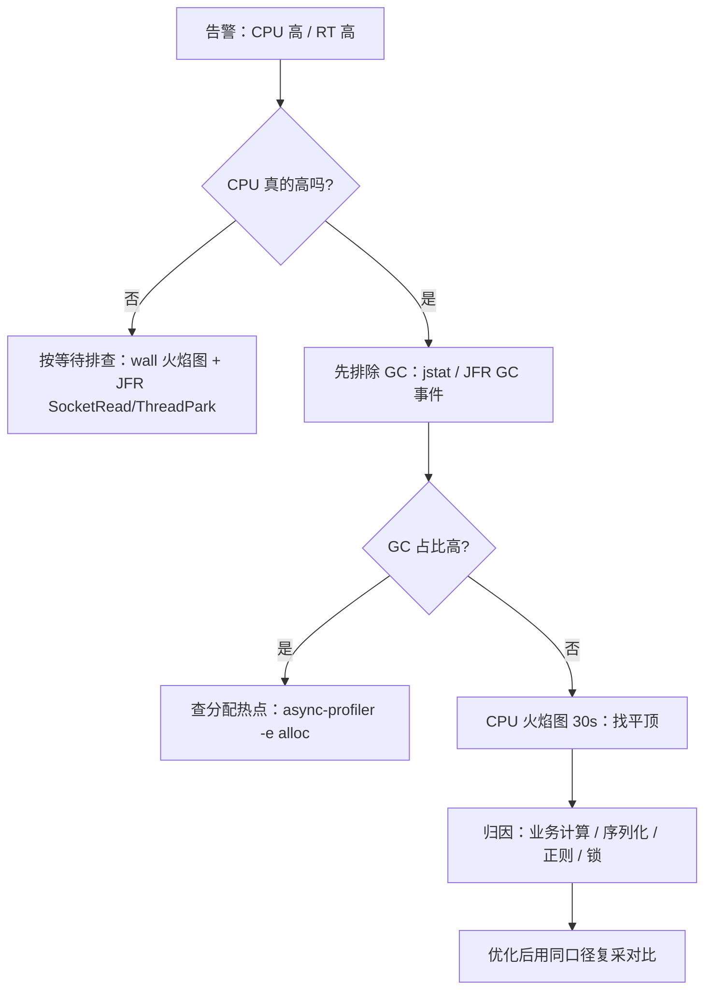
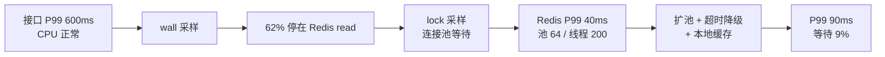

# JVM 性能剖析：JFR、async-profiler 与火焰图

> 定位：线上 CPU 飙高，多数人的第一反应是 `jstack` 连打三次找「共同的栈顶」——这套方法在 2010 年够用，在今天经常给出错误答案（安全点偏差、JIT 内联后栈帧消失）。这篇讲清两类真正低开销的剖析工具：JDK 自带的 **JFR** 与采样式 **async-profiler**，以及怎么读火焰图把「哪行代码在烧 CPU」定位到方法级。

> **版本提示（2026-11）**：JFR 自 JDK 11 起商用免费、JDK 14 起持续改进，JDK 21/25 均已内置；async-profiler 3.x 为当前主线，支持分代 ZGC 与容器环境。

## 一、为什么需要它

排查 CPU 问题有三层证据，缺一层就只能猜：

1. **宏观**：监控看到 CPU 使用率、Load、GC 时间、线程数的趋势——知道「是不是真的 CPU 高」。
2. **中观**：线程/GC/锁的分布——知道「是哪类线程在烧」。
3. **微观**：方法级采样——知道「是哪行代码、占多少比例」。

`top -H` + `jstack` 只能给中观证据，而且有两个硬伤：

- **安全点偏差（safepoint bias）**：`jstack` 只能在安全点采样，JIT 编译线程、短命方法、正在执行 native 的线程会被系统性低估或漏掉。
- **内联后栈帧消失**：JIT 把小方法内联进调用者后，栈上看不到它，你会在火焰图上「找不到热点」。

采样剖析（sampling profiler）正是为解决这两点而生：**按固定频率抓「当前在执行的指令地址」，再映射回方法**，不依赖安全点、开销通常在 1% 量级。

## 二、核心原理

### 2.1 JFR：JVM 内置的「飞行记录仪」

JFR（Java Flight Recorder）不是采样器，而是**事件记录框架**：JVM 在关键路径埋了大量事件（GC、类加载、线程启停、锁、IO、异常、方法采样），事件写入线程本地的环形缓冲，再由后台线程刷到磁盘。

- **开销低**：默认配置（`profile`）通常在 1%-2%；`default` 更低。
- **可回溯**：出事前就开着，事后拿 `.jfr` 文件分析——这是它相对「临时 attach」的最大优势。
- **生态**：JDK Mission Control（JMC）可视化；`jfr` 命令行可打印汇总。

```bash
# 启动时开（生产推荐，配磁盘滚动）
-XX:StartFlightRecording=filename=/var/log/app/app.jfr,dumpOnExit=true,settings=profile

# 运行中开 60 秒
jcmd <pid> JFR.start name=prof duration=60s settings=profile filename=/tmp/prof.jfr
jcmd <pid> JFR.dump name=prof filename=/tmp/prof.jfr
jcmd <pid> JFR.stop name=prof

# 命令行分析（无需 JMC）
jfr summary /tmp/prof.jfr
jfr print --events jdk.CPULoad,jdk.GarbageCollection /tmp/prof.jfr
```

JFR 的核心事件族：

| 事件 | 用途 |
|---|---|
| `jdk.ExecutionSample` | 方法采样（默认 20ms 一次，需 `profile` 配置），等价于轻量火焰图数据 |
| `jdk.NativeMethodSample` | native 栈采样 |
| `jdk.GarbageCollection` / `jdk.GCPhasePause` | GC 次数、停顿、各阶段耗时 |
| `jdk.JavaMonitorEnter` / `jdk.ThreadPark` | 锁竞争与等待 |
| `jdk.SocketRead` / `jdk.FileRead` | IO 阻塞耗时 |
| `jdk.ObjectAllocationSample` | 分配热点（按字节采样） |

> 一句话：**JFR 回答「系统整体在干什么」，async-profiler 回答「这段代码在烧什么」**。两者互补，不互斥。

### 2.2 async-profiler：低偏差的采样器

async-profiler 的核心是两条采样通道：

- **`AsyncGetCallTrace`**：JVM 提供的异步栈回溯入口，可在任意指令点抓栈，**不依赖安全点**；
- **`perf_events`**：Linux 性能计数器，用于 CPU 周期采样与 native 栈（需 `perf_event_paranoid` 放开）。

它解决了 `jstack` 的两个硬伤，并且能按维度切：

| 模式 | 采样对象 | 适合回答 |
|---|---|---|
| `cpu` | CPU 周期/执行样本 | 「谁在烧 CPU」 |
| `alloc` | 对象分配（按字节阈值） | 「谁在制造垃圾、GC 压力从哪来」 |
| `lock` | 锁竞争等待 | 「谁在等锁、锁住了多久」 |
| `wall` | 墙钟时间（含阻塞/IO） | 「接口慢在哪」（**不是 CPU**） |

```bash
# CPU 火焰图，采样 30 秒
./profiler.sh -e cpu -d 30 -f /tmp/cpu.html <pid>

# 分配热点：每分配 1MB 采一次
./profiler.sh -e alloc --alloc 1m -d 30 -f /tmp/alloc.html <pid>

# 墙钟：定位「慢」而不是「忙」
./profiler.sh -e wall -d 30 -f /tmp/wall.html <pid>

# 锁竞争
./profiler.sh -e lock --lock 10ms -d 30 -f /tmp/lock.html <pid>
```

### 2.3 火焰图怎么读

火焰图是一条条**倒置的调用栈**：

- **横轴**：不是时间，是「样本占比」的宽度——越宽越耗时；
- **纵轴**：调用深度，下面是调用者，上面是被调用者；
- **找平顶**：某个方法很宽但上方没有更细的子帧，说明**时间花在它自己身上**（自耗时），这就是热点；
- **找分叉**：同一层出现多个并列宽块，说明有多条执行路径；
- **颜色**：通常按包/方法随机，不代表性能好坏（别被红色误导）。

三个常见误读：

1. **把宽度当耗时绝对值**——宽度是样本占比，采样 30 秒的 10% 就是 3 秒 CPU 时间；
2. **忽略 `[unknown]`**——通常是 native 代码或 JIT 内联帧缺失，需要 `-XX:+DebugNonSafepoints` 重新采；
3. **拿 CPU 火焰图解释「接口慢」**——慢可能是 IO 等待，要看 `wall` 模式。

## 三、关键机制与参数

### 3.1 让采样更准的三个 JVM 参数

```bash
-XX:+UnlockDiagnosticVMOptions -XX:+DebugNonSafepoints   # 保留非安全点的栈信息，火焰图更完整
-XX:+PreserveFramePointer                                  # 保留帧指针，perf 类工具可解析栈
```

生产开启的代价很小（帧指针会略占寄存器），但能让火焰图从「大概」变成「准确」。

### 3.2 容器里采样的三个前提

1. **CPU 配额可见**：JVM 要能读到 cgroup 限额（`-XX:UseContainerSupport` 默认开，JDK 11+），否则按宿主机核数算，采样结论失真。
2. **perf 权限**：`kernel.perf_event_paranoid` 需 ≤ 2（容器内常为 4）；不行就退回 `-e itimer` 模式（精度略低但可用）。
3. **`--all-user`**：容器里通常只允许采用户态，加这个参数避免权限报错。

### 3.3 生产可用的三种采法

| 场景 | 工具 | 开销 | 建议 |
|---|---|---|---|
| 事后回溯 | JFR（常开） | 1%-2% | 全量常开，按大小滚动，保留 24-72 小时 |
| 事发时定点 | async-profiler `cpu` 30s | <2% | 只对单实例、短时开启 |
| 持续剖析 | JFR + 定时 dump / OTel profiling | 1%-3% | 抽样实例开启，接入可观测平台 |

## 四、生产坑点与排查

### 坑点 1：`jstack` 三次法得出错误结论

**现象**：三次 `jstack` 都看到同一段业务代码，判定它是热点，优化后 CPU 没降。

**原因**：安全点偏差 + 内联。JIT 编译线程很少停在安全点，短方法被内联后栈上不显示。

**解法**：改用 JFR 的 `jdk.ExecutionSample` 或 async-profiler 的 `cpu` 模式；对热点结论至少用两种工具交叉验证。

### 坑点 2：火焰图里大量 `[unknown]`

**原因**：缺少 `DebugNonSafepoints`；或 native 栈未采（缺 `perf_events` 权限）；或帧指针被省略。

**解法**：加两个诊断参数重采；容器里确认 `perf_event_paranoid`；必要时用 `-e itimer`。

### 坑点 3：把「CPU 高」当成「接口慢」

**现象**：CPU 只有 30%，但 P99 是 3 秒；团队一直在优化 CPU，问题没解。

**原因**：瓶颈在等待（IO、锁、下游），不是计算。

**解法**：先看 `wall` 模式火焰图与 JFR 的 `SocketRead`/`ThreadPark` 事件；再看 GC 停顿与线程池排队。

### 坑点 4：JFR 开了但没数据

**原因**：`settings=default` 不含方法采样；`dumpOnExit` 在 `kill -9` 时不触发；磁盘写满导致记录中断。

**解法**：用 `profile` 配置；配置 `maxage`/`maxsize` 滚动；用 `jcmd JFR.dump` 主动落盘；监控 JFR 文件大小。

### 坑点 5：采样频率与「锁步偏差」

**现象**：某个方法占比忽高忽低，多次采样结论不一致。

**原因**：固定频率采样可能与周期性任务同频（如每 10ms 一次的定时任务），产生系统性偏差。

**解法**：换频率（99Hz 而非 100Hz 就是为此）；延长采样时长；多次采样取交集。

### 坑点 6：在生产上开 `loggerLevel: full`/详细 GC 日志把磁盘打满

**原因**：排查时临时开的 debug 日志忘了关；GC 日志每秒几 MB。

**解法**：用 JFR 替代大部分日志排查；日志设大小上限与保留天数；把「临时开关」做成带自动过期的配置。

## 五、调优与最佳实践

### 5.1 一套可复用的排查顺序

1. **确认是高 CPU 还是高延迟**：`top`/监控看 CPU 使用率与负载；延迟高但 CPU 低 → 走等待分析。
2. **看 GC**：`jstat -gcutil` 或 JFR GC 事件，先排除「GC 在烧 CPU」。
3. **抓 30 秒 CPU 火焰图**：async-profiler `cpu`，找平顶。
4. **对热点做归因**：是业务计算、序列化、正则、日志拼接，还是锁竞争。
5. **验证**：优化后用同口径采样对比，看热点宽度是否下降。



### 5.2 常见热点的「经验指纹」

| 火焰图形状 | 常见原因 | 对策 |
|---|---|---|
| `StringBuilder.append` / `String.format` 很宽 | 循环里拼日志/拼 SQL | 参数化日志、预编译 |
| `ObjectMapper.writeValue` 很宽 | 大对象频繁序列化 | 复用 ObjectMapper、裁剪字段、换二进制协议 |
| `Matcher.find` / `Pattern.compile` 很宽 | 正则每次编译、回溯爆炸 | 预编译、简化正则、限制输入长度 |
| `Unsafe.park` / `ReentrantLock.lock` 很宽 | 锁竞争 | 减小临界区、分段锁、无锁结构 |
| `G1` 相关帧很宽 | 分配速率过高 | 查 `alloc` 火焰图，减少临时对象 |
| `Inflater.inflate` 很宽 | 压缩/解压（HTTP、消息体） | 评估是否必须压缩、调阈值 |

### 5.3 落地清单

- [ ] 生产默认开 JFR（`profile` + 滚动 + 保留 48h），出问题能回溯
- [ ] 部署脚本带上 `DebugNonSafepoints`、`PreserveFramePointer`
- [ ] 容器确认 cgroup 感知与 perf 权限，准备 `itimer` 兜底
- [ ] 每个核心服务做一次「基线火焰图」，优化后对比
- [ ] 把「CPU 高/延迟高/内存涨」三套排查路径写成 runbook
- [ ] 热点结论必须双工具交叉验证，禁止只凭 `jstack`

## 六、实战：三类典型问题的采样剧本

工具会敲不难，难的是「看到现象选对采法、拿到火焰图会判读」。下面三套剧本覆盖生产上 80% 的性能问题。

### 7.1 CPU 飙高：先分线程，再采栈

```bash
# 1) 找出最耗 CPU 的线程（%CPU 列）
top -Hp <pid>
# 2) 转十六进制线程号
printf '%x\n' <tid>
# 3) 连续采 3 次，间隔 5 秒，看是否同一栈顶
jstack <pid> | grep -A 30 "nid=0x<hex>"
```

判读要点：

- 三次都是同一业务栈顶 → 真实热点，采样确认后优化代码；
- 三次栈顶不同、且都在 `Object.wait`/`park` → 不是 CPU 问题，是锁或线程数问题；
- 栈顶是 `GC` 线程 → 看 GC 日志，不是业务代码。

### 7.2 内存持续上涨：先看 GC，再做堆分析

| 现象 | 第一步 | 第二步 |
|---|---|---|
| Old 区持续涨、Full GC 后不降 | 开 JFR 记录 `jdk.GCHeapSummary` | `jcmd <pid> GC.heap_dump` + MAT 看支配树 |
| 堆不高但 RSS 涨 | 看 `Native Memory Tracking` | 查直接内存、线程栈、mmap |
| 频繁 Young GC | 看分配速率与晋升率 | 采样分配热点（async-profiler `alloc`） |

**优先用 JFR 的原因**：开销低（默认配置 <1%），能同时给出 GC、分配、锁、IO 的时间线，比单点 dump 更容易看出「何时开始涨」。

### 7.3 接口慢但 CPU 不高：查锁、IO 与下游

```bash
# 锁竞争与阻塞
async-profiler -e lock -d 30 -f lock.html <pid>
# IO 等待（含 socket）
async-profiler -e wall -d 30 -f wall.html <pid>
```

判读：

- `wall` 火焰图里宽而平的业务栈 → 在等下游/DB，顺着栈找调用点；
- `lock` 图集中在同一把锁 → 缩小临界区或换分段锁；
- 大量线程停在连接池获取 → 池太小或下游慢，不是「线程不够」。

## 七、从火焰图到修复：一个完整案例

**采样命令速查**：

| 目标 | 命令 |
|---|---|
| CPU 热点 | `asprof -e cpu -d 30 -f cpu.html <pid>` |
| 墙钟/等待 | `asprof -e wall -d 30 -f wall.html <pid>` |
| 内存分配 | `asprof -e alloc -d 30 -f alloc.html <pid>` |
| 锁竞争 | `asprof -e lock -d 30 -f lock.html <pid>` |
| JFR 录制 | `jcmd <pid> JFR.start duration=60s filename=rec.jfr` |
| 堆直方图 | `jcmd <pid> GC.class_histogram` |

**现象**：订单查询接口 P99 从 80ms 涨到 600ms，CPU 利用率正常，GC 正常。

**采样**：`wall` 模式 30 秒，火焰图显示 62% 时间停在 `SocketInputStream.read`，上层是 Redis 客户端；进一步看 `lock` 图，大量线程等连接池。

**定位**：Redis 单次调用 P99 从 2ms 涨到 40ms，连接池最大 64、业务线程 200，线程大量排队等连接。根因是缓存实例所在节点网络抖动 + 池太小放大了排队。

**修复**：

1. 短期：连接池调到 128，加 200ms 超时与降级（回源 DB + 限流）；
2. 中期：热点 key 加本地缓存，减少 Redis 调用次数；
3. 长期：Redis 调用按业务分级，非核心走异步刷新。

**验证**：修复后 `wall` 图里 Redis 等待从 62% 降到 9%，P99 回到 90ms；连接池等待时间 P99 < 5ms。

**复盘要点**：CPU 不高不代表没问题——**等待型瓶颈要看 wall，不要只看 CPU**；连接池不是越大越好，要配合下游延迟与超时。



## 八、面试高频问法

**Q1：线上 CPU 100%，你怎么定位到代码？**
一句话结论：先分层（系统/进程/线程/方法），再用采样剖析定位热点，`jstack` 只作辅助。
展开：`top` → `top -H -p` → 线程 ID 转十六进制 → `jstack` 找到线程 → 用 JFR/async-profiler 拿方法级占比。
加分点：指出 `jstack` 有安全点偏差，长稳的结论要靠采样器。

**Q2：JFR 和 async-profiler 有什么区别？**
一句话结论：JFR 是常开的事件记录（可回溯），async-profiler 是低偏差的按需采样器（更细）。
展开：JFR 覆盖 GC/锁/IO/异常等全局事件；async-profiler 在方法级 CPU/分配/锁/墙钟上更准，能直接出火焰图。
加分点：能说出「JFR 的 ExecutionSample 也可以出火焰图」，两者数据可交叉验证。

**Q3：火焰图怎么看？宽的代表什么？**
一句话结论：宽度是样本占比，不是时间绝对值；找「宽且上方无子帧」的平顶就是自耗时热点。
展开：纵轴是调用栈深度，`[unknown]` 通常是 native 或内联帧缺失。
加分点：能指出「CPU 火焰图不能解释 IO 等待，要看 wall 模式」。

**Q4：为什么 `jstack` 采样会不准？**
一句话结论：只能在安全点采样，且 JIT 内联会让栈帧消失。
展开：编译线程、native 执行、短命方法会被系统性低估；`DebugNonSafepoints` 能缓解帧缺失。
加分点：提到「锁步偏差」，采样频率应避开常见周期（99Hz）。

**Q5：怎么定位「内存涨得快、GC 频繁」？**
一句话结论：用分配采样（`-e alloc`）找分配热点，而不是只看堆 dump。
展开：堆 dump 告诉你「谁占着」，分配采样告诉你「谁在造」；两者结合才能定位泄漏 vs 高分配率。
加分点：能区分「泄漏」（老年代持续涨、Full GC 后不降）与「高分配率」（YGC 频繁但存活低）。

**Q6：生产开剖析工具会不会影响性能？**
一句话结论：JFR 常开约 1%-2%，async-profiler 短时采样 <2%，都可接受；关键是别开 debug 日志。
展开：JFR 用环形缓冲与采样事件，开销可控；async-profiler 只在采样瞬间抓栈。
加分点：提到「按实例抽样开启持续剖析」，而不是全集群全量。

**Q7：容器里采样失败怎么办？**
一句话结论：先查 cgroup 感知与 perf 权限，不行退 `itimer`。
展开：`perf_event_paranoid` 过高会导致 `perf_events` 不可用；`--all-user` 限定用户态；JVM 必须读得到 CPU 限额。
加分点：能说出「容器 CPU limit 下，按宿主机核数算并行度会失真」。

**Q8：优化后怎么证明真的变快了？**
一句话结论：同口径复采 + 看热点宽度与 P99，而不是只看平均值。
展开：平均值会被少数请求掩盖；用同负载、同时长、同采样频率对比火焰图；结合 GC 与线程池指标。
加分点：提到「基线火焰图」，以及「优化前后用同一份压测脚本」。

## 小结

- `jstack` 有安全点偏差与内联丢帧，方法级定位要靠采样剖析。
- JFR 是常开的事件记录器，负责全局与回溯；async-profiler 是低偏差采样器，负责方法级与火焰图。
- 火焰图宽度 = 样本占比；找平顶、看 `[unknown]`、区分 cpu 与 wall。
- 容器采样三前提：cgroup 感知、perf 权限、`--all-user`（或用 `itimer`）。
- 优化闭环：确认是 CPU 还是延迟 → 排除 GC → 采样 → 归因 → 同口径复采验证。
