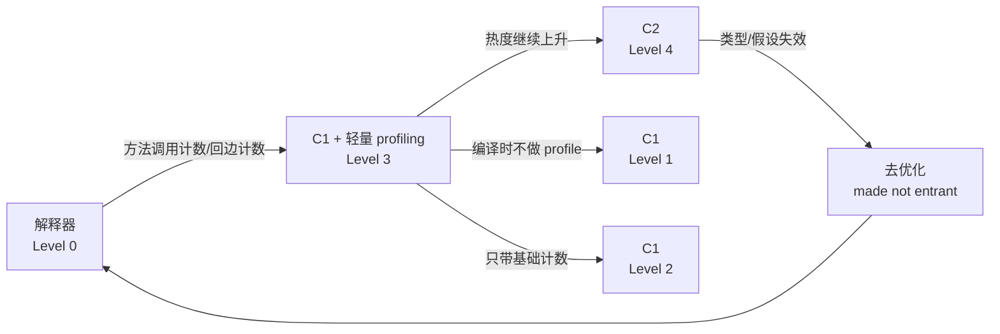

# JIT 编译与字节码：解释、C1、C2 与去优化

> 定位：同一个方法，刚启动时慢、跑一会儿变快、跑很久又可能突然变慢——这三件事的答案都在 JIT。这篇从 class 字节码讲到分层编译、C2 内联、去优化与 CodeCache，目标是让你看到 `-XX:+PrintCompilation` 的输出能读懂，听到「逃逸分析」「标量替换」能分清哪些是真优化、哪些只是营销话术。

## 一、为什么需要理解 JIT

先看三个线上现象，它们都不是 GC 或线程池能解释的：

1. **刚发布时 RT 高，十分钟后恢复正常。** 不是流量降了，是方法还没被编译到 C2，前面几万次调用走的是解释器/C1。
2. **服务跑了一整天，吞吐突然掉一截，重启就好。** 常见原因是 CodeCache 满，编译器被关闭，热点方法退回解释执行。
3. **同样的代码，加了一个实现类就慢了一倍。** 调用点从「单态/双态」变成「巨态（megamorphic）」，C2 不再内联，虚方法分派把收益吃掉了。

JIT 的知识价值不在「背参数」，而在**解释性能曲线的形状**：为什么预热存在、为什么基准测试要预热、为什么“压测 1 分钟”会得出错误结论、为什么“JIT 一定比解释快”是错的。

## 二、字节码：JIT 的输入长什么样

### 2.1 class 文件的关键结构

`javac` 产出的 `.class` 不是机器码，而是一套面向 JVM 的中间表示。关键部分：

| 区域 | 内容 | 和 JIT 的关系 |
|---|---|---|
| 常量池 | 类名、方法名、字符串、数值、方法句柄 | 解析（resolution）后变成直接引用，C2 才能做常量折叠 |
| 方法表 | 方法名、描述符、访问标志、`Code` 属性 | `Code` 里的字节码就是编译器的输入 |
| `StackMapTable` | 每个跳转目标的局部变量/操作数栈类型 | 字节码校验用；类型不合法直接 `VerifyError` |
| 属性表 | `LineNumberTable`、`LocalVariableTable`、`Exceptions` | 调试与异常处理；不影响优化上限 |

### 2.2 栈帧：局部变量表 + 操作数栈

JVM 是**栈式**指令集：大多数指令从操作数栈取参数、把结果压回去。一个方法调用创建一帧：

```text
栈帧
├── 局部变量表（slot 0 = this，参数依次往后）
├── 操作数栈（深度由 max_stack 限定）
├── 动态链接（指向常量池中本方法的引用）
└── 返回地址 / 异常表
```

```java
public int add(int a, int b) {
    int c = a + b;
    return c * 2;
}
```

```bash
javap -c -p Demo.class
```

```text
public int add(int, int);
  Code:
     0: iload_1          // 压入 a
     1: iload_2          // 压入 b
     2: iadd             // 弹出两个、压入和
     3: istore_3         // 存入局部变量 c
     4: iload_3
     5: iconst_2
     6: imul
     7: ireturn
```

这段字节码在解释器里就是逐条查表执行；在 C2 里会被还原成 SSA 形式的图，`a + b` 与 `* 2` 直接折叠成表达式，甚至整个方法被内联进调用方。

### 2.3 五条 invoke 指令，决定了能不能内联

| 指令 | 用在哪 | 分派方式 | 对内联的影响 |
|---|---|---|---|
| `invokestatic` | 静态方法 | 编译期确定 | 最容易内联 |
| `invokespecial` | 构造器、private、`super.` | 编译期确定 | 容易内联 |
| `invokevirtual` | 普通实例方法 | 运行时按接收者类型 | 单态/双态可内联，巨态退化 |
| `invokeinterface` | 接口方法 | 运行时按实现类型 | 同上，且要处理 itable |
| `invokedynamic` | Lambda、字符串拼接、记录模式 | 调用点绑定 `CallSite` | Lambda 经 `LambdaMetafactory` 生成类后可内联；拼接走 `makeConcatWithConstants` |

一个容易忽略的点：**Lambda 不是匿名内部类**，编译后是 `invokedynamic` + 运行时生成的隐藏类；这也是为什么 Lambda 在热点路径上仍能被内联，而传统匿名类会因为多一层类加载与字段访问稍慢。

## 三、执行引擎：解释器、C1、C2 与分层编译



| 层级 | 编译器 | 特点 | 典型用途 |
|---|---|---|---|
| 0 | 解释器 | 启动最快，执行最慢；收集调用计数 | 冷代码、启动阶段 |
| 1 | C1 | 编译快，优化保守，不做 profiling | 简单方法、低热度 |
| 2 | C1 | 带基础计数，给 C2 提供少量信息 | 过渡层 |
| 3 | C1 | 完整 profiling（类型、分支、调用） | 大多数方法的第一份编译产物 |
| 4 | C2 | 激进优化：内联、逃逸分析、去虚拟化 | 真正的热点 |

**触发门槛**不是单一数字。默认 `CompileThreshold=10000` 是基准，分层编译下还会叠加 `Tier3InvocationThreshold`（约 200）、`Tier4InvocationThreshold`（约 15000），并按 CPU 核数缩放；循环还有回边计数（backedge），触发 **OSR（On-Stack Replacement）**——在方法还没返回时，直接把正在跑的循环体编译掉继续执行。`-XX:+PrintCompilation` 输出里的 `%` 就是 OSR。

所以「预热跑 10 次」通常远远不够：方法调用计数没到阈值，C2 根本没进来；压测脚本如果只跑 30 秒，测到的很可能还是 C1 甚至解释器。

## 四、C2 做了什么：内联是王，其余是配套

### 4.1 内联（inlining）

C2 的第一优先级不是「把加法变快」，而是**把调用消掉**。方法内联后，参数变成常量、边界检查可消除、锁可消除、虚调用可去虚拟化，后面所有优化才有空间。

默认限制（以 `-XX:+PrintFlagsFinal` 实测为准）：

| 参数 | 默认量级 | 含义 |
|---|---|---|
| `MaxInlineSize` | 35 字节 | 小于此值的字节码，冷点也尝试内联 |
| `FreqInlineSize` | 325 字节 | 热点方法放宽到此上限 |
| `MaxInlineLevel` | 9 层 | 内联嵌套深度 |
| `MaxRecursiveInlineLevel` | 1 层 | 递归方法内联层数 |
| `InlineSmallCode` | 约 2KB | 已编译代码小于此值才考虑 |

实践含义：

- **热点方法别写太大**。一个 200 行的 `process()` 很可能超过 325 字节，永远进不了内联，调用开销和优化机会一起丢掉。拆成几个小方法，C2 反而更容易把整条链路优化掉。
- **别用异常做热路径控制流**。异常表和非局部跳转会显著增加编译复杂度，也会让内联判断更保守。
- **别在热点路径用反射**。反射调用点多、类型不稳定，C2 很难去虚拟化；`MethodHandle` 在充分预热后可以内联，但前提是调用点稳定。

### 4.2 逃逸分析（Escape Analysis）

逃逸分析回答一个问题：**这个对象会不会跑出当前方法/线程？** 如果不会，C2 可以做：

| 优化 | 做什么 | 是否必然发生 |
|---|---|---|
| 标量替换（Scalar Replacement） | 把对象拆成字段，放寄存器/栈 | 否，取决于对象大小、字段访问模式、编译预算 |
| 栈上分配 | 对象不进堆 | JVM 规范不保证；HotSpot 通常用标量替换达到近似效果 |
| 锁消除（Lock Elision） | 去掉不可能被其他线程看到的锁 | 否，需证明对象不逃逸 |
| 锁粗化（Lock Coarsening） | 合并相邻的同一把锁 | 否 |

```java
// 对象不逃逸，C2 可能把 point 拆成两个局部变量，连分配都省掉
int norm(int x, int y) {
    Point p = new Point(x, y);
    return p.x * p.x + p.y * p.y;
}
```

**不要这样讲**：「开启逃逸分析后对象都在栈上分配」——这是错的。HotSpot 没有真正的“栈上分配”开关，`-XX:+DoEscapeAnalysis` 默认开启，但是否标量替换由编译器判断；对象一大、字段被取地址、进入同步块，优化就不发生。

### 4.3 去虚拟化与类型画像

C2 会记录调用点的接收者类型（`TypeProfileWidth`，默认 2）：

- **单态（monomorphic）**：只有一个实现 → 直接内联，等价于静态调用。
- **双态（bimorphic）**：两个实现 → 生成类型判断 + 两份内联代码。
- **巨态（megamorphic）**：超过阈值 → 放弃内联，走 vtable/itable 分派。

这就是「加了一个实现类，接口调用突然变慢」的机制。常见触发场景：策略模式每类业务一个实现、通用 `Handler` 接口被 20 个类实现、把 `if/else` 改成“优雅”的接口分发。

### 4.4 其他常见优化

- 常量折叠、死代码消除、公共子表达式消除；
- 循环展开、循环不变量外提、范围检查消除（`for (i=0;i<arr.length;i++)` 的边界检查可被消掉）；
- 自动向量化（SIMD），但依赖循环形态与 CPU 支持；
- 空检查消除、类型检查消除（内联后 `checkcast` 常被证明多余）。

## 五、去优化：为什么“跑热了又变慢”

C2 的优化建立在**假设**上：这个调用点只有 A 类型、这个字段不会为 null、这个类不会被卸载。假设失效时，JVM 必须**去优化（deoptimization）**：把已编译代码标记为 `made not entrant`，回到解释器或低层级重新执行，再重新编译。

常见触发原因：

| 原因 | 例子 | 现象 |
|---|---|---|
| 类型画像失效 | 新上线一个实现类，单态变双态/巨态 | 发布后短时抖动，随后稳定 |
| 类加载/卸载 | 动态代理、热部署、OSGi | `made zombie`，反复重编译 |
| uncommon trap | 分支假设反了（如“这个异常不会发生”） | 某个输入下突然变慢 |
| 空值/边界假设 | 某字段一直非空，突然为 null | 去优化 + 重新编译 |
| 编译预算耗尽 | 方法太大、优化太复杂 | 编译失败，停在低层级 |

排查手段：

```bash
# 看编译与去优化事件（含 made not entrant / made zombie）
java -XX:+PrintCompilation -jar app.jar

# 结构化日志，配合 JITWatch 看内联树与去优化原因
java -XX:+UnlockDiagnosticVMOptions -XX:+LogCompilation -XX:LogFile=jit.log -jar app.jar

# JFR：编译事件、编译阶段耗时、CodeCache
java -XX:StartFlightRecording=filename=jit.jfr,settings=profile -jar app.jar
```

`PrintCompilation` 一行大致是：

```text
  timestamp  compile_id  attributes  tier  method  size  deopt
    1234      567        %  s       4     com.example.OrderService::calc (120 bytes)
```

属性含义：`%` = OSR，`s` = synchronized，`!` = 有异常处理器，`b` = 阻塞，`n` = native 包装。看到同一方法反复出现 `made not entrant`，基本就是去优化抖动。

## 六、CodeCache：编译产物也有容量上限

JIT 编译出的机器码放在 **CodeCache**（本地内存，不在堆里）。它分三段：non-profiled（C2）、profiled（C1）、non-method（适配器等）。

| 事实 | 说明 |
|---|---|
| 默认预留 | 64 位、分层编译下约 240MB（`ReservedCodeCacheSize`，以 `PrintFlagsFinal` 为准） |
| 满了会怎样 | 打印 `CodeCache is full. Compiler has been disabled`，**停止编译**，热点退回解释执行 |
| 表现 | CPU 升高、吞吐下降、RT 抖动，重启后恢复（因为 CodeCache 清空） |
| 相关参数 | `ReservedCodeCacheSize`、`InitialCodeCacheSize`、`CodeCacheExpansionSize`、`UseCodeCacheFlushing` |

处理顺序：

1. 先确认：`jcmd <pid> Compiler.codecache` 或 JFR 的 `jdk.CodeCacheFull` 事件；
2. 看是不是**代码太多**：大量动态生成类（CGLIB、Groovy、JSON 序列化器）会持续吃 CodeCache；
3. 再考虑扩容 `-XX:ReservedCodeCacheSize=512m`，同时观察 RSS 与启动；
4. 不要用 `-XX:-UseCodeCacheFlushing` 硬撑， flushing 关掉只会更早撞墙。

## 七、调优：先改代码形状，再动参数

| 现象 | 优先动作 | 不建议 |
|---|---|---|
| 预热慢 | 减少启动期类加载/反射；用 AppCDS/AOT 缓存（JDK 24+ 的 Leyden） | 盲目调低 `CompileThreshold`，会让 C2 编译队列拥塞 |
| 热点方法不内联 | 拆分 >325 字节的方法、减少巨态调用 | 用 `-XX:CompileCommand=inline` 强塞大方法 |
| 去优化抖动 | 查类型画像与类加载；固定实现集合 | 关掉分层编译 |
| CodeCache 满 | 扩容 + 清理动态类生成 | 关闭 flushing |
| 基准测试数字好看 | 预热到 C2 稳定（看 `PrintCompilation` 不再出新行） | 只跑 30 秒就下结论 |

参数层面的底线：**除非你在做编译器/基准测试，不要动 `CompileThreshold`、`Tier*Threshold`**。这些值按 CPU 核数缩放，手改会破坏分层编译的平衡；生产调 JIT 的收益，90% 来自减少巨态调用与拆分大方法。

JDK 25 的 Leyden 项（JEP 514/515/483）把「AOT 方法剖析 + 类加载链接缓存」做成产品能力，目的是缩短启动与预热，但它**不替代 JIT**：运行期仍然靠 C1/C2 把热点编译到最优。

## 八、常见误区

1. **「JIT 编译后一定更快」**：编译有成本，冷方法编译是负收益；去优化、CodeCache 满都会让“编译过”的代码变慢。
2. **「逃逸分析 = 栈上分配」**：HotSpot 主要做标量替换，是否发生由编译器判断，不能当作确定行为。
3. **「`-Xcomp` 可以提升性能」**：它强制启动即编译、不做 profiling，C2 拿不到类型信息，生产用它是灾难。
4. **「CodeCache 越大越好」**：CodeCache 占本地内存，过大会推高 RSS；先治“动态类太多”，再谈扩容。
5. **「方法越小越好」**：过小的方法会增加调用点数量与编译单元数量；关键是**热点路径上的方法要能被内联**，而不是无脑拆碎。
6. **「`-XX:+PrintCompilation` 会影响性能」**：它只输出编译事件，开销可接受；真正有开销的是 `LogCompilation` 全量日志，别长期开。

## 面试高频问法

**Q1：分层编译有哪几层？为什么需要它？**

一句话结论：0 解释器、1–3 C1（不同 profiling 级别）、4 C2；目的是用 C1 快速拿到“还不错的代码”，同时收集画像供 C2 做激进优化。

展开：启动阶段解释器最快；方法变热后 C1 编译快、优化保守，先止血；C1 的 profiling 记录类型、分支、调用，C2 据此做内联、去虚拟化、逃逸分析。没有分层编译，要么启动慢（直接 C2），要么峰值低（只用 C1）。

加分点：能说出 OSR 的存在——循环在方法未返回时就能被编译替换。

**Q2：为什么同一个方法刚启动慢、跑一会儿快？**

一句话结论：调用计数没到阈值，前面在执行解释器/C1；热度上来后 C2 编译并内联，才有峰值性能。

展开：`CompileThreshold` 是基准，分层下还有 Tier3/Tier4 阈值，按 CPU 数缩放；循环有回边计数触发 OSR。基准测试必须预热到编译稳定，否则测的是 C1。

加分点：提到“预热不是跑几次，而是看编译日志不再产生新编译”。

**Q3：C2 内联的条件是什么？为什么我的方法不内联？**

一句话结论：字节码小于 `MaxInlineSize`（35B）或热点方法小于 `FreqInlineSize`（325B），且调用点类型稳定；太大、巨态、含异常处理都会阻止内联。

展开：内联是后续优化的前提；方法太大就拆，调用点类型太多就收敛实现集合；递归还有层数限制。

加分点：指出“为了‘代码优雅’把 if/else 改成 20 个实现类的接口分发，可能把单态打成巨态，性能反而下降”。

**Q4：逃逸分析做了什么？对象真的分配在栈上吗？**

一句话结论：做逃逸判定后可能标量替换、锁消除，但 HotSpot 不保证“栈上分配”，是否发生由编译器判断。

展开：对象不逃逸且字段可拆时，C2 把字段放寄存器/栈；对象大、被取地址、进同步块就不优化。`-XX:+DoEscapeAnalysis` 默认开启。

加分点：能区分“标量替换”与“栈上分配”两个概念，不把营销话术当事实。

**Q5：CodeCache 满了会怎样？怎么排查？**

一句话结论：编译器被禁用，热点退回解释执行，CPU 升高、吞吐下降；用 `jcmd Compiler.codecache` 或 JFR 确认，再扩容/治理动态类。

展开：CodeCache 在本地内存，默认约 240MB；大量 CGLIB/动态代理/脚本类会持续增长；扩容 `ReservedCodeCacheSize` 是止血，治理类生成才是根治。

加分点：知道“重启恢复”是 CodeCache 清空的典型特征。

**Q6：什么是去优化？线上什么现象要怀疑它？**

一句话结论：C2 的优化假设失效时，编译代码被标记 `made not entrant`，回到解释器/低层级；表现为发布后或流量结构变化后性能短时抖动。

展开：类型画像变化（新增实现类）、类加载/卸载、uncommon trap 都会触发；`PrintCompilation` 能看到反复的 `made not entrant`。

加分点：能给出处理顺序——先看类型是否变巨态，再看动态类加载，最后才考虑编译参数。

**Q7：`invokevirtual` 和 `invokeinterface` 的区别？**

一句话结论：前者按接收者类型走 vtable，后者走 itable；两者在单态/双态下都能被 C2 内联，巨态时都退化为查表分派。

展开：`invokespecial` 用于构造器/private/super，`invokestatic` 用于静态方法，`invokedynamic` 用于 Lambda/字符串拼接等调用点绑定。

加分点：能解释 Lambda 为什么不是匿名内部类。

**Q8：怎么读 `-XX:+PrintCompilation` 的一行输出？**

一句话结论：时间戳、编译 ID、属性（`%` OSR、`s` synchronized、`!` 有异常表）、层级（1–4）、方法名与字节码大小；同一方法反复 `made not entrant` 就是去优化。

展开：层级 3 是 C1 带完整 profile，4 是 C2；`%` 说明是循环触发的 OSR 编译。

加分点：能结合 `LogCompilation` + JITWatch 看内联树，而不是只盯一行日志。

## 小结

- **字节码是栈式指令集**，`invoke*` 五条指令决定分派方式，也决定 C2 能不能内联；Lambda 走 `invokedynamic`，不是匿名内部类。
- **分层编译用 C1 止血、C2 冲峰值**：0 解释器、1–3 C1、4 C2；循环有 OSR。预热不到阈值，压测数字没有意义。
- **内联是 C2 的第一优先级**：热点方法控制在 325 字节以内、收敛调用点类型，比调任何编译参数都有效。
- **逃逸分析的产出是标量替换/锁消除，不是“必然栈上分配”**；对象大小、取地址、同步都会让优化不发生。
- **去优化是正常机制**：类型画像变化、类加载、uncommon trap 都会触发，表现为性能抖动；`made not entrant` 是排查入口。
- **CodeCache 有上限**：满了就停编译、退回解释执行，先治动态类生成，再谈扩容。
- **参数不是第一手段**：改代码形状（拆分大方法、减少巨态、少用反射）优先于改 `CompileThreshold`。
