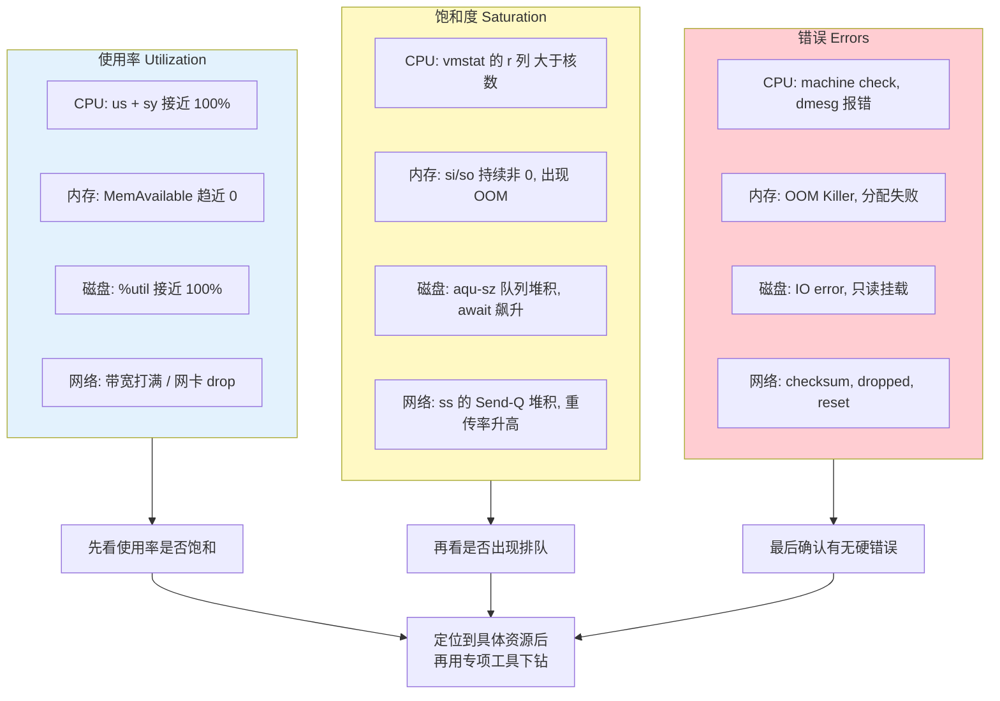
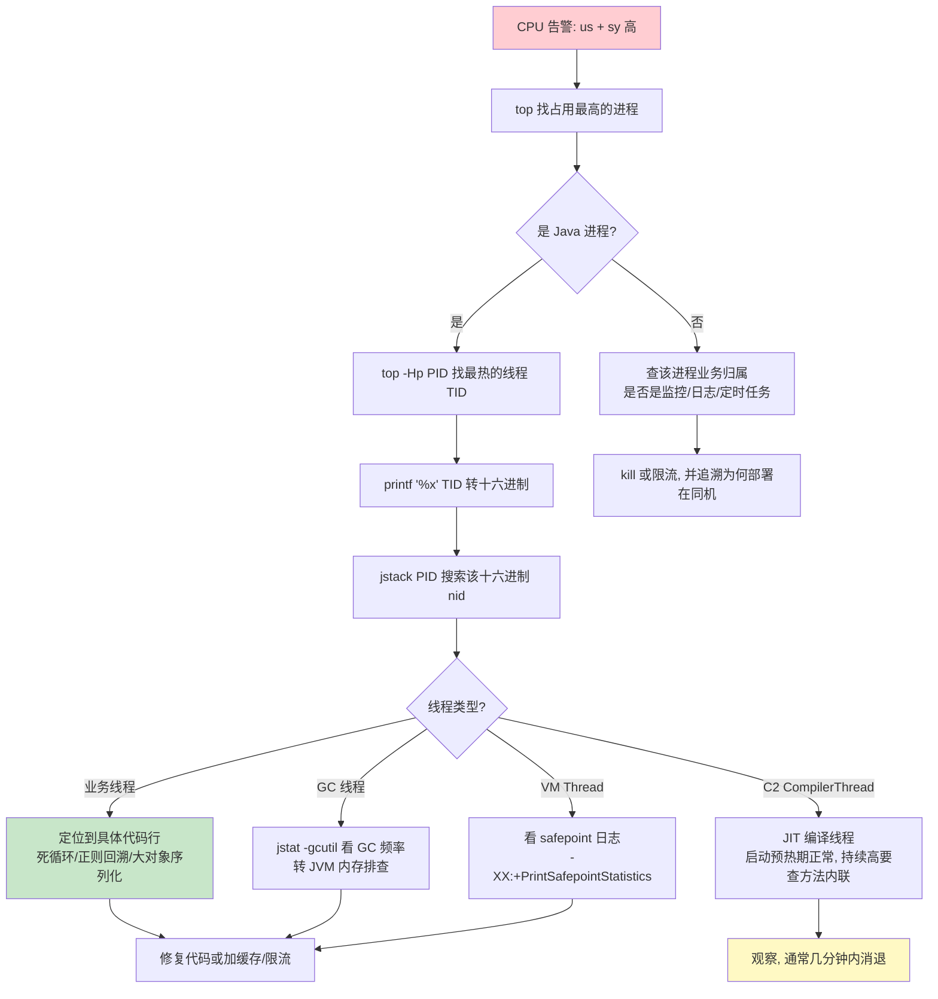
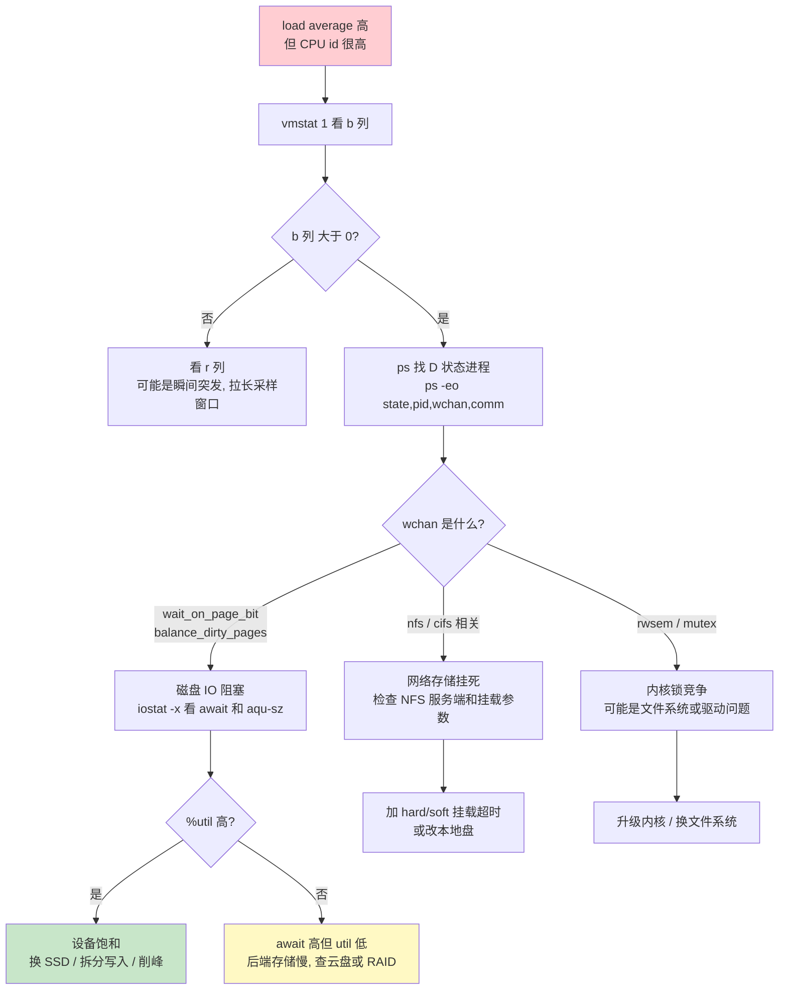

# Linux性能分析与排查

> 定位：Java 服务跑在 Linux 上，JVM 只是操作系统上的一个进程。CPU 飙高、内存只涨不降、连接堆积、接口 P99 抖动，最终都要落到 OS 层去解释。这篇给你一套可复用的排查框架（USE 方法）和四大子系统（CPU / 内存 / 磁盘 / 网络）的真实命令与指标含义，让你在只拿到一台机器和 SSH 的情况下，20 分钟内定位到瓶颈在哪一层，并能顺着 `top -Hp` → `jstack` 一路走到 Java 代码行。

## 一、为什么需要它

先看几个真实场景，它们都不是 Java 层面的问题，但都会以「Java 服务出问题」的形式报上来：

- 接口 P99 从 50ms 涨到 800ms，GC 日志正常，堆也没涨。真相是同一台机器上的日志采集进程把磁盘打满，`write()` 阻塞，业务线程卡在 `FileOutputStream.write`。
- 服务 CPU 使用率 30%，但 `load average` 是 48（16 核机器）。运维说「机器负载很高」，开发说「CPU 又不高，肯定不是我的代码」。真相是某个线程在做 `fsync`，处于 D 状态（不可中断睡眠），负载把 IO 等待也算进去了。
- 内存持续上涨，重启就好。查了堆 dump 一切正常，最后发现是 `DirectByteBuffer` 堆外内存泄漏，或者线程数从 200 涨到 8000（每线程 1MB 栈）。
- 服务突然大量超时，应用日志没有任何异常。真相是 `net.ipv4.ip_local_port_range` 太小 + 大量短连接，客户端端口耗尽，`connect()` 直接返回 `EADDRNOTAVAIL`。

这些问题的共同点：**症状在应用层，病因在系统层**。只会看应用日志和 JVM 指标，就会陷入「重启大法」和「加机器」的循环。

更重要的是，这类问题在面试里区分度极高。能说出「`load average` 包含 D 状态进程，所以 IO 阻塞也会把负载打高」的人，和只会背「负载高就是 CPU 忙」的人，不是一个层级。

## 二、核心原理：USE 方法

排查性能问题最大的敌人不是工具不够，而是**没有章法**——东看一眼 `top`，西看一眼 `iostat`，靠运气撞。Brendan Gregg 提出的 **USE 方法**是这套领域的通用框架：

对**每一个资源**，检查三个维度：

| 维度 | 英文 | 含义 | 判断标准 |
|---|---|---|---|
| **使用率** | Utilization | 资源在单位时间内忙于服务的时间占比 | 接近 100% 即饱和 |
| **饱和度** | Saturation | 资源排队/等待的程度（超出服务能力的部分） | 出现排队即有问题 |
| **错误** | Errors | 错误事件的计数 | 任何非零都值得追查 |

关键在于「每一个资源」——不是只看 CPU，而是把系统拆成资源清单逐个过：

- **CPU**：使用率 `us+sy`，饱和度看 `vmstat` 的 `r` 列（运行队列长度）
- **内存**：使用率看 `MemAvailable`，饱和度看 `si/so`（换页）和 OOM 次数
- **磁盘**：使用率看 `%util`，饱和度看 `aqu-sz`（队列深度）和 `await`
- **网络**：使用率看带宽占比，饱和度看 `ss -s` 的 `send-q`/重传数
- **文件描述符 / 连接数 / 端口**：常被忽略，但泄漏时同样致命

下图是 USE 方法的四象限视图，把「资源 × 指标」的检查矩阵画出来：



**怎么用这张图**：从左到右是一条时间线——先看使用率（是不是忙），再看饱和度（忙到排队了吗），最后看错误（有没有硬件/协议层报错）。如果三个维度都正常，问题就不在系统层，回去看应用。

USE 方法的价值是**排除法**：它让你能理直气壮地说「CPU、内存、磁盘、网络我都查过了，四个维度都健康，问题在 JVM 内部或者下游依赖」。这比「我觉得可能是 GC」强一百倍。

### 2.1 一个必须先搞清的概念：负载均值

`uptime` / `top` 第一行的 `load average: 0.52, 0.58, 0.60` 是最容易被误读的指标。

**它的定义**：单位时间内，处于 **R（Running/Runnable）** 和 **D（Uninterruptible Sleep）** 状态的进程数平均值。

三个数字分别是 1 分钟、5 分钟、15 分钟的指数衰减平均。

关键点：

1. **它包含 D 状态**。D 状态是不可中断睡眠，典型场景就是等磁盘 IO、等 NFS、等某些内核锁。所以**磁盘慢会把负载打高，即使 CPU 完全空闲**。
2. **它是绝对值不是百分比**。16 核机器 load 16 才算跑满，load 4 只用了 25%。判断标准是 `load / 核数`。
3. **趋势比绝对值重要**。1 分钟远高于 15 分钟，说明正在恶化；反过来说明在恢复。

```bash
# 核数
nproc
grep -c 'processor' /proc/cpuinfo

# 负载
cat /proc/loadavg
# 0.52 0.58 0.60 2/1024 12345
# 最后两段：运行中/总进程数、最近创建的 PID
```

## 三、CPU 分析

### 3.1 看懂 top 的 CPU 行

```
%Cpu(s): 12.3 us,  8.1 sy,  0.0 ni, 76.4 id,  3.0 wa,  0.0 hi,  0.2 si,  0.0 st
```

| 字段 | 含义 | 高了说明什么 |
|---|---|---|
| `us` | 用户态 CPU 时间 | 应用在算东西：业务计算、序列化、GC（GC 线程算用户态） |
| `sy` | 内核态 CPU 时间 | 系统调用频繁：大量 `read/write`、`epoll`、上下文切换、内存分配触发缺页 |
| `ni` | nice 值调整过的进程占用 | 一般很低，批处理任务调过 nice 才会高 |
| `id` | 空闲 | — |
| `wa` | IO 等待 | 磁盘/网络存储慢，CPU 空闲但在等 IO 完成 |
| `hi` | 硬中断 | 网卡/磁盘中断，通常很低 |
| `si` | 软中断 | **网络小包高 PPS 的典型信号**，`ksoftirqd` 吃满 |
| `st` | steal time | 虚拟机被宿主机「偷走」的 CPU，云主机上高说明超卖 |

几个高价值的判断：

- **`sy` 高 + `us` 不高**：不是业务代码在算，是系统调用多。常见于：日志打得太多（每次 `write` 都陷内核）、线程数爆炸导致调度开销、频繁 `malloc`。
- **`si` 高**：网络软中断。典型是 Redis/MQ 这类小包高吞吐服务，或者被 DDoS。可以用 `mpstat -P ALL 1` 看是不是集中在某几个核（网卡多队列不均）。
- **`st` 高**：你在云上，隔壁邻居在抢 CPU。找云厂商，自己调不了。
- **`wa` 高**：CPU 在等磁盘。结合 `iostat -x` 看是哪个设备。

```bash
# 每秒刷新，显示每个 CPU 核
mpstat -P ALL 1

# 只看某个进程的 CPU 拆分
pidstat -u 1 -p <pid>
```

### 3.2 上下文切换：自愿 vs 非自愿

这是区分「CPU 真忙」和「CPU 在瞎忙」的关键指标。

```bash
vmstat 1
# procs -----------memory---------- ---swap-- -----io---- -system-- ------cpu-----
#  r  b   swpd   free   buff  cache   si   so    bi    bo   in   cs us sy id wa st
#  2  0      0 812345  20112 912345    0    0    12    45  890 1203  8  3 88  1  0
```

- `cs`：每秒上下文切换总次数（context switches）
- `in`：每秒中断次数（interrupts）

细分到进程：

```bash
pidstat -w 1 -p <pid>
# UID  PID   cswch/s nvcswch/s  Command
# 999  1234   1200.00     35.00  java
```

| 指标 | 含义 | 高了说明什么 |
|---|---|---|
| `cswch/s` | **自愿**上下文切换 | 进程主动让出 CPU：等锁、等 IO、`sleep`、`park`。高说明**在等资源**，不是 CPU 不够 |
| `nvcswch/s` | **非自愿**上下文切换 | 时间片用完被强制换下。高说明**线程太多、CPU 不够分** |

这个区分极其有用：

- 一个 Java 服务 `cswch/s` 十万级、`nvcswch/s` 很低 → 大量线程阻塞在锁或 IO 上，去看 `jstack` 找 BLOCKED/WAITING 的线程。
- `nvcswch/s` 很高 → 线程数远超核数，CPU 时间都花在保存/恢复现场。这时候加线程只会更慢，要减线程或加机器。

经验阈值：单核 `cs` 在几千以内正常，上万要警惕。但没有绝对标准，看趋势和 `nvcswch` 占比更有意义。

### 3.3 perf：从「哪个函数热」到火焰图

`top` 只告诉你「哪个进程吃 CPU」，`perf` 告诉你「进程里哪个函数吃 CPU」。

```bash
# 实时看热点函数（需要 root 或 perf_event_paranoid 放开）
perf top -p <pid>

# 采样 30 秒，记录调用栈
perf record -F 99 -g -p <pid> -- sleep 30

# 生成报告（文本）
perf report --stdio | head -50

# 生成火焰图（需要 FlameGraph 脚本）
perf script > out.perf
./stackcollapse-perf.pl out.perf > out.folded
./flamegraph.pl out.folded > cpu.svg
```

`-F 99` 是采样频率 99Hz，用 99 而不是 100 是为了避开与定时器共振导致的采样偏差——这是 Brendan Gregg 的经验做法。

**火焰图怎么读**：

- 横轴是**采样占比**（宽度 = 该函数占用的 CPU 比例），不是时间顺序
- 纵轴是**调用栈深度**，下面是调用者，上面是被调用者
- 找**最宽的平顶**——那就是热点。如果顶端是 `[unknown]`，通常是缺少调试符号或者 JIT 编译后的代码
- Java 进程需要 `-XX:+PreserveFramePointer` 才能拿到准确的 Java 栈帧（JDK 8u60+ 支持），否则看到的多是 `libjvm.so` 里的地址

对 Java 来说，更实用的组合是 `perf` 看 native 层 + `async-profiler` 看 Java 层。async-profiler 用 `perf_events` + `AsyncGetCallTrace`，能同时给出 Java 栈和 native 栈，且不需要 safepoint 偏差修正：

```bash
./profiler.sh -d 30 -f /tmp/flame.html <pid>
```

### 3.4 CPU 排查决策树

拿到「CPU 高」的告警后，按这张图走，能避免瞎猜：



**这张图的核心是「三次下钻」**：进程 → 线程 → 代码行。每一次下钻都换一个工具：`top` → `top -Hp` → `jstack`。没有这一步，你只能得出「Java 进程 CPU 高」这种没用的结论。

## 四、内存分析

### 4.1 free 的输出怎么读

```bash
free -h
#               total        used        free      shared  buff/cache   available
# Mem:           31Gi        12Gi       1.2Gi       300Mi        18Gi        18Gi
# Swap:         8.0Gi       0.0Gi       8.0Gi
```

很多人看到 `free` 只有 1.2G 就慌了，这是**最常见的误读**。

| 字段 | 含义 |
|---|---|
| `total` | 物理内存总量 |
| `used` | 已使用 = total - free - buff/cache（注意：不同版本 `free` 算法略有差异） |
| `free` | **完全未使用**的内存 |
| `shared` | tmpfs / `shm` 占用的内存 |
| `buff/cache` | 块设备缓存（buffers）+ 页缓存（cache），**可回收** |
| `available` | **应用真正可用的估算值**，包含可回收的 cache |

**核心认知**：Linux 会把空闲内存拿来做页缓存（page cache），加速文件读写。这是**设计如此**，不是内存泄漏。当应用需要内存时，内核会回收这些 cache。所以判断内存是否紧张，看 `available`，不看 `free`。

「Linux 吃内存」这个说法就是这么来的——机器跑久了 `free` 趋近 0，但 `available` 还有一大半，系统完全健康。

### 4.2 /proc/meminfo 里的关键项

```bash
grep -E 'MemTotal|MemFree|MemAvailable|^Buffers|^Cached|^Dirty|Writeback|SwapTotal|SwapFree|Committed_AS|CommitLimit' /proc/meminfo
```

| 字段 | 含义 | 关注点 |
|---|---|---|
| `MemAvailable` | 可用内存估算 | 趋近 0 说明真的要 OOM 了 |
| `Cached` | 页缓存 | 可回收，大不是问题 |
| `Dirty` | 脏页（已改未写回磁盘） | 大说明回写跟不上，写延迟会抖 |
| `Writeback` | 正在回写的页 | 持续非 0 说明磁盘写不过来 |
| `SwapFree` | 剩余 swap | 持续减少说明在换出 |
| `Committed_AS` | 已承诺的虚拟内存 | 远大于 `CommitLimit` 说明 overcommit 严重，随时可能 OOM |

**脏页是个容易被忽略的坑**。应用 `write()` 只是写进 page cache 就返回了（所以很快），真正落盘是内核异步回写。如果写入速度持续超过磁盘能力，脏页堆积到 `vm.dirty_ratio`（默认 20% 内存），内核会**同步阻塞**写入进程直到回写完成——这时候你会看到业务线程莫名卡住几百毫秒，而磁盘 `%util` 已经 100%。

```bash
sysctl vm.dirty_ratio vm.dirty_background_ratio vm.dirty_expire_centisecs
# vm.dirty_ratio = 20
# vm.dirty_background_ratio = 10
# vm.dirty_expire_centisecs = 3000   （30 秒）
```

### 4.3 vmstat 与 swap

```bash
vmstat 1 5
```

关注两列：

- `si`（swap in）：从 swap 读入内存，单位 KB/s
- `so`（swap out）：写入 swap

**`si/so` 持续非 0 是内存不足的强信号**。一旦开始 swap，Java 服务的延迟会劣化一个数量级——因为 swap 在磁盘上，随机访问延迟是内存的十万倍。这时候不要调 JVM 参数，直接加内存或减堆。

云服务器上很多默认不开 swap，`si/so` 恒为 0，那就只能靠 `MemAvailable` 和 OOM 日志判断。

### 4.4 OOM Killer：谁杀了我的进程

内存真正耗尽时，内核的 OOM Killer 会挑一个进程杀掉。Java 服务经常是受害者（因为通常 RSS 最大）。

```bash
# 查 OOM 记录（-T 显示人类可读时间）
dmesg -T | grep -i -E 'out of memory|oom|killed process'

# 典型输出
# [Wed Nov 12 03:14:15 2026] Out of memory: Killed process 12345 (java)
#   total-vm:12582912kB, anon-rss:8388608kB, file-rss:0kB, shmem-rss:0kB
```

```bash
# 系统的 OOM 次数
grep -c 'oom_kill' /proc/vmstat

# 各进程的 OOM 优先级（数值越大越容易被杀）
cat /proc/<pid>/oom_score
cat /proc/<pid>/oom_score_adj    # -1000 ~ 1000，-1000 表示永不杀
```

**注意区分两种「OOM」**：

| 现象 | 日志位置 | 含义 |
|---|---|---|
| `java.lang.OutOfMemoryError: Java heap space` | 应用日志 / hs_err | **JVM 堆**不够，是 Java 层问题 |
| `Out of memory: Killed process ... (java)` | `dmesg` / `/var/log/messages` | **操作系统**内存不够，进程被内核杀掉，通常没有 Java 异常 |

第二种情况最坑：进程直接消失，应用日志里啥也没有，只有一行 `Killed`。如果你在容器里，还会看到 exit code 137（128 + 9，SIGKILL）。

### 4.5 定位内存去哪了

```bash
# 进程级
ps -eo pid,rss,vsz,comm --sort=-rss | head -10

# 进程内存映射（看堆、堆外、mmap 文件、线程栈）
pmap -x <pid> | sort -k3 -n -r | head -20

# Java 堆内
jmap -histo:live <pid> | head -30
jcmd <pid> GC.heap_info

# Java 堆外（需要启动加 -XX:NativeMemoryTracking=summary）
jcmd <pid> VM.native_memory summary
```

一个 Java 进程的 RSS 大致由这些构成：

```
RSS ≈ Java 堆 + Metaspace + Code Cache + 线程栈（线程数 × 1MB）+ DirectByteBuffer + GC 元数据 + JNI 分配的 native 内存 + 加载的 jar/so 的 mmap
```

所以「堆设了 4G，为什么进程占了 7G」是正常现象。堆外泄漏最常见的两个来源：`DirectByteBuffer`（Netty、NIO）和 `ThreadLocal` 撑爆的线程数。

## 五、磁盘 IO 分析

### 5.1 iostat -x 的字段

```bash
iostat -x 1
# Device  r/s     w/s   rkB/s   wkB/s  rrqm/s  wrqm/s  await  r_await  w_await  aqu-sz  %util
# vda    120.0   340.0  4800.0  13600    2.0    18.0   12.4     8.1     14.2     1.8   62.3
```

> 不同 `sysstat` 版本（11.x / 12.x）的列顺序略有差异，以你机器上 `iostat -x` 的表头为准，下面只讲字段含义。

| 字段 | 含义 | 判断 |
|---|---|---|
| `r/s` `w/s` | 每秒读/写请求数（IOPS） | 结合设备能力看是否打满 |
| `rkB/s` `wkB/s` | 每秒读/写吞吐 | 顺序读写看这个 |
| `await` | 平均 IO 等待时间（ms）= 排队 + 服务 | **最关键**，机械盘 >20ms、SSD >5ms 要警惕 |
| `r_await` `w_await` | 分读写 | 定位是读慢还是写慢 |
| `aqu-sz` | 平均队列深度 | 持续 >1 说明有排队 |
| `%util` | 设备繁忙时间占比 | 接近 100% 说明饱和（但**对 RAID/云盘不完全准**） |

**两个经典误判**：

1. **`%util` 100% 不等于一定有问题**。对支持并行的设备（SSD、RAID、云盘），`%util` 是「至少有一个请求在处理的时间占比」，即使 100% 也可能还有余量。真正该看 `await` 和 `aqu-sz`。
2. **`await` 高但 `%util` 低**：请求不多但每个都很慢。这是云盘/网络存储的典型特征——瓶颈在后端存储，不在本机。这时候加本机 IO 线程没用。

`svctm` 字段在较新的 `sysstat` 里已经废弃，不要再拿它做判断。

### 5.2 找是哪个进程在读写

```bash
# 只显示真正有 IO 的进程
iotop -oP

# 按进程累计 IO（读 /proc/<pid>/io）
cat /proc/<pid>/io
# rchar: 累计读字节（含缓存命中）
# read_bytes: 真正落到块设备的读字节
# write_bytes: 真正落到块设备的写字节
```

`rchar` 和 `read_bytes` 的区别很重要：`rchar` 包含从 page cache 读到的量，`read_bytes` 才是真正触发磁盘 IO 的量。判断「是不是真的在打磁盘」要看后者。

### 5.3 磁盘满了怎么查

这是运维事故排行榜第一名，而且经常「删了文件空间不释放」。

```bash
# 1. 看哪个分区满（注意 inode 也可能满）
df -h
df -i

# 2. 逐层找大目录
du -sh /* 2>/dev/null | sort -rh | head -10
du -sh /var/* 2>/dev/null | sort -rh | head -10

# 3. 找大文件（大于 1G）
find / -xdev -type f -size +1G -exec ls -lh {} \; 2>/dev/null

# 4. 关键：找已删除但仍被进程持有的文件
lsof +L1 2>/dev/null | head -20
# 或
lsof -n | grep deleted
```

**为什么删了文件空间不释放**：Linux 的文件是「引用计数」的。`rm` 只是把目录项删掉，如果有进程还持有这个文件的 fd（比如 Java 进程打开的日志文件），inode 和数据块都不会释放。只有进程关闭 fd 或退出，空间才回收。

这是日志切割的经典坑：用 `mv app.log app.log.1` 然后 `kill -HUP`，如果进程没重开文件，它继续往旧 inode 写，磁盘照样满。正确做法是 `copytruncate` 或让进程自己 reopen。

```bash
# 验证：某个被删文件还被谁占着
lsof | grep deleted | awk '{print $1, $2, $7, $9}'
```

### 5.4 磁盘问题的判断路径

```bash
# 一步到位看整体
iostat -x 1 3
vmstat 1 5      # 看 b 列（阻塞进程数）和 wa
pidstat -d 1    # 按进程看 IO

# 看 D 状态进程（不可中断睡眠，通常卡在 IO）
ps -eo state,pid,ppid,wchan:32,comm | awk '$1=="D"'
```

`wchan` 列会告诉你进程卡在哪个内核函数上，比如 `wait_on_page_bit`（等页 IO）、`balance_dirty_pages`（脏页限流）。这是定位 IO 卡顿最直接的证据。

## 六、网络分析

Linux 网络排查分两个层次：**连接层**（有多少连接、什么状态）和**流量层**（带宽、重传、丢包）。

### 6.1 连接状态统计

```bash
# 汇总：各类 socket 数量
ss -s
# Total: 1523
# TCP:   1204 (estab 890, closed 210, orphaned 2, timewait 180)

# 监听端口（-l 监听 -n 数字 -t TCP -p 进程）
ss -lntp

# 所有 TCP 连接的状态分布
ss -ant | awk 'NR>1 {print $1}' | sort | uniq -c | sort -rn

# 按状态筛选
ss -ant state established | wc -l
ss -ant state time-wait | wc -l
ss -ant state close-wait
```

`netstat` 在连接数上万时会非常慢（它读 `/proc/net/tcp` 全量），`ss` 直接走 netlink，快一个数量级。新系统上应该用 `ss`。

### 6.2 连接状态的含义与对策

| 状态 | 含义 | 数量多说明什么 |
|---|---|---|
| `ESTABLISHED` | 已建立 | 正常，但接近上限要看 fd 和内存 |
| `TIME_WAIT` | 主动关闭方等待 2MSL | 本机主动关连接多（短连接），见 02 篇 |
| `CLOSE_WAIT` | 对方已 FIN，本机还没 close | **代码 bug**：没调用 `close()`，连接泄漏 |
| `SYN_SENT` | 发了 SYN 没收到 SYN+ACK | 对端不可达 / 防火墙丢包 /  backlog 满 |
| `SYN_RECV` | 收到 SYN 回了 SYN+ACK，等 ACK | 大量出现可能是 SYN flood |
| `FIN_WAIT2` | 本机已 FIN，等对方 FIN | 对端迟迟不关，可能是对端应用问题 |

**`CLOSE_WAIT` 是最有诊断价值的**：它 100% 是应用层没关连接。看到几千个 `CLOSE_WAIT`，不用查网络，直接去看代码里 `HttpClient` / `Connection` 有没有在 finally 里 `close()`。这个在 02 篇会展开。

### 6.3 流量与错误

```bash
# 网卡吞吐、包量、错误、丢包（1 秒一次）
sar -n DEV 1 5
# IFACE  rxpck/s  txpck/s  rxkB/s  txkB/s  rxcmp/s  txcmp/s  rxmcst/s  %ifutil

# TCP 层：主动/被动连接、重传
sar -n TCP,ETCP 1 5
# active/s  passive/s  iseg/s  oseg/s
# retrans/s  （重传，重要！）

# 累计重传统计
netstat -s | grep -i -E 'retrans|reset|drop|overflow'
nstat -az | grep -i -E 'TcpRetransSegs|TcpExtListenOverflows|TcpExtListenDrops'
```

关键指标：

- **`retrans/s` 持续 > 0**：网络质量差或对端处理不过来。公网环境 0.1% 以内可接受，内网应该接近 0。
- **`ListenOverflows` / `ListenDrops`**：accept 队列溢出，说明应用 accept 太慢或 backlog 太小。这直接对应 02 篇的 SYN 队列/accept 队列。
- **`rxdrop` / `txdrop`**：网卡队列满，通常是流量突增或软中断处理不过来。

```bash
# 网卡队列和丢包
ethtool -S eth0 | grep -i -E 'drop|error|miss'
ip -s link show eth0
```

### 6.4 端口与 fd 上限

```bash
# 文件描述符
ulimit -n
cat /proc/<pid>/limits | grep 'open files'
ls /proc/<pid>/fd | wc -l

# 端口范围（客户端主动连接时用）
sysctl net.ipv4.ip_local_port_range
# net.ipv4.ip_local_port_range = 32768 60999   → 约 2.8 万个端口

# 已用端口数
ss -ant | awk '{print $4}' | grep -oE '[0-9]+$' | sort -u | wc -l
```

**端口耗尽的经典场景**：服务作为客户端大量调用下游，每次新建短连接。2.8 万个端口 × 每个连接 TIME_WAIT 60 秒，理论上限就是 470 QPS 左右。超过就 `Cannot assign requested address`。解法是**连接池 + 长连接**，不是调大端口范围。

## 七、典型排查套路

前面是零件，这一节是组装。四个最高频的场景，每个给出完整的命令序列。

### 7.1 套路一：CPU 100%

```bash
# 1. 谁在吃 CPU
top -b -n 1 | head -20

# 2. 假设 PID=12345，看哪个线程
top -Hp 12345

# 3. 假设最热线程 TID=12389，转十六进制
printf '%x\n' 12389
# 3065

# 4. 在 jstack 里找 nid=0x3065
jstack 12345 > /tmp/stack.txt
grep -A 30 'nid=0x3065' /tmp/stack.txt
```

读到栈之后按线程类型分流：

| 线程名特征 | 说明 | 下一步 |
|---|---|---|
| `http-nio-8080-exec-*` | Tomcat 业务线程 | 看栈顶方法，找死循环/大计算/正则 |
| `GC task thread` / `G1 Young RemSet` | GC 线程 | `jstat -gcutil 12345 1000` 看 GC 频率和耗时 |
| `C2 CompilerThread*` | JIT 编译 | 启动预热期正常，持续高查方法是否过大 |
| `VM Thread` | safepoint | 加 `-XX:+PrintSafepointStatistics` 看停顿原因 |
| `DestroyJavaVM` / `Finalizer` | 收尾/终结器 | Finalizer 高说明有对象重写了 finalize |

**如果是 GC 导致的 CPU 高**，转 JVM 排查：看 `jstat -gcutil` 的 `FGC` 次数和 `FGCT` 累计时间，看是否频繁 Full GC；再看堆 dump 找大对象。

### 7.2 套路二：负载高但 CPU 不高

这是最能体现水平的一个场景。现象是 `load average` 很高（比如 16 核机器 load 40），但 `top` 里 CPU 的 `id` 还有 80%。

原因一定是**有大量进程/线程处于 D 状态**（不可中断睡眠），而 D 状态会计入负载但不消耗 CPU。D 状态的来源几乎都是 IO。



命令序列：

```bash
# 1. 确认负载和 CPU 的矛盾
uptime; nproc
vmstat 1 5      # 重点看 r 和 b

# 2. 找 D 状态进程
ps -eo state,pid,ppid,wchan:40,comm | awk '$1 ~ /^D/'

# 3. 看 IO 设备
iostat -x 1 3

# 4. 看是谁在 IO
iotop -oP
pidstat -d 1

# 5. 如果是 Java 进程，看它在等什么
jstack <pid> | grep -B 2 -A 20 'java.lang.Thread.State: RUNNABLE'  # 注意 D 状态在 jstack 里可能显示 RUNNABLE
```

**注意一个坑**：Java 线程在做 native IO 时，`jstack` 里显示的是 `RUNNABLE`（因为 JVM 不知道线程在内核里阻塞了）。所以看到大量 `RUNNABLE` 且栈顶是 `FileInputStream.read0` / `SocketInputStream.read`，实际是 IO 阻塞。要看 `/proc/<pid>/task/<tid>/stat` 的第 3 个字段确认真实状态。

### 7.3 套路三：内存持续上涨

```bash
# 1. 是进程涨还是系统涨
free -h; cat /proc/meminfo | head -5
ps -eo pid,rss,comm --sort=-rss | head -5

# 2. 如果是 Java 进程，先分清堆内堆外
jcmd <pid> GC.heap_info
jstat -gcutil <pid> 1000 5

# 3. 堆内正常但 RSS 涨 → 查堆外
jcmd <pid> VM.native_memory summary    # 需 -XX:NativeMemoryTracking=summary
pmap -x <pid> | sort -k3 -nr | head -15

# 4. 线程数是否失控（每线程 1MB 栈）
ls /proc/<pid>/task | wc -l
jstack <pid> | grep '^"' | wc -l

# 5. 是不是 page cache 被误读
# available 充足就没事，cache 可回收
```

| 现象 | 可能原因 |
|---|---|
| 堆老年代持续上涨，Full GC 后不降 | 内存泄漏（静态集合、缓存无上限、ThreadLocal） |
| 堆正常，RSS 涨，`pmap` 有大量 64MB 匿名映射 | `DirectByteBuffer` 泄漏（Netty 未 release） |
| 线程数持续增长 | 线程池无界 / 每次请求 new Thread |
| Metaspace 持续涨 | 动态生成类（CGLIB、Groovy、热部署） |
| `available` 正常，`free` 很低 | 正常，page cache |

### 7.4 套路四：磁盘写满

```bash
df -h                    # 哪个分区
df -i                    # inode 是否耗尽（大量小文件）
du -sh /var/* | sort -rh | head
find / -xdev -size +500M -type f 2>/dev/null | head
lsof +L1                 # 已删除未释放
```

inode 耗尽是个隐蔽的坑：`df -h` 显示还有空间，但创建文件报 `No space left on device`。原因是有几百万个小文件（比如 session 文件、临时文件、邮件队列）把 inode 用完了。`df -i` 一看 `IUse%` 100% 就明白了。

## 八、生产坑点

### 坑点 1：把 page cache 当内存泄漏

**现象**：监控告警「内存使用率 95%」，登录一看 `free` 只剩 800M，重启服务后恢复，过几天又告警。

**原因**：`free` 里的 `buff/cache` 是可回收的页缓存，被算进了「已使用」。这是 Linux 的正常行为——用空闲内存缓存磁盘数据来提速。

**解法**：监控采集 `MemAvailable` 而不是 `free`；`used` 的计算应该是 `total - available`。如果是容器环境，还要注意 cgroup 的 `memory.usage_in_bytes` 包含 page cache，判断 OOM 风险要看 `memory.stat` 里的 `total_active_anon` 之类。

### 坑点 2：`%util` 100% 就断定磁盘瓶颈

**现象**：`iostat` 显示 `%util` 99%，于是申请换更高规格的磁盘，换完还是慢。

**原因**：`%util` 对并行设备不准。SSD/RAID/云盘能同时处理多个请求，`%util` 100% 时队列里可能还有余量。真正的瓶颈指标是 `await`（单次 IO 延迟）和 `aqu-sz`（排队深度）。

**解法**：用 `await` 对比设备基线（机械盘 10-20ms，SSD 0.1-1ms，云盘看 SLA），`aqu-sz` 持续 > 队列深度说明真堵。同时看应用侧的实际影响（P99 延迟），而不是盯一个指标。

### 坑点 3：日志切割后磁盘不释放

**现象**：`du` 统计只有 10G，但 `df` 显示分区用了 100G。

**原因**：日志被 `mv` 或 `rm` 了，但 Java 进程还持有 fd，inode 和数据块没释放。`du` 看不到（目录项没了），`df` 算得到（块还被占用）。

**解法**：

```bash
lsof +L1 | grep -i log     # 找到持有者
# 方案一：重启/重开文件（推荐，logback 支持 SIGHUP 或 SizeAndTimeBasedRollingPolicy）
# 方案二：临时清空（不推荐，会丢日志）
: > /proc/<pid>/fd/<fd_num>
```

根治要靠 logback/log4j2 的滚动策略，别用外部脚本 `mv`。

### 坑点 4：`ulimit -n` 改了但 Java 进程没生效

**现象**：`ulimit -n` 显示 65535，但 Java 服务还是报 `Too many open files`。

**原因**：`ulimit` 只影响**当前 shell 及其子进程**。已经运行的进程（尤其是 systemd 拉起的服务）用的是启动时的限制。而且 systemd 有独立的 `LimitNOFILE`。

**解法**：

```bash
# 确认进程实际限制
cat /proc/<pid>/limits | grep 'open files'

# systemd 服务
systemctl edit myservice
# [Service]
# LimitNOFILE=65535
systemctl daemon-reload && systemctl restart myservice

# 同时确认全局上限
sysctl fs.file-max
```

### 坑点 5：只看平均负载不看核数

**现象**：`load average: 8.0`，运维说「负载 8 很高了，赶紧扩容」。

**原因**：load 是绝对数值。4 核机器 load 8 是 200%（严重过载），32 核机器 load 8 只有 25%（很闲）。

**解法**：永远用 `load / nproc` 判断。经验阈值：< 0.7 健康，0.7-1.0 警戒，> 1.0 过载（这里指比值）。容器环境要注意 `nproc` 可能返回宿主机的核数，而 cgroup 限制了实际可用 CPU，得看 `cpu.cfs_quota_us`。

### 坑点 6：容器里看到的指标是宿主机的

**现象**：容器里 `free -h` 显示 64G，`nproc` 显示 32，但容器 limit 只有 2C4G。JVM 按 32 核去设线程池，按 64G 去设堆，直接 OOM。

**原因**：早期容器不隔离 `/proc`，`free`/`nproc` 读的是宿主机数据。JDK 8u191 之前也不认 cgroup limit。

**解法**：JDK 8u191+ / JDK 10+ 用 `-XX:+UseContainerSupport`（默认开）；显式设 `-XX:MaxRAMPercentage`；用 `jcmd <pid> VM.info` 确认 JVM 看到的可用核数和内存。排查时用 cgroup 文件：

```bash
cat /sys/fs/cgroup/memory/memory.limit_in_bytes       # cgroup v1
cat /sys/fs/cgroup/cpu/cpu.cfs_quota_us              # cgroup v1
cat /sys/fs/cgroup/memory.max                        # cgroup v2
cat /sys/fs/cgroup/cpu.max                           # cgroup v2
```

## 九、最佳实践

### 9.1 排查顺序清单

拿到「服务慢」的告警，按这个顺序过一遍，5 分钟能有结论：

1. `uptime` → load / 核数，是否过载
2. `top` → CPU 的 us/sy/wa/si/st 分布，谁占 CPU
3. `vmstat 1 5` → r（运行队列）、b（阻塞）、si/so（swap）
4. `free -h` → 看 `available` 不看 `free`
5. `iostat -x 1 3` → await、aqu-sz、%util
6. `ss -s` → 连接总数和各状态分布
7. `dmesg -T | tail -50` → 有没有 OOM、IO error、网卡 down

### 9.2 监控该采哪些指标

| 层 | 必采指标 | 告警建议 |
|---|---|---|
| CPU | `us`、`sy`、`wa`、`si`、load/核数 | load/核数 > 1 持续 5 分钟 |
| 内存 | `MemAvailable` 占比、swap 使用、OOM 次数 | available < 10% 或出现 OOM |
| 磁盘 | `await`、`%util`、`aqu-sz`、分区使用率、inode 使用率 | await > 基线 3 倍，使用率 > 85% |
| 网络 | 带宽占比、重传率、`ListenOverflows`、连接数 | 重传 > 0.5%，连接数接近 fd 上限 |
| 进程 | fd 数、线程数、RSS | fd > 上限 80% |

### 9.3 参数调整的边界

能不动内核参数就不动。真正值得调的没几个：

| 参数 | 默认 | 什么时候调 |
|---|---|---|
| `net.core.somaxconn` | 4096（新内核） | 高并发 accept 队列溢出时，配合应用 backlog |
| `net.ipv4.tcp_max_syn_backlog` | 1024/4096 | SYN flood 或握手慢时 |
| `net.ipv4.ip_local_port_range` | 32768-60999 | 客户端端口耗尽（治标，治本是连接池） |
| `vm.swappiness` | 60 | 数据库/Java 服务建议 1-10，尽量不用 swap |
| `vm.dirty_ratio` / `dirty_background_ratio` | 20 / 10 | 写抖动严重时降低，减少一次性回写量 |
| `fs.file-max` | 很大 | 一般不用动，动 `LimitNOFILE` 就够 |

**反面教材**：网上流传的「Linux 性能优化一键脚本」，关掉 `tcp_tw_recycle`（已在 4.12 移除）、关 IPv6、改一堆 `tcp_*` 参数——大多数是有害的。参数要针对具体问题调，不要抄。

## 十、面试高频问法

**Q1：load average 是什么？为什么会出现负载高但 CPU 不高？**

**一句话结论**：load average 是单位时间内处于 R（运行/可运行）和 D（不可中断睡眠）状态的进程数平均值，因为包含 D 状态，所以 IO 阻塞也会把负载打高而 CPU 空闲。

展开：

- 三个数字是 1/5/15 分钟的指数衰减平均，趋势比绝对值重要。
- 判断要除以核数：`load / nproc`。16 核 load 16 才是 100%。
- D 状态来自内核不可中断的等待，典型是磁盘 IO、NFS、某些内核锁。这些进程不消耗 CPU，但会计入 load。
- 排查：`vmstat` 看 `b` 列，`ps -eo state,pid,wchan,comm | grep '^D'` 看 `wchan` 定位卡在哪个内核函数。

加分点：说「Java 线程在做 native IO 时，jstack 显示 RUNNABLE，因为 JVM 不知道内核态阻塞了，得看 `/proc/<pid>/task/<tid>/stat` 的第三个字段」。

**Q2：CPU 使用率里的 us、sy、wa、si、st 分别代表什么？**

**一句话结论**：us 用户态、sy 内核态、wa IO 等待、si 软中断、st 被虚拟化偷走的时间。

| 字段 | 高了说明 |
|---|---|
| `us` | 应用在计算：业务逻辑、序列化、GC |
| `sy` | 系统调用多：频繁 write、上下文切换、缺页 |
| `wa` | 磁盘/网络存储慢，CPU 在等 IO |
| `si` | 网络软中断，小包高 PPS 的典型信号 |
| `st` | 宿主机超卖，云环境常见 |

加分点：说「`sy` 高但 `us` 不高，往往不是代码算得慢，而是系统调用太频繁——比如日志打太多，每次 `write` 都陷内核；或者线程数爆炸导致调度开销」。

**Q3：自愿上下文切换和非自愿上下文切换有什么区别？**

**一句话结论**：自愿是进程主动让出 CPU（等 IO、等锁），非自愿是时间片用完被强制换下（CPU 不够分）。

- `pidstat -w` 的 `cswch/s` 是自愿，`nvcswch/s` 是非自愿。
- 自愿高 → 在等资源，去看 `jstack` 找 BLOCKED/WAITING 线程，或者看 IO。
- 非自愿高 → 线程数远超核数，加线程只会更慢，要减线程或加机器。
- `vmstat` 的 `cs` 是总数，`in` 是中断数。

加分点：说「这两个指标方向相反：自愿高是『等』，非自愿高是『抢』，一个要减少等待源，一个要减少竞争者」。

**Q4：free 显示内存快满了，是内存泄漏吗？**

**一句话结论**：不一定。Linux 会把空闲内存用作 page cache，`buff/cache` 是可回收的，判断标准是 `MemAvailable` 而不是 `free`。

展开：

- `free` 是完全未使用的内存，长期运行的系统趋近 0 是正常的。
- `buff/cache` 缓存磁盘数据加速读写，应用需要时内核会回收。
- `available` 是内核估算的「应用真正能拿到多少」，包含可回收的 cache。
- 真正的内存不足信号：`available` 趋近 0、`si/so` 持续非 0、`dmesg` 出现 OOM。

加分点：说「容器里更要注意，cgroup 的 `memory.usage_in_bytes` 包含 page cache，判断 OOM 风险要看匿名页（anon）而不是总量」。

**Q5：怎么区分 JVM OOM 和操作系统 OOM？**

**一句话结论**：JVM OOM 抛 `OutOfMemoryError` 有 Java 异常栈；OS OOM 是内核杀进程，日志在 `dmesg`，进程直接消失，退出码 137。

| 类型 | 表现 | 查哪里 |
|---|---|---|
| JVM 堆 OOM | `java.lang.OutOfMemoryError: Java heap space` | 应用日志、`-XX:+HeapDumpOnOutOfMemoryError` 的 dump |
| JVM 堆外 OOM | `Direct buffer memory` / `unable to create new native thread` | NMT、`pmap` |
| OS OOM | 进程消失，`Killed process ... (java)` | `dmesg -T`、`/var/log/messages`、exit code 137 |

加分点：说「OS OOM 时 JVM 来不及做任何事，所以没有 hs_err、没有 dump，这是两者最容易区分的特征」。

**Q6：iostat 的 %util 到 100% 就说明磁盘到瓶颈了吗？**

**一句话结论**：不一定。`%util` 对支持并行的设备（SSD、RAID、云盘）不准，真正该看 `await` 和 `aqu-sz`。

展开：

- `%util` 的定义是「至少有一个请求在处理的时间占比」，不是「设备能力用尽」。
- SSD 能并行处理几十上百个请求，`%util` 100% 时仍有吞吐余量。
- `await` 是平均单次 IO 延迟（排队 + 服务），对比设备基线才有意义。
- `aqu-sz` 是平均队列深度，持续大于设备并行度说明真堵了。

加分点：说「`await` 高但 `%util` 低，是云盘/网络存储的典型特征——瓶颈在后端，加本机 IO 线程没用」。

**Q7：磁盘满了，删了文件空间却不释放，为什么？**

**一句话结论**：Linux 文件是引用计数，`rm` 只删目录项，如果还有进程持有 fd，inode 和数据块不会释放。

展开：

- `du` 看不到（目录项没了），`df` 算得到（块还被占）。
- 用 `lsof +L1` 或 `lsof | grep deleted` 找持有者。
- 释放方式：让进程关闭 fd（重启或重开日志文件），或者 `: > /proc/<pid>/fd/<n>` 临时清空。
- 根治：日志用 logback 的滚动策略，不要用外部脚本 `mv`。

加分点：说「还有一种『满了』是 inode 满，`df -h` 有空间但创建文件报 `No space left on device`，要 `df -i` 才看得到」。

**Q8：线上 CPU 100%，你的排查步骤是什么？**

**一句话结论**：top 找进程 → top -Hp 找线程 → TID 转十六进制 → jstack 定位代码行，按线程类型分流。

展开：

```bash
top                      # 找 PID
top -Hp <pid>            # 找最热 TID
printf '%x\n' <tid>      # 转十六进制
jstack <pid> | grep -A 30 'nid=0x<hex>'
```

分流：

- 业务线程 → 死循环、正则回溯、大对象序列化、加密
- GC 线程 → `jstat -gcutil` 看 GC 频率，转 JVM 排查
- C2 CompilerThread → 预热期正常，持续高查方法内联
- VM Thread → safepoint 停顿，看 `-XX:+PrintSafepointStatistics`

加分点：说「如果栈顶是 `[unknown]` 或者全是 `libjvm.so`，说明 JIT 编译后没有 frame pointer，可以加 `-XX:+PreserveFramePointer` 用 perf 看，或者直接用 async-profiler」。

**Q9：怎么统计机器上的 TCP 连接状态分布？**

**一句话结论**：`ss -ant | awk '{print $1}' | sort | uniq -c | sort -rn`，或者 `ss -s` 看汇总。

展开：

- `ss -s` 给总数和各状态计数，最快。
- `ss -lntp` 看监听端口和对应进程。
- `ss -ant state close-wait` 直接筛某个状态。
- `netstat` 在连接数上万时很慢（全量读 `/proc/net/tcp`），`ss` 走 netlink 快得多。
- 各状态含义：`CLOSE_WAIT` 多 = 应用没 close（代码 bug）；`TIME_WAIT` 多 = 本机主动关连接多；`SYN_RECV` 多 = 可能 SYN flood。

加分点：说「`ss -s` 里的 `orphaned` 是孤儿 socket，通常是有 fd 泄漏或者进程异常退出留下的」。

**Q10：容器里 JVM 为什么容易 OOM？**

**一句话结论**：JVM 早期版本不认 cgroup limit，按宿主机内存设堆；即使认了，堆外内存（Metaspace、线程栈、DirectBuffer）不在堆限制内，容易超出容器 limit 被杀。

展开：

- JDK 8u191 之前需要 `-XX:+UseCGroupMemoryLimitForHeap`，之后 `-XX:+UseContainerSupport` 默认开启。
- 容器 limit 4G，JVM 堆设 3G，加上 Metaspace 256M + 线程栈 + DirectBuffer + JVM 自身，很容易超 4G 被 OOM Killer 杀。
- 建议堆占容器 limit 的 50-70%，用 `-XX:MaxRAMPercentage=70`。
- 用 `jcmd <pid> VM.info` 确认 JVM 看到的可用内存。

加分点：说「K8s 里 Pod 被 OOMKilled 的退出码是 137，`kubectl describe pod` 能看到 `Last State: Terminated, Reason: OOMKilled`，这和 JVM 的 OutOfMemoryError 是两回事」。

**Q11：perf 火焰图怎么看？**

**一句话结论**：横轴是采样占比（宽度 = CPU 占用比例），纵轴是调用栈深度，找最宽的平顶就是热点。

展开：

- 横轴**不是时间顺序**，是按字母排序合并后的占比，所以左右位置没有时间含义。
- 从下往上是调用链，平顶说明该函数自己消耗 CPU（而不是在等子调用）。
- 顶端 `[unknown]` 通常是缺符号表或 JIT 代码，Java 需要 `-XX:+PreserveFramePointer`。
- 采样频率用 99Hz 而非 100Hz，避免与系统定时器共振。

加分点：说「Java 场景更推荐 async-profiler，它用 `perf_events` + `AsyncGetCallTrace`，能同时给出 Java 栈和 native 栈，还能区分 CPU/alloc/lock 三种事件」。

**Q12：`ulimit -n` 改了为什么 Java 进程还是报 Too many open files？**

**一句话结论**：`ulimit` 只影响当前 shell 及子进程，已运行的进程用启动时的限制；systemd 服务有独立的 `LimitNOFILE`。

展开：

- 确认进程实际限制：`cat /proc/<pid>/limits | grep 'open files'`。
- systemd：`systemctl edit` 加 `[Service] LimitNOFILE=65535`，然后 `daemon-reload` + 重启。
- 全局上限 `fs.file-max` 一般够大，不用动。
- 排查泄漏：`ls /proc/<pid>/fd | wc -l`，`lsof -p <pid>` 看是哪类文件（socket？文件？）。

加分点：说「fd 泄漏最常见的两个来源是 HTTP 连接没关（配合 CLOSE_WAIT 增多）和文件流没在 finally 里 close」。

## 小结

- **USE 方法**是排查框架：对每个资源（CPU/内存/磁盘/网络/fd）查使用率、饱和度、错误，用排除法定位层次。
- **load average 包含 D 状态**，所以 IO 阻塞会让负载高而 CPU 空闲；判断永远用 `load / nproc`。
- **CPU** 看 `us/sy/wa/si/st` 分布，上下文切换区分自愿（在等）和非自愿（在抢）；`perf` / async-profiler 出火焰图找热点函数。
- **内存**看 `MemAvailable` 不看 `free`，`buff/cache` 可回收；区分 JVM OOM（有异常）和 OS OOM（`dmesg` 有 `Killed process`，退出码 137）。
- **磁盘**看 `await` 和 `aqu-sz` 而不是 `%util`；磁盘满要查 `lsof +L1`（删除未释放）和 `df -i`（inode 耗尽）。
- **网络**用 `ss` 不用 `netstat`；`CLOSE_WAIT` 多 = 代码没 close，`TIME_WAIT` 多 = 主动关闭多，`ListenOverflows` = accept 队列溢出。
- **Java 衔接**：`top -Hp` 找 TID → `printf '%x'` 转十六进制 → `jstack` 搜 `nid`，三次下钻到代码行。
