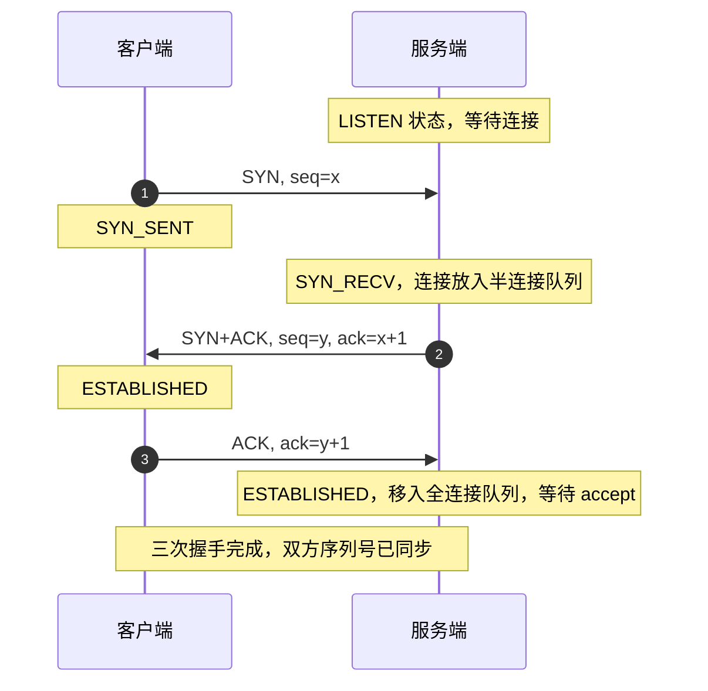
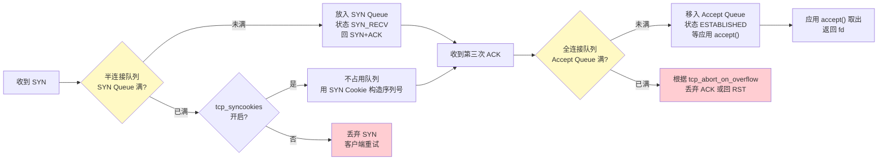
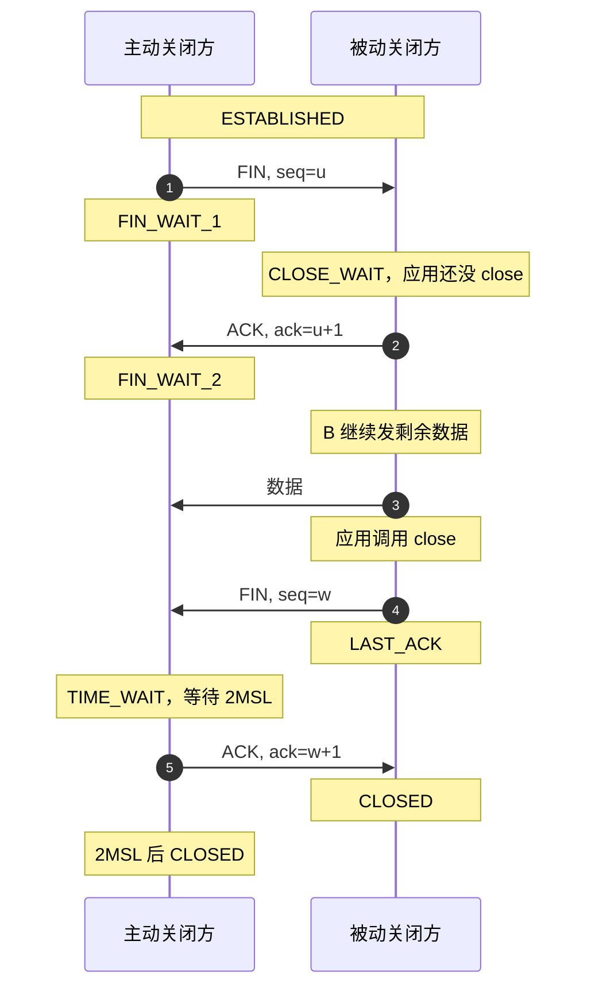
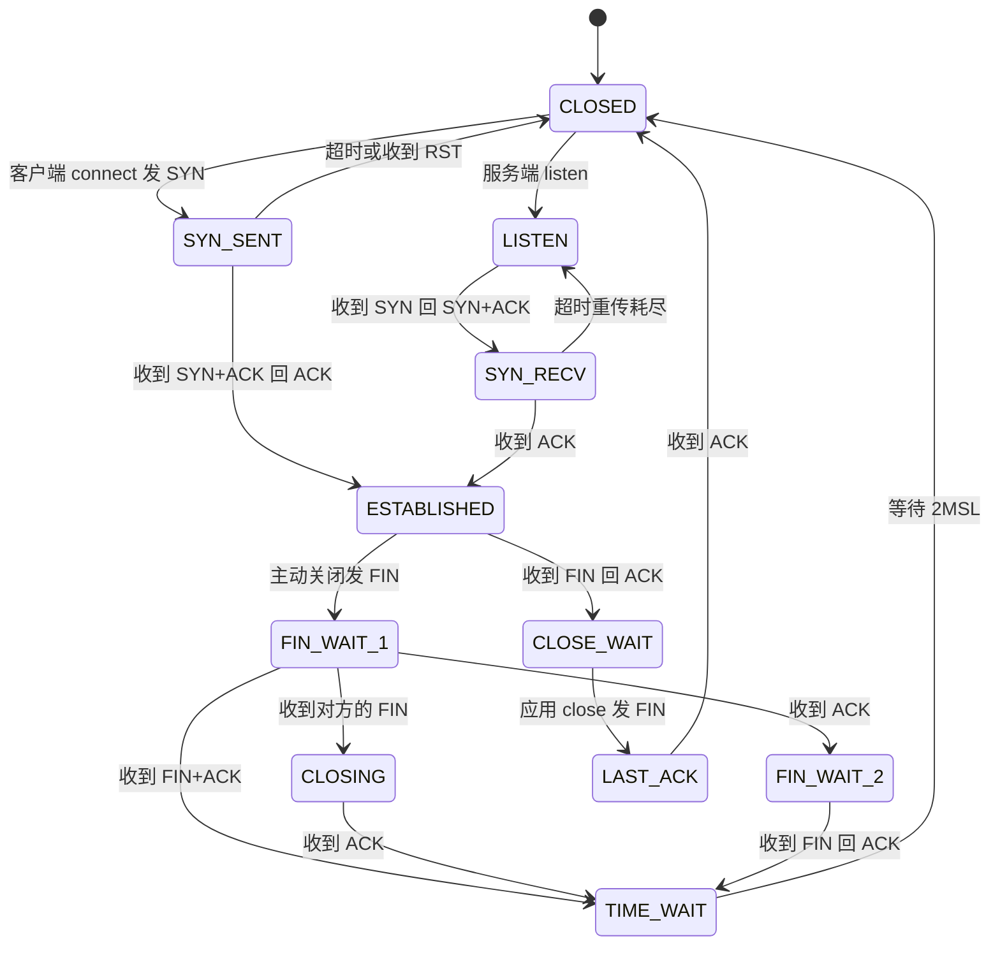
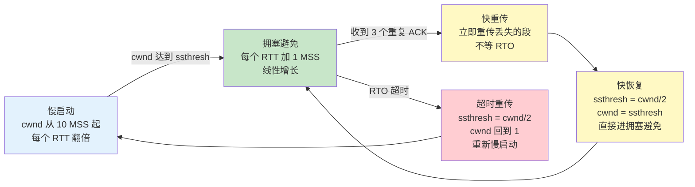

# TCP-IP协议栈深度

> 定位：Java 工程师写的每一行 RPC、每一次 HTTP 调用、每一个数据库连接，底下都是一条 TCP 连接。线上「偶发 40ms 延迟」「大量 CLOSE_WAIT」「TIME_WAIT 把端口耗尽」「压测 QPS 上不去但 CPU 很闲」，答案全在 TCP 的状态机、队列和拥塞控制里。这篇从三次握手讲到拥塞控制，把每个状态、每个队列、每个 sysctl 参数讲清楚，让你看到 `ss` 的输出就知道系统在发生什么。

## 一、为什么需要它

先看四个真实故障，它们的共同点是：**应用代码完全正确，但系统表现异常**。

**故障一：接口偶发 40ms 延迟**。P50 是 3ms，P99 是 43ms，非常规律。GC 日志干净，下游也正常。真相是客户端和服务端都开了 Nagle 算法和延迟确认，小包被攒着，等对方的 ACK，而对方的 ACK 又被延迟 40ms——两个「优化」叠加成了 40ms 的固定延迟。

**故障二：服务端几万个 CLOSE_WAIT**。连接数监控一路涨，最后 `Too many open files`。真相是代码里 `HttpClient` 用完没 `close()`，异常路径漏了 `finally`。CLOSE_WAIT 是「对方已经挥手了，我还没关」——这个数量直接等于**你泄漏的连接数**。

**故障三：压测 QPS 卡在 800 上不去**。CPU 20%，下游响应 5ms。真相是客户端每次请求新建连接，2.8 万个本地端口 × TIME_WAIT 60 秒，上限只有 470 QPS 左右，端口耗尽后 `connect()` 直接失败。

**故障四：大文件传输吞吐只有带宽的 30%**。抓包发现有大量重传。真相是跨公网链路有 1% 丢包，CUBIC 把丢包一律当成拥塞信号，疯狂减窗口——而 BBR 基于带宽时延积建模，能在丢包链路上跑满。

这四个故障对应 TCP 的四个核心机制：**Nagle/延迟确认、连接状态机、TIME_WAIT/端口、拥塞控制**。不懂这些，你只能靠「加机器」和「换框架」碰运气。

## 二、三次握手

### 2.1 过程



三次握手的本质是**交换并确认双方的初始序列号（ISN）**，同时确认双方的收发能力：

| 次数 | 作用 |
|---|---|
| 第一次（SYN） | 客户端告诉服务端：我的发送能力 OK，我的 ISN 是 x |
| 第二次（SYN+ACK） | 服务端告诉客户端：我的收发都 OK，我的 ISN 是 y，确认你的 x |
| 第三次（ACK） | 客户端告诉服务端：我收到你的 y 了，我的收发都 OK |

### 2.2 为什么是三次，不是两次

这是最经典的面试题，标准答案有三层，能答出第三层才是加分项：

**第一层：防止历史重复连接**。客户端一个滞留在网络里的旧 SYN 到达服务端，服务端回 SYN+ACK 并建立连接、分配资源，但客户端根本不认这个连接。这个「幽灵连接」会一直占着服务端资源直到超时。三次握手让服务端在收到第三次 ACK 前不确定客户端是否真的想连，避免为无效请求分配资源。

**第二层：同步双方 ISN**。TCP 是全双工，两个方向各自维护序列号。客户端确认自己的 ISN 被对方收到（通过第二次握手的 ack），服务端确认自己的 ISN 被对方收到（通过第三次握手）。两次握手只能同步一个方向。

**第三层：确认双方收发能力**。只有三次才能让**双方都确认**「我能发、你能收、你能发、我能收」这四件事。两次握手时，服务端无法确认自己发出的 SYN+ACK 被收到。

### 2.3 为什么不是四次

因为**第二次握手把 SYN 和 ACK 合并了**。服务端收到 SYN 后，既要确认对方的 SYN（ACK），又要发起自己的 SYN，这两个动作可以放在同一个报文里。四次握手的方案（SYN / ACK / SYN / ACK）在协议上可行，但没必要。

同理，四次挥手中 ACK 和 FIN 通常不能合并，因为被动关闭方收到 FIN 时可能还有数据没发完，必须先 ACK 再等数据发完才 FIN。

### 2.4 半连接队列与全连接队列

这是 Linux 上最容易出问题的部分，也是面试和排查的高频点。

服务端收到 SYN 后，不是直接建立连接，而是经过**两个队列**：



| 队列 | 内核参数 | 长度由谁决定 | 存什么 |
|---|---|---|---|
| **半连接队列**（SYN Queue） | `net.ipv4.tcp_max_syn_backlog` | 该参数，并受 `listen()` 的 backlog 影响 | 收到 SYN、回了 SYN+ACK、还没收到 ACK 的连接（SYN_RECV） |
| **全连接队列**（Accept Queue） | `net.core.somaxconn` | `min(backlog, somaxconn)`，`backlog` 是 `listen(fd, backlog)` 的参数 | 三次握手完成、等应用 `accept()` 的连接（ESTABLISHED） |

**关键理解**：应用调用 `accept()` 只是从全连接队列里取一个已经建好的连接。如果应用 accept 得慢（比如 Tomcat 的 acceptor 线程被阻塞），队列会堆满，新连接进不来。

**怎么观测**：

```bash
# Recv-Q 是全连接队列当前长度，Send-Q 是队列上限
ss -lnt
# State   Recv-Q  Send-Q  Local Address:Port
# LISTEN  0       511     0.0.0.0:8080
#         ^当前排队      ^backlog 上限

# 队列溢出统计（关键！）
netstat -s | grep -i -E 'listen|overflow|SYN'
# 12345 times the listen queue of a socket overflowed   ← 全连接队列溢出次数
# 678 SYNs to LISTEN sockets dropped                     ← 半连接队列满丢的 SYN
```

`Recv-Q` 持续接近 `Send-Q`，说明应用 accept 太慢或者并发太高，需要调大 backlog 或者优化 accept 逻辑（Tomcat 的 `acceptCount` 对应 backlog）。

### 2.5 SYN Flood 与 SYN Cookies

**SYN Flood 攻击**：攻击者伪造大量源 IP 发 SYN，服务端回 SYN+ACK 后放进半连接队列，但第三次 ACK 永远不会来。队列被占满，正常用户的 SYN 被丢弃。

**SYN Cookies** 是防御手段：当半连接队列满时，服务端**不再保存连接状态**，而是把连接信息（源 IP、源端口、目标 IP、目标端口、时间戳）用密钥哈希成一个 32 位的值，作为自己的初始序列号（ISN）放在 SYN+ACK 里发出去。等客户端回 ACK 时，服务端重新计算哈希，比对 `ack-1` 是否匹配，匹配就说明这是合法连接，直接建立。

```bash
# 查看/开启（1 = 队列满时才启用，2 = 无条件启用）
sysctl net.ipv4.tcp_syncookies
```

**代价**：SYN Cookie 的 ISN 里塞不下 TCP 选项，所以窗口缩放（window scaling）、SACK、时间戳这些选项无法协商，会显著影响大带宽长距离连接的吞吐。所以它是**应急手段**，不是常态配置。正常情况下应该靠调大 `tcp_max_syn_backlog` 和 `somaxconn` 来扛。

```bash
# 相关参数
sysctl net.ipv4.tcp_max_syn_backlog    # 半连接队列长度
sysctl net.core.somaxconn              # 全连接队列上限
sysctl net.ipv4.tcp_synack_retries     # SYN+ACK 重试次数，默认 5（约 31 秒）
sysctl net.ipv4.tcp_abort_on_overflow  # 全连接队列满时是否回 RST，默认 0（丢弃 ACK）
```

`tcp_abort_on_overflow = 0` 时，全连接队列满了会**丢弃第三次 ACK**，客户端以为连接建立了，发数据没人理，靠重传才发现问题——表现为「连接建立了但请求超时」。设成 1 会直接回 RST，客户端立刻知道失败，更容易排查，但会放大瞬时故障。生产一般保持 0，靠监控 `ListenOverflows` 告警。

## 三、四次挥手与 TIME_WAIT

### 3.1 为什么是四次

TCP 是**全双工**的，两个方向的数据流独立关闭。收到 FIN 只表示「对方没有数据要发了」，不表示「我也没数据要发」，也不表示「对方不能收数据了」。



四次的原因：**B 收到 FIN 后，可能还有数据要发**。所以 B 先回 ACK（告诉 A「我知道你要关了」），等自己的数据发完、应用调用 `close()` 后，再发自己的 FIN。这两个动作不能合并。

如果 B 收到 FIN 时恰好也没数据要发，ACK 和 FIN 可以合并成一个报文（延迟确认机制会等一小会儿看有没有数据），这时候看起来是「三次挥手」——但协议上仍然是四个逻辑步骤。

### 3.2 TIME_WAIT 的作用

**只有主动关闭方会进入 TIME_WAIT**，持续 **2MSL**（Maximum Segment Lifetime，Linux 上 MSL 固定为 30 秒，所以是 60 秒）。

两个作用：

**作用一：保证最后一个 ACK 能到达对方**。

A 发完最后一个 ACK 就进入 TIME_WAIT。如果这个 ACK 丢了，B 会重发 FIN。此时 A 还在 TIME_WAIT，能重新回 ACK。如果 A 直接 CLOSED，B 重发的 FIN 会收到 RST，B 会认为「连接异常终止」而不是「正常关闭」，可能丢数据。

**作用二：让旧连接的残留报文在网络中消散**。

一个连接由四元组（源 IP、源端口、目标 IP、目标端口）唯一标识。如果 A 立刻用相同的四元组建立新连接，网络上还有旧连接的延迟报文，可能被新连接误收，造成数据错乱。等 2MSL（报文在网络中存活的最长时间的两倍，一来一回），旧报文一定已经消失。

**为什么是 2MSL 而不是 1MSL**：要覆盖「ACK 丢失 + FIN 重传」的来回——最坏情况 ACK 走一个 MSL 才丢，重发的 FIN 又走一个 MSL 才到。

### 3.3 TIME_WAIT 过多怎么办

先明确：**TIME_WAIT 本身不是问题，是保护机制**。几百上千个很正常。只有当它耗尽本地端口（客户端）或者占用过多内存（服务端）时才需要处理。

判断标准：

```bash
# TIME_WAIT 数量
ss -ant state time-wait | wc -l

# 本地端口范围（客户端可用端口数）
sysctl net.ipv4.ip_local_port_range
# 32768 60999 → 28231 个

# TIME_WAIT 上限
sysctl net.ipv4.tcp_max_tw_buckets
```

如果是**客户端**（主动发起连接的一方），TIME_WAIT 会占用本地端口。2.8 万端口 / 60 秒 = 470 QPS 的理论上限。超过就报 `Cannot assign requested address`。

如果是**服务端**（被关闭的一方通常是 CLOSE_WAIT，主动关闭才是 TIME_WAIT），TIME_WAIT 只占内存（每个约几百字节），几万个也就几十 MB，通常不用管。

**处理手段，按优先级**：

| 手段 | 做法 | 评价 |
|---|---|---|
| **1. 用长连接 / 连接池** | HTTP 用 Keep-Alive，RPC 用连接池，数据库用连接池 | **治本**。减少连接建立次数，TIME_WAIT 自然少 |
| **2. 让服务端主动关闭** | 调整 `keepalive_timeout`，让服务端先关 | 把 TIME_WAIT 转移到服务端（服务端端口多，压力小） |
| **3. `tcp_tw_reuse = 1`** | 允许复用 TIME_WAIT 的 socket 发起新连接 | 有效，但有条件（见下） |
| **4. 扩大端口范围** | `ip_local_port_range = 1024 65535` | 治标，最多提升 2 倍 |
| **5. `tcp_max_tw_buckets` 调小** | 超过上限直接销毁 | **危险**，会打印警告且破坏协议保护 |

**`tcp_tw_reuse` 的正确理解**：

```bash
sysctl net.ipv4.tcp_tw_reuse
# 默认 2（Linux 4.12+），表示在 loopback 上允许；设为 1 表示所有连接允许
```

它允许**主动发起连接时**复用处于 TIME_WAIT 的 socket，但有两个硬性条件：

1. 必须开启 `tcp_timestamps`（默认开）。复用时新连接的 timestamp 必须大于旧连接，靠 PAWS 机制保证旧报文不会被误收——这其实部分替代了「等 2MSL」的作用。
2. **只对客户端生效**（outgoing connection），对服务端 accept 的连接无效。

所以 `tcp_tw_reuse` 对「客户端短连接太多」的场景有效，对「服务端 TIME_WAIT 多」无效。

**`tcp_tw_recycle` 为什么被废弃**：

它曾经是「快速回收 TIME_WAIT」的选项，比 reuse 更激进——不要求时间戳递增，直接快速回收。但它的实现依赖**按源 IP 记录最近的时间戳**（per-host PAWS）。

问题出在 **NAT** 环境：公司出口网关后面几千台机器共享一个公网 IP，它们的 TCP 时间戳是各自独立生成的，不单调递增。服务端看到同一个源 IP 的时间戳忽大忽小，PAWS 判定为「旧报文」，直接丢包。表现为**部分用户随机连不上**，而且极难排查（换个网络就好了）。

Linux 4.12（2017 年）彻底移除了这个参数。现在你在任何新系统上都找不到它，网上还在教人开 `tcp_tw_recycle=1` 的文章都是过时的、有害的。

### 3.4 CLOSE_WAIT 过多说明什么

这是**最有诊断价值的状态**，因为它 100% 是应用层的问题。

CLOSE_WAIT 的含义：**对方发了 FIN，我回了 ACK，但我的应用还没调用 `close()`**。

这个状态不会自动消失，除非：
1. 应用调用 `close()` → 发 FIN → 进入 LAST_ACK
2. 进程退出
3. 对端 RST

所以 **CLOSE_WAIT 的数量 ≈ 应用泄漏的连接数**。看到几千个，不用怀疑网络，直接查代码。

常见原因：

| 原因 | 典型场景 |
|---|---|
| 连接用完没 close | `HttpURLConnection` 没调 `disconnect()`，`Socket` 没关 |
| 异常路径漏了 close | `try` 里抛异常，`close()` 写在 `try` 末尾而不是 `finally` |
| 连接池配置错误 | 池的 `maxIdle` 太大 + 对端主动关闭 + 池没检测失效连接 |
| 读超时没设置 | 线程卡在 `read()`，永远走不到 close |
| 响应体没读完 | HTTP 客户端只读了 header，body 没消费，连接无法复用也无法关闭 |

```bash
# 找 CLOSE_WAIT 属于哪个进程
ss -antp state close-wait | head -20

# 统计每个进程的 CLOSE_WAIT 数
ss -antp state close-wait | grep -oE 'pid=[0-9]+' | sort | uniq -c | sort -rn

# 对照 Java 进程的 fd 数
ls /proc/<pid>/fd | wc -l
```

修复的核心是**确保所有路径都 close**：

```java
// 错误：异常时不会 close
Socket s = new Socket(host, port);
s.getOutputStream().write(data);
s.close();   // 上面抛异常就执行不到

// 正确：try-with-resources
try (Socket s = new Socket(host, port)) {
    s.getOutputStream().write(data);
}
```

## 四、11 种状态与状态机

TCP 连接的生命周期有 11 种状态，把它们串起来就是完整的协议行为。



| 状态 | 谁进入 | 含义 | 异常信号 |
|---|---|---|---|
| `CLOSED` | — | 初始/终止状态，无连接 | — |
| `LISTEN` | 服务端 | 监听端口，等待 SYN | — |
| `SYN_SENT` | 客户端 | 发了 SYN，等 SYN+ACK | 大量出现 = 对端不可达/防火墙丢包 |
| `SYN_RECV` | 服务端 | 收到 SYN 回了 SYN+ACK，等 ACK | 大量出现 = SYN flood 或客户端异常 |
| `ESTABLISHED` | 双方 | 连接已建立，可传数据 | 接近 fd 上限 = 连接泄漏或流量暴涨 |
| `FIN_WAIT_1` | 主动关闭方 | 发了 FIN，等 ACK | 堆积 = 对端不回 ACK |
| `FIN_WAIT_2` | 主动关闭方 | 收到 ACK，等对方 FIN | **堆积 = 对端不 close**（半关闭，内核有超时 `tcp_fin_timeout`） |
| `CLOSE_WAIT` | 被动关闭方 | 收到 FIN 回了 ACK，等应用 close | **堆积 = 应用没 close，代码 bug** |
| `CLOSING` | 双方同时关闭 | 都发了 FIN，等对方 ACK | 罕见，正常现象 |
| `LAST_ACK` | 被动关闭方 | 应用 close 发了 FIN，等最后 ACK | 堆积 = 对端不回 ACK |
| `TIME_WAIT` | 主动关闭方 | 等 2MSL 让旧报文消散 | 过多 = 短连接多，端口可能耗尽 |

**几个容易混淆的点**：

- `FIN_WAIT_2` 和 `CLOSE_WAIT` 都是「等对方/等自己」，但方向相反：前者是「我已经关了，等你关」，后者是「你关了，我还没关」。
- `FIN_WAIT_2` 有超时（`net.ipv4.tcp_fin_timeout`，默认 60 秒），`CLOSE_WAIT` **没有超时**——这是它危险的原因，会一直占着 fd。
- `CLOSING` 是双方同时发 FIN 的产物，正常但少见。

## 五、拥塞控制

TCP 的拥塞控制决定了「一次能发多少数据不把网络打爆」，是吞吐量的核心。四个经典算法（Reno 系）：慢启动、拥塞避免、快重传、快恢复。

### 5.1 核心变量

- **cwnd**（congestion window）：拥塞窗口，发送方维护，单位是 MSS（最大报文段长度）。它决定「在收到 ACK 前最多能发多少数据」。
- **rwnd**（receive window）：接收窗口，接收方通过 TCP header 告知，表示「我还能收多少」。
- **实际发送窗口 = min(cwnd, rwnd)**。
- **ssthresh**（slow start threshold）：慢启动和拥塞避免的分界点。

### 5.2 四个阶段



**慢启动（Slow Start）**

名字有误导性——它一点也不慢。cwnd 从初始值开始（Linux 默认 `initcwnd = 10` MSS，老版本是 1），**每收到一个 ACK，cwnd 加 1 MSS**。因为一个 RTT 内所有段都被 ACK，效果是**每个 RTT cwnd 翻倍**，指数增长。

```
RTT 1: cwnd = 10
RTT 2: cwnd = 20
RTT 3: cwnd = 40
RTT 4: cwnd = 80
...
```

**拥塞避免（Congestion Avoidance）**

当 cwnd ≥ ssthresh，进入线性增长：**每个 RTT cwnd 加 1 MSS**（实现上是每个 ACK 加 `MSS * MSS / cwnd`）。这样增长慢得多，避免快速把网络打爆。

**快重传（Fast Retransmit）**

发送方发出 1、2、3、4、5，收到 1 的 ACK、2 的 ACK，然后连续收到 3 个「ACK 2」（重复 ACK）——说明 3 丢了，4、5 到达了但触发了重复确认。此时**不等 RTO 超时**（可能几百毫秒到几秒），立即重传 3。

**快恢复（Fast Recovery）**

快重传后不回到慢启动（cwnd = 1 太激进），而是：

```
ssthresh = cwnd / 2
cwnd = ssthresh      （Reno 实现，有的实现是 ssthresh + 3）
```

直接进入拥塞避免。因为收到重复 ACK 说明网络还在传数据，只是丢了个别包，不必把窗口砍到 1。

**超时重传**则严重得多：RTO 超时说明网络可能严重拥塞，`ssthresh = cwnd/2`，`cwnd = 1`，重新慢启动。

### 5.3 CUBIC 与 BBR

**CUBIC**（Linux 默认，2.6.19 起）：

- 窗口增长是**三次函数**，与 RTT 无关（解决了 Reno 在高 RTT 链路上增长过慢的问题）。
- 仍然**以丢包为拥塞信号**：丢包 → 减窗口。
- 问题：在**有随机丢包**的链路（无线、跨公网）上，它会把非拥塞丢包误判为拥塞，反复减窗，吞吐上不去。

**BBR**（Google 提出，Linux 4.9 引入）：

- 不把丢包当拥塞信号，而是**主动测量**瓶颈带宽 `BtlBw` 和最小 RTT `RTprop`。
- 发送速率 = `BtlBw × RTprop`（带宽时延积 BDP），让管道刚好填满但不排队。
- 优势：高丢包、长肥管道（Long Fat Network）上吞吐远高于 CUBIC，排队更少、延迟更低。
- 劣势：与 CUBIC 共存时**不公平**（抢带宽更凶），浅缓冲区场景可能造成排队。

```bash
# 查看/切换拥塞控制算法
sysctl net.ipv4.tcp_congestion_control
sysctl net.ipv4.tcp_available_congestion_control
sysctl -w net.ipv4.tcp_congestion_control=bbr

# 确认 BBR 模块
lsmod | grep bbr
```

**选型建议**：

| 场景 | 推荐 |
|---|---|
| 内网、丢包率接近 0 | CUBIC 够用，默认即可 |
| 跨公网、有丢包、长距离 | BBR 明显更优 |
| 视频流、大文件分发 | BBR |
| 与大量 CUBIC 流共享瓶颈 | 谨慎，BBR 会抢占 |

## 六、Nagle 算法与延迟确认

### 6.1 两个「优化」如何制造 40ms 延迟

**Nagle 算法**（发送方）：为了减少小包（tinygram）数量，规定「如果还有未确认的数据，就先把小数据攒着，等 ACK 回来或者攒够一个 MSS 再发」。

**延迟确认**（接收方）：为了减少纯 ACK 报文，收到数据后不立即回 ACK，而是等一小会儿（Linux 上最小 40ms，最大 200ms），看能不能捎带数据或者合并多个 ACK。

**两者叠加的灾难**：

```
1. 客户端 write(小包1)  → Nagle 允许发（没有未确认数据）
2. 客户端 write(小包2)  → Nagle 阻塞（小包1 的 ACK 还没回来）
3. 服务端收到小包1      → 延迟确认，等 40ms 再回 ACK
4. 40ms 后服务端回 ACK
5. 客户端收到 ACK，发出小包2
```

结果：**每个「写两次小包」的交互固定多 40ms**。这就是「P50 3ms、P99 43ms」的来源——大部分请求一次写完不受影响，少数分两次写的就中招。

### 6.2 怎么解决

```java
// 关闭 Nagle，小包立即发送
socket.setTcpNoDelay(true);

// Netty
.childOption(ChannelOption.TCP_NODELAY, true)   // 默认就是 true
```

**`TCP_NODELAY` 是绝大多数场景的正确选择**。理由：

- 现代网络带宽充足，小包的开销可以接受。
- 交互式应用（RPC、HTTP API、游戏、即时通讯）对延迟敏感，40ms 不可接受。
- 真正需要 Nagle 的是**大批量小数据顺序写**（比如某些文件传输、telnet 粘贴），这类场景很少。

**权衡**：关 Nagle 会增加小包数量，但 Java 后端几乎总该关。

```bash
# 检查连接是否开了 nodelay（需要 ss 支持 -i）
ss -ti dst :8080
# 输出里有 "nodelay" 说明已开启
```

## 七、粘包与拆包

### 7.1 本质：TCP 是字节流，没有消息边界

这是最容易被误解的概念。**TCP 根本不「粘包」——它压根没有包的概念**。

TCP 是**面向字节流**的协议：它保证「你发的字节序列，对方按顺序收到，不丢不重」，但**不保证每次 `read()` 读到的量和每次 `write()` 写的量对应**。

```
发送方 write("Hello") + write("World")
接收方可能读到：
  - "HelloWorld"      （一次读完，看起来"粘"了）
  - "Hel" + "loWorld" （拆开了）
  - "HelloWor" + "ld"
```

UDP 才有消息边界（每个 datagram 独立），所以 UDP 没有粘包问题。

### 7.2 三种解决方案

| 方案 | 做法 | 优点 | 缺点 | 典型协议 |
|---|---|---|---|---|
| **定长** | 每个消息固定 N 字节，不够补空格 | 实现最简单，解析最快 | 浪费带宽，长度不灵活 | 某些工业协议 |
| **分隔符** | 用特殊字符（如 `\r\n`、`\0`）分隔 | 可读性好，长度灵活 | 消息体不能含分隔符（需转义），需扫描 | HTTP header、Redis 的 RESP、SMTP |
| **长度字段** | 消息头里写 body 长度，先读头再读 body | 最高效，支持任意二进制 | 需要处理半包（长度字段本身可能不完整） | 绝大多数 RPC、MQTT、Dubbo |

**长度字段方案的标准实现**：

```java
// 手写版本的核心逻辑
DataInputStream in = new DataInputStream(socket.getInputStream());
while (true) {
    int length = in.readInt();        // 先读 4 字节长度
    if (length < 0 || length > MAX_LEN) {
        throw new IllegalStateException("非法长度: " + length);
    }
    byte[] body = new byte[length];
    in.readFully(body);               // 必须读满，read() 可能只读一部分
    handle(body);
}
```

`readFully` 是关键——`read(byte[])` 返回的是「实际读到的字节数」，可能小于数组长度。很多手写协议在这里出 bug，读半包就当成完整消息处理了。

### 7.3 Netty 的 LengthFieldBasedFrameDecoder

Netty 把这个模式抽象成了 `LengthFieldBasedFrameDecoder`，五个参数覆盖所有变体：

```java
new LengthFieldBasedFrameDecoder(
    1024 * 1024,   // 1. maxFrameLength：最大帧长，防止恶意超大长度导致 OOM
    0,             // 2. lengthFieldOffset：长度字段的起始偏移
    4,             // 3. lengthFieldLength：长度字段占几字节（4 = int）
    0,             // 4. lengthAdjustment：长度值的修正量
    4              // 5. initialBytesToStrip：解码后跳过前几字节（跳过长度字段本身）
);
```

五个参数的含义：

| 参数 | 作用 | 举例 |
|---|---|---|
| `maxFrameLength` | 最大帧长，超了抛 `TooLongFrameException` | 必须设，否则恶意长度会 OOM |
| `lengthFieldOffset` | 长度字段在帧里的偏移 | 有 magic number 时不为 0 |
| `lengthFieldLength` | 长度字段的字节数 | 1/2/3/4/8 |
| `lengthAdjustment` | 长度值需要加减的偏移 | 长度值不含头部时用负数 |
| `initialBytesToStrip` | 解码后剥掉的前导字节数 | 通常等于 `offset + length`，剥掉长度字段 |

**为什么这个类能解决半包**：它内部维护一个累积缓冲区，每次 `channelRead` 都往里追加，然后尝试解码：

- 可读字节 < 头部长度 → 不够，等下次
- 读到长度字段，但可读字节 < 长度值 + 调整量 → 半包，等下次
- 够了 → 切出一个完整帧，交给下一个 handler

这就是**「累积 + 尝试解析 + 不够就等」**的经典模式，任何自定义协议都应该这么写。

**必须注意的坑**：

- `maxFrameLength` 一定要设合理值。不设或者设成 `Integer.MAX_VALUE`，一个恶意客户端发个 `0x7FFFFFFF` 的长度就能让你 OOM。
- `LengthFieldBasedFrameDecoder` 必须放在 pipeline 的**最前面**（在业务 handler 之前），否则业务 handler 收到的是半包。
- 编码端（`LengthFieldPrepender`）和解码端的参数必须严格对应，尤其是 `lengthAdjustment` 和 `initialBytesToStrip`。

## 八、Keepalive：TCP 层与应用层

### 8.1 TCP Keepalive

TCP 协议内置的保活机制：连接空闲超过一定时间后，发送探测包（一个空的 ACK），如果连续多次没响应，认为连接已死，关闭它。

```bash
# 三个参数（单位：秒 / 次数）
sysctl net.ipv4.tcp_keepalive_time      # 7200，空闲多久开始探测（2 小时！）
sysctl net.ipv4.tcp_keepalive_intvl     # 75，探测间隔
sysctl net.ipv4.tcp_keepalive_probes    # 9，探测次数
```

默认配置下，**从空闲到判定死亡要 7200 + 75×9 = 7875 秒，约 2 小时**：

- 对端进程崩溃、机器断电，你的连接会「假活」两个多小时。
- 中间设备（NAT、防火墙、LB）的表项通常 5-30 分钟就超时清理，连接早被静默丢弃，但两端都不知道。

```java
// 开启 TCP keepalive（只是开启，参数是系统级的）
socket.setKeepAlive(true);
```

**Linux 上可以按连接调参**（`TCP_KEEPIDLE` 等 socket option），Java 标准库不支持，需要 Netty 的 `EpollChannelOption.TCP_KEEPIDLE` 或者 JNI。

### 8.2 为什么需要应用层心跳

TCP keepalive 有三个致命缺陷：

1. **默认时间太长**（2 小时），完全不适合检测故障。
2. **只能检测链路层/传输层死亡**。如果对端进程死锁、GC 停顿 10 分钟、线程池打满，TCP 连接仍然正常（内核还能回 ACK），keepalive 探测会成功——但应用已经不能处理请求了。
3. **穿透 NAT 不可靠**。NAT 设备清理表项后，keepalive 包发出去也到不了对端。

所以生产系统都用**应用层心跳**：

```java
// 每 30 秒发一次心跳，连续 3 次没响应判定死亡
scheduler.scheduleAtFixedRate(() -> {
    if (!sendHeartbeat()) {
        failureCount.incrementAndGet();
        if (failureCount.get() >= 3) {
            closeAndReconnect();
        }
    } else {
        failureCount.set(0);
    }
}, 0, 30, TimeUnit.SECONDS);
```

| 对比项 | TCP Keepalive | 应用层心跳 |
|---|---|---|
| 默认周期 | 2 小时 | 可配（通常 10-30 秒） |
| 检测能力 | 链路/对端主机 | 链路 + 对端进程 + 应用逻辑 |
| 穿透 NAT | 不可靠（NAT 表项已清理） | 有效（定期发包刷新表项） |
| 实现位置 | 内核 | 应用 |
| 开销 | 极低 | 需要业务线程/定时器 |
| 适用 | 兜底，清理僵尸连接 | 生产必备，快速故障转移 |

**最佳实践是两者都开**：TCP keepalive 作为兜底（防止 fd 永久泄漏），应用层心跳作为主检测手段（30 秒级发现故障）。注册中心（Nacos、Eureka）、RPC 框架（Dubbo、gRPC）、MQ 客户端都是这个思路。

**心跳间隔怎么定**：要小于中间设备的空闲超时。常见 NAT/ELB 是 60 秒或 300 秒，所以心跳通常设 30 秒以内——太频繁浪费流量，太稀疏会被中间设备断开。

## 九、生产坑点与排查

### 坑点 1：大量 CLOSE_WAIT 导致 fd 耗尽

**现象**：连接数持续上涨，`ss -s` 显示几万个 `closed`（CLOSE_WAIT），最终 `Too many open files`，服务不可用。

**原因**：应用没有调用 `close()`。最常见的是 HTTP 客户端异常路径没关连接，或者连接池没有正确释放。

**解法**：

```bash
# 确认是 CLOSE_WAIT 而不是 TIME_WAIT
ss -s
ss -ant state close-wait | wc -l

# 定位到进程
ss -antp state close-wait | grep -oE 'pid=[0-9]+' | sort | uniq -c
```

代码层面：所有连接用 try-with-resources；HTTP 客户端要消费完响应体（否则连接无法复用也无法关闭）；连接池设置 `maxIdle`、`maxLifeTime` 和空闲检测。

### 坑点 2：TIME_WAIT 耗尽客户端端口

**现象**：调用下游报 `java.net.BindException: Cannot assign requested address`，或者 `connect` 超时。`ss -ant state time-wait | wc -l` 接近 2.8 万。

**原因**：大量短连接，每个连接关闭后占一个本地端口 60 秒。

**解法**：

1. **首选**：改用连接池/长连接，这是治本。
2. `sysctl -w net.ipv4.tcp_tw_reuse=1`（客户端侧有效）。
3. 扩大 `ip_local_port_range` 到 `1024 65535`（治标，提升约 2 倍）。
4. 绝不要用 `tcp_tw_recycle`（已被移除）。

### 坑点 3：全连接队列溢出导致「连接建立但请求超时」

**现象**：压测时部分请求超时，服务端日志没有任何请求记录。客户端报连接成功。

**原因**：`somaxconn` 或应用 backlog 太小，全连接队列满了，内核丢弃第三次 ACK。客户端以为连接建立了，发数据没人理。

**解法**：

```bash
# 看溢出计数，非 0 就是这个问题
netstat -s | grep -i 'listen queue'
# 12345 times the listen queue of a socket overflowed

# 看当前队列深度 vs 上限
ss -lnt
# Recv-Q 接近 Send-Q 就是快满了
```

调整：

```bash
sysctl -w net.core.somaxconn=8192
sysctl -w net.ipv4.tcp_max_syn_backlog=8192
# 应用侧（Tomcat）
# server.tomcat.accept-count=8192
# server.tomcat.max-connections=20000
```

注意 `somaxconn` 是上限，实际队列长度是 `min(应用 backlog, somaxconn)`。两边都要调。

### 坑点 4：Nagle + 延迟确认导致 40ms 毛刺

**现象**：P99 比 P50 高 40ms 左右，非常规律，且只在某些接口出现。

**原因**：见第六章。写两次小包 + 双方默认配置。

**解法**：客户端和服务端都设 `TCP_NODELAY`。Netty 默认开启，Java 原生 Socket 默认关闭（`setTcpNoDelay(false)`），需要手动开。Tomcat 的 NIO connector 默认开启。

### 坑点 5：FIN_WAIT_2 堆积

**现象**：`ss -ant state fin-wait-2` 数量持续增长，连接不释放。

**原因**：本端已经发了 FIN 并收到 ACK，但**对端一直不发 FIN**——对端应用没有 `close()`。这是对端的 CLOSE_WAIT 问题，但表现在你这边是 FIN_WAIT_2。

**解法**：`net.ipv4.tcp_fin_timeout`（默认 60 秒）会兜底回收。但根因在对端，需要推动对端修复。如果对端是不可控的第三方，可以缩短这个超时，但会加快端口回收，需权衡。

### 坑点 6：容器里 `somaxconn` 是宿主机的

**现象**：容器里改 `net.core.somaxconn` 不生效，或看到的是宿主机的值。

**原因**：`net.core.*` 属于网络命名空间，但 `hostNetwork: true` 或某些 CNI 会共享宿主配置；非特权容器改它需要 `CAP_NET_ADMIN`。

**解法**：用 Pod 的 `securityContext.sysctls` 声明，或 initContainer 设置。

## 十、最佳实践

### 10.1 参数配置清单

| 参数 | 默认值 | 建议值 | 说明 |
|---|---|---|---|
| `net.core.somaxconn` | 4096 | 8192-65535 | 全连接队列上限，高并发必调 |
| `net.ipv4.tcp_max_syn_backlog` | 1024/4096 | 8192 | 半连接队列，抗 SYN flood |
| `net.ipv4.tcp_syncookies` | 1 | 1 | 队列满时兜底，保持开启 |
| `net.ipv4.tcp_tw_reuse` | 2 | 1 | 客户端短连接场景有效 |
| `net.ipv4.tcp_fin_timeout` | 60 | 30-60 | FIN_WAIT_2 超时 |
| `net.ipv4.tcp_keepalive_time` | 7200 | 600-1800 | 配合应用层心跳 |
| `net.ipv4.tcp_max_tw_buckets` | 131072-262144 | 保持默认 | 不要调小 |
| `net.ipv4.tcp_congestion_control` | cubic | bbr（公网） | 按链路质量选 |
| `net.ipv4.ip_local_port_range` | 32768-60999 | 1024-65535 | 客户端端口紧张时调 |

### 10.2 应用层必做

1. **`TCP_NODELAY = true`**：几乎所有 Java 后端服务都该开。
2. **用连接池，不用短连接**：HTTP Keep-Alive、数据库连接池、RPC 长连接。
3. **设置连接超时和读超时**：没有超时的 `read()` 会让线程永久卡住，连接永远不释放。
4. **确保所有路径 close**：try-with-resources，或者连接池的正确归还。
5. **应用层心跳**：30 秒级，配合 TCP keepalive 兜底。
6. **协议设计带长度字段**：不要依赖「一次 read 就是一条消息」。
7. **`maxFrameLength` 必须设**：防止恶意长度导致 OOM。

### 10.3 排查命令速查

| 想查什么 | 命令 |
|---|---|
| 各状态连接数 | `ss -s` / `ss -ant \| awk '{print $1}' \| sort \| uniq -c` |
| 监听端口和 backlog | `ss -lnt`（Recv-Q 当前队列，Send-Q 上限） |
| 队列溢出 | `netstat -s \| grep -i 'listen queue'` |
| 丢的 SYN | `netstat -s \| grep -i 'SYN'` |
| 重传率 | `sar -n ETCP 1` / `netstat -s \| grep retrans` |
| 拥塞控制算法 | `sysctl net.ipv4.tcp_congestion_control` |
| 连接的详细参数 | `ss -ti`（看 cwnd、rtt、retrans） |
| 抓包 | `tcpdump -i eth0 -nn 'tcp port 8080' -w /tmp/a.pcap` |

`ss -ti` 的输出非常有价值：

```
ESTAB 0 0 10.0.0.1:8080 10.0.0.2:54321
  cubic wscale:7,7 rto:204 rtt:1.2/0.6 ato:40 mss:1448 cwnd:10 bytes_acked:...
  ^算法        ^超时  ^RTT/抖动      ^MSS  ^拥塞窗口
```

看到 `cwnd:10` 不增长说明卡在慢启动初期（可能一直丢包）；`retrans` 增长说明链路有问题。

## 十一、面试高频问法

**Q1：TCP 为什么是三次握手，不是两次或四次？**

**一句话结论**：三次是为了让双方都确认「自己的 ISN 被对方收到」且「双方的收发能力都正常」，同时避免历史重复连接占用资源；四次是因为 SYN 和 ACK 可以合并。

展开：

- 两次握手：服务端无法确认客户端能收到自己的 SYN+ACK，也无法确认自己的 ISN 被同步；且一个滞留的旧 SYN 会让服务端建立无效连接。
- 三次握手：客户端确认「我能发、你能收、你能发、我能收」四件事齐了。
- 四次握手：SYN 和 ACK 在同一个报文里，没必要拆开。

加分点：说「三次握手还有个隐含作用：让双方的初始序列号都得到确认，这是可靠传输的基础——序列号用来去重和排序」。

**Q2：SYN 队列和 accept 队列有什么区别？**

**一句话结论**：SYN 队列（半连接队列）存收到 SYN、回了 SYN+ACK、还没收到 ACK 的连接（SYN_RECV）；accept 队列（全连接队列）存三次握手完成、等应用 `accept()` 的连接（ESTABLISHED）。

| 队列 | 参数 | 满了会怎样 |
|---|---|---|
| 半连接队列 | `tcp_max_syn_backlog` | 丢 SYN（或启用 syncookies） |
| 全连接队列 | `min(backlog, somaxconn)` | 丢第三次 ACK（或回 RST，看 `tcp_abort_on_overflow`） |

观测：`ss -lnt` 的 `Recv-Q` 是当前全连接队列长度，`Send-Q` 是上限；`netstat -s | grep 'listen queue'` 是溢出计数。

加分点：说「全连接队列满丢 ACK 的后果很隐蔽——客户端以为连上了，发数据没人理，表现为『连接成功但请求超时』，日志里啥都没有」。

**Q3：TIME_WAIT 的作用是什么？为什么是 2MSL？**

**一句话结论**：两个作用——保证最后一个 ACK 能到达（丢了还能重发），以及让旧连接的残留报文在网络中消散（避免被相同四元组的新连接误收）；2MSL 是因为要考虑 ACK 丢失 + FIN 重传的往返。

展开：

- 只有**主动关闭方**进入 TIME_WAIT，Linux 上固定 60 秒（MSL = 30 秒）。
- 如果不等待：ACK 丢了对方会重发 FIN，此时你已经 CLOSED，会回 RST，对方认为异常终止。
- 如果不等待：新连接用相同四元组，旧连接的延迟报文可能被误认为是新连接的数据。
- 2MSL = 一去一回的最大报文存活时间。

加分点：说「TIME_WAIT 不是 bug 是 feature，它保护了连接的正常关闭；只有数量过多耗尽端口时才需要处理」。

**Q4：TIME_WAIT 过多怎么优化？**

**一句话结论**：优先用长连接/连接池治本；客户端可以开 `tcp_tw_reuse`（需 timestamps）；扩大端口范围治标；绝不能用 `tcp_tw_recycle`（已在 Linux 4.12 移除）。

展开：

- 2.8 万端口 / 60 秒 ≈ 470 QPS 上限，超过就 `Cannot assign requested address`。
- `tcp_tw_reuse=1` 只对**主动发起连接**有效，且要求新连接的 timestamp 大于旧连接（PAWS 保护）。
- `tcp_tw_recycle` 依赖 per-host 时间戳，在 NAT 下会误丢包（同一 IP 的多台机器时间戳不单调），所以被废弃。
- `tcp_max_tw_buckets` 调小会破坏协议保护，不推荐。

加分点：说「让服务端主动关闭可以把 TIME_WAIT 转移到服务端——服务端端口多，且不占客户端端口，这是 Nginx 等反向代理的常见做法」。

**Q5：大量 CLOSE_WAIT 说明什么？**

**一句话结论**：说明**应用没有调用 `close()`**，是代码 bug，不是网络问题。CLOSE_WAIT 的数量约等于泄漏的连接数。

展开：

- CLOSE_WAIT = 收到对方 FIN、回了 ACK、等自己 `close()`。
- 这个状态**没有超时**，会一直占着 fd，直到进程退出或应用 close。
- 常见原因：异常路径漏 close、连接池配置错误、响应体没读完、没设读超时。
- 修复：try-with-resources；HTTP 客户端消费完 body；连接池设 `maxLifeTime` 和空闲检测。

加分点：说「对比 FIN_WAIT_2——那个是『我关了等对方关』，有 60 秒超时；CLOSE_WAIT 是『对方关了我没关』，没超时，所以更危险」。

**Q6：TCP 拥塞控制的四个算法是什么？**

**一句话结论**：慢启动（指数增长）、拥塞避免（线性增长）、快重传（3 个重复 ACK 立即重传）、快恢复（减半而不回 1）。

展开：

- 慢启动：cwnd 从 10 MSS 起，每 RTT 翻倍，到 ssthresh 为止。
- 拥塞避免：每 RTT 加 1 MSS。
- 快重传：收到 3 个重复 ACK 判定丢包，不等 RTO 立即重传。
- 快恢复：`ssthresh = cwnd/2`，`cwnd = ssthresh`，直接进拥塞避免。
- 超时重传则更严重：cwnd 回 1，重新慢启动。

加分点：说「快重传和快恢复是配套的——快重传解决『等太久』，快恢复解决『减太狠』，两者一起避免了单包丢失导致吞吐断崖」。

**Q7：BBR 和 CUBIC 有什么区别？**

**一句话结论**：CUBIC 以丢包为拥塞信号、窗口按三次函数增长；BBR 主动测量瓶颈带宽和最小 RTT，不把丢包当拥塞信号，在高丢包长距离链路上吞吐更高。

| 维度 | CUBIC | BBR |
|---|---|---|
| 拥塞信号 | 丢包 | 带宽 + RTT 建模 |
| 增长方式 | 三次函数 | 按 BDP 调整 pacing rate |
| 高丢包链路 | 吞吐骤降 | 基本不受影响 |
| 缓冲区 | 容易填满（bufferbloat） | 主动控制排队 |
| 公平性 | 相对公平 | 与 CUBIC 共存时偏强势 |

加分点：说「BBR 的代价是抢占性——和大量 CUBIC 流共享瓶颈时会挤占带宽，所以公网服务端用 BBR 要评估对同链路其他流的影响」。

**Q8：为什么会有 40ms 的延迟？怎么解决？**

**一句话结论**：Nagle 算法（发送方攒小包等 ACK）+ 延迟确认（接收方等 40ms 再回 ACK）互相等待，形成 40ms 固定延迟；解决方法是设 `TCP_NODELAY`。

展开：

- 第一次 write 发出去，第二次 write 被 Nagle 阻塞（有未确认数据）。
- 接收方延迟确认，等 40ms 才回 ACK。
- 发送方收到 ACK 才发第二个包。
- 结果是每个「两次小写」的交互多 40ms。

加分点：说「Linux 的延迟确认最小 40ms、最大 200ms；这个值在 `include/net/tcp.h` 里是 `TCP_DELACK_MIN = HZ/25`，即 40ms」。

**Q9：TCP 粘包是怎么回事？怎么解决？**

**一句话结论**：TCP 是字节流协议，**没有消息边界**，`write` 和 `read` 的次数、大小都不对应，所以看起来「粘」或「拆」；解决靠应用层自己划边界：定长、分隔符、长度字段。

展开：

- 本质不是 TCP 的缺陷，是它「面向字节流」的设计。
- UDP 有 datagram 边界，所以没这个问题。
- 三种方案：定长（简单浪费）、分隔符（可读但需转义）、长度字段（最高效，最常用）。
- Netty 的 `LengthFieldBasedFrameDecoder` 封装了长度字段方案，内部是「累积 + 尝试解析 + 不够就等」。

加分点：说「手写长度字段方案最常见的 bug 是用 `read(byte[])` 而不是 `readFully()`，读半包就当完整消息处理了」。

**Q10：TCP keepalive 和应用层心跳有什么区别？该用哪个？**

**一句话结论**：TCP keepalive 是内核机制、默认 2 小时、只能检测链路死亡；应用层心跳是业务实现、秒级、能检测进程假死。生产应该两个都开，心跳为主、keepalive 兜底。

| 维度 | TCP Keepalive | 应用层心跳 |
|---|---|---|
| 默认周期 | 7200 秒 | 10-30 秒 |
| 检测范围 | 链路 + 对端主机 | 链路 + 进程 + 业务逻辑 |
| 穿透 NAT | 不可靠 | 有效（刷新 NAT 表项） |
| 实现 | 内核，`setKeepAlive(true)` | 应用定时器 |

加分点：说「对端 GC 停顿 5 分钟时，TCP 连接完全正常（内核还能回 ACK），keepalive 探测会成功，但应用已经不能服务了——只有应用层心跳能发现」。

**Q11：为什么四次挥手中的 ACK 和 FIN 不能合并？**

**一句话结论**：因为 TCP 是全双工，收到 FIN 只表示对方不发数据了，我可能还有数据要发，所以必须先 ACK 确认收到，等数据发完再发自己的 FIN。

展开：

- FIN 只关闭**一个方向**的发送通道，另一个方向仍然可以传数据（半关闭）。
- 被动方收到 FIN 后进入 CLOSE_WAIT，可以继续发数据。
- 等应用调用 `close()`，才发 FIN 关闭自己的方向。
- 如果被动方恰好也没数据要发，延迟确认可能让 ACK 和 FIN 合并，看起来像三次，但逻辑上仍是四步。

加分点：说「这也是为什么 CLOSE_WAIT 会堆积——被动方收到 FIN 后如果不主动 close，连接就卡在这个半关闭状态，另一个方向还能用，但 fd 一直被占着」。

**Q12：`tcp_tw_reuse` 和 `tcp_tw_recycle` 有什么区别？为什么后者被废弃？**

**一句话结论**：`tw_reuse` 只复用 TIME_WAIT socket 发起**新连接**，且要求时间戳递增（PAWS 保护）；`tw_recycle` 更激进地快速回收，依赖 per-host 时间戳，在 NAT 下会误丢包，Linux 4.12 已移除。

展开：

- `tw_reuse` 的安全前提是 `tcp_timestamps=1`，新连接的 timestamp 必须大于旧连接，这样旧报文会被 PAWS 丢弃，等效于「等 2MSL」。
- `tw_recycle` 不要求时间戳递增，直接按源 IP 记录最近时间戳，同一 IP 的旧时间戳报文一律丢弃。
- NAT 后面多台机器共享一个公网 IP，时间戳各自独立、不单调，导致随机丢包——用户表现为「时好时坏，换个网络就好」。
- 所以 4.12 彻底删除，现在配置它会报错。

加分点：说「看到网上教程让你开 `net.ipv4.tcp_tw_recycle=1`，直接跳过——那个参数在新内核上根本不存在，在老内核上是个定时炸弹」。

## 小结

- **三次握手**的本质是同步双方 ISN + 确认收发能力，两次不够（防历史连接、单向同步），四次多余（SYN 和 ACK 可合并）。
- **两个队列**：半连接队列（`tcp_max_syn_backlog`，存 SYN_RECV）+ 全连接队列（`min(backlog, somaxconn)`，存待 accept）。溢出看 `ss -lnt` 的 Recv-Q/Send-Q 和 `netstat -s` 的 overflow 计数。
- **TIME_WAIT** 是主动关闭方的保护状态（2MSL = 60 秒），作用是保证最后 ACK 到达 + 让旧报文消散。过多优先用长连接，其次 `tcp_tw_reuse`，`tcp_tw_recycle` 已废弃。
- **CLOSE_WAIT 过多 = 应用没 close**，是代码 bug，没有超时会一直占 fd。对比 FIN_WAIT_2 有 60 秒超时。
- **拥塞控制**：慢启动指数 → 拥塞避免线性 → 3 个重复 ACK 快重传 + 快恢复（减半）→ 超时才回 1。CUBIC 靠丢包判断，BBR 靠带宽时延建模。
- **40ms 延迟**来自 Nagle + 延迟确认的互相等待，`TCP_NODELAY=true` 解决。
- **粘包是伪命题**，TCP 是字节流没有边界，用长度字段划边界（`LengthFieldBasedFrameDecoder`），注意 `readFully` 和 `maxFrameLength`。
- **keepalive 两层**：TCP keepalive 默认 2 小时只能兜底，应用层心跳 30 秒才能发现进程假死，两个都开。
