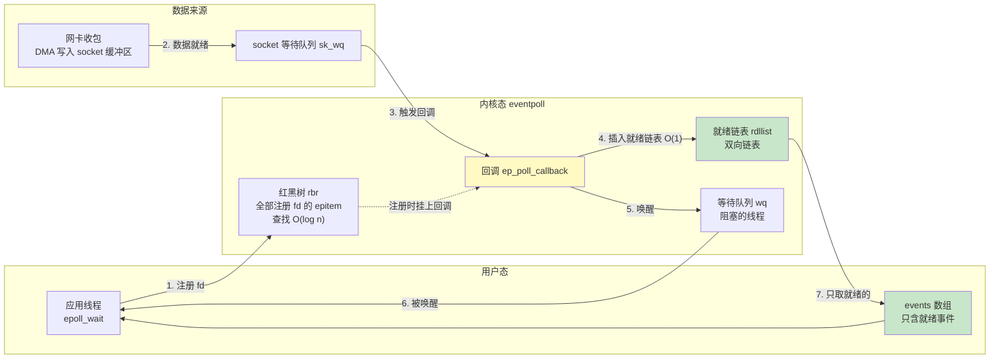
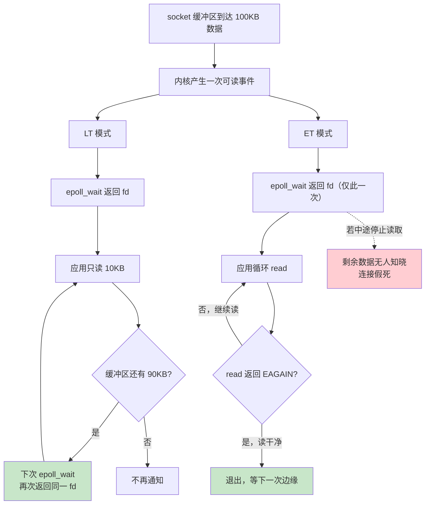
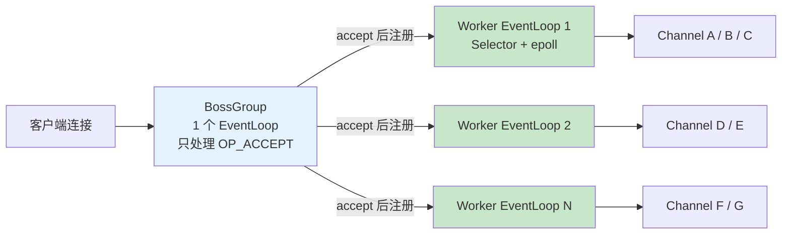

# epoll 与 IO 多路复用

> 定位：NIO、Netty、Redis、Nginx 全站在同一个地基上——epoll。上一篇《BIO、NIO、AIO 与零拷贝》讲了 Java 层的三套 IO 模型和零拷贝，这一篇往下钻一层，把「五种 IO 模型的阻塞点到底在哪」「select 为什么会被淘汰」「epoll 的红黑树和就绪链表怎么做到 O(1)」「LT 和 ET 到底差在哪、为什么 ET 必须配非阻塞」这些面试和线上都会撞上的问题讲透。看完你应该能对着 `strace` 的输出解释一个连接从网卡中断到 `epoll_wait` 返回的完整路径。

## 一、为什么需要 IO 多路复用

### 1.1 从一个数字说起：C10K

1999 年 Dan Kegel 提出 C10K 问题：**如何让一台服务器同时处理一万个连接**。用 BIO 的思路，答案很粗暴——一万个连接就开一万个线程。

算一笔账：

| 开销项 | 数量级 | 一万连接的代价 |
|---|---|---|
| 线程栈 | Java 默认 `-Xss1m`，glibc 默认 8MB | 10GB 虚拟内存（Java 实际提交约 1GB） |
| 内核 task_struct | 约 2-4KB | 几十 MB，尚可接受 |
| 上下文切换 | 1-5 微秒/次 | 线程一多，调度器本身吃掉大量 CPU |
| 内存拷贝 | 每线程独立缓冲区 | 缓存局部性极差，CPU cache 频繁失效 |

更致命的是：**一万个连接里，同一时刻真正有数据的可能只有几十个**。剩下 9900 多个线程都在 `read()` 上睡着，占着栈、占着调度配额，什么也不干。

所以矛盾的本质是：**连接数 ≫ 活跃连接数**。IO 多路复用就是针对这个矛盾设计的——**用少量线程盯住大量 fd，只处理真正就绪的那几个**。

### 1.2 多路复用的三个层次

「多路复用」这个词在不同语境下指不同东西，先分清：

| 层次 | 复用的是什么 | 代表 |
|---|---|---|
| **IO 多路复用** | 一个线程复用给多个连接的等待过程 | select / poll / epoll |
| **连接复用** | 一条 TCP 连接复用给多个请求 | HTTP Keep-Alive、多路复用（HTTP/2 Stream） |
| **线程复用** | 一个线程复用给多个任务 | 线程池 |

这篇只讲第一层。它是后两层能成立的前提——没有 epoll，一个线程根本没法同时「看着」上万个连接。

## 二、五种 IO 模型：阻塞点到底在哪

### 2.1 先建立「两阶段」心智模型

一次网络读操作，内核里实际分两步：

1. **等待数据就绪**：数据从网卡 → DMA 写入内核 socket 接收缓冲区。这期间可能什么都没有。
2. **拷贝数据**：把数据从内核缓冲区 `copy_to_user` 到用户缓冲区。

> 注意：很多文章说「两次拷贝」是指「网卡→内核」「内核→用户」。前者是 DMA，不占 CPU；后者是 CPU 拷贝，是真正消耗的地方。

**五种 IO 模型的全部差异，就是这两个阶段里应用线程在干什么。** 把这一点记住，后面所有对比都是它的推论。

### 2.2 五种模型逐一拆解

**（1）阻塞 IO（Blocking IO）**

`read()` 一调用就阻塞，两个阶段全程挂着。数据没来就睡，数据来了被唤醒、拷贝完才返回。

优点：编程模型最简单，一个连接一个线程，代码是顺序的。
缺点：线程利用率极低，连接数上不去。

**（2）非阻塞 IO（Non-blocking IO）**

把 fd 设成 `O_NONBLOCK`，`read()` 立刻返回：有数据就返回数据，没数据返回 `-1` 并置 `errno = EAGAIN`。

第一阶段不阻塞了，但**应用必须自己循环重试**——这就是「轮询」。一万个连接就要循环一万次 `read()`，绝大部分是无意义的系统调用，CPU 空转。**非阻塞 IO 单独使用几乎没有工程价值**，它的价值在于作为多路复用的零件。

**（3）IO 多路复用（IO Multiplexing）**

把「轮询哪些 fd 就绪」这件事**交给内核**：应用阻塞在 `select`/`poll`/`epoll_wait` 上，内核告诉你有哪几个 fd 就绪，然后你只对这几个 fd 调 `read()`。

注意：**`read()` 那一步还是阻塞的**（拷贝阶段），所以多路复用本质上仍是**同步 IO**。它优化的是「等待」，不是「拷贝」。

一个反直觉的点：连接很少时，多路复用比阻塞 IO **更慢**——多了一次 `select` 系统调用和一次 fd 集合遍历。它的收益只在连接数大、活跃比例低时才体现。

**（4）信号驱动 IO（Signal-driven IO）**

用 `sigaction` 注册 `SIGIO` 信号处理函数，把 fd 的属主设为当前进程。数据就绪时内核发 `SIGIO`，应用在信号处理函数里再去 `read()`（这一步阻塞）。

第一阶段完全不阻塞，也不用轮询。但工程上问题很多：

- 信号是**异步打断**，处理函数里能做的事极其有限（不能调非异步信号安全的函数）
- 标准信号**不排队**，多个 fd 同时就绪可能只收到一个 `SIGIO`，会丢事件
- 高并发下信号风暴本身是灾难

所以网络编程里基本没人用，只在某些嵌入式/串口场景见得到。

**（5）异步 IO（Asynchronous IO）**

`aio_read()` 提交请求后立刻返回，**内核负责等数据 + 拷贝到用户缓冲区 + 完成后通知**。两个阶段都不阻塞应用线程。

这才是 POSIX 定义下真正的「异步」。但要澄清一个流传很广的误解：

- Linux 原生 AIO（`io_submit`/`io_getevents`）**只对文件 IO 有效**（还要求 O_DIRECT），对 socket 长期不支持
- **Java 的 AIO 在 Linux 上底层是 epoll + 线程池模拟的**，并不是内核级异步
- Linux 5.1 引入的 **io_uring** 才是统一的、真正高性能的异步接口，但生态成熟度还在追赶

所以「AIO 性能最好」这句话在 Linux 网络编程里是不成立的，Netty 至今主推 NIO 而不是 AIO，原因就在这里。

### 2.3 五种模型对比

| 模型 | 阶段一：等数据 | 阶段二：拷贝 | 系统调用 | 应用线程阻塞点 | 典型使用 |
|---|---|---|---|---|---|
| **阻塞 IO** | 阻塞 | 阻塞 | `read` | 全程 | 传统 Socket、BIO |
| **非阻塞 IO** | 轮询，不阻塞 | 阻塞 | `read` 循环 | 拷贝时 | 几乎不单独用 |
| **IO 多路复用** | 阻塞在 `select`/`epoll_wait`（可同时等多个 fd） | 阻塞 | `select` + `read` | 等待 + 拷贝 | Netty、Redis、Nginx |
| **信号驱动 IO** | 不阻塞，`SIGIO` 通知 | 阻塞 | `sigaction` + `read` | 拷贝时 | 极少 |
| **异步 IO** | 不阻塞 | 不阻塞（内核完成） | `aio_read` | 无 | io_uring、Windows IOCP |


看图的方法：**红色块是线程被阻塞的阶段**。前四种模型都至少有一个红色块，只有第五种（异步 IO）全程绿色。这就是「同步」和「异步」的分界线——**拷贝阶段由谁做**。多路复用再快也还是同步，因为它最后仍要应用线程自己 `read`。

## 三、从 select 到 epoll：多路复用的演进

### 3.1 select：位图 + 全量遍历

`select` 的接口长这样：

```c
int select(int nfds, fd_set *readfds, fd_set *writefds,
           fd_set *exceptfds, struct timeval *timeout);
```

`fd_set` 是一个**位图**，每一位对应一个 fd 号。用法是：把关心的 fd 用 `FD_SET` 置位，调 `select`，返回后遍历检查哪些位还在。

```c
fd_set readfds;
FD_ZERO(&readfds);
FD_SET(listen_fd, &readfds);
int maxfd = listen_fd;
/* 把每个连接 fd 都塞进去 */
for (int i = 0; i < conn_cnt; i++) {
    FD_SET(conn_fd[i], &readfds);
    if (conn_fd[i] > maxfd) maxfd = conn_fd[i];
}
struct timeval tv = {5, 0};
int n = select(maxfd + 1, &readfds, NULL, NULL, &tv);
if (n > 0) {
    for (int fd = 0; fd <= maxfd; fd++) {   /* O(n) 遍历 */
        if (FD_ISSET(fd, &readfds)) {
            /* 处理这个 fd */
        }
    }
}
```

它有三个结构性缺陷：

| 缺陷 | 具体表现 | 后果 |
|---|---|---|
| **数量上限** | `fd_set` 大小由编译期常量 `FD_SETSIZE` 决定，默认 **1024** | fd 号 ≥ 1024 直接没法用，改它要重编 glibc |
| **每次全量拷贝** | 每次调用都要把位图 `copy_from_user` 进内核，返回时再 `copy_to_user` 回来 | 连接越多，拷贝开销线性增长 |
| **O(n) 轮询** | 内核遍历所有 fd 检查就绪，应用返回后还要再遍历一遍找是哪个 | 活跃连接很少时，99% 的遍历是浪费 |

还有个隐蔽的坑：**`select` 返回时会把 `fd_set` 就地改成「只剩就绪的」**。所以下一次循环前必须重新 `FD_ZERO` + `FD_SET` 重建整个集合。这意味着每轮都要重新拼一遍位图，代码又臭又容易漏。

### 3.2 poll：解决数量，不解决遍历

`poll` 把位图换成了数组：

```c
struct pollfd {
    int   fd;       /* 文件描述符 */
    short events;   /* 关心的事件，入参 */
    short revents;  /* 实际发生的事件，出参 */
};

int poll(struct pollfd *fds, nfds_t nfds, int timeout);
```

改进点：

- **没有 1024 限制**，能监听多少取决于 `RLIMIT_NOFILE`
- **入参和出参分离**（`events` 不被破坏，只有 `revents` 被填），不用每轮重建整个集合

但**核心问题一个没解决**：每次调用仍要把整个 `pollfd` 数组拷进内核，内核仍要 O(n) 遍历所有 fd，应用返回后仍要 O(n) 遍历找 `revents != 0` 的。

poll 是「改良版 select」，不是「下一代」。真正的代际跃迁是 epoll。

### 3.3 epoll：注册与等待分离

epoll 把「注册 fd」和「等待事件」拆成了两个独立的系统调用，这是它一切优势的来源：

```c
int epoll_create1(int flags);                                   /* 创建实例 */
int epoll_ctl(int epfd, int op, int fd, struct epoll_event *ev); /* 增删改 */
int epoll_wait(int epfd, struct epoll_event *events,
               int maxevents, int timeout);                      /* 等待就绪 */
```

`epoll_ctl` 的 `op` 有三个值：`EPOLL_CTL_ADD`（注册）、`EPOLL_CTL_MOD`（修改关注事件）、`EPOLL_CTL_DEL`（删除）。

```c
int epfd = epoll_create1(EPOLL_CLOEXEC);   /* 注意：size 参数已废弃 */
struct epoll_event ev, events[1024];

ev.events = EPOLLIN;                        /* 不写 EPOLLET 就是默认的 LT */
ev.data.fd = listen_fd;
epoll_ctl(epfd, EPOLL_CTL_ADD, listen_fd, &ev);   /* 只注册这一次 */

while (1) {
    int n = epoll_wait(epfd, events, 1024, -1);   /* -1 表示永久阻塞 */
    for (int i = 0; i < n; i++) {                 /* 只遍历就绪的 n 个 */
        int fd = events[i].data.fd;
        if (events[i].events & EPOLLIN)  { /* 读 */ }
        if (events[i].events & EPOLLOUT) { /* 写 */ }
        if (events[i].events & (EPOLLERR | EPOLLHUP)) { /* 出错/挂断 */ }
    }
}
```

对比一下三者的本质差异：

| 维度 | select | poll | epoll |
|---|---|---|---|
| 内核数据结构 | 位图 | 数组（链表实现） | **红黑树 + 就绪链表** |
| fd 上限 | `FD_SETSIZE` = 1024 | 无（受 `RLIMIT_NOFILE`） | 无（受 `RLIMIT_NOFILE`） |
| fd 信息拷贝 | **每次调用都全量拷贝** | **每次调用都全量拷贝** | **只在 `epoll_ctl` 注册时拷贝一次** |
| 就绪检测 | 内核 O(n) 遍历 + 应用 O(n) 遍历 | 同 select | **内核回调入队，O(1)**；应用只遍历就绪数 |
| 返回内容 | 整个集合（被修改） | 整个数组（填 `revents`） | **只有就绪的 fd** |
| 触发模式 | 仅 LT | 仅 LT | **LT / ET** |
| 时间复杂度 | O(n) | O(n) | 注册 O(log n)，等待 O(就绪数) |

一句话总结演进逻辑：**select 受限于「位图大小 + 每次重传」；poll 去掉了位图大小限制但仍每次重传、仍全量遍历；epoll 通过「注册一次 + 内核维护状态 + 事件回调」把每次调用的成本从 O(n) 降到了 O(就绪数)。**

## 四、epoll 的数据结构：为什么能做到 O(1)

### 4.1 内核里的两个核心结构

`epoll_create` 会在内核创建一个 `struct eventpoll`（源码在 `fs/eventpoll.c`），关键字段：

| 字段 | 类型 | 作用 |
|---|---|---|
| `rbr` | 红黑树根节点 | **存放所有注册的 fd**，支持 O(log n) 的增删改查 |
| `rdllist` | 双向链表头 | **就绪链表**，只放「有事可做」的 fd |
| `wq` | 等待队列 | 所有阻塞在 `epoll_wait` 上的进程/线程 |
| `ovflist` | 单链表 | 正在向用户态传递事件时，新就绪的 fd 先挂这里，避免链表被破坏 |
| `mtx` / `lock` | 互斥锁 / 自旋锁 | 保护红黑树和就绪链表 |

红黑树里存的不是 fd 本身，而是 `struct epitem`：

```c
struct epitem {
    struct rb_node  rbn;      /* 红黑树节点，挂到 eventpoll->rbr */
    struct list_head rdllink; /* 就绪链表节点，挂到 eventpoll->rdllist */
    struct epoll_filefd ffd;  /* 包含 file 指针和 fd 号 */
    struct epoll_event event; /* 用户注册的关注事件和 data */
    struct eventpoll *ep;     /* 反向指回所属的 eventpoll */
    /* ... 还有等待队列项、poll 表等 */
};
```

注意 `ffd` 里同时有 **file 指针**和 fd 号。原因是同一个文件可能被 `dup` 出多个 fd，只按 fd 号做 key 会冲突，所以红黑树的比较键是 `(file*, fd)` 二元组。这也是为什么 `close(fd)` 之后必须显式 `epoll_ctl(DEL)`——**fd 号被复用后，内核里残留的 epitem 可能指向旧 file**。

### 4.2 注册：一次拷贝 + 挂回调

调用 `epoll_ctl(EPOLL_CTL_ADD)` 时，内核做三件事：

1. 分配一个 `epitem`，把用户传的 `epoll_event`（含 `data`）存进去
2. **调用目标文件的 `poll` 方法**，把 `ep_poll_callback` 注册为该 socket 等待队列（`sk_wq`）的回调函数
3. 把 `epitem` 插入红黑树

第 2 步是关键：**注册的不是「我要监听」，而是一个回调函数指针**。从此这个 socket 的内核对象里就挂着一个指向 epoll 的钩子。

### 4.3 就绪：回调把 epitem 塞进链表

数据到达时的完整链路：

1. 网卡收到包 → 硬中断 → 软中断（NAPI）→ 协议栈处理 → 数据放进 socket 接收缓冲区
2. 协议栈唤醒 socket 的等待队列 `sk_wq`
3. 内核调用之前挂上的 `ep_poll_callback`
4. 回调里把对应的 `epitem` **插入 `rdllist` 就绪链表**（如果还没在里面）
5. 唤醒阻塞在 `wq` 上的 `epoll_wait`

**注意：这里没有任何「遍历所有 fd」的动作。** 是 fd 自己「举手」说「我好了」，而不是内核挨个去问。这就是 O(1) 就绪检测的真正含义——**成本只和「就绪的 fd 数」相关，和「注册的总 fd 数」无关**。

### 4.4 返回：只拷贝就绪事件

`epoll_wait` 被唤醒后：

1. 检查 `rdllist`，为空且没超时就继续睡
2. 非空则把链表上的 `epitem` 逐个取出，把 `event` 拷到用户传入的 `events` 数组，最多 `maxevents` 个
3. 如果是 **LT 模式**，把 `epitem` 重新放回 `rdllist`（下次还会通知）；如果是 **ET 模式**，不再放回



看图重点：**左边红黑树是「花名册」，右边就绪链表是「今天到岗名单」**。数据来了不需要翻花名册，socket 自己通过回调报到。`epoll_wait` 只把「到岗名单」抄给应用，所以总 fd 数从 1 万涨到 100 万，只要活跃的还是那几十个，`epoll_wait` 的成本几乎不变。

### 4.5 澄清一个流传很广的误解：epoll 没有用 mmap

网上大量文章说「epoll 通过 mmap 把内核的就绪队列映射到用户空间，避免拷贝」。**这是错的。**

- `epoll_create` 不调用 `mmap`，内核也不向用户态暴露任何共享内存
- `epoll_wait` 返回时仍然要 `copy_to_user`，把就绪的 `epoll_event` 拷到用户数组
- 真正省掉的拷贝是「**每次调用都重传全量 fd 集合**」，不是「就绪事件的拷贝」

能讲清这一点，比背十句「epoll 用 mmap 所以快」都有说服力。

### 4.6 复杂度小结

| 操作 | 复杂度 | 说明 |
|---|---|---|
| `epoll_ctl(ADD/MOD/DEL)` | O(log n) | 红黑树插入/删除/查找 |
| 数据就绪 | O(1) | 回调直接挂链表 |
| `epoll_wait` | O(k)，k 为就绪数 | 只遍历就绪链表 |
| 内存占用 | O(n) | 每个 fd 一个 epitem，约 100+ 字节 |

所以 epoll 的适用前提是 **n 大、k 小**。如果所有连接都一直活跃（k ≈ n），epoll 相对 select 的优势会被抹平，甚至因为回调开销略慢。

## 五、LT 与 ET：两种触发模式

### 5.1 语义差异

| 模式 | 全称 | 触发条件 | 类比 |
|---|---|---|---|
| **LT** | Level Triggered，水平触发 | **只要缓冲区里还有数据**，每次 `epoll_wait` 都返回 | 门铃一直响，直到你把东西拿完 |
| **ET** | Edge Triggered，边缘触发 | **只在状态发生变化时**（新数据到达）通知一次 | 门铃只响一声，没拿完就自己负责 |

`EPOLLIN` 默认就是 LT，要 ET 必须显式加 `EPOLLET`：

```c
ev.events = EPOLLIN | EPOLLET;   /* 边缘触发 */
```

### 5.2 LT 的行为

假设缓冲区来了 100KB，你一次只读了 10KB 就返回：

- **LT**：下次 `epoll_wait` 立刻又返回这个 fd（因为还有 90KB），你可以慢慢读
- **ET**：不会再有通知了。因为「新数据到达」这个**边缘**已经发生过了，除非对端再发新数据，否则这 90KB 就永远躺在缓冲区里

这就是 ET 最大的坑：**漏读会导致连接假死**——连接还在，但再也收不到数据，直到超时。

### 5.3 ET 的两个强制要求

**要求一：fd 必须设为非阻塞。**

因为 ET 要求「一次事件必须把数据读干净」，标准写法是循环读直到 `EAGAIN`：

```c
/* ET 模式下的标准读循环 */
int flags = fcntl(fd, F_GETFL, 0);
fcntl(fd, F_SETFL, flags | O_NONBLOCK);   /* 必须非阻塞 */

while (1) {
    ssize_t n = read(fd, buf, sizeof(buf));
    if (n > 0) {
        /* 处理数据，继续读 */
        continue;
    }
    if (n == 0) {
        /* 对端关闭 */
        close(fd);
        break;
    }
    if (errno == EAGAIN || errno == EWOULDBLOCK) {
        /* 读干净了，退出循环等下一次事件 */
        break;
    }
    if (errno == EINTR) {
        continue;   /* 被信号打断，重试 */
    }
    /* 其他错误 */
    break;
}
```

如果 fd 是阻塞的，最后一次 `read` 在没数据时会**永远阻塞**，整个事件循环卡死。所以「ET 必须配非阻塞」不是风格建议，是正确性要求。

**要求二：必须处理「读了一半」的边界。**

`read` 返回的数据可能不构成一个完整业务包（TCP 是字节流）。所以 ET 模式下应用必须自己维护缓冲区，把半包攒起来，等下一个包到了再拼。这也是为什么 Netty 的 `ByteToMessageDecoder` 要维护 `cumulation` 累积缓冲区。

### 5.4 为什么 Netty 默认用 LT

这是个高频追问：**ET 明明更高效（通知次数少），为什么 Netty 默认不用？**

| 维度 | LT | ET |
|---|---|---|
| 通知次数 | 多（没读完就重复通知） | 少（只在变化时通知） |
| 编程复杂度 | 低，读一部分也没事 | 高，必须读到 `EAGAIN` |
| 出错后果 | 无（下次还会提醒） | **连接假死**，极难排查 |
| 系统调用次数 | 可能多几次 `epoll_wait` | 少，但 `read` 循环可能多几次 |
| 谁在用 | **Netty 默认、Redis、Java NIO** | Nginx、Netty 可选的 native ET |

核心原因是**取舍**：

1. **LT 更不容易写错**。框架要面向所有使用者，一个「忘记读到 EAGAIN」的 bug 可能在生产上表现为随机连接挂死，排查成本极高。
2. **现代内核下 LT 的性能损失很小**。多几次 `epoll_wait` 返回，相比业务处理的开销可以忽略。
3. **JDK NIO 只支持 LT**。Java 的 `Selector` 抽象没有暴露 ET，Netty 基于 JDK NIO 时想用也用不了；只有走 `netty-transport-native-epoll` 时才能开 ET。

Nginx 敢用 ET，是因为它的 event loop 是自己写的 C 代码，每个 handler 都严格实现了「读到 EAGAIN」，可控性完全不同。



看图的关键：**LT 的循环是「内核反复提醒」，ET 的循环是「应用自己读干净」**。ET 少了一次次返回的开销，但把「不能漏」的责任转移给了应用。红色那条虚线就是 ET 最典型的生产事故。

### 5.5 EPOLLONESHOT：多线程下的补丁

ET 还有个衍生问题：如果多个线程都 `epoll_wait` 同一个 epfd，一个 fd 就绪时可能被**多个线程同时唤醒**，两个线程同时 `read` 同一个 socket，数据顺序就乱了。

`EPOLLONESHOT` 解决这个：注册时带上它，事件触发一次后该 fd 自动从监听集合里「摘掉」，必须显式 `epoll_ctl(MOD)` 重新注册才会再触发。这样能保证**同一时刻只有一个线程处理这个 fd**。

```c
ev.events = EPOLLIN | EPOLLET | EPOLLONESHOT;
/* 线程处理完后必须重新注册 */
epoll_ctl(epfd, EPOLL_CTL_MOD, fd, &ev);
```

代价是每次事件多一次 `epoll_ctl` 系统调用。Netty 没有用这个机制，而是用「一个 Channel 绑定一个 EventLoop 线程」从架构上保证了串行。

## 六、epoll 的生产坑点与排查

### 坑点 1：accept 惊群，新连接来了所有进程都被唤醒

**现象**：多进程（如 Nginx 多 worker、多实例 `SO_REUSEPORT` 之前）同时监听同一个端口，一个新连接到达时，**所有阻塞在 `accept` 的进程都被唤醒**，但只有一个能 `accept` 成功，其余白跑一趟。QPS 高时这种「惊群」会吃掉大量 CPU。

**原因**：内核唤醒等待队列时默认唤醒全部等待者，没有做「只唤醒一个」的优化。

**解法**（三种，按推荐度排序）：

| 方案 | 原理 | 适用 |
|---|---|---|
| **`SO_REUSEPORT`** | 每个进程各自 `bind` 同一端口，内核按四元组哈希分流，**从根上没有共享等待队列** | 多进程/多实例，Linux 3.9+ |
| **`EPOLLEXCLUSIVE`** | `epoll_ctl` 时带上该标志，内核只唤醒一个等待者 | 多进程共享同一个 listen fd，Linux 4.5+ |
| **accept mutex / 只让一个进程监听** | 应用层加锁串行化 accept | 老内核兜底 |

```c
/* Nginx 风格：每个 worker 独立监听 */
int opt = 1;
setsockopt(fd, SOL_SOCKET, SO_REUSEPORT, &opt, sizeof(opt));
```

注意 `SO_REUSEPORT` 有副作用：内核按哈希分流，**长连接可能分布不均**；且进程重启时新进程和老进程会短暂共存，需要配合 `SO_REUSEPORT` 的 BPF 或优雅退出。

### 坑点 2：fd 泄漏，跑几天就 `Too many open files`

**现象**：服务运行一段时间后大量 `accept`/`open` 失败，报 `EMFILE: Too many open files`；`ls /proc/PID/fd | wc -l` 接近 `ulimit -n`。

**原因**（epoll 场景下最常见的三种）：

1. **`close(fd)` 前忘了 `epoll_ctl(DEL)`**。虽然 `close` 会自动把 fd 从 epoll 里移除（内核 `eventpoll_release_file` 会处理），但如果这个 fd 是 `dup` 出来的，**只有最后一个引用关闭才移除**，容易残留。
2. **异常分支没关连接**。`read` 出错、业务抛异常时直接 `return`，socket 没关。
3. **`accept` 返回的 fd 没注册成功**。`epoll_ctl(ADD)` 失败（比如内存不足）后没 `close`。

**排查路径**：

```bash
# 1. 看进程打开了多少 fd
ls /proc/<pid>/fd | wc -l
lsof -p <pid> | wc -l

# 2. 看 fd 类型分布（socket 多还是文件多）
lsof -p <pid> | awk '{print $5}' | sort | uniq -c | sort -rn

# 3. 看系统级总量和上限
cat /proc/sys/fs/file-nr        # 已分配 / 未使用 / 上限
cat /proc/<pid>/limits | grep 'open files'
ulimit -n
```

**解法**：`try-with-resources` / `finally` 保证关闭；Netty 里用 `ChannelFutureListener.CLOSE`；给 `ulimit -n` 调到 65535 以上（注意 systemd 服务要在 unit 文件里设 `LimitNOFILE`，光改 `/etc/security/limits.conf` 不生效）。

### 坑点 3：空轮询 bug，Selector 线程 CPU 100%

**现象**：Java NIO 服务 CPU 打满，但 QPS 很低；`jstack` 看到 `NioEventLoop` 线程一直在 `selector.select()` 里打转，没有阻塞。

**原因**：这是 JDK 的著名 bug（JDK-6670302 等）。在某些情况下（典型是 epoll 的 `epoll_wait` 被信号打断后返回 0，但 JDK 没正确处理），`selector.select()` 会**立即返回 0**，而 `selectedKeys()` 为空，导致 `while(true)` 空转。

**Netty 的解法**：在 `NioEventLoop.run()` 里统计「连续空轮询次数」，超过阈值就**重建 Selector**：

```java
// io.netty.channel.nio.NioEventLoop#select 简化逻辑
int selectCnt = 0;
for (;;) {
    int selectedKeys = selector.select(timeoutMillis);
    selectCnt++;
    if (selectedKeys != 0 || oldWakenUp || wakenUp.get()
            || hasTasks() || hasScheduledTasks()) {
        break;   /* 有事件或有任务，正常退出 */
    }
    if (selectCnt >= SELECTOR_AUTO_REBUILD_THRESHOLD) {  /* 默认 512 */
        rebuildSelector();      /* 新建 Selector，把旧 Channel 重新注册过去 */
        selector.selectNow();
        selectCnt = 1;
        break;
    }
}
```

阈值默认 **512**，可通过 `-Dio.netty.selectorAutoRebuildThreshold=0` 关闭（0 表示不重建）。重建的代价是遍历所有 Channel 重新 `register`，所以阈值不能设太小。

**排查**：`jstack` 看线程栈是否卡在 `sun.nio.ch.EPollArrayWrapper.epollWait` 反复出现；`perf top -p <pid>` 看 `epoll_wait` 是否占据高比例。

### 坑点 4：LT 模式下注册 EPOLLOUT 导致 busy loop

**现象**：加了写事件监听后 CPU 飙升，`epoll_wait` 一直返回同一个 fd 的 `EPOLLOUT`。

**原因**：**socket 绝大多数时间都是「可写」的**。LT 模式下只要发送缓冲区没满，`EPOLLOUT` 就会一直触发。如果你注册了 `EPOLLOUT` 却不写数据，就是死循环。

**解法**：**只在「写不完」时才注册 `EPOLLOUT`，写完立刻取消**：

```c
/* 写数据 */
ssize_t n = write(fd, buf, len);
if (n < len) {
    /* 没写完，把剩余数据存起来，注册 EPOLLOUT 等可写 */
    pending = buf + n;
    ev.events = EPOLLIN | EPOLLOUT;
    epoll_ctl(epfd, EPOLL_CTL_MOD, fd, &ev);
}
/* 在 EPOLLOUT 回调里继续写，写完后取消关注 */
if (写完了) {
    ev.events = EPOLLIN;   /* 去掉 EPOLLOUT */
    epoll_ctl(epfd, EPOLL_CTL_MOD, fd, &ev);
}
```

Netty 的 `ChannelOutboundBuffer` 就是这个逻辑：只有 `isWritable() == false`（水位超限）时才 `interestOps |= OP_WRITE`。

### 坑点 5：`maxevents` 设太小，吞吐上不去

**现象**：连接数和 QPS 都不低，但延迟抖动大，`epoll_wait` 调用次数异常多。

**原因**：`epoll_wait` 一次最多返回 `maxevents` 个事件。如果就绪数经常超过这个值，剩下的要等下一轮，增加了轮次。

**解法**：`maxevents` 一般设 1024~4096（Netty 默认用 `selectStrategy` 动态控制）。但也不能无限大——数组是每次调用都要遍历的，太大浪费。经验值：**等于预期并发峰值的 1/10 到 1/5，且不小于 256**。

### 坑点 6：ET 模式下漏读，连接「假活」

**现象**：连接没断，心跳也在发，但对端发的业务数据就是不处理；`ss` 看 `Recv-Q` 一直大于 0。

**原因**：ET 模式下只读了一次就返回，剩余数据在缓冲区里，**没有新数据到达就不会再触发事件**。

**排查**：

```bash
ss -tn state established '( sport = :8080 )'   # 看 Recv-Q 是否堆积
ss -tni                                        # 看详细的 cwnd、rtt、重传
```

**解法**：严格实现「循环读到 `EAGAIN`」；用 Netty 的话不要自己写 `read`，交给 `ByteToMessageDecoder`；压测时用「大包 + 慢消费」专门构造这个场景。

### 排查工具箱

| 目的 | 命令 |
|---|---|
| 连接总览 | `ss -s` |
| 监听端口 | `ss -lntp` |
| 连接队列 | `ss -lnt`（看 `Send-Q` 是 accept 队列） |
| 进程 fd 数 | `ls /proc/<pid>/fd \| wc -l` |
| fd 类型分布 | `lsof -p <pid>` |
| 系统调用统计 | `strace -f -c -p <pid>` |
| CPU 热点 | `perf top -p <pid>` |
| 内核网络统计 | `cat /proc/net/sockstat` |
| 半连接/全连接溢出 | `nstat -az \| grep -i listen` |

重点看 `TcpExtListenOverflows` 和 `TcpExtListenDrops`：前者是全连接队列满，后者是半连接队列满。两个都非零说明 `backlog` 太小或 accept 太慢。

## 七、epoll 与 Netty 的衔接

### 7.1 NioEventLoop 就是「Selector + 任务队列 + 定时任务」

Netty 的 `NioEventLoop` 本质是一个死循环：

```
for (;;) {
    select();              // 调 epoll_wait，带超时
    处理 IO 事件;           // 读、写、accept
    runAllTasks();         // 跑任务队列
}
```

它把三件事揉在一起：

| 组成 | 作用 |
|---|---|
| `Selector` | 底层 epoll 实例，监听所有注册的 Channel |
| `taskQueue` | 外部线程提交的任务（如 `channel.write()` 从业务线程调用） |
| `scheduledTaskQueue` | 定时任务（心跳、超时） |

关键设计：**一个 Channel 从注册到销毁只绑定一个 EventLoop**。所以同一个连接的所有事件都是串行处理的，`ChannelHandler` 里不用加锁（除非标了 `@Sharable` 被多个 Channel 共享）。

### 7.2 主从 Reactor 模型



- **BossGroup**：通常 1 个线程，只负责 `accept`，把新连接注册到 Worker。因为 `accept` 很快，1 个线程足够。
- **WorkerGroup**：默认 `CPU 核数 × 2` 个 EventLoop，每个管一批 Channel 的读写。
- **为什么是主从而不是单 Reactor**：`accept` 和读写分离，避免新连接建立（涉及 TLS 握手等耗时操作）阻塞已有连接的 IO。

### 7.3 JDK NIO 与 native epoll 的差别

| 维度 | JDK NIO（`NioEventLoop`） | native epoll（`EpollEventLoop`） |
|---|---|---|
| 底层 | JDK 的 `EPollArrayWrapper`，JNI 调 epoll | 直接 JNI 调 epoll，无 JDK 中间层 |
| 触发模式 | **只有 LT** | **支持 ET**（`EpollMode.EDGE_TRIGGERED`） |
| 额外能力 | 无 | `TCP_CORK`、`SO_REUSEPORT`、`EPOLLEXCLUSIVE` 等 |
| 性能 | 够用 | 略高（少一层封装、支持 ET） |
| 依赖 | 无 | 需要 `netty-transport-native-epoll` + Linux |

引入方式：

```xml
<dependency>
    <groupId>io.netty</groupId>
    <artifactId>netty-transport-native-epoll</artifactId>
    <classifier>linux-x86_64</classifier>
</dependency>
```

```java
EventLoopGroup boss = new EpollEventLoopGroup(1);
EventLoopGroup worker = new EpollEventLoopGroup();
ServerBootstrap b = new ServerBootstrap();
b.group(boss, worker)
 .channel(EpollServerSocketChannel.class)   // 换成 Epoll 实现
 .childOption(EpollChannelOption.EPOLL_MODE, EpollMode.EDGE_TRIGGERED);
```

**但生产上大多数场景用 JDK NIO 就够了**。native epoll 的收益主要在「连接数极大 + 短包多」的场景，普通业务感知不到。而且 native 传输多一个 so 文件依赖，跨平台部署更麻烦。

### 7.4 Netty 对 epoll 坑点的兜底

| epoll 坑 | Netty 的处理 |
|---|---|
| 空轮询 | `selectCnt >= 512` 时 `rebuildSelector()` |
| accept 惊群 | 支持 `SO_REUSEPORT`（`EpollChannelOption.SO_REUSEPORT`） |
| fd 泄漏 | `Channel` 生命周期管理，`closeFuture` 保证释放 |
| `EPOLLOUT` busy loop | `ChannelOutboundBuffer` 水位控制，写不出去才注册 |
| ET 漏读 | `EpollEventLoop` 内部实现「读到 EAGAIN」的循环 |
| 半包 | `ByteToMessageDecoder` 维护累积缓冲区 |

## 八、最佳实践与选型

1. **优先用成熟框架，别手写 epoll**。Netty、Redis、Nginx 把坑都趟过了，手写的 NIO 大概率会踩空轮询、半包、fd 泄漏。
2. **默认用 LT**。除非你有明确的性能瓶颈且能保证每个 handler 都读到 `EAGAIN`，否则 ET 带来的收益远小于风险。
3. **ET 三件套缺一不可**：`EPOLLET` + `O_NONBLOCK` + 循环读到 `EAGAIN`。
4. **`EPOLLOUT` 按需注册**。只在写不完时加，写完立刻去掉，否则 busy loop。
5. **多进程监听用 `SO_REUSEPORT`**，比 `EPOLLEXCLUSIVE` 更彻底，还能顺带做负载均衡。
6. **fd 上限要提前调**。`ulimit -n` 至少 65535，systemd 服务记得改 unit 文件的 `LimitNOFILE`。
7. **监控三个指标**：`TcpExtListenOverflows`（全连接队列溢出）、`TcpExtListenDrops`（半连接队列溢出）、进程 fd 使用率。前两个非零就加 `backlog` 或加 worker。
8. **`backlog` 不是越大越好**。`somaxconn` 默认 4096，`backlog` 超过它会被截断；队列太长会让客户端感知的「连接成功」延迟变大。
9. **排查 CPU 100% 先看是不是空轮询**：`jstack` 看是否卡在 `epollWait`，`perf top` 看 `epoll_wait` 占比，确认后升级 Netty 或调 `selectorAutoRebuildThreshold`。

### 选型速查

| 场景 | 推荐 |
|---|---|
| Java 高并发网络服务 | Netty（JDK NIO，LT） |
| 极致性能、连接数十万 | Netty + native epoll（可开 ET） |
| 需要自己写 C 服务 | epoll + LT 起步，压测后再考虑 ET |
| 连接数 < 1000 且简单 | BIO 反而更省事 |
| 纯文件 IO 高吞吐 | io_uring（新）或 AIO + O_DIRECT |

## 九、面试高频问法

> 答案按「能讲透」的标准写：先一句话结论，再展开机制，最后给加分点。

**Q1：五种 IO 模型有什么区别？**

**一句话结论**：区别只在两个阶段——「等数据」和「拷贝数据」——谁阻塞；前四种至少有一个阶段阻塞应用线程，只有异步 IO 两个阶段都不阻塞。

展开：

| 模型 | 等数据 | 拷贝 | 是否同步 |
|---|---|---|---|
| 阻塞 IO | 阻塞 | 阻塞 | 同步 |
| 非阻塞 IO | 轮询 | 阻塞 | 同步 |
| IO 多路复用 | 阻塞在 select/epoll | 阻塞 | 同步 |
| 信号驱动 | 信号通知 | 阻塞 | 同步 |
| 异步 IO | 不阻塞 | 内核完成 | 异步 |

**加分点**：指出「IO 多路复用本质是同步 IO，因为最后的 `read` 拷贝还是要应用自己做」，并补充「Linux 原生 AIO 只支持文件，Java AIO 在 Linux 是 epoll 模拟的，真正的异步要等 io_uring」。

**Q2：select、poll、epoll 有什么区别？**

**一句话结论**：select 有位图上限且每次全量拷贝 + O(n) 遍历；poll 去掉了数量限制但仍全量拷贝 + O(n) 遍历；epoll 用「注册一次 + 红黑树 + 就绪链表」把每次调用的成本降到 O(就绪数)。

展开：

| 维度 | select | poll | epoll |
|---|---|---|---|
| 数据结构 | 位图 | 数组 | 红黑树 + 就绪链表 |
| fd 上限 | 1024 | 无 | 无 |
| 拷贝 | 每次全量 | 每次全量 | 注册时一次 |
| 遍历 | O(n) | O(n) | O(k) |
| 触发模式 | LT | LT | LT/ET |

**加分点**：说「select 返回会破坏 fd 集合，每轮都要重建；poll 用 `events`/`revents` 分离解决了这个问题，但没解决拷贝和遍历」。

**Q3：epoll 为什么高效？底层数据结构是什么？**

**一句话结论**：内核用红黑树存所有注册的 fd，用就绪链表存「有事可做」的 fd，fd 就绪时通过回调主动入链，`epoll_wait` 只取链表，所以成本只和就绪数相关。

展开：

- `struct eventpoll` 有 `rbr`（红黑树）、`rdllist`（就绪链表）、`wq`（等待队列）
- `epoll_ctl(ADD)` 时分配 `epitem`，调用目标文件的 `poll` 方法注册 `ep_poll_callback`，插入红黑树
- 数据到达 → 协议栈唤醒 socket 等待队列 → 回调把 `epitem` 插入 `rdllist` → 唤醒 `epoll_wait`
- `epoll_wait` 只遍历 `rdllist`，把事件拷到用户数组

**加分点**：澄清「epoll 没有用 mmap，`epoll_wait` 仍要 `copy_to_user`，省掉的是每次重传全量 fd 集合」——这一点能立刻区分背八股和真读过源码。

**Q4：LT 和 ET 的区别？为什么 ET 必须配非阻塞？**

**一句话结论**：LT 是「缓冲区有数据就通知」，ET 是「状态变化才通知一次」；ET 要求一次把数据读干净，只有非阻塞 fd 才能用「循环 read 到 EAGAIN」实现这一点。

展开：

- LT 默认，读不完下次还提醒，容错好
- ET 必须 `EPOLLET`，只通知一次，漏读就假死
- ET 的读循环：`read` 返回 `EAGAIN` 才算读完；阻塞 fd 的最后一次 `read` 会永久阻塞，卡死整个 event loop

**加分点**：说「Netty 默认用 LT，因为 JDK NIO 只支持 LT，而且 LT 更不容易写错；Nginx 用 ET 是因为它自己控制每个 handler 都实现了读到 EAGAIN」。

**Q5：epoll 是同步还是异步？**

**一句话结论**：同步。epoll 只解决了「等数据」阶段的效率，数据就绪后仍要应用线程自己调 `read` 把数据从内核拷到用户态。

展开：POSIX 定义里，异步 IO 要求「内核完成拷贝并通知」，epoll 的 `epoll_wait` 只告诉你「可以读了」，拷贝这一步还是同步的。

**加分点**：补充「所以 Netty 是异步框架但不是异步 IO——它的『异步』是指线程模型（回调/ Future），底层仍是同步非阻塞 IO」。

**Q6：什么是惊群？怎么解决？**

**一句话结论**：多个进程/线程阻塞在同一资源上，事件到来时全部被唤醒但只有一个能处理，其余白跑；用 `SO_REUSEPORT` 或 `EPOLLEXCLUSIVE` 解决。

展开：

- accept 惊群：多进程监听同一端口
- `SO_REUSEPORT`（3.9+）：每个进程独立 bind，内核按四元组哈希分流，从根上消除共享等待队列
- `EPOLLEXCLUSIVE`（4.5+）：共享同一个 epoll 时只唤醒一个
- 老方案：accept mutex

**加分点**：说「`SO_REUSEPORT` 有分布不均的问题，长连接场景要配合 BPF 或一致性哈希；进程重启时会短暂双绑，要做优雅退出」。

**Q7：Netty 的空轮询 bug 是什么？怎么解决的？**

**一句话结论**：JDK NIO 在某些情况下 `select()` 立即返回 0 导致 `while(true)` 空转，Netty 通过统计连续空轮询次数、超过 512 次就重建 Selector 来解决。

展开：

- 现象：CPU 100%，QPS 很低，`jstack` 看到卡在 `epollWait` 反复返回
- 根因：JDK 对 `epoll_wait` 被信号打断的返回值处理有缺陷
- Netty：`selectCnt >= SELECTOR_AUTO_REBUILD_THRESHOLD`（默认 512）时 `rebuildSelector()`

**加分点**：说「重建的代价是遍历所有 Channel 重新注册，所以阈值不能太小；可以用 `-Dio.netty.selectorAutoRebuildThreshold` 调整，设 0 关闭」。

**Q8：`epoll_wait` 返回后还需要 `read` 吗？`read` 会不会阻塞？**

**一句话结论**：必须 `read`，`epoll_wait` 只告诉你「可读」不代表数据已经在你手里；LT 下 `read` 可能阻塞（如果数据被别的线程读走），所以生产上 fd 一律设非阻塞。

展开：

- `epoll_wait` 返回的是「就绪状态」，数据还在内核 socket 缓冲区
- 多线程场景下可能被其他线程抢先读走，此时阻塞 fd 的 `read` 会挂住
- 所以即使 LT，也建议 `O_NONBLOCK`，读到 `EAGAIN` 就返回

**加分点**：说「这也是为什么 Netty 的所有 socket 都是非阻塞的，即使它用 LT」。

**Q9：一个 epoll 实例能管理多少连接？瓶颈在哪？**

**一句话结论**：理论上受 `RLIMIT_NOFILE` 和内存限制，百万级没问题；真正的瓶颈在内存（每个连接的内核缓冲区 + 应用缓冲区）和「活跃连接的处理能力」。

展开：

- fd 上限：`ulimit -n` / `/proc/sys/fs/file-max`
- 内存：每个 TCP 连接的内核缓冲区默认几 KB 到几 MB（`net.ipv4.tcp_rmem`/`tcp_wmem`），加上应用层缓冲区
- CPU：活跃连接多时，事件处理本身是瓶颈
- 端口：作为客户端时受 `ip_local_port_range` 限制

**加分点**：说「C1000K 的瓶颈通常不是 epoll，而是内存和协议栈参数，比如 `tcp_mem`、`somaxconn`、conntrack 表大小」。

**Q10：为什么 LT 模式下不能一直注册 `EPOLLOUT`？**

**一句话结论**：socket 大部分时间都是可写的，LT 会不断返回 `EPOLLOUT`，如果没数据可写就是 busy loop 把 CPU 打满。

展开：只在 `write` 返回「没写完」时才注册 `EPOLLOUT`，写完立刻 `epoll_ctl(MOD)` 去掉。Netty 用 `ChannelOutboundBuffer` 的水位机制做这件事。

**加分点**：说「`EPOLLOUT` 的正确用法是『等待可写』而不是『监听可写』，语义搞反就是 CPU 100%」。

**Q11：epoll 和 Reactor 模式是什么关系？**

**一句话结论**：epoll 是操作系统提供的「事件通知机制」，Reactor 是基于它构建的「事件分发架构」；epoll 是零件，Reactor 是设计模式。

展开：

- 单 Reactor 单线程：一个线程 select + 处理所有事件（Redis）
- 单 Reactor 多线程：一个线程 select，业务丢线程池
- 主从 Reactor：Boss 管 accept，Worker 管读写（Netty）

**加分点**：说「Netty 的 `EventLoop` 就是 Reactor 的载体，一个 EventLoop 一个线程一个 Selector，Channel 绑定 EventLoop 保证串行」。

**Q12：Redis 单线程为什么也很快？和 epoll 什么关系？**

**一句话结论**：Redis 用 epoll 做多路复用，一个线程处理上万连接；快的原因还有纯内存操作、单线程无锁无切换、高效数据结构、RESP 协议简单。

展开：

- epoll 让单线程能盯住大量连接，只处理活跃的
- 所有操作在内存完成，没有磁盘 IO（持久化是异步/子进程）
- 单线程避免了锁竞争和上下文切换
- 6.0 之后网络 IO 多线程，但命令执行仍是单线程

**加分点**：说「Redis 的单线程瓶颈在 CPU 和单核，不在 IO 等待——因为 epoll 已经把等待成本摊掉了；真正的瓶颈是命令执行和内存带宽」。

## 小结

- **两阶段模型**是理解一切 IO 模型的钥匙：等数据 + 拷数据，五种模型的差别就是这两个阶段谁阻塞。
- **多路复用本质是同步 IO**：epoll 优化的是「等待」，不是「拷贝」；最后的 `read` 仍由应用线程完成。
- **select → poll → epoll 的演进主线**：select 受限于 1024 位图 + 每次全量拷贝 + O(n) 遍历；poll 只解决了数量限制；epoll 用「注册一次 + 红黑树 + 就绪链表 + 回调」把每次成本降到 O(就绪数)。
- **epoll 的两个核心结构**：红黑树存所有 fd（`epitem`），就绪链表存有事可做的 fd；fd 就绪时通过 `ep_poll_callback` 主动入链，不靠轮询。
- **LT 是默认且更安全**，ET 更高效但必须「非阻塞 + 读到 EAGAIN」，漏读就是连接假死；Netty 默认 LT，Nginx 用 ET。
- **三大生产坑**：accept 惊群（`SO_REUSEPORT`/`EPOLLEXCLUSIVE`）、fd 泄漏（`ulimit` + 生命周期管理）、空轮询（Netty 512 次重建 Selector）。
- **排查靠三件套**：`ss` 看连接和队列、`lsof`/`/proc/<pid>/fd` 看 fd、`strace`/`perf` 看系统调用和 CPU 热点。
