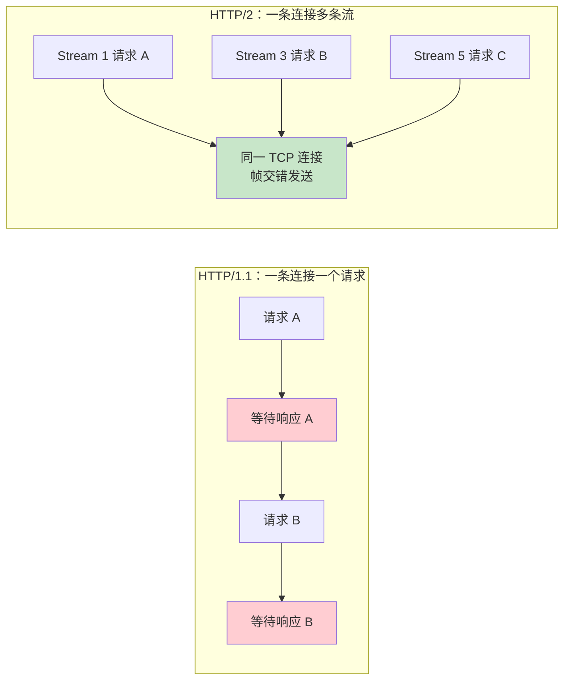
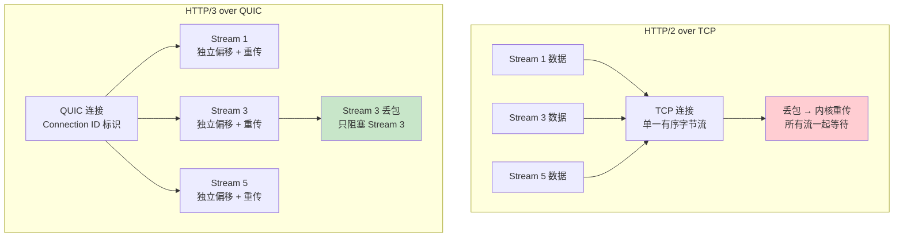
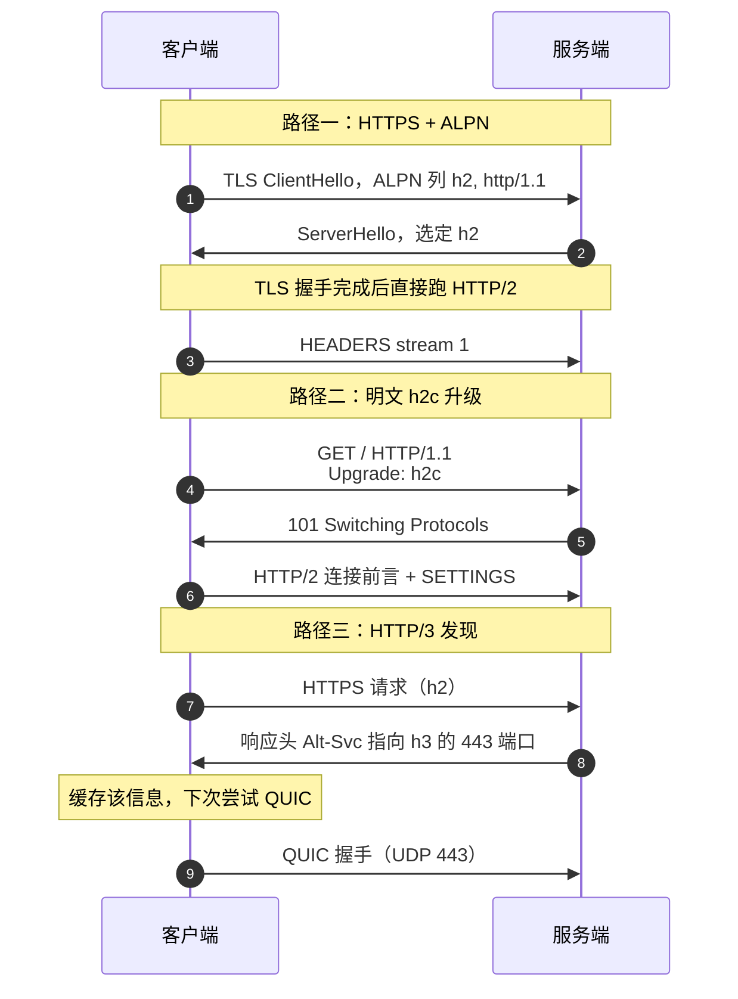

# HTTP 协议演进：HTTP/1.1 到 HTTP/3

> 定位：传输层的三次握手、TIME_WAIT、拥塞控制已在[《TCP/IP 协议栈深度》](02-TCP-IP协议栈深度.md)讲透，但决定「一个页面要发多少请求、请求怎么排队、丢一个包会不会拖死全站」的是 HTTP 应用层。这一篇把 HTTP/1.1 的队头阻塞、HTTP/2 的分帧与多路复用、HTTP/3 基于 QUIC 的重构串成一条线，落点在 Java：Spring Boot 怎么开 h2/h2c、JDK HttpClient 的边界在哪、代理不支持 h2 时会怎样。

## 一、为什么需要它

先看三个线上场景，共同点是「网络没坏、服务没挂，性能就是不达标」：

**场景一：首页 40 个静态资源，只用了 6 条连接**。浏览器对同一域名通常只开 6 条并发连接，40 个资源排队，每个请求都要等前面的响应——这是应用层队头阻塞（Head-of-Line Blocking，下称 HOL）。于是有了域名分片、雪碧图、资源内联这些「HTTP/1.1 时代的补丁」。

**场景二：升级 h2 后，弱网下反而更慢**。HTTP/2 把并发收敛成 1 条 TCP 连接，所有流共享同一条拥塞窗口和重传队列。一旦丢包，**TCP 重传期间所有流一起停等**——这是 TCP 层 HOL，HTTP/2 在协议层绕不过去。

**场景三：网关不支持 h2，后端开了 h2 之后 502**。客户端 h1.1 连 Nginx，Nginx 用 h2 回源 Tomcat，某一跳不理解 `:authority` 伪首部或拒绝 h2c 升级，连接就断或返回 421。

要在这三个场景里做对判断，必须能回答：**当前这一跳用的是哪个 HTTP 版本、它的并发模型是什么、瓶颈在应用层还是传输层**。这一篇按这个顺序展开。

## 二、核心原理

### 2.1 HTTP/1.1 持久连接：只省了建连，没省排队

HTTP/1.0 默认每个请求一条 TCP 连接，结束就 `close`，每个请求都要付一次三次握手 + 慢启动，HTTPS 再加一次 TLS 握手。HTTP/1.1 引入**持久连接（Keep-Alive）**：默认不关连接，后续请求复用同一条 TCP。

但 HTTP/1.1 的请求-响应严格串行：同一条连接上，第二个请求必须等第一个响应收完才能发。所以持久连接只是把「N 次建连」变成「1 次建连 + N 次排队」，**排队问题一点没解决**。浏览器的对策是同域多开约 6 条连接，再叠加域名分片、资源合并、内联这些手段——它们全是**在协议缺陷上打补丁**，也正是 HTTP/2 要推翻的东西。



读图要点：HTTP/1.1 的红色块是「连接被占着但没传数据」的空闲等待；HTTP/2 把三个请求拆帧交错发送，消除了这段等待。但它们仍共享同一条 TCP 连接，这为后续所有问题埋下伏笔。

### 2.2 pipeline 为什么失败

HTTP/1.1 其实有「多路复用雏形」——**pipeline**：客户端不等响应，连续把多个请求写进同一条连接。它在工程上失败有四个原因：

1. **响应必须按请求顺序返回**。HTTP/1.1 没有流 ID，只能靠 FIFO 对应请求与响应。第一个请求慢，后面全部等——**HOL 只是从客户端搬到了服务端**。
2. **失败后无法可靠恢复**。某个响应出错时，客户端不知道哪些请求已执行，重试可能重复下单。
3. **中间设备不兼容**。老代理、CDN、负载均衡器对 pipeline 处理不一致，有的缓冲、有的乱序、有的直接断连。
4. **没有单请求取消机制**。一个请求出错往往要整条连接重来。

所以浏览器默认关闭 pipeline。**HTTP/2 不是优化 pipeline，而是换了模型**：给每个请求分配 stream ID，响应可乱序，出错只重置单条流。

### 2.3 HTTP/2：二进制分帧把一条连接拆成多条虚拟流

HTTP/2（RFC 7540，2022 年由 RFC 9113 修订）的核心只有一句：**在一条 TCP 连接上，用二进制帧承载多条并发的逻辑流（Stream）**。

| 帧类型 | 作用 |
|---|---|
| `HEADERS` | 承载压缩后的头部，同时标识所属 stream |
| `DATA` | 承载 body，受流控窗口约束 |
| `SETTINGS` | 协商初始窗口、最大并发流数、头部表大小 |
| `WINDOW_UPDATE` | 增加流控信用 |
| `RST_STREAM` | 只终止某条流，不影响连接 |
| `GOAWAY` | 优雅关闭，告知最后处理的 stream ID |

三个关键设计：**Stream ID**（客户端奇数、服务端偶数，单调递增不复用，让乱序响应可解析）；**帧交错**（一条流的 `HEADERS` 后可以插入别的流的 `DATA`，接收方按 ID 重组，这是多路复用的物理实现）；**单连接**（同源共用一条连接，省握手、省慢启动、只维护一份拥塞状态）。

代价同样明确：

1. **TCP 层 HOL 消除不了**。一条连接共享同一个 TCP 接收缓冲区，丢一个包，所有流都得等重传。弱网下 h2 可能不如 h1 的 6 条连接——因为 h1 丢包只影响其中一条。
2. **`GOAWAY` 影响被放大**。服务端一次优雅关闭会让这条连接上所有流一起失败，客户端要重连并重放。
3. **并发上限成了新排队点**。`SETTINGS_MAX_CONCURRENT_STREAMS` 决定单连接能同时跑多少流，超过就等。

### 2.4 HPACK：把重复的 Header 压成索引

HTTP/1.1 的头部是纯文本，每个请求都重复发 `User-Agent`、`Cookie`、`Accept-*`。HTTP/2 用 **HPACK（RFC 7541）** 压缩：

- **静态表**：61 个高频头部预定义索引，如 `:method: GET` 是索引 2，直接发一个字节。
- **动态表**：每条连接维护一个有容量上限的 FIFO 表，出现过的头部值下次只发索引；容量通过 `SETTINGS_HEADER_TABLE_SIZE` 协商。
- **Huffman 编码**：字面量值用静态 Huffman 表压缩。

两个工程要点：**HPACK 是有状态的，必须按序解码**，所以 `HEADERS` + `CONTINUATION` 不能被打断，头部块也不能乱序处理；**动态表大小要匹配**，网关和源站两侧乱调只会降低压缩率甚至解码出错。HTTP/3 改用 **QPACK（RFC 9204）**，用「动态表 + 阻塞流上限」适配 QUIC 的乱序流，代价是可能出现头部阻塞。

### 2.5 流控：HTTP/2 自己的信用机制

HTTP/2 有两层流控，和 TCP 滑动窗口完全独立：

| 层级 | 控制对象 | RFC 默认初始窗口 | 调整方式 |
|---|---|---|---|
| **连接级** | 所有 `DATA` 帧的字节数 | 65,535 字节 | 收方发 `WINDOW_UPDATE` |
| **流级** | 单条 stream 的 `DATA` 字节数 | `SETTINGS_INITIAL_WINDOW_SIZE`，默认 65,535 | 收方发 `WINDOW_UPDATE` |

三个要点：流控是**信用制**，发一帧扣一次、收到更新才恢复；它**只管 `DATA` 不管 `HEADERS`**，头部大小靠 `SETTINGS_MAX_HEADER_LIST_SIZE` 限制；**流控窗口 ≠ TCP 窗口**，前者是「应用愿意收多少」，后者是内核缓冲区。

这解释了一个高频问题：默认 64KB 流窗口在 100ms RTT 下理论吞吐只有约 640KB/s（窗口 / RTT），所以大文件下载必须及时 `WINDOW_UPDATE` 或直接调大初始窗口，否则「开了 h2 反而变慢」。

### 2.6 Server Push 的失败与 103 Early Hints

**Server Push** 曾是多路复用的招牌：服务端在请求 HTML 时用 `PUSH_PROMISE` 主动推送 CSS/JS，省掉「解析 HTML 再请求」的一轮。它在 2022 年被 Chrome 106 移除，原因是设计假设不成立：**推什么很难判断**（不知道客户端缓存里有什么，容易重复下载）、**推了不用就是纯浪费**（用户提前跳转，资源白传）、**抢带宽**（推送资源可能拖慢关键资源）、**实现与 CDN 协同复杂**。

替代方案是 **103 Early Hints（RFC 8297）**：最终响应前先发一个 103，带 `Link: </app.css>; rel=preload`，客户端收到就开始预加载。**由客户端决定是否加载，服务端只提供线索**，不占用推送资源。

```http
HTTP/1.1 103 Early Hints
Link: </assets/app.css>; rel=preload; as=style

HTTP/1.1 200 OK
Content-Type: text/html
```

注意 103 是中间响应，代理/CDN 必须透传，否则客户端看不到；Nginx 开源版长期没有原生支持（以版本为准），落地更多依赖边缘节点或应用直接输出。

### 2.7 HTTP/3：把可靠传输搬进用户态

HTTP/3（RFC 9114）不再跑 TCP，而是跑在 **QUIC（RFC 9000）** 上，QUIC 又跑在 UDP 上。它要解决 HTTP/2 的两个死结：TCP 层 HOL 和握手延迟。

四个核心能力：

1. **流级独立**。QUIC 在传输层实现多条独立有序字节流，每个 stream 有自己的偏移和重传逻辑，**一个流丢包只阻塞这个流**。
2. **1-RTT / 0-RTT 握手**。传输握手与 TLS 1.3 合并，首次 1-RTT，会话恢复可 0-RTT（有重放风险，见坑点 6）。
3. **连接迁移**。用 **Connection ID** 而非四元组标识连接，Wi-Fi 切 4G、NAT 重映射端口都能继续，不用重新握手。
4. **无重传歧义**。包号单调递增、永不复用，ACK 语义明确，RTT 测量和丢包检测比 TCP 更准。



读图要点：左边所有流共享一条 TCP 有序字节流，丢包是全局事件；右边每条流有自己的偏移量，丢包是局部事件。**HTTP/3 的价值不是「绝对更快」，而是「弱网更稳、抖动更小」**。

为什么基于 UDP？**中间设备僵化**：TCP 头部和选项被大量防火墙/NAT 写死，改协议会被丢弃，UDP 是白纸，QUIC 全部在用户态实现并加密；**部署快**：浏览器和 CDN 升级即可，不用等内核普及；**协议一体化**：传输、加密、流控合并设计，不用两套状态机叠加。代价是 UDP 常被企业防火墙拦截，必须能回退 h2，且用户态协议栈 CPU 开销高于内核 TCP。

## 三、关键机制与 Java 落地

### 3.1 三种协议的能力对比

| 维度 | HTTP/1.1 | HTTP/2 | HTTP/3 |
|---|---|---|---|
| 传输层 | TCP | TCP | QUIC（UDP） |
| 数据格式 | 文本 | 二进制分帧 | 二进制分帧 |
| 多路复用 | 无，靠多连接 | Stream | QUIC Stream |
| 应用层 HOL | 严重 | 无 | 无 |
| 传输层 HOL | 有 | **有**（TCP 丢包） | **无** |
| 头部压缩 | 无 | HPACK | QPACK |
| 握手延迟 | TCP + TLS 各一次 | 同左 | 首次 1-RTT，恢复 0-RTT |
| 连接迁移 | 不支持 | 不支持 | 支持 |
| Java 服务端成熟度 | 默认 | 成熟 | 尚早，边缘终结为主 |

### 3.2 协商：ALPN、Upgrade、Alt-Svc



读图要点：**HTTPS 下靠 ALPN 在 TLS 握手内完成协商，零额外往返**；明文 h2c 多一次 `101` 往返且浏览器不支持；HTTP/3 通过 `Alt-Svc` 广告，首次访问仍走 h2，下次才尝试 QUIC。

生产上还有个反向问题：**后端 h2、前端 h1** 时网关要做协议转换，`Connection`、`Upgrade`、`TE`、`:authority` 等头部不能照抄，处理不当就是 400/502。

### 3.3 Tomcat / Jetty / Netty 的支持现状

| 容器 | h2（TLS） | h2c（明文） | h3 | 备注 |
|---|---|---|---|---|
| **Tomcat 10.1 / 11** | 支持，需 ALPN + keystore | 需添加 `Http2Protocol` 升级协议 | 提供可插拔 API，需自行引入实现 | 以 10.1 文档为准 |
| **Jetty 12** | 支持 | 支持 | 提供实验性 HTTP/3 | 生产需评估成熟度 |
| **Netty 4.1** | 支持（`codec-http2`） | 支持 | `netty-incubator-codec-http3` | incubator，非稳定 API |
| **Nginx** | 支持（`http2 on`） | 一般不作为源站 h2c | 1.25.0 起实验性支持 | 版本差异大，看 changelog |

必须澄清几点：**浏览器不会用 h2c**，只在 TLS 上启用 h2，h2c 只适合内网服务间或网关回源；**Tomcat 的 h2 依赖 ALPN**，JDK 9+ 的 JSSE 原生支持，走 OpenSSL 则需要对应版本的 tcnative；**Nginx 1.25.1 起 `listen ... http2` 被 `http2 on;` 取代**，旧配置升级后可能不生效；**Java 服务端直接上 h3 还不是改配置的事**，主流做法是 CDN 终结 h3、回源 h2。

### 3.4 JDK HttpClient 的 HTTP/2

JDK 11 引入的 `java.net.http.HttpClient` 默认就是 HTTP/2，服务端不支持时自动降级到 1.1：

```java
HttpClient client = HttpClient.newBuilder()
        .version(HttpClient.Version.HTTP_2)      // 默认值，显式写出便于排查
        .connectTimeout(Duration.ofSeconds(2))
        .build();

HttpRequest request = HttpRequest.newBuilder()
        .uri(URI.create("https://api.example.com/users/1"))
        .timeout(Duration.ofSeconds(3))
        .header("Accept", "application/json")
        .GET()
        .build();

HttpResponse<String> response = client.send(request, HttpResponse.BodyHandlers.ofString());
System.out.println(response.version());   // HTTP_2 或 HTTP_1_1，用它确认实际协商结果
```

边界（以 JDK 21 为准）：**不支持 HTTP/3**；TLS 下走 ALPN，明文 h2c 支持有限，不要假设它和 curl 的升级行为一致；**连接池内部管理**，没有公开的最大连接数参数，能调的只有 `Executor` 和超时；h2 的 `RST_STREAM` 会表现为 `IOException`，要区分「单流失败可重试」和「连接失败需重连」。

### 3.5 Spring Boot 开启 h2 / h2c

浏览器场景下 TLS 是前提，一个开关即可：

```yaml
server:
  port: 8443
  http2:
    enabled: true
  ssl:
    enabled: true
    key-store: classpath:keystore.p12
    key-store-type: PKCS12
    key-store-password: ${KEYSTORE_PASSWORD}
    key-alias: server
```

Tomcat 会据此在 Connector 上配置 `Http2Protocol` 并通过 ALPN 协商；Jetty 的 `server.http2.enabled=true` 同时覆盖 h2 和 h2c；Undertow 的 HTTP/2 只在 TLS 下生效。

内网确实需要明文 h2c 时，Tomcat 要额外注册升级协议：

```java
@Bean
TomcatConnectorCustomizer h2cCustomizer() {
    return connector -> connector.addUpgradeProtocol(new Http2Protocol());
}
```

验证永远看实际协商结果，而不是看配置：

```bash
openssl s_client -alpn h2 -connect example.com:443 </dev/null 2>/dev/null | grep ALPN
curl -s -o /dev/null -w '%{http_version}\n' --http2 https://example.com/
curl -v --http2 http://127.0.0.1:8080/actuator/health 2>&1 | grep -E 'HTTP/2|101'
```

## 四、生产坑点与排查

### 坑点 1：中间代理不支持 h2，导致降级或 502

**现象**：浏览器显示 `h2`，过一层代理后变 `http/1.1`；或网关到源站开 h2c 后大量 502，源站日志出现 `Invalid HTTP/2 preface`。

**原因**：HTTP/2 是逐跳协议，客户端到 CDN 是 h2，不代表 CDN 到源站也是 h2。某一跳不认识 h2c 升级，或把 `Upgrade`/`Connection` 当普通头透传，就会协议错乱。

**解法**：画清链路图（客户端 → CDN → Nginx → Tomcat）逐跳验证；内部回源优先 TLS + ALPN 而不是 h2c；逐跳头部由代理剥离重建，不能透传；出现 `421 Misdirected Request` 时检查 SNI/`:authority` 与后端虚拟主机是否一致。

### 坑点 2：h2 流控窗口太小，大响应吞吐上不去

**现象**：小接口延迟下降，但文件下载、大 JSON 导出明显慢于 h1；抓包看到发送方频繁等 `WINDOW_UPDATE`。

**原因**：流级初始窗口默认 65,535 字节，接收方不及时发更新（应用读取慢或实现保守），发送方只能停。RTT 越大，限制越明显（吞吐 ≈ 窗口 / RTT）。

**解法**：检查容器的 `http2InitialWindowSize`、`http2MaxConcurrentStreams` 等参数（以版本为准）；应用侧及时消费响应体，不要拿到流后长时间不读；大文件改用分片下载或对象存储直链；对比测试固定 RTT 和丢包率，避免把网络问题误判成协议问题。

### 坑点 3：单连接 + 丢包，弱网下 h2 比 h1 更慢

**现象**：办公网 h2 表现很好，移动端弱网首屏反而变长；抓包显示重传期间所有流都停。

**原因**：h2 把并发收敛到一条 TCP 连接，一个包丢了，后续数据全得等；h1 的 6 条连接在这种情况下反而形成「多路径冗余」。

**解法**：移动端优先上 HTTP/3（若 CDN 支持）；上不了 h3 时关键静态资源可保留少量多连接兜底；监控区分「服务端处理时间」和「客户端感知时间」，弱网问题不能只看服务端 P99。

### 坑点 4：keepalive 超时错配，复用了死连接

**现象**：偶发 `Connection reset`、`Broken pipe`，或 h2 下偶发 `GOAWAY` 后请求失败；低峰期更明显。

**原因**：客户端连接池空闲超时 > 服务端/中间设备 keepalive 超时。连接已被中间设备回收，客户端却以为还活着，复用时才失败。

**解法**：让**客户端空闲超时 < 服务端 keepalive 超时 < 中间设备空闲超时**，形成梯度；Nginx 配 `keepalive_timeout`、`keepalive_requests`，upstream 配 `keepalive` 并清空 `Connection` 头；客户端开启空闲探活，幂等请求做一次重试；h2 正确处理带 `last-stream-id` 的 `GOAWAY`。

### 坑点 5：压测工具不支持 h2，结论是错的

**现象**：压测显示 QPS 上不去，但线上监控正常；服务端连接数很少、CPU 不高，延迟却很高。

**原因**：`wrk` 默认 HTTP/1.1，`ab` 只支持 1.0/1.1，部分工具即使支持 h2 也默认关闭。用 h1 模型压 h2 服务，测到的是「一条连接串行」的极限。

**解法**：明确压测协议（`curl --http2`、`h2load`、Gatling/JMeter 的 h2 支持）；按线上模型设计并发——h2 是「少量连接 + 高并发流」，不是「大量连接 + 每连接一请求」；同时采集 `response.version()`、连接数和流并发数。

### 坑点 6：0-RTT 重放，非幂等请求被重复执行

**现象**：开启 TLS 1.3 0-RTT 后偶发重复下单、重复扣款，同一请求 ID 在极短时间内出现两次。

**原因**：0-RTT 的 early data 可被截获重放，协议不保证「只执行一次」，安全责任在应用层。

**解法**：**只对 GET/HEAD 等幂等请求启用 0-RTT**，写操作等 1-RTT 完成；写接口做幂等键（request id + 唯一索引）；没做幂等前不要打开 `ssl_early_data`。

## 五、调优、选型与灰度

### 5.1 什么时候该上 HTTP/2

| 场景 | 建议 | 理由 |
|---|---|---|
| 面向浏览器的站点 | **上 h2** | 多资源并发收益明显；但 h2 依赖 TLS，握手开销是固定成本 |
| 内网服务间 REST | 看情况 | 收益有限，h2c 反而增加复杂度 |
| 大文件下载为主 | 谨慎 | 流控窗口和单连接丢包都会放大问题 |
| 大量小请求 + 高 RTT | **收益最大** | 省重复握手，头部压缩效果显著 |
| 移动端弱网 | 优先考虑 h3 | h2 的 TCP HOL 是硬伤 |

**不该用 h2 的场景**：只有一条长连接、每次一个请求的简单内网调用，h1.1 加 keepalive 更省心；对端中间设备老旧且无法升级时，强行 h2c 只会制造故障。

### 5.2 灰度与降级

1. **按域名/路径灰度**：先在静态资源域名开 h2，看 CDN 回源和错误率，再推到 API 域名。
2. **保留 h1.1 入口**：服务端同时支持 h1.1 和 h2，由 ALPN 协商，异常时可回退。
3. **协议维度打点**：按 `http_version` 采集错误率、P99、连接数，否则出问题无法定位是哪一层。
4. **h3 先边缘后源站**：CDN 终结 h3、回源 h2，是当前风险最低的方式。
5. **开关可热更**：协议开关放配置中心，避免为了关 h2 重启整个集群。

## 六、面试高频问法

**Q1：HTTP/1.1 的持久连接解决了什么？没解决什么？**

**一句话结论**：解决了「每个请求都要三次握手 + 慢启动」的建连开销，没解决同一条连接上请求串行排队的问题。

展开：持久连接让多个请求复用同一条 TCP，省掉重复握手和 TLS 握手；但 HTTP/1.1 没有流 ID，响应必须按序返回，所以仍是「发一个、等一个」。浏览器只能靠同域约 6 条并发连接缓解，于是有了域名分片、资源合并。

加分点：这些补丁在 HTTP/2 下变成反模式——多域名会拆散连接，失去单连接多路复用的收益。

**Q2：HTTP/2 多路复用是怎么实现的？**

**一句话结论**：在一条 TCP 连接上用二进制帧承载多条 Stream，每条流有唯一 ID，帧可交错发送、接收方按 ID 重组，因此响应可乱序。

展开：`HEADERS` 开启流，`DATA` 携带 body，`RST_STREAM` 只终止单条流；流 ID 奇偶区分发起方、单调递增不复用；`SETTINGS_MAX_CONCURRENT_STREAMS` 限制并发流数。

加分点：分帧只解决了应用层排队，TCP 仍是有序字节流，丢包时所有流一起等。

**Q3：HTTP/2 已经多路复用了，为什么还可能有队头阻塞？**

**一句话结论**：因为多路复用只发生在 HTTP 层，底下仍是一条 TCP 连接，TCP 的有序可靠传输决定了「丢一个包，后面所有流都得等重传」。

展开：**TCP 层 HOL** 是主因，共享接收缓冲区，丢包即全局停等；**应用层残留**，并发流打到 `MAX_CONCURRENT_STREAMS` 上限后新请求排队，服务端线程池满也会排队；**头部阻塞**，HPACK 动态表必须按序解码。

加分点：HTTP/3 用 QUIC 的独立流解决传输层 HOL，用 QPACK 解决头部解码的顺序依赖。

**Q4：QUIC 为什么基于 UDP？**

**一句话结论**：不是 UDP 更快，而是为了绕开 TCP 的协议僵化和内核升级周期，在用户态实现一个可加密、可演进的可靠传输。

展开：中间设备对 TCP 头部和选项做了大量写死假设，改协议会被丢弃；UDP 是白纸，QUIC 在用户态实现握手、流控、重传、加密，浏览器和 CDN 升级即可；传输握手与 TLS 1.3 合并，首次 1-RTT、恢复 0-RTT。

加分点：代价是企业防火墙常封 UDP，必须能回退 h2；用户态协议栈 CPU 开销更高，需要网卡卸载配合。

**Q5：QUIC 怎么做到连接迁移？**

**一句话结论**：QUIC 用 Connection ID 而不是四元组标识连接，IP/端口变了只要 Connection ID 不变，连接就能继续。

展开：TCP 由四元组标识，Wi-Fi 切 4G 后源 IP 变化，连接必须重建；QUIC 包里有 Connection ID，服务端按 ID 找回上下文，再做路径验证确认新地址可达。

加分点：迁移不是免费的，要重做路径 MTU 探测和拥塞控制状态迁移，但省掉了握手和 TLS 重建。

**Q6：Server Push 为什么被放弃？103 Early Hints 好在哪？**

**一句话结论**：Push 让服务端替客户端决定「推什么」，命中率和缓存状态都不可知，容易白传带宽；103 只提前告知资源列表，由客户端决定是否预加载。

展开：Push 的问题包括重复下载、推了不用、抢关键资源带宽、CDN 协同复杂，Chrome 106 移除；103 是中间响应，带 `Link: rel=preload`，客户端收到即可开始加载。

加分点：103 依赖代理/CDN 透传，落地前要逐跳验证；很多场景用「预加载 + 合理优先级」就够了。

**Q7：Spring Boot 怎么开启 HTTP/2？为什么浏览器场景必须配 TLS？**

**一句话结论**：`server.http2.enabled=true` 同时配置 `server.ssl.*`；浏览器只通过 TLS 的 ALPN 协商 h2，不支持明文 h2c。

展开：Boot 会在 Tomcat/Jetty 的 Connector 上启用 h2；Tomcat 的 h2c 需额外 `connector.addUpgradeProtocol(new Http2Protocol())`；验证用 `curl --http2` 或 `openssl s_client -alpn h2`。

加分点：内网回源优先 TLS + ALPN，而不是 h2c 升级，因为 `101` 升级在代理链上兼容性差。

**Q8：升级 HTTP/2 后大文件下载变慢，怎么排查？**

**一句话结论**：先怀疑流控窗口，再怀疑单连接丢包，最后才是服务端线程和带宽。

展开：默认流窗口 64KB，RTT 100ms 时理论吞吐约 640KB/s；检查容器 `http2InitialWindowSize`、应用是否及时读取 body；抓包看 `WINDOW_UPDATE` 频率和 TCP 重传；弱网下对比 h1 多连接与 h3。

加分点：大文件本来就不该走应用层单响应，直接对象存储直链或分片是架构层面的解法。

**Q9：HTTP/3 现在能直接在 Java 服务端上吗？**

**一句话结论**：可以但不建议作为主路径。主流做法是 CDN/边缘终结 h3、回源 h2；Java 侧 Tomcat 只有可插拔 API、Jetty 12 属实验性、Netty 在 incubator，JDK 21 的 HttpClient 不支持 h3。

展开：h3 的收益主要在移动弱网和连接迁移；服务端直接上 h3 要解决 UDP 放通、实现成熟度、CPU 开销、抓包可观测性等一整套问题。

加分点：先确认用户是否真的在弱网/移动端，办公网场景 h2 收益已够，h3 的边际收益很小。

## 小结

- **持久连接只省建连，不省排队**；pipeline 因「响应必须按序 + 失败不可恢复 + 中间设备不兼容」而失败。
- **HTTP/2 = 二进制分帧 + 流 ID + 单连接多路复用**，解决了应用层 HOL，但把问题集中到 TCP：丢一个包，所有流一起等。
- **HPACK 是连接级有状态压缩**，必须按序解码；HTTP/3 换 QPACK 以适配 QUIC 的乱序流。
- **HTTP/3 的价值是弱网更稳**：QUIC 独立流消除传输层 HOL，Connection ID 支持连接迁移，1-RTT/0-RTT 降握手延迟。
- **Server Push 已失败**，103 Early Hints 更合理；Java 侧 h2 成熟、h3 尚早，h3 优先在边缘终结。
- **升级前先画清每一跳的协议**：h2 是逐跳协商的，代理不支持的降级、421、连接复用错乱，比协议版本本身更容易出事故。

## 参考资料

- RFC 9110《HTTP Semantics》，RFC 9112《HTTP/1.1》
- RFC 9113《HTTP/2》，RFC 7541《HPACK》
- RFC 9114《HTTP/3》，RFC 9000《QUIC》，RFC 9204《QPACK》
- RFC 8297《103 Early Hints》，RFC 8446《TLS 1.3》
- Apache Tomcat 10.1 与 Eclipse Jetty 12 文档，HTTP/2、HTTP/3 章节
- Spring Boot Reference Documentation 与 Java SE 21 API 文档，HTTP/2 与 `java.net.http.HttpClient`
