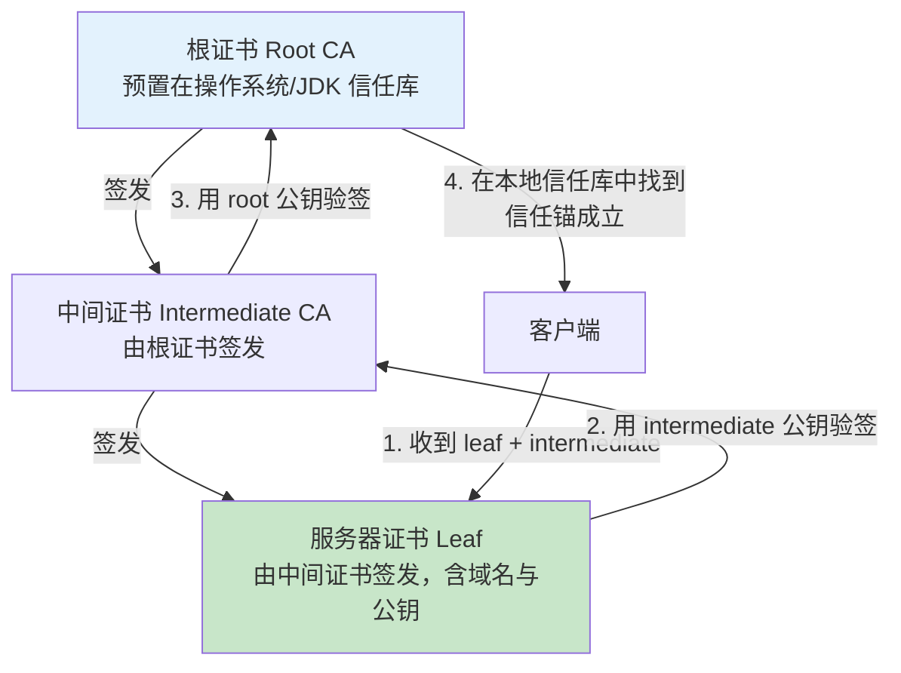
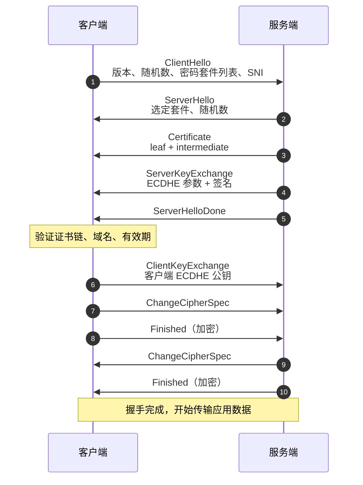
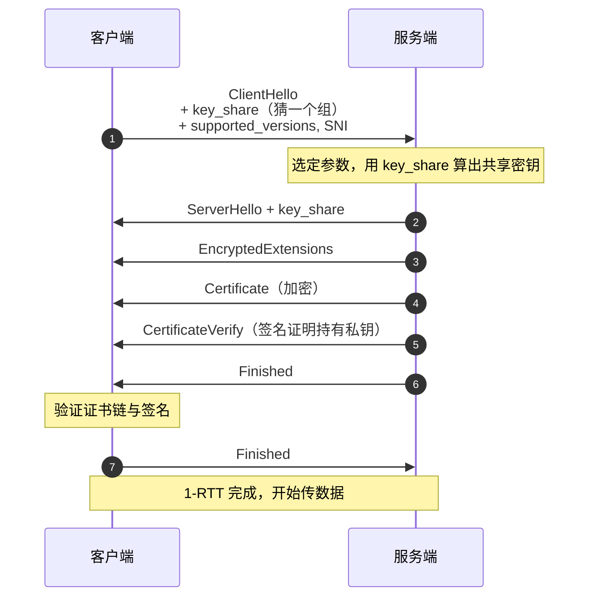
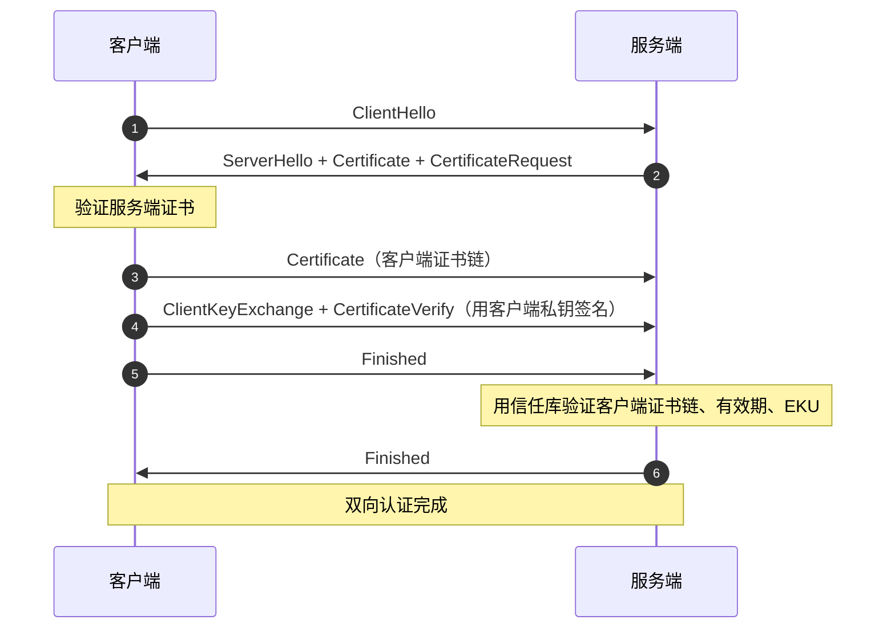

# HTTPS 与 TLS 握手

> 定位：TLS 不是「配个证书就完事」的黑盒。线上 `PKIX path building failed`、证书突然过期、iOS 能访问而 Java 客户端握手失败、mTLS 调用方 401，根因都在证书链、握手版本和信任库这三个点上。这一篇不写密码学教材，而是从 TLS 1.2/1.3 的握手报文讲到 keytool、Spring Boot 配置和排障命令，让你看到 `-Djavax.net.debug=ssl:handshake` 的输出就知道卡在哪一步。

## 一、为什么需要它

HTTP 明文有三个致命问题：**内容可被中间人读取**、**内容可被篡改**、**无法确认对端身份**。HTTPS 就是 HTTP + TLS，用加密解决前两个，用证书体系解决第三个。

但工程上的问题几乎都不在「加密算法够不够强」，而在这些地方：

- 浏览器正常，**Java 客户端报 `PKIX path building failed`**——服务端只发了叶子证书，缺中间证书。
- 凌晨零点证书过期，**全站 HTTPS 拒绝连接**，而监控只探了 HTTP 端口。
- 换证书后**部分老设备连不上**，因为它们只支持 TLS 1.2，而新配置只留了 TLS 1.3。
- 内部服务上了 mTLS，**调用方一直 401**，因为客户端证书的 SAN 里没有服务端期望的身份。

这些问题有一个共同点：**都能从握手过程和证书链里看出来**。所以这一篇的主线是「握手 -> 证书 -> Java 落地 -> 排障」，而不是「对称加密有哪些模式」。

## 二、核心原理

### 2.1 对称与非对称：为什么不直接用非对称

| 类型 | 代表算法 | 速度 | 用途 |
|---|---|---|---|
| **对称加密** | AES-GCM、ChaCha20-Poly1305 | 快，硬件加速后可达 GB/s | 加密应用数据 |
| **非对称加密** | RSA、ECDSA、Ed25519 | 慢，比对称慢几个数量级 | 签名、身份认证、密钥协商 |
| **密钥交换** | ECDHE、DHE | 一次协商出共享密钥 | 前向安全地生成会话密钥 |

TLS 的组合方式是：**用非对称手段协商出一个只有双方知道的对称密钥，再用它加密后续所有数据**。原因很朴素——非对称太慢，不可能拿它加密几 MB 的响应体；而对称密钥又不能明文传输，所以需要非对称或 Diffie-Hellman 来「安全地约定」。

这里有一个关键性质叫**前向安全（Forward Secrecy）**：如果每次会话都用临时 ECDHE 协商密钥，即使服务端私钥将来泄露，攻击者也无法解密历史流量。TLS 1.3 强制要求前向安全，TLS 1.2 则取决于是否选了 ECDHE 套件。

### 2.2 证书体系：CA、证书链、SAN、SNI

证书解决的是「我凭什么相信这个公钥属于 example.com」。链条是这样的：



读图要点：**服务端必须下发「叶子证书 + 中间证书」，根证书不需要下发**——客户端本地信任库里已经有。只发叶子证书是最常见的「链不全」故障，浏览器有时会自己补链（AIA 拉取），Java 不会。

四个必须分清的概念：

| 概念 | 含义 | 常见坑 |
|---|---|---|
| **CA** | 签发证书的机构，分根 CA 和中间 CA | 自签证书不被信任库认可 |
| **证书链** | leaf -> intermediate -> root 的签名链 | 少发中间证书，Java 直接握手失败 |
| **SAN** | Subject Alternative Name，证书覆盖的域名/IP 列表 | 只填 CN 不填 SAN，现代浏览器直接拒绝 |
| **SNI** | TLS 握手里客户端声明的目标域名 | 一个 IP 多站点时，服务端靠它选证书 |

**SAN 是硬要求**：Chrome 58 之后不再回退到 CN 匹配，Java 的 `HostnameVerifier` 同样校验 SAN。证书里没有 `DNS:api.example.com`，就算 CN 写对了也会报 `No subject alternative names matching IP address / hostname`。

**SNI 在 ClientHello 里是明文的**（TLS 1.3 也一样），所以中间设备能看到你访问的域名——这是 HTTPS 也藏不住的信息。ECH（Encrypted Client Hello）能加密 SNI，但部署还远未普及。反过来，SNI 也是排障线索：服务端收到不认识的 SNI 时可能返回默认证书，客户端就会报「域名不匹配」。

### 2.3 TLS 1.2 完整握手：2-RTT

TLS 1.2 的完整握手（以 ECDHE 套件为例）需要 **2 个 RTT**：



读图要点：**前一个 RTT 协商参数和证书，后一个 RTT 交换密钥并确认**。证书是明文传输的，所以抓包能看到服务端证书（TLS 1.2 特性）；这也是为什么 TLS 1.3 要把证书加密。

握手完成后，双方用协商出的会话密钥做对称加密。注意 `Finished` 是对整个握手记录的校验，任何一步被篡改都会导致校验失败。

### 2.4 TLS 1.3：1-RTT 与 0-RTT

TLS 1.3（RFC 8446）做了三件大事：**砍掉不安全算法**（RSA 密钥交换、静态 DH、CBC 模式、压缩、重协商全部移除）、**强制前向安全**（只用 (EC)DHE）、**把握手压到 1-RTT**。



读图要点：**客户端在第一个 flight 里就把 ECDHE 公钥（key_share）发出去**，服务端不需要再等一轮就能算出共享密钥，所以整体只需 1-RTT；证书和 `CertificateVerify` 都被加密，抓包看不到证书内容。

**0-RTT** 建立在会话恢复之上：客户端用上次会话的 PSK 加密 early data，在第一个 flight 里直接带上业务请求，省掉整整一个 RTT。代价有两个：

1. **可重放**。early data 不参与本次握手的随机性，攻击者可以原样重放。所以只能用于幂等请求。
2. **前向安全变弱**。0-RTT 数据用的是由旧 PSK 派生的密钥，如果 PSK 泄露，这部分数据可被解密。

### 2.5 密钥交换：ECDHE 与 RSA 的退场

TLS 1.2 时代有两种密钥交换方式，安全性和性能差异很大：

| 方式 | 做法 | 前向安全 | 抓包可解密 | TLS 1.3 |
|---|---|---|---|---|
| **RSA 密钥交换** | 客户端用服务端证书公钥加密预主密钥 | 无 | **有私钥就能解密历史流量** | 已移除 |
| **ECDHE** | 双方各出临时公私钥，协商出共享密钥 | 有 | 不能 | 唯一方式 |

RSA 密钥交换被移除的原因很直接：**只要服务端私钥泄露，历史所有抓包都能解密**。ECDHE 每次会话生成临时密钥，私钥泄露也不影响历史流量。

工程含义：如果你还在用「RSA 密钥交换 + 只支持 TLS 1.2 的老客户端」组合，升级到 TLS 1.3 后这些客户端会直接握手失败。排障时看 `ClientHello` 的 `supported_versions` 和 `signature_algorithms` 就能确认。

### 2.6 会话复用：Session ID、Session Ticket、PSK

完整握手成本不低（非对称运算 + 2 个 RTT），所以 TLS 一直有会话复用机制：

| 机制 | 原理 | 状态存在哪 | 适用 |
|---|---|---|---|
| **Session ID** | 服务端缓存会话密钥，客户端带 ID 来恢复 | 服务端内存（多机要共享） | 单机或共享缓存 |
| **Session Ticket** | 服务端把会话状态加密成 ticket 发给客户端，下次带回 | 客户端（服务端只需密钥） | 无状态、易横向扩展 |
| **TLS 1.3 PSK** | 恢复时用 ticket 里的 PSK 派生密钥，支持 0-RTT | 客户端 + 服务端密钥 | 现代默认方式 |

三个实践要点：

- **多实例部署必须共享 Session ID 缓存，或统一改用 Session Ticket**，否则负载均衡到另一台就要完整握手。
- **Ticket 密钥要轮换但不能立刻丢弃**，否则老 ticket 全部失效。
- **TLS 1.3 的会话恢复本质也是 PSK**，`SessionTicket` 只是承载形式；不要把「PSK」和「预共享密钥认证」混为一谈。

### 2.7 mTLS：双向认证

普通 HTTPS 只验证服务端；**mTLS（mutual TLS）** 要求客户端也出示证书，服务端用信任库验证。典型用于服务网格、开放平台、支付回调。



读图要点：多出来的关键是 **`CertificateRequest`** 和 **`CertificateVerify`**——客户端不仅交证书，还要用私钥对握手记录签名，证明自己持有私钥，光有证书文件是没用的。

服务端验证客户端证书时通常还要做**身份映射**：从 SAN 或 Subject 里取服务名，映射到权限模型。直接「有证书就放行」在生产上很危险，证书泄露等于权限泄露。

## 三、Java 落地：keytool、keystore、Spring Boot

### 3.1 keystore 与 truststore：别搞反

| 概念 | 存什么 | 谁用 | 典型文件 |
|---|---|---|---|
| **keystore** | 自己的私钥 + 证书链 | 服务端、mTLS 客户端 | `server.p12` / `server.jks` |
| **truststore** | 信任的 CA 证书（信任锚） | 校验对端的一方 | `truststore.p12` / JDK 的 `cacerts` |

一句话记忆：**keystore 是「我的身份证」，truststore 是「我认可哪些发证机关」**。服务端握手失败说「找不到信任路径」，问题在 truststore；客户端说「无法验证你的身份」，问题在服务端的证书链。

JDK 9 起 `keytool` 默认生成 **PKCS12**，JKS 是历史格式。新项目一律用 PKCS12，别再用 JKS。

### 3.2 keytool 常用命令

```bash
# 1. 生成私钥与自签证书（仅测试/内网）
keytool -genkeypair -alias server -keyalg RSA -keysize 2048 \
  -validity 365 -storetype PKCS12 -keystore server.p12 \
  -dname "CN=api.example.com, O=Example, C=CN" \
  -ext "SAN=dns:api.example.com,ip:10.0.0.10"

# 2. 生成 CSR，交给 CA 签发
keytool -certreq -alias server -keystore server.p12 -file server.csr

# 3. 导入 CA 返回的证书链（先导中间证书，再导叶子证书）
keytool -importcert -alias intermediate -file intermediate.crt \
  -keystore server.p12 -storepass changeit
keytool -importcert -alias server -file server.crt \
  -keystore server.p12 -storepass changeit

# 4. 查看证书链、SAN、有效期
keytool -list -v -keystore server.p12 -storepass changeit

# 5. 把企业 CA 导入信任库（客户端）
keytool -importcert -alias corp-ca -file corp-ca.crt \
  -keystore truststore.p12 -storepass changeit -noprompt

# 6. 检查远端证书链（不依赖 Java）
openssl s_client -connect api.example.com:443 -servername api.example.com -showcerts
```

第 3 步的顺序很关键：**先导中间证书，再导叶子证书**，否则 `keytool` 会因为「找不到签发者」拒绝导入。

### 3.3 Spring Boot 配置 HTTPS

Spring Boot 3.x 的配置集中在 `server.ssl.*`：

```yaml
server:
  port: 8443
  ssl:
    enabled: true
    key-store: classpath:server.p12
    key-store-type: PKCS12
    key-store-password: ${KEYSTORE_PASSWORD}
    key-alias: server
    enabled-protocols: TLSv1.3,TLSv1.2
    ciphers: TLS_ECDHE_RSA_WITH_AES_128_GCM_SHA256,TLS_ECDHE_RSA_WITH_AES_256_GCM_SHA384
  http2:
    enabled: true
```

三个注意点：

- **`enabled-protocols` 不要贪多**。留 `TLSv1.3,TLSv1.2` 足够；写 `TLSv1`、`TLSv1.1` 在当前 JDK 里本来就被 `jdk.tls.disabledAlgorithms` 禁掉，写了也协商不上。
- **`ciphers` 是 TLS 1.2 的套件名**，TLS 1.3 的套件由 JDK 自己管理，单独配置一般不影响 1.3。想精确控制 1.3 套件，需要自定义 `SSLContext`/`SSLParameters`，并确认 JDK 是否暴露对应开关。
- **Spring Boot 3.1+ 支持 PEM 直接配置**（`server.ssl.certificate` + `certificate-private-key`，以版本为准），适合 Kubernetes Secret 挂载证书文件的场景，省掉打包 p12 的步骤。

mTLS 服务端再加一行：

```yaml
server:
  ssl:
    client-auth: need              # need: 必须带客户端证书；want: 可选
    trust-store: classpath:truststore.p12
    trust-store-type: PKCS12
    trust-store-password: ${TRUSTSTORE_PASSWORD}
```

### 3.4 Java 客户端信任库与排障开关

自签或企业 CA 场景，客户端要么把 CA 导入 JDK 的 `cacerts`，要么显式指定 truststore：

```bash
java -Djavax.net.ssl.trustStore=/opt/certs/truststore.p12 \
     -Djavax.net.ssl.trustStorePassword=changeit \
     -Djavax.net.ssl.trustStoreType=PKCS12 \
     -jar app.jar
```

排查握手问题，先打开 JDK 的调试日志：

```bash
java -Djavax.net.debug=ssl:handshake -jar app.jar
```

输出里重点找三样：**协商出的协议版本和套件**、**服务端下发的证书链**、**失败原因**（`certificate_unknown`、`handshake_failure`、`unknown_ca`）。`PKIX path building failed` 基本等于「链不全或信任库没有根证书」。

## 四、生产坑点与排查

### 坑点 1：证书链不全，浏览器正常但 Java 报 PKIX 错误

**现象**：浏览器访问正常，Java 客户端报 `sun.security.provider.certpath.SunCertPathBuilderException: unable to find valid certification path to requested target`。

**原因**：服务端只下发了叶子证书，没发中间证书。浏览器会通过证书里的 AIA 地址自动补链，Java 默认不补，直接在信任库找不到签发者。

**解法**：用 `openssl s_client -showcerts` 确认服务端下发的证书数量；把中间证书按「叶子 -> 中间」顺序拼进 p12 或 PEM；用 SSL Labs 或 `keytool -list -v` 复核链完整性；不要图省事把根证书也放进服务端证书文件。

### 坑点 2：证书过期与时钟偏差

**现象**：某天零点开始全站 TLS 握手失败，错误是 `certificate has expired`；或新证书生效前就报 `certificate is not yet valid`。

**原因**：证书有 `NotBefore`/`NotAfter`，客户端本地时间不在区间内就拒绝。容器、虚拟机时钟漂移，或新证书提前部署但生效时间未到，都会触发。

**解法**：把证书过期时间纳入监控（提前 30/15/7 天告警），不要只监控端口存活；部署前用 `openssl x509 -noout -dates -in server.crt` 核对有效期；所有节点开 NTP/chrony，容器基础镜像也要同步时间；轮换时预留「新旧证书重叠期」。

### 坑点 3：域名不匹配，SAN 里没有实际访问的域名

**现象**：`No subject alternative names matching IP address 10.0.0.10` 或 `No name matching api.example.com found`。

**原因**：证书只填了 CN，或 SAN 只写了主域名，没写 `www`、内网 IP、服务名。现代客户端只认 SAN。

**解法**：签发时把所有访问入口写进 SAN（多个 DNS + 必要时的 IP）；内网服务用内部 CA 签，不要用公网域名硬套；排查时用 `openssl s_client -servername <域名>` 明确指定 SNI，避免连到默认站点拿到错误证书。

### 坑点 4：信任库未更新，内部 CA 或新根证书不被认可

**现象**：升级 JDK 或换 CA 后，客户端突然报 `unknown_ca` / `PKIX path building failed`；本地 `curl` 正常，Java 服务不行。

**原因**：Java 用的是自己 `$JAVA_HOME/lib/security/cacerts`，不是操作系统的信任库。系统 `update-ca-certificates` 对 Java 无效；容器镜像里的 cacerts 还可能被裁剪。

**解法**：内部 CA 显式导入 cacerts 或用独立 truststore，自签证书必须显式导入、公共 CA 链帮不上忙；升级 JDK 时对比新旧 cacerts 差异（JDK 会移除过期根证书）；容器镜像构建时把 CA 一并打入并校验指纹；用 `keytool -list -cacerts` 确认根证书存在。

### 坑点 5：TLS 版本或套件不兼容，老客户端握手失败

**现象**：新配置上线后，部分老设备、老 SDK 报 `handshake_failure`；服务端日志显示 `no protocols enabled` 或客户端 `supported_versions` 只有 TLSv1.2 以下。

**原因**：服务端只留 TLS 1.3，而客户端不支持；或 JDK 21 默认禁用了 TLS 1.0/1.1 和弱套件（`java.security` 里的 `jdk.tls.disabledAlgorithms`），老系统连不上。

**解法**：用 `openssl s_client -tls1_2` 分别验证各版本；服务端至少保留 TLS 1.2 作为兼容底线，等客户端全部升级再关；确实要支持老设备时，评估风险后调整 `jdk.tls.disabledAlgorithms`（不推荐）；升级前用真实客户端样本做兼容性回归，不要只用自己的浏览器测。

### 坑点 6：证书轮换未热加载，或 mTLS 客户端证书过期

**现象**：证书文件已经替换，服务端仍返回旧证书；或 mTLS 调用方突然 401/403，服务端日志是 `certificate_expired`。

**原因**：Spring Boot 的 `server.ssl.*` 在启动时加载，换文件不生效；mTLS 客户端证书往往没有纳入证书管理，续期被漏掉。

**解法**：轮换后滚动重启（或使用支持热加载的网关终结 TLS）；把**所有证书**（服务端、客户端、CA）统一纳入到期监控；mTLS 客户端证书用独立别名管理，续期时先验证再切换；CA 轮换时保留旧 CA 在信任库一段时间，避免存量证书立刻失效。

## 五、TLS 卸载、性能与选型

### 5.1 TLS 卸载放在哪一层

| 方案 | 做法 | 优点 | 缺点 |
|---|---|---|---|
| **边缘/负载均衡卸载** | Nginx/SLB 终结 TLS，回源明文或再加密 | 证书集中管理，后端无感 | 内网明文有合规风险 |
| **端到端加密** | TLS 一直打到应用 | 内网也加密 | 证书分发、轮换成本高 |
| **再加密（re-encrypt）** | 边缘卸载后，用另一张证书回源 | 兼顾集中管理与内网加密 | 多一次握手，链路更复杂 |

选型建议：**合规要求高的走端到端或再加密；普通业务在边缘卸载即可**。但要注意「边缘卸载 + 内网明文」意味着内网抓包能直接看到业务数据，不要把它当成默认安全。

### 5.2 性能要点

1. **握手成本主要在非对称运算和 RTT**，不在对称加密。TLS 1.3 把握手压到 1-RTT，是最大的性能收益。
2. **会话复用比任何算法优化都有效**。没有复用，每个新连接都要完整握手；有 ticket/PSK，恢复只需 1-RTT 甚至 0-RTT。
3. **OCSP Stapling 能省客户端一次吊销查询**，但配置不当会导致握手变慢或失败，上线前验证。
4. **TLS 1.3 的 0-RTT 只适合幂等请求**，写接口不要开。
5. **别盲目追求最高安全等级**：只留 TLS 1.3 会让老客户端直接不可用，兼容性和安全要按用户群权衡。

### 5.3 不该用 HTTPS 的场景

- **纯内网、无跨主机通信**的进程内调用，TLS 没有收益。
- **性能极度敏感且链路可信**的场景（如同机 Unix Socket），TLS 反而增加 CPU。
- **无法维护证书生命周期**的临时环境，强行 HTTPS 只会制造过期故障，不如用内网隔离 + 明文。

## 六、面试高频问法

**Q1：HTTPS 抓包为什么看不到明文？**

**一句话结论**：HTTP 报文被 TLS 记录层用对称会话密钥加密，抓包只能看到 TLS 记录头和密文；密钥由 ECDHE 协商，不经过网络传输。

展开：TLS 握手用非对称/密钥交换协商出会话密钥，之后所有应用数据用 AES-GCM 或 ChaCha20-Poly1305 加密；TLS 1.3 连证书都加密，TLS 1.2 还能看到证书明文和 SNI。

加分点：能解密的三种情况——支持 keylog 的客户端导出 `SSLKEYLOGFILE`、服务端配置了 RSA 密钥交换且拿到私钥（TLS 1.3 已无此方式）、或中间人代理持有伪造证书且客户端信任了它。

**Q2：TLS 1.3 为什么更快？**

**一句话结论**：把密钥交换合并进第一个 flight，完整握手从 2-RTT 降到 1-RTT；会话恢复支持 0-RTT；同时砍掉了一堆低效套件。

展开：客户端在 `ClientHello` 里带 `key_share`，服务端不用再等一轮；只保留 AEAD 套件和 (EC)DHE；证书加密后减少了明文解析开销；会话恢复走 PSK。

加分点：0-RTT 有重放风险，只能用于幂等请求；1-RTT 的收益在高 RTT 链路上最明显，内网感知不大。

**Q3：TLS 1.2 和 TLS 1.3 的握手有什么区别？**

**一句话结论**：TLS 1.2 完整握手 2-RTT，证书明文、密钥交换单独一轮；TLS 1.3 压缩到 1-RTT，证书加密、密钥交换随 ClientHello 一起发、只允许前向安全算法。

展开：对比 flight 数量、证书是否加密、是否允许 RSA 密钥交换、是否支持 0-RTT。TLS 1.3 还移除了重协商、压缩、CBC 模式。

加分点：指出「TLS 1.3 不是简单优化，而是删掉了不安全的选项」，所以老客户端可能因为不支持新套件而连不上。

**Q4：为什么说 RSA 密钥交换被淘汰了？**

**一句话结论**：RSA 密钥交换没有前向安全，服务端私钥一旦泄露，历史抓包全部可解密；TLS 1.3 已彻底移除，只保留 (EC)DHE。

展开：RSA 方式下客户端用服务端公钥加密预主密钥，私钥是长期不变的；ECDHE 每次会话生成临时密钥，私钥泄露不影响历史会话。

加分点：所以「拿到服务端私钥就能解密 HTTPS」只对老的 RSA 密钥交换成立，对 ECDHE 不成立。

**Q5：证书链是什么？为什么服务端要发中间证书？**

**一句话结论**：证书链是 leaf -> intermediate -> root 的签名链，客户端用本地信任库里的根证书做信任锚；服务端必须下发叶子 + 中间证书，根证书不用发。

展开：客户端逐级验签，直到找到信任锚；浏览器能通过 AIA 自动补链，Java 默认不补，所以少发中间证书时浏览器正常、Java 报 `PKIX path building failed`。

加分点：根证书私钥离线保存，中间证书用于隔离风险；证书链顺序不能错，叶子必须在最前。

**Q6：SAN 和 CN 有什么区别？为什么只填 CN 不行？**

**一句话结论**：CN 是历史字段，现代客户端只校验 SAN；证书里没有对应域名/IP，就会报主机名不匹配。

展开：SAN 可以包含多个 DNS 名和 IP；Chrome 58 之后不再回退 CN；Java 的 `HostnameVerifier` 同样按 SAN 校验。

加分点：内网服务要特别记得把 IP 和服务名都写进 SAN，否则用 IP 调用时必挂。

**Q7：Session ID 和 Session Ticket 有什么区别？**

**一句话结论**：Session ID 把会话状态存在服务端，需要共享缓存；Session Ticket 把状态加密后交给客户端保存，服务端只需密钥，天然适合多实例。

展开：Session ID 在多机部署时如果不共享缓存，负载均衡到另一台就要完整握手；Ticket 无状态但需要轮换密钥；TLS 1.3 统一用 PSK 恢复。

加分点：Ticket 密钥轮换要保留旧密钥一段时间，否则存量 ticket 全部失效。

**Q8：mTLS 的握手多了什么？为什么光有客户端证书不够？**

**一句话结论**：服务端多发 `CertificateRequest`，客户端回 `Certificate` + `CertificateVerify`；后者用私钥对握手记录签名，证明持有私钥。

展开：只交证书文件不能证明身份，任何人都能复制证书；`CertificateVerify` 的签名才能证明私钥在客户端手里；服务端还要校验链、有效期、EKU，并做身份映射。

加分点：生产上不能「有证书就放行」，证书泄露等于权限泄露，必须绑定服务身份和最小权限。

**Q9：Java 报 PKIX path building failed，怎么排查？**

**一句话结论**：九成是「服务端证书链不全」或「客户端信任库没有对应根 CA」，用 `openssl s_client -showcerts` 和 `keytool -list -v` 两步就能定位。

展开：先看服务端下发了几个证书，叶子后面有没有中间证书；再看客户端 truststore 里有没有根 CA；最后核对域名、有效期和时钟。打开 `-Djavax.net.debug=ssl:handshake` 看具体失败点。

加分点：JDK 有自己的 cacerts，操作系统的证书更新对 Java 无效；容器镜像里的 cacerts 可能被裁剪，升级 JDK 时要重新核对。

**Q10：TLS 卸载有什么风险？怎么选？**

**一句话结论**：卸载后边缘到后端是明文，内网被抓包就能看到业务数据；合规要求高时用端到端或再加密，普通业务可在边缘卸载并配合网络隔离。

展开：三种模式（边缘卸载、端到端、再加密）的对比；卸载的收益是证书集中管理、后端无感、性能好；风险是内网明文和信任边界扩大。

加分点：卸载不等于安全边界，内网仍需 mTLS 或网络策略；证书轮换要考虑所有终结 TLS 的节点。

## 小结

- **TLS = 非对称协商 + 对称加密数据**；ECDHE 提供前向安全，RSA 密钥交换已从 TLS 1.3 移除。
- **证书链 = leaf + intermediate + root**；服务端发前两个，根证书在客户端信任库；少发中间证书是 Java 报 PKIX 错误的首因。
- **SAN 才是域名校验依据**，CN 已废弃；SNI 决定服务端返回哪张证书，且在握手中明文可见。
- **TLS 1.2 完整握手 2-RTT，TLS 1.3 压到 1-RTT**，会话恢复可 0-RTT，但 0-RTT 可重放，只能用于幂等请求。
- **keystore 存自己的私钥和证书，truststore 存信任的 CA**；JDK 用自己的 cacerts，操作系统的证书更新对它无效。
- **排障顺序**：先看版本/套件协商，再看证书链，再看域名与有效期，最后看信任库和时钟。

## 参考资料

- RFC 8446《The Transport Layer Security Protocol Version 1.3》
- RFC 5246《The Transport Layer Security Protocol Version 1.2》
- RFC 5280《Internet X.509 Public Key Infrastructure Certificate and CRL Profile》
- RFC 6066《TLS Extensions: SNI》，RFC 5077《Transport Layer Security Session Resumption without Server-Side State》
- RFC 6962《Certificate Transparency》，RFC 6961《TLS Multiple Certificate Status Request Extension》
- Spring Boot Reference Documentation 与 Java SE 21 文档，SSL、`keytool`、JSSE Reference Guide
