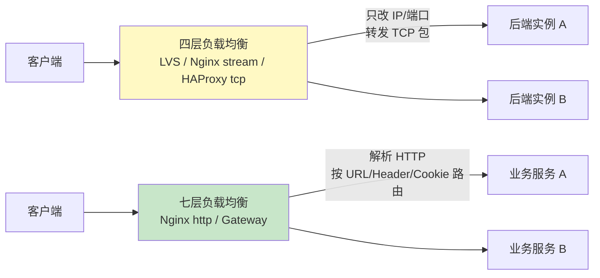
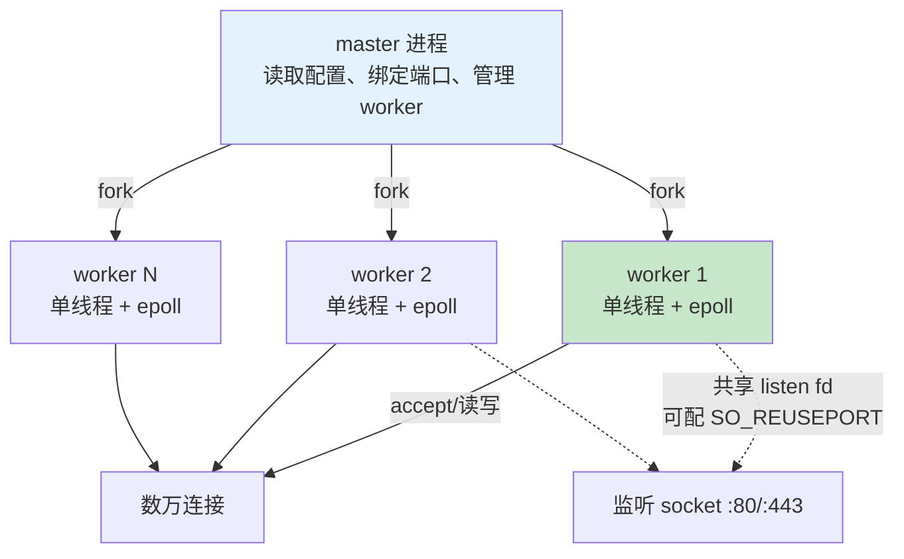
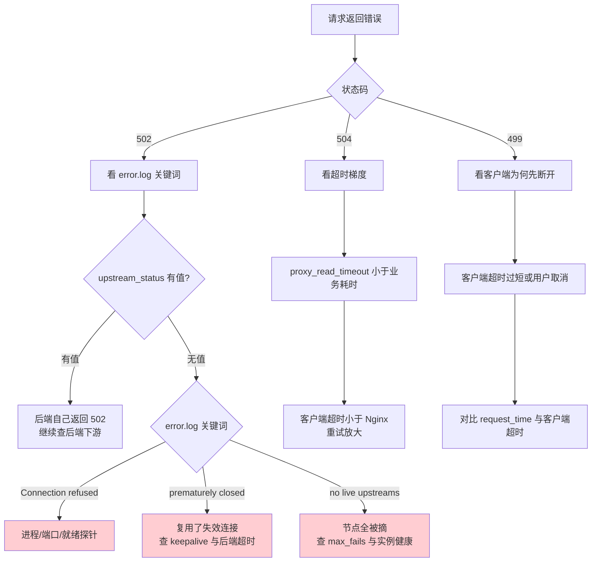

# Nginx 与负载均衡

> 定位：线上「偶发 502」「大批 504」「监控看到 499」「扩容了还是扛不住」这些问题，九成能从 Nginx 的 upstream、超时和连接数配置里找到答案。这一篇讲清四层/七层、master-worker 与 epoll、upstream 算法与 keepalive 连接池，给出一份可直接对照的完整配置，并把 502/504/499 的排查路径画成决策树。

## 一、为什么需要它

单体时代，流量直接打到 Tomcat，配个 `server.xml` 就完事。服务拆分后，链路变成：

```
浏览器 -> CDN -> Nginx/LVS -> Spring Cloud Gateway -> 业务服务 -> 下游
```

每一跳都可能是瓶颈，也都会产生自己的错误码。四个典型现场：

**发布时大量 502**：新实例没起来，旧的已被摘除，upstream 里全是连不上的节点。

**接口超时变 504，用户重试后雪崩**：`proxy_read_timeout` 是 60s，客户端只等 5s 就断开，产生 499；自动重试把压力翻倍。

**QPS 没到瓶颈，先报 `worker_connections are not enough`**：连接数配小了，或者 upstream 没开 keepalive，每个请求都在新建 TCP。**灰度 10% 流量却全量命中新版本**：`ip_hash` 加在网关前面，所有流量从同一出口 IP 进来，哈希退化成单桶。

共同点是：**不懂 Nginx 的连接模型和 upstream 行为，只能靠重启和加机器碰运气**。TCP 状态机与 TIME_WAIT 见[《TCP/IP 协议栈深度》](02-TCP-IP协议栈深度.md)，epoll 内核机制见[《epoll 与 IO 多路复用》](03-epoll与IO多路复用.md)。

## 二、核心原理

### 2.1 四层与七层：代理到底看得到什么



读图要点：四层只看 IP、端口、TCP 状态，转发成本低、吞吐高，但**看不懂 HTTP**，做不了按路径路由、改 Header、限流；七层要解析完整请求，策略丰富，但更耗 CPU，也更容易成为瓶颈。

| 维度 | 四层（L4） | 七层（L7） |
|---|---|---|
| 工作对象 | TCP/UDP 连接 | HTTP 请求 |
| 路由依据 | 五元组 | URL、Header、Cookie、方法 |
| TLS | 只能透传 | 可终结、可再加密 |
| 典型位置 | 机房入口、VIP | 应用入口、Kubernetes Ingress |

一句话选型：**入口用 L4 扛量，应用入口用 L7 做路由和治理**，LVS + Nginx 是经典组合。

### 2.2 master/worker 与 epoll：Nginx 为什么能扛



读图要点：**每个 worker 是单线程事件循环**，用 epoll 盯住大量连接，不做「一连接一线程」。master 不处理请求，只负责配置、信号和 worker 生命周期，所以 `nginx -s reload` 能平滑切换（新 worker 起来、旧 worker 处理完存量连接再退出）。

三个关键点：

- **worker 数量默认等于 CPU 核数**（`worker_processes auto`），再多只会争抢 CPU、增加上下文切换。
- **每 worker 的连接数由 `worker_connections` 决定**，同时受 `worker_rlimit_nofile` 和系统 `ulimit -n` 限制。
- **反向代理时一条客户端连接还要占一条 upstream 连接**，所以实际并发客户端数约为 `worker_connections × worker_processes / 2`。

### 2.3 upstream 负载算法

| 算法 | 配置 | 原理 | 适用 |
|---|---|---|---|
| **轮询** | 默认 | 按顺序轮流 | 实例同构、无状态服务 |
| **加权轮询** | `weight=3` | 按权重平滑调度 | 机器配置不一致 |
| **ip_hash** | `ip_hash;` | 按客户端 IP 哈希 | 必须会话粘性 |
| **least_conn** | `least_conn;` | 优先发给当前连接最少的 | 请求耗时差异大 |
| **hash** | `hash $request_uri;` | 按任意 key 哈希 | 缓存分片、用户粘性 |

三个容易踩的点：

1. **`ip_hash` 在 NAT/代理后会退化**。所有用户从同一出口 IP 进来，就全落到一台；某台挂了，它的会话还会全部丢失。
2. **`least_conn` 看连接数，不看负载**。长连接（WebSocket、gRPC 流）会把机器「占满」，但它可能很闲。
3. **权重只能粗调**。实例性能差异大时，更可靠的做法是让慢实例被健康检查摘掉，而不是猛加权重。

### 2.4 健康检查：开源版只有被动检查

Nginx 开源版的 `max_fails` + `fail_timeout` 是**被动健康检查**：请求失败了才记账，失败次数达到阈值就把节点摘掉一段时间。

```nginx
upstream backend {
    server 10.0.0.11:8080 max_fails=3 fail_timeout=10s;
    server 10.0.0.12:8080 max_fails=3 fail_timeout=10s;
}
```

`max_fails` 默认 1，`fail_timeout` 默认 10s；窗口内失败达到阈值就标记不可用，过一段时间才重新尝试。**主动健康检查是 Nginx Plus 的商业功能**，开源版没有；需要主动探测时用 HAProxy、云 LB 或第三方模块（如 `nginx_upstream_check_module`，需自行编译）。现实影响是：**第一个用户先吃一次失败**，所以要么接受，要么用支持主动检查的组件，或依靠 Kubernetes readinessProbe 摘除不健康实例（仍有同步窗口）。

### 2.5 keepalive 连接池：不复用就是在烧端口

默认情况下，Nginx 对 upstream 用 HTTP/1.0 语义，**每个请求新建一条连接**。高 QPS 下会耗尽本地端口，产生海量 TIME_WAIT。

正确配置三件套：

```nginx
upstream backend {
    server 10.0.0.11:8080;
    keepalive 32;                    # 每个 worker 保持的空闲连接数
    keepalive_requests 1000;         # 单条连接最多复用多少次
    keepalive_timeout 60s;           # 空闲连接保活时间
}

location /api/ {
    proxy_http_version 1.1;
    proxy_set_header Connection "";  # 清掉客户端传来的 Connection: close
    proxy_pass http://backend;
}
```

三个细节：**`proxy_http_version 1.1` 和 `Connection ""` 缺一不可**，少了前者不会复用，少了后者会把 `Connection: close` 透传给后端；**`keepalive` 是每 worker 的空闲池大小**，不是总连接数，太小高峰期照样新建；**`keepalive_requests` 要设上限**，复用次数过多可能累积后端内存碎片，一般 1000 左右。

### 2.6 七层能力概览

七层代理的价值在于「看得到 HTTP」：**动静分离**用 `location` + `root` 让静态资源直出；**gzip** 压缩文本响应；**proxy_cache** 缓存后端响应、降低回源；**limit_req / limit_conn** 按 key 限速和限并发；**map + 变量 `proxy_pass`** 按 Header/Cookie 做灰度。

限流的两个关键参数：**`burst` 是允许突发的桶大小，`nodelay` 表示突发请求立即处理而不是排队**。只写 `burst` 不写 `nodelay`，突发会被延迟处理，表现为「偶发慢请求」；写了 `nodelay`，超出速率的请求会被立即拒绝（默认 503，可用 `limit_req_status` 改）。没有绝对优劣，取决于你想削峰还是快速失败。

## 三、配置实战

### 3.1 反向代理 + upstream + keepalive（完整示例）

```nginx
worker_processes auto;
worker_rlimit_nofile 65535;
events {
    worker_connections 10240;
    multi_accept on;
}
http {
    include       mime.types;
    default_type  application/octet-stream;
    sendfile      on;
    tcp_nopush    on;
    keepalive_timeout 65;
    log_format main '$remote_addr - $status "$request" '
                    'upstream=$upstream_addr ust=$upstream_status '
                    'rt=$request_time urt=$upstream_response_time';
    access_log /var/log/nginx/access.log main;
    upstream backend {
        least_conn;
        server 10.0.0.11:8080 max_fails=3 fail_timeout=10s;
        server 10.0.0.12:8080 max_fails=3 fail_timeout=10s;
        keepalive 64;
        keepalive_requests 1000;
        keepalive_timeout 60s;
    }
    server {
        listen 80;
        server_name api.example.com;
        client_max_body_size 20m;
        location /api/ {
            proxy_http_version 1.1;
            proxy_set_header Connection "";
            proxy_set_header Host $host;
            proxy_set_header X-Real-IP $remote_addr;
            proxy_set_header X-Forwarded-For $proxy_add_x_forwarded_for;
            proxy_set_header X-Forwarded-Proto $scheme;
            proxy_connect_timeout 2s;
            proxy_send_timeout 10s;
            proxy_read_timeout 10s;
            proxy_next_upstream error timeout http_502 http_503;
            proxy_next_upstream_tries 2;
            proxy_pass http://backend;
        }
    }
}
```

要点：**日志里一定要带 `$upstream_addr`、`$upstream_status`、`$upstream_response_time`**。只记 `$status` 时，502 到底是「没连上后端」还是「后端自己返回的」根本分不清，排障要多花几倍时间。

### 3.2 gzip、缓存、限流

```nginx
http {
    gzip on;
    gzip_min_length 1k;
    gzip_comp_level 5;
    gzip_types text/plain text/css application/json application/javascript;
    proxy_cache_path /var/cache/nginx levels=1:2 keys_zone=api_cache:100m
                     max_size=10g inactive=60m use_temp_path=off;
    limit_req_zone $binary_remote_addr zone=api_limit:10m rate=20r/s;
    limit_conn_zone $binary_remote_addr zone=conn_limit:10m;
    server {
        location /static/ {
            root /data/www;
            expires 7d;
        }
        location /api/public/ {
            proxy_cache api_cache;
            proxy_cache_valid 200 5m;
            proxy_cache_use_stale error timeout updating http_502;
            add_header X-Cache-Status $upstream_cache_status;
            proxy_pass http://backend;
        }
        location /api/ {
            limit_req zone=api_limit burst=40 nodelay;
            limit_conn conn_limit 20;
            limit_req_status 429;
            limit_conn_status 429;
            proxy_pass http://backend;
        }
    }
}
```

注意 `limit_req_zone` 的 key 用 `$binary_remote_addr` 省内存；如果 Nginx 前面还有一层代理，**必须先把真实客户端 IP 还原到 `$remote_addr`**（`real_ip_header` + `set_real_ip_from`），否则所有请求共享同一个限流桶，一个人就能把全站限死。

### 3.3 按 Header 做灰度（map 位于 http 块内）

```nginx
map $http_x_gray $backend_pool {
    default  backend_stable;
    "v2"     backend_canary;
}

server {
    location /api/ {
        proxy_http_version 1.1;
        proxy_set_header Connection "";
        proxy_pass http://$backend_pool;
    }
}
```

`map` 在进入 `location` 之前完成求值，比在 `location` 里写 `if` 更安全（`if` 属于 rewrite 阶段，容易产生意外行为）；按比例灰度则用 `split_clients "${remote_addr}${http_user_agent}"` 按哈希百分比分流到不同 upstream 组。

## 四、生产坑点与排查



读图要点：**三个状态码对应三条完全不同的排查线**，先把 502 分成「Nginx 自己产生的」和「后端返回的」，再往下钻，能少走一大半弯路。

### 坑点 1：502，先分清「连不上」还是「后端返回的」

**现象**：接口返回 502，业务日志里什么都没有。

**原因**：Nginx 认为 upstream 响应无效或连接失败，常见四类：连接被拒绝（进程没起来）、连接被重置（崩溃或复用了死连接）、响应头非法、响应过早关闭；后端连接池耗尽也会表现为响应提前关闭。

**解法**：看 `error.log` 关键词，再看 `$upstream_addr` 和 `$upstream_status`：

| 关键词 | 含义 | 处理 |
|---|---|---|
| `Connection refused` | 后端没监听 | 查端口、进程、就绪探针 |
| `upstream prematurely closed` | 后端提前关连接 | 查后端超时、keepalive 错配 |
| `upstream sent invalid header` | 响应头非法 | 抓包看后端返回 |
| `no live upstreams` | 节点全被摘 | 查 `max_fails` 与实例健康 |

若 `$upstream_status` 有值，说明是**后端自己返回的**，要查后端到它下游的链路，而不是继续盯着 Nginx。

### 坑点 2：504，超时时间层层错配

**现象**：慢接口返回 504，但后端日志显示请求最终成功了。

**原因**：`proxy_read_timeout`（默认 60s）小于业务实际耗时，Nginx 先断开，后端白干；客户端超时又短于 Nginx 时，用户先失败并重试，压力翻倍。

**解法**：保持超时梯度——**客户端 > Nginx `proxy_read_timeout` > 后端自身 > 下游**，每层留余量；慢接口单独用 `location` 放大超时，不要全局调到 300s；长任务改异步（提交 + 轮询）。

### 坑点 3：499，客户端先走了

**现象**：access.log 大量 499，业务侧看到请求「消失」或处理到一半。

**原因**：499 是 Nginx 自定义状态码，表示**客户端在响应返回前关闭了连接**，常见于客户端超时过短、用户取消、移动网络切换。

**解法**：对比 `$request_time` 与客户端超时，确认谁先放弃；集中在慢接口时优先优化或改异步；结合 `$upstream_response_time` 确认后端是否处理完；把 499 当体验指标，而不是服务端错误。

### 坑点 4：`worker_connections are not enough`

**现象**：error.log 大量报错，新连接被拒绝，CPU 却不高。

**原因**：每 worker 连接数达到上限，或系统 `ulimit -n` 太小拿不到 fd；反向代理时一条客户端连接还占一条 upstream 连接，实际并发要除以 2。

**解法**：`worker_connections` 调到 10240 以上，`worker_rlimit_nofile` 和 systemd 的 `LimitNOFILE` 一起调（只改 `limits.conf` 对 systemd 无效）；用 `ss -s`、`ls /proc/<worker_pid>/fd | wc -l` 确认 fd 用量；仍不够就 L4 分流或加实例。

### 坑点 5：upstream 没开 keepalive，端口被 TIME_WAIT 耗尽

**现象**：高峰期偶发 `Cannot assign requested address`，`ss -s` 显示大量 TIME_WAIT。

**原因**：Nginx 到后端每个请求新建连接，主动关闭方进入 TIME_WAIT（默认 60s），QPS 高时本地端口不够用。

**解法**：按 2.5 配三件套；确认后端也支持 keepalive；监控 `ss -tan state time-wait | wc -l` 和 `ip_local_port_range`；不要把 `tcp_tw_reuse` 当主要方案，它有前提条件。

### 坑点 6：限流配置不当，正常用户被误伤

**现象**：压测正常，线上大量 429；或者限流形同虚设，后端照样被打挂。

**原因**：三种典型错误——**key 选错**（前面有代理却用 `$remote_addr`，所有流量一个桶）、**`burst` 太小**、**`zone` 内存太小**（哈希冲突，日志报 `could not allocate node`）。

**解法**：先还原真实 IP，再按用户/租户/接口维度设计 key；`burst` 按允许的瞬时并发估算，配合 `nodelay` 明确排队还是拒绝；`zone` 按 key 数量估内存；上线前用真实流量模型压测，观察 429 比例。

## 五、调优、选型与最佳实践

### 5.1 Nginx vs LVS vs HAProxy vs Spring Cloud Gateway

| 维度 | LVS | Nginx | HAProxy | Spring Cloud Gateway |
|---|---|---|---|---|
| 工作层次 | L4（IPVS） | L4/L7 | L4/L7 | L7（JVM） |
| 性能 | 最高，内核态转发 | 高 | 高 | 中，受 JVM 和 Reactor 影响 |
| 协议支持 | TCP/UDP | HTTP/1.1、h2、h3、stream | TCP/HTTP，功能丰富 | HTTP，基于 Reactor Netty |
| 健康检查 | 依赖 keepalived/脚本 | 被动（开源） | **主动 + 被动** | 依赖注册中心 |
| 动态配置 | 需借助工具 | reload，动态能力弱 | 运行时 API | **天然动态** |
| 服务发现 | 无 | 需配合 Consul/etcd | 需配合 | **原生集成** |
| 鉴权/限流/熔断 | 无 | 基础限流 | ACL、stick table | **过滤器生态完整** |
| 典型位置 | 机房入口 VIP | 应用入口、Ingress | 纯负载均衡、TCP 代理 | 微服务东西向流量 |

读表要点：**LVS 把流量分到机房，Nginx 把 HTTP 请求分到服务，Gateway 在服务之间做治理**；三者可叠加，不是四选一。

### 5.2 选型建议与不适用场景

- **只做 TCP/UDP 转发、追求极致吞吐**：选 LVS；它不懂 HTTP，不要指望它做路由。
- **需要 HTTP 路由、静态资源、缓存、限流，团队熟悉配置文件**：选 Nginx；开源版没有主动健康检查，动态配置弱，K8s 频繁变更时要配合 Ingress Controller。
- **需要丰富 ACL、主动健康检查、会话保持和观测面板**：选 HAProxy；纯 LB 场景很成熟，但生态不如 Nginx 广。
- **微服务内部需要鉴权、灰度、熔断、服务发现**：选 Spring Cloud Gateway；吞吐不如 Nginx，不要拿它扛全网入口。

**不推荐**：用 Gateway 直接暴露公网扛全量流量（JVM 内存和 GC 是瓶颈）；用 Nginx 承担复杂业务鉴权（配置难维护、变更要 reload）；用 LVS 做七层灰度（它看不到 HTTP）。

### 5.3 参数清单

| 参数 | 建议值 | 说明 |
|---|---|---|
| `worker_processes` | `auto` | 等于 CPU 核数 |
| `worker_connections` | 10240+ | 同时受 ulimit 限制 |
| `proxy_connect_timeout` | 2~3s | 建连不应该慢 |
| `proxy_read_timeout` | 按业务定 | 不要全局 300s |
| `proxy_next_upstream` | `error timeout http_502` | 只对幂等请求安全 |
| `client_max_body_size` | 按业务定 | 默认 1m，上传接口必调 |

## 六、面试高频问法

**Q1：四层和七层负载均衡有什么区别？**

**一句话结论**：四层只看 IP/端口/TCP 状态，转发快但不懂 HTTP；七层解析完整请求，能做路由、改写、限流，但更耗 CPU。

展开：LVS 是典型四层，Nginx http、Gateway 是七层；四层适合机房入口扛量，七层适合应用入口做治理；四层做 TLS 只能透传，七层可以终结和再加密。

加分点：LVS + Nginx 是常见组合，各司其职，不是替代关系。

**Q2：Nginx 为什么性能高？**

**一句话结论**：master-worker 多进程 + 每 worker 单线程事件循环 + epoll 多路复用，避免了一连接一线程的栈和切换开销。

展开：worker 数量等于 CPU 核数，各自独立 accept；epoll 让单线程盯住数万连接，只处理就绪的；master 只做管理和 reload。

加分点：Nginx 用 ET 且每个 handler 都实现「读到 EAGAIN」；Java NIO 只支持 LT，Netty 默认也是 LT。

**Q3：upstream 有哪些负载算法？怎么选？**

**一句话结论**：轮询/加权轮询适合无状态同构服务；`least_conn` 适合耗时不均；`ip_hash` 只适合必须会话粘性且能接受倾斜的场景。

展开：权重解决机器配置差异；`hash $key` 用于缓存分片；`random two least_conn` 适合大规模 upstream 避免羊群。

加分点：`ip_hash` 在 NAT/代理后所有用户共享出口 IP，会退化成单机；节点故障时会话全丢，最好用共享 Session 替代。

**Q4：upstream keepalive 为什么要配 `proxy_http_version 1.1` 和 `Connection ""`？**

**一句话结论**：HTTP/1.0 不支持连接复用，必须升到 1.1；同时要清掉客户端传来的 `Connection: close`，否则后端会主动关连接。

展开：不配 keepalive 时每个请求新建 TCP，高 QPS 下端口和 TIME_WAIT 会爆；`keepalive N` 是每 worker 的空闲池大小。

加分点：`keepalive_requests` 和 `keepalive_timeout` 也要配，避免连接无限复用或长期空闲被中间设备回收。

**Q5：502、504、499 分别是什么？怎么排查？**

**一句话结论**：502 是 upstream 响应无效或连不上，504 是等后端超时，499 是客户端先断开；三者排查方向完全不同。

展开：502 看 error.log 关键词和 `$upstream_status`；504 看超时梯度；499 对比 `$request_time` 与客户端超时。access.log 必须记录 `$upstream_addr`、`$upstream_status`、`$upstream_response_time`。

加分点：502 要分清「Nginx 自己产生的」和「后端返回的」，前者查连接，后者查后端的下游。

**Q6：Nginx、LVS、HAProxy、Gateway 怎么选？**

**一句话结论**：入口扛量用 LVS，HTTP 入口和静态资源用 Nginx，纯 LB 且要主动健康检查用 HAProxy，微服务治理用 Gateway。

展开：四者的层次、性能、动态能力、服务发现差异；可以叠加使用，LVS -> Nginx -> Gateway 是常见链路。

加分点：Gateway 是 JVM 应用，吞吐不如 Nginx，不适合直接扛公网全量流量。

**Q7：Nginx 最大能支撑多少连接？怎么算？**

**一句话结论**：理论上限约 `worker_connections × worker_processes`，反向代理场景要除以 2，实际还受 fd 上限、内存和带宽限制。

展开：`worker_connections` 是每 worker 的连接数；代理时每条客户端连接还占一条 upstream 连接；`worker_rlimit_nofile` 和系统 `ulimit -n` 必须同步调大。

加分点：连接数不是唯一瓶颈，活跃连接的读写、TLS 握手、日志写入都会吃 CPU，压测要按真实模型来。

**Q8：`limit_req` 的 `burst` 和 `nodelay` 是什么？**

**一句话结论**：`burst` 是允许突发的桶大小，`nodelay` 决定突发请求是立即处理还是排队延迟。

展开：不配 `nodelay` 时超出速率的请求被延迟，表现为慢请求；配了 `nodelay` 则立即处理突发，超出桶容量直接拒绝。`limit_req_status` 可自定义状态码。

加分点：Nginx 前面有代理时必须还原真实 IP，否则所有请求共享一个限流桶。

## 小结

- **四层扛量、七层治理**：LVS 看五元组，Nginx/Gateway 才看得懂 HTTP；两者常组合使用。
- **Nginx = master + 多 worker 单线程 + epoll**，性能来自事件驱动；`worker_connections × worker_processes` 是连接上限的起点。
- **upstream 默认轮询，`least_conn` 适合耗时不均，`ip_hash` 只在必须粘性时用**，且要警惕 NAT 导致的倾斜。
- **开源 Nginx 只有被动健康检查**；upstream keepalive 必须配 `proxy_http_version 1.1` + `Connection ""`，否则端口和 TIME_WAIT 会爆。
- **502/504/499 是三条不同的排障线**：502 查连接和响应合法性，504 查超时梯度，499 查客户端为什么先走。
- **日志必须带 `$upstream_addr`、`$upstream_status`、`$upstream_response_time`**，否则排障只能靠猜。
