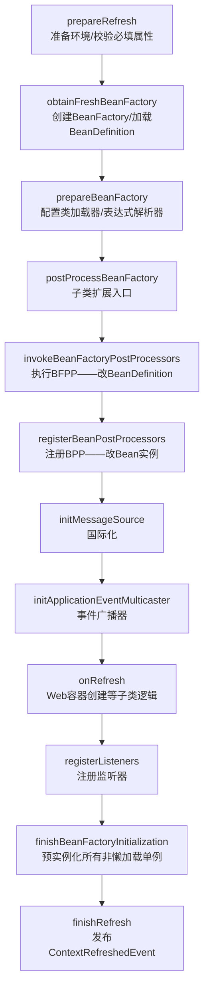
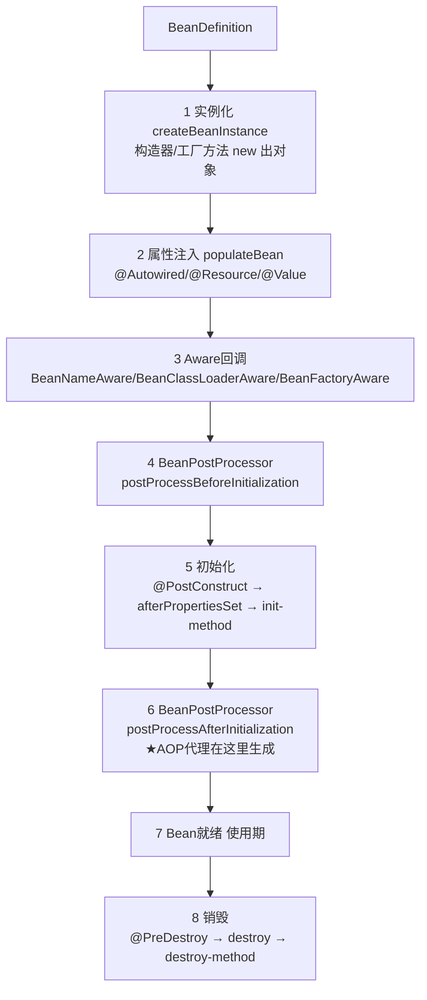

# Spring IOC 与 Bean 生命周期

> 定位：IOC 是 Spring 的地基，Bean 生命周期是这块地基上最常考、也最容易在生产环境踩坑的一条主线。搞不清「一个 Bean 从 XML/@Bean 到能被你 `@Autowired` 拿到，中间到底经历了什么」，你就无法理解循环依赖、AOP 代理时机、事务失效、Aware 注入这些问题的根因。这一篇把这条主线从头到尾拆给你看。

## 一、为什么必须搞清 IOC 与 Bean 生命周期

先看一个真实场景：你在项目里写了 `@PostConstruct` 做初始化，又写了 `ApplicationRunner` 做启动后逻辑，结果发现有的时候 `@Autowired` 的字段在 `@PostConstruct` 里是 null，有的时候又正常；某个类实现了 `ApplicationContextAware` 拿上下文，结果在普通 Bean 里能拿到、在 `BeanPostProcessor` 里却是 null。

这些「玄学」问题的根源，都是**你不知道 Spring 在什么时候、按什么顺序对你的对象做了什么**。

- `@PostConstruct` 为什么能执行到？因为有一个 `BeanPostProcessor` 在初始化前回调了它
- AOP 代理为什么有时生效有时不生效？因为代理是在生命周期的「初始化后」这一步生成的
- 为什么 `@Value` 在构造方法是 null、在 `@PostConstruct` 里就有值？因为属性注入发生在实例化之后、初始化之前

IOC 不是「把 new 交给 Spring」这么简单。它是一整套**对象创建 + 依赖装配 + 生命周期管理 + 扩展点回调**的精密流程。理解它，是理解后面循环依赖、AOP、事务的前提。

## 二、IOC / DI 的基本概念

### 2.1 控制反转与依赖注入

**IOC（Inversion of Control，控制反转）**：对象的创建和依赖关系的管理，从代码内部转移到外部容器。传统写法中，你在 `A` 里 `new B()`，控制权在 `A` 手里；IOC 之后，容器负责创建 `B` 并「塞给」`A`，控制权反转给了容器。

**DI（Dependency Injection，依赖注入）**：IOC 的具体实现手段——容器把依赖对象注入到目标对象。常见三种方式：

| 注入方式 | 示例 | 特点 |
|---|---|---|
| 构造器注入 | `public A(B b) { this.b = b; }` | 依赖不可变、必然完整，Spring 官方推荐 |
| Setter 注入 | `@Autowired public void setB(B b){...}` | 依赖可变，能解决循环依赖（见下一篇） |
| 字段注入 | `@Autowired private B b;` | 最简洁，但无法 final、隐含强耦合，官方不推荐 |

> 一个小类比：IOC 容器像「婚介所」，你（Bean）不用自己满大街找对象（依赖），婚介所根据你的「择偶条件」（`@Autowired`）把合适的人介绍给你。你从「主动寻找」变成「被动接受」——这就是控制反转。

### 2.2 BeanDefinition：Bean 的「图纸」

Spring 并不直接 new 你写的类，它先把类的元信息解析成 **`BeanDefinition`**，再按图纸生产 Bean。你可以把它理解为「对象的图纸」，上面记录了：

- `beanClassName`：类名
- `scope`：`singleton` / `prototype` / `request` 等
- `lazyInit`：是否懒加载
- `dependsOn`：依赖的其他 Bean
- `autowireMode`：自动装配模式
- `propertyValues`：属性值 / 构造参数值
- `initMethodName` / `destroyMethodName`：生命周期回调方法名
- `factoryBeanName` / `factoryMethodName`：工厂方法信息

常见实现类：

- `GenericBeanDefinition`：通用的、编程式注册常用
- `AnnotatedGenericBeanDefinition`：处理 `@Component` 等注解类
- `ScannedGenericBeanDefinition`：组件扫描产生
- `RootBeanDefinition` / `ChildBeanDefinition`：父子 Bean 定义（Child 已废弃）

理解 BeanDefinition 很关键：**`BeanFactoryPostProcessor` 操作的就是它**——在 Bean 实例化之前改图纸，而不是改实例。

## 三、BeanFactory 与 ApplicationContext

### 3.1 两者的关系

`BeanFactory` 是 Spring 最底层的 IOC 容器接口，只提供最基础的能力：`getBean()`、`containsBean()`、`getType()` 等。**默认懒加载**——单例 Bean 在第一次 `getBean()` 时才创建。

`ApplicationContext` 继承自 `BeanFactory`，是一个「增强版容器」，额外提供：

- **MessageSource**：国际化
- **ApplicationEventPublisher**：事件发布
- **ResourceLoader**：资源加载
- **Environment**：环境 / 配置
- 自动注册 `BeanPostProcessor`、AOP 代理、事务管理等
- **默认饿加载**——`refresh()` 时一次性预实例化所有非懒加载单例

| 对比项 | BeanFactory | ApplicationContext |
|---|---|---|
| Bean 实例化 | 懒加载（用到才建） | 饿加载（启动时建好） |
| 扩展能力 | 基础 | 事件、资源、国际化、AOP 等 |
| 启动开销 | 小 | 较大 |
| 问题暴露时机 | 运行时才暴露 | 启动时即暴露 |
| 典型实现 | `DefaultListableBeanFactory` | `AnnotationConfigApplicationContext` |

> 面试常问：为什么实际开发都用 `ApplicationContext` 而不是 `BeanFactory`？答案是——启动期就能发现配置错误（饿加载），且提供了企业级扩展能力，这点开销完全值得。

### 3.2 refresh()：容器启动的 12 步

`AbstractApplicationContext.refresh()` 是整个 Spring 容器启动的骨架，记住这 12 步，你就掌握了容器的「开机自检流程」：



这张图是后面所有机制的「时间轴」：BeanDefinition 在第 5 步被 BFPP 修改，BeanPostProcessor 在第 6 步注册，Bean 实例在第 11 步批量创建。**记住「先改图纸，再招工人，最后生产产品」这个顺序**，cycle dependency、AOP 时机的问题都能在这条时间轴上找到位置。

## 四、Bean 的完整生命周期

现在把第 11 步「创建一个 Bean」放大。一个单例 Bean 从图纸到可用，走的是一条固定流水线：



这张图是全篇最重要的一张，**建议你截图背下来**。逐段拆解：

### 4.1 阶段 1：实例化（Instantiation）

`AbstractAutowireCapableBeanFactory.createBeanInstance()` 负责。三种策略：

- **无参构造器**（默认）：反射调用 `clazz.getDeclaredConstructor().newInstance()`
- **有参构造器**：`AutowiredAnnotationBeanPostProcessor` 挑选构造器并完成参数注入
- **工厂方法**：`factoryBeanName` + `factoryMethodName`（对应 `@Bean` 方法）

此时对象刚被 new 出来，还是个「空壳」——属性全是默认值（引用类型是 null，基本类型是 0/false）。

### 4.2 阶段 2：属性注入（Population）

`populateBean()` 把依赖塞进对象。`InstantiationAwareBeanPostProcessor.postProcessProperties()` 是核心扩展点，`AutowiredAnnotationBeanPostProcessor` 在这里处理 `@Autowired` / `@Value`，`CommonAnnotationBeanPostProcessor` 处理 `@Resource` / `@PostConstruct`。

注意 `@Autowired` 的注入流程：`byType` 找候选 Bean → 多个候选时按 `@Primary` / `@Priority` 选 → 再用 `@Qualifier` 按名字缩小范围 → 找不到且 `required=true` 抛 `NoSuchBeanDefinitionException`。

### 4.3 阶段 3：Aware 接口回调

如果 Bean 实现了特定的 Aware 接口，Spring 会「反向」把容器基础设施注入进来：

| Aware 接口 | 注入内容 | 回调时机 |
|---|---|---|
| `BeanNameAware` | Bean 的名字 | `invokeAwareMethods` |
| `BeanClassLoaderAware` | 类加载器 | `invokeAwareMethods` |
| `BeanFactoryAware` | 当前 BeanFactory | `invokeAwareMethods` |
| `EnvironmentAware` | Environment | `ApplicationContextAwareProcessor`（BPP before） |
| `ApplicationContextAware` | ApplicationContext | `ApplicationContextAwareProcessor`（BPP before） |
| `ApplicationEventPublisherAware` | 事件发布器 | 同上 |
| `ResourceLoaderAware` | 资源加载器 | 同上 |

注意前三个在 `invokeAwareMethods()` 里直接回调，最后一个 `ApplicationContextAware` 是通过一个 `BeanPostProcessor`（`ApplicationContextAwareProcessor`）在「初始化前」回调的——这就是为什么**在 BeanPostProcessor 自身里注入 ApplicationContext 拿不到**（它创建时自己还没被处理）。

### 4.4 阶段 4-6：初始化与代理生成

`initializeBean()` 是这一段的核心方法，内部顺序固定：

```
invokeAwareMethods()                          // BeanName/ClassLoader/BeanFactory Aware
  → applyBeanPostProcessorsBeforeInitialization()  // @PostConstruct 在这里被触发
  → invokeInitMethods()                        // InitializingBean.afterPropertiesSet → 自定义 init-method
  → applyBeanPostProcessorsAfterInitialization()   // AOP 代理在这里生成
```

三个初始化回调的先后顺序要记牢：**`@PostConstruct` → `InitializingBean.afterPropertiesSet()` → 自定义 `init-method` / `@Bean(initMethod=...)`**。

而 **`postProcessAfterInitialization` 是 AOP 代理的诞生地**——`AbstractAutoProxyCreator`（一个 BPP）在这里把你的原始对象包成代理对象返回。这意味着：你最终从容器里拿到的是代理对象，而不是原始对象。这也解释了后面「同类方法调用导致 AOP 失效」的根因——自调用走的是原始对象的 `this`，绕过了代理。

### 4.5 阶段 8：销毁

容器关闭时（`context.close()`），单例 Bean 依次执行：`@PreDestroy` → `DisposableBean.destroy()` → 自定义 `destroy-method`。prototype 作用域的 Bean **不归容器管理销毁**——用完得你自己清理。

## 五、两大扩展点：BeanFactoryPostProcessor 与 BeanPostProcessor

这是面试重灾区，也是自定义 Spring 扩展的入口。核心区别一句话：

> **BeanFactoryPostProcessor 改「图纸」（BeanDefinition），BeanPostProcessor 改「产品」（Bean 实例）。**

| 对比项 | BeanFactoryPostProcessor (BFPP) | BeanPostProcessor (BPP) |
|---|---|---|
| 操作对象 | BeanDefinition（元数据） | Bean 实例 |
| 执行时机 | 实例化之前（refresh 第 5 步） | 实例化/初始化前后 |
| 典型用途 | 修改属性值、注册 BeanDefinition | AOP 代理、字段注入、自定义处理 |
| 经典实现 | `PropertySourcesPlaceholderConfigurer`、`ConfigurationClassPostProcessor` | `AutowiredAnnotationBeanPostProcessor`、`AbstractAutoProxyCreator` |

一个自定义 BFPP 的例子——把所有 Bean 的 `lazyInit` 改成 true：

```java
@Component
public class CustomBeanFactoryPostProcessor implements BeanFactoryPostProcessor {
    @Override
    public void postProcessBeanFactory(ConfigurableListableBeanFactory bf) {
        for (String name : bf.getBeanDefinitionNames()) {
            BeanDefinition bd = bf.getBeanDefinition(name);
            bd.setLazyInit(true); // 改的是图纸，此时还没有 Bean 实例
        }
    }
}
```

一个自定义 BPP 的例子——打印每个 Bean 的创建耗时：

```java
@Component
public class CostBeanPostProcessor implements BeanPostProcessor {
    private final Map<String, Long> start = new ConcurrentHashMap<>();

    @Override
    public Object postProcessBeforeInitialization(Object bean, String name) {
        start.put(name, System.nanoTime());
        return bean;
    }

    @Override
    public Object postProcessAfterInitialization(Object bean, String name) {
        System.out.println(name + " 初始化耗时: " +
            (System.nanoTime() - start.get(name)) / 1_000_000 + " ms");
        return bean;
    }
}
```

> 注意：BPP 的 `postProcessAfterInitialization` 必须返回 `bean`（或它的代理），如果你返回 null，容器里这个 Bean 就没了。

## 六、资源加载与 Bean 作用域

### 6.1 Resource 与 ResourceLoader

Spring 用 `Resource` 接口统一抽象了「资源」这个概念，屏蔽了 classpath、文件系统、URL 的差异：

| 实现 | 前缀 | 用途 |
|---|---|---|
| `ClassPathResource` | `classpath:` | 从类路径加载 |
| `FileSystemResource` | `file:` | 从文件系统加载 |
| `UrlResource` | `http:` / `https:` | 从网络加载 |
| `ServletContextResource` | `/` | Web 容器上下文内 |
| `ByteArrayResource` | — | 字节数组 |

`ApplicationContext` 本身实现了 `ResourceLoader`，所以可以这样用：

```java
Resource res = ctx.getResource("classpath:config/app.properties");
// 批量加载：classpath*: 会扫描所有 jar 里的匹配文件
Resource[] resources = ctx.getResources("classpath*:mapper/**/*.xml");
```

`classpath:` 和 `classpath*:` 的区别是高频坑点：前者只加载**第一个**匹配资源，后者加载**所有** classpath（含依赖 jar）里的匹配资源。MyBatis 的 mapper XML 分散在多个 jar 时，必须用 `classpath*:`。

### 6.2 Bean 的作用域

| scope | 含义 | 注意 |
|---|---|---|
| `singleton` | 默认，每个容器一个实例 | 无状态 Bean 适用 |
| `prototype` | 每次 `getBean()` 新建一个 | 容器不负责销毁 |
| `request` | 每个 HTTP 请求一个 | Web 环境 |
| `session` | 每个会话一个 | Web 环境 |
| `application` | 每个 ServletContext 一个 | Web 环境 |

单例 Bean 里注入 prototype Bean 是个经典陷阱：因为单例只创建一次，它持有的 prototype 依赖也只会被注入一次。解决办法是用 `ObjectFactory` / `@Lookup` / `ApplicationContext.getBean()` 延迟获取。

## 七、生产坑点与排查

### 坑点 1：在构造函数里使用 `@Autowired` 或 `@Value` 字段为 null

**现象**：构造器里读 `@Autowired` 字段或 `@Value` 注入的值，拿到 null。
**原因**：生命周期上，实例化（构造器）发生在属性注入之前——构造时依赖还没被塞进来。
**解法**：把依赖移到构造器参数上（构造器注入，还能用 final），或用 `@PostConstruct` 做初始化逻辑，或实现 `InitializingBean`。

### 坑点 2：BeanPostProcessor 里注入普通 Bean 导致该 Bean 提前实例化、AOP 失效

**现象**：自定义 BPP 里 `@Autowired` 某个 Service，结果这个 Service 上的 `@Transactional` 不生效，或启动时报「not eligible for getting processed by all BeanPostProcessors」警告。
**原因**：BPP 在其他 Bean 之前创建，它依赖的 Bean 会被提前实例化，此时后面的 BPP（如 AOP 代理创建器）还没注册完，导致该 Bean 没被代理。
**解法**：BPP 里不要直接 `@Autowired` 业务 Bean；改用 `ApplicationContextAware` 延迟从上下文 `getBean()`，或实现 `BeanFactoryAware` 用 `getBean()` 按需取。

### 坑点 3：`@PostConstruct` 不执行 / 执行顺序不符合预期

**现象**：升级 Spring Boot 到某版本后 `@PostConstruct` 不执行，或想当然认为它比 `afterPropertiesSet` 晚。
**原因**：`@PostConstruct` / `@PreDestroy` 在 Jakarta EE 9+ 从 `javax.annotation` 迁到 `jakarta.annotation`，Spring Boot 3 用后者，包没引对就不生效。顺序上它其实是最先执行的。
**解法**：Spring Boot 3 引入 `jakarta.annotation-api`；记住顺序 `@PostConstruct` → `afterPropertiesSet` → `init-method`，别依赖错误的顺序假设。

### 坑点 4：单例 Bean 里注入 prototype Bean，每次拿到的都是同一个对象

**现象**：配置 `@Scope("prototype")`，但从单例 Bean 里 `@Autowired` 进去，每次调用都是同一个实例。
**原因**：单例 Bean 只在创建时注入一次依赖，prototype 的「每次新建」语义只对直接 `getBean()` 生效。
**解法**：注入 `ObjectFactory<T>` 并调用 `getObject()`，或用 `@Lookup` 注解方法，或注入 `ApplicationContext` 手动 `getBean()`。

### 坑点 5：容器 refresh 时某个 Bean 创建失败，整个应用起不来

**现象**：启动时 `BeanCreationException`，某个 `@Autowired` 报 `NoSuchBeanDefinitionException`。
**原因**：ApplicationContext 默认饿加载，启动时就实例化所有非懒加载单例，任何 Bean 装配失败都会让 refresh 失败。
**解法**：读完整堆栈定位是哪个 Bean、哪个依赖；用 `@ConditionalOnBean` 或 `@Lazy` 按需处理；确实 optional 的依赖用 `@Autowired(required=false)` 或 `Optional<T>`。

## 八、调优 / 选型 / 最佳实践

1. **优先构造器注入**：依赖不可变、必然完整、便于单测，也是 Spring 5+ 官方推荐。字段注入虽简洁，但隐藏耦合、无法 final。
2. **单例 Bean 必须无状态**：不要在单例里放可变的成员变量（除非用 `ThreadLocal`），否则并发下线程不安全。
3. **慎用饿加载 vs 懒加载**：生产用饿加载（启动期暴露问题），大型应用启动慢时，可对非核心 Bean 用 `@Lazy` 分摊。
4. **扩展点选型**：改配置/注册 Bean 用 BFPP，改实例/做代理用 BPP；BPP 实现里别 `@Autowired` 业务 Bean。
5. **生命周期回调选一个**：`@PostConstruct`、`InitializingBean`、自定义 init-method 三选一，别混用，避免顺序混乱。
6. **资源路径**：多 jar 聚合场景用 `classpath*:`，单资源用 `classpath:`，避免扫到重复资源导致启动变慢。

## 九、面试高频问法

> 这一节按「面试时能讲透」的标准写：先给一句能直接背的结论，再展开机制、原因和坑点，最后给一句加分点。建议先自己答一遍，再对照补全。

**Q1：什么是 IOC 和 DI？Spring 有哪几种依赖注入方式，各有什么优劣？**

**一句话结论**：IOC（控制反转）是把对象的创建和依赖管理权从代码内部交给容器；DI（依赖注入）是 IOC 的具体实现手段，常见有构造器、Setter、字段三种注入。

展开：

- **IOC 的本质**：传统写法里 `A` 内部 `new B()`，控制权在 `A`；IOC 后由容器创建 `B` 并「塞给」`A`，控制权反转给容器。好处是解耦——`A` 不再依赖 `B` 的构造细节，替换实现只改配置。
- **三种注入方式**：

| 方式 | 示例 | 优劣 |
|---|---|---|
| 构造器注入 | `public A(B b){this.b=b;}` | 依赖不可变、必然完整、可 final、便于单测，官方推荐 |
| Setter 注入 | `@Autowired public void setB(B b)` | 依赖可变，能解决循环依赖（见循环依赖篇） |
| 字段注入 | `@Autowired private B b;` | 最简洁，但不能 final、隐藏强耦合、脱离容器无法使用 |

- **为什么推荐构造器注入**：依赖在对象创建时就完备，不会出现「用到时还是 null」；且字段注入让类与 Spring 框架强绑定，单测要起容器才能注入。

加分点：说一句「构造器注入天生不支持循环依赖，但这其实是好事——让你在设计阶段就暴露环」，面试官会认可你对设计权衡的理解。

**Q2：BeanDefinition 是什么？为什么它是理解 Spring 扩展机制的关键？**

**一句话结论**：BeanDefinition 是 Bean 的「图纸」，记录类名、作用域、构造参数、初始化方法等元信息；Spring 先解析出图纸，再按图纸生产 Bean。

展开：

- **存了什么**：`beanClassName`、`scope`（singleton/prototype）、`lazyInit`、`dependsOn`、`propertyValues`、`initMethodName`/`destroyMethodName`、`factoryBeanName`/`factoryMethodName` 等。
- **谁来生产**：`ClassPathBeanDefinitionScanner` 扫描 `@Component` 生成 `ScannedGenericBeanDefinition`，`@Bean` 方法解析成配置类里的 BeanDefinition，`<bean>` 标签解析成 `GenericBeanDefinition`。
- **为什么关键**：因为 `BeanFactoryPostProcessor` 操作的正是 BeanDefinition——它能在 Bean **实例化之前**改「图纸」（比如改 scope、替换类名、注册新 BeanDefinition），而不是改已经 new 出来的实例。`PropertySourcesPlaceholderConfigurer` 解析 `${}` 占位符、`ConfigurationClassPostProcessor` 解析 `@Configuration`，本质都是改图纸。

```java
// BFPP 里把图纸的 lazyInit 改成 true，此时还没有任何 Bean 实例
for (String name : bf.getBeanDefinitionNames()) {
    bf.getBeanDefinition(name).setLazyInit(true);
}
```

加分点：点出「先改图纸 → 再招工人（注册 BPP）→ 最后生产产品（实例化）」这条主线，就能把 BFPP、BPP、AOP 时机的所有问题串在同一条时间轴上。

**Q3：说说一个单例 Bean 的完整生命周期。**

**一句话结论**：实例化 → 属性注入 → Aware 回调 → BPP before → 初始化 → BPP after（AOP 代理在此生成）→ 使用 → 销毁，是一条固定流水线。

展开：

| 阶段 | 关键动作 |
|---|---|
| 1 实例化 | `createBeanInstance`，构造器/工厂方法反射 new 出「空壳」，属性全是默认值 |
| 2 属性注入 | `populateBean`，`AutowiredAnnotationBeanPostProcessor` 处理 `@Autowired`/`@Value` |
| 3 Aware 回调 | `BeanNameAware`/`BeanClassLoaderAware`/`BeanFactoryAware` 走 `invokeAwareMethods` |
| 4 BPP before | `postProcessBeforeInitialization`，`@PostConstruct` 在这里被触发 |
| 5 初始化 | `@PostConstruct` → `afterPropertiesSet()` → 自定义 init-method |
| 6 BPP after | `postProcessAfterInitialization`，**AOP 代理在这里生成并替换原始对象** |
| 7 使用 | 容器里拿到的是（可能是代理的）Bean |
| 8 销毁 | `@PreDestroy` → `DisposableBean.destroy()` → destroy-method |

关键结论：**你最终从容器拿到的是代理对象而不是原始对象**——这正是同类自调用导致 AOP/事务失效的根因（自调用走原始对象的 `this`）。另外 prototype Bean 容器不负责第 8 步销毁。

加分点：主动说「实例化发生在属性注入之前，所以构造器里读 `@Autowired` 字段一定是 null」——把生命周期和高频生产坑直接挂钩。

**Q4：三个初始化回调的顺序是怎样的？AOP 代理在哪个环节生成？**

**一句话结论**：顺序是 `@PostConstruct` → `InitializingBean.afterPropertiesSet()` → 自定义 init-method；AOP 代理在初始化之后的 `postProcessAfterInitialization` 生成。

展开：

- `initializeBean()` 内部顺序固定：
  1. `invokeAwareMethods()`：回调 BeanName/ClassLoader/BeanFactory Aware
  2. `applyBeanPostProcessorsBeforeInitialization()`：`CommonAnnotationBeanPostProcessor` 在此触发 `@PostConstruct`
  3. `invokeInitMethods()`：先 `afterPropertiesSet()`，再自定义 init-method / `@Bean(initMethod=...)`
  4. `applyBeanPostProcessorsAfterInitialization()`：`AbstractAutoProxyCreator` 在此把原始对象包成代理返回
- **为什么要分清**：三个回调都能做初始化，但混用会让执行顺序难以预测；生产上建议只选一种。
- **版本坑**：`@PostConstruct` 在 Jakarta EE 9+ 从 `javax.annotation` 迁到 `jakarta.annotation`，Spring Boot 3 用后者，包引错就不生效（以你的版本为准）。

加分点：指出「`@PostConstruct` 其实是三者里最先执行的，很多人误以为它比 afterPropertiesSet 晚」——纠正一个高频误解。

**Q5：BeanFactory 和 ApplicationContext 有什么区别？实际开发用哪个？**

**一句话结论**：ApplicationContext 继承 BeanFactory，是「增强版容器」——额外提供事件、资源、国际化、AOP 等能力，且默认饿加载，生产上都用后者。

展开：

| 对比项 | BeanFactory | ApplicationContext |
|---|---|---|
| Bean 实例化 | 懒加载，第一次 `getBean()` 才创建 | 饿加载，`refresh()` 时预实例化所有非懒加载单例 |
| 扩展能力 | 只有 `getBean`/`containsBean` 等基础能力 | 事件发布、资源加载、MessageSource、Environment、AOP、事务等 |
| 启动开销 | 小 | 较大 |
| 问题暴露时机 | 运行时才暴露 | 启动时即暴露 |

典型实现：`DefaultListableBeanFactory` vs `AnnotationConfigApplicationContext`。

- **为什么生产用 ApplicationContext**：启动期就能发现配置错误（饿加载），且企业级扩展能力齐全，这点启动开销完全值得。
- **代价**：应用大时启动变慢，可对非核心 Bean 用 `@Lazy` 分摊到首次使用。

加分点：补一句「`ApplicationContext` 的饿加载发生在 refresh 的第 11 步 `finishBeanFactoryInitialization`，任何一个 Bean 装配失败都会导致整个应用起不来」——把现象定位到源码步骤。

**Q6：refresh() 的大致流程？哪几步最关键？**

**一句话结论**：`AbstractApplicationContext.refresh()` 是容器启动的 12 步骨架，最关键的是第 5 步执行 BFPP、第 6 步注册 BPP、第 11 步批量实例化单例。

展开：

```
prepareRefresh → obtainFreshBeanFactory（加载 BeanDefinition）
→ prepareBeanFactory → postProcessBeanFactory
→ invokeBeanFactoryPostProcessors   ★第5步：执行 BFPP，改 BeanDefinition
→ registerBeanPostProcessors        ★第6步：注册 BPP
→ initMessageSource → initApplicationEventMulticaster
→ onRefresh（Web 容器创建等）→ registerListeners
→ finishBeanFactoryInitialization  ★第11步：预实例化所有非懒加载单例
→ finishRefresh（发布 ContextRefreshedEvent）
```

- **第 5 步**：`ConfigurationClassPostProcessor` 在这里解析 `@Configuration`/`@ComponentScan`/`@Import`，`@Bean` 方法被解析成 BeanDefinition。
- **第 6 步**：注册所有 BeanPostProcessor，注意 BPP 自身会被优先创建——这就是「BPP 里 @Autowired 业务 Bean 导致该 Bean 提前实例化、AOP 失效」的根源。
- **第 11 步**：`preInstantiateSingletons()` 批量 new 出所有单例，启动耗时和装配失败大多在这里。

加分点：把这三步记成「先改图纸（5）→ 再招工人（6）→ 最后生产产品（11）」，任何循环依赖、代理时机问题都能在这条时间轴上定位。

**Q7：BeanFactoryPostProcessor 和 BeanPostProcessor 有什么区别？**

**一句话结论**：BFPP 改「图纸」（BeanDefinition，实例化之前），BPP 改「产品」（Bean 实例，初始化前后），两者操作对象和执行时机都不同。

展开：

| 对比项 | BeanFactoryPostProcessor | BeanPostProcessor |
|---|---|---|
| 操作对象 | BeanDefinition（元数据） | Bean 实例 |
| 执行时机 | 实例化之前（refresh 第 5 步） | 实例化之后、初始化前后 |
| 典型用途 | 改属性值、注册 BeanDefinition、解析占位符 | AOP 代理、字段注入、耗时统计 |
| 经典实现 | `PropertySourcesPlaceholderConfigurer`、`ConfigurationClassPostProcessor` | `AutowiredAnnotationBeanPostProcessor`、`AbstractAutoProxyCreator` |

自定义 BPP 有一个必记的坑：`postProcessAfterInitialization` 必须返回 `bean`（或它的代理），**返回 null 容器里这个 Bean 就没了**。另外 BPP 里不要直接 `@Autowired` 业务 Bean——BPP 在其他 Bean 之前创建，会把业务 Bean 提前实例化，导致后面的 AOP 代理创建器还没注册好，该 Bean 没被代理。

加分点：能说出「想改配置/注册 Bean 用 BFPP，想改实例/做代理用 BPP；BPP 里要拿 Bean 改为 ApplicationContextAware 延迟 getBean()」——这是生产扩展点的正确姿势。

**Q8：Aware 接口有什么用？为什么在 BeanPostProcessor 里注入 ApplicationContext 拿不到？**

**一句话结论**：Aware 接口让 Bean 感知并拿到容器基础设施；`ApplicationContextAware` 是通过一个 BPP 在「初始化前」回调的，所以 BPP 自身创建时还没被这个回调处理，拿不到上下文。

展开：

- **常见的 Aware**：`BeanNameAware`（注入 Bean 名）、`BeanClassLoaderAware`、`BeanFactoryAware`、以及 `ApplicationContextAware`/`EnvironmentAware`/`ApplicationEventPublisherAware`/`ResourceLoaderAware`。
- **回调位置不同**：
  - 前三个在 `invokeAwareMethods()` 里直接回调；
  - 后面几个由 `ApplicationContextAwareProcessor` 这个 BPP 在 `postProcessBeforeInitialization` 里回调。
- **为什么 BPP 里拿不到**：BPP 本身要先于普通 Bean 注册和创建，创建它时负责回调 `ApplicationContextAware` 的那个 BPP 还没轮到它，所以字段是 null。启动时还会打印 "not eligible for getting processed by all BeanPostProcessors" 警告。

```java
// 正确做法：实现 ApplicationContextAware 延迟取，别直接 @Autowired
private ApplicationContext ctx;
public void setApplicationContext(ApplicationContext c) { this.ctx = c; }
```

加分点：这其实和「BPP 里 @Autowired 业务 Bean 导致提前实例化、AOP 失效」是同一个根因——BPP 创建时机太早，面试官很吃这种「一个根因解释多个现象」的回答。

**Q9：@Autowired 和 @Resource 有什么区别？**

**一句话结论**：`@Autowired` 是 Spring 的、默认 byType；`@Resource` 是 JSR-250（jakarta.annotation）的、默认 byName——出身、装配策略、处理器都不同。

展开：

| 对比项 | @Autowired | @Resource |
|---|---|---|
| 归属 | Spring 自家注解 | JSR-250 标准（`javax.annotation`/`jakarta.annotation`） |
| 默认策略 | byType | byName，找不到再 byType |
| 配合注解 | `@Qualifier` 按名缩小、`@Primary` 优先级 | 直接用 `name` 属性指定 |
| required | 支持 `required=false` | 无此属性 |
| 处理器 | `AutowiredAnnotationBeanPostProcessor` | `CommonAnnotationBeanPostProcessor` |

- **@Autowired 的解析流程**：byType 找候选 → 多个候选按 `@Primary`/`@Priority` 选 → 再用 `@Qualifier` 按名字缩小 → 找不到且 `required=true` 抛 `NoSuchBeanDefinitionException`。
- **选型**：想和 Spring 深度集成、用 `@Qualifier`/`required=false` 就用 `@Autowired`；想减少对 Spring 的依赖、按名字精确注入就用 `@Resource`。Spring Boot 3 注意包名是 `jakarta.annotation`。

加分点：说一句「两者都是字段/方法注入，仍属于字段注入的缺点——不能 final、隐藏耦合；构造器注入才是官方推荐」——把这道题引向最佳实践。

**Q10：为什么单例 Bean 里注入 prototype Bean 会「失效」？怎么解决？**

**一句话结论**：单例 Bean 只在创建时注入一次依赖，所以注入进来的 prototype Bean 也只被创建一次，「每次getBean新建」的语义对字段注入无效。

展开：

- **现象**：`@Scope("prototype")` 的 Bean 注入到单例 Service 里，每次调用拿到的都是同一个实例。
- **根因**：prototype 的「每次新建」只对直接 `getBean()` 生效；单例 Bean 的 `@Autowired` 发生在它自己创建的那一次，之后不再注入，所以持有的是同一个 prototype 实例。
- **三种解法**：

| 解法 | 做法 |
|---|---|
| ObjectFactory | 注入 `ObjectFactory<T>`，每次用 `getObject()` 拿新实例 |
| @Lookup | 在单例里声明 `@Lookup protected T createT();`，Spring 重写该方法返回新实例 |
| 手动 getBean | 注入 `ApplicationContext`，调用 `getBean(T.class)` |

```java
@Autowired private ObjectFactory<PrototypeBean> factory;
public void doIt() { factory.getObject().work(); }  // 每次都是新实例
```

加分点：补一句「`@Lookup` 底层是靠 CGLIB 重写方法实现的，方法不能是 private/static」——体现你对注解背后机制的掌握。

**Q11：升级 Spring Boot 3 后 @PostConstruct 不执行，可能是什么原因？**

**一句话结论**：最常见是包名没从 `javax.annotation` 换成 `jakarta.annotation`——Boot 3 基于 Jakarta EE 9+，注解迁移了命名空间。

展开：

- **根因**：Jakarta EE 9 把 `javax.*` 整体改名为 `jakarta.*`，`@PostConstruct`/`@PreDestroy`/`@Resource` 都在其中。Boot 2.x 用 `javax.annotation`，Boot 3.x 只认 `jakarta.annotation`，依赖没换就不生效。
- **排查**：
  1. 检查 import 是不是 `jakarta.annotation.PostConstruct`；
  2. 确认引入了 `jakarta.annotation-api`（通常 starter 会带，精简依赖时可能被排除）；
  3. 确认方法不是 static、不是 final，且类由 Spring 管理；
  4. 用 Actuator 或打日志确认 Bean 确实被创建。
- **同类迁移**：`@Resource`、`@PreDestroy`、Servlet 的 `javax.servlet.*` → `jakarta.servlet.*`，升级时成批核对。

加分点：说一句「`@PostConstruct` 的回调依赖 `CommonAnnotationBeanPostProcessor`，它识别的正是 `jakarta.annotation` 的注解」——把版本问题和底层处理器关联起来，而不是死记「要改包名」。

## 小结

- 生命周期主线：实例化 → 属性注入 → Aware → BPP before → 初始化 → BPP after（AOP 代理）→ 使用 → 销毁。
- BeanDefinition 是「图纸」，BFPP 改图纸、BPP 改实例，两者时机不同。
- `refresh()` 12 步是容器的时间轴：先改图纸（第 5 步），再注册 BPP（第 6 步），最后批量实例化（第 11 步）。
- AOP 代理在 BPP after 生成；同类自调用绕过代理正是下一篇循环依赖与 AOP 失效的伏笔。
- 回调顺序：`@PostConstruct` → `afterPropertiesSet` → `init-method`；Spring Boot 3 用 `jakarta.annotation`。
