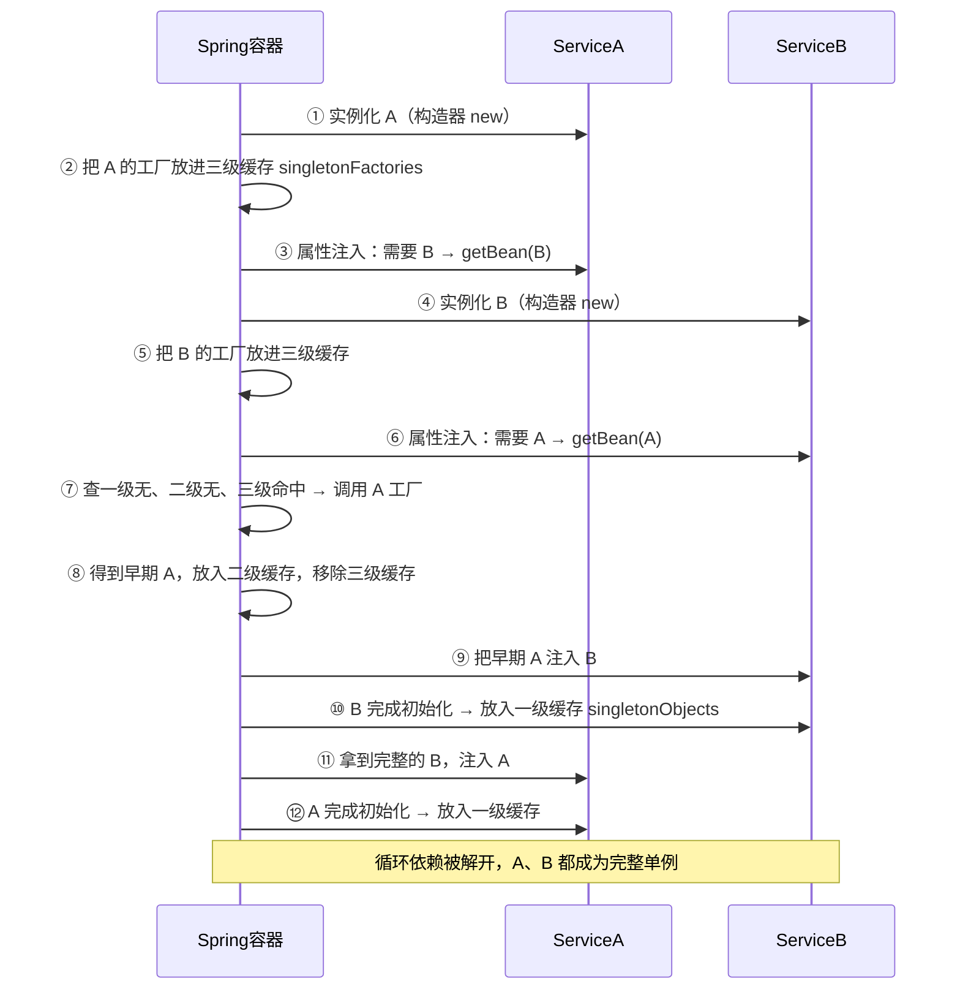
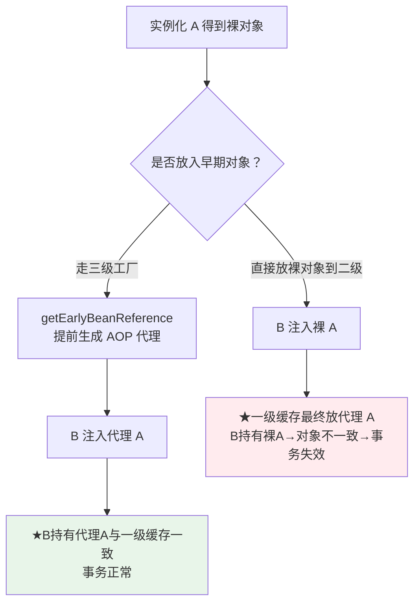
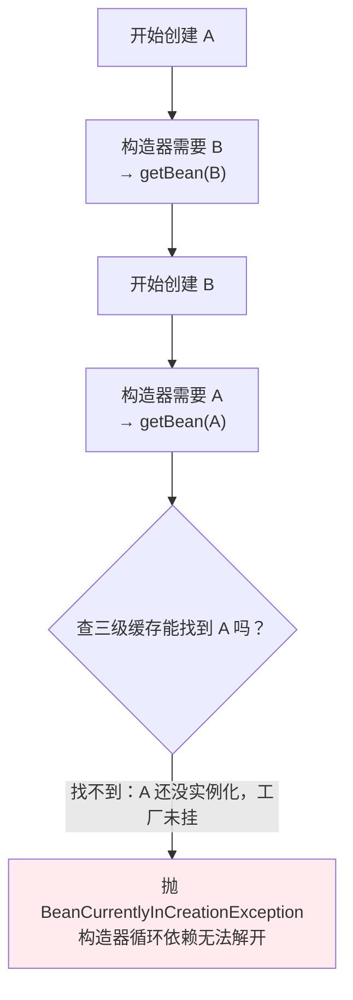
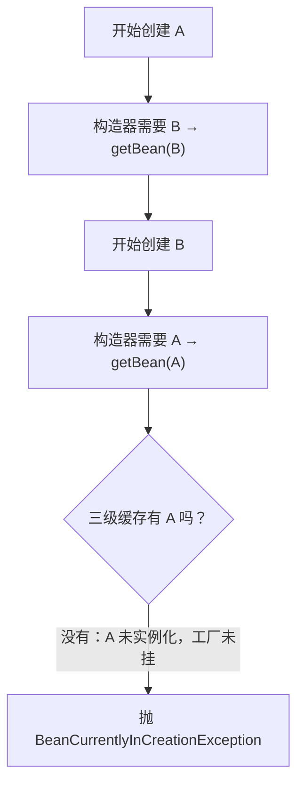

# 循环依赖与三级缓存

> 定位：为什么 setter 注入的循环依赖 Spring 能自动帮你解开，构造器注入却直接报 `BeanCurrentlyInCreationException`？为什么 Spring Boot 2.6 之后默认禁止循环依赖？答案全在「三级缓存」的设计里。这一篇把三级缓存的作用、为什么必须是三级、以及 `@Lazy` 破环的原理讲透，这是高级 Java 面试的必考题。

## 一、什么是循环依赖

循环依赖就是两个或多个 Bean 互相持有对方，形成闭环：

```
A 依赖 B，B 又依赖 A  →  A ↔ B
A → B → C → A        →  三 Bean 环
自己依赖自己          →  A → A
```

```java
@Component
public class ServiceA {
    @Autowired private ServiceB serviceB;  // A 需要 B
}

@Component
public class ServiceB {
    @Autowired private ServiceA serviceA;  // B 又需要 A
}
```

如果没有特殊机制，Spring 创建 A 时发现需要 B，转去创建 B；创建 B 时发现需要 A，又转去创建 A……无限递归，最终栈溢出或报 `BeanCurrentlyInCreationException`。

先给结论：**Spring 只能解决「单例 + setter/字段注入」的循环依赖，解决不了「构造器注入」和「prototype 作用域」的循环依赖。** 为什么？往下看。

## 二、核心原理：三级缓存

### 2.1 三个缓存分别是什么

三级缓存定义在 `DefaultSingletonBeanRegistry` 里：

| 缓存 | 字段名 | 存什么 | 大白话 |
|---|---|---|---|
| 一级 | `singletonObjects` | 完整初始化好的单例 Bean | 成品货架 |
| 二级 | `earlySingletonObjects` | 早期暴露的 Bean（已实例化，未初始化） | 半成品货架 |
| 三级 | `singletonFactories` | `ObjectFactory<?>`，能生产早期 Bean 的工厂 | 半成品生产流水线 |

创建 Bean 时，真正的顺序是：**实例化 → 提前暴露工厂（放进三级）→ 属性注入 → 初始化 → 放进一级**。注意「提前暴露」这个动作，发生在**实例化之后、属性注入之前**——这是解开循环依赖的关键窗口。

### 2.2 getSingleton 的查找顺序

当 B 需要注入 A 时，Spring 调用 `getSingleton("a", true)`，按三级顺序找：

```java
// DefaultSingletonBeanRegistry.getSingleton 简化版
protected Object getSingleton(String beanName, boolean allowEarlyReference) {
    Object obj = singletonObjects.get(beanName);          // 1. 一级：成品
    if (obj == null && isSingletonCurrentlyInCreation(beanName)) {
        synchronized (singletonObjects) {
            obj = earlySingletonObjects.get(beanName);    // 2. 二级：半成品
            if (obj == null && allowEarlyReference) {
                ObjectFactory<?> f = singletonFactories.get(beanName); // 3. 三级：工厂
                if (f != null) {
                    obj = f.getObject();                   // 调用工厂生产早期对象
                    earlySingletonObjects.put(beanName, obj); // 升级到二级
                    singletonFactories.remove(beanName);      // 清掉三级
                }
            }
        }
    }
    return obj;
}
```

下面这张图是 A、B 循环依赖（setter 注入）的完整时序，对照着看上面这段代码：



这张图的精髓在第 ⑦ ⑧ 步：B 需要 A 时，A 还没初始化完（不能放一级缓存），但**已经在三级缓存里挂了工厂**。容器调用这个工厂拿到「早期的 A」并注入给 B，让 B 能先完成创建，然后回头 A 也顺利拿到完整的 B。整个环就被「提前暴露半成品」这个动作打破了。

### 2.3 addSingletonFactory：什么时候挂工厂

在 `AbstractAutowireCapableBeanFactory.doCreateBean()` 里，实例化之后紧接着：

```java
if (earlySingletonExposure) {
    addSingletonFactory(beanName, () -> getEarlyBeanReference(beanName, mbd, bean));
}
```

`earlySingletonExposure` 的条件是：单例 + 允许循环依赖 + 该 Bean 正在创建中。而这个工厂的核心 `getEarlyBeanReference()` 会遍历所有 `SmartInstantiationAwareBeanPostProcessor`——**AOP 代理就是在这里提前生成的**（`AbstractAutoProxyCreator.getEarlyBeanReference`）。这就是为什么三级缓存里存的是「工厂」而不是「对象本身」。

## 三、为什么必须是三级，两级不行吗

这是最难也最经典的问题。两级缓存有两种设计方案，我们逐一证伪。

### 3.1 只有一级缓存（成品货架）

只有 `singletonObjects`。B 要 A 时，A 还没初始化完，一级缓存里根本没有 → 直接失败。**连最基本的循环依赖都解不开**，淘汰。

### 3.2 二级缓存方案 A：直接存早期对象

实例化后就把「裸对象」放进二级缓存。B 拿到的是裸 A。问题来了——**如果 A 需要被 AOP 代理（事务、@Async）**：

- B 注入的是裸 A（未代理）
- 容器最终在一级缓存里放的是 A 的代理对象
- 结果：B 手里的 A 和容器里的 A **不是同一个对象**，B 调用 A 的方法完全绕过事务/代理 → 事务失效



三级缓存存**工厂**而不是裸对象，就是为了「延迟决策」：只有真的发生循环依赖、有人来取早期引用时，才调用工厂生成对象（可能是代理）。而且 `AbstractAutoProxyCreator` 用 `earlyProxyReferences` 记录了「已经为哪个 Bean 生成过早期代理」，保证**多次取早期引用返回的是同一个代理对象**，且这个代理和最终放进一级缓存的是同一个。

### 3.3 二级缓存方案 B：只有一级 + 三级，去掉二级

不要二级缓存，每次需要早期对象都从三级工厂 `getObject()` 生成。问题有两个：

1. **性能**：每次依赖注入都重新调用工厂、重新走一遍代理判断逻辑
2. **对象不一致风险**：如果工厂实现不是幂等的（每次 `getObject()` 生成新代理），多个 Bean 依赖同一个循环中的 Bean 时，会拿到不同的对象

二级缓存 `earlySingletonObjects` 的作用就是**缓存工厂产出的早期对象**：第一次从三级取到对象后，立刻升级到二级并清空三级，后续再取直接从二级拿，保证唯一性和效率。

一句话总结三级分工：

> 三级缓存（工厂）解决「AOP 代理延迟生成」，二级缓存（早期对象）解决「多次取引用的一致性与效率」，一级缓存（成品）解决「正常使用」。**三级缺一不可。**

## 四、为什么构造器注入的循环依赖无解

关键在「提前暴露」的时机：`addSingletonFactory()` 是在**实例化之后**才执行的。

构造器注入要求在**实例化阶段**就必须拿到依赖——要 new A，先得有 B；要 new B，先得有 A。此时 A、B 都还没实例化成功，谁也来不及挂工厂。



prototype 作用域同理：Spring 不缓存 prototype Bean，每次都是全新创建，没有「提前暴露」的机会，循环依赖同样无解，会抛异常。

## 五、@Lazy 如何破环

`@Lazy` 加在注入点上（配合 `@Autowired`），Spring 不会立即注入真实 Bean，而是注入一个**懒加载代理**（由 `ContextAnnotationAutowireCandidateResolver` 提供）。这个代理在**第一次真正调用方法时**才去容器里 `getBean()` 解析真实对象。

```java
@Component
public class ServiceA {
    @Lazy                       // 关键：注入的是代理，不是真实 B
    @Autowired private ServiceB serviceB;
}
```

创建 A 时，注入的是 B 的代理（不触发 B 的创建），A 能顺利创建完；等到 A 的某个方法第一次调用 `serviceB.xxx()` 时，B 才被创建，那时 A 早已是完整单例，循环在「时间」上被错开，自然解开。

> 注意：`@Lazy` 破环的本质是「延迟解析」，它和三级缓存是两套独立机制。生产上更推荐的做法是**重构消除循环依赖**（抽取公共逻辑到第三层），`@Lazy` 只是快速止血手段。

## 六、Spring Boot 2.6+ 默认禁止循环依赖

从 Spring Boot 2.6 起，`spring.main.allow-circular-references` 默认值从 `true` 改为 `false`。应用存在循环依赖时直接启动失败：

```
***************************
APPLICATION FAILED TO START
***************************
Description:
The dependencies of some of the beans in the application context form a cycle:
   ┌────┐
   │ serviceA
   ↑    ↓
   │ serviceB
   └────┘
Action:
Relying upon circular references is discouraged and they are prohibited by default.
```

**为什么要改？** 官方理由：

1. 循环依赖往往意味着**代码设计有问题**（职责不清、耦合过重）
2. 循环依赖和 AOP 代理叠加时容易产生**对象不一致、代理失效**等隐蔽 bug
3. 让启动顺序变得脆弱，Bean 加载顺序变化就可能出问题

**三种应对方式**：

| 方式 | 做法 | 评价 |
|---|---|---|
| 重构（推荐） | 抽取公共逻辑到第三个 Bean，或用事件/回调解耦 | 根治，但成本高 |
| `@Lazy` | 在循环的一方注入点加 `@Lazy` | 快速止血，掩盖设计问题 |
| 改回默认 | `spring.main.allow-circular-references=true` | 临时兼容老项目，不推荐长期 |

## 七、生产坑点与排查

### 坑点 1：循环依赖 + `@Async` / `@Transactional` 导致代理对象不一致

**现象**：B 注入的 A 调用事务方法不生效，或报 `BeanNotOfRequiredTypeException`（期望代理类型、实际拿到裸对象）。
**原因**：早期引用的生成依赖 `SmartInstantiationAwareBeanPostProcessor.getEarlyBeanReference`。如果某个代理处理器没有正确实现这个回调，早期暴露的就是裸对象，与最终一级缓存里的代理对象不一致。
**解法**：避免循环依赖；若在循环中同时用 `@Async` + `@Transactional`，给注入点加 `@Lazy` 让依赖在代理完成后再解析；升级到较新 Spring 版本（对早期代理的支持更完善，以你的版本为准）。

### 坑点 2：升级 Spring Boot 2.6 后应用起不来，报循环依赖

**现象**：升级后启动直接失败，报「Relying upon circular references is discouraged」。
**原因**：默认 `allow-circular-references=false`。
**解法**：优先重构；短期用 `spring.main.allow-circular-references=true` 恢复；或在循环一侧加 `@Lazy`。

### 坑点 3：构造器注入的循环依赖，三级缓存也救不了

**现象**：改成构造器注入后，循环依赖报 `BeanCurrentlyInCreationException`，而字段注入时正常。
**原因**：构造器注入在实例化阶段就要依赖，此时工厂还没挂进三级缓存。
**解法**：循环的一方改用 setter/字段注入；或加 `@Lazy`；最彻底是重构消除环。

### 坑点 4：prototype Bean 循环依赖

**现象**：`@Scope("prototype")` 的 Bean 互相依赖，启动或运行时报循环依赖异常。
**原因**：prototype 不进单例缓存，Spring 没有提前暴露机制。
**解法**：改用单例，或 `@Lazy`，或重构。

## 八、调优 / 选型 / 最佳实践

1. **优先构造器注入**，但要有意识：构造器注入天生不支持循环依赖，这其实是好事——**让你在设计阶段就暴露环**。
2. **默认禁止循环依赖是合理默认值**，新项目保持 `false`，把循环依赖当作设计缺陷来治理。
3. **`@Lazy` 是止血不是治病**：能快速上线，但应在后续迭代中重构掉环。
4. **排查工具**：启动时加 `--debug` 看条件报告；循环依赖报错会打印完整的依赖链，顺着 `┌──┐` 图找环。
5. **避免在循环 Bean 上叠加多种代理**（`@Async` + `@Transactional` + `@Validated`），代理叠加最容易在早期引用上出问题。

## 九、面试高频问法

> 这一节按「面试时能讲透」的标准写：先给一句能直接背的结论，再展开机制、原因和坑点，最后给一句加分点。循环依赖是高级 Java 面试的深水区，建议先自己答一遍再对照。

**Q1：什么是循环依赖？Spring 能解决哪几种？**

**一句话结论**：循环依赖是两个或多个 Bean 互相持有形成闭环；Spring **只能解决「单例 + setter/字段注入」的循环依赖**，构造器注入和 prototype 作用域的都无解。

展开：

- **三种形态**：A↔B 互相依赖、A→B→C→A 三 Bean 环、A 自己依赖自己。
- **不做处理会怎样**：创建 A 发现需要 B → 转去创建 B → 发现需要 A → 又创建 A……无限递归，最终 `BeanCurrentlyInCreationException` 或栈溢出。
- **能解决的前提**：必须是 singleton（单例），且依赖是在「实例化之后」注入的（setter/字段注入）。因为 Spring 的解法核心是「提前暴露」——实例化后、属性注入前把对象挂出去，这个时机只有 setter/字段注入才有。
- **无解的两种**：构造器注入在实例化阶段就要依赖，此时对象还没 new 出来、来不及挂出去；prototype 每次全新创建、不进缓存，没有提前暴露的机会。

加分点：先亮出「单例 + setter/字段」这个前提再讲原理，面试官会认为你思路清晰——很多人一上来就讲三级缓存，却答不出适用边界。

**Q2：Spring 解决循环依赖的核心思路是什么？**

**一句话结论**：靠「提前暴露半成品」——实例化 A 后、注入属性前，先把能生产 A 的工厂放进三级缓存，让 B 能拿到「早期的 A」先完成创建，从而打破环。

展开：

创建 Bean 的真实顺序是：**实例化 → 提前暴露工厂（进三级）→ 属性注入 → 初始化 → 放进一级**。

以 A↔B（字段注入）为例：

1. 实例化 A（此时 A 是「空壳」）→ 把 A 的工厂放进三级缓存 `singletonFactories`
2. A 注入属性需要 B → 转去创建 B
3. 实例化 B → 把 B 的工厂放进三级
4. B 注入属性需要 A → `getSingleton("a")`
5. 查一级（成品）无、二级（半成品）无、三级命中 → 调用 A 的工厂拿到「早期 A」
6. 早期 A 放进二级、清掉三级 → 注入给 B
7. B 完成初始化 → 放进一级缓存
8. 回头 A 拿到完整的 B → A 完成初始化 → 放进一级

精髓在第 5、6 步：A 还没初始化完（不能进一级），但工厂已经挂出去了，B 拿的是「早期引用」，等 B 先建好，A 再收尾。

加分点：强调「提前暴露的时机是实例化之后、属性注入之前」——这是整个机制的题眼，构造器注入之所以无解正是卡在这个时机上。

**Q3：三级缓存分别是什么？为什么必须是三级，两级不行吗？**

**一句话结论**：一级 `singletonObjects` 存成品、二级 `earlySingletonObjects` 存早期对象、三级 `singletonFactories` 存工厂；三级存工厂是为了 AOP 代理延迟生成且保证对象一致，二级存早期对象是为了多次取引用的一致性与效率，缺一不可。

展开：

| 缓存 | 字段 | 存什么 | 作用 |
|---|---|---|---|
| 一级 | `singletonObjects` | 完整初始化的单例 Bean | 成品货架，正常使用 |
| 二级 | `earlySingletonObjects` | 早期暴露的 Bean（已实例化、未初始化） | 缓存早期对象，保证一致性+效率 |
| 三级 | `singletonFactories` | `ObjectFactory<?>`，能生产早期 Bean | AOP 代理延迟生成 |

**为什么两级不行**——逐一证伪：

- **只有一级**：B 要 A 时 A 还没初始化完，一级里根本没有 → 直接失败，连基本环都解不开。
- **二级直接存裸对象**：如果 A 需要被 AOP 代理（事务/@Async），B 拿到的是裸 A，而一级最终放的是代理 A → **B 手里的 A 和容器里的 A 不是同一个对象，事务失效**。
- **只有一级+三级、去掉二级**：每次取早期对象都重新调工厂生成，一是性能差，二是若工厂非幂等（每次生成新代理），多个 Bean 会拿到不同对象。

三级存**工厂**是「延迟决策」：只有真发生循环依赖、有人来取时才调工厂生成（可能是代理）；且 `AbstractAutoProxyCreator` 用 `earlyProxyReferences` 记录已生成过早期代理的 Bean，保证多次取、以及最终进一级的是同一个代理对象。

加分点：用一句话总结三级分工——「三级解决代理延迟与一致，二级解决多次取用的效率与唯一，一级解决正常使用」，这是这道题的标准高分答法。

**Q4：三级缓存里为什么存的是 ObjectFactory 工厂，而不是直接存早期对象？**

**一句话结论**：存工厂是为了「延迟决策」——只有真发生循环依赖时才生成对象，且能在这里提前完成 AOP 代理，保证注入的是代理对象而非裸对象。

展开：

- **源码位置**：`doCreateBean()` 里实例化后紧接着：
  ```java
  if (earlySingletonExposure) {
      addSingletonFactory(beanName, () -> getEarlyBeanReference(beanName, mbd, bean));
  }
  ```
  工厂的核心就是 `getEarlyBeanReference()`。
- **它会做什么**：遍历所有 `SmartInstantiationAwareBeanPostProcessor`，调用其 `getEarlyBeanReference()`。`AbstractAutoProxyCreator`（AOP 代理创建器）就在这里**提前生成代理**——所以工厂产出的不是裸对象，而是代理对象。
- **为什么不提前直接生成**：绝大多数 Bean 没有循环依赖，如果实例化后无脑生成代理，会把代理创建成本摊到所有 Bean 上。存工厂后，只有真有人来取早期引用（即发生循环依赖）时才生成，是按需的。
- **一致性保障**：`AbstractAutoProxyCreator` 内部用 `earlyProxyReferences` 缓存「已为谁生成过早期代理」，后续再取返回同一个，且最终进一级缓存时也会复用它——避免「早期是裸对象、最终是代理」的分裂。

加分点：指出「这正是 Spring Boot 2.6 默认禁止循环依赖的深层原因之一——循环依赖 + AOP 的组合最容易在早期引用上出对象不一致的隐蔽 bug」。

**Q5：getSingleton 是怎么从三级缓存里找 Bean 的？**

**一句话结论**：按「一级 → 二级 → 三级」顺序查，三级命中后调用工厂生成对象、升级到二级并清掉三级，保证后续取用走更快的二级。

展开：

```java
protected Object getSingleton(String beanName, boolean allowEarlyReference) {
    Object obj = singletonObjects.get(beanName);              // 1. 一级：成品
    if (obj == null && isSingletonCurrentlyInCreation(beanName)) {
        synchronized (singletonObjects) {
            obj = earlySingletonObjects.get(beanName);        // 2. 二级：半成品
            if (obj == null && allowEarlyReference) {
                ObjectFactory<?> f = singletonFactories.get(beanName); // 3. 三级：工厂
                if (f != null) {
                    obj = f.getObject();                       // 调工厂生产早期对象
                    earlySingletonObjects.put(beanName, obj);  // 升级到二级
                    singletonFactories.remove(beanName);       // 清掉三级
                }
            }
        }
    }
    return obj;
}
```

要点：

- `isSingletonCurrentlyInCreation(beanName)` 保证只处理「正在创建中」的 Bean，避免误取。
- 「三级命中 → 升级二级 → 清三级」这个动作，让同一个早期对象被缓存下来，后续依赖方直接从二级拿，既快又保证是同一个对象（幂等）。
- 整个查找在 `synchronized (singletonObjects)` 内，保证多线程下缓存的一致性。

加分点：点出「二级缓存是三级和一级之间的缓冲带——工厂只调用一次，结果存二级；等初始化完成再从二级清掉、进一级」，把这三级的关系说成一条流转链。

**Q6：为什么构造器注入的循环依赖解决不了？**

**一句话结论**：因为「提前暴露工厂」发生在实例化之后，而构造器注入在实例化阶段就必须拿到依赖，此时对象还没 new 出来、工厂根本没挂进三级缓存。

展开：

- **时序冲突**：三级缓存的 `addSingletonFactory()` 在 `createBeanInstance()` 之后。构造器注入要求「先有 B 才能 new A、先有 A 才能 new B」——两边都卡在实例化阶段，谁也没走到挂工厂那一步。
- **结果**：查三级缓存全空 → 抛 `BeanCurrentlyInCreationException`，Spring 直接放弃。



- **解法**：循环的一方改用 setter/字段注入；或加 `@Lazy`；最彻底是重构消除环（抽公共逻辑到第三层）。

加分点：补一句「所以构造器注入 '不支持循环依赖' 不是缺陷而是特性——它让设计问题在启动期就暴露，这也是官方推荐构造器注入的原因之一」。

**Q7：为什么 prototype 作用域的循环依赖也解决不了？**

**一句话结论**：因为 Spring 完全不缓存 prototype Bean，没有「提前暴露」的机制，每次都是全新创建，遇到环只能无限递归。

展开：

- **缓存只认单例**：三级缓存（`singletonObjects`/`earlySingletonObjects`/`singletonFactories`）都是为 singleton 服务的，prototype Bean 从不放进去。
- **无提前暴露**：`addSingletonFactory()` 的前提是 `earlySingletonExposure`，prototype 不满足，所以即使在实例化后也不会挂工厂。
- **结果**：A(prototype) 需要 B → 新建 B → B 需要 A → 又新建一个全新的 A……没有终点，最终栈溢出或抛异常。
- **解法**：改用单例；或循环一方加 `@Lazy` 延迟解析；或重构拆环。

加分点：把这道题和上一题归并成一句话——「构造器注入卡在 '来不及挂工厂'，prototype 卡在 '根本没有工厂'，两者都因为缺少提前暴露这个窗口而无解」，体现归纳能力。

**Q8：@Lazy 为什么能解决循环依赖？它和三级缓存是一回事吗？**

**一句话结论**：不是一回事。`@Lazy` 注入的是懒加载代理，第一次真正调用方法时才去 `getBean()` 解析真实对象，把循环在「时间」上错开。

展开：

```java
@Component
public class ServiceA {
    @Lazy                       // 关键：注入的是 B 的代理，不是真实 B
    @Autowired private ServiceB serviceB;
}
```

- **原理**：`ContextAnnotationAutowireCandidateResolver` 为加 `@Lazy` 的注入点生成一个懒代理。创建 A 时注入代理 B（不触发 B 创建），A 能顺利建完；等 A 的某个方法第一次调用 `serviceB.xxx()` 时，B 才被创建，那时 A 早已是完整单例，环自然解开。
- **与三级缓存的区别**：三级缓存是「提前暴露半成品」化解环，`@Lazy` 是「延迟解析」错开时序——两套独立机制。
- **本质**：`@Lazy` 是止血不是治病，它掩盖了职责不清的设计问题，应在后续迭代中重构掉环。

加分点：说一句「生产上我更推荐抽取公共逻辑到第三层或用事件解耦，`@Lazy` 只作为快速上线手段」——体现工程判断而非炫技。

**Q9：循环依赖和 AOP（事务/@Async）同时存在会有什么坑？**

**一句话结论**：早期引用如果没被正确代理，会导致注入的对象与容器里的对象不一致——B 拿着裸 A，事务/@Async 全部失效，甚至报 `BeanNotOfRequiredTypeException`。

展开：

- **坑的根源**：早期引用的生成依赖 `SmartInstantiationAwareBeanPostProcessor.getEarlyBeanReference()`。如果某个代理处理器没正确实现这个回调，三级工厂产出的就是裸对象，而一级缓存最终放的是代理对象 → 两个对象不是同一个。
- **典型现象**：B 注入的 A 调用事务方法不回滚；或按类型注入时报「期望代理类型、实际是裸对象」。
- **Spring 的保障**：正常情况下三级工厂会调 `getEarlyBeanReference` 提前生成代理，`earlyProxyReferences` 保证早期代理==最终代理。但如果用了某些第三方 BPP 或配置不当，保障会失效。
- **解法**：避免循环依赖；必须组合时给注入点加 `@Lazy`，让依赖在代理完成后再解析；升级到较新 Spring 版本（对早期代理支持更完善，以版本为准）；避免在循环 Bean 上叠加 `@Async` + `@Transactional` + `@Validated` 多种代理。

加分点：这正是 Spring Boot 2.6 把循环依赖默认关掉的重要动机——「循环依赖 + AOP」是最容易产生隐蔽 bug 的组合，面试官很吃这个因果链。

**Q10：Spring Boot 2.6 默认禁止循环依赖，你怎么看？**

**一句话结论**：`spring.main.allow-circular-references` 默认值从 `true` 改成 `false`，循环依赖直接导致启动失败——官方意在把它当作设计缺陷治理。

展开：

- **报错长这样**：启动失败，打印 `Relying upon circular references is discouraged and they are prohibited by default`，并画出 `┌──┐` 依赖环图。
- **为什么改**：
  1. 循环依赖往往意味着职责不清、耦合过重，是代码设计有问题的信号；
  2. 和 AOP 代理叠加容易产生对象不一致、代理失效等隐蔽 bug；
  3. 让启动顺序变脆弱，Bean 加载顺序一变就可能出问题。
- **三种应对**：

| 方式 | 做法 | 评价 |
|---|---|---|
| 重构（推荐） | 抽公共逻辑到第三个 Bean，或用事件/回调解耦 | 根治，成本高 |
| @Lazy | 循环一方注入点加 `@Lazy` | 快速止血，掩盖设计问题 |
| 改回默认 | `spring.main.allow-circular-references=true` | 临时兼容老项目，不推荐长期 |

加分点：表态「新项目保持 `false`，把循环依赖当 design smell 治理」——既答了知识点，又体现了工程价值观。

**Q11：项目里发现循环依赖，你的排查和处理思路是什么？**

**一句话结论**：先看报错里的依赖链定位环，再判断是设计问题还是历史包袱，优先重构消除环，`@Lazy`/改配置只作过渡。

展开：

- **排查步骤**：
  1. 启动时报的 `BeanCurrentlyInCreationException` 或 Boot 的循环依赖报错会打印**完整依赖链**（`┌──┐` 图），顺着它找到环上的 Bean；
  2. 用 `--debug` 看条件报告，确认是不是配置意外加载导致多出依赖；
  3. 用 IDE 的依赖结构分析（如 Structurely/IDEA 的 cyclic dependency 检测）或手写依赖图梳理。
- **处理优先级**：
  1. **重构**（最优）：把互相依赖的逻辑抽到第三个 Bean，或用事件/观察者模式解耦，从根上消除环；
  2. **@Lazy**（止血）：在循环一方的注入点加 `@Lazy`，快速恢复启动；
  3. **改配置**（兼容）：`spring.main.allow-circular-references=true` 临时放行老项目，并登记技术债后续重构。
- **注意**：构造器注入场景 `@Lazy` 也要加在注入点（构造器参数）上才生效；prototype 的环只能靠重构或改单例。

加分点：说一句「我一般会在治理后加一条架构测试（如 ArchUnit）禁止新的包级循环依赖，防止问题回归」——体现从「解决一个问题」到「防一类问题」的思路。

## 小结

- 循环依赖只有「单例 + setter/字段注入」能被 Spring 自动解开，构造器和 prototype 无解。
- 破环靠「提前暴露」：实例化后、属性注入前把工厂挂进三级缓存。
- 三级分工：一级成品、二级早期对象（一致性+效率）、三级工厂（AOP 代理延迟生成）。
- 构造器注入在实例化时就要依赖，来不及挂工厂，故无解。
- `@Lazy` 用懒代理延迟解析破环；Spring Boot 2.6+ 默认禁止循环依赖，优先重构。
