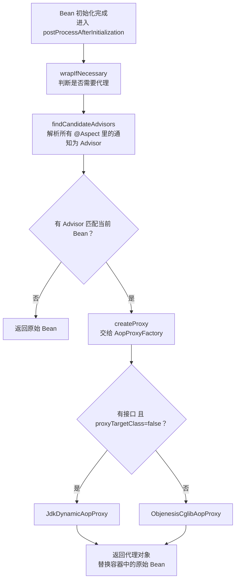
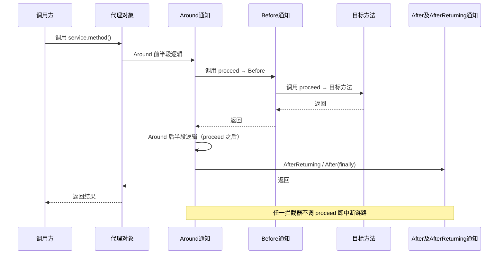

# Spring AOP 与动态代理

> 定位：AOP 是 Spring 除 IOC 外的另一根支柱，事务、日志、缓存、权限校验全靠它。为什么 `@Transactional` 有时生效有时不生效？为什么同类方法调用会绕过代理？搞懂动态代理的创建过程和通知链的执行顺序，这些问题就不再是玄学。这一篇把 AOP 从概念到源码执行链讲清楚。

## 一、为什么需要 AOP

想象一个场景：你要给 50 个 Service 方法都加上「方法执行耗时日志 + 事务 + 权限校验」。如果在每个方法里手写，代码会充斥着和业务无关的重复逻辑，改一个日志格式要改 50 处。

AOP（Aspect-Oriented Programming，面向切面编程）解决的就是这类**横切关注点**（cross-cutting concerns）：把散落在各处的公共逻辑抽出来，声明式地「织入」到目标方法前后，业务代码保持纯净。

Spring AOP 基于**代理模式**实现：容器不直接给你原始对象，而是给一个「包了一层」的代理对象，方法调用先经过代理，代理在执行前后插入通知逻辑。理解这一点，就理解了后面所有 AOP 失效问题的本质——**你调用的到底是不是代理对象**。

## 二、AOP 核心概念

先对齐术语，这些词面试和源码里到处都是：

| 概念 | 英文 | 含义 | 类比 |
|---|---|---|---|
| 连接点 | Joinpoint | 程序执行的某个点，Spring AOP 中就是**方法调用/执行** | 可以被拦截的「关卡」 |
| 切入点 | Pointcut | 匹配连接点的表达式，决定「拦哪些方法」 | 关卡的「筛选规则」 |
| 通知 | Advice | 在连接点执行的动作，即「做什么」 | 过关时执行的「动作」 |
| 切面 | Aspect | 切入点 + 通知的组合 | 「规则 + 动作」的整套方案 |
| 目标对象 | Target | 被代理的原始对象 | 被保护的「本体」 |
| 织入 | Weaving | 把切面应用到目标、创建代理的过程 | 给本体装上「关卡」 |

五种通知类型：

| 注解 | 类型 | 执行时机 | 能否改变返回值/吞异常 |
|---|---|---|---|
| `@Before` | 前置 | 目标方法前 | 否 |
| `@AfterReturning` | 返回后 | 正常返回后 | 可读返回值，不能改 |
| `@AfterThrowing` | 异常后 | 抛异常后 | 可读异常，不能吞 |
| `@After` | 最终 | 无论成功失败（finally） | 否 |
| `@Around` | 环绕 | 前后都包住 | **能**，可决定是否调用目标、改返回值、吞异常 |

切入点表达式最常用的是 `execution`：

```java
@Pointcut("execution(* com.example.service.*.*(..))")
//          ↑返回类型 ↑包路径      ↑方法  ↑任意参数
```

> Spring AOP vs AspectJ：Spring AOP 是**运行时代理**，只支持方法级别、只能作用于 Spring 容器管理的 Bean，轻量但功能有限；AspectJ 是**编译期/类加载期织入**，支持构造器、字段等更全面的连接点，功能强但需要额外工具链（`ajc` 或 LTW）。日常开发用 Spring AOP 足够，本篇也聚焦它。

## 三、两种动态代理：JDK vs CGLIB

Spring AOP 的底层是两种动态代理，选哪种由 `AopProxyFactory`（默认 `DefaultAopProxyFactory`）决定。

### 3.1 JDK 动态代理

- 基于 `java.lang.reflect.Proxy` + `InvocationHandler`
- **要求目标类实现接口**，代理类和目标类实现同一组接口
- 调用方法时进入 `InvocationHandler.invoke()`，在这里执行通知链
- Spring 中的实现：`JdkDynamicAopProxy`

### 3.2 CGLIB 动态代理

- 基于字节码生成（ASM），**生成目标类的子类**，重写方法时插入通知
- 不要求接口，能代理普通类
- 通过 `MethodInterceptor.intercept()` 拦截
- 用 **Objenesis** 绕过构造器实例化代理对象（避免目标类无参构造器副作用）
- Spring 中的实现：`ObjenesisCglibAopProxy extends CglibAopProxy`

### 3.3 选择规则

| 条件 | 结果 |
|---|---|
| 实现了接口 | 早期默认用 JDK；Spring Boot 2.0+ 默认用 CGLIB |
| 没实现接口 | 只能用 CGLIB |
| 类是 `final` | CGLIB 无法继承 → AOP 失效/报错 |
| 方法是 `final`/`private`/`static` | 无法被重写/拦截 → 该方法的通知失效 |

Spring Boot 通过 `AopAutoConfiguration` 把 `spring.aop.proxy-target-class` 默认设为 `true`，即**总是用 CGLIB**。这么做的核心原因：用 JDK 代理时，代理对象不是目标类的子类型，按具体类注入会报 `BeanNotOfRequiredTypeException`。想切回 JDK：

```yaml
spring:
  aop:
    proxy-target-class: false   # 有接口时用 JDK 代理
```

或在配置类上：`@EnableAspectJAutoProxy(proxyTargetClass = false)`。

> 性能上，早期 CGLIB 创建代理慢、JDK 调用慢；现代 JDK（8+）JDK 代理调用已经很快，两者差距在多数业务场景可忽略。**选型的关键不是性能，是「能否代理」和「注入类型是否匹配」**。

## 四、代理创建过程

代理是何时、如何被创建的？入口是 `AnnotationAwareAspectJAutoProxyCreator`——它本质上是一个 `BeanPostProcessor`（第 1 篇讲过，代理在 BPP 的 `postProcessAfterInitialization` 阶段生成）。



这张图要抓住两点：① 代理是 BPP 在 Bean 初始化**之后**生成的，所以你最终从容器拿到的是代理对象；② JDK/CGLIB 的分叉点在 `DefaultAopProxyFactory`。

解析 `@Aspect` 的工作由 `BeanFactoryAspectJAdvisorsBuilder` 完成：它扫描所有 `@Aspect` 类，把每个 `@Before`/`@Around` 等方法解析成一个 **Advisor**（= Pointcut + Advice）。`ClassUtils`、`AnnotationUtils` 负责读注解，最终生成 `AspectJMethodBeforeAdvice`、`AspectJAroundAdvice` 等。

## 五、通知链与责任链执行

### 5.1 责任链是怎么跑的

多个通知按Advisor 顺序被包装成一条 `MethodInterceptor` 链，核心是 `ReflectiveMethodInvocation.proceed()`——一个典型的**责任链 + 递归**：

```java
// ReflectiveMethodInvocation 简化版
public Object proceed() throws Throwable {
    if (currentInterceptorIndex == interceptorsAndDynamicMethodMatchers.size() - 1) {
        return invokeJoinpoint(); // 链尾：反射调用目标方法
    }
    Object interceptor = interceptorsAndDynamicMethodMatchers.get(++currentInterceptorIndex);
    return ((MethodInterceptor) interceptor).invoke(this); // 把控制权交给下一个
}
```

每个拦截器（如 `MethodBeforeAdviceInterceptor`）在自己的 `invoke()` 里先干自己的活，再调用 `mi.proceed()` 把控制权传给下一个，直到链尾真正执行目标方法。**`@Around` 是唯一可以不调用 `proceed()` 的通知**——你不调，目标方法和后续通知就都不执行，这就是环绕通知能「吞掉」方法调用、改返回值的原理。



这张图展示责任链的「洋葱模型」：通知像一层层洋葱皮包住目标方法，`proceed()` 是往里钻的通道，`@Around` 在最外层，能决定要不要往里走。异常时，异常会沿链向外抛出，被 `@AfterThrowing` 捕获，`@After` 在 finally 中照常执行。

### 5.2 通知的执行顺序

同一连接点上多个通知的执行顺序遵循 AspectJ 的优先级规则，常见实现中通常观察到：

- **正常返回**：`@Around(前)` → `@Before` → 目标方法 → `@Around(后)` → `@AfterReturning` → `@After`
- **抛异常**：`@Around(前)` → `@Before` → 目标方法抛异常 → `@AfterThrowing` → `@After` → 异常继续外抛

要把顺序讲准有两点补充：

1. **不同切面**之间用 `@Order(n)` 或实现 `Ordered` 控制，n 越小优先级越高、越先执行
2. **同一切面内**多个通知的严格顺序，Spring 官方文档明确说「未定义」——如果对顺序有强依赖，正确做法是拆成不同切面并用 `@Order` 显式控制，而不是赌声明顺序（以你使用的版本为准）

## 六、代理失效场景与排查

这是 AOP 落地时最常踩的坑，核心就一句话：**只有「通过代理对象发起的、可被重写的公共方法调用」才会被拦截**。

### 6.1 六大失效场景

| 场景 | 为什么失效 | 解决办法 |
|---|---|---|
| 同类方法自调用 | `this.methodB()` 走的是原始对象，绕过代理 | 拆到另一个 Bean；或注入自身代理；或 `AopContext.currentProxy()`（需 `exposeProxy=true`） |
| `private` 方法 | 无法被子类重写/接口暴露 | 改成 public/protected |
| `final` 方法/类 | CGLIB 无法重写 final | 去掉 final |
| `static` 方法 | 属于类，不属于实例代理 | 改成实例方法 |
| 自己 `new` 的对象 | 不是 Spring Bean，没经过代理 | 交给容器管理 |
| 非 public 方法（JDK 代理） | JDK 代理只暴露接口方法 | 用 CGLIB 或声明到接口 |

自调用示例（最经典）：

```java
@Service
public class OrderService {
    public void createOrder() {
        // ❌ 自调用：this 是原始对象，checkStock() 上的 @Transactional 不生效
        this.checkStock();
    }

    @Transactional
    public void checkStock() { /* ... */ }
}
```

### 6.2 排查手段

1. **看对象是不是代理**：在调用处打印 `bean.getClass().getName()`，出现 `$Proxy`（JDK）或 `EnhancerBySpringCGLIB` / `$$`（CGLIB）说明是代理
2. **用工具类判断**：`AopUtils.isAopProxy(bean)`、`AopUtils.isJdkDynamicProxy(bean)`、`AopUtils.isCglibProxy(bean)`
3. **开日志**：`logging.level.org.springframework.aop=DEBUG`，看 Advisor 匹配过程
4. **断点调试**：在 `ReflectiveMethodInvocation.proceed()` 打断点，看调用链是否经过
5. **Arthas 在线诊断**：`sc *OrderService` 看类名，`jad` 反编译看字节码，`watch` 观察调用栈

> 快速判断口诀：**事务/日志不生效，先看是不是「自己调自己」，再看方法是不是 public 且非 final，最后看调用对象是不是容器里的代理 Bean。**

## 七、生产坑点与排查

### 坑点 1：`@Transactional` 在同类自调用方法上完全失效

**现象**：`checkStock()` 上的 `@Transactional` 不报错也不生效，库存扣减没有回滚。
**原因**：`createOrder()` 内部 `this.checkStock()` 调用的是原始对象方法，没经过代理，事务拦截器根本没介入。
**解法**：把 `checkStock()` 挪到另一个 Service 注入调用；或在 `OrderService` 里 `@Autowired private OrderService self;` 用 `self.checkStock()`（注意可能触发循环依赖，可加 `@Lazy`）；或开启 `exposeProxy=true` 后用 `((OrderService) AopContext.currentProxy()).checkStock()`。

### 坑点 2：按具体类注入时报 `BeanNotOfRequiredTypeException`

**现象**：`spring.aop.proxy-target-class=false` 时，`@Autowired private UserServiceImpl service;` 报类型不匹配。
**原因**：JDK 代理生成的是实现接口的代理类，不是 `UserServiceImpl` 的子类，无法按实现类注入。
**解法**：按接口类型注入（推荐）；或改回 CGLIB（`proxy-target-class=true`，Spring Boot 默认）。

### 坑点 3：代理类方法里的 `private` 工具方法里的注解不生效

**现象**：在 `private` 方法上加 `@Cacheable` / `@Async` 毫无反应。
**原因**：private 方法对代理不可见，无法被拦截。
**解法**：改成 public 实例方法；或把逻辑移到独立 Bean；AspectJ 织入（LTW）可绕过此限制。

### 坑点 4：循环依赖 + AOP 导致注入对象不一致

**现象**：循环依赖场景下，B 注入的 A 事务不生效。
**原因**：早期暴露的对象不是正确的代理（详见循环依赖篇），代理对象不一致。
**解法**：加 `@Lazy` 让依赖在代理完成后解析；或重构消除循环依赖。

## 八、调优 / 选型 / 最佳实践

1. **代理方式**：Spring Boot 保持默认 CGLIB（`proxy-target-class=true`），避免按类注入的类型陷阱；只有明确需要 JDK 代理特性时才切回。
2. **切面设计**：横切逻辑放独立 `@Aspect` 类，不要和业务 Bean 混在一起；需要控制顺序时用 `@Order` + 不同切面。
3. **规避自调用**：相互调用的方法拆到不同 Bean，这是最干净的写法，也能规避循环依赖。
4. **切入点精度**：`execution` 表达式尽量收窄到具体包/类，避免 `..*..*(..)` 这种宽泛表达式把大量方法纳入代理，拖慢启动和运行。
5. **排查工具常备**：`AopUtils`、DEBUG 日志、Arthas，三者配合能定位 99% 的 AOP 失效问题。

## 九、面试高频问法

> 这一节按「面试时能讲透」的标准写：先给一句能直接背的结论，再展开机制、原因和坑点，最后给一句加分点。AOP 失效是生产最高频的「玄学问题」，建议先自己答一遍再对照。

**Q1：什么是 AOP？Spring AOP 有哪些核心概念？**

**一句话结论**：AOP（面向切面编程）把散落在各处的横切关注点（日志、事务、权限）抽出来声明式织入；核心概念是连接点、切入点、通知、切面、目标对象、织入。

展开：

- **解决什么问题**：给 50 个 Service 方法都加「耗时日志 + 事务 + 权限校验」，手写会充斥重复逻辑。AOP 把它们抽成切面，业务代码保持纯净。
- **六个术语**：

| 概念 | 英文 | 含义 |
|---|---|---|
| 连接点 | Joinpoint | 程序执行的某个点，Spring AOP 中就是方法调用/执行 |
| 切入点 | Pointcut | 匹配连接点的表达式，决定「拦哪些方法」 |
| 通知 | Advice | 在连接点执行的动作，即「做什么」 |
| 切面 | Aspect | 切入点 + 通知的组合 |
| 目标对象 | Target | 被代理的原始对象 |
| 织入 | Weaving | 把切面应用到目标、创建代理的过程 |

- **Spring AOP vs AspectJ**：Spring AOP 是**运行时代理**，只支持方法级别、只作用于 Spring Bean，轻量但有限；AspectJ 是**编译期/类加载期织入**，支持构造器、字段等更全的连接点，但需额外工具链（`ajc`/LTW）。日常用 Spring AOP 足够。

加分点：说一句「理解 AOP 所有失效问题的钥匙就一句话——你调用的到底是不是代理对象」，把后面的坑提前收口。

**Q2：五种通知类型分别是什么？有什么区别？**

**一句话结论**：`@Before`、`@AfterReturning`、`@AfterThrowing`、`@After`、`@Around` 五种；其中只有 `@Around` 能改变返回值、吞异常、决定是否调用目标方法。

展开：

| 注解 | 类型 | 执行时机 | 能否改返回值/吞异常 |
|---|---|---|---|
| `@Before` | 前置 | 目标方法前 | 否 |
| `@AfterReturning` | 返回后 | 正常返回后 | 只能读返回值，不能改 |
| `@AfterThrowing` | 异常后 | 抛异常后 | 只能读异常，不能吞 |
| `@After` | 最终 | 无论成功失败（finally） | 否 |
| `@Around` | 环绕 | 前后都包住 | **能**：可决定是否调用目标、改返回值、吞异常 |

- **为什么 `@Around` 特殊**：它是唯一拿到 `ProceedingJoinPoint` 的通知，`proceed()` 是通往目标方法的开关——不调就不执行目标，可在前后任意加工返回值，也可 catch 异常吞掉。缓存命中直接返回、权限拦截直接拒绝都靠它。
- **典型陷阱**：`@AfterReturning` 想「改返回值」是做不到的，它只能读；真要改必须用 `@Around` 并返回新值。

加分点：补一句「`@Around` 虽然强大，但要记得在 finally 或正常路径里调 `proceed()`，否则目标方法会被意外吞掉」——这是生产常见事故。

**Q3：Spring AOP 的实现原理是什么？**

**一句话结论**：基于动态代理——BPP（`AnnotationAwareAspectJAutoProxyCreator`）在 Bean 初始化后判断是否需要代理，用 `DefaultAopProxyFactory` 选 JDK 或 CGLIB 生成代理替换原始 Bean，调用时走 `ReflectiveMethodInvocation.proceed()` 责任链执行通知。

展开：

- **代理创建**：入口是 `AnnotationAwareAspectJAutoProxyCreator`（本质是个 BPP），在 `postProcessAfterInitialization` 阶段调用 `wrapIfNecessary()`：
  1. `findCandidateAdvisors()`：解析所有 `@Aspect` 里的通知为 Advisor（= Pointcut + Advice）；
  2. 判断是否有 Advisor 匹配当前 Bean；
  3. 匹配则 `createProxy()`，交给 `AopProxyFactory` 选 JDK/CGLIB；
  4. 返回代理对象**替换容器里的原始 Bean**。
- **调用执行**：调用代理方法 → 进入 `InvocationHandler.invoke()` / `MethodInterceptor.intercept()` → 构造 `ReflectiveMethodInvocation` → `proceed()` 递归串联通知链 → 链尾反射调用目标方法。
- **解析 @Aspect**：`BeanFactoryAspectJAdvisorsBuilder` 扫描 `@Aspect` 类，把 `@Before`/`@Around` 等方法解析成 `AspectJMethodBeforeAdvice`、`AspectJAroundAdvice` 等具体 Advice。

加分点：强调「代理是 BPP 在初始化**之后**生成的，所以容器里最终是代理对象」——这一句直接解释了后面所有失效场景的根因。

**Q4：JDK 动态代理和 CGLIB 代理有什么区别？**

**一句话结论**：JDK 基于接口 + `InvocationHandler`，要求实现接口；CGLIB 基于字节码生成子类 + `MethodInterceptor`，无需接口但不能代理 final 类/方法。选型关键是「能否代理」和「注入类型是否匹配」，不是性能。

展开：

| 维度 | JDK 动态代理 | CGLIB 动态代理 |
|---|---|---|
| 原理 | `java.lang.reflect.Proxy` + `InvocationHandler` | ASM 字节码生成目标类的**子类**，重写方法插入通知 |
| 接口要求 | **必须实现接口** | 不需要接口 |
| 拦截入口 | `InvocationHandler.invoke()` | `MethodInterceptor.intercept()` |
| 限制 | 非接口方法无法拦截 | `final` 类/方法、`private`、`static` 无法重写 |
| 实例化 | 直接生成代理 | 用 **Objenesis** 绕过构造器，避免无参构造副作用 |
| Spring 实现 | `JdkDynamicAopProxy` | `ObjenesisCglibAopProxy` |

- **性能**：早期 CGLIB 创建慢、JDK 调用慢；现代 JDK（8+）两者差距在多数业务场景可忽略。**别拿性能当选型理由**。
- **final 方法坑**：CGLIB 靠重写方法织入，方法是 `final` 就重写不了，通知静默失效（不报错），最难排查。

加分点：说「选型看的是 '能否代理'——没接口只能 CGLIB，final 类/方法两种都救不了，只能改造代码」，这句话能体现你抓重点。

**Q5：Spring Boot 为什么默认用 CGLIB 代理？怎么切回 JDK？**

**一句话结论**：Boot 2.0+ 通过 `AopAutoConfiguration` 把 `spring.aop.proxy-target-class` 默认设为 `true`（总是 CGLIB），主要是为了避免 JDK 代理导致「按具体类注入」报 `BeanNotOfRequiredTypeException`。

展开：

- **为什么要默认 CGLIB**：JDK 代理对象实现的是接口，不是目标类的子类型。如果你写 `@Autowired private UserServiceImpl service;`（按实现类注入），JDK 代理无法赋值 → 报类型不匹配。CGLIB 生成的是子类，按类/按接口注入都能满足，坑更少。
- **切回 JDK**：

```yaml
spring:
  aop:
    proxy-target-class: false   # 有接口时用 JDK 代理
```

或配置类上 `@EnableAspectJAutoProxy(proxyTargetClass = false)`。

- **注意**：切回 JDK 后，所有注入点必须按接口类型写；否则启动报 `BeanNotOfRequiredTypeException`。这也是很多人「切回 JDK 后应用起不来」的原因。

加分点：补一句「默认 CGLIB 不是因为性能，而是为了 '少踩注入类型的坑'」——纠正一个很常见的误解。

**Q6：AOP 代理是在 Bean 生命周期的哪个阶段创建的？**

**一句话结论**：在 Bean 初始化完成后的 `postProcessAfterInitialization`（BPP after）阶段生成，由 `AbstractAutoProxyCreator` 这个 BPP 完成。

展开：

- **时机**：Bean 走完实例化 → 属性注入 → Aware → `@PostConstruct`/init-method 之后，进入 BPP 的 `postProcessAfterInitialization`，`AbstractAutoProxyCreator` 在这里判断是否代理并返回代理对象。
- **源码链路**：`initializeBean()` → `applyBeanPostProcessorsAfterInitialization()` → `AbstractAutoProxyCreator.postProcessAfterInitialization()` → `wrapIfNecessary()` → `createProxy()`。
- **为什么放在「最后」**：代理要包住一个「完整可用」的对象，必须等属性注入、初始化回调都做完；放在前面包的是半成品，会有问题。
- **和循环依赖的交集**：循环依赖场景下会在「提前暴露」时通过 `getEarlyBeanReference()` 提前生成代理（见循环依赖篇），这是 BPP after 之外的另一个代理生成入口。

加分点：把这道题和第 1 篇的生命周期串起来——「记住 'AOP 代理在 BPP after' 这一个点，就能推出自调用失效、循环依赖代理不一致两个高频坑」，体现知识体系化。

**Q7：多个通知的执行顺序是怎样的？如何控制？**

**一句话结论**：常见顺序是 `@Around(前)` → `@Before` → 目标方法 → `@Around(后)` → `@AfterReturning`/`@AfterThrowing` → `@After`；跨切面用 `@Order` 控制，同切面内的严格顺序 Spring 官方未定义。

展开：

- **正常返回**：Around 前 → Before → 目标 → Around 后 → AfterReturning → After。
- **抛异常**：Around 前 → Before → 目标抛异常 → AfterThrowing → After → 异常继续外抛（Around 里能 catch 并吞掉）。
- **洋葱模型**：通知像一层层洋葱皮包住目标方法，`proceed()` 是往里钻的通道，`@Around` 在最外层，能决定要不要往里走。异常沿链向外抛，被 AfterThrowing 捕获，After 在 finally 里照常执行。
- **控制顺序**：
  1. **不同切面**：用 `@Order(n)` 或实现 `Ordered`，n 越小优先级越高、越先执行；
  2. **同一切面内**：Spring 官方文档明确说顺序「未定义」，如果对顺序有强依赖，正确做法是**拆成不同切面并用 `@Order` 显式控制**，而不是赌声明顺序（以你使用的版本为准）。

加分点：说「同切面内顺序不要依赖，拆切面 + @Order 才是稳妥做法」——这是很多人踩过坑才有的经验，面试官很吃。

**Q8：@Around 不调用 proceed() 会怎样？**

**一句话结论**：目标方法和后续所有通知都不会执行——`@Around` 是唯一能「吞掉」整个调用链的通知。

展开：

- **原理**：通知链靠 `ReflectiveMethodInvocation.proceed()` 递归串联，每个拦截器在自己的 `invoke()` 里先干活、再调 `mi.proceed()` 把控制权传给下一个。`@Around` 拿到的是 `ProceedingJoinPoint`，**调不调 `proceed()` 完全由你决定**。
- **不调的后果**：目标方法不执行，后面的 `@Before`（如果排在其后）、`@AfterReturning` 等也都收不到通知；方法返回值由 `@Around` 自己决定（可返回缓存值、默认值、或抛异常）。
- **典型用途**：

| 场景 | 做法 |
|---|---|
| 缓存命中 | 命中直接返回缓存值，不调 proceed |
| 权限拒绝 | 校验不通过直接抛异常或返回错误，不调 proceed |
| 分布式锁 | 抢锁失败直接返回，抢到才 proceed |

```java
@Around("pointcut()")
public Object around(ProceedingJoinPoint pjp) throws Throwable {
    Object cached = cache.get(key);
    if (cached != null) return cached;   // 不调 proceed，目标方法不执行
    Object result = pjp.proceed();        // 放行
    cache.put(key, result);
    return result;
}
```

加分点：补一句「 Spring 里 `@Cacheable` 的缓存拦截器就是这么实现的——缓存命中时直接返回，不执行目标方法」，把知识点和真实组件关联。

**Q9：为什么说同类方法自调用会导致 AOP 失效？有哪些失效场景？**

**一句话结论**：自调用 `this.methodB()` 走的是原始对象，不经过代理，拦截器根本没介入；此外 private/final/static 方法、自己 new 的对象、非 Spring Bean 都会失效。

展开：

- **自调用根因**：`@Transactional` 的 `checkStock()` 被同类 `createOrder()` 里的 `this.checkStock()` 调用，`this` 是原始对象不是代理，调用链压根没进 `ReflectiveMethodInvocation`，事务/日志自然不生效。

```java
@Service
public class OrderService {
    public void createOrder() {
        this.checkStock();   // ❌ 自调用，checkStock 上的 @Transactional 不生效
    }
    @Transactional
    public void checkStock() { /* ... */ }
}
```

- **六大失效场景**：

| 场景 | 为什么失效 | 解法 |
|---|---|---|
| 同类自调用 | `this` 是原始对象，绕过代理 | 拆到另一个 Bean；注入自身代理；`AopContext.currentProxy()`（需 `exposeProxy=true`） |
| `private` 方法 | 无法被重写/接口暴露 | 改 public/protected |
| `final` 方法/类 | CGLIB 无法重写 final | 去掉 final |
| `static` 方法 | 属于类，不属于实例代理 | 改实例方法 |
| 自己 `new` 的对象 | 不是 Spring Bean，没经过代理 | 交给容器管理 |
| 非 public 方法（JDK 代理） | JDK 只暴露接口方法 | 用 CGLIB 或声明到接口 |

加分点：给个口诀——「事务不生效先看你调的是不是代理对象：是不是自己调自己、方法是不是 public 非 final、对象是不是容器管的」，这是排查的黄金三步。

**Q10：如何排查一个注解（如 @Transactional）为什么不生效？**

**一句话结论**：按「是不是代理对象 → 是不是自调用 → 方法是不是 public 非 final → 是不是自己 new 的 → 开 DEBUG 看 Advisor 匹配」的顺序排查。

展开：

1. **看对象是不是代理**：调用处打印 `bean.getClass().getName()`，出现 `$Proxy`（JDK）或 `EnhancerBySpringCGLIB`/`$$`（CGLIB）说明是代理。
2. **用工具类判断**：`AopUtils.isAopProxy(bean)`、`AopUtils.isJdkDynamicProxy(bean)`、`AopUtils.isCglibProxy(bean)`。
3. **查自调用**：搜 `this.xxx()`，看是不是同类内部调带注解的方法。
4. **查方法可见性**：是不是 `private`/`final`/`static`——CGLIB 重写不了 final，JDK 只暴露接口方法。
5. **查对象来源**：是不是自己 `new` 的、类上有没有 `@Service`。
6. **开日志**：`logging.level.org.springframework.aop=DEBUG` 看 Advisor 匹配过程；断点打在 `ReflectiveMethodInvocation.proceed()` 看调用链是否经过。
7. **Arthas 在线诊断**：`sc *OrderService` 看类名，`jad` 反编译，`watch` 观察调用栈。

加分点：说「线上不能重启时用 Arthas 的 `sc` 看 bean 的类名是不是 `$$EnhancerBySpringCGLIB`，一秒判断是否被代理」——体现生产排查经验。

**Q11：切面之间的顺序怎么控制？同一个切面里多个通知的顺序可靠吗？**

**一句话结论**：不同切面用 `@Order(n)`（n 越小越先）控制；同一切面内多个通知的严格顺序 Spring 官方明确说「未定义」，有依赖就拆成多个切面。

展开：

- **@Order 控制跨切面顺序**：给每个 `@Aspect` 类加 `@Order(1)`、`@Order(2)`，或实现 `Ordered` 接口返回序号。n 越小优先级越高——先执行的前置通知（Before/Around 前）越早，后置通知（After/AfterReturning）越晚（洋葱模型，外层最后收尾）。
- **同切面顺序为何不可靠**：Spring 把同一切面里的多个通知方法解析成 Advisor 列表，官方并不保证它们的排序稳定，依赖声明顺序是「赌」。
- **正确做法**：

```java
@Aspect @Order(1) class LogAspect { /* 日志 */ }
@Aspect @Order(2) class TxAspect  { /* 事务 */ }
```

  把有关联顺序的通知拆到不同切面，用 `@Order` 显式锁定顺序。

- **版本提示**：不同 Spring 版本对同切面通知的解析顺序可能有差异（以你使用的版本为准）。

加分点：一句「越靠外的切面，前置通知越早、后置通知越晚——这是洋葱模型决定的，理解这点才不会把 After 的顺序搞反」，体现对执行模型的理解。

## 小结

- AOP = 切入点（拦哪些）+ 通知（做什么）+ 切面（二者组合），Spring 用运行时代理实现。
- JDK 代理靠接口，CGLIB 靠生成子类；Spring Boot 默认 CGLIB，选型的关键是「能否代理」而非性能。
- 代理在 BPP `postProcessAfterInitialization` 阶段生成；通知链靠 `ReflectiveMethodInvocation.proceed()` 递归串联。
- `@Around` 是唯一能决定是否调用目标方法的通知；同切面通知顺序未定义，跨切面用 `@Order`。
- 失效口诀：自调用、private/final/static、自己 new、循环依赖代理不一致——排查先看是不是代理对象。
