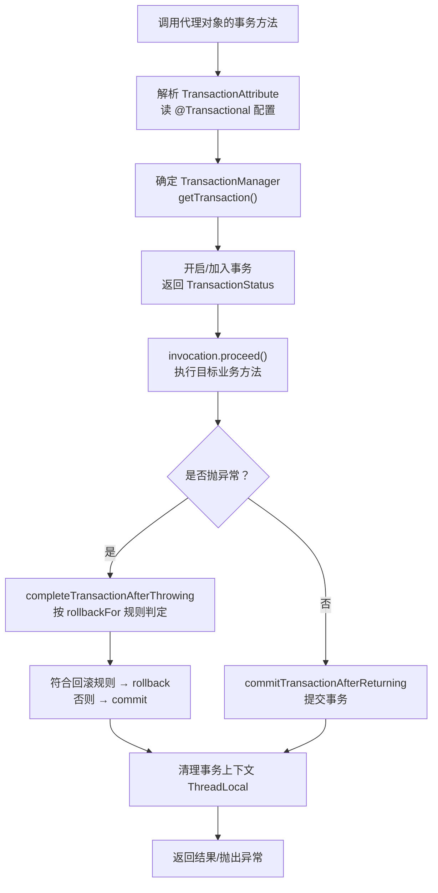
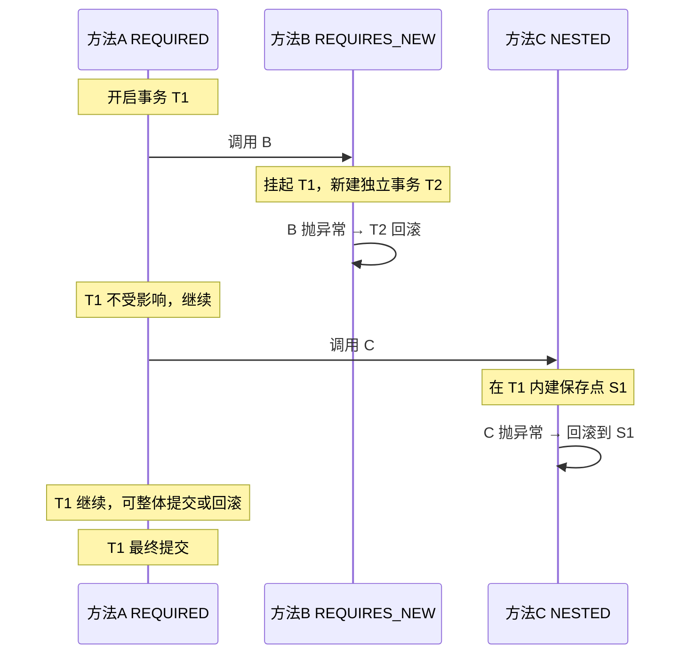
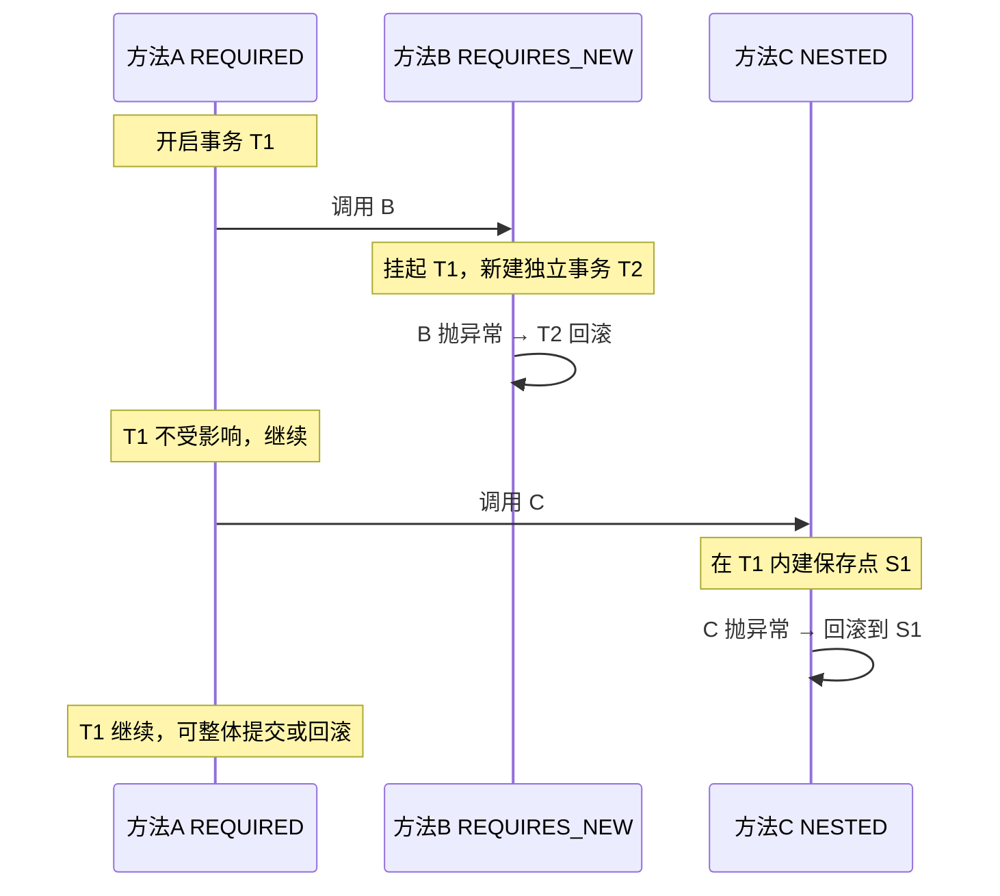

# Spring 事务原理与失效场景

> 定位：`@Transactional` 用起来只要一个注解，但它失效时能让你调一整天——明明加了注解，异常却不回滚。事务是 AOP 最典型的应用，它的原理、传播行为、以及那一长串失效场景，是高级 Java 面试和生产的双重高频区。这一篇从 `TransactionInterceptor` 讲起，把「事务到底怎么开启、怎么回滚、什么时候失效」一次性理清。

## 一、为什么需要声明式事务

早期写事务要这样：

```java
Connection conn = dataSource.getConnection();
try {
    conn.setAutoCommit(false);
    // 一堆业务逻辑
    conn.commit();
} catch (Exception e) {
    conn.rollback();
} finally {
    conn.close();
}
```

每个业务方法都重复「开事务-提交-回滚-关连接」，和业务代码纠缠在一起。`@Transactional` 把这套模板代码抽走，你只管写业务，事务的开启、提交、回滚由框架通过 AOP 代理自动完成。

**理解事务的前提是理解上一篇的 AOP**：事务就是一个环绕通知（`TransactionInterceptor`），它在目标方法执行前开启事务、执行后提交、异常时回滚。所以 AOP 的所有失效场景（自调用、private、final、自己 new），事务全会继承——这是本篇后面一大半坑点的根源。

## 二、事务的 AOP 原理

### 2.1 核心组件

开启 `@EnableTransactionManagement` 后，Spring 注册了三个关键组件：

| 组件 | 角色 |
|---|---|
| `TransactionInterceptor` | 通知（Advice），实现 `MethodInterceptor`，事务逻辑的主体 |
| `TransactionAttributeSource` | 解析 `@Transactional` 注解为 `TransactionAttribute`（含传播行为、隔离级别、超时、回滚规则） |
| `BeanFactoryTransactionAttributeSourceAdvisor` | 切面（Advisor）= 上面的通知 + 匹配带 `@Transactional` 方法的切入点 |

代理创建过程和第 3 篇完全一致：BPP 在 Bean 初始化后，发现某个方法有 `@Transactional`，就给它生成代理，把 `TransactionInterceptor` 织入调用链。

### 2.2 invokeWithinTransaction：事务执行主干

`TransactionInterceptor` 继承 `TransactionAspectSupport`，核心方法是 `invokeWithinTransaction()`，流程如下：



这张图的核心在 `D → E → F` 这一段：**事务是在目标方法执行之前开启的，提交/回滚是在方法返回之后由拦截器决定的**。记住这一点，就能理解「异常被 catch 吞掉为什么不回滚」——拦截器根本没看到异常，自然按正常流程提交了。

回滚判定规则（在 `completeTransactionAfterThrowing` 中）：默认只对 `RuntimeException` 和 `Error` 回滚；受检异常（`Exception` 的子类但非 RuntimeException）默认**不回滚**，除非配了 `rollbackFor`。

## 三、事务传播行为

传播行为回答一个问题：**一个事务方法被另一个事务方法调用时，事务如何传播？** Spring 定义了 7 种（`Propagation` 枚举）：

| 传播行为 | 含义 | 典型场景 |
|---|---|---|
| `REQUIRED`（默认） | 有事务就加入，没有就新建 | 绝大多数业务方法 |
| `SUPPORTS` | 有事务就加入，没有就非事务执行 | 查询方法，可参与也可不参与 |
| `MANDATORY` | 必须在事务中运行，否则抛异常 | 强制要求调用方开启事务 |
| `REQUIRES_NEW` | 总是新建事务，挂起当前事务 | 独立记录日志、审计，不受外层回滚影响 |
| `NOT_SUPPORTED` | 非事务执行，挂起当前事务 | 不需要事务的批量操作 |
| `NEVER` | 不能在事务中运行，否则抛异常 | 强制禁止事务 |
| `NESTED` | 有事务则嵌套（保存点），无则新建 | 内层回滚不影响外层 |

`REQUIRES_NEW` 和 `NESTED` 最容易被搞混，用一张图看它们的区别：



关键区别：`REQUIRES_NEW` 是**两个完全独立的事务**（内层提交后，外层回滚也不会撤销它）；`NESTED` 是**同一个事务里的保存点**（外层回滚会连内层一起撤销，内层回滚只回到保存点）。`NESTED` 依赖数据库保存点支持，并非所有事务管理器都支持（以你使用的版本/数据源为准）。

> 坑：`REQUIRES_NEW` 挂起和恢复事务有成本，且如果内外层操作同一行数据，内层事务提交前外层一直持锁等待，容易死锁。别滥用。

## 四、隔离级别

隔离级别对应数据库的 `Isolation` 枚举，解决并发事务的读一致性问题：

| 隔离级别 | 脏读 | 不可重复读 | 幻读 | 说明 |
|---|---|---|---|---|
| `DEFAULT` | — | — | — | 用数据库默认：MySQL InnoDB 默认 REPEATABLE READ，Oracle 默认 READ COMMITTED |
| `READ_UNCOMMITTED` | 允许 | 允许 | 允许 | 最低隔离，几乎不用 |
| `READ_COMMITTED` | 防止 | 允许 | 允许 | 每次读都读已提交的最新值 |
| `REPEATABLE_READ` | 防止 | 防止 | 允许* | 同一事务内多次读一致 |
| `SERIALIZABLE` | 防止 | 防止 | 防止 | 最高，串行执行，性能最差 |

\* InnoDB 在 REPEATABLE READ 下用 MVCC + next-key lock 已经能解决幻读，所以 MySQL 默认级别比标准定义更强。

设置方式：`@Transactional(isolation = Isolation.READ_COMMITTED)`。生产上一般**沿用数据库默认**，不要随意调高——隔离级别越高并发性能越差，除非有明确的业务需求。

## 五、事务失效场景（10 种）

### 5.1 AOP 类失效（与第 3 篇同源）

1. **同类方法自调用**：`this.internalMethod()` 绕过代理，`@Transactional` 不生效
2. **`private` / `final` / `static` 方法**：无法被代理拦截
3. **自己 `new` 的对象**：不是 Spring Bean，没有代理
4. **未被 Spring 容器管理**：类上没 `@Service` 等注解

### 5.2 异常与回滚规则类

5. **异常被 catch 吞掉**：事务拦截器看不到异常 → 按正常流程提交
6. **抛受检异常（非 RuntimeException）**：默认不回滚，需 `@Transactional(rollbackFor = Exception.class)`
7. **`rollbackFor` 配置错误**：声明的异常类型与实际抛出的不匹配

### 5.3 配置与环境类

8. **多线程调用**：事务状态存在 `ThreadLocal`（`TransactionSynchronizationManager`）里，新线程拿不到，不在同一事务
9. **数据库引擎不支持事务**：如 MySQL 的 MyISAM 引擎
10. **只读事务里写数据**：`@Transactional(readOnly = true)` 下部分 ORM 会做只读优化，写操作可能不生效或报错
11. **多个事务管理器未指定**：配了多个 `TransactionManager` 却没用 `@Qualifier` 指定，用错了管理器
12. **事务超时**：`@Transactional(timeout = N)`，业务执行超过 N 秒被回滚

> 记忆口诀：**代理没生效（自调用/private/new）、异常没看见（吞异常/受检异常）、环境不支持（引擎/多线程/只读/多管理器）**——三大类覆盖了 99% 的失效场景。

## 六、生产坑点与排查

### 坑点 1：异常被 catch 吞掉，事务没有回滚

**现象**：方法里 `try-catch` 捕获了异常并打印日志，事务仍然提交，脏数据落库。
**原因**：事务拦截器在目标方法返回后判断——没看到异常就提交。你 catch 了，异常没抛到拦截器。
**解法**：catch 后手动设置回滚 `TransactionAspectSupport.currentTransactionStatus().setRollbackOnly()`；或 catch 处理后重新抛出；或不要在事务方法里吞异常。

### 坑点 2：抛出受检异常，事务不回滚

**现象**：`@Transactional` 方法抛 `IOException` / 自定义 `Exception`，数据没回滚。
**原因**：Spring 默认只对 `RuntimeException` 和 `Error` 回滚，受检异常被视为「业务预期的异常」不回滚。
**解法**：显式声明 `@Transactional(rollbackFor = Exception.class)`。**建议所有事务方法都加上这个配置**，避免遗漏。

### 坑点 3：`@Transactional` 加在同类被调用的 private 方法上

**现象**：public 方法调用同类 private 方法，private 方法上的 `@Transactional` 毫无作用。
**原因**：private 方法无法被代理拦截，且同类调用本就绕过代理，双重失效。
**解法**：把需要事务的方法改成 public 并拆到另一个 Bean。

### 坑点 4：事务里开新线程查不到未提交数据 / 回滚不一致

**现象**：事务方法里用线程池异步处理，子线程查不到主线程刚插入的数据。
**原因**：事务通过 `ThreadLocal` 绑定连接，子线程不在同一事务上下文，用的是另一条连接，看不到未提交数据。
**解法**：不要把事务内逻辑丢到异步线程；若需要事务性异步，用 `@Async` + 独立事务的方法，并明确数据一致性边界。

### 坑点 5：事务还没提交就释放锁，出现脏读

**现象**：`@Transactional` 方法里用 `synchronized` / `ReentrantLock` 加锁保护库存扣减，仍出现超卖。
**原因**：AOP 在方法**执行前**开事务、**返回后**提交；而 `synchronized` 在方法**内部**释放。锁释放时事务还没提交，另一个线程拿到锁读到的是旧数据（或未提交数据被隔离）。**事务和锁的边界错位了**。
**解法**：把锁放在事务外层——在**调用方**加锁，锁内调用事务代理方法，确保「锁内完成事务提交」；或用数据库行锁（`select ... for update`）；或用 Redis 分布式锁包住事务方法。

### 坑点 6：长事务拖垮数据库

**现象**：某个批量任务跑几十分钟，期间数据库连接池耗尽、主从延迟飙升、undo log 暴涨。
**原因**：长事务长期持有连接和锁，MVCC 旧版本无法清理（undo log 不能 purge），主从复制延迟。
**解法**：拆分大事务为小批次；事务内禁止远程调用/文件 IO；设置合理 `timeout`；只读查询移出事务；监控 `information_schema.innodb_trx` 里的长事务。

## 七、调优 / 选型 / 最佳实践

1. **事务粒度要小**：只包住必要的数据库操作，不要在事务里做 RPC、发消息、写文件。
2. **统一加 `rollbackFor = Exception.class`**：避免受检异常不回滚的坑。
3. **查询按需加只读**：`@Transactional(readOnly = true)` 让 ORM/数据库做只读优化，但别在里面写数据。
4. **传播行为别乱用**：默认 `REQUIRED` 足够；`REQUIRES_NEW` 有挂起成本，仅用于独立提交场景。
5. **隔离级别沿用数据库默认**：调高前先想清楚并发代价。
6. **监控长事务**：定期查 `information_schema.innodb_trx`（看 `trx_started`、`TIME_TO_SEC(TIMEDIFF(now(), trx_started))`），超过阈值告警。
7. **事务与锁**：锁的边界必须包住事务提交，锁在外、事务在内。

## 八、面试高频问法

> 这一节按「面试时能讲透」的标准写：先给一句能直接背的结论，再展开机制、原因和坑点，最后给一句加分点。事务失效是「加了注解却调一整天」的重灾区，建议先自己答一遍再对照。

**Q1：@Transactional 的实现原理是什么？**

**一句话结论**：基于 AOP——`TransactionInterceptor` 环绕通知在方法前通过 `TransactionManager.getTransaction()` 开事务，方法后 `commit()`，抛异常时按 `rollbackFor` 规则 `rollback()`，事务状态存在 `ThreadLocal`。

展开：

- **它就是一个环绕通知**：开启 `@EnableTransactionManagement` 后，Spring 注册 `TransactionInterceptor`（通知）、`TransactionAttributeSource`（把注解解析成 `TransactionAttribute`）、`BeanFactoryTransactionAttributeSourceAdvisor`（切面 = 通知 + 匹配带 `@Transactional` 方法的切入点）。BPP 在 Bean 初始化后发现有 `@Transactional` 的方法就生成代理、把拦截器织入调用链。
- **执行主干 `invokeWithinTransaction()`**：

```
调用代理方法 → 解析 TransactionAttribute（读注解配置）
→ getTransaction() 开启/加入事务，返回 TransactionStatus
→ invocation.proceed() 执行业务方法
→ 没异常：commit()；抛异常：completeTransactionAfterThrowing() 按规则 rollback/commit
→ 清理 ThreadLocal 上下文 → 返回结果/抛异常
```

- **核心认知**：事务是在目标方法**执行前**开启、**返回后**由拦截器决定提交/回滚。记住这点就能理解「异常被 catch 吞掉为什么不回滚」——拦截器没看到异常，自然按正常流程提交。

加分点：主动说「所以事务继承 AOP 的所有失效场景——自调用、private、final、自己 new，事务全会中招」，把本篇和第 3 篇串起来。

**Q2：Spring 事务的核心组件有哪些？各自职责？**

**一句话结论**：三个组件——`TransactionInterceptor`（通知主体）、`TransactionAttributeSource`（解析注解配置）、`Advisor`（切面，把通知和切入点组装起来），再配合 `PlatformTransactionManager` 真正操作事务。

展开：

| 组件 | 角色 |
|---|---|
| `TransactionInterceptor` | 通知（Advice），实现 `MethodInterceptor`，事务逻辑主体，核心方法 `invokeWithinTransaction()` |
| `TransactionAttributeSource` | 把 `@Transactional` 解析成 `TransactionAttribute`（含传播行为、隔离级别、超时、回滚规则） |
| `BeanFactoryTransactionAttributeSourceAdvisor` | 切面（Advisor）= 通知 + 匹配带 `@Transactional` 方法的切入点 |
| `PlatformTransactionManager` | 真正的事务管理器，`getTransaction`/`commit`/`rollback`，如 `DataSourceTransactionManager` |

- **为什么这样分层**：注解只是「声明意图」，`TransactionAttributeSource` 把它翻译成运行时属性；`TransactionInterceptor` 是通用逻辑，不关心具体注解；真正开/提交/回滚委托给 `TransactionManager`，从而支持 JDBC、JPA、分布式等不同事务实现。
- **事务状态载体**：`TransactionSynchronizationManager` 用 `ThreadLocal` 保存当前线程的事务资源（Connection），所以**同一线程内**的事务方法才共享同一事务。

加分点：点出「事务状态在 ThreadLocal，这是 '多线程调用不在同一事务' 的根源」——把组件和后面的生产坑关联起来。

**Q3：Spring 的 7 种事务传播行为是什么？**

**一句话结论**：传播行为回答「一个事务方法被另一个事务方法调用时事务如何传播」；7 种是 REQUIRED（默认）、SUPPORTS、MANDATORY、REQUIRES_NEW、NOT_SUPPORTED、NEVER、NESTED。

展开：

| 传播行为 | 含义 | 典型场景 |
|---|---|---|
| `REQUIRED`（默认） | 有事务就加入，没有就新建 | 绝大多数业务方法 |
| `SUPPORTS` | 有就加入，没有就非事务执行 | 查询方法 |
| `MANDATORY` | 必须在事务中运行，否则抛异常 | 强制调用方开事务 |
| `REQUIRES_NEW` | 总是新建事务，挂起当前事务 | 独立日志/审计，不受外层回滚影响 |
| `NOT_SUPPORTED` | 非事务执行，挂起当前事务 | 不需事务的批量操作 |
| `NEVER` | 不能在事务中运行，否则抛异常 | 强制禁止事务 |
| `NESTED` | 有事务则嵌套（保存点），无则新建 | 内层回滚不影响外层 |

- **重点掌握三个**：`REQUIRED`（默认，加入或新建）、`REQUIRES_NEW`（独立新事务）、`NESTED`（同一事务的保存点）。
- **`NESTED` 的限制**：依赖数据库保存点（savepoint）支持，并非所有事务管理器都支持（以你使用的版本/数据源为准）。

加分点：说「生产上 90% 场景默认 REQUIRED 就够，只有 '日志必须独立提交' 才用 REQUIRES_NEW，滥用会因挂起/恢复带来成本和死锁风险」——体现克制。

**Q4：REQUIRES_NEW 和 NESTED 有什么区别？**

**一句话结论**：`REQUIRES_NEW` 是两个完全独立的事务（内层提交后外层回滚也撤销不了它）；`NESTED` 是同一事务里的保存点（外层回滚会连内层一起撤销，内层回滚只回到保存点）。

展开：

用一张时序图看区别：



- **本质区别**：`REQUIRES_NEW` 挂起外层、开新连接、新事务；`NESTED` 不挂起，复用同一连接，在事务内部建 savepoint。
- **回滚影响**：外层回滚时，REQUIRES_NEW 已提交的内层**不受影响**；NESTED 的内层**被连带回滚**。
- **坑**：`REQUIRES_NEW` 挂起/恢复有成本；若内外层操作同一行数据，内层提交前外层一直持锁等待，容易死锁——别滥用。

加分点：补一句「判断用哪个就问自己一句——内层失败了，外层回滚时它该不该跟着回滚？该就用 NESTED，不该（如独立审计日志）就用 REQUIRES_NEW」，给出可操作的决策标准。

**Q5：Spring 事务的隔离级别有哪些？MySQL 有什么特殊之处？**

**一句话结论**：5 个隔离级别解决并发读一致性问题（DEFAULT/读未提交/读已提交/可重复读/串行化）；MySQL InnoDB 在 REPEATABLE READ 下靠 MVCC + next-key lock 已能解决幻读，比 SQL 标准更强。

展开：

| 隔离级别 | 脏读 | 不可重复读 | 幻读 |
|---|---|---|---|
| `DEFAULT` | 用数据库默认 | — | — |
| `READ_UNCOMMITTED` | 允许 | 允许 | 允许 |
| `READ_COMMITTED` | 防止 | 允许 | 允许 |
| `REPEATABLE_READ` | 防止 | 防止 | 允许* |
| `SERIALIZABLE` | 防止 | 防止 | 防止 |

- **三种读问题**：脏读（读到未提交数据）、不可重复读（同一事务两次读结果不同，重点在改）、幻读（同一事务两次读行数不同，重点在增删）。
- **MySQL 特殊**：InnoDB 默认 REPEATABLE READ，配合 MVCC（一致性读）+ next-key lock（当前读）已经能解决幻读，所以表里标「允许*」在 MySQL 下其实基本不会遇到。Oracle 默认是 READ COMMITTED。
- **设置**：`@Transactional(isolation = Isolation.READ_COMMITTED)`。生产上**沿用数据库默认**，别随意调高——隔离级别越高并发性能越差。

加分点：说「隔离级别调高前先想清楚并发代价，业务上更常用乐观锁/版本号解决并发更新，而不是靠 SERIALIZABLE」——体现调优思路。

**Q6：事务默认对什么异常回滚？为什么受检异常不回滚？怎么改？**

**一句话结论**：默认只对 `RuntimeException` 和 `Error` 回滚；受检异常被视为「业务预期异常」不回滚，要加 `@Transactional(rollbackFor = Exception.class)` 显式声明。

展开：

- **判定位置**：`completeTransactionAfterThrowing()` 里的回滚规则——默认 `rollbackOn(ex)` 只对 RuntimeException/Error 返回 true。
- **为什么这样设计**：Spring（继承 EJB 约定）认为受检异常是业务流程的一部分（比如「库存不足」用受检异常表达），调用方预期会处理它，所以默认不回滚；而 RuntimeException 通常代表程序错误，需要回滚。
- **最大的坑**：自定义业务异常如果继承 `Exception`（受检），加了 `@Transactional` 也不回滚，数据脏落库，且不报错——最难发现。

```java
@Transactional(rollbackFor = Exception.class)   // 建议所有事务方法都加
public void createOrder() throws Exception { ... }
```

- **反向配置**：`noRollbackFor` 指定某些异常即使匹配也不回滚。

加分点：给出工程建议「团队规范里强制所有 `@Transactional` 写 `rollbackFor = Exception.class`，从源头杜绝受检异常不回滚」——这是很实在的生产经验。

**Q7：事务失效的场景有哪些？**

**一句话结论**：归纳三大类——代理没生效（自调用/private/final/自己 new/未被容器管理）、异常没看见（吞异常/受检异常/rollbackFor 配错）、环境不支持（多线程/引擎不支持/只读/多事务管理器/超时）。

展开：

**第一类：AOP 代理没生效（与第 3 篇同源）**

1. 同类方法自调用：`this.internalMethod()` 绕过代理
2. `private`/`final`/`static` 方法：无法被代理拦截
3. 自己 `new` 的对象：不是 Spring Bean，没有代理
4. 类上没 `@Service` 等注解：未被容器管理

**第二类：异常与回滚规则**

5. 异常被 `try-catch` 吞掉：拦截器看不到异常，按正常提交
6. 抛受检异常：默认不回滚
7. `rollbackFor` 配错：声明类型与实际抛出的不匹配

**第三类：配置与环境**

8. 多线程调用：事务状态在 ThreadLocal，新线程不在同一事务
9. 数据库引擎不支持事务：如 MySQL 的 MyISAM
10. 只读事务里写数据：`readOnly=true` 下写操作可能不生效或报错
11. 多个事务管理器未指定：用错管理器
12. 事务超时：`timeout=N`，业务执行超时被回滚

加分点：用口诀收口——「代理没生效、异常没看见、环境不支持」，三类覆盖了 99% 的失效场景，答题时分三类讲，逻辑清晰不容易漏。

**Q8：异常被 catch 吞掉，事务为什么不回滚？怎么解决？**

**一句话结论**：事务拦截器在目标方法返回后才判断——没看到异常就提交；你 catch 了，异常没抛到拦截器，它自然按正常流程提交。

展开：

- **现象**：方法里 `try-catch` 捕获异常并打日志，事务仍然提交，脏数据落库。
- **根因**：`invokeWithinTransaction()` 靠「目标方法是否抛出异常」决定提交/回滚。你 catch 住不外抛，拦截器看到的是「正常返回」→ 提交。
- **三种解法**：

```java
// ① catch 后手动标记回滚
try { ... } catch (Exception e) {
    TransactionAspectSupport.currentTransactionStatus().setRollbackOnly();
}
// ② catch 处理后重新抛出（推荐）
try { ... } catch (Exception e) { log.error(...); throw e; }
// ③ 别在事务方法里吞异常，交给全局异常处理器
```

- **注意**：`setRollbackOnly()` 只是标记「这个事务要回滚」，不会立即回滚，方法继续往下走。

加分点：说一句「 Rising 的坑是 'catch 了但只 log 不 throw'，日志里看着有异常，数据却提交了——排查时一定要看事务方法的 catch 块」——这是生产高频事故。

**Q9：事务和 synchronized 一起用有什么坑？**

**一句话结论**：事务是 AOP 在方法**外**开、**返回后**提交，而 `synchronized` 在方法**内**释放——锁释放早于事务提交，别的线程拿到锁可能读到旧数据，导致并发问题（如超卖）。

展开：

- **边界错位**：`@Transactional` 方法里用 `synchronized` 保护库存扣减，看似安全，实则：

```
线程1：进入 synchronized → 扣库存 → 释放 synchronized 锁
                                    ↑ 此时事务还没提交！
线程2：拿到锁 → 读库存 → 读到旧值（或隔离下看不到未提交数据）→ 也扣 → 超卖
线程1：事务此刻才提交
```

- **根因**：AOP 在方法执行前开事务、方法返回后提交；`synchronized` 在方法内部代码块结束时释放。锁的释放点早于事务提交点，事务和锁的边界错位了。
- **正解**：**锁在外、事务在内**——在调用方加锁，锁内调用事务代理方法，确保「锁内完成事务提交」；或用数据库行锁 `select ... for update`；或用 Redis 分布式锁包住事务方法。

加分点：说「判断标准就一句——锁的生命周期必须完全包住事务的生命周期，否则中间有个 '锁已放、事务未交' 的窗口被别人钻空子」，把结论抽象成可迁移的原则。

**Q10：事务里开新线程，为什么查不到主线程刚插入的数据？**

**一句话结论**：事务状态和数据库连接绑定在 `ThreadLocal`（`TransactionSynchronizationManager`）里，子线程不在同一事务上下文，用的是另一条连接，看不到主线程未提交的数据。

展开：

- **现象**：事务方法里把逻辑丢到线程池异步执行，子线程查不到主线程刚 insert 的记录。
- **根因**：`TransactionSynchronizationManager` 用 `ThreadLocal` 保存当前线程的事务资源（Connection）。主线程的连接和未提交数据只对本线程可见；子线程拿到的是另一条连接，在 READ_COMMITTED 及以上隔离级别下当然读不到未提交数据。
- **连带问题**：子线程的操作也不在主线程事务里——主线程回滚，子线程的写入不会回滚，数据一致性被破坏。
- **解法**：不要把事务内的逻辑丢到异步线程；若必须异步且要事务性，用 `@Async` + 独立事务的方法，并明确数据一致性边界（如等主线程提交后再异步处理，或用消息最终一致）。

加分点：补一句「`ThreadLocal` 这把钥匙能同时解释 '多线程不在同一事务' 和 '事务上下文跨方法传递靠的是同一线程'——事务的线程绑定性是本质」，体现底层理解。

**Q11：长事务有什么危害？怎么治理？**

**一句话结论**：长事务长期持有连接和锁、让 MVCC 旧版本无法清理（undo log 暴涨）、拖慢主从复制，最终拖垮数据库；治理手段是拆小事务、移出远程调用、设 timeout、加强监控。

展开：

- **危害**：
  1. 长期持有数据库连接 → 连接池耗尽；
  2. 持有的锁长时间不释放 → 其他事务阻塞、死锁概率上升；
  3. MVCC 旧版本不能 purge → undo log 暴涨、磁盘压力；
  4. 主从复制延迟（大事务要等整个事务提交才同步）。
- **治理**：

| 手段 | 做法 |
|---|---|
| 拆大事务 | 批量任务分批处理，每批独立事务 |
| 移出耗时操作 | 事务内禁止 RPC、发消息、写文件、大循环 |
| 设置 timeout | `@Transactional(timeout = N)`，超时回滚防止无限占用 |
| 只读查询移出 | 查询不用套事务，或 `readOnly=true` |
| 监控告警 | 定期查 `information_schema.innodb_trx`，看 `trx_started` 和运行时长，超阈值告警 |

加分点：给出可执行的 SQL 思路「`TIME_TO_SEC(TIMEDIFF(now(), trx_started))` 算事务运行时长，超过 60s 告警」——体现生产可落地性。

## 小结

- 事务 = AOP 环绕通知，`TransactionInterceptor.invokeWithinTransaction()` 开事务 → 执行 → 提交/回滚。
- 默认只对 RuntimeException/Error 回滚；受检异常要 `rollbackFor = Exception.class`。
- 7 种传播行为，重点分清 REQUIRES_NEW（独立事务）与 NESTED（保存点）。
- 失效三大类：代理没生效、异常没看见、环境不支持；自调用和吞异常是最常见的两个。
- 事务状态在 ThreadLocal，多线程不共享；锁的边界必须在事务提交之外；长事务要拆、要监控。
