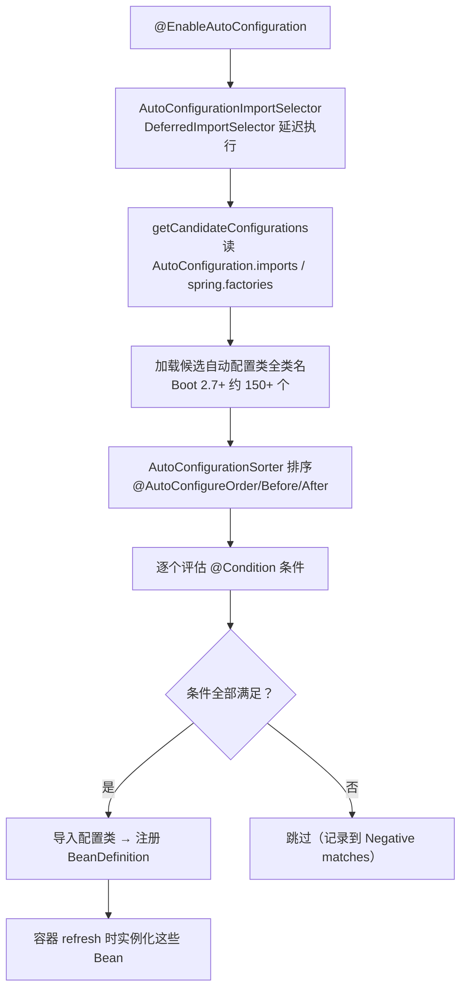
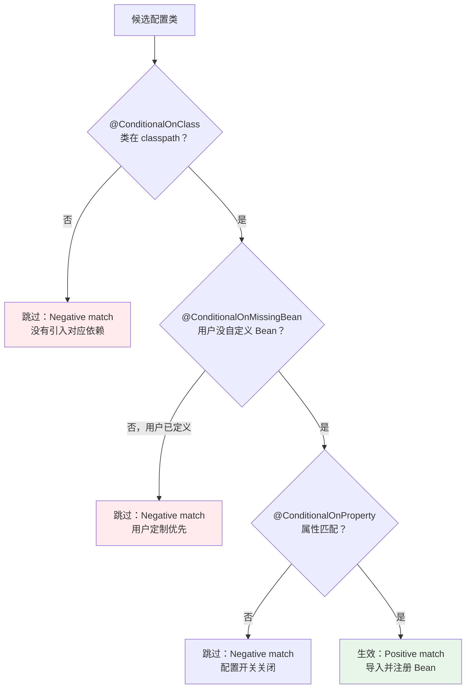
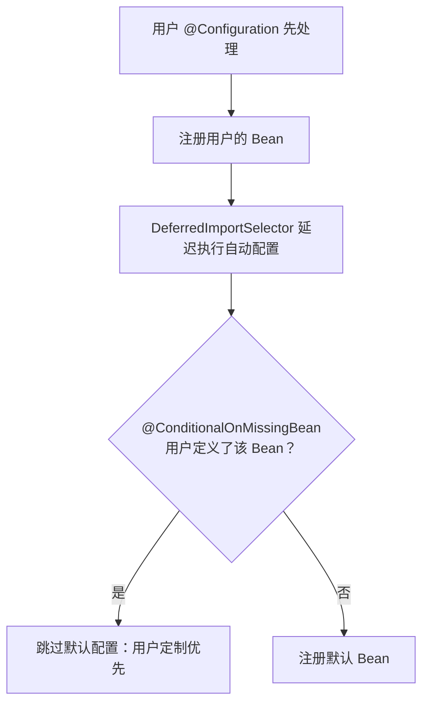

# SpringBoot 自动配置原理

> 定位：为什么加一个 `spring-boot-starter-web` 依赖，Tomcat、DispatcherServlet、Jackson 就全都有了？「约定优于配置」背后是一套精密的自动装配机制。搞懂 `@EnableAutoConfiguration`、`spring.factories` / `AutoConfiguration.imports`、`@Conditional` 条件注解，你才能自定义 starter、才能排查「为什么我的配置没生效」。这是 Spring Boot 面试的必考题。

## 一、为什么需要自动配置

传统 Spring MVC 项目，你得手写一堆配置：

```xml
<bean class="org.springframework.web.servlet.DispatcherServlet">...</bean>
<bean class="org.springframework.web.servlet.view.InternalResourceViewResolver">...</bean>
<bean class="org.springframework.http.converter.json.MappingJackson2HttpMessageConverter">...</bean>
<!-- 还有事务管理器、数据源、消息转换器…… -->
```

这些配置 80% 的项目都一样，只是少量参数不同。Spring Boot 的做法是：**把这些通用配置预先写好，打成 jar，你引入依赖它就自动生效；你需要定制时，用配置文件覆盖默认值。** 这就是「约定优于配置」。

自动配置要解决的三个核心问题：

1. **怎么知道要配什么？**——靠 classpath 上有哪些类（SPI 机制）
2. **怎么适应用户的定制？**——靠 `@Conditional` 系列条件注解
3. **怎么让配置加载顺序正确？**——靠 `DeferredImportSelector` + `@AutoConfigureOrder`

## 二、@SpringBootApplication 拆解

启动类上的 `@SpringBootApplication` 是个组合注解，拆开是三个：

```java
@SpringBootConfiguration   // ① 本质是 @Configuration，标记这是配置类
@EnableAutoConfiguration   // ② 开启自动配置（核心）
@ComponentScan(            // ③ 扫描当前包及子包的 @Component
    excludeFilters = {
        @Filter(type = FilterType.CUSTOM, classes = TypeExcludeFilter.class),
        @Filter(type = FilterType.CUSTOM, classes = AutoConfigurationExcludeFilter.class)
    })
public @interface SpringBootApplication {}
```

三者分工：

| 注解 | 作用 |
|---|---|
| `@SpringBootConfiguration` | 本质是 `@Configuration`，声明这是个配置类 |
| `@ComponentScan` | 扫描启动类所在包及其子包下的 `@Component` / `@Service` / `@Controller` |
| `@EnableAutoConfiguration` | **自动配置的入口**，告诉 Spring「去加载所有符合条件的自动配置类」 |

> 一个常见坑：启动类放在了过高的包（如 `com.example`），而业务代码在 `com.example.app`，能被扫到；但如果业务在 `com.other`，就扫不到——这是 `@ComponentScan` 默认只扫启动类所在包及子包导致的。解法是把启动类放到根包，或用 `@ComponentScan(basePackages = ...)` 指定。

### 2.1 @EnableAutoConfiguration 再拆一层

```java
@AutoConfigurationPackage                    // 注册当前主类的包为「自动配置包」
@Import(AutoConfigurationImportSelector.class) // 核心：导入自动配置类
public @interface EnableAutoConfiguration {}
```

- `@AutoConfigurationPackage` 通过 `@Import(AutoConfigurationPackages.Registrar.class)` 把启动类所在包注册进 `AutoConfigurationPackages`，供 JPA 实体扫描等使用
- `@Import(AutoConfigurationImportSelector.class)` 是真正的「加载器」

## 三、自动配置的加载过程

`AutoConfigurationImportSelector` 实现了 `DeferredImportSelector`（延迟导入选择器）——这个「延迟」很关键：**它要等所有用户自己的 `@Configuration` 都处理完，才执行自动配置导入**，这样 `@ConditionalOnMissingBean` 才能正确判断「用户有没有定义自己的 Bean」。



这张图的主线是：**读文件 → 排序 → 条件过滤 → 导入**。重点看第 3、6 步——它们分别是「SPI 机制」和「条件注解」，下面详细讲。

### 3.1 SPI：配置从哪来

Spring Boot 用类 SPI（Service Provider Interface）思想，把「有哪些自动配置类」写在不同 jar 的 `META-INF` 文件里，容器启动时统一读取：

| 版本 | 文件 | 格式 |
|---|---|---|
| Spring Boot 2.6 及以前 | `META-INF/spring.factories` | `key=类1,类2,...` |
| Spring Boot 2.7+ | `META-INF/spring/org.springframework.boot.autoconfigure.AutoConfiguration.imports` | 每行一个全类名 |

2.7 是过渡版本，两种都支持；**Spring Boot 3.x 只认 `AutoConfiguration.imports`**（`spring.factories` 仍用于 `EnvironmentPostProcessor`、`ApplicationListener` 等其他扩展，以你的版本为准）。

`spring.factories` 示例（旧版）：

```properties
org.springframework.boot.autoconfigure.EnableAutoConfiguration=\
com.example.FooAutoConfiguration,\
com.example.BarAutoConfiguration
```

`AutoConfiguration.imports` 示例（新版）：

```
com.example.FooAutoConfiguration
com.example.BarAutoConfiguration
```

`SpringFactoriesLoader` 负责读 `spring.factories`，`ImportCandidates.load()` 负责读 `AutoConfiguration.imports`。核心思想一样：**把「实现类清单」放在 jar 的约定路径下，框架启动时扫描加载**——这就是 SPI。

### 3.2 @Conditional：为什么有些配置不生效

候选类有 150+ 个，但不是全用。`@Conditional` 系列注解决定「这个配置要不要生效」：

| 注解 | 判断依据 | 典型用途 |
|---|---|---|
| `@ConditionalOnClass` | classpath 有某个类 | 引入了对应 starter 才配置 |
| `@ConditionalOnMissingClass` | classpath 没有某个类 | 类不存在时的替代方案 |
| `@ConditionalOnBean` | 容器里有某个 Bean | 依赖其他 Bean 存在 |
| `@ConditionalOnMissingBean` | 容器里没有某个 Bean | **用户没自定义时才用默认实现** |
| `@ConditionalOnProperty` | 配置属性值匹配 | `xxx.enabled=true` 才开启 |
| `@ConditionalOnWebApplication` | 是 Web 应用 | Web 相关配置 |
| `@ConditionalOnExpression` | SpEL 表达式为真 | 复杂条件 |

以 `DataSourceAutoConfiguration` 为例感受一下：

```java
@AutoConfiguration
@ConditionalOnClass({DataSource.class, EmbeddedDatabaseType.class})
@ConditionalOnMissingBean(type = "io.r2dbc.spi.ConnectionFactory")
@EnableConfigurationProperties(DataSourceProperties.class)
@Import({DataSourcePoolMetadataProvidersConfiguration.class, ...})
public class DataSourceAutoConfiguration { ... }
```

翻译：classpath 里有 `DataSource` 和 `EmbeddedDatabaseType` 时（引了 JDBC 依赖）才配置；容器里没有 `ConnectionFactory`（用户没选 R2DBC）才配置；并把 `spring.datasource.*` 绑定到 `DataSourceProperties`。

`@ConditionalOnMissingBean` 是「用户可以覆盖默认配置」的关键：你自定义一个 `DataSource` Bean，Spring 看到后就不创建默认的数据源了。这也是为什么**自定义 Bean 要放在自动配置之前**——所以 `AutoConfigurationImportSelector` 必须是 `DeferredImportSelector`（延迟）。



这张图解释了「为什么自动配置没生效」的大部分原因——顺着三个条件节点排查即可。

## 四、如何自定义一个 Starter

自定义 starter 的标准套路：

1. **命名**：官方 `spring-boot-starter-xxx`，第三方 `xxx-spring-boot-starter`（区分来源）
2. **建 autoconfigure 模块**，写自动配置类：

```java
@AutoConfiguration              // Boot 2.7+ 用 @AutoConfiguration；老版本用 @Configuration
@ConditionalOnClass(FooService.class)         // 有这个类才配置
@EnableConfigurationProperties(FooProperties.class) // 绑定 foo.* 配置
public class FooAutoConfiguration {

    @Bean
    @ConditionalOnMissingBean                   // 用户没定义才创建
    public FooService fooService(FooProperties props) {
        return new FooService(props.getMode());
    }
}
```

```java
@ConfigurationProperties(prefix = "foo")
public class FooProperties {
    private String mode = "default";
    // getter / setter
}
```

3. **注册配置类**：在 `resources/META-INF/spring/org.springframework.boot.autoconfigure.AutoConfiguration.imports` 写入 `FooAutoConfiguration` 的全类名（2.6 及以前写 `spring.factories`）
4. **（可选）配置元数据**：引入 `spring-boot-configuration-processor`，编译期生成 `spring-configuration-metadata.json`，让 IDEA 对 `foo.mode` 有代码提示
5. 用户引入依赖后，配置 `foo.mode=xxx` 即可生效

要点：自动配置类一定要带 `@ConditionalOnMissingBean`，把「定制权」留给用户。

## 五、生产坑点与排查

### 坑点 1：引了依赖，自动配置却没生效

**现象**：加了 `spring-boot-starter-redis`，但 `RedisTemplate` 注入失败。
**原因**：可能是依赖版本冲突、`@ConditionalOnClass` 的类不在 classpath、或 `AutoConfiguration.imports` 文件路径/类名写错。
**解法**：启动加 `--debug`，看 `CONDITIONS EVALUATION REPORT` 的 `Negative matches` 段落，里面写明了每个配置类「为什么没生效」。

### 坑点 2：自定义 Bean 后，默认配置不创建了

**现象**：自定义了一个 `ObjectMapper`，结果 Jackson 的自动配置行为变了（如日期格式、序列化规则丢失）。
**原因**：`@ConditionalOnMissingBean` 看到用户定义了 Bean，就跳过了默认配置，连带一些默认的定制（如 `Jackson2ObjectMapperBuilderCustomizer`）可能不再应用。
**解法**：不要完全替换默认 Bean，而是定制它——用 `Jackson2ObjectMapperBuilderCustomizer` 或 `@Bean` 里复用默认配置；或在自定义 Bean 时补上原本自动配置的行为。

### 坑点 3：配置属性不生效，值总是默认值

**现象**：`application.yml` 里配了 `foo.mode=prod`，但 `FooProperties.mode` 还是 `default`。
**原因**：① 前缀写错；② `FooProperties` 没加 `@ConfigurationProperties` 或没被 `@EnableConfigurationProperties` 注册；③ YAML 缩进错误；④ 配置中心和本地配置的优先级覆盖。
**解法**：用 Actuator `/actuator/configprops` 看实际绑定的属性值；检查 `@ConfigurationProperties(prefix=...)` 与配置文件 key 是否一致；用 `--debug` 看属性来源。

### 坑点 4：新版 Boot 升级后自定义 starter 失效

**现象**：从 Boot 2.6 升到 3.x，自己的 starter 不生效了。
**原因**：Boot 3.x 不再从 `spring.factories` 读自动配置类，只认 `AutoConfiguration.imports`；且 `javax` 包名改 `jakarta`。
**解法**：把自动配置类清单迁到 `META-INF/spring/org.springframework.boot.autoconfigure.AutoConfiguration.imports`；检查包名迁移。

## 六、调优 / 选型 / 最佳实践

1. **排查自动配置三板斧**：启动加 `--debug` 看条件报告、用 Actuator `/actuator/conditions` 和 `/actuator/configprops`、开 `logging.level.org.springframework.boot.autoconfigure=DEBUG`。
2. **自定义 starter 必带 `@ConditionalOnMissingBean`**：把覆盖权交给用户，别「霸道」地强制注册。
3. **配置属性加元数据**：用 `spring-boot-configuration-processor` 生成元数据，提升使用者体验。
4. **排除不需要的自动配置**：`@SpringBootApplication(exclude = {DataSourceAutoConfiguration.class})` 或 `spring.autoconfigure.exclude`，减少无用的 Bean 和启动时间。
5. **注意版本差异**：2.7 是过渡版本，3.x 只认 `AutoConfiguration.imports`；升级时先检查自定义 starter 的注册文件。

## 七、面试高频问法

> 这一节按「面试时能讲透」的标准写：先给一句能直接背的结论，再展开机制、原因和坑点，最后给一句加分点。自动配置是 Spring Boot 面试必考，建议先自己答一遍再对照。

**Q1：@SpringBootApplication 由哪些注解组成？**

**一句话结论**：它是组合注解，核心是三个——`@SpringBootConfiguration`（本质是 `@Configuration`）、`@EnableAutoConfiguration`（开启自动配置）、`@ComponentScan`（扫描组件）。

展开：

```java
@SpringBootConfiguration   // ① 本质是 @Configuration，标记这是配置类
@EnableAutoConfiguration   // ② 开启自动配置（核心入口）
@ComponentScan(             // ③ 扫描当前包及子包的 @Component
    excludeFilters = {
        @Filter(type = FilterType.CUSTOM, classes = TypeExcludeFilter.class),
        @Filter(type = FilterType.CUSTOM, classes = AutoConfigurationExcludeFilter.class)
    })
public @interface SpringBootApplication {}
```

- **三者分工**：`@SpringBootConfiguration` 声明这是配置类；`@ComponentScan` 扫描启动类所在包及其子包下的 `@Component`/`@Service`/`@Controller`；`@EnableAutoConfiguration` 是自动配置入口。
- **高频坑**：启动类包位置太高或太低都出问题——业务代码在 `com.other` 而启动类在 `com.example`，默认扫不到。解法：启动类放根包，或 `@ComponentScan(basePackages = ...)` 指定。
- **再拆一层**：`@EnableAutoConfiguration` = `@AutoConfigurationPackage`（注册主类所在包供 JPA 实体扫描等用）+ `@Import(AutoConfigurationImportSelector.class)`（真正的加载器）。

加分点：说「`@ComponentScan` 的排除过滤器里有 `AutoConfigurationExcludeFilter`，是为了防止自动配置类被当普通组件重复扫描」——体现对细节的留意。

**Q2：Spring Boot 自动配置的完整原理是什么？**

**一句话结论**：`@EnableAutoConfiguration` 导入 `AutoConfigurationImportSelector`（一个 `DeferredImportSelector`），它从 SPI 清单读候选配置类，排序后用 `@Conditional` 系列条件过滤，把满足条件的导入容器注册 Bean。

展开：

主线是「读文件 → 排序 → 条件过滤 → 导入」：

1. **读文件**：`getCandidateConfigurations()` 从 `AutoConfiguration.imports`（2.7+）或 `spring.factories`（旧版）读出 150+ 个候选自动配置类的全类名；
2. **排序**：`AutoConfigurationSorter` 按 `@AutoConfigureOrder`/`@AutoConfigureBefore`/`@AutoConfigureAfter` 排好加载顺序；
3. **条件过滤**：逐个评估 `@ConditionalOnClass`/`@ConditionalOnMissingBean`/`@ConditionalOnProperty` 等，不满足的跳过（记入 Negative matches）；
4. **导入**：满足条件的配置类被 `@Import` 进容器，注册其中的 `@Bean`；容器 refresh 时实例化。

- **为什么要「延迟」**：`AutoConfigurationImportSelector` 实现 `DeferredImportSelector`，等用户自己的 `@Configuration` 都处理完才执行——这样 `@ConditionalOnMissingBean` 才能正确判断「用户有没有定义自己的 Bean」。

加分点：把主线压缩成一句「SPI 提供候选清单 + @Conditional 做按需筛选 + DeferredImportSelector 保证用户配置优先」，这是自动配置的三根支柱。

**Q3：spring.factories 和 AutoConfiguration.imports 有什么区别？**

**一句话结论**：都是 SPI 清单文件；2.6 及以前用 `spring.factories` 的 `EnableAutoConfiguration` key，2.7+ 改用 `AutoConfiguration.imports`（每行一个类名），3.x 只认后者。

展开：

| 版本 | 文件 | 格式 |
|---|---|---|
| Boot 2.6 及以前 | `META-INF/spring.factories` | `key=类1,类2,...` |
| Boot 2.7+ | `META-INF/spring/org.springframework.boot.autoconfigure.AutoConfiguration.imports` | 每行一个全类名 |

```properties
# 旧版 spring.factories
org.springframework.boot.autoconfigure.EnableAutoConfiguration=\
com.example.FooAutoConfiguration,\
com.example.BarAutoConfiguration
```

```
# 新版 AutoConfiguration.imports
com.example.FooAutoConfiguration
com.example.BarAutoConfiguration
```

- **2.7 是过渡版本**：两种都支持；**Boot 3.x 只认 `AutoConfiguration.imports`**。
- **`spring.factories` 没完全废弃**：它仍用于 `EnvironmentPostProcessor`、`ApplicationListener` 等其他扩展点，只是不再承载自动配置类清单（以你的版本为准）。
- **读取者不同**：`SpringFactoriesLoader` 读 `spring.factories`，`ImportCandidates.load()` 读 `AutoConfiguration.imports`。

加分点：说一句「升级 Boot 3 时自定义 starter 失效，八成就是没把清单迁到 `AutoConfiguration.imports`」——把版本差异和真实故障挂钩。

**Q4：什么是 SPI？自动配置为什么用 SPI 机制？**

**一句话结论**：SPI（Service Provider Interface）是「把实现类清单放在 jar 约定路径下、框架启动时扫描加载」的扩展机制；自动配置用它实现「引依赖即生效」的解耦。

展开：

- **SPI 的本质**：调用方定义接口/扩展点，提供方在 jar 的 `META-INF` 下放一个清单文件写明实现类，框架用 `ServiceLoader`/`SpringFactoriesLoader` 扫描清单并实例化。调用方无需 import 提供方的类——这就是解耦。
- **自动配置怎么用**：每个 starter 的 autoconfigure 模块在自己的 `META-INF` 清单里列出自动配置类。Boot 启动时统一扫描所有 jar 的清单，汇总出 150+ 个候选类，再按条件筛选。**所以「引了 starter 依赖」= 「jar 在 classpath 上」= 「清单被扫描到」= 「配置类成为候选」**。
- **好处**：starter 开发者只需写配置类 + 放清单文件，不用调用方写一行 `@Import`；调用方排除某个自动配置也只需 `exclude`。

加分点：说「SPI 是 '控制反转' 思想在框架扩展上的体现——不是框架去 new 你的类，而是你把类登记到约定位置、框架来发现你」，拔高到设计思想层面。

**Q5：常用的 @Conditional 条件注解有哪些？**

**一句话结论**：`@Conditional` 系列决定「这个配置要不要生效」，常用的有 `@ConditionalOnClass`/`OnMissingClass`、`OnBean`/`OnMissingBean`、`OnProperty`、`OnWebApplication` 等。

展开：

| 注解 | 判断依据 | 典型用途 |
|---|---|---|
| `@ConditionalOnClass` | classpath 有某个类 | 引了对应 starter 才配置 |
| `@ConditionalOnMissingClass` | classpath 没有某个类 | 类不存在时的替代方案 |
| `@ConditionalOnBean` | 容器里有某 Bean | 依赖其他 Bean 存在 |
| `@ConditionalOnMissingBean` | 容器里没有某 Bean | **用户没自定义才用默认实现** |
| `@ConditionalOnProperty` | 配置属性值匹配 | `xxx.enabled=true` 才开启 |
| `@ConditionalOnWebApplication` | 是 Web 应用 | Web 相关配置 |
| `@ConditionalOnExpression` | SpEL 表达式为真 | 复杂条件 |

以 `DataSourceAutoConfiguration` 为例：

```java
@AutoConfiguration
@ConditionalOnClass({DataSource.class, EmbeddedDatabaseType.class})
@ConditionalOnMissingBean(type = "io.r2dbc.spi.ConnectionFactory")
@EnableConfigurationProperties(DataSourceProperties.class)
public class DataSourceAutoConfiguration { ... }
```

翻译：classpath 有 `DataSource` 和 `EmbeddedDatabaseType`（引了 JDBC）才配置；容器里没有 `ConnectionFactory`（用户没选 R2DBC）才配置；并绑定 `spring.datasource.*`。

加分点：说「排查自动配置没生效，八成是某个 `@ConditionalOnClass` 的类不在 classpath 或 `@ConditionalOnProperty` 的开关没开——顺着条件节点查就行」，给出可操作的排查方向。

**Q6：@ConditionalOnMissingBean 为什么重要？为什么自动配置必须延迟导入？**

**一句话结论**：`@ConditionalOnMissingBean` 实现「用户定制优先」——用户定义了自己的 Bean，自动配置就跳过默认实现；而要做到这点，自动配置必须等用户配置处理完（即延迟导入）。

展开：

- **用户定制优先**：你自定义一个 `DataSource`，`@ConditionalOnMissingBean` 看到容器里已有该类型 Bean，就跳过默认的 DataSource 自动配置——把覆盖权交给用户，这是 starter 不「霸道」的关键。
- **为什么要延迟**：`AutoConfigurationImportSelector` 实现 `DeferredImportSelector`，它的处理时机在**所有用户 `@Configuration` 之后**。如果同步导入，自动配置先注册了默认 Bean，用户再定义就成了「重复 Bean」或「被覆盖」，`@ConditionalOnMissingBean` 判断也不准。
- **因果链**：`DeferredImportSelector` 延迟 → 用户 Bean 先注册 → 自动配置的条件判断能看到用户 Bean → 用户定制生效。三者是环环相扣的。



加分点：把这道题答成一条因果链——「延迟导入是 '因'，用户定制优先是 '果'，@ConditionalOnMissingBean 是 '判断依据'」，面试官很吃这种结构性表达。

**Q7：如何排查「自动配置为什么没生效」？**

**一句话结论**：三板斧——启动加 `--debug` 看 Conditions Evaluation Report 的 Negative matches、用 Actuator `/actuator/conditions` 和 `/actuator/configprops`、开 `logging.level.org.springframework.boot.autoconfigure=DEBUG`。

展开：

- **第一板斧 `--debug`**：打印 CONDITIONS EVALUATION REPORT，分 Positive matches（生效）和 Negative matches（未生效），后者明确写出每个配置类「为什么没生效」——比如 `@ConditionalOnClass` 找不到类、`@ConditionalOnMissingBean` 发现用户已定义。
- **第二板斧 Actuator**：`/actuator/conditions` 在线看条件评估结果；`/actuator/configprops` 看配置属性实际绑定的值（排查 `foo.mode` 还是默认值很有用）；`/actuator/env` 看属性来源。
- **第三板斧 日志**：`logging.level.org.springframework.boot.autoconfigure=DEBUG` 看匹配细节。
- **常见原因清单**：依赖没引/版本冲突、`@ConditionalOnClass` 的类不在 classpath、清单文件路径/类名写错、配置前缀写错、YAML 缩进错、包扫描没覆盖、Boot 3 版本迁移问题。

加分点：说「我一般先 `--debug` 一把，Negative matches 里基本能直接读到原因——这是定位自动配置问题最快的手段」，给出实战首选。

**Q8：如何自定义一个 Spring Boot starter？**

**一句话结论**：建 autoconfigure 模块写 `@AutoConfiguration` + 条件注解 + 配置属性绑定的自动配置类，在 `AutoConfiguration.imports` 注册全类名，用户引依赖即可。

展开：

**标准五步**：

1. **命名**：官方 `spring-boot-starter-xxx`，第三方 `xxx-spring-boot-starter`（区分来源）；
2. **写自动配置类**：

```java
@AutoConfiguration              // Boot 2.7+ 用；老版用 @Configuration
@ConditionalOnClass(FooService.class)
@EnableConfigurationProperties(FooProperties.class)
public class FooAutoConfiguration {
    @Bean
    @ConditionalOnMissingBean                   // 用户没定义才创建
    public FooService fooService(FooProperties props) {
        return new FooService(props.getMode());
    }
}
```

```java
@ConfigurationProperties(prefix = "foo")
public class FooProperties {
    private String mode = "default";
    // getter/setter
}
```

3. **注册清单**：在 `resources/META-INF/spring/org.springframework.boot.autoconfigure.AutoConfiguration.imports` 写 `FooAutoConfiguration` 全类名（2.6 及以前写 `spring.factories`）；
4. **（可选）元数据**：引 `spring-boot-configuration-processor`，编译期生成 `spring-configuration-metadata.json`，让 IDEA 对 `foo.mode` 有提示；
5. **使用**：用户引依赖后配 `foo.mode=prod` 即可。

- **铁律**：自动配置类一定要带 `@ConditionalOnMissingBean`，把定制权留给用户。

加分点：说「starter 分为 'starter 模块（只管依赖传递）' 和 'autoconfigure 模块（写自动配置）'，官方建议拆成两个模块——starter 依赖 autoconfigure，避免自动配置逻辑被当普通依赖引入」，体现规范做法。

**Q9：自定义了一个 Bean 后，默认配置不创建了、行为变了，怎么回事？**

**一句话结论**：`@ConditionalOnMissingBean` 看到用户定义了 Bean 就跳过默认配置，连带一些默认的定制（如 Jackson 的 BuilderCustomizer）也不再应用。

展开：

- **现象**：自定义一个 `ObjectMapper`，结果 Jackson 的日期格式、序列化规则丢了。
- **根因**：`@ConditionalOnMissingBean` 的语义是「用户有就不创建默认的」。你定义了 `ObjectMapper`，JacksonAutoConfiguration 跳过默认 Bean，原本随默认 Bean 一起配置的定制器可能也不生效了。
- **解法**：

| 做法 | 说明 |
|---|---|
| 不替换，改定制 | 用 `Jackson2ObjectMapperBuilderCustomizer` 在默认 Bean 基础上改，而不是自己 new 一个 |
| 复用默认配置 | 自定义 `@Bean` 时把原本的默认行为补上 |
| 调整条件 | 让默认 Bean 的 `@ConditionalOnMissingBean` 按更具体的类型判断 |

加分点：说「这是 '覆盖默认配置' 的通用原则——优先定制（Customizer）而非替换（@Bean），因为默认的自动配置往往附带一堆你没注意到的细节配置」，给出可迁移的原则。

**Q10：从 Boot 2.6 升到 3.x，自定义 starter 失效了，怎么办？**

**一句话结论**：两个变化——Boot 3.x 不再从 `spring.factories` 读自动配置类（只认 `AutoConfiguration.imports`），且 `javax` 包名改为 `jakarta`。

展开：

- **变化一：清单文件**：把自动配置类清单从 `META-INF/spring.factories` 迁到 `META-INF/spring/org.springframework.boot.autoconfigure.AutoConfiguration.imports`（每行一个全类名）。`spring.factories` 仍用于 `EnvironmentPostProcessor`、`ApplicationListener` 等，但不再放自动配置类。
- **变化二：包名**：`javax.servlet.*` → `jakarta.servlet.*`，`javax.annotation.*` → `jakarta.annotation.*`（`@PostConstruct`、`@Resource` 等都迁移了）。
- **变化三**：`@Configuration` 在 2.7+ 推荐用 `@AutoConfiguration` 替代（老写法仍兼容，以版本为准）。
- **排查**：启动时用 `--debug` 看 Negative matches，确认配置类有没有进候选清单、条件为什么没满足。

加分点：说「升级 Boot 3 的迁移清单里，自定义 starter 的注册文件是最容易漏的一项——建议升级前先 grep 项目里所有 `spring.factories`」，给出实操建议。

**Q11：想排除某个自动配置（比如不需要数据源），怎么做？**

**一句话结论**：用 `@SpringBootApplication(exclude = {XxxAutoConfiguration.class})` 或配置 `spring.autoconfigure.exclude`，让该自动配置类不参与。

展开：

- **注解方式**：

```java
@SpringBootApplication(exclude = {DataSourceAutoConfiguration.class})
public class DemoApplication { ... }
```

- **配置方式**：

```yaml
spring:
  autoconfigure:
    exclude:
      - org.springframework.boot.autoconfigure.jdbc.DataSourceAutoConfiguration
```

- **什么时候用**：明确不需要某功能（如纯 RPC 服务不需要 Web 容器、不需要数据源），排除它可减少无用 Bean、加快启动、避免自动配置误触发（如 `DataSourceAutoConfiguration` 找不到 URL 报错）。
- **注意**：排除的是**自动配置类**，不是 starter 依赖本身；类写错或排除不存在的类会启动报错。`--debug` 可确认排除是否生效。

加分点：说「排除自动配置也是启动优化手段之一——大型应用里把用不到的自动配置 exclude 掉，能省下可观的 Bean 创建和启动时间」，把知识点和调优关联。

## 小结

- `@SpringBootApplication` = @SpringBootConfiguration + @EnableAutoConfiguration + @ComponentScan。
- 自动配置靠 SPI 清单（新版 `AutoConfiguration.imports`）+ `@Conditional` 条件过滤 + DeferredImportSelector 延迟导入。
- `@ConditionalOnMissingBean` 实现「用户定制优先」，是自动配置可覆盖的关键。
- 自定义 starter：配置类 + 条件注解 + 注册文件 + 配置属性绑定 + 元数据。
- 排查三板斧：`--debug` 条件报告、Actuator 端点、日志级别；升级注意 `spring.factories` → `AutoConfiguration.imports` 迁移。
