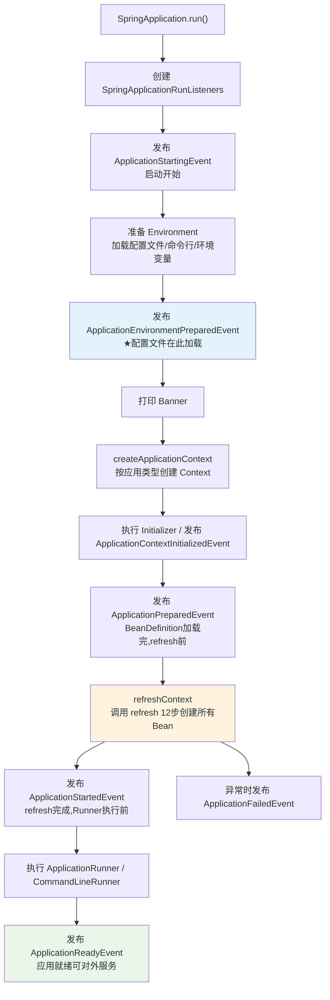
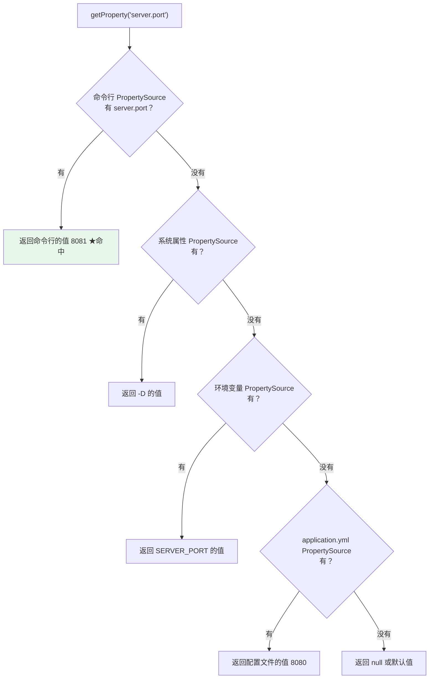

# SpringBoot 启动流程

> 定位：应用启动慢、配置不生效、Runner 执行顺序不对、监听器没被回调——这些问题的答案都藏在 `SpringApplication.run()` 的流程里。搞清启动的每一步、事件的发布顺序、配置的加载优先级，你才能精准地「在正确的时机插入自己的逻辑」。这一篇把 Spring Boot 启动全流程拆给你看，这是排查启动类问题的地图。

## 一、为什么必须搞清启动流程

先看几个真实困惑：

- 为什么 `ApplicationRunner` 里能拿到 `@Autowired` 的 Bean，而 `ApplicationListener` 在某些事件里拿不到？
- 为什么在 `main` 方法里设置系统属性生效，但写在 `application.yml` 里同一属性却不生效？
- 为什么配置中心的地址要写在 `bootstrap.yml` 而不是 `application.yml`？
- 应用启动卡住，怎么判断卡在哪个阶段？

这些都需要你脑子里有一张**启动时间轴**：什么事件在什么时候发布、Environment 什么时候准备好、Bean 什么时候创建、Runner 什么时候执行。有了这张图，上面的问题都能对号入座。

## 二、SpringApplication 的构造与 run 总览

启动入口：`SpringApplication.run(DemoApplication.class, args)`。它分两步——**构造 `SpringApplication` 对象** + **调用 `run()`**。

### 2.1 构造阶段做了什么

`SpringApplication` 构造时会初始化五项关键信息：

| 动作 | 说明 |
|---|---|
| `setPrimarySources` | 记录主配置类（启动类） |
| `deduceWebApplicationType` | 推断应用类型：`SERVLET` / `REACTIVE` / `NONE`（看 classpath 有没有 `DispatcherServlet` 等） |
| `setInitializers` | 从 SPI 加载 `ApplicationContextInitializer` |
| `setListeners` | 从 SPI 加载 `ApplicationListener` |
| `deduceMainApplicationClass` | 从堆栈推断 main 方法所在类 |

这里的 Initializer 和 Listener 都是从 `spring.factories`（SPI，见自动配置篇）加载的，是启动流程的「扩展钩子」。

### 2.2 run() 全流程



这张图是全篇的骨架。抓住三个关键节点：

- **E 点**：Environment 准备好了，配置文件在这里被加载——所以「配置没读到」的问题去这个阶段查
- **J 点**：`refresh()` 创建所有 Bean——启动慢大多慢在这里，Bean 创建失败也在这里抛
- **M 点**：`ApplicationReadyEvent` 之后应用才算真正就绪——需要「所有 Bean 都准备好再执行」的逻辑放这里或 Runner 里

### 2.3 七个关键事件

| 事件 | 发布时机 | 能做什么 |
|---|---|---|
| `ApplicationStartingEvent` | 最早，Environment 还没建 | 极早期日志、系统初始化 |
| `ApplicationEnvironmentPreparedEvent` | Environment 就绪，Context 未创建 | **加载配置**、修改 Environment |
| `ApplicationContextInitializedEvent` | Context 创建、Initializer 执行完 | 访问 Context，Bean 还没加载 |
| `ApplicationPreparedEvent` | BeanDefinition 加载完，refresh 前 | 注册额外 BeanDefinition |
| `ApplicationStartedEvent` | refresh 完成，Runner 前 | 启动完成通知 |
| `ApplicationReadyEvent` | Runner 执行完 | **应用就绪**，可安全调用所有 Bean |
| `ApplicationFailedEvent` | 启动异常 | 清理、告警 |

> 记住一个规律：**越早的事件能访问的 Spring 设施越少**。想在事件里 `@Autowired` Bean，得等到 `ApplicationReadyEvent` 或用 Runner；想改配置，用 `ApplicationEnvironmentPreparedEvent`。

## 三、Environment 与 PropertySource

### 3.1 Environment 是什么

`Environment` 代表应用运行的「环境」，它持有一组有序的 `PropertySource`（属性源），对外提供 `getProperty(key)` 查询能力。你可以把它想象成**一个按优先级叠起来的配置层**——查找属性时从上往下扫，第一个命中的生效。



这张图演示了「为什么命令行能覆盖配置文件」：属性源是有序的，`getProperty()` 从上往下找，**第一个命中的就返回**。所以排查「配置不生效」时，本质上是在查「哪个更高优先级的属性源抢先命中了」。

`StandardEnvironment`（Web 环境是 `StandardServletEnvironment`）里 PropertySource 的典型顺序（优先级从高到低）：

| 来源 | 说明 |
|---|---|
| 命令行参数 | `--server.port=8081` |
| `SPRING_APPLICATION_JSON` | JSON 形式的配置 |
| Servlet 参数 / JNDI | Web 容器场景 |
| Java 系统属性 | `-Dserver.port=8081` |
| 操作系统环境变量 | `SERVER_PORT=8081` |
| `application-{profile}.yml` | Profile 专属配置 |
| `application.yml` | 主配置文件 |
| `@PropertySource` | 注解指定的 properties 文件 |
| 默认属性 | `SpringApplication.setDefaultProperties` |

（完整优先级以 Spring Boot 官方 Externalized Configuration 文档为准。）

加载配置的核心是 `ConfigDataEnvironmentPostProcessor`（Spring Boot 2.4+，旧版是 `ConfigFileApplicationListener`），它监听 `ApplicationEnvironmentPreparedEvent`，把 `application.yml` 等解析成 `PropertySource` 加进 Environment。

### 3.2 Profile 机制

Profile 让你按环境切换配置：

```yaml
# application.yml
spring:
  profiles:
    active: dev          # 激活 dev profile
---
spring:
  config:
    activate:
      on-profile: dev    # Boot 2.4+ 的写法
server:
  port: 8080
---
spring:
  config:
    activate:
      on-profile: prod
server:
  port: 80
```

- 激活方式：配置文件 `spring.profiles.active`、命令行 `--spring.profiles.active=prod`、环境变量 `SPRING_PROFILES_ACTIVE=prod`
- `@Profile("dev")` 注解本质是 `@Conditional(ProfileCondition)`，决定某个 Bean/配置类是否加载
- **注意版本差异**：Boot 2.4+ 引入了新的 config data 处理，`spring.profiles` 不能再写在 profile 专属文档里，改用 `spring.config.activate.on-profile`（以你的版本为准）

### 3.3 bootstrap 与 application 的区别

这是 Spring Cloud 项目的经典困惑：

| 配置文件 | 归属 | 加载阶段 | 用途 |
|---|---|---|---|
| `bootstrap.yml` | Spring Cloud | 更早（`bootstrap` 上下文） | 配置中心地址、应用名等**启动早期**就要的配置 |
| `application.yml` | Spring Boot | 主上下文 | 常规业务配置 |

bootstrap 上下文是主上下文的**父上下文**，先加载且优先级更高，适合放「要从配置中心拉取配置」的前置信息。注意 **Spring Cloud 2020+ / Boot 2.4+ 默认关闭了 bootstrap 上下文**，要用需引入 `spring-cloud-starter-bootstrap` 依赖或开启 `spring.cloud.bootstrap.enabled=true`（以你的版本为准）。

## 四、refresh() 与 Bean 创建

启动流程的 J 点调用 `refreshContext()`，最终执行 `AbstractApplicationContext.refresh()` 的 12 步（第 1 篇讲过），其中最重要的是：

- 第 5 步 `invokeBeanFactoryPostProcessors`：处理 `@Configuration`、`@ComponentScan`、自动配置（BFPP 阶段）
- 第 6 步 `registerBeanPostProcessors`：注册 BPP（AOP 代理的准备）
- 第 11 步 `finishBeanFactoryInitialization`：**实例化所有非懒加载单例 Bean**——这一步通常最耗时

Web 应用在这一阶段还会由 `onRefresh()` 创建并启动内嵌的 Tomcat/Jetty（ServletWebServerApplicationContext 的 `createWebServer()`）。所以「Tomcat 端口被占用」的报错是在 refresh 阶段抛出的。

## 五、Runner 与启动后逻辑

`refresh()` 完成后，Spring Boot 调用两类 Runner：

```java
@Component
public class MyRunner implements ApplicationRunner {
    @Override
    public void run(ApplicationArguments args) {
        // 所有 Bean 都已就绪，可以安全注入使用
    }
}
```

- `ApplicationRunner`：参数是解析后的 `ApplicationArguments`，方便取 `--key=value`
- `CommandLineRunner`：参数是原始 `String[] args`
- 多个 Runner 用 `@Order` 或实现 `Ordered` 控制顺序，值越小越先执行
- Runner 抛异常会导致启动失败（`ApplicationFailedEvent`）

Runner 和 `ApplicationReadyEvent` 都能做「启动后逻辑」，区别是 Runner 在 `ApplicationStartedEvent` 之后、Ready 之前执行；如果你要发布「完全就绪」的信号，用 `ApplicationReadyEvent` 更准确。

## 六、生产坑点与排查

### 坑点 1：在 `ApplicationListener` 的早期事件里注入 Bean 失败

**现象**：监听 `ApplicationEnvironmentPreparedEvent` 的 Listener 里 `@Autowired` Bean，拿到 null 或抛异常。
**原因**：这个事件发布时 Context 还没创建、Bean 还没加载，根本没有 Bean 可注入。
**解法**：凡是依赖 Bean 的启动后逻辑，放到 `ApplicationRunner` 或 `ApplicationReadyEvent` 监听里；早期事件只操作 Environment 和 Context 本身。

### 坑点 2：同一属性在命令行配了却没生效

**现象**：`application.yml` 写了 `server.port=8080`，命令行 `--server.port=8081` 没生效。
**原因**：① 写法错误（`--server.port=8081` 要写在 jar 包参数位置，即 `java -jar app.jar --server.port=8081`）；② 属性被更高优先级来源（如 `SPRING_APPLICATION_JSON`、系统属性）覆盖。
**解法**：用 Actuator `/actuator/env` 看每个属性的实际值和来源（propertySources），即可定位是谁覆盖的。

### 坑点 3：配置中心配置没加载，用的是本地默认值

**现象**：Nacos/Config Server 上的配置没生效，应用用了本地 `application.yml` 的值。
**原因**：Spring Cloud 2020+ 默认关闭 bootstrap 上下文，导致 `bootstrap.yml` 没被加载，配置中心地址没读到。
**解法**：引入 `spring-cloud-starter-bootstrap` 依赖或开启 `spring.cloud.bootstrap.enabled=true`；或改用 Spring Cloud 推荐的新版 config data 方式（以你的版本为准）。

### 坑点 4：应用启动很慢，不知道卡在哪

**现象**：启动耗时几分钟，没有明显报错。
**解法**：① 加 `--debug` 看条件报告；② 用 Actuator `/actuator/startup`（需开启）看各阶段耗时；③ 在 `refresh()` 的第 11 步前后打日志，定位是不是某个 Bean 初始化慢（如数据库连接、大缓存预热）；④ 检查是否有 Bean 在 `@PostConstruct` / `ApplicationRunner` 里做了远程调用。

### 坑点 5：Runner 执行顺序不符合预期

**现象**：多个 Runner 的执行顺序和代码书写顺序不一致。
**原因**：Spring 不保证无 `@Order` 的 Runner 顺序。
**解法**：显式加 `@Order(1)` / `@Order(2)`，或实现 `Ordered` 接口返回明确序号。

## 七、调优 / 选型 / 最佳实践

1. **扩展点选对时机**：改配置用 `EnvironmentPostProcessor` / `ApplicationEnvironmentPreparedEvent`；启动后逻辑用 Runner / `ApplicationReadyEvent`。
2. **启动耗时治理**：排查 `/actuator/startup`、减少启动时远程调用、对非核心 Bean 用 `@Lazy`、排除不需要的自动配置。
3. **Profile 管理**：用环境变量 `SPRING_PROFILES_ACTIVE` 切换环境，别在代码里写死；敏感配置走配置中心/环境变量，别进代码库。
4. **优先级牢记**：命令行 > 系统属性 > 环境变量 > 配置文件；用 `/actuator/env` 验证实际来源。
5. **配置中心前置配置**：放 bootstrap（老版本）或按新 config data 规范配置，确保启动早期能读到。

## 八、面试高频问法

> 这一节按「面试时能讲透」的标准写：先给一句能直接背的结论，再展开机制、原因和坑点，最后给一句加分点。启动流程是排查「配置不生效、Runner 顺序乱、启动卡住」的地图，建议先自己答一遍再对照。

**Q1：说说 Spring Boot 的启动流程。**

**一句话结论**：分两步——构造 `SpringApplication`（推断 Web 类型、加载 Initializer/Listener）+ 调 `run()`：发布 Starting → 准备 Environment（加载配置）→ 创建 Context → refresh（建 Bean）→ Started → Runner → Ready。

展开：

```
SpringApplication.run() 
→ 创建 SpringApplicationRunListeners
→ 发布 ApplicationStartingEvent
→ 准备 Environment（加载配置）→ 发布 ApplicationEnvironmentPreparedEvent ★配置在此加载
→ 打印 Banner
→ createApplicationContext（按应用类型创建 Context）
→ 执行 Initializer / 发布 ApplicationContextInitializedEvent
→ 发布 ApplicationPreparedEvent（BeanDefinition 加载完，refresh 前）
→ refreshContext（refresh 12 步，创建所有 Bean）★最耗时
→ 发布 ApplicationStartedEvent
→ 执行 ApplicationRunner / CommandLineRunner
→ 发布 ApplicationReadyEvent（应用就绪）
→ 异常时发布 ApplicationFailedEvent
```

- **三个关键节点**：
  - **EnvironmentPrepared**：配置文件在这里加载，「配置没读到」去这查；
  - **refresh**：创建所有 Bean，启动慢大多慢在这里，Bean 创建失败也在这抛；
  - **Ready**：之后应用才算真正就绪，「所有 Bean 都准备好再执行」的逻辑放这里或 Runner。

加分点：说「脑子里要有这张启动时间轴，遇到 '配置不生效/Runner 顺序不对/启动卡住' 的问题，先定位是哪个阶段的，再查对应机制」——体现方法论。

**Q2：SpringApplication 的构造阶段做了什么？**

**一句话结论**：构造阶段初始化五项信息——主配置类、推断 Web 应用类型、从 SPI 加载 Initializer 和 Listener、推断 main 方法所在类。

展开：

| 动作 | 说明 |
|---|---|
| `setPrimarySources` | 记录主配置类（启动类） |
| `deduceWebApplicationType` | 推断应用类型：`SERVLET`/`REACTIVE`/`NONE`（看 classpath 有没有 `DispatcherServlet` 等） |
| `setInitializers` | 从 SPI 加载 `ApplicationContextInitializer` |
| `setListeners` | 从 SPI 加载 `ApplicationListener` |
| `deduceMainApplicationClass` | 从堆栈推断 main 方法所在类 |

- **Web 类型推断**：有 `DispatcherServlet` + Servlet 相关类 → `SERVLET`（创建 `AnnotationConfigServletWebServerApplicationContext`）；有 WebFlux 相关 → `REACTIVE`；都没有 → `NONE`。这决定了后面 `createApplicationContext()` 创建哪种 Context。
- **Initializer/Listener 来源**：从 `spring.factories`（SPI）加载，它们是启动流程的「扩展钩子」——Initializer 在 Context 刷新前回调，Listener 监听各阶段事件。
- **main 类推断**：遍历堆栈找第一个有 `main` 方法的类，用于后续推断包路径等。

加分点：说「构造阶段只是 '准备参数'，真正干活在 run()——很多人把两者混在一起答，分开讲显得更清楚」，体现答题结构感。

**Q3：Spring Boot 的启动事件有哪些？顺序如何？**

**一句话结论**：Starting → EnvironmentPrepared → ContextInitialized → Prepared → Started → Ready，异常时 Failed；规律是「越早的事件能访问的 Spring 设施越少」。

展开：

| 事件 | 发布时机 | 能做什么 |
|---|---|---|
| `ApplicationStartingEvent` | 最早，Environment 还没建 | 极早期日志、系统初始化 |
| `ApplicationEnvironmentPreparedEvent` | Environment 就绪，Context 未创建 | 加载/修改配置 |
| `ApplicationContextInitializedEvent` | Context 创建、Initializer 执行完 | 访问 Context，Bean 还没加载 |
| `ApplicationPreparedEvent` | BeanDefinition 加载完，refresh 前 | 注册额外 BeanDefinition |
| `ApplicationStartedEvent` | refresh 完成，Runner 前 | 启动完成通知 |
| `ApplicationReadyEvent` | Runner 执行完 | 应用就绪，可安全调用所有 Bean |
| `ApplicationFailedEvent` | 启动异常 | 清理、告警 |

- **能访问什么**：
  - Starting 阶段连 Environment 都没有；
  - EnvironmentPrepared 能改配置（BootstrapApplicationListener 就在这时创建 bootstrap 上下文）；
  - Prepared 能访问 Context、注册 BeanDefinition，但 Bean 还没实例化；
  - Ready 时所有 Bean 都就绪，可安全 `@Autowired`。

加分点：一句话总结——「想在事件里注入 Bean，得等 `ApplicationReadyEvent` 或用 Runner；想改配置，用 `ApplicationEnvironmentPreparedEvent`」，给出可操作的选型标准。

**Q4：Spring Boot 配置属性的优先级是怎样的？**

**一句话结论**：命令行 > SPRING_APPLICATION_JSON > 系统属性 > 环境变量 > profile 专属配置 > application 配置 > @PropertySource > 默认属性（完整以官方文档为准）。

展开：

| 来源（高→低） | 示例 |
|---|---|
| 命令行参数 | `--server.port=8081` |
| `SPRING_APPLICATION_JSON` | JSON 形式的配置 |
| Servlet 参数 / JNDI | Web 容器场景 |
| Java 系统属性 | `-Dserver.port=8081` |
| 操作系统环境变量 | `SERVER_PORT=8081` |
| `application-{profile}.yml` | Profile 专属配置 |
| `application.yml` | 主配置文件 |
| `@PropertySource` | 注解指定的 properties |
| 默认属性 | `SpringApplication.setDefaultProperties` |

- **优先级怎么用**：`Environment` 持有一组**有序**的 `PropertySource`，`getProperty(key)` 从上往下扫，**第一个命中的就返回**。所以「命令行能覆盖配置文件」本质是命令行的 PropertySource 排在前面。
- **排查配置不生效**：本质是查「哪个更高优先级的属性源抢先命中了」，用 `/actuator/env` 看每个属性的实际值和来源。

加分点：说「环境变量的命名规则是点号转下划线、去掉连字符、大写（`server.port` → `SERVER_PORT`），容器化部署时最常用」——给出实战细节。

**Q5：Environment 和 PropertySource 是什么？**

**一句话结论**：`Environment` 代表应用运行环境，持有一组有序的 `PropertySource`（属性源）；`getProperty()` 按优先级从高到低查找，第一个命中就返回。

展开：

- **模型**：PropertySource 是「一层配置」，Environment 是「按优先级叠起来的一摞配置层」。典型的有命令行层、系统属性层、环境变量层、application.yml 层等。
- **查找流程**：

```
getProperty("server.port")
→ 命令行层有？ → 返回（命中）
→ 系统属性层有？ → 返回
→ 环境变量层有？ → 返回
→ application.yml 层有？ → 返回
→ 都没有 → null 或默认值
```

- **加载配置的组件**：`ConfigDataEnvironmentPostProcessor`（Boot 2.4+，旧版是 `ConfigFileApplicationListener`），它监听 `ApplicationEnvironmentPreparedEvent`，把 `application.yml` 等解析成 PropertySource 加进 Environment。
- **StandardEnvironment vs StandardServletEnvironment**：后者是 Web 环境，多了 Servlet 参数、JNDI 等属性源。

加分点：说「理解 '有序 PropertySource + 首个命中' 这个模型，就理解了所有 '配置覆盖' 现象——这比死记优先级表更通用」，拔高到模型层面。

**Q6：Profile 机制是什么？有哪些版本差异？**

**一句话结论**：Profile 让你按环境切换配置；用 `spring.profiles.active` 激活，`@Profile` 本质是 `@Conditional(ProfileCondition)`；Boot 2.4+ 用 `spring.config.activate.on-profile` 替代旧的 `spring.profiles`。

展开：

```yaml
# application.yml
spring:
  profiles:
    active: dev          # 激活 dev profile
---
spring:
  config:
    activate:
      on-profile: dev    # Boot 2.4+ 的写法
server:
  port: 8080
---
spring:
  config:
    activate:
      on-profile: prod
server:
  port: 80
```

- **激活方式**：配置文件 `spring.profiles.active`、命令行 `--spring.profiles.active=prod`、环境变量 `SPRING_PROFILES_ACTIVE=prod`。
- **@Profile 注解**：本质是 `@Conditional(ProfileCondition)`，决定某个 Bean/配置类是否加载。
- **版本差异（重要）**：Boot 2.4+ 引入新 config data 处理，`spring.profiles` 不能再写在 profile 专属文档（多文档 `---` 分隔的后面几段）里，要改用 `spring.config.activate.on-profile`（以你的版本为准）。

加分点：说「生产上用环境变量 `SPRING_PROFILES_ACTIVE` 切环境，别在配置文件里写死 active，也别把敏感配置进代码库」——给出安全实践。

**Q7：bootstrap.yml 和 application.yml 有什么区别？**

**一句话结论**：bootstrap 属 Spring Cloud、先加载且优先级高，放配置中心地址等早期配置；application 是 Boot 主配置。Cloud 2020+ / Boot 2.4+ 默认关闭 bootstrap，需显式开启。

展开：

| 配置文件 | 归属 | 加载阶段 | 用途 |
|---|---|---|---|
| `bootstrap.yml` | Spring Cloud | 更早（bootstrap 上下文） | 配置中心地址、应用名等启动早期配置 |
| `application.yml` | Spring Boot | 主上下文 | 常规业务配置 |

- **为什么需要 bootstrap**：bootstrap 上下文是主上下文的**父上下文**，先加载、优先级更高，适合放「要从配置中心拉取配置」的前置信息——你得先知道配置中心地址，才能去拉配置。
- **版本变化（高频坑）**：Spring Cloud 2020+ / Boot 2.4+ 默认关闭 bootstrap 上下文，要用需引入 `spring-cloud-starter-bootstrap` 依赖或 `spring.cloud.bootstrap.enabled=true`（以你的版本为准）。很多「升级后 bootstrap.yml 失效、配置中心没连上」都源于此。

加分点：用类比收尾——「bootstrap 像 '出门前看天气决定是否带伞'，必须先做且决定后面的环境；application 像 '到公司安排具体工作'」，让解释更形象。

**Q8：ApplicationRunner 和 CommandLineRunner 有什么区别？**

**一句话结论**：`ApplicationRunner` 参数是解析过的 `ApplicationArguments`，`CommandLineRunner` 是原始 `String[]`；两者都在 refresh 后、Ready 前执行，用 `@Order` 控制顺序，抛异常会导致启动失败。

展开：

```java
@Component
public class MyRunner implements ApplicationRunner {
    @Override
    public void run(ApplicationArguments args) {
        // 所有 Bean 都已就绪，可安全注入使用
        String v = args.getOptionValues("key");  // 解析过的 --key=value
    }
}
```

- **参数差异**：`ApplicationRunner` 拿到 `ApplicationArguments`，能方便地取 `--key=value`（`getOptionValues`/`getSourceArgs`）；`CommandLineRunner` 拿到原始 `String[] args`。
- **执行时机**：refresh 完成后、`ApplicationStartedEvent` 之后、`ApplicationReadyEvent` 之前。此时所有 Bean 都就绪，可安全 `@Autowired`。
- **顺序**：多个 Runner 用 `@Order(n)` 或实现 `Ordered`，n 越小越先执行。**不加 `@Order` 时 Spring 不保证顺序**——这是「Runner 顺序不符合预期」的根因。
- **异常影响**：Runner 抛异常会导致 `ApplicationFailedEvent`，启动失败。

加分点：说「Runner 和 Ready 事件都能做启动后逻辑，但要发布 '完全就绪' 信号用 `ApplicationReadyEvent` 更准确——因为它在所有 Runner 执行完之后」，区分两者的细微差别。

**Q9：refresh() 在启动流程里做了什么？**

**一句话结论**：`refreshContext()` 最终调 `AbstractApplicationContext.refresh()` 的 12 步，核心是第 5 步处理 `@Configuration`/自动配置、第 6 步注册 BPP、第 11 步实例化所有非懒加载单例。

展开：

- **第 5 步 `invokeBeanFactoryPostProcessors`**：`ConfigurationClassPostProcessor` 处理 `@Configuration`、`@ComponentScan`、`@Import`，自动配置也在这里被导入（BFPP 阶段）。
- **第 6 步 `registerBeanPostProcessors`**：注册所有 BPP，为 AOP 代理做准备。
- **第 11 步 `finishBeanFactoryInitialization`**：`preInstantiateSingletons()` 实例化所有非懒加载单例——**这一步通常最耗时**，也是 Bean 创建失败抛异常的地方。
- **Web 容器启动**：Web 应用在这一阶段由 `onRefresh()` 触发 `ServletWebServerApplicationContext.createWebServer()` 创建并启动内嵌 Tomcat/Jetty。所以「Tomcat 端口被占用」的报错是在 refresh 阶段抛出的。

加分点：说「记住 refresh 12 步是第 1 篇讲过的容器骨架——启动流程里的 refresh 只是 '调用它'，真正的内容在那 12 步里」，把两篇知识打通。

**Q10：应用启动很慢，怎么排查？**

**一句话结论**：用 `--debug`、Actuator `/actuator/startup`、在 refresh 第 11 步前后打点定位慢 Bean、检查 `@PostConstruct`/Runner 里的远程调用、排除不需要的自动配置。

展开：

1. **`--debug`**：看条件报告，排查是否有大量自动配置被误加载；
2. **`/actuator/startup`**（需开启）：看启动各阶段耗时；
3. **refresh 第 11 步前后打日志**：定位是不是某个 Bean 初始化慢——常见如数据库连接、大缓存预热、Feign 客户端初始化；
4. **检查 `@PostConstruct`/`ApplicationRunner`**：是不是里面做了远程调用（调配置中心、调下游接口），网络等待会显著拖慢启动；
5. **治理手段**：对非核心 Bean 用 `@Lazy` 分摊、排除不需要的自动配置、减少启动期远程调用。

加分点：说「我一般先加 `--debug` 全局看一眼，再在 `preInstantiateSingletons()` 前后打点缩小范围，最后用 Arthas 的 `trace` 定位到具体方法——分层排查效率最高」，给出可落地的排查路径。

**Q11：为什么在早期事件的监听器里 @Autowired Bean 会失败？**

**一句话结论**：因为事件发布得越早，可用的 Spring 设施越少——`ApplicationEnvironmentPreparedEvent` 发布时 Context 还没创建、Bean 还没加载，根本没有 Bean 可注入。

展开：

- **现象**：监听 `ApplicationEnvironmentPreparedEvent` 的 Listener 里 `@Autowired` 某 Bean，拿到 null 或抛异常。
- **根因**：事件时序——Starting（无 Environment）→ EnvironmentPrepared（无 Context）→ ContextInitialized（Context 有、Bean 没加载）→ Prepared（BeanDefinition 有、Bean 没实例化）→ Started/Ready（Bean 可用）。早期事件时 Bean 工厂都没建好，自然注入不了。
- **解法**：
  - 早期事件只操作 Environment 和 Context 本身（改配置、注册 BeanDefinition）；
  - 凡是依赖 Bean 的启动后逻辑，放到 `ApplicationRunner` 或 `ApplicationReadyEvent` 监听里。
- **延伸**：想在早期注册 Bean，用 `ApplicationPreparedEvent` 或 `ApplicationContextInitializer`；想在早期改配置，用 `ApplicationEnvironmentPreparedEvent` 或 `EnvironmentPostProcessor`。

加分点：把规律抽象成一句——「事件选型的本质是 '你需要的最小设施是什么'：要配置就用 EnvironmentPrepared，要 Context 就用 Prepared，要 Bean 就用 Runner/Ready」，给出决策框架。

## 小结

- 启动主线：构造 SpringApplication → run：Starting → EnvironmentPrepared（加载配置）→ 创建 Context → Prepared → refresh（建 Bean）→ Started → Runner → Ready。
- 事件越早可用设施越少；依赖 Bean 的逻辑放 Runner / Ready。
- 配置优先级：命令行 > 系统属性 > 环境变量 > 配置文件；用 `/actuator/env` 看实际来源。
- Profile 用 `spring.profiles.active` 激活；Boot 2.4+ 用 `spring.config.activate.on-profile`。
- bootstrap 是 Cloud 的父上下文、先加载且优先级高；Cloud 2020+ 默认关闭需显式开启。
