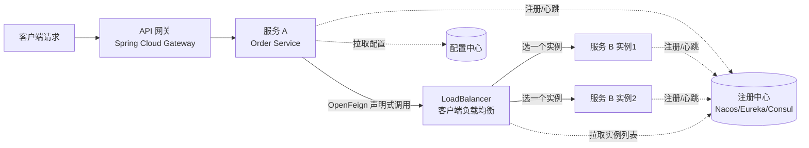
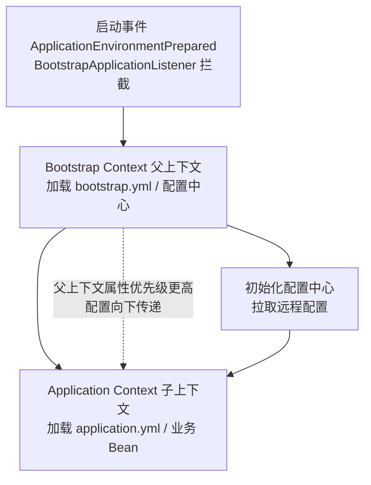
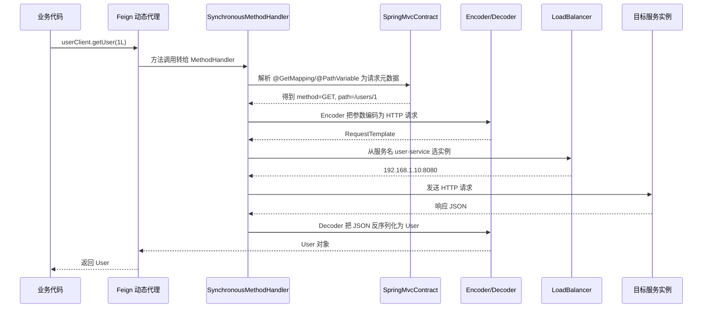

# SpringCloud 基础

> 定位：Spring Cloud 不是某个框架，而是一套「微服务治理武器库」——服务注册发现、负载均衡、声明式调用、配置中心。它们的底层都建立在 Spring Boot 的上下文和 AOP 之上。搞懂父子上下文、服务发现的抽象、OpenFeign 的动态代理与超时重试，你才能把微服务从「跑起来」用到「用得稳」。这一篇是 Spring Cloud 体系的总纲。

## 一、Spring Cloud 解决什么问题

单体应用拆成微服务后，出现一系列新问题：

- 服务实例如此之多，**怎么找到对方**？→ 服务注册与发现
- 一个服务有多个实例，**请求发给谁**？→ 客户端负载均衡
- 服务间调用要写一堆 HTTP 模板代码，**能不能像调本地方法一样**？→ 声明式调用（OpenFeign）
- 配置散落在几十个实例，**怎么集中管理和刷新**？→ 配置中心
- 某个实例挂了，**怎么不让故障扩散**？→ 熔断、限流、降级

Spring Cloud 的做法是：**定义一套抽象接口，让不同组件（Eureka / Nacos / Consul）去实现**。你面向抽象编程，切换组件时改动很小。这一篇聚焦最核心的三块：服务发现、负载均衡、OpenFeign 调用。

## 二、整体架构与父子上下文

### 2.1 整体调用链



这张图展示了 Spring Cloud 的核心协作关系：服务启动向注册中心注册、调用方通过 LoadBalancer 从注册中心拉取实例列表并选一个、OpenFeign 负责把接口调用转成 HTTP 请求。注意**负载均衡发生在客户端（调用方）**，这是 Spring Cloud 与 Nginx 这类服务端负载均衡的本质区别。

### 2.2 Bootstrap Context 与 Application Context

Spring Cloud 在 Spring Boot 的 Application Context 之上，增加了一个**父上下文**——Bootstrap Context：



- **Bootstrap Context** 由 `BootstrapApplicationListener` 在 `ApplicationEnvironmentPreparedEvent` 阶段创建，id 是 `bootstrap`，作为主上下文的**父上下文**
- 它先加载 `bootstrap.yml` 和配置中心配置，且这些属性**优先级高于**主上下文，确保「连配置中心的地址」这类启动早期配置可用
- 主上下文之后加载 `application.yml` 和业务 Bean，能从父上下文继承属性
- **重要版本变化**：Spring Cloud 2020+ / Boot 2.4+ **默认关闭 bootstrap 上下文**，要用需引入 `spring-cloud-starter-bootstrap` 依赖或设置 `spring.cloud.bootstrap.enabled=true`（以你的版本为准）。这是很多「升级后 bootstrap.yml 失效」问题的根源

> 类比：bootstrap 上下文像「出门前先看天气预报决定是否带伞」，主上下文像「到了公司再安排具体工作」——前者必须先做，且决定了后者的环境。

## 三、服务注册与发现抽象

Spring Cloud Commons 定义了一组与具体实现无关的抽象：

| 抽象接口 | 作用 | 实现举例 |
|---|---|---|
| `ServiceInstance` | 一个服务实例的元数据（host、port、metadata） | `NacosServiceInstance`、`EurekaServiceInstance` |
| `DiscoveryClient` | 服务发现：根据服务名找实例列表 | `NacosDiscoveryClient`、`EurekaDiscoveryClient`、`ConsulDiscoveryClient` |
| `ServiceRegistry` | 服务注册：注册/注销实例 | 各组件实现 |
| `LoadBalancerClient` | 负载均衡客户端：选实例、发请求 | `BlockingLoadBalancerClient` |

你面向 `DiscoveryClient` 编程，`@Autowired DiscoveryClient` 拿到的是当前引入组件的实现。切换注册中心时，通常只需换 starter 依赖和少量配置。**Eureka 已进入维护模式**，新项目多选 Nacos / Consul（以你的版本为准）。

## 四、负载均衡：从 Ribbon 到 LoadBalancer

### 4.1 Ribbon 退役

Netflix Ribbon 曾是最经典的客户端负载均衡器，但已进入维护模式，Spring Cloud 2020+ 移除了它，改用 **Spring Cloud LoadBalancer**。

### 4.2 Spring Cloud LoadBalancer 核心

| 组件 | 作用 |
|---|---|
| `LoadBalancerClient` / `BlockingLoadBalancerClient` | 阻塞式负载均衡入口，`choose(serviceId)` 选实例 |
| `ReactiveLoadBalancer<T>` | 响应式负载均衡接口 |
| `ServiceInstanceListSupplier` | 提供候选实例列表，默认 `DiscoveryClientServiceInstanceListSupplier`（从 DiscoveryClient 拉） |
| `LoadBalancerClientFactory` | 为每个服务创建独立的负载均衡上下文（Named Context Factory） |
| `@LoadBalanced` | 标记 RestTemplate / WebClient 使用负载均衡 |

默认负载均衡算法是**轮询**（Round Robin）。要换随机等策略，自定义 `ReactiveLoadBalancer.Factory` 或 `ServiceInstanceListSupplier`（以你的版本为准）。

`@LoadBalanced RestTemplate` 背后的原理是 `LoadBalancerInterceptor`：它拦截 HTTP 请求，从 URL 里取出服务名（如 `http://user-service/users`），用 `LoadBalancerClient` 选出一个真实实例，把 URL 改写成 `http://192.168.1.10:8080/users` 再发出去。

## 五、OpenFeign 调用原理

OpenFeign 让你「像调本地方法一样调远程 HTTP」：

```java
@FeignClient(name = "user-service")
public interface UserClient {
    @GetMapping("/users/{id}")
    User getUser(@PathVariable("id") Long id);
}
```

### 5.1 动态代理生成

`@EnableFeignClients` 会扫描所有 `@FeignClient` 接口，为每个接口通过 `FeignClientFactoryBean.getObject()` 创建 **JDK 动态代理**：



这张图是 Feign 调用的完整链路。关键角色：

- **`SpringMvcContract`**：把 Spring MVC 注解（`@RequestMapping`、`@PathVariable`、`@RequestBody`）解析成 Feign 的请求元数据，所以你能用写 Controller 的习惯写 Feign 客户端
- **`Encoder` / `Decoder`**：请求体编码（如 Jackson 序列化）和响应体解码；常见实现 `SpringEncoder` / `SpringDecoder`（基于 HttpMessageConverter），还有 `OptionalDecoder`、`ResponseEntityDecoder`
- **`ErrorDecoder`**：处理非 2xx 响应，可自定义把 404、500 映射成业务异常
- **`Client`**：底层 HTTP 客户端，默认基于 `HttpURLConnection`；可替换为 OkHttp、Apache HttpClient 5（配 `feign.okhttp.enabled` 等，以版本为准）
- **`FeignBlockingLoadBalancerClient`**：把负载均衡集成进 Feign——调用时先把服务名解析成真实实例，再交给底层 Client 发请求

### 5.2 RequestInterceptor：统一透传 Header

`RequestInterceptor` 在请求发送前被调用，用来统一注入 TraceId、认证 Token 等：

```java
@Configuration
public class FeignConfig {
    @Bean
    public RequestInterceptor headerInterceptor() {
        return template -> {
            template.header("X-Trace-Id", MDC.get("traceId"));
            template.header("Authorization", "Bearer " + getToken());
        };
    }
}
```

这是分布式链路追踪和鉴权透传的标准做法。注意 `RequestInterceptor` 是全局的，也可以通过 `feign.client.config.<服务名>.requestInterceptors` 针对单个服务配置。

## 六、Feign 的超时与重试坑

### 6.1 超时配置

Feign 的超时通过 `Request.Options`（connectTimeout / readTimeout）控制，在 Spring Cloud OpenFeign 里这样配：

```yaml
feign:
  client:
    config:
      default:                    # 全局默认
        connectTimeout: 3000      # 连接超时，毫秒
        readTimeout: 10000        # 读取（响应）超时，毫秒
      user-service:               # 针对单个服务
        readTimeout: 5000
```

> Feign 默认 connectTimeout 约 10s、readTimeout 约 60s（不同版本默认值有差异，以你的版本为准）。生产上**必须显式调小**，否则下游卡住时调用方线程会长时间挂起，耗尽线程池。

**超时的「上下游配合」原则**：

- Feign 的 readTimeout 必须**小于**上游网关/调用方的超时时间，否则上游先超时返回，Feign 还在傻等，线程白白占用
- 如果用了熔断（Resilience4j / Sentinel），**熔断超时要大于 Feign 超时**，否则熔断先生效，Feign 请求还在途，可能造成重复调用或状态不一致

### 6.2 重试的坑

Feign 的 `Retryer` 可以对失败的 IO 请求重试，但这里是重灾区：

- **默认行为因版本而异**（有的版本默认 `Retryer.Default` 有多次重试，有的版本默认不重试），**务必显式确认并以你的版本为准**
- **对非幂等请求（POST 创建订单、扣款）重试，会造成重复数据**。生产上要么关闭重试，要么只对 GET 等幂等请求重试
- 重试会**放大流量**：下游已经过载时，上游重试会让流量翻倍，加速雪崩——这正是熔断要解决的问题

**建议**：关闭或严格控制重试，配合熔断器 + 幂等设计，而不是靠盲目重试。

## 七、生产坑点与排查

### 坑点 1：升级 Spring Cloud 2020+ 后 bootstrap.yml 失效

**现象**：配置中心地址写在 `bootstrap.yml`，升级后读不到，应用用本地默认配置启动。
**原因**：新版默认关闭 bootstrap 上下文。
**解法**：引入 `spring-cloud-starter-bootstrap` 或开启 `spring.cloud.bootstrap.enabled=true`；或迁移到新版 config data 方式（以版本为准）。

### 坑点 2：Feign 调用超时导致线程池耗尽

**现象**：下游响应慢，上游接口全部卡死，线程数打满。
**原因**：Feign 默认 readTimeout 太长，线程长期挂起。
**解法**：显式配置较小的 connectTimeout / readTimeout；配合熔断降级；下游做超时治理。

### 坑点 3：POST 请求被 Feign 重试，产生重复订单

**现象**：网络抖动时，同一笔订单创建了两条记录。
**原因**：Feign 的 Retryer 对 IO 异常重试，POST 非幂等。
**解法**：关闭重试或只对幂等请求重试；业务侧用幂等号去重。

### 坑点 4：Feign 调用 404/500 没有抛预期异常

**现象**：下游返回 500，Feign 直接把错误响应解码成对象或返回 null，业务没感知。
**原因**：默认 `ErrorDecoder` 没有映射成业务异常；或返回类型不匹配。
**解法**：自定义 `ErrorDecoder`，按状态码抛出明确的业务异常；统一返回 `ResponseEntity` 包装。

### 坑点 5：RequestInterceptor 的 Token 在某些调用里丢失

**现象**：Feign 调用下游时偶尔没有 Authorization Header。
**原因**：Token 存在 `ThreadLocal` / 请求上下文里，异步调用或线程池切换后丢失；或 Feign 配置被多个服务名覆盖。
**解法**：在调用前确保上下文已设置；异步场景显式透传；检查 `feign.client.config` 的 default 与具体服务配置是否冲突。

## 八、调优 / 选型 / 最佳实践

1. **注册中心选型**：新项目优先 Nacos / Consul（Eureka 已维护模式）；面向 `DiscoveryClient` 抽象编程，便于切换。
2. **超时必须显式配**：connectTimeout 设 1-3s，readTimeout 按业务设 5-10s，且小于上游超时、大于下游 P99。
3. **谨慎重试**：默认关闭，只对幂等 GET 重试；配合幂等号解决重复问题。
4. **熔断配合**：熔断超时 > Feign 超时；用 Resilience4j / Sentinel 做隔离和降级。
5. **可观测性**：用 `RequestInterceptor` 透传 TraceId，配合 SkyWalking / Zipkin 做链路追踪。
6. **版本意识**：Ribbon → LoadBalancer、bootstrap 默认关闭、Retryer 默认值变化——升级 Spring Cloud 时逐项核对。

## 九、面试高频问法

> 这一节按「面试时能讲透」的标准写：先给一句能直接背的结论，再展开机制、原因和坑点，最后给一句加分点。Spring Cloud 的坑多集中在版本变化和 Feign 超时重试，建议先自己答一遍再对照。

**Q1：Spring Cloud 的核心组件有哪些？解决什么问题？**

**一句话结论**：Spring Cloud 是一套微服务治理「武器库」——服务注册发现、客户端负载均衡、声明式调用、配置中心、网关、熔断降级，都建立在 Spring Boot 上下文和 AOP 之上。

展开：

| 问题 | 对应组件 |
|---|---|
| 服务实例这么多，怎么找到对方 | 服务注册与发现（DiscoveryClient，Nacos/Eureka/Consul） |
| 一个服务多个实例，请求发给谁 | 客户端负载均衡（LoadBalancer，替代 Ribbon） |
| 调用要写一堆 HTTP 模板代码 | 声明式调用（OpenFeign） |
| 配置散落在几十个实例 | 配置中心（Nacos Config/Config Server） |
| 某实例挂了怎么不让故障扩散 | 熔断限流降级（Resilience4j/Sentinel） |
| 统一入口 | API 网关（Spring Cloud Gateway） |

- **核心设计思想**：Spring Cloud **定义一套抽象接口，让不同组件去实现**。你面向 `DiscoveryClient` 这样的抽象编程，切换注册中心时通常只需换 starter 依赖和少量配置。
- **与 Spring Boot 的关系**：Spring Cloud 建立在 Boot 之上——自动配置、父子上下文、AOP 全是 Boot 的机制，Cloud 只是在其上叠加了微服务抽象。

加分点：说「Spring Cloud 不是某个框架，是 '抽象 + 一堆实现' 的生态——面试时先说抽象再说具体实现，显得有体系」，体现结构化认知。

**Q2：Spring Cloud 的整体调用链是怎样的？**

**一句话结论**：客户端请求 → 网关 → 服务 A；服务 A 通过 OpenFeign 声明式调用，经 LoadBalancer 从注册中心拉取实例列表并选一个，再把请求发给服务 B 的实例。

展开：

- **核心协作关系**：
  1. 各服务启动向注册中心**注册**、定时**心跳**；
  2. 调用方通过 LoadBalancer 从注册中心**拉取实例列表**并选一个；
  3. OpenFeign 负责把接口调用转成 HTTP 请求；
  4. 配置中心集中管理配置；
  5. 网关作为统一入口。
- **关键点：负载均衡发生在客户端（调用方）**——这是 Spring Cloud 与 Nginx 这类**服务端负载均衡**的本质区别。客户端拿到完整实例列表，自己按策略选一个，省去中心化转发的单点瓶颈。

加分点：说「客户端负载均衡的优点是 '去中心化、可扩展'，代价是每个调用方都要集成负载均衡逻辑——Spring Cloud 用 `@LoadBalanced` + LoadBalancer 抽象把这件事标准化了」，体现对设计权衡的理解。

**Q3：Bootstrap Context 和 Application Context 是什么关系？**

**一句话结论**：bootstrap 是主上下文的**父上下文**，由 `BootstrapApplicationListener` 在 EnvironmentPrepared 阶段创建，先加载且属性优先级更高；Cloud 2020+ 默认关闭需显式开启。

展开：

- **创建时机**：`BootstrapApplicationListener` 监听 `ApplicationEnvironmentPreparedEvent`，创建 id 为 `bootstrap` 的父上下文。
- **职责分工**：
  - **Bootstrap Context**：加载 `bootstrap.yml` 和配置中心配置，属性优先级高，确保「连配置中心的地址」这类启动早期配置可用；
  - **Application Context**：主上下文，加载 `application.yml` 和业务 Bean，能从父上下文继承属性。
- **为什么要有父子两层**：Bootstrap 像「出门前看天气决定是否带伞」，必须先做且决定后面的环境；主上下文像「到公司安排具体工作」。父上下文先加载，子上下文后加载并可继承。
- **版本变化（高频坑）**：Spring Cloud 2020+ / Boot 2.4+ **默认关闭 bootstrap 上下文**，要用需引 `spring-cloud-starter-bootstrap` 或 `spring.cloud.bootstrap.enabled=true`（以你的版本为准）。这是「升级后 bootstrap.yml 失效、配置中心连不上」的根源。

加分点：说「判断要不要开 bootstrap：如果你的配置中心地址写在 `bootstrap.yml`，升级后读不到，八成就是这个原因——要么显式开启，要么迁移到新版 config data 方式」，给出可操作的排查结论。

**Q4：Spring Cloud Commons 定义了哪些核心抽象？**

**一句话结论**：`ServiceInstance`、`DiscoveryClient`、`ServiceRegistry`、`LoadBalancerClient` 等与具体实现无关的抽象接口，让业务面向抽象编程、切换组件成本低。

展开：

| 抽象接口 | 作用 | 实现举例 |
|---|---|---|
| `ServiceInstance` | 服务实例元数据（host、port、metadata） | `NacosServiceInstance`、`EurekaServiceInstance` |
| `DiscoveryClient` | 服务发现：按服务名找实例列表 | `NacosDiscoveryClient`、`EurekaDiscoveryClient`、`ConsulDiscoveryClient` |
| `ServiceRegistry` | 服务注册：注册/注销实例 | 各组件实现 |
| `LoadBalancerClient` | 负载均衡客户端：选实例、发请求 | `BlockingLoadBalancerClient` |

- **怎么用**：`@Autowired DiscoveryClient` 拿到的是当前引入组件的实现——引 Nacos starter 就是 Nacos 的实现，引 Eureka 就是 Eureka 的。业务代码不用改。
- **选型提示**：**Eureka 已进入维护模式**，新项目多选 Nacos / Consul（以你的版本为准）。

加分点：说「这其实是 '面向接口编程 + SPI' 在微服务框架的落地——Spring Cloud 把 '服务发现' 抽象成接口，各厂商提供实现，这就是它能兼容多种注册中心的原因」，拔高到设计思想。

**Q5：Ribbon 和 Spring Cloud LoadBalancer 是什么关系？**

**一句话结论**：Ribbon 已进入维护模式、Spring Cloud 2020+ 把它移除，改用 Spring Cloud LoadBalancer；后者提供 `BlockingLoadBalancerClient`、`ServiceInstanceListSupplier` 等，默认轮询算法。

展开：

- **演进**：Netflix Ribbon 曾是最经典的客户端负载均衡器，但 Netflix 停止维护后，Spring Cloud 2020+ 移除了它，推出自己的 **Spring Cloud LoadBalancer**。
- **LoadBalancer 核心组件**：

| 组件 | 作用 |
|---|---|
| `LoadBalancerClient`/`BlockingLoadBalancerClient` | 阻塞式负载均衡入口，`choose(serviceId)` 选实例 |
| `ReactiveLoadBalancer<T>` | 响应式负载均衡接口 |
| `ServiceInstanceListSupplier` | 提供候选实例列表，默认从 DiscoveryClient 拉 |
| `LoadBalancerClientFactory` | 为每个服务创建独立的负载均衡上下文（Named Context Factory） |
| `@LoadBalanced` | 标记 RestTemplate/WebClient 使用负载均衡 |

- **算法**：默认**轮询**（Round Robin）。要换随机等策略，自定义 `ReactiveLoadBalancer.Factory` 或 `ServiceInstanceListSupplier`（以你的版本为准）。

加分点：说「升级 Spring Cloud 时 Ribbon → LoadBalancer 是必查项——代码里如果还 `import com.netflix.loadbalancer.*`，升级后会编译不过」，给出实操提醒。

**Q6：@LoadBalanced RestTemplate 背后是什么原理？**

**一句话结论**：靠 `LoadBalancerInterceptor` 拦截 HTTP 请求，从 URL 里取出服务名，用 `LoadBalancerClient` 选出真实实例，把 URL 改写成真实地址再发出去。

展开：

- **使用方式**：

```java
@Bean
@LoadBalanced
public RestTemplate restTemplate() { return new RestTemplate(); }

// 调用时用服务名而非真实地址
restTemplate.getForObject("http://user-service/users/1", User.class);
```

- **拦截流程**：
  1. `@LoadBalanced` 给 RestTemplate 加上 `LoadBalancerInterceptor`；
  2. 请求发出前拦截器拿到 URL `http://user-service/users/1`，解析出服务名 `user-service`；
  3. 调 `LoadBalancerClient.choose("user-service")` 选出一个实例（如 `192.168.1.10:8080`）；
  4. 把 URL 改写成 `http://192.168.1.10:8080/users/1`；
  5. 底层 Client 发出真实 HTTP 请求。

- **关键认知**：负载均衡发生在**拦截器改写 URL** 这一步，调用方代码里写的是服务名而非 IP——这就是「声明式服务调用」的第一层。

加分点：说「`LoadBalancerClientFactory` 为每个服务名创建独立的 Named Context，所以不同服务可以配不同的负载均衡策略——这是 LoadBalancer 比 Ribbon 设计更清晰的地方」，体现源码层面的理解。

**Q7：OpenFeign 的调用原理是什么？**

**一句话结论**：`@FeignClient` 接口通过 `FeignClientFactoryBean` 生成 JDK 动态代理；`SpringMvcContract` 解析 MVC 注解为请求元数据；Encoder 编码、Decoder 解码；`FeignBlockingLoadBalancerClient` 做负载均衡；底层 Client 发 HTTP。

展开：

```java
@FeignClient(name = "user-service")
public interface UserClient {
    @GetMapping("/users/{id}")
    User getUser(@PathVariable("id") Long id);
}
```

**完整调用链**：

1. `@EnableFeignClients` 扫描所有 `@FeignClient` 接口，为每个接口通过 `FeignClientFactoryBean.getObject()` 创建 **JDK 动态代理**；
2. 调用 `userClient.getUser(1L)` → 代理把方法调用转给 `SynchronousMethodHandler`；
3. `SpringMvcContract` 把 `@GetMapping`/`@PathVariable` 解析成请求元数据（method=GET, path=/users/1）；
4. `Encoder`（如 `SpringEncoder`）把参数编码成 HTTP 请求，生成 `RequestTemplate`；
5. `FeignBlockingLoadBalancerClient` 从服务名 `user-service` 选出真实实例；
6. 底层 `Client`（默认基于 `HttpURLConnection`，可换 OkHttp/HttpClient 5）发出请求；
7. 响应 JSON 由 `Decoder`（如 `SpringDecoder`）反序列化成 `User` 对象返回。

加分点：说「Feign 本质是 'JDK 动态代理 + 注解解析 + HTTP 编解码' 三件事，它是 RestTemplate + @LoadBalanced 的进一步封装——把 URL 模板也变成了接口方法」，把 Feign 和 RestTemplate 的关系讲清。

**Q8：Feign 的 Encoder、Decoder、ErrorDecoder、Client 各自作用？**

**一句话结论**：Encoder 编码请求、Decoder 解码响应、ErrorDecoder 处理非 2xx 响应、Client 是底层 HTTP 客户端（可替换）。

展开：

| 组件 | 作用 | 常见实现/定制 |
|---|---|---|
| `Encoder` | 请求体编码（如 Jackson 序列化） | `SpringEncoder`（基于 HttpMessageConverter） |
| `Decoder` | 响应体解码（JSON→对象） | `SpringDecoder`、`OptionalDecoder`、`ResponseEntityDecoder` |
| `ErrorDecoder` | 处理非 2xx 响应，可映射成业务异常 | 自定义按状态码抛异常 |
| `Client` | 底层 HTTP 客户端 | 默认 `HttpURLConnection`；可换 OkHttp、Apache HttpClient 5（配 `feign.okhttp.enabled` 等，以版本为准） |

- **为什么要定制 ErrorDecoder**：默认 `ErrorDecoder` 不把 404/500 映射成业务异常，下游报错时 Feign 可能把错误响应解码成对象或返回 null，业务无感知——这是生产高频坑。
- **为什么要换 Client**：默认 `HttpURLConnection` 不支持连接池、性能一般；生产常换 OkHttp 或 HttpClient 5 获得连接池和更好的性能。

加分点：说「换底层 Client 时记得配连接池参数——连接池复用是 Feign 性能优化的大头，比调各种 Feign 开关效果好得多」，给出调优重点。

**Q9：RequestInterceptor 有什么用？**

**一句话结论**：在请求发送前被调用，用来统一注入 Header（TraceId、认证 Token 等），是分布式链路追踪和鉴权透传的标准做法。

展开：

```java
@Configuration
public class FeignConfig {
    @Bean
    public RequestInterceptor headerInterceptor() {
        return template -> {
            template.header("X-Trace-Id", MDC.get("traceId"));
            template.header("Authorization", "Bearer " + getToken());
        };
    }
}
```

- **典型用途**：透传 TraceId（配合 SkyWalking/Zipkin 做全链路追踪）、透传认证 Token、注入租户 ID 等公共 Header。
- **配置范围**：
  - **全局**：`@Configuration` 里声明 `RequestInterceptor` Bean，对所有 Feign 调用生效；
  - **按服务**：通过 `feign.client.config.<服务名>.requestInterceptors` 针对单个服务配置。
- **坑**：Token 存在 `ThreadLocal`/请求上下文里时，异步调用或线程池切换后会丢失；配置被多个服务名覆盖时也可能失效。

加分点：说「`RequestInterceptor` 是 '横切逻辑统一处理' 的思路，和 AOP 类似——把 TraceId 透传这种每个调用都要做的事集中到一个地方，避免散落各处」，拔高到设计思想。

**Q10：Feign 超时和重试怎么配？有哪些坑？**

**一句话结论**：超时通过 `feign.client.config.default.connectTimeout/readTimeout` 配，要「小于上游、大于下游 P99」；重试默认行为因版本而异，非幂等 POST 重试会造成重复数据，生产要显式关闭或限制。

展开：

```yaml
feign:
  client:
    config:
      default:                    # 全局默认
        connectTimeout: 3000      # 连接超时，毫秒
        readTimeout: 10000        # 读取（响应）超时，毫秒
      user-service:               # 针对单个服务
        readTimeout: 5000
```

- **超时配置原则**：
  - Feign 默认 connectTimeout 约 10s、readTimeout 约 60s（各版本有差异，以你的版本为准），**生产必须显式调小**——下游卡住时调用方线程会长时间挂起，耗尽线程池；
  - **上下游配合**：readTimeout 要**小于**上游网关/调用方的超时（否则上游先超时，Feign 还在傻等）；用了熔断时，**熔断超时要大于 Feign 超时**（否则重复调用或状态不一致）。
- **重试的坑**：
  - 默认行为因版本而异（有的默认多次重试、有的默认不重试），**务必显式确认**；
  - 对非幂等请求（POST 创建订单、扣款）重试 → **重复数据**；
  - 重试会放大流量：下游已过载时上游重试让流量翻倍，加速雪崩。

加分点：给一套生产建议——「connectTimeout 设 1-3s，readTimeout 按业务设 5-10s，重试默认关闭、只对 GET 等幂等请求开，配合熔断 + 幂等号」，可落地。

**Q11：Feign 调用下游返回 500，却没抛预期异常，怎么回事？**

**一句话结论**：默认 `ErrorDecoder` 没把非 2xx 响应映射成业务异常，Feign 可能把错误响应解码成对象或返回 null，业务无感知——要自定义 `ErrorDecoder`。

展开：

- **现象**：下游返回 500/404，Feign 调用方没报错，拿到的是 null 或解码后的奇怪对象，业务继续执行，问题被掩盖。
- **根因**：Feign 的默认 `ErrorDecoder` 对错误响应的处理比较「温和」，不会按你的业务语义抛出明确异常；如果返回类型声明得不合适（如直接声明成 DTO 而非 `ResponseEntity`），错误体可能被强行解码。
- **解法**：

```java
@Bean
public ErrorDecoder errorDecoder() {
    return (methodKey, response) -> {
        if (response.status() >= 500) return new RemoteServerException("下游服务异常: " + response.status());
        if (response.status() == 404) return new NotFoundException("资源不存在");
        return new FeignException(response.status(), response.reason(), ...);
    };
}
```

  另外可统一返回 `ResponseEntity` 包装，显式判断状态码。

加分点：说「微服务间调用一定要 '快速失败 + 明确异常'，不能让错误静默变成 null——否则问题会沿着调用链一路扩散，等到用户投诉才发现」，体现生产可观测性意识。

## 小结

- Spring Cloud 是抽象集合：`DiscoveryClient`（发现）、`LoadBalancerClient`（负载均衡）、`OpenFeign`（声明式调用）。
- bootstrap 是主上下文的父上下文，先加载、优先级高；Cloud 2020+ 默认关闭需显式开启。
- Ribbon 退役，改用 Spring Cloud LoadBalancer；`@LoadBalanced` 靠拦截器改写服务名为真实实例。
- OpenFeign = JDK 动态代理 + SpringMvcContract + Encoder/Decoder + LoadBalancer；RequestInterceptor 透传 Header。
- 超时显式配、小于上游大于下游 P99；谨慎重试（非幂等会重复）；熔断超时 > Feign 超时。
