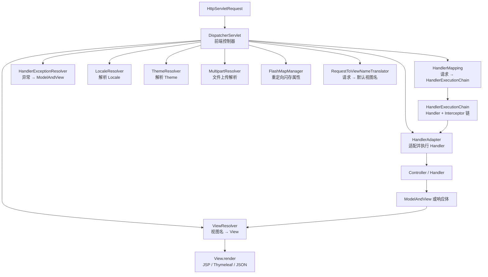
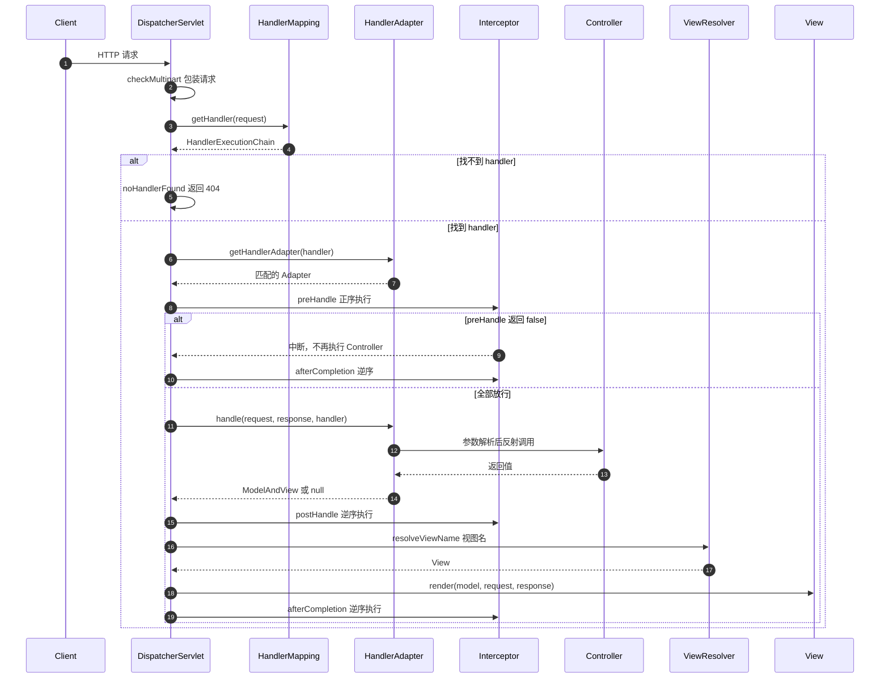
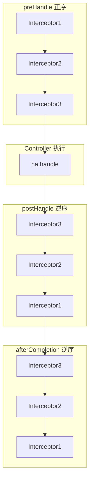

# Spring MVC 请求处理流程

> 定位：你每天写 `@RestController`，但一个 HTTP 请求从 Tomcat 的 Socket 到你的方法参数，中间到底经过了谁？这一篇把 `DispatcherServlet` 这条主干拆开：九大组件各管什么、`doDispatch` 每一行在做什么、拦截器为什么有时候「不生效」。搞懂这条链路，404/405、拦截器顺序、异步请求、`@ResponseBody` 不渲染视图这些高频问题，都能直接定位到源码行。

## 一、为什么必须理解请求链路

先看几个真实故障：

- 在 `postHandle` 里给响应加 `X-Trace-Id`，小响应能加上，大响应偶尔丢——因为响应已经提交了。
- 写了 `AuthInterceptor` 做鉴权，结果 `/error`、静态资源、404 请求全都没进拦截器，安全扫描直接报高危。
- 接口返回 `@ResponseBody`，在 `postHandle` 里 `mv.getModel()` 抛 NPE——因为消息转换器已经把请求标记为「已处理」，`mv` 是 null。
- 异步接口用 `DeferredResult`，日志里同一次请求的 `preHandle` 打印了两次，`postHandle` 一次都没打印。
- 自定义了 `HandlerMapping`，启动正常，请求却始终进不来——因为 `HandlerAdapter` 没配对，`getHandlerAdapter` 直接抛 `ServletException`。

这些问题的共同点：**你不知道请求在框架内部走到了哪一步、当前处于哪个扩展点**。

Spring MVC 的设计核心是一个「前端控制器」——`DispatcherServlet`。它不做业务，只做编排：找 handler、找适配器、执行拦截器、调 Controller、处理异常、渲染视图。九大组件是它的「器官」，`doDispatch` 是它的「心跳」。理解这套编排，比背 `@RequestMapping` 的属性有用得多。

## 二、核心原理：DispatcherServlet 与九大组件

### 2.1 继承体系：它首先是一个 Servlet

```
jakarta.servlet.http.HttpServlet
  └─ HttpServletBean              // 把 init-param 绑定到 Bean 属性
      └─ FrameworkServlet         // 创建 WebApplicationContext，统一 processRequest
          └─ DispatcherServlet    // 九大组件 + doDispatch
```

（Spring 5.x 是 `javax.servlet.*`，Spring 6 / Boot 3 迁到 `jakarta.servlet.*`，下面统一写 `jakarta`。）

关键点：**Servlet 容器只认 `Servlet` 接口**，所以 Spring MVC 必须「寄生」在一个 Servlet 上。`DispatcherServlet` 注册为 `/` 的映射后，所有没被更精确 Servlet 匹配的请求都会进来。

`FrameworkServlet` 重写了 `service()`：

```java
@Override
protected void service(HttpServletRequest request, HttpServletResponse response)
        throws ServletException, IOException {
    HttpMethod httpMethod = HttpMethod.valueOf(request.getMethod());
    if (httpMethod == HttpMethod.PATCH || httpMethod == null) {
        // HttpServlet 没有 doPatch，PATCH 请求直接走统一入口
        processRequest(request, response);
    } else {
        super.service(request, response);   // 分发给 doGet/doPost...
    }
}
```

`doGet`、`doPost`、`doPut`、`doDelete` 全部收敛到 `processRequest()`，再调 `doService()`（`DispatcherServlet` 实现），最终进入 `doDispatch()`：

```
HttpServlet.service
  → FrameworkServlet.service
    → FrameworkServlet.processRequest
      → DispatcherServlet.doService     // 放入 WebApplicationContext、LocaleResolver、FlashMap 等
        → DispatcherServlet.doDispatch  // 真正的编排
```

`processRequest` 的 `finally` 里还会做三件容易被忽略的事：重置 `LocaleContextHolder` / `RequestContextHolder`、发布 `ServletRequestHandledEvent`、记录访问日志。**异步请求的 ThreadLocal 丢失问题，就和这里的 reset 有关**。

### 2.2 九大组件的职责

`DispatcherServlet` 在 `onRefresh()` 时调用 `initStrategies()`，一次性初始化九个组件：

```java
protected void initStrategies(ApplicationContext context) {
    initMultipartResolver(context);          // 文件上传
    initLocaleResolver(context);             // 国际化
    initThemeResolver(context);              // 主题
    initHandlerMappings(context);            // 请求 → handler
    initHandlerAdapters(context);            // 执行 handler
    initHandlerExceptionResolvers(context);  // 异常 → ModelAndView
    initRequestToViewNameTranslator(context);// 请求 → 默认视图名
    initViewResolvers(context);              // 视图名 → View
    initFlashMapManager(context);            // 重定向闪存属性
}
```

初始化策略大体是「先找容器里的自定义 Bean，找不到再用默认」（`MultipartResolver` 特殊，按固定名字 `multipartResolver` 查找）。以 `HandlerMapping` 为例，只要容器里有任意该类型的 Bean，就全部收集并按 `Order` 排序，一个都不用默认值。Spring Boot 的 `WebMvcAutoConfiguration` 会注册一整套 `HandlerMapping`，所以 Boot 环境下基本不会走 properties 兜底。

九个组件的关系如下。**看这张图时重点看两件事：谁在请求主链路上（HandlerMapping / HandlerAdapter / ViewResolver），谁是旁路能力（Locale / Theme / Multipart / FlashMap）**。



逐个体检一遍：

| 组件 | 职责 | 默认实现 | 什么时候需要自定义 |
|---|---|---|---|
| `HandlerMapping` | 根据 URL、Method、Header 找到 handler，并组装拦截器链 | `RequestMappingHandlerMapping`、`BeanNameUrlHandlerMapping`、`RouterFunctionMapping` | 自定义路由规则、灰度路由、多租户路由 |
| `HandlerAdapter` | 判断是否支持某个 handler，并真正执行它 | `RequestMappingHandlerAdapter`、`HttpRequestHandlerAdapter`、`SimpleControllerHandlerAdapter` | 接入自定义 Handler 类型 |
| `HandlerExceptionResolver` | 把异常解析成 `ModelAndView` 或直接写响应 | `ExceptionHandlerExceptionResolver`、`ResponseStatusExceptionResolver`、`DefaultHandlerExceptionResolver` | 统一错误页、错误码 |
| `ViewResolver` | 把逻辑视图名解析成 `View` | `InternalResourceViewResolver`（JSP）、`ContentNegotiatingViewResolver` | 换模板引擎、前后端不分离 |
| `LocaleResolver` | 从请求解析 `Locale` | `AcceptHeaderLocaleResolver` | 用 Session / Cookie 存语言 |
| `ThemeResolver` | 解析主题名 | `FixedThemeResolver` | 老项目换肤，新项目基本不用 |
| `MultipartResolver` | 判断是否 multipart 并包装请求 | `StandardServletMultipartResolver`（Boot 自动配置） | 换 Commons FileUpload（Spring 6 已移除） |
| `FlashMapManager` | 重定向时跨请求传一次性属性 | `SessionFlashMapManager` | 改为 Cookie / 自定义存储 |
| `RequestToViewNameTranslator` | handler 没返回视图名时，从 URL 推导 | `DefaultRequestToViewNameTranslator` | 约定式视图名 |

几个组件值得单独说清楚：

**HandlerMapping 返回的不是 handler，而是 `HandlerExecutionChain`。** 这个 chain 里装着 `handler` 和 `List<HandlerInterceptor>`。`AbstractHandlerMapping.getHandler()` 会先调 `getHandlerInternal()` 找到 handler（`@RequestMapping` 由 `RequestMappingHandlerMapping` 查映射注册表），再用 `getHandlerExecutionChain()` 把匹配的拦截器塞进去。**拦截器不是 DispatcherServlet 自己找的，是 HandlerMapping 挂上去的**——这解释了为什么 404 时拦截器不执行：`getHandler` 返回 null，压根没有 chain。

**HandlerExceptionResolver 是「三级漏斗」**，默认顺序在 `DispatcherServlet.properties` 里定义：`ExceptionHandlerExceptionResolver` → `ResponseStatusExceptionResolver` → `DefaultHandlerExceptionResolver`。第一个能返回非 null 的 `ModelAndView` 就短路。下一篇《Spring MVC 参数解析与返回值处理》会展开。

**MultipartResolver 是「请求包装器」**，不是「解析器工具类」。`checkMultipart()` 判断 `Content-Type` 是否 `multipart/form-data`，是就把 `HttpServletRequest` 包成 `MultipartHttpServletRequest`，后续 `@RequestParam MultipartFile` 才能拿到文件。

**FlashMapManager 服务于重定向传参。** `redirectAttributes.addFlashAttribute("msg", "保存成功")` 会把属性存进 Session 的 `FlashMap`，重定向后的那次请求再取出来并删除。它依赖 Session，所以集群环境要做 Session 共享，否则重定向后丢提示。

**RequestToViewNameTranslator 是「约定优于配置」的兜底。** Controller 方法返回 `void`、也没写视图名时，`DefaultRequestToViewNameTranslator` 把 `/user/list` 翻译成视图名 `user/list`。前后端分离项目里基本用不到，但老项目排错时会遇到「为什么莫名渲染了一个不存在的视图」。

### 2.3 为什么需要 HandlerAdapter

这是面试高频题，也是设计模式在 Spring 里最漂亮的一处落地。

问题背景：Spring MVC 支持多种「Handler」，它们的调用签名完全不同：

| Handler 类型 | 示例 | 执行方式 |
|---|---|---|
| `@Controller` 方法 | `@GetMapping("/u") public User u()` | 反射调用，需要参数解析、返回值处理 |
| `HttpRequestHandler` | 实现 `handleRequest(request, response)` | 直接调用，无返回值 |
| `Controller` 接口 | 实现 `handleRequest(request, response)` | 直接调用，返回 `ModelAndView` |
| `HandlerFunction` | 函数式端点 `RouterFunction` | 调用 `handle(ServerRequest)` |

如果让 `DispatcherServlet` 自己判断：

```java
// 反面教材：每加一种 Handler 都要改核心类
if (handler instanceof HandlerMethod hm) {
    // 几十行参数解析 + 反射 + 返回值处理
} else if (handler instanceof HttpRequestHandler h) {
    h.handleRequest(request, response);
} else if (handler instanceof Controller c) {
    return c.handleRequest(request, response);
}
```

这段代码违反开闭原则：新增一种 handler 就要改 `DispatcherServlet`，核心类会无限膨胀。

Spring 的解法是**适配器模式**：`DispatcherServlet` 只认识 `HandlerAdapter` 接口，具体怎么调由适配器负责。

```java
public interface HandlerAdapter {
    boolean supports(Object handler);   // 我能不能处理这个 handler
    ModelAndView handle(HttpServletRequest request, HttpServletResponse response,
                        Object handler) throws Exception;   // 真正执行
    long getLastModified(HttpServletRequest request, Object handler);  // 支持 304 协商
}
```

`doDispatch` 里只做两件事：遍历 `handlerAdapters` 找到第一个 `supports(handler)` 为 true 的适配器，然后调 `handle()`。**新增 handler 类型 = 新增一个 Adapter Bean，核心类一行不改**。

对应关系：

| Handler | HandlerAdapter | 关键动作 |
|---|---|---|
| `HandlerMethod`（`@Controller` 方法） | `RequestMappingHandlerAdapter` | 参数解析 → 反射调用 → 返回值处理 |
| `HttpRequestHandler` | `HttpRequestHandlerAdapter` | 直接调 `handleRequest`，返回 null |
| `Controller` 接口 | `SimpleControllerHandlerAdapter` | 调 `handleRequest`，返回 `ModelAndView` |
| `HandlerFunction` | `HandlerFunctionAdapter` | 函数式端点，Spring 5.2+ |

一个自定义适配器长这样，把「命令对象」也纳入 MVC：

```java
public class CommandHandlerAdapter implements HandlerAdapter {

    @Override
    public boolean supports(Object handler) {
        return handler instanceof Command;          // 只接 Command
    }

    @Override
    public ModelAndView handle(HttpServletRequest request, HttpServletResponse response,
                               Object handler) throws Exception {
        ((Command) handler).execute(request, response);
        return null;                                // 自己写响应，不需要视图
    }

    @Override
    public long getLastModified(HttpServletRequest request, Object handler) {
        return -1;                                  // 不支持 304
    }
}
```

注册到容器即可生效（Boot 下任何 `HandlerAdapter` Bean 都会被 `initHandlerAdapters` 收集）。这也解释了另一个常见报错：**`No adapter for handler [...]`**——你的 handler 没有任何适配器支持，通常是自定义了 `HandlerMapping` 却忘了配套的 `HandlerAdapter`。

## 三、核心原理：一次请求的完整链路

### 3.1 时序图

先看全景。**重点看三处分支：`preHandle` 返回 false、异步请求、异常路径**——这三处是生产问题的高发区。



### 3.2 各组件的出场顺序

把一次正常请求拆成 12 步，每一步都能对应到具体方法：

| 步骤 | 执行者 | 关键方法 | 说明 |
|---|---|---|---|
| 1 | Servlet 容器 | `service` | 按 HTTP Method 分发 |
| 2 | `FrameworkServlet` | `processRequest` | 统一入口，最终调 `doService` |
| 3 | `DispatcherServlet` | `doService` | 放入上下文、Locale、FlashMap 等请求属性 |
| 4 | `DispatcherServlet` | `checkMultipart` | multipart 请求包装 |
| 5 | `HandlerMapping` | `getHandler` | 返回 handler + 拦截器链 |
| 6 | `DispatcherServlet` | `getHandlerAdapter` | 按 handler 类型选适配器 |
| 7 | `HandlerExecutionChain` | `applyPreHandle` | 正序执行 `preHandle` |
| 8 | `HandlerAdapter` | `handle` | 参数解析、反射调用、返回值处理 |
| 9 | `HandlerExecutionChain` | `applyPostHandle` | 逆序执行 `postHandle` |
| 10 | `DispatcherServlet` | `processDispatchResult` | 异常解析 + 视图渲染 |
| 11 | `ViewResolver` / `View` | `resolveViewName` / `render` | 只有非 `@ResponseBody` 才走 |
| 12 | `HandlerExecutionChain` | `triggerAfterCompletion` | 逆序执行 `afterCompletion` |

### 3.3 doDispatch 源码走读

这是全篇最该逐行读的一段。我按 Spring 6.x 的代码给出主干，注释标出每一步的意图和坑：

```java
protected void doDispatch(HttpServletRequest request, HttpServletResponse response) throws Exception {
    HttpServletRequest processedRequest = request;
    HandlerExecutionChain mappedHandler = null;
    boolean multipartRequestParsed = false;

    WebAsyncManager asyncManager = WebAsyncUtils.getAsyncManager(request);

    try {
        ModelAndView mv = null;
        Exception dispatchException = null;
        try {
            // 1. 文件上传：如果是 multipart，包装成 MultipartHttpServletRequest
            processedRequest = checkMultipart(request);
            multipartRequestParsed = (processedRequest != request);

            // 2. 找 handler：遍历所有 HandlerMapping，第一个返回非 null 的胜出
            //    返回值是 HandlerExecutionChain，里面已经挂好了匹配的拦截器
            mappedHandler = getHandler(processedRequest);
            if (mappedHandler == null) {
                noHandlerFound(processedRequest, response);   // 默认 sendError(404)
                return;                                      // ★ 拦截器不会执行
            }

            // 3. 找适配器：按 handler 类型匹配，找不到抛 ServletException
            HandlerAdapter ha = getHandlerAdapter(mappedHandler.getHandler());

            // 4. Last-Modified 协商：GET/HEAD 且 handler 支持时，可能直接 304 返回
            String method = request.getMethod();
            boolean isGet = HttpMethod.GET.matches(method);
            if (isGet || HttpMethod.HEAD.matches(method)) {
                long lastModified = ha.getLastModified(request, mappedHandler.getHandler());
                if (new ServletWebRequest(request, response).checkNotModified(lastModified) && isGet) {
                    return;                                  // ★ 304 也不会触发 afterCompletion
                }
            }

            // 5. preHandle：正序执行；任何一个返回 false 就中断
            //    中断时会触发「已成功执行过 preHandle 的拦截器」的 afterCompletion
            if (!mappedHandler.applyPreHandle(processedRequest, response)) {
                return;
            }

            // 6. 真正执行：参数解析 → 反射调用 → 返回值处理，都在 Adapter 内部
            mv = ha.handle(processedRequest, response, mappedHandler.getHandler());

            // 7. 异步请求：handler 已返回但结果未就绪，直接退出
            //    ★ 这里 return 意味着 postHandle 不会执行
            if (asyncManager.isConcurrentHandlingStarted()) {
                return;
            }

            // 8. handler 没返回视图名时，用 RequestToViewNameTranslator 兜底
            applyDefaultViewName(processedRequest, mv);

            // 9. postHandle：逆序执行，此时视图还没渲染，但响应体可能已写入
            mappedHandler.applyPostHandle(processedRequest, response, mv);
        }
        catch (Exception ex) {
            dispatchException = ex;          // 先接住，交给 processDispatchResult 统一处理
        }
        catch (Throwable err) {
            // Spring 5.x 是 NestedServletException，6.0 起直接用 ServletException
            dispatchException = new ServletException("Handler dispatch failed: " + err, err);
        }

        // 10. 处理结果：异常解析 → 视图渲染 → 正常路径的 afterCompletion
        processDispatchResult(processedRequest, response, mappedHandler, mv, dispatchException);
    }
    catch (Exception ex) {
        // 11. 走到这里说明 processDispatchResult 自己炸了（比如视图渲染失败）
        triggerAfterCompletion(processedRequest, response, mappedHandler, ex);
    }
    catch (Throwable err) {
        triggerAfterCompletion(processedRequest, response, mappedHandler,
                new ServletException("Handler dispatch failed: " + err, err));
    }
    finally {
        if (asyncManager.isConcurrentHandlingStarted()) {
            // 12a. 异步已启动：回调 afterConcurrentHandlingStarted，multipart 交给异步线程清理
            if (mappedHandler != null) {
                mappedHandler.applyAfterConcurrentHandlingStarted(processedRequest, response);
            }
        }
        else {
            // 12b. 同步完成：清理 multipart 临时文件
            if (multipartRequestParsed) {
                cleanupMultipart(processedRequest);
            }
        }
    }
}
```

这段代码里有四个必须记住的「提前 return」：

1. **找不到 handler** → 404，拦截器全部不执行。
2. **304 协商命中** → 直接返回，`afterCompletion` 也不执行。
3. **`preHandle` 返回 false** → 只对「已经成功执行过 preHandle」的拦截器逆序调 `afterCompletion`。
4. **异步已启动** → `postHandle` 跳过，只回调 `afterConcurrentHandlingStarted`。

### 3.4 processDispatchResult：异常与视图的分岔口

```java
private void processDispatchResult(HttpServletRequest request, HttpServletResponse response,
        HandlerExecutionChain mappedHandler, ModelAndView mv, Exception exception) throws Exception {

    boolean errorView = false;

    if (exception != null) {
        if (exception instanceof ModelAndViewDefiningException mavDefiningException) {
            // 拦截器/Controller 主动指定错误页
            mv = mavDefiningException.getModelAndView();
        }
        else {
            Object handler = (mappedHandler != null ? mappedHandler.getHandler() : null);
            // ★ 三级异常解析器在这里被调用
            mv = processHandlerException(request, response, handler, exception);
            errorView = (mv != null);
        }
    }

    // 有视图才渲染；@ResponseBody 场景 mv 为 null，直接跳过
    if (mv != null && !mv.wasCleared()) {
        render(mv, request, response);
        if (errorView) {
            WebUtils.clearErrorRequestAttributes(request);
        }
    }

    // 异步请求在这里再次退出，afterCompletion 交给异步完成后的二次 dispatch
    if (WebAsyncUtils.getAsyncManager(request).isConcurrentHandlingStarted()) {
        return;
    }

    if (mappedHandler != null) {
        // 正常完成：异常参数传 null
        mappedHandler.triggerAfterCompletion(request, response, null);
    }
}
```

`processHandlerException` 就是三级漏斗的入口：

```java
protected ModelAndView processHandlerException(HttpServletRequest request, HttpServletResponse response,
        Object handler, Exception ex) throws Exception {

    request.removeAttribute(HandlerMapping.PRODUCIBLE_MEDIA_TYPES_ATTRIBUTE);

    ModelAndView exMv = null;
    if (this.handlerExceptionResolvers != null) {
        for (HandlerExceptionResolver resolver : this.handlerExceptionResolvers) {
            exMv = resolver.resolveException(request, response, handler, ex);
            if (exMv != null) {
                break;                       // 第一个处理成功就短路
            }
        }
    }
    if (exMv != null) {
        return exMv;
    }
    throw ex;   // 没人处理，继续往外抛，最终交给容器错误页 / BasicErrorController
}
```

注意最后那个 `throw ex`：**如果三个解析器都没命中，异常会抛回 Servlet 容器**。Spring Boot 下会转发到 `/error`，由 `BasicErrorController` 兜底返回 JSON。这也是为什么「自定义异常没被 `@ControllerAdvice` 捕获」时，客户端看到的往往是 Boot 默认的错误结构。

### 3.5 视图渲染：render 做了什么

```java
protected void render(ModelAndView mv, HttpServletRequest request, HttpServletResponse response) throws Exception {
    Locale locale = this.localeResolver.resolveLocale(request);
    response.setLocale(locale);

    View view;
    if (mv.isReference()) {
        // 逻辑视图名 → View，遍历所有 ViewResolver
        view = resolveViewName(mv.getViewName(), mv.getModelInternal(), locale, request);
        if (view == null) {
            throw new ServletException("Could not resolve view with name '" + mv.getViewName() + "'...");
        }
    }
    else {
        view = mv.getView();   // 已经是 View 实例
    }

    view.render(mv.getModelInternal(), request, response);
}
```

`AbstractView.render()` 先 `prepareResponse`（设置缓存头），再 `renderMergedOutputModel`（把 Model 写进响应）。JSP 走 `InternalResourceView` 的 `RequestDispatcher.forward`，Thymeleaf 走 `ThymeleafView` 的模板引擎输出。

**`@ResponseBody` 为什么不会走到这里？** 因为 `RequestResponseBodyMethodProcessor.handleReturnValue()` 里调了 `mavContainer.setRequestHandled(true)`，`RequestMappingHandlerAdapter.getModelAndView()` 看到这个标记就返回 null，`processDispatchResult` 的 `if (mv != null ...)` 直接跳过。**消息转换器已经自己把响应写完了，框架不需要再渲染视图**。

### 3.6 组件之间怎么传数据：请求属性

`DispatcherServlet` 不靠方法参数把上下文传给九大组件，而是往 `HttpServletRequest` 里塞属性。理解这些 key，排错时能少走很多弯路：

| 请求属性 | 写入方 | 读取方 / 用途 |
|---|---|---|
| `WebApplicationContext.ROOT_WEB_APPLICATION_CONTEXT_ATTRIBUTE` | `FrameworkServlet` | 拿到根容器 |
| `DispatcherServlet.WEB_APPLICATION_CONTEXT_ATTRIBUTE` | `doService` | handler、View 里取当前容器 |
| `DispatcherServlet.LOCALE_RESOLVER_ATTRIBUTE` | `doService` | 视图、标签库取 LocaleResolver |
| `DispatcherServlet.INPUT_FLASH_MAP_ATTRIBUTE` | `doService` | 重定向后取出一次性属性 |
| `DispatcherServlet.OUTPUT_FLASH_MAP_ATTRIBUTE` | `doService` | 本次请求写入待保存的 FlashMap |
| `HandlerMapping.URI_TEMPLATE_VARIABLES_ATTRIBUTE` | `RequestMappingHandlerMapping` | `PathVariableMethodArgumentResolver` 从这里取值 |
| `HandlerMapping.BEST_MATCHING_HANDLER_ATTRIBUTE` | `AbstractHandlerMapping` | 记录最佳匹配的 handler，便于排查 |
| `HandlerMapping.PRODUCIBLE_MEDIA_TYPES_ATTRIBUTE` | `RequestMappingHandlerAdapter` | `@ResponseBody` 写响应时参考 `produces` |

这解释了两个细节：

- `@PathVariable` 不是从 URL 字符串里再解析一遍，而是直接读 `URI_TEMPLATE_VARIABLES_ATTRIBUTE`。所以你在 Filter 里重写 URL 后，`@PathVariable` 拿到的仍是 HandlerMapping 匹配时的值。
- `processHandlerException` 的第一行是 `request.removeAttribute(HandlerMapping.PRODUCIBLE_MEDIA_TYPES_ATTRIBUTE)`——异常响应不应该沿用正常响应的 `produces` 限制，否则 `@ExceptionHandler` 想返回 JSON 却被 `produces=text/html` 卡住，直接 406。

## 四、关键机制：拦截器 vs 过滤器

### 4.1 本质区别

| 对比项 | Filter | HandlerInterceptor |
|---|---|---|
| 规范 | Servlet 规范（`jakarta.servlet.Filter`） | Spring MVC 自己的接口 |
| 执行位置 | Servlet 容器内、`DispatcherServlet` 之前 | `DispatcherServlet` 内部、handler 执行前后 |
| 作用范围 | 所有请求（含静态资源、其他 Servlet） | 只作用于 DispatcherServlet 能映射到的 handler |
| 能否拿到 Bean | 默认不能，需 `GenericFilterBean` 或手动注入 | 本身是 Spring Bean，直接 `@Autowired` |
| 能否拿到 handler | 不能 | 能，`preHandle` 的第三个参数就是 `HandlerMethod` |
| 能否拿到方法参数 | 不能 | 能通过 `HandlerMethod.getMethodParameters()` 拿到元信息，但拿不到解析后的值 |
| 能否包装 request/response | 能，这是 Filter 的强项 | 不能，只能读/改 |
| 执行顺序控制 | `@Order` / `FilterRegistrationBean.setOrder` | `InterceptorRegistration.order()` / 注册顺序 |
| 异常处理 | 抛出的异常不经过 `HandlerExceptionResolver` | 抛出的异常会被 `processDispatchException` 捕获 |

一句话选型：**编码、跨域、请求体缓存、TraceId、安全过滤链放 Filter；鉴权、权限注解、租户上下文、接口耗时统计放 Interceptor**。

### 4.2 三个回调的时机与顺序

`HandlerInterceptor` 有三个方法：

```java
public interface HandlerInterceptor {
    default boolean preHandle(HttpServletRequest request, HttpServletResponse response, Object handler) {
        return true;
    }
    default void postHandle(HttpServletRequest request, HttpServletResponse response,
                            Object handler, ModelAndView modelAndView) {
    }
    default void afterCompletion(HttpServletRequest request, HttpServletResponse response,
                                 Object handler, Exception ex) {
    }
}
```

- `preHandle`：Controller 执行前。返回 `false` 中断请求。
- `postHandle`：Controller 执行后、视图渲染前。**`@ResponseBody` 时 `modelAndView` 是 null**。
- `afterCompletion`：整个请求完成后（视图渲染完）。无论成功失败都会执行（只要该拦截器的 `preHandle` 曾返回 true）。

多个拦截器的顺序，记住一句口诀：**pre 正序，post 和 afterCompletion 逆序**。



为什么是这个顺序？因为拦截器链是一个「栈」：先进后出。`preHandle` 像入栈（1→2→3），`postHandle` 和 `afterCompletion` 像出栈（3→2→1）。**这保证了「谁先准备好资源，谁最后清理资源」**，和 AOP 的环绕通知、事务的嵌套逻辑一致。

源码在 `HandlerExecutionChain`：

```java
boolean applyPreHandle(HttpServletRequest request, HttpServletResponse response) throws Exception {
    for (int i = 0; i < this.interceptorList.size(); i++) {
        HandlerInterceptor interceptor = this.interceptorList.get(i);
        if (!interceptor.preHandle(request, response, this.handler)) {
            // ★ 只回滚「已经成功执行过 preHandle」的拦截器
            triggerAfterCompletion(request, response, null);
            return false;
        }
        this.interceptorIndex = i;   // 记录最后一个成功的下标
    }
    return true;
}

void applyPostHandle(HttpServletRequest request, HttpServletResponse response, ModelAndView mv) throws Exception {
    for (int i = this.interceptorList.size() - 1; i >= 0; i--) {
        HandlerInterceptor interceptor = this.interceptorList.get(i);
        interceptor.postHandle(request, response, this.handler, mv);
    }
}

void triggerAfterCompletion(HttpServletRequest request, HttpServletResponse response, Exception ex) {
    for (int i = this.interceptorIndex; i >= 0; i--) {
        HandlerInterceptor interceptor = this.interceptorList.get(i);
        try {
            interceptor.afterCompletion(request, response, this.handler, ex);
        }
        catch (Throwable ex2) {
            logger.error("HandlerInterceptor.afterCompletion threw exception", ex2);
        }
    }
}
```

`interceptorIndex` 这个字段是关键：它记录「最后一个 `preHandle` 返回 true 的下标」。如果 Interceptor2 返回 false，`interceptorIndex` 还停在 0，`triggerAfterCompletion` 只会回调 Interceptor1——**Interceptor3 的 `preHandle` 没执行过，它的 `afterCompletion` 也不会执行**。这个设计避免了对「没初始化过的拦截器」做清理。

### 4.3 注册拦截器

```java
@Configuration
public class WebConfig implements WebMvcConfigurer {

    private final AuthInterceptor authInterceptor;

    public WebConfig(AuthInterceptor authInterceptor) {
        this.authInterceptor = authInterceptor;
    }

    @Override
    public void addInterceptors(InterceptorRegistry registry) {
        registry.addInterceptor(authInterceptor)
                .addPathPatterns("/api/**")
                .excludePathPatterns("/api/login", "/api/public/**")
                .order(1);

        registry.addInterceptor(new CostInterceptor())
                .addPathPatterns("/**")
                .order(2);
    }
}
```

两个细节：

- `order` 越小越先执行；不写则按注册顺序。`InterceptorRegistry` 最终用 `AnnotationAwareOrderComparator` 排序。
- `addPathPatterns("/**")` 会连静态资源、`/error` 一起拦。Spring Boot 的静态资源由 `ResourceHttpRequestHandler` 处理，它也是一个 handler，所以**拦截器对静态资源同样生效**。要排除就显式写 `excludePathPatterns("/static/**", "/favicon.ico", "/error")`。

拦截器有三种注册方式，行为差别很大：

| 方式 | 是否自动生效 | 路径控制 | 适用场景 |
|---|---|---|---|
| `WebMvcConfigurer.addInterceptors` + `InterceptorRegistration` | 是 | `addPathPatterns` / `excludePathPatterns` | 推荐，绝大多数场景 |
| 声明 `MappedInterceptor` Bean | 是，`AbstractHandlerMapping.detectMappedInterceptors` 自动收集 | 构造器传入 include / exclude | 框架级、需要独立打包 |
| 只声明 `HandlerInterceptor` Bean（`@Component`） | **否** | 无 | 必须再通过 `addInterceptors` 注册 |

最后一行是高频误解：**`@Component` 只是把它变成 Bean，不会自动挂到任何 `HandlerMapping` 上**。你必须在 `WebMvcConfigurer` 里显式注册，否则它永远不执行。

## 五、生产坑点与排查

### 坑点 1：在 postHandle 里改 response 不生效

**现象**：`postHandle` 里 `response.setHeader("X-Trace-Id", id)`，小响应偶尔生效，大响应丢失；有时抛 `IllegalStateException: getWriter() has already been called`。

**原因**：`postHandle` 在 `ha.handle()` 之后执行。`@ResponseBody` 场景下，`HttpMessageConverter` 已经把数据写入 `response.getOutputStream()`；如果响应体超过缓冲区（Tomcat 默认 8KB），或者 converter 内部 flush 过，响应就**已提交**。提交后 `setHeader` 被静默忽略，`getWriter()` 再取会冲突。

**解法**：

- 需要加响应头，放在 `preHandle` 里做（此时响应一定没提交）。
- 需要改响应体，用 `ResponseBodyAdvice`（在 converter 写入前介入）或 Filter 包装 `HttpServletResponse`。
- 排查时看 `response.isCommitted()`，别猜。

### 坑点 2：异步请求下拦截器「少执行一次 / 多执行一次」

**现象**：`DeferredResult` 接口，日志里 `preHandle` 打印两次，`postHandle` 一次都没有，`afterCompletion` 在结果返回后才打印。

**原因**：异步请求第一次进入 `doDispatch` 时，`ha.handle()` 返回 null，`asyncManager.isConcurrentHandlingStarted()` 为 true，`doDispatch` 直接 return——**`postHandle` 被跳过**。等异步结果就绪，Servlet 容器发起二次 dispatch，请求再次进入 `doDispatch`，`preHandle` 又执行一遍，然后才渲染/写回并触发 `afterCompletion`。

**解法**：

- 拦截器里做计数、幂等、限流时，用 `request.getAttribute(...)` 标记「本次请求已处理」，避免二次 dispatch 重复计数。
- 需要感知「异步已启动」，实现 `AsyncHandlerInterceptor.afterConcurrentHandlingStarted()`，在这里清理 ThreadLocal。
- 不要在 `preHandle` 里把上下文只存 ThreadLocal 就完事——异步线程拿不到，需要显式传递（`RequestContextHolder.setRequestAttributes(attrs, true)`）。

### 坑点 3：@ResponseBody 时 postHandle 里 mv 为 null，直接 NPE

**现象**：拦截器 `postHandle` 里 `modelAndView.getModel().put(...)`，所有 REST 接口 500。

**原因**：`RequestResponseBodyMethodProcessor` 把 `mavContainer` 标记为 `requestHandled=true`，`getModelAndView()` 返回 null，`applyPostHandle` 传进去的就是 null。

**解法**：`postHandle` 里先判空；REST 接口想改返回值用 `ResponseBodyAdvice`，不要动 `ModelAndView`。

### 坑点 4：404 请求不进拦截器，鉴权被绕过

**现象**：安全扫描报告「不存在的路径未鉴权」，但你的 `AuthInterceptor` 明明配了 `/**`。

**原因**：`getHandler()` 返回 null 时，`doDispatch` 直接 `noHandlerFound()` 返回 404，**根本没有 `HandlerExecutionChain`，拦截器自然不会执行**。同理，`/error` 转发、部分静态资源也可能绕过。

**解法**：

- 鉴权不要只依赖 MVC 拦截器，Filter 层做兜底（Filter 对所有请求生效）。
- 需要让 404 也进统一异常处理，配置 `spring.mvc.throw-exception-if-no-handler-found=true`，并关闭静态资源兜底（`spring.web.resources.add-mappings=false`），让 `NoHandlerFoundException` 抛出来。
- 明确 `excludePathPatterns`，不要图省事全放开。

### 坑点 5：拦截器顺序和 Filter 顺序搞混

**现象**：`@Order(1)` 标在拦截器 Bean 上，实际执行顺序却不对。

**原因**：`@Order` 对 `HandlerInterceptor` Bean **不直接生效**，顺序由 `InterceptorRegistration.order()` 或注册顺序决定；Filter 的 `@Order` 才由 `AnnotationAwareOrderComparator` 处理。两套排序机制不是一回事。

**解法**：拦截器统一在 `addInterceptors` 里显式 `.order(n)`；Filter 用 `FilterRegistrationBean.setOrder(n)`，注意 Spring Security 的 `FilterChainProxy` 默认 order 是 `-100`，会排在最前面。

### 坑点 6：自定义 HandlerMapping 后启动正常，请求 500

**现象**：实现了 `HandlerMapping` 并注册成 Bean，请求进来报 `ServletException: No adapter for handler [...]`。

**原因**：`getHandlerAdapter()` 遍历所有 `HandlerAdapter`，没有一个 `supports()` 你的 handler 类型。

**解法**：配套实现 `HandlerAdapter` 并注册为 Bean；或者让你的 handler 实现 `HttpRequestHandler` / 返回 `HandlerMethod`，复用现有适配器。排查时在 `getHandlerAdapter` 的异常堆栈里看 handler 的类名。

### 坑点 7：拦截器里 @Autowired 为 null

**现象**：`AuthInterceptor` 里注入了 `TokenService`，`preHandle` 一调用就 NPE。

**原因**：注册时写了 `registry.addInterceptor(new AuthInterceptor())`，这个对象是**手动 new 的，不是 Spring Bean**，容器不会给它做依赖注入。

**解法**：把拦截器声明成 `@Component`，在 `WebMvcConfigurer` 里构造器注入后注册；或者用 `@Bean` 方法创建。判断方法很简单：`new` 出来的对象，Spring 一概不管。

## 六、最佳实践

1. **分层要清晰**：Filter 管「请求进入 Servlet 之前」的横切（编码、CORS、TraceId、请求体缓存、安全过滤链），Interceptor 管「进入 MVC 之后」的横切（鉴权、租户、权限注解、耗时统计）。
2. **鉴权必须有 Filter 兜底**：MVC 拦截器覆盖不到 404、`/error`、非 DispatcherServlet 的 Servlet。
3. **不要在 `postHandle` 改响应**：要改响应头去 `preHandle`，要改响应体用 `ResponseBodyAdvice` 或 Filter 包装。
4. **异步接口单独设计拦截器**：实现 `AsyncHandlerInterceptor`，在 `afterConcurrentHandlingStarted` 里清理 ThreadLocal；需要上下文时显式传递，别依赖 ThreadLocal 自动继承。
5. **拦截器路径要写全**：`addPathPatterns` + `excludePathPatterns` 成对出现，静态资源、`/error`、健康检查显式排除。
6. **自定义 Handler 必须配 Adapter**：`HandlerMapping` 和 `HandlerAdapter` 是成对扩展点，只加一半会在运行期报错。
7. **理解「四个提前 return」**：404、304、`preHandle=false`、异步启动，这四条路径的拦截器/异常行为都和正常路径不同，写扩展点时逐条对照。

## 七、面试高频问法

> 这一节按「能讲透」的标准写：先给一句能直接背的结论，再展开机制和坑点，最后给加分点。建议先自己答一遍再对照。

**Q1：描述一次 HTTP 请求在 Spring MVC 中的完整处理流程。**

**一句话结论**：请求进入 `DispatcherServlet.doDispatch`，依次经过「找 handler → 找适配器 → preHandle → 执行 Controller → postHandle → 视图渲染/消息转换 → afterCompletion」。

展开：

1. `FrameworkServlet.service` 按 Method 分发，统一走 `processRequest → doService → doDispatch`。
2. `checkMultipart` 判断是否文件上传，包装请求。
3. `getHandler` 遍历 `HandlerMapping`，拿到 `HandlerExecutionChain`（handler + 拦截器链）。
4. `getHandlerAdapter` 按 handler 类型选适配器。
5. `applyPreHandle` 正序执行拦截器，任一返回 false 则中断。
6. `ha.handle` 内部完成参数解析、反射调用、返回值处理。
7. `applyPostHandle` 逆序执行。
8. `processDispatchResult` 处理异常、渲染视图；`@ResponseBody` 时跳过视图。
9. `triggerAfterCompletion` 逆序执行。

加分点：主动补一句「404、304、preHandle=false、异步启动这四条路径会提前 return，拦截器行为与正常路径不同」——说明你真读过源码，不是背流程图。

**Q2：DispatcherServlet 的九大组件分别是什么？各自职责？**

**一句话结论**：`HandlerMapping` 找 handler、`HandlerAdapter` 执行 handler、`HandlerExceptionResolver` 处理异常、`ViewResolver` 解析视图，外加 `LocaleResolver`、`ThemeResolver`、`MultipartResolver`、`FlashMapManager`、`RequestToViewNameTranslator` 五个旁路能力。

展开：

| 组件 | 一句话职责 |
|---|---|
| `HandlerMapping` | URL → `HandlerExecutionChain`（handler + 拦截器） |
| `HandlerAdapter` | 按 handler 类型适配执行 |
| `HandlerExceptionResolver` | 异常 → `ModelAndView` / 响应 |
| `ViewResolver` | 逻辑视图名 → `View` |
| `LocaleResolver` | 解析 `Locale`，默认 `AcceptHeaderLocaleResolver` |
| `ThemeResolver` | 解析主题，默认 `FixedThemeResolver` |
| `MultipartResolver` | 文件上传请求包装，默认 `StandardServletMultipartResolver` |
| `FlashMapManager` | 重定向跨请求传一次性属性 |
| `RequestToViewNameTranslator` | 无视图名时从 URL 推导 |

初始化在 `initStrategies()`，策略是「容器里有自定义 Bean 就用，没有就读 `DispatcherServlet.properties` 默认值」。

加分点：指出「`HandlerMapping` 返回的是 chain 不是 handler，拦截器是它挂上去的」——这一句能解释 404 不进拦截器的原因。

**Q3：为什么需要 HandlerAdapter？不用行不行？**

**一句话结论**：因为 Handler 类型多样、调用签名不同，`HandlerAdapter` 用适配器模式把「执行方式」从 `DispatcherServlet` 里解耦出去，新增 Handler 类型不用改核心类。

展开：

- 三种典型 handler：`@Controller` 方法（`HandlerMethod`，要参数解析 + 反射）、`HttpRequestHandler`（直接调）、`Controller` 接口（返回 `ModelAndView`）。
- 没有适配器，`DispatcherServlet` 里就是一长串 `instanceof` + 分支，违反开闭原则。
- 有适配器，`doDispatch` 只依赖 `HandlerAdapter` 的 `supports` / `handle`，新增类型 = 新增 Bean。
- 对应关系：`RequestMappingHandlerAdapter`、`HttpRequestHandlerAdapter`、`SimpleControllerHandlerAdapter`、`HandlerFunctionAdapter`。

加分点：说一句「自定义 `HandlerMapping` 必须配套 `HandlerAdapter`，否则运行期报 `No adapter for handler`」——把设计模式和排错连起来。

**Q4：HandlerMapping 是怎么找到 Controller 的？**

**一句话结论**：`RequestMappingHandlerMapping` 启动时扫描所有 `@Controller`/`@RequestMapping` 方法，构建「请求条件 → HandlerMethod」的映射注册表，运行时按 URL、Method、Header、参数条件匹配。

展开：

- 启动期：`AbstractHandlerMethodMapping.afterPropertiesSet → initHandlerMethods`，遍历 Bean，用 `MethodIntrospector.selectMethods` 找 `@RequestMapping` 方法，解析成 `RequestMappingInfo`（path、method、params、headers、consumes、produces）并注册。
- 运行期：`getHandlerInternal` → `lookupHandlerMethod`，先按直接路径查，再按模式匹配，命中多个时用 `RequestMappingInfo` 的比较器选最优。
- 匹配结果封装成 `HandlerMethod`（bean、method、参数元信息），再包成 `HandlerExecutionChain`。

加分点：提一句「Spring 6 / Boot 3 默认用 `PathPatternParser`，旧版用 `AntPathMatcher`，两者对 `**` 的匹配语义有差异」——体现版本意识。

**Q5：拦截器和过滤器有什么区别？分别适合做什么？**

**一句话结论**：Filter 是 Servlet 规范的组件，在 `DispatcherServlet` 之前，能包装请求但拿不到 handler；Interceptor 是 Spring MVC 的组件，在 handler 前后，能拿到 `HandlerMethod` 和 Bean。

展开：

| 维度 | Filter | Interceptor |
|---|---|---|
| 规范 | Servlet | Spring MVC |
| 位置 | DispatcherServlet 之前 | DispatcherServlet 内部 |
| 范围 | 所有请求 | 能映射到 handler 的请求 |
| 拿 Bean | 需注入 | 本身就是 Bean |
| 拿 handler | 不能 | 能 |
| 包装请求 | 能 | 不能 |
| 异常 | 不走 MVC 异常解析 | 走 `HandlerExceptionResolver` |

选型：编码/CORS/TraceId/请求体缓存/安全链用 Filter；鉴权/权限注解/租户/耗时统计用 Interceptor。

加分点：补一句「404 和 `/error` 不进拦截器，所以鉴权不能只靠 Interceptor」——这是真实的安全漏洞来源。

**Q6：多个拦截器的执行顺序是怎样的？preHandle 返回 false 会发生什么？**

**一句话结论**：`preHandle` 正序，`postHandle` 和 `afterCompletion` 逆序；某个 `preHandle` 返回 false 时，只对「已成功执行过 preHandle」的拦截器逆序回调 `afterCompletion`。

展开：

- 顺序像栈：1→2→3 入，3→2→1 出。
- `HandlerExecutionChain` 用 `interceptorIndex` 记录最后一个成功的下标。
- 返回 false 时立即 `triggerAfterCompletion`，然后 `doDispatch` return，Controller 不执行。
- 后面的拦截器 `preHandle` 没执行过，它们的 `afterCompletion` 也不会执行。

加分点：说一句「这个设计和 AOP 环绕通知、事务嵌套的『先进后出』是同一个思想：谁先申请资源，谁最后释放」。

**Q7：@ResponseBody 为什么不会走视图渲染？**

**一句话结论**：`RequestResponseBodyMethodProcessor` 用 `HttpMessageConverter` 把返回值直接写入响应，并设置 `mavContainer.setRequestHandled(true)`，`getModelAndView()` 返回 null，`processDispatchResult` 跳过 `render`。

展开：

- `handleReturnValue` → `writeWithMessageConverters` → 选 converter → `converter.write`。
- `mavContainer` 标记已处理，`RequestMappingHandlerAdapter.getModelAndView` 返回 null。
- `processDispatchResult` 里 `if (mv != null && !mv.wasCleared())` 不成立，不渲染。
- 副作用：`postHandle` 的 `modelAndView` 参数是 null。

加分点：补一句「所以 `spring.mvc.view.prefix/suffix` 对 `@RestController` 完全无效，配了也不会拼」，这是新手常见误解。

**Q8：异步请求（DeferredResult / Callable）下拦截器怎么执行？**

**一句话结论**：第一次 dispatch 在 `ha.handle()` 后因 `isConcurrentHandlingStarted()` 直接返回，`postHandle` 不执行；异步完成后二次 dispatch，`preHandle` 再执行一次，最后才 `afterCompletion`。

展开：

- `postHandle` 跳过，因为此时没有 `ModelAndView`，结果还没出来。
- `preHandle` 执行两次（两次 dispatch 各一次），计数/幂等要注意。
- `afterCompletion` 在异步结果写回后执行。
- 异步线程拿不到 `RequestContextHolder` / `SecurityContextHolder`（ThreadLocal 不继承），需要显式传递。
- 实现 `AsyncHandlerInterceptor.afterConcurrentHandlingStarted` 可以感知「异步已启动」，适合清理 ThreadLocal。

加分点：指出「`@Async` 标在 Controller 方法上是错误用法」——它会让方法立刻返回 null，DispatcherServlet 按同步流程继续走完（通常是一个空视图或 404），真正的执行结果被丢弃，异步线程里的异常也不会回到 MVC 的异常链。正确做法是返回 `Callable` / `DeferredResult`。

**Q9：DispatcherServlet 是单例吗？线程安全吗？**

**一句话结论**：是单例（Servlet 规范），但 `doDispatch` 全部用局部变量，九大组件是无状态单例，所以框架本身线程安全；不安全的是你在 Controller 里放的可变成员变量。

展开：

- `DispatcherServlet` 在容器里只有一个实例，所有请求共用一个。
- `doDispatch` 的 `mappedHandler`、`mv`、`processedRequest` 都是方法局部变量，不存在共享。
- `RequestMappingHandlerMapping` 的映射注册表是启动期构建、运行期只读；`HandlerMethod` 无状态。
- Controller 默认也是单例，**成员变量是线程不安全的**，要用 `ThreadLocal` 或无状态设计。

加分点：说一句「Spring MVC 的线程安全模型是『框架无状态 + 业务自己保证』，不是框架帮你加锁」。

**Q10：如何自定义一个 HandlerMapping 或 HandlerAdapter？**

**一句话结论**：实现 `HandlerMapping.getHandler()` 返回 `HandlerExecutionChain`，再实现 `HandlerAdapter` 的 `supports` / `handle`，两者都注册成 Bean 即可。

展开：

- `HandlerMapping`：`getHandlerInternal` 返回 handler，父类 `getHandler` 会帮你包装拦截器链。
- `HandlerAdapter`：`supports` 判断类型，`handle` 执行并返回 `ModelAndView`（自己写响应就返回 null）。
- 注册：`@Component` 或 `@Bean`，`DispatcherServlet.initHandlerMappings` 会收集所有同类型 Bean 并排序。
- 常见用途：灰度路由、多租户路由、把非 Spring 的组件接入 MVC。

加分点：提醒「只加 Mapping 不加 Adapter 会在运行期报 `No adapter for handler`，启动期发现不了」——这是扩展点最容易漏的一半。

**Q11：拦截器里能拿到 Controller 方法的参数值吗？权限注解怎么做？**

**一句话结论**：`preHandle` 只能拿到 `HandlerMethod` 的元信息（方法、注解、参数类型），拿不到解析后的参数值；要做参数级权限，用 AOP 环绕 `@RequestMapping` 方法，或在参数解析器/`RequestBodyAdvice` 里做。

展开：

- `handler` 强转 `HandlerMethod`，可拿 `getMethodAnnotation`、`getMethodParameters`。
- 参数值要等 `HandlerAdapter` 解析完才有，拦截器阶段还没有。
- 方法级权限：自定义注解 + `HandlerInterceptor` 读注解 + 校验。
- 参数级权限：AOP 切 `@RequestMapping` 方法，或自定义 `HandlerMethodArgumentResolver` 在解析时校验。

加分点：说一句「拦截器适合做『方法级』横切，参数级横切用 AOP 更自然」，体现你对扩展点边界的理解。

**Q12：为什么 404 请求进不了 @ExceptionHandler？**

**一句话结论**：404 发生在「找不到 handler」阶段，`getHandler` 返回 null，`doDispatch` 直接 `noHandlerFound`，没有进入 `processDispatchResult` 的异常解析流程。

展开：

- `noHandlerFound` 默认 `response.sendError(404)`，由容器错误页处理。
- Spring Boot 默认 `throwExceptionIfNoHandlerFound=false`，不会抛 `NoHandlerFoundException`。
- 打开 `spring.mvc.throw-exception-if-no-handler-found=true` 后，才会抛异常并进入 `@ControllerAdvice`。
- 但静态资源兜底会干扰，需要配合 `spring.web.resources.add-mappings=false`。
- Boot 3.2 起默认行为有调整，以你的版本为准。

加分点：补一句「即使抛了 `NoHandlerFoundException`，Filter 层的异常仍然捕获不到，因为 Filter 在 DispatcherServlet 之前」——把两个边界串起来。

**Q13：静态资源请求会经过 DispatcherServlet 和拦截器吗？**

**一句话结论**：会。Spring Boot 的静态资源由 `ResourceHttpRequestHandler` 处理，它本身就是一个 handler，所以 `addPathPatterns("/**")` 的拦截器同样会拦到它。

展开：

- `WebMvcAutoConfiguration` 注册了 `resourceHandlerMapping`，把 `/webjars/**`、`/static/**` 等映射到 `ResourceHttpRequestHandler`。
- 它也是 `HandlerMapping` 返回的 handler，`getHandlerAdapter` 会用 `HttpRequestHandlerAdapter` 执行。
- 因此拦截器链照常执行，`handler` 不是 `HandlerMethod`，强转前必须判断类型。
- 放行方式：`excludePathPatterns("/static/**", "/favicon.ico")`，或自定义 `WebMvcConfigurer.addResourceHandlers` 调整路径。
- 如果想让静态资源完全不进 DispatcherServlet，可以配置 `spring.mvc.static-path-pattern` 或注册默认 Servlet 处理（`spring.web.resources.add-mappings=false` 后交给容器默认 Servlet）。

加分点：补一句「拦截器里 `handler instanceof HandlerMethod` 判断不是可选项，是必须项——静态资源和函数式端点都不是 `HandlerMethod`」，这是 `ClassCastException` 的常见来源。

## 小结

- `DispatcherServlet` 是前端控制器，继承链是 `HttpServlet → HttpServletBean → FrameworkServlet → DispatcherServlet`，所有 Method 最终收敛到 `doDispatch`。
- 九大组件：`HandlerMapping` 找 handler + 拦截器链，`HandlerAdapter` 适配执行，`HandlerExceptionResolver` 三级处理异常，`ViewResolver` 解析视图，其余五个是旁路能力。
- `HandlerAdapter` 是适配器模式的落地：新增 Handler 类型只加 Adapter，不改核心类；Mapping 和 Adapter 必须成对扩展。
- 请求链路：找 handler → 找适配器 → preHandle 正序 → `ha.handle` → postHandle 逆序 → 视图渲染/消息转换 → afterCompletion 逆序。
- 四个提前 return：404、304、`preHandle=false`、异步启动——这四条路径的拦截器行为都和正常路径不同。
- 拦截器是「栈式」执行：pre 正序、post/afterCompletion 逆序；`interceptorIndex` 保证只回滚执行过的拦截器。
- `@ResponseBody` 走消息转换器，`mavContainer` 标记已处理，视图不渲染，`postHandle` 的 `mv` 为 null。
- 异步请求 `postHandle` 跳过、`preHandle` 执行两次、ThreadLocal 不继承；`@Async` 标在 Controller 上是错误用法。
