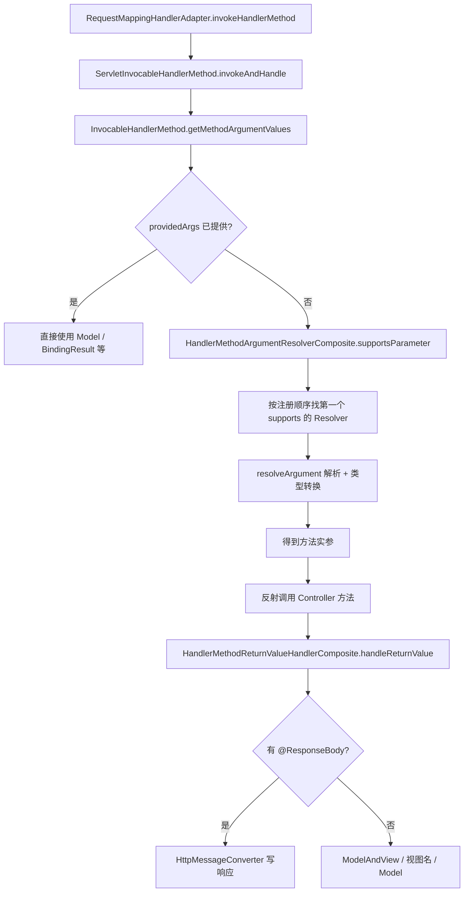
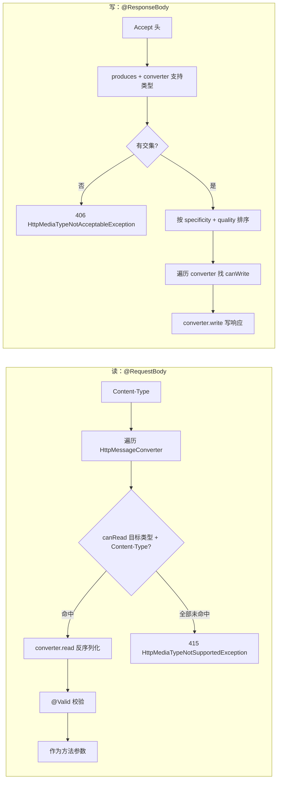
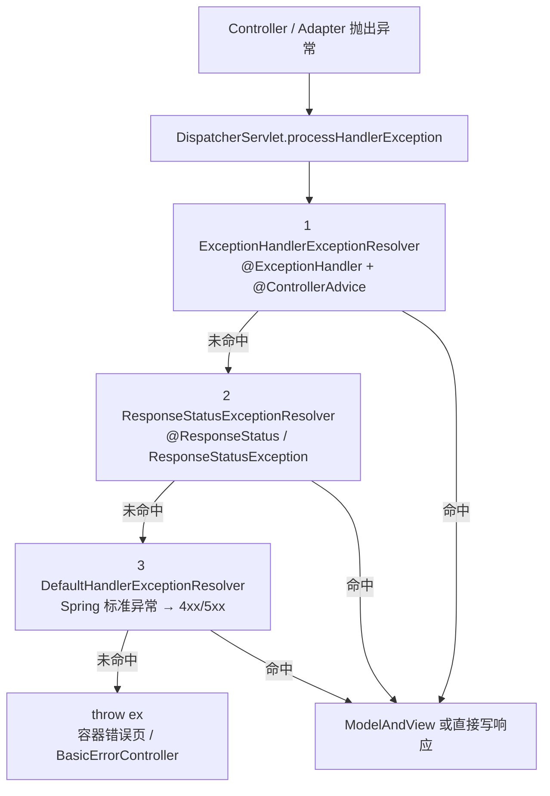

# Spring MVC 参数解析与返回值处理

> 定位：Controller 的方法签名可以千变万化——`@RequestParam`、`@PathVariable`、`@RequestBody`、`@ModelAttribute`、`BindingResult`、`ResponseEntity`——但 `DispatcherServlet` 只认识一个 `Object handler`。中间这层「翻译」就是参数解析器和返回值处理器。这一篇讲清：谁把你的 HTTP 请求变成方法参数、谁把返回值写回响应、415/406/参数名丢失/日期差 8 小时这些坑到底出在哪一环。

## 一、为什么需要这一层

先看几个每天都在发生的故障：

- 前端发 `application/json`，后端用 `@RequestParam("name")` 接，永远是 null——因为 Servlet 容器只对表单类型解析 `getParameter()`。
- 拦截器里打了一行「请求体日志」，Controller 的 `@RequestBody` 立刻报 `Required request body is missing`——输入流只能读一次。
- 给 DTO 字段加了 `@DateTimeFormat(pattern = "yyyy-MM-dd")`，JSON 入参依然报日期解析失败——这个注解管的是 MVC 绑定，不管 Jackson。
- `@Valid` 加了，校验不生效；或者 `BindingResult` 放错位置，直接 `IllegalStateException`。
- 全局 `@ControllerAdvice` 写了，Filter 里抛的异常依然返回 Tomcat 的 500 错误页。

这些问题的共同点：**你不知道参数是从哪个 Resolver、哪条转换链路来的**。

Spring MVC 的执行模型可以概括成一句话：

> **HandlerMapping 负责「找到方法」，HandlerAdapter 负责「调用方法」，而「怎么把请求变成参数、把返回值变成响应」由两组策略接口完成——`HandlerMethodArgumentResolver` 和 `HandlerMethodReturnValueHandler`。**

## 二、核心原理：HandlerMethod 与调用主流程

### 2.1 从 HandlerMethod 说起

`RequestMappingHandlerMapping` 找到的不是一个裸方法，而是 `HandlerMethod`：

```java
public class HandlerMethod {
    private final Object bean;                 // Controller 实例
    private final Class<?> beanType;           // Controller 类型
    private final Method method;               // 目标方法
    private final MethodParameter[] parameters;// 参数元信息（含注解、泛型、索引）
    // 还有 bridgeMethod、resolvedFromHandlerMethod 等字段，略
}
```

`HandlerMethod` 只是「描述」，真正可执行的是它的子类 `ServletInvocableHandlerMethod`：

```
HandlerMethod
  └─ InvocableHandlerMethod          // 负责参数解析 + 反射调用
      └─ ServletInvocableHandlerMethod  // 加上响应状态、返回值处理
```

`InvocableHandlerMethod` 持有两个组合器：

- `HandlerMethodArgumentResolverComposite`：参数解析器集合
- `HandlerMethodReturnValueHandlerComposite`：返回值处理器集合

它们都是「责任链 + 缓存」：按顺序找第一个 `supports` 的处理器，找到后缓存到 `ConcurrentHashMap`，同一个方法第二次请求不再遍历。

### 2.2 调用主流程

`RequestMappingHandlerAdapter.invokeHandlerMethod()` 是整个参数/返回值体系的总入口：

```java
protected ModelAndView invokeHandlerMethod(HttpServletRequest request,
        HttpServletResponse response, HandlerMethod handlerMethod) throws Exception {

    ServletWebRequest webRequest = new ServletWebRequest(request, response);
    try {
        // 1. 准备 DataBinder 工厂：收集 @InitBinder 方法
        WebDataBinderFactory binderFactory = getDataBinderFactory(handlerMethod);
        // 2. 准备 Model：执行 @ModelAttribute 方法、合并 SessionAttributes
        ModelFactory modelFactory = getModelFactory(handlerMethod, binderFactory);

        // 3. 把 HandlerMethod 包装成可执行对象，注入三大件
        ServletInvocableHandlerMethod invocableMethod = createInvocableHandlerMethod(handlerMethod);
        invocableMethod.setHandlerMethodArgumentResolvers(this.argumentResolvers);
        invocableMethod.setHandlerMethodReturnValueHandlers(this.returnValueHandlers);
        invocableMethod.setDataBinderFactory(binderFactory);
        invocableMethod.setParameterNameDiscoverer(this.parameterNameDiscoverer);

        ModelAndViewContainer mavContainer = new ModelAndViewContainer();
        mavContainer.addAllAttributes(RequestContextUtils.getInputFlashMap(request));
        modelFactory.initModel(webRequest, mavContainer, invocableMethod);
        mavContainer.setIgnoreDefaultModelOnRedirect(this.ignoreDefaultModelOnRedirect);

        // 4. 异步支持（DeferredResult / Callable）
        AsyncWebRequest asyncWebRequest = WebAsyncUtils.createAsyncWebRequest(request, response);
        asyncWebRequest.setTimeout(this.asyncRequestTimeout);
        WebAsyncManager asyncManager = WebAsyncUtils.getAsyncManager(request);
        asyncManager.setTaskExecutor(this.taskExecutor);
        asyncManager.setAsyncWebRequest(asyncWebRequest);

        // 5. 执行：参数解析 → 反射调用 → 返回值处理
        //    （省略 asyncManager.hasConcurrentResult() 时二次 dispatch 的分支）
        invocableMethod.invokeAndHandle(webRequest, mavContainer);
        if (asyncManager.isConcurrentHandlingStarted()) {
            return null;                       // 异步已启动，交给二次 dispatch
        }

        // 6. 把 mavContainer 转成 ModelAndView
        return getModelAndView(mavContainer, modelFactory, webRequest);
    }
    finally {
        webRequest.requestCompleted();
    }
}
```

`invokeAndHandle()` 内部只有三步：

```java
public void invokeAndHandle(ServletWebRequest webRequest, ModelAndViewContainer mavContainer,
        Object... providedArgs) throws Exception {

    // ① 解析参数并反射调用
    Object returnValue = invokeForRequest(webRequest, mavContainer, providedArgs);

    // ② 处理 @ResponseStatus
    setResponseStatus(webRequest);

    if (returnValue == null) {
        if (isRequestNotModified(webRequest) || getResponseStatus() != null
                || mavContainer.isRequestHandled()) {
            mavContainer.setRequestHandled(true);
            return;
        }
    }
    else if (StringUtils.hasText(getResponseStatusReason())) {
        mavContainer.setRequestHandled(true);
        return;
    }

    // ③ 交给返回值处理器
    mavContainer.setRequestHandled(false);
    this.returnValueHandlers.handleReturnValue(
            returnValue, getReturnValueType(returnValue), mavContainer, webRequest);
}
```

参数解析的入口在 `InvocableHandlerMethod.getMethodArgumentValues()`：

```java
protected Object[] getMethodArgumentValues(NativeWebRequest request,
        @Nullable ModelAndViewContainer mavContainer, Object... providedArgs) throws Exception {

    MethodParameter[] parameters = getMethodParameters();
    if (ObjectUtils.isEmpty(parameters)) {
        return EMPTY_ARGS;
    }

    Object[] args = new Object[parameters.length];
    for (int i = 0; i < parameters.length; i++) {
        MethodParameter parameter = parameters[i];
        parameter.initParameterNameDiscovery(this.parameterNameDiscoverer);

        // 有些参数由框架直接提供（比如 Model、BindingResult）
        args[i] = findProvidedArgument(parameter, providedArgs);
        if (args[i] != null) {
            continue;
        }

        // 没有 Resolver 支持 → 启动/运行期直接报错
        if (!this.resolvers.supportsParameter(parameter)) {
            throw new IllegalStateException(formatArgumentError(parameter, "No suitable resolver"));
        }

        try {
            // 责任链：找到第一个 supports 的 Resolver 并执行
            args[i] = this.resolvers.resolveArgument(parameter, mavContainer, request, this.dataBinderFactory);
        }
        catch (Exception ex) {
            throw ex;   // 交给 HandlerExceptionResolver 处理
        }
    }
    return args;
}
```

流程图如下。**重点看两个分叉：有注解走专用 Resolver，无注解走「兜底 Resolver」**——很多「参数莫名其妙绑定不上」的问题，就出在兜底规则上。



### 2.3 MethodParameter：泛型与参数名的载体

`MethodParameter` 封装了「第几个参数、什么类型、有什么注解、泛型是什么」。三个容易忽略的能力：

- **嵌套泛型**：`List<User>` 的 `Type` 是 `ParameterizedType`，只有 `GenericHttpMessageConverter` 能读；普通 `HttpMessageConverter.canRead(Class)` 只能看到原始类型 `List`，所以 `@RequestBody List<User>` 必须走泛型分支。
- **参数名发现**：`parameter.initParameterNameDiscovery(parameterNameDiscoverer)` 会从 `-parameters` 编译信息或 `@ConstructorProperties` 里找名字；找不到就退化成 `arg0`，这就是 `@RequestParam` 不写 value 时报错的根因。
- **Optional 拆包**：`parameter.nestedIfOptional()` 把 `Optional<T>` 拆成 `T` 再解析，所以 `@RequestParam Optional<String> name` 能正常工作，缺失时返回 `Optional.empty()`，而不是 400。

`HandlerMethodArgumentResolverComposite` 的缓存 key 就是 `MethodParameter`，它的 `equals/hashCode` 基于「方法 + 参数索引」，所以同一个方法的不同参数不会互相串。

## 三、HandlerMethodArgumentResolver

### 3.1 接口定义

```java
public interface HandlerMethodArgumentResolver {
    boolean supportsParameter(MethodParameter parameter);
    Object resolveArgument(MethodParameter parameter, @Nullable ModelAndViewContainer mavContainer,
            NativeWebRequest webRequest, @Nullable WebDataBinderFactory binderFactory) throws Exception;
}
```

两个方法：`supportsParameter` 判断「这个参数归不归我管」，`resolveArgument` 负责真正解析。`HandlerMethodArgumentResolverComposite` 维护一个 `List`，按顺序问过去，命中即返回，并缓存到 `Map<MethodParameter, HandlerMethodArgumentResolver>`。

### 3.2 内置 Resolver 全表

这张表建议收藏。**排查参数问题的第一步，就是确认你的参数被哪个 Resolver 接管了**：

| 参数形态 | Resolver | 数据来源 |
|---|---|---|
| `@RequestParam` | `RequestParamMethodArgumentResolver` | `request.getParameter()`（query / form） |
| `@RequestParam Map` | `RequestParamMapMethodArgumentResolver` | 所有请求参数 |
| `@PathVariable` | `PathVariableMethodArgumentResolver` | `HandlerMapping.URI_TEMPLATE_VARIABLES_ATTRIBUTE` |
| `@RequestBody` | `RequestResponseBodyMethodProcessor` | 请求体 + `HttpMessageConverter` |
| `@RequestHeader` | `RequestHeaderMethodArgumentResolver` | 请求头 |
| `@RequestHeader Map` | `RequestHeaderMapMethodArgumentResolver` | 所有请求头 |
| `@CookieValue` | `ServletCookieValueMethodArgumentResolver` | Cookie |
| `@ModelAttribute` | `ServletModelAttributeMethodProcessor` | 表单/query 数据绑定到对象 |
| `@RequestPart` | `RequestPartMethodArgumentResolver` | multipart 的 part |
| `@SessionAttribute` | `SessionAttributeMethodArgumentResolver` | Session 属性 |
| `@RequestAttribute` | `RequestAttributeMethodArgumentResolver` | Request 属性 |
| `@Value` | `ExpressionValueMethodArgumentResolver` | 配置项 / SpEL |
| `Errors` / `BindingResult` | `ErrorsMethodArgumentResolver` | 前一个参数的校验结果 |
| `HttpServletRequest` / `ServletResponse` / `InputStream` / `OutputStream` / `Principal` / `Locale` | `ServletRequestMethodArgumentResolver` / `ServletResponseMethodArgumentResolver` | 原生对象 |
| `HttpEntity` / `RequestEntity` | `HttpEntityMethodProcessor` | 请求头 + 请求体 |
| `Model` / `Map` | `ModelMethodProcessor` / `MapMethodProcessor` | 放入 Model |
| 无注解的简单类型（`String`、`int`、`Long`…） | `RequestParamMethodArgumentResolver`（兜底，`useDefaultResolution=true`） | 按参数名从 `getParameter()` 取 |
| 无注解的复杂类型（POJO） | `ServletModelAttributeMethodProcessor`（兜底，`annotationNotRequired=true`） | 数据绑定 |

最后两行是「兜底规则」，非常关键：

- **无注解的简单类型**，Spring 会当成 `@RequestParam` 处理，按**参数名**取值。这就是为什么 `public User get(Long id)` 不写注解也能工作——前提是编译时保留了参数名（`-parameters`）。
- **无注解的复杂类型**，Spring 会当成 `@ModelAttribute` 处理，走 `WebDataBinder` 数据绑定。所以 `public String save(User user)` 能从表单/query 自动填充 `user` 的字段，但**不能从 JSON body 填充**——JSON 必须显式 `@RequestBody`。

### 3.3 一个参数的完整解析过程

以 `@RequestParam` 为例，它继承 `AbstractNamedValueMethodArgumentResolver`，模板方法把「取名 → 取值 → 默认值 → 必填校验 → 类型转换」串起来：

```java
public final Object resolveArgument(MethodParameter parameter, @Nullable ModelAndViewContainer mavContainer,
        NativeWebRequest webRequest, @Nullable WebDataBinderFactory binderFactory) throws Exception {

    NamedValueInfo namedValueInfo = getNamedValueInfo(parameter);   // 解析注解上的 name/defaultValue/required

    // 1. 按名字取值（子类实现：getParameter / header / cookie / URI 变量）
    Object arg = resolveName(namedValueInfo.name, parameter, webRequest);

    // 2. 空值处理：默认值 → 必填校验 → 基本类型给默认值
    if (arg == null) {
        if (namedValueInfo.defaultValue != null) {
            arg = resolveEmbeddedValuesAndExpressions(namedValueInfo.defaultValue);
        }
        else if (namedValueInfo.required && !parameter.isOptional()) {
            handleMissingValue(namedValueInfo.name, parameter, webRequest);
            // 抛 MissingServletRequestParameterException → 400
        }
        arg = handleNullValue(namedValueInfo.name, arg, parameter.getParameterType());
    }

    // 3. 类型转换：String → int/Long/Enum/Date，走 ConversionService
    if (binderFactory != null) {
        WebDataBinder binder = binderFactory.createBinder(webRequest, null, namedValueInfo.name);
        arg = binder.convertIfNecessary(arg, parameter.getParameterType(), parameter);
    }
    return arg;
}
```

三个结论：

- `required=true`（默认）且参数缺失 → `MissingServletRequestParameterException`，最终 400。
- `defaultValue` 会在类型转换**之前**替换，所以 `@RequestParam(defaultValue = "1") int page` 是安全的。
- 类型转换失败（比如 `page=abc`）→ `MethodArgumentTypeMismatchException`，最终 400。

### 3.4 自定义 Resolver：统一注入当前登录用户

这是生产中最常见的自定义场景。目标：Controller 里直接写 `@CurrentUser LoginUser user`，不用每次从 `request.getAttribute` 取。

```java
@Target(ElementType.PARAMETER)
@Retention(RetentionPolicy.RUNTIME)
public @interface CurrentUser {
    boolean required() default true;
}
```

```java
public class CurrentUserArgumentResolver implements HandlerMethodArgumentResolver {

    @Override
    public boolean supportsParameter(MethodParameter parameter) {
        // 必须同时满足：有 @CurrentUser 注解 + 类型是 LoginUser
        return parameter.hasParameterAnnotation(CurrentUser.class)
                && LoginUser.class.isAssignableFrom(parameter.getParameterType());
    }

    @Override
    public Object resolveArgument(MethodParameter parameter, ModelAndViewContainer mavContainer,
            NativeWebRequest webRequest, WebDataBinderFactory binderFactory) {

        HttpServletRequest request = webRequest.getNativeRequest(HttpServletRequest.class);
        LoginUser user = (LoginUser) request.getAttribute(LoginUser.ATTR_KEY);

        boolean required = parameter.getParameterAnnotation(CurrentUser.class).required();
        if (user == null && required) {
            throw new UnauthorizedException("未登录");   // 交给全局异常处理器 → 401
        }
        return user;
    }
}
```

注册：

```java
@Configuration
public class WebConfig implements WebMvcConfigurer {

    @Override
    public void addArgumentResolvers(List<HandlerMethodArgumentResolver> resolvers) {
        resolvers.add(new CurrentUserArgumentResolver());
    }
}
```

顺序要注意：`addArgumentResolvers` 注册的自定义解析器，排在**所有注解解析器之后、两个兜底解析器之前**。所以：

- 你的 `@CurrentUser LoginUser` 不会被 `ServletModelAttributeMethodProcessor` 抢走（它只认 `@ModelAttribute`）。
- 如果你写一个「无注解 + 复杂类型」的自定义解析器，它会先于兜底的 `@ModelAttribute` 生效。
- 但如果你自定义的注解参数是简单类型，且内置的 `@RequestParam` 解析器不认你的注解，它也不会抢——`supportsParameter` 会检查具体注解。

## 四、HandlerMethodReturnValueHandler

### 4.1 接口与选择顺序

```java
public interface HandlerMethodReturnValueHandler {
    boolean supportsReturnType(MethodParameter returnType);
    void handleReturnValue(@Nullable Object returnValue, MethodParameter returnType,
            ModelAndViewContainer mavContainer, NativeWebRequest webRequest) throws Exception;
}
```

选择逻辑在 `HandlerMethodReturnValueHandlerComposite.selectHandler()`：

```java
private HandlerMethodReturnValueHandler selectHandler(@Nullable Object value, MethodParameter returnType) {
    boolean isAsyncValue = isAsyncReturnValue(value, returnType);
    for (HandlerMethodReturnValueHandler handler : this.returnValueHandlers) {
        // 异步返回值只匹配 AsyncHandlerMethodReturnValueHandler
        if (isAsyncValue && !(handler instanceof AsyncHandlerMethodReturnValueHandler)) {
            continue;
        }
        if (handler.supportsReturnType(returnType)) {
            return handler;
        }
    }
    return null;
}
```

### 4.2 内置处理器全表

| 返回值 | 处理器 | 行为 |
|---|---|---|
| `ModelAndView` | `ModelAndViewMethodReturnValueHandler` | 直接渲染 |
| `String` + `@ResponseBody` | `RequestResponseBodyMethodProcessor` | 交给 `StringHttpMessageConverter` 写字符串 |
| `String` 无 `@ResponseBody` | `ViewNameMethodReturnValueHandler` | 当成逻辑视图名 |
| `void` | `ViewNameMethodReturnValueHandler`（不写视图名） | 视图名为空，靠 `RequestToViewNameTranslator` 推导 |
| `ResponseEntity` / `HttpEntity` | `HttpEntityMethodProcessor` | 状态码 + 响应头 + 响应体 |
| `Map` / `Model` | `MapMethodProcessor` / `ModelMethodProcessor` | 放进 Model |
| `@ModelAttribute` 对象 | `ServletModelAttributeMethodProcessor` | 放进 Model |
| `Callable` | `CallableMethodReturnValueHandler` | 异步，交给 `WebAsyncManager` |
| `DeferredResult` | `DeferredResultMethodReturnValueHandler` | 异步，结果由其他线程设置 |
| `ResponseBodyEmitter` / `SseEmitter` | `ResponseBodyEmitterReturnValueHandler` | 流式 / SSE |
| `StreamingResponseBody` | `StreamingResponseBodyReturnValueHandler` | 流式写响应 |
| `HttpHeaders` | `HttpHeadersReturnValueHandler` | 只写响应头 |

几个容易混淆的点：

- **`String` 是「视图名」还是「响应体」，取决于 `@ResponseBody`**。`@RestController` 类上自带 `@ResponseBody`，返回 `String` 会走 `StringHttpMessageConverter`，和返回 DTO 走 Jackson 不是一条路；普通 `@Controller` 返回 `String` 则是视图名。
- **`void` 不是没返回值，而是「没有视图名」**。`mavContainer` 没被标记为已处理，`DispatcherServlet` 会用 `RequestToViewNameTranslator` 从 URL 推导视图名。
- **`ResponseEntity` 优先级高于 `@ResponseBody`**，因为它由 `HttpEntityMethodProcessor` 处理，`supportsReturnType` 直接判断类型，不依赖注解。

### 4.3 @ResponseBody 的完整处理

`RequestResponseBodyMethodProcessor` 同时实现了参数解析和返回值处理两个接口。返回值分支：

```java
@Override
public void handleReturnValue(@Nullable Object returnValue, MethodParameter returnType,
        ModelAndViewContainer mavContainer, NativeWebRequest webRequest) throws Exception {

    // ★ 关键：标记请求已处理，DispatcherServlet 不再渲染视图
    mavContainer.setRequestHandled(true);

    ServletServerHttpRequest inputMessage = createInputMessage(webRequest);
    ServletServerHttpResponse outputMessage = createOutputMessage(webRequest);

    // 即使 returnValue 为 null 也要走，ResponseBodyAdvice 可能想改状态码
    writeWithMessageConverters(returnValue, returnType, inputMessage, outputMessage);
}
```

`supportsReturnType` 的判断：

```java
@Override
public boolean supportsReturnType(MethodParameter returnType) {
    return (AnnotatedElementUtils.hasAnnotation(returnType.getContainingClass(), ResponseBody.class) ||
            returnType.hasMethodAnnotation(ResponseBody.class));
}
```

先看类上有没有 `@ResponseBody`（`@RestController` 包含它），再看方法上有没有。**所以类上标了 `@RestController`，方法上再标 `@ResponseBody` 是多余的**。

### 4.4 自定义返回值处理器：统一包装

如果不想用 `ResponseBodyAdvice`，也可以自己写处理器。比如定义一个 `@WrapResult` 注解，把返回值包成 `{"code":0,"data":...}`：

```java
public class WrapResultReturnValueHandler implements HandlerMethodReturnValueHandler {

    private final RequestResponseBodyMethodProcessor delegate;

    public WrapResultReturnValueHandler(List<HttpMessageConverter<?>> converters) {
        this.delegate = new RequestResponseBodyMethodProcessor(converters);
    }

    @Override
    public boolean supportsReturnType(MethodParameter returnType) {
        return returnType.hasMethodAnnotation(WrapResult.class);
    }

    @Override
    public void handleReturnValue(Object returnValue, MethodParameter returnType,
            ModelAndViewContainer mavContainer, NativeWebRequest webRequest) throws Exception {
        // 复用 @ResponseBody 的整套消息转换逻辑
        delegate.handleReturnValue(Result.ok(returnValue), returnType, mavContainer, webRequest);
    }
}
```

注册用 `WebMvcConfigurer.addReturnValueHandlers()`。不过大多数场景用 `ResponseBodyAdvice` 更轻：

```java
@RestControllerAdvice
public class ResultAdvice implements ResponseBodyAdvice<Object> {
    @Override
    public boolean supports(MethodParameter returnType, Class<? extends HttpMessageConverter<?>> converterType) {
        return true;
    }
    @Override
    public Object beforeBodyWrite(Object body, MethodParameter returnType, MediaType selectedContentType,
            Class<? extends HttpMessageConverter<?>> selectedConverterType,
            ServerHttpRequest request, ServerHttpResponse response) {
        return body instanceof Result ? body : Result.ok(body);
    }
}
```

注意 `ResponseBodyAdvice` 对 `String` 返回值有坑：如果 converter 是 `StringHttpMessageConverter`，你返回一个 `Result` 对象会 `ClassCastException`。要么排除 `String`，要么统一改 `produces`。

## 五、HttpMessageConverter

### 5.1 接口与内置实现

```java
public interface HttpMessageConverter<T> {
    boolean canRead(Class<?> clazz, @Nullable MediaType mediaType);
    boolean canWrite(Class<?> clazz, @Nullable MediaType mediaType);
    List<MediaType> getSupportedMediaTypes();
    T read(Class<? extends T> clazz, HttpInputMessage inputMessage) throws IOException, HttpMessageNotReadableException;
    void write(T t, @Nullable MediaType contentType, HttpOutputMessage outputMessage) throws IOException, HttpMessageNotWritableException;
}
```

内置转换器（顺序即优先级）：

| 转换器 | 支持的 MediaType | 处理类型 |
|---|---|---|
| `ByteArrayHttpMessageConverter` | `application/octet-stream`、`*/*` | `byte[]` |
| `StringHttpMessageConverter` | `text/plain`、`*/*` | `String` |
| `ResourceHttpMessageConverter` | `*/*` | `Resource` |
| `ResourceRegionHttpMessageConverter` | `*/*` | `ResourceRegion`（断点续传） |
| `AllEncompassingFormHttpMessageConverter` | `application/x-www-form-urlencoded`、`multipart/form-data` | `MultiValueMap` |
| `MappingJackson2HttpMessageConverter` | `application/json`、`application/*+json` | 任意对象 |
| `MappingJackson2XmlHttpMessageConverter` | `application/xml`、`text/xml` | 任意对象 |
| `Jaxb2RootElementHttpMessageConverter` | `application/xml`、`text/xml` | JAXB 注解类 |
| `ProtobufHttpMessageConverter` | `application/x-protobuf` | Protobuf `Message` |

顺序很重要：`String` 会先被 `StringHttpMessageConverter` 接住，`byte[]` 会先被 `ByteArrayHttpMessageConverter` 接住。**如果你自定义的 converter 想处理 `String`，必须排在它们前面**（用 `extendMessageConverters` 往列表头插，而不是 `add` 到尾部）。

### 5.2 读：@RequestBody 怎么选转换器

`RequestResponseBodyMethodProcessor.readWithMessageConverters()` 的核心逻辑：

```java
@SuppressWarnings("unchecked")
protected <T> Object readWithMessageConverters(NativeWebRequest webRequest, MethodParameter parameter,
        Type paramType) throws IOException, HttpMediaTypeNotSupportedException, HttpMessageNotReadableException {

    ServletServerHttpRequest inputMessage = createInputMessage(webRequest);
    MediaType contentType = inputMessage.getHeaders().getContentType();
    Class<?> contextClass = parameter.getContainingClass();
    Class<T> targetClass = (paramType instanceof Class<?> clazz ? (Class<T>) clazz : null);
    Object body = NO_VALUE;

    EmptyBodyCheckingHttpInputMessage message = new EmptyBodyCheckingHttpInputMessage(inputMessage);

    for (HttpMessageConverter<?> converter : this.messageConverters) {
        // 泛型类型（如 List<User>）必须用 GenericHttpMessageConverter
        GenericHttpMessageConverter<?> genericConverter =
                (converter instanceof GenericHttpMessageConverter<?> ghmc ? ghmc : null);

        boolean canRead = (genericConverter != null
                ? genericConverter.canRead(paramType, contextClass, contentType)
                : (targetClass != null && converter.canRead(targetClass, contentType)));

        if (canRead) {
            if (message.hasBody()) {
                body = (genericConverter != null
                        ? genericConverter.read(paramType, contextClass, message)
                        : ((HttpMessageConverter<T>) converter).read(targetClass, message));
            }
            else {
                body = null;
            }
            break;                       // 第一个命中即用，后面的不再尝试
        }
    }

    if (body == NO_VALUE) {
        // 没有转换器能读 → 415
        throw new HttpMediaTypeNotSupportedException(contentType,
                getSupportedMediaTypes(targetClass != null ? targetClass : Object.class));
    }
    return body;
}
```

读的链路只有一句话：**`Content-Type` + 目标类型 → 遍历 converter → 第一个 `canRead` 为 true 的执行 `read`**。

所以：

- `Content-Type: application/json` + POJO → Jackson 命中。
- `Content-Type: application/x-www-form-urlencoded` + POJO → Jackson 不认，`FormHttpMessageConverter` 只认 `MultiValueMap` → **415**。
- `Content-Type: text/plain` + POJO → 所有 converter 都不认 → **415**。
- 没有 `Content-Type` + POJO → Jackson 的 `canRead` 对 null mediaType 返回 true，能读；但行为依赖版本，别赌。
- 请求体为空且 `@RequestBody(required = true)` → **400** `HttpMessageNotReadableException`，不是 415——415 只针对「有 body 但没有 converter 能读」。

### 5.3 写：@ResponseBody 怎么做内容协商

`writeWithMessageConverters()` 比读复杂，因为要处理 `Accept` 头、`produces`、通配符：

```java
@SuppressWarnings("unchecked")
protected <T> void writeWithMessageConverters(@Nullable T value, MethodParameter returnType,
        ServletServerHttpRequest inputMessage, ServletServerHttpResponse outputMessage)
        throws IOException, HttpMediaTypeNotAcceptableException, HttpMessageNotWritableException {

    Object body;
    Class<?> valueType;
    Type targetType;

    if (value instanceof CharSequence) {
        body = value.toString();
        valueType = String.class;
        targetType = String.class;
    }
    else {
        body = value;
        valueType = getReturnValueType(body, returnType);
        targetType = GenericTypeResolver.resolveType(getGenericType(returnType), returnType.getContainingClass());
    }

    // 1. 客户端能接受什么（Accept 头）
    List<MediaType> acceptableTypes = getAcceptableMediaTypes(inputMessage.getServletRequest());
    // 2. 服务端能生产什么（produces + converter 支持的类型）
    List<MediaType> producibleTypes = getProducibleMediaTypes(inputMessage.getServletRequest(), valueType, targetType);

    // 3. 求交集
    List<MediaType> mediaTypesToUse = new ArrayList<>();
    for (MediaType acceptableType : acceptableTypes) {
        for (MediaType producibleType : producibleTypes) {
            if (acceptableType.isCompatibleWith(producibleType)) {
                mediaTypesToUse.add(getMostSpecificMediaType(acceptableType, producibleType));
            }
        }
    }
    if (mediaTypesToUse.isEmpty()) {
        if (body != null) {
            throw new HttpMediaTypeNotAcceptableException(producibleTypes);   // 406
        }
        return;
    }
    MediaType.sortBySpecificityAndQuality(mediaTypesToUse);

    // 4. 选出具体 MediaType，再找第一个能写的 converter
    MediaType selectedMediaType = null;
    for (MediaType mediaType : mediaTypesToUse) {
        if (mediaType.isConcrete()) {
            selectedMediaType = mediaType.removeQualityValue();
            break;
        }
    }
    if (selectedMediaType != null) {
        for (HttpMessageConverter<?> converter : this.messageConverters) {
            if (converter.canWrite(valueType, selectedMediaType)) {
                ((HttpMessageConverter<Object>) converter).write(body, selectedMediaType, outputMessage);
                return;
            }
        }
    }
    if (body != null) {
        throw new HttpMediaTypeNotAcceptableException(getSupportedMediaTypes(valueType));   // 406
    }
}
```

下面这张图把「读」和「写」两条链路放在一起。**注意 415 和 406 的分界：415 是请求体读不了，406 是响应体写不出去**。



### 5.4 MappingJackson2HttpMessageConverter 的定制点

这个类是最常用的，定制方式有三种，作用范围从小到大：

| 方式 | 作用范围 | 示例 |
|---|---|---|
| 字段注解 | 单个字段 | `@JsonFormat`、`@JsonSerialize`、`@JsonIgnore` |
| `Jackson2ObjectMapperBuilderCustomizer` | 全局 `ObjectMapper` | 日期格式、时区、Long 转 String、忽略未知字段 |
| 自定义 `HttpMessageConverter` | 单个 converter | 换 Fastjson、加自定义序列化器 |

全局定制示例：

```java
@Configuration
public class JacksonConfig {

    @Bean
    public Jackson2ObjectMapperBuilderCustomizer jacksonCustomizer() {
        return builder -> builder
                // 日期统一格式 + 时区
                .simpleDateFormat("yyyy-MM-dd HH:mm:ss")
                .timeZone(TimeZone.getTimeZone("GMT+8"))
                // 忽略 JSON 里多出来的字段，避免前端加字段就 400
                .failOnUnknownProperties(false)
                // Long 转字符串，防止 JS 精度丢失
                .serializerByType(Long.class, ToStringSerializer.instance)
                .serializerByType(Long.TYPE, ToStringSerializer.instance);
    }
}
```

注意 `serializerByType(Long.class, ...)` 对包装类型生效，`Long.TYPE` 对基本类型 `long` 生效，两个都要写。

### 5.5 自定义 Converter：统一日期格式

如果不想动全局 Jackson，也可以只加一个 converter 处理特定类型。但更常见的做法是自定义 `HttpMessageConverter` 替换 Jackson，比如接 Fastjson2：

```java
@Configuration
public class FastJsonConfig implements WebMvcConfigurer {

    @Override
    public void extendMessageConverters(List<HttpMessageConverter<?>> converters) {
        FastJsonHttpMessageConverter converter = new FastJsonHttpMessageConverter();
        converter.setSupportedMediaTypes(List.of(MediaType.APPLICATION_JSON));
        // 放到最前面，覆盖默认 Jackson
        converters.add(0, converter);
    }
}
```

`extendMessageConverters` 是在默认 converter 列表已经构建好之后回调，**`add(0, ...)` 才能覆盖 Jackson**；用 `configureMessageConverters` 则是「清空默认列表，完全自己配」，两者语义不同。

### 5.6 Jackson 与 Fastjson 怎么选

| 维度 | Jackson | Fastjson 1.x | Fastjson2 |
|---|---|---|---|
| 性能 | 中等，稳定 | 曾以快著称 | 接近或超过 Jackson |
| 安全 | 稳定，CVE 少 | 多次 autoType 反序列化漏洞 | 重构，默认关闭 autoType |
| Spring 集成 | 原生，Boot 默认 | 需自定义 Converter | 需自定义 Converter |
| 生态 | 最广，注解丰富 | 国内使用多 | 迁移中 |
| 建议 | 新项目首选 | 不建议新用 | 老项目升级可选 |

选型结论：**新项目用 Jackson，别为了性能数字换 Fastjson**；历史项目如果还在 Fastjson 1.x，至少升级到 Fastjson2 并确认 `autoType` 关闭，否则一个恶意 JSON 就能 RCE。

## 六、数据绑定与校验

### 6.1 WebDataBinder 的角色

`@ModelAttribute`、无注解 POJO、`@RequestParam` 的类型转换，底层都走 `WebDataBinder`。它的继承链：

```
DataBinder
  └─ WebDataBinder
      └─ ServletRequestDataBinder
          └─ ExtendedServletRequestDataBinder
```

- `WebDataBinder`：字段绑定、类型转换、校验、`BindingResult`。
- `ServletRequestDataBinder`：从 `ServletRequest` 的 parameters 构造 `MutablePropertyValues`。
- `ExtendedServletRequestDataBinder`：额外把 URI 模板变量合并进绑定源，用于 `@ModelAttribute` + `@PathVariable` 同时出现的场景。

`bind()` 的核心：

```java
public void bind(ServletRequest request) {
    // 1. 把 request parameter 转成 PropertyValues
    MutablePropertyValues mpvs = new ServletRequestParameterPropertyValues(request);

    // 2. 文件上传的 part 也合并进来
    MultipartRequest multipartRequest = WebUtils.getNativeRequest(request, MultipartRequest.class);
    if (multipartRequest != null) {
        bindMultipart(multipartRequest.getMultiFileMap(), mpvs);
    }

    // 3. 子类扩展（ExtendedServletRequestDataBinder 在这里合并 URI 变量）
    addBindValues(mpvs, request);

    // 4. 真正绑定：字段校验 → 属性赋值 → 类型转换
    doBind(mpvs);
}
```

### 6.2 @InitBinder

`@InitBinder` 用来定制某个 Controller（或全局）的 `WebDataBinder`：

```java
@InitBinder
public void initBinder(WebDataBinder binder) {
    // 日期格式
    binder.registerCustomEditor(Date.class,
            new CustomDateEditor(new SimpleDateFormat("yyyy-MM-dd"), true));
    // 禁止绑定敏感字段，防参数覆盖（mass assignment）
    binder.setDisallowedFields("id", "createTime", "ownerId");
}
```

执行顺序：**全局 `@ControllerAdvice` 里的 `@InitBinder` 先执行，当前 Controller 里的后执行**。后者可以覆盖前者的设置。

`setDisallowedFields` 是安全要点：如果直接拿实体接参，攻击者可以传 `id=1` 把别人的记录改掉。**接参一律用 DTO，别用实体**，这是比 `setDisallowedFields` 更彻底的方案。

### 6.3 Converter / Formatter / @DateTimeFormat

Spring 的类型转换有三层：

| 接口 | 作用 | 示例 |
|---|---|---|
| `Converter<S, T>` | 一对一转换 | `String → Enum`、`String → IP` |
| `ConverterFactory<S, R>` | 一对多转换 | `String → 所有 Enum 子类` |
| `GenericConverter` | 多对多，能拿到类型上下文 | 集合、泛型转换 |
| `Formatter<T>` | 带 Locale 的格式化/解析 | 日期、金额 |

注册：

```java
@Configuration
public class ConverterConfig implements WebMvcConfigurer {
    @Override
    public void addFormatters(FormatterRegistry registry) {
        registry.addConverter(new StringToStatusConverter());
    }
}
```

`@DateTimeFormat` 是 `Formatter` 体系的注解，由 `DateTimeFormatAnnotationFormatterFactory` 处理，**只对 MVC 数据绑定生效**（query、form、`@ModelAttribute`、`@RequestParam`），对 `@RequestBody` 的 JSON 反序列化无效。JSON 要用 `@JsonFormat`。

三套日期配置各管一段，别混：

| 配置 | 作用范围 | 示例 |
|---|---|---|
| `@DateTimeFormat` | query / form / `@ModelAttribute` | `@DateTimeFormat(pattern = "yyyy-MM-dd")` |
| `@JsonFormat` | JSON body 序列化/反序列化 | `@JsonFormat(pattern = "yyyy-MM-dd HH:mm:ss", timezone = "GMT+8")` |
| `spring.mvc.format.date-time` | 全局 MVC 绑定 | `iso` / `yyyy-MM-dd` |
| `spring.jackson.date-format` + `time-zone` | 全局 Jackson | `yyyy-MM-dd HH:mm:ss` / `GMT+8` |

> 注意：`spring.jackson.date-format` 主要作用于 `java.util.Date`；`LocalDateTime` 默认按 ISO-8601 输出（`2024-01-01T12:00:00`），要自定义格式仍得用 `@JsonFormat` 或注册 `JavaTimeModule` 的序列化器。

### 6.4 校验：@Valid 与 BindingResult

`@Valid` 触发 `WebDataBinder.validate()`，底层是 `LocalValidatorFactoryBean`（JSR-380 实现）：

```java
public void validate(Object... validationHints) {
    Object target = getTarget();
    BindingResult bindingResult = getBindingResult();
    for (Validator validator : getValidators()) {
        if (!ObjectUtils.isEmpty(validationHints) && validator instanceof SmartValidator smartValidator) {
            smartValidator.validate(target, bindingResult, validationHints);   // 分组校验
        }
        else {
            validator.validate(target, bindingResult);
        }
    }
}
```

`BindingResult` 必须**紧跟**在 `@ModelAttribute` / `@Valid` 参数后面：

```java
@PostMapping("/users")
public Result create(@Valid @RequestBody UserDTO dto, BindingResult result) {  // ✗ 报错
    return null;   // 走不到这里，参数解析阶段就抛 IllegalStateException
}
```

`@RequestBody` 不能配 `BindingResult`——请求体是一次性读取的，校验失败只能抛 `MethodArgumentNotValidException`，由全局异常处理器统一转 400。正确写法：

```java
@PostMapping("/users")
public Result create(@Valid @RequestBody UserDTO dto) {
    // 校验失败会抛 MethodArgumentNotValidException
    return Result.ok(userService.create(dto));
}
```

表单/`@ModelAttribute` 才可以这样：

```java
@PostMapping("/users")
public String create(@Valid @ModelAttribute UserForm form, BindingResult result, Model model) {
    if (result.hasErrors()) {
        return "user/form";   // 回显错误
    }
    userService.create(form);
    return "redirect:/users";
}
```

`@Valid` 与 `@Validated` 的区别：

| 对比项 | `@Valid` | `@Validated` |
|---|---|---|
| 来源 | Jakarta Bean Validation | Spring |
| 分组 | 不支持 | 支持 `groups` |
| 典型位置 | 方法参数、字段 | 类、方法、参数 |
| 触发方式 | `@RequestBody` / `@ModelAttribute` 参数校验 | 类级别方法校验（`MethodValidationPostProcessor`） |
| 失败异常 | `MethodArgumentNotValidException` / `BindException` | `ConstraintViolationException`（6.1 前）/ `HandlerMethodValidationException`（6.1+） |

Spring 6.1 起，Controller 方法参数上的约束（`@RequestParam @Min(1) int page`）有内建校验，不再必须给类加 `@Validated`；6.1 之前需要类上加 `@Validated` 并依赖 `MethodValidationPostProcessor`。以你的版本为准。

## 七、异常处理三级

### 7.1 三级漏斗

`DispatcherServlet.processHandlerException()` 按顺序遍历 `HandlerExceptionResolver`，第一个返回非 null 的就短路：



三者的分工：

| 解析器 | 处理什么 | 典型输出 |
|---|---|---|
| `ExceptionHandlerExceptionResolver` | `@ExceptionHandler` 方法、`@ControllerAdvice` | 自定义 JSON / 错误页 |
| `ResponseStatusExceptionResolver` | 异常类上的 `@ResponseStatus`、`ResponseStatusException` | 指定 HTTP 状态码 |
| `DefaultHandlerExceptionResolver` | Spring MVC 标准异常 | 400 / 404 / 405 / 406 / 415 / 500 |

Spring Boot 下这三个被包进 `HandlerExceptionResolverComposite`，作为单个 Bean 注册，所以 `processHandlerException` 看到的是一个 composite，内部再按顺序问三个。

### 7.2 @ExceptionHandler 的匹配规则

`ExceptionHandlerExceptionResolver.getExceptionHandlerMethod()` 的查找顺序：

1. **当前 Controller 的 `@ExceptionHandler`**（局部优先）。
2. **`@ControllerAdvice` 里的 `@ExceptionHandler`**（按 `@Order` 排序，`ControllerAdviceBean` 实现 `Ordered`）。

```java
protected ServletInvocableHandlerMethod getExceptionHandlerMethod(
        @Nullable HandlerMethod handlerMethod, Exception exception) {

    Class<?> handlerType = null;
    if (handlerMethod != null) {
        handlerType = handlerMethod.getBeanType();
        // 1. 先找当前 Controller 自己的 @ExceptionHandler
        ExceptionHandlerMethodResolver resolver = this.exceptionHandlerCache.get(handlerType);
        if (resolver == null) {
            resolver = new ExceptionHandlerMethodResolver(handlerType);
            this.exceptionHandlerCache.put(handlerType, resolver);
        }
        Method method = resolver.resolveMethod(exception);
        if (method != null) {
            return new ServletInvocableHandlerMethod(handlerMethod.getBean(), method, this.applicationContext);
        }
    }

    // 2. 再找 @ControllerAdvice
    for (Map.Entry<ControllerAdviceBean, ExceptionHandlerMethodResolver> entry : this.exceptionHandlerAdviceCache.entrySet()) {
        ControllerAdviceBean advice = entry.getKey();
        if (advice.isApplicableToBeanType(handlerType)) {
            Method method = entry.getValue().resolveMethod(exception);
            if (method != null) {
                return new ServletInvocableHandlerMethod(advice.resolveBean(), method, this.applicationContext);
            }
        }
    }
    return null;
}
```

匹配「最具体」的异常靠 `ExceptionDepthComparator`：从异常类往上找父类，**层级越浅越优先**。比如同时有 `@ExceptionHandler(Exception.class)` 和 `@ExceptionHandler(BusinessException.class)`，抛 `BusinessException` 时命中后者。如果当前异常没有匹配，还会沿着 `getCause()` 继续找。

### 7.3 统一异常处理器

```java
@RestControllerAdvice
public class GlobalExceptionHandler {

    @ExceptionHandler(BusinessException.class)
    @ResponseStatus(HttpStatus.BAD_REQUEST)
    public Result handleBusiness(BusinessException ex) {
        return Result.fail(ex.getCode(), ex.getMessage());
    }

    @ExceptionHandler(MethodArgumentNotValidException.class)
    public ResponseEntity<Result> handleValid(MethodArgumentNotValidException ex) {
        String msg = ex.getBindingResult().getFieldErrors().stream()
                .map(e -> e.getField() + ": " + e.getDefaultMessage())
                .collect(Collectors.joining("; "));
        return ResponseEntity.badRequest().body(Result.fail(400, msg));
    }

    @ExceptionHandler(Exception.class)
    public ResponseEntity<Result> handleUnknown(Exception ex) {
        log.error("unhandled exception", ex);
        return ResponseEntity.status(HttpStatus.INTERNAL_SERVER_ERROR)
                .body(Result.fail(500, "系统繁忙"));
    }
}
```

`@RestControllerAdvice` = `@ControllerAdvice` + `@ResponseBody`，返回值直接走消息转换器。如果只想对某些包生效，加 `basePackages = "com.example.api"`。

### 7.4 @ResponseStatus 的两种用法

```java
// 用法一：标在异常类上 → ResponseStatusExceptionResolver 处理
@ResponseStatus(HttpStatus.NOT_FOUND)
public class UserNotFoundException extends RuntimeException {
    public UserNotFoundException(Long id) {
        super("user not found: " + id);
    }
}

// 用法二：标在 @ExceptionHandler 方法上 → ServletInvocableHandlerMethod 直接 setStatus
@ExceptionHandler(UserNotFoundException.class)
@ResponseStatus(HttpStatus.NOT_FOUND)
public Result handleNotFound(UserNotFoundException ex) {
    return Result.fail(404, ex.getMessage());
}
```

用法二优先于用法一：只要 `@ExceptionHandler` 命中了，`ResponseStatusExceptionResolver` 就没机会执行。

## 八、生产坑点与排查

### 坑点 1：@RequestBody 只能读一次

**现象**：加了一个打印请求体的 Filter/Interceptor 后，Controller 报 `HttpMessageNotReadableException: Required request body is missing`。

**原因**：`ServletServerHttpRequest.getBody()` 返回 `request.getInputStream()`，Servlet 输入流是**一次性**的。上游读完后，下游 `@RequestBody` 读到的是空流。

**解法**：

- 不要在 Filter/Interceptor 里直接读 body。
- 必须读，就用自定义 `HttpServletRequestWrapper` 缓存字节，每次 `getInputStream()` 返回新的 `ByteArrayInputStream`。
- `ContentCachingRequestWrapper` 只能「缓存已经被读过的内容」，不能让你重复读；它适合在 `chain.doFilter` 之后拿缓存做日志，不适合在之前读。
- 或者 Controller 用 `@RequestBody String raw` / `byte[]` 接，自己用 `ObjectMapper` 解析，只读一次。

### 坑点 2：@RequestParam 和 @RequestBody 混用，参数永远是 null

**现象**：`POST` 接口，前端 `Content-Type: application/json`，body 里有 `name`，后端 `@RequestParam String name` 拿到 null。

**原因**：Servlet 容器只对 `application/x-www-form-urlencoded` 和 `multipart/form-data` 解析 body 到 parameter map。`application/json` 的 body 不解析，`getParameter("name")` 只能拿到 URL query 上的值。

**解法**：

- 统一用 DTO + `@RequestBody` 接 JSON。
- 如果确实要 query + body 混合，`@RequestParam` 只从 query 取，前端要把参数拼在 URL 上；接口文档要写清楚。
- 不要指望 `@RequestParam` 能读 JSON 字段，这是协议层限制，不是 Spring 的 bug。

### 坑点 3：Content-Type 不匹配导致 415

**现象**：接口报 `415 Unsupported Media Type`，日志里 `HttpMediaTypeNotSupportedException: Content type 'text/plain;charset=UTF-8' not supported`。

**原因**：`@RequestBody UserDTO` 需要 JSON converter，但请求头是 `text/plain`，没有 converter 能读。

**解法**：

- 前端改 `Content-Type: application/json`。
- 后端显式声明 `@PostMapping(value = "/users", consumes = MediaType.APPLICATION_JSON_VALUE)`，让错误更早暴露。
- 如果是表单提交，别用 `@RequestBody`，用 `@ModelAttribute` 或 `@RequestParam`。
- 排查时先看请求头，再看 `consumes`，最后看 converter 列表。

顺便区分 415 和 406：

| 状态码 | 含义 | 触发点 |
|---|---|---|
| 415 | 请求体的 `Content-Type` 服务端读不了 | `readWithMessageConverters` |
| 406 | 客户端 `Accept` 服务端生产不了 | `writeWithMessageConverters` |

### 坑点 4：参数名丢失，启动或请求时报错

**现象**：`@RequestParam String userName` 报 `IllegalArgumentException: Name for argument of type [java.lang.String] not specified`，或者 `@PathVariable` 取不到值。

**原因**：Java 编译默认不保留参数名，Spring 拿不到 `userName` 这个名字。Spring Boot 的 Maven/Gradle 插件默认加 `-parameters`，但 IDEA 直接编译、或老项目手动配 `maven-compiler-plugin` 时可能没有。

**解法**：

- 显式写 `@RequestParam("userName")`、`@PathVariable("id")`，最稳。
- 编译加 `-parameters`：`<compilerArgs><arg>-parameters</arg></compilerArgs>`。
- 排查：`javap -v` 看 `MethodParameters` 属性是否存在。

### 坑点 5：全局异常处理器捕获不到 Filter 层异常

**现象**：Filter 里抛 `UnauthorizedException`，`@RestControllerAdvice` 完全没反应，客户端收到 Tomcat 的 HTML 500。

**原因**：`@ControllerAdvice` 由 `DispatcherServlet.processHandlerException` 调用，而 Filter 在 `DispatcherServlet` **之前**执行，异常根本没进 MVC 的异常解析链路。

**解法**：

- Filter 内 `try-catch`，自己写 JSON 响应。
- 或者注入 `HandlerExceptionResolver`（`@Qualifier("handlerExceptionResolver")`），在 catch 里手动调 `resolveException(request, response, null, ex)`，复用全局处理器。
- 或者 `response.sendError(500)`，交给容器的 `/error` → `BasicErrorController`。
- 最外层再兜一个 `ErrorController`，保证任何漏网异常都有统一结构。

### 坑点 6：日期格式三套配置用错地方

**现象**：DTO 字段加了 `@DateTimeFormat(pattern = "yyyy-MM-dd")`，JSON 入参还是报 `Cannot deserialize value of type java.util.Date`；或者出参时间差 8 小时。

**原因**：`@DateTimeFormat` 属于 Spring 的 `Formatter` 体系，只作用于 MVC 数据绑定；`@RequestBody` 走 Jackson，不认这个注解。时区问题则是 Jackson 默认用 UTC。

**解法**：

| 场景 | 用什么 |
|---|---|
| query / form 入参 | `@DateTimeFormat` |
| JSON 入参/出参 | `@JsonFormat(pattern = "...", timezone = "GMT+8")` |
| 全局 Jackson | `spring.jackson.date-format` + `spring.jackson.time-zone=GMT+8` |
| 全局 MVC 绑定 | `spring.mvc.format.date-time` |

排查顺序：先确认参数是 query 还是 body，再确认走的是 `Formatter` 还是 Jackson，最后看时区。

### 坑点 7：required=false 配基本类型，缺失时反而 500

**现象**：`@RequestParam(required = false) int page`，不传 `page` 时接口 500，日志是 `IllegalStateException: Optional int parameter 'page' is present but cannot be translated into a null value`。

**原因**：`AbstractNamedValueMethodArgumentResolver.handleNullValue` 对基本类型无法赋 null，只能抛异常。`required=false` 只表示「允许缺失」，不表示「基本类型能给 null」。

**解法**：改用包装类型 `Integer`，或直接 `@RequestParam(defaultValue = "1") int page`。`Optional<Integer>` 也可以，但 REST 接口用 `defaultValue` 更直观。

## 九、最佳实践

1. **接参一律用 DTO，不用实体**：避免 `id`、`ownerId` 被参数覆盖（mass assignment），也避免暴露持久化字段。
2. **JSON 接口统一 `@RequestBody` + `@Valid`**，校验失败交给 `@RestControllerAdvice` 转 400，别在 Controller 里写 `if (name == null)`。
3. **query 参数显式写名字**：`@RequestParam("page")`，不要赌编译参数名。
4. **日期分两套**：query 用 `@DateTimeFormat`，body 用 `@JsonFormat`；全局时区统一 `GMT+8`。
5. **Long 主键出参转 String**：JS 的 `Number` 最大安全整数是 `2^53-1`，雪花 ID 直接返回会精度丢失。
6. **自定义 Resolver 只做横切参数**：当前用户、租户、分页、签名校验；业务参数不要塞进 Resolver。
7. **统一响应包装用 `ResponseBodyAdvice`**，别在每个 Controller 手动 `Result.ok()`；注意 `String` 返回值的类型转换坑。
8. **异常分层**：业务异常继承 `BusinessException`，全局处理器按类型映射状态码；未知异常统一 500 并打日志，不要把堆栈返回给客户端。
9. **Filter 异常单独兜底**：`@ControllerAdvice` 管不到 Filter，最外层要有 `ErrorController` 或 Filter 内 try-catch。

## 十、面试高频问法

> 同样按「一句话结论 + 展开 + 加分点」写。参数/返回值这块的面试题很爱追问「源码里是哪个类」，答得出类名就是区分度。

**Q1：@RequestParam、@PathVariable、@RequestBody 有什么区别？**

**一句话结论**：`@RequestParam` 取 query/form 参数，`@PathVariable` 取 URI 模板变量，`@RequestBody` 用消息转换器读整个请求体。

展开：

| 注解 | 数据来源 | 底层 |
|---|---|---|
| `@RequestParam` | `request.getParameter()` | `RequestParamMethodArgumentResolver` |
| `@PathVariable` | URI 模板变量 attribute | `PathVariableMethodArgumentResolver` |
| `@RequestBody` | 请求体输入流 | `RequestResponseBodyMethodProcessor` + `HttpMessageConverter` |

关键差异：`@RequestParam` 依赖 Servlet 的参数解析（只解析 form 类型 body），`@RequestBody` 走 Spring 的消息转换器（能读 JSON/XML）。所以 JSON body 里的字段用 `@RequestParam` 永远取不到。

加分点：补一句「`@RequestBody` 只能读一次流，`@RequestParam` 可以重复取，因为参数已经被容器解析成 map 了」——把协议层和实现层串起来。

**Q2：Spring MVC 是怎么把请求参数绑定到方法参数上的？**

**一句话结论**：`InvocableHandlerMethod` 遍历 `MethodParameter`，用 `HandlerMethodArgumentResolverComposite` 找到第一个 `supports` 的 Resolver，调 `resolveArgument` 完成取值和类型转换。

展开：

1. `RequestMappingHandlerAdapter.invokeHandlerMethod` 准备好 `argumentResolvers`、`binderFactory`。
2. `getMethodArgumentValues` 逐个参数处理，先看 `providedArgs` 是否已提供（Model、BindingResult）。
3. 没有则 `supportsParameter` 找 Resolver，命中后缓存到 `ConcurrentHashMap`。
4. `resolveArgument` 内部完成「取名 → 取值 → 默认值 → 必填校验 → 类型转换」。
5. 全部解析完，反射调用目标方法。

加分点：说一句「Resolver 的匹配结果会按 `MethodParameter` 缓存，所以同一个接口第二次请求不会重复遍历责任链」——体现对性能细节的了解。

**Q3：@RequestBody 为什么只能读一次？怎么解决？**

**一句话结论**：它底层是 `request.getInputStream()`，Servlet 输入流是一次性的；上游读完后下游就是空流。

展开：

- `ServletServerHttpRequest.getBody()` 直接返回 `getInputStream()`。
- Filter/Interceptor 里读 body 做日志，Controller 的 `@RequestBody` 就报 `Required request body is missing`。
- `ContentCachingRequestWrapper` 只缓存「已被下游读过的内容」，不能凭空重放。
- 解法：自定义 `HttpServletRequestWrapper` 在第一次读时把字节缓存到 `byte[]`，后续每次 `getInputStream()` 返回新的 `ByteArrayInputStream`；或 Controller 用 `String`/`byte[]` 接参自己解析。

加分点：补一句「这也是为什么网关/日志组件喜欢在 Filter 里包一层可重复读的 wrapper，而不是直接读流」——把框架知识和工程实践连起来。

**Q4：HttpMessageConverter 是怎么选中的？**

**一句话结论**：读看 `Content-Type` + 目标类型，写看 `Accept` + `produces`，都是遍历 converter 找第一个 `canRead` / `canWrite` 为 true 的。

展开：

- 读：`readWithMessageConverters` 拿 `Content-Type`，遍历 `messageConverters`，`canRead(targetType, contentType)` 命中就 `read`。
- 写：`writeWithMessageConverters` 拿 `Accept` 和 `produces` 求交集，按 specificity + quality 排序，再遍历 converter 找 `canWrite`。
- 读不到 → 415；写不出 → 406。
- 顺序即优先级，自定义 converter 要覆盖默认实现必须 `add(0, ...)`。

加分点：说一句「`String` 会被 `StringHttpMessageConverter` 优先接住，所以想让自定义 converter 处理 String 必须插到列表头」——这是实际改 converter 时最容易踩的坑。

**Q5：415 和 406 分别是什么原因？怎么排查？**

**一句话结论**：415 是请求体的 `Content-Type` 服务端读不了，406 是客户端 `Accept` 服务端生产不了。

展开：

| 状态码 | 异常 | 触发点 | 常见原因 |
|---|---|---|---|
| 415 | `HttpMediaTypeNotSupportedException` | 读请求体 | 发了 `text/plain`、表单却用 `@RequestBody`、`consumes` 不匹配 |
| 406 | `HttpMediaTypeNotAcceptableException` | 写响应 | `Accept: application/xml` 但只有 Jackson JSON、`produces` 限制太死 |

排查：先看请求头 `Content-Type` / `Accept`，再看接口的 `consumes` / `produces`，最后看 converter 列表里有没有能处理的类型。

加分点：补一句「415 发生在参数解析阶段，还没进 Controller；406 发生在返回值处理阶段，Controller 已经执行完了」——从时序上区分两者。

**Q6：@Valid 和 @Validated 有什么区别？**

**一句话结论**：`@Valid` 是 Bean Validation 标准注解，不支持分组；`@Validated` 是 Spring 的，支持分组，还能触发类级别的方法校验。

展开：

| 对比项 | `@Valid` | `@Validated` |
|---|---|---|
| 来源 | Jakarta Validation | Spring |
| 分组 | 不支持 | 支持 `groups` |
| 位置 | 参数、字段 | 类、方法、参数 |
| 失败异常 | `MethodArgumentNotValidException` / `BindException` | `ConstraintViolationException` / `HandlerMethodValidationException` |

- `@RequestBody` + `@Valid` → 校验失败抛 `MethodArgumentNotValidException`。
- `@ModelAttribute` + `@Valid` + `BindingResult` → 错误进 `BindingResult`，不抛异常。
- 类上加 `@Validated` 才能校验 `@RequestParam` 上的 `@Min` 等约束（6.1 之前）。

加分点：说一句「`@Validated` 的类级别校验靠 `MethodValidationPostProcessor` 生成代理，所以它和 AOP 一样，同类自调用会失效」——把校验和代理机制串起来。

**Q7：BindingResult 为什么必须紧跟参数？放后面会怎样？**

**一句话结论**：`ErrorsMethodArgumentResolver` 取 `Model` 里最后一个 key，要求它必须以 `BindingResult.` 开头；位置错了就取不到，直接抛 `IllegalStateException`。

展开：

- `@ModelAttribute` 绑定时会把 `BindingResult` 以 `BindingResult.MODEL_KEY_PREFIX + name` 放进 Model。
- `ErrorsMethodArgumentResolver` 依赖这个约定，要求 `BindingResult` 紧跟在被校验参数后面。
- 放错位置 → `IllegalStateException: An Errors/BindingResult argument is expected to be declared immediately after the model attribute`。
- `@RequestBody` 不能配 `BindingResult`，因为 body 只能读一次，校验失败只能抛异常。

加分点：说一句「REST 接口更推荐让校验失败抛 `MethodArgumentNotValidException`，由全局处理器统一转 400，而不是在方法签名里塞 `BindingResult`」——体现接口设计取舍。

**Q8：@ControllerAdvice 的原理是什么？异常处理的优先级是怎样的？**

**一句话结论**：它是 `@ControllerAdvice` + `@ExceptionHandler` 的组合，由 `ExceptionHandlerExceptionResolver` 在启动时扫描并缓存，运行时先找当前 Controller 的局部处理器，再按 `@Order` 找全局 advice。

展开：

- 启动期：`ExceptionHandlerExceptionResolver.afterPropertiesSet` 扫描所有 `@ControllerAdvice` Bean，建立 `ControllerAdviceBean → ExceptionHandlerMethodResolver` 缓存。
- 运行期：`getExceptionHandlerMethod` 先查当前 Controller 的 `@ExceptionHandler`，再遍历 advice。
- 匹配最具体异常靠 `ExceptionDepthComparator`，层级越浅越优先；当前异常没匹配还会沿 `cause` 找。
- 三级顺序：`ExceptionHandlerExceptionResolver` → `ResponseStatusExceptionResolver` → `DefaultHandlerExceptionResolver`。

加分点：说一句「局部优先于全局，所以某个 Controller 可以覆盖全局的异常处理策略」——这是实际做定制时的关键行为。

**Q9：为什么 @ControllerAdvice 捕获不到 Filter 里抛的异常？**

**一句话结论**：Filter 在 `DispatcherServlet` 之前执行，异常没进入 MVC 的 `processHandlerException` 链路。

展开：

- `@ControllerAdvice` 的调用点是 `DispatcherServlet.processHandlerException`。
- Filter 属于 Servlet 规范层，在 DispatcherServlet 之前/之后。
- 解法：Filter 内 try-catch 写响应；或注入 `HandlerExceptionResolver` 手动调用；或 `sendError` 交给 `/error`。
- 同理，Interceptor 的 `afterCompletion` 里抛的异常也只会被记录，不会再走异常解析。

加分点：补一句「鉴权和异常兜底都应该在 Filter 层有一份，不能只依赖 MVC」——把异常边界和安全边界统一起来。

**Q10：如何自定义一个参数解析器？举个例子。**

**一句话结论**：实现 `HandlerMethodArgumentResolver` 的 `supportsParameter` 和 `resolveArgument`，再通过 `WebMvcConfigurer.addArgumentResolvers` 注册。

展开：

- 定义注解 `@CurrentUser`，`supportsParameter` 判断注解 + 类型。
- `resolveArgument` 从 `request.getAttribute` 取登录用户，为空按 `required` 决定抛异常还是返回 null。
- 注册后排在注解解析器之后、兜底解析器之前。
- 适合做当前用户、租户、分页、签名等横切参数。

加分点：说一句「不要在 Resolver 里做业务查询，它应该是无状态、只做参数转换的」——避免把解析器写成第二个 Service。

**Q11：@ResponseBody 的处理链路是怎样的？为什么视图不渲染？**

**一句话结论**：`RequestResponseBodyMethodProcessor.handleReturnValue` 先 `mavContainer.setRequestHandled(true)`，再用 `HttpMessageConverter` 把返回值写进响应，`getModelAndView` 返回 null，DispatcherServlet 跳过视图渲染。

展开：

1. `supportsReturnType` 检查类或方法上的 `@ResponseBody`。
2. `handleReturnValue` 标记请求已处理。
3. `writeWithMessageConverters` 做内容协商、选 converter、写响应。
4. `RequestMappingHandlerAdapter.getModelAndView` 看到 `requestHandled` 返回 null。
5. `processDispatchResult` 不渲染视图，`postHandle` 的 `mv` 为 null。

加分点：说一句「`ResponseEntity` 走的是 `HttpEntityMethodProcessor`，不依赖 `@ResponseBody`，所以它优先级更高、也更适合需要精确控制状态码和响应头的场景」。

**Q12：如何统一包装所有接口的返回值？**

**一句话结论**：用 `ResponseBodyAdvice` 在 converter 写响应前改 body，或用自定义 `HandlerMethodReturnValueHandler` 接管特定注解。

展开：

- `ResponseBodyAdvice.beforeBodyWrite` 在 `writeWithMessageConverters` 里被调用，能拿到 body、returnType、selectedMediaType。
- 适合统一包 `{code, data, msg}`、统一加密、统一脱敏。
- `String` 返回值有坑：`StringHttpMessageConverter` 要求 body 是 String，返回对象会 `ClassCastException`，要排除或改 `produces`。
- 需要更精细控制（比如只处理带 `@WrapResult` 的方法），用自定义 `HandlerMethodReturnValueHandler`。

加分点：补一句「包装逻辑不要吞掉 `ResponseEntity` 的状态码，否则 201/204 会变成 200」——这是统一包装最常见的副作用。

**Q13：日期格式为什么配了不生效？三套配置怎么区分？**

**一句话结论**：`@DateTimeFormat` 管 MVC 绑定，`@JsonFormat` 管 Jackson，`spring.jackson.*` 管全局 JSON，三者作用域不同，配错地方就不生效。

展开：

| 场景 | 生效的配置 |
|---|---|
| `@RequestParam` / 表单 / `@ModelAttribute` | `@DateTimeFormat`、`spring.mvc.format.date-time` |
| `@RequestBody` / `@ResponseBody` | `@JsonFormat`、`spring.jackson.date-format` + `time-zone` |
| 时区差 8 小时 | Jackson 默认 UTC，设 `spring.jackson.time-zone=GMT+8` |

排查：先确认参数从 query 还是 body 来，再看走的是 `Formatter` 还是 Jackson，最后看时区。

加分点：说一句「`spring.mvc.format.date-time` 不会影响 Jackson，这是两个独立的转换体系」——这是配置不生效的最常见原因。

## 小结

- 参数解析的核心是 `HandlerMethodArgumentResolver` 责任链：按顺序找第一个 `supports` 的解析器，结果按 `MethodParameter` 缓存。
- 内置解析器覆盖 `@RequestParam`、`@PathVariable`、`@RequestBody`、`@RequestHeader`、`@ModelAttribute`、`@RequestPart` 等；无注解参数走「简单类型当 RequestParam、复杂类型当 ModelAttribute」的兜底规则。
- 返回值处理的核心是 `HandlerMethodReturnValueHandler`：`@ResponseBody` 走 `RequestResponseBodyMethodProcessor`，`ModelAndView` 直接渲染，`String` 无注解当视图名，`void` 靠 `RequestToViewNameTranslator`。
- `HttpMessageConverter` 读看 `Content-Type`、写看 `Accept` + `produces`；读不了 415，写不出 406；顺序即优先级。
- 数据绑定底层是 `WebDataBinder`，`@InitBinder` 定制，`Converter`/`Formatter` 做类型转换，`@Valid` 触发校验，`BindingResult` 必须紧跟参数。
- 异常处理三级：`ExceptionHandlerExceptionResolver` → `ResponseStatusExceptionResolver` → `DefaultHandlerExceptionResolver`；局部 `@ExceptionHandler` 优先于全局 `@ControllerAdvice`。
- 高频坑：`@RequestBody` 只能读一次、JSON body 配 `@RequestParam` 取不到、`Content-Type` 不匹配 415、参数名丢失、Filter 异常捕获不到、日期三套配置用错。
