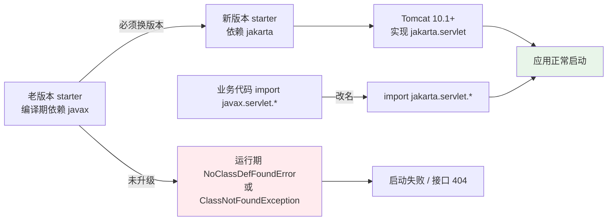
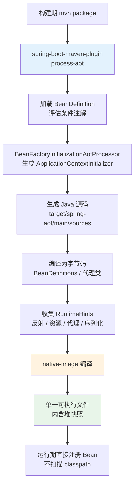
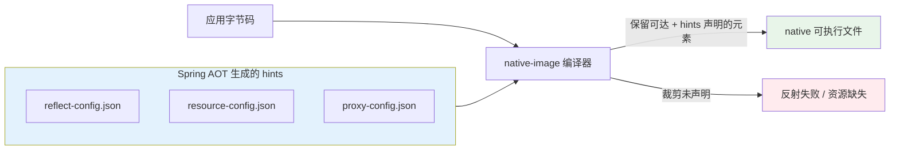

# Spring Boot 3 到 4 与 AOT 原生镜像

> 定位：这篇文章解决两类真实焦虑。第一类是「升到 Boot 3 之后为什么一半依赖跑不起来了」——`javax.servlet` 找不到、配置项悄悄失效、自研 starter 不再生效；第二类是「要不要把服务编译成 Native Image」——启动从秒级降到百毫秒、内存大幅下降，但反射、动态代理、序列化接连报错。读完你能判断哪些升级问题是基线导致的、AOT 到底把什么工作提前到了构建期、Native 的代价是否值得。

## 一、为什么需要它

先看两个线上场景。

**场景一：升级 Boot 3 后启动失败。** 一个跑了五年的服务从 Boot 2.7 升到 3.2，`mvn clean package` 成功，启动却报：

```
java.lang.NoClassDefFoundError: javax/servlet/Filter
```

代码一行没改，问题出在依赖树里某个老 jar 还在编译期引用 `javax.servlet.*`。这不是配置问题，是**命名空间整体搬迁**带来的二进制不兼容。

**场景二：Native 镜像上线后接口 500。** 团队把订单服务编译成 Native，冷启动从 6 秒降到 0.2 秒，K8s 扩容瞬间生效。但上线后某个查询接口持续报错，日志里只有一句 `Cannot construct instance of OrderDTO`——Jackson 通过反射创建对象，而 Native 镜像在构建期把「没被静态引用的构造函数」裁掉了。

这两个场景指向同一件事：**Spring Boot 的版本基线决定了你的依赖能不能用，而 AOT 决定了你的运行时还剩下多少「动态能力」**。它们不是两个孤立话题，Native 支持正是从 Boot 3 开始成为一等公民的，而 Boot 3 的基线变化又直接决定了哪些库能进 Native 镜像。

## 二、核心原理

### 2.1 Boot 3 的三条硬基线

Boot 3 不是「加了点新特性」，而是三条同时抬高、缺一不可的基线：

| 维度 | Boot 2.7 | Boot 3.x | 影响 |
|---|---|---|---|
| JDK | 8 / 11 / 17 | **17 起** | 记录类、密封类、`switch` 模式匹配可放心用；老 JDK 8 构建流水线必须换 |
| Jakarta EE | Java EE 8（`javax.*`） | **Jakarta EE 9+（`jakarta.*`）** | Servlet、JPA、Validation、Mail 等包名全部变更，二进制不兼容 |
| Spring Framework | 5.3 | **6.x** | 移除大量废弃 API，AOT 与 Native 支持正式落地 |

> Spring Boot 3.5 仍是 3.x 的最后一个特性版本；Boot 4.0 与 Spring Framework 7 同期发布，细节以官方 Release Notes 为准。

三条基线里最容易低估的是第二条。`javax.servlet` 和 `jakarta.servlet` 是**两个完全不同的包**，JVM 不认为它们有任何关系。所以升级不是「改个 import」，而是**整条依赖链上的所有库都必须有 Jakarta 版本**。Boot 3 生态的常见对应关系：

| 组件 | Boot 2.x 常用版本 | Boot 3.x 可用版本 |
|---|---|---|
| Servlet 容器 | Tomcat 9（`javax.servlet`） | Tomcat 10.1+（`jakarta.servlet`） |
| JPA | Hibernate 5.x（`javax.persistence`） | Hibernate 6.x（`jakarta.persistence`） |
| MyBatis | `mybatis-spring-boot-starter` 2.x | `mybatis-spring-boot-starter` 3.x |
| 接口文档 | Springfox 3（已停止维护） | SpringDoc 2.x |
| 参数校验 | `javax.validation` | `jakarta.validation` |

一个判断技巧：升级前先跑 `mvn dependency:tree`，搜 `javax.servlet`、`javax.persistence`、`javax.validation`。只要还出现，就一定会踩坑——哪怕它只是被传递依赖带进来的。

### 2.2 javax 到 jakarta 的连锁反应



读图要点：升级不是「替换 import」一件事，而是**业务代码、第三方 starter、Servlet 容器三者同时对齐到 Jakarta**。只要有一环留在 `javax`，就会在启动或首次调用时炸。最隐蔽的是「编译通过、运行才炸」——因为编译期那个老 jar 还在 classpath 上。

### 2.3 Boot 3 的自动配置与配置属性迁移

Boot 3 还有两处经常被忽略的机制变化。

**第一，自动配置的注册文件换了。** Boot 2.x 用 `META-INF/spring.factories` 注册自动配置类，Boot 2.7 引入新方式，Boot 3 起**只认**新文件（机制细节见 [SpringBoot 自动配置原理](05-SpringBoot自动配置原理.md)）：

```
META-INF/spring/org.springframework.boot.autoconfigure.AutoConfiguration.imports
```

自研 starter 如果还在写 `spring.factories` 里的 `EnableAutoConfiguration=`，升级后会**静默失效**——不报错，只是 Bean 不存在，直到某个 `@Autowired` 报 `NoSuchBeanDefinitionException`。同时推荐把配置类从 `@Configuration` 换成 `@AutoConfiguration`，并用 `@AutoConfigureAfter` / `@AutoConfigureBefore` 表达顺序。

**第二，大量配置键被重命名。** 常见迁移：

| Boot 2.x | Boot 3.x |
|---|---|
| `spring.redis.*` | `spring.data.redis.*` |
| `spring.elasticsearch.*` | `spring.data.elasticsearch.*` |
| `server.max-http-header-size` | `server.max-http-request-header-size` |
| `spring.mvc.pathmatch.matching-strategy` | 默认 `PATH_PATTERN_PARSER`，旧值仅供兼容 |
| `spring.datasource.initialization-mode` | `spring.sql.init.mode` |

Boot 默认对未知配置项**不报错**（`ignoreUnknownFields=true`），所以写错的键不会让应用启动失败，只会让配置「看起来配了、实际没生效」。官方提供 `spring-boot-properties-migrator`，启动时会把失效的键打印出来，升级期强烈建议临时加上。

**第三，可观测性统一到 Micrometer Observation。** Boot 3 用 Observation API 把 Metrics 和 Tracing 合成一套抽象：一个 `@Observed` 或一个被自动观测的 `RestTemplate`/`WebClient` 调用，会同时产生指标和 Span。底层可接 Micrometer Tracing + OpenTelemetry，取代了 Boot 2 时代的 Sleuth。

### 2.4 Boot 4 / Spring Framework 7 的方向

Boot 4 的细节仍在快速演进，这里只讲**方向确定**的部分，具体版本行为以官方 Release Notes 与迁移指南为准：

- **模块化**：从「几个大 jar」拆成按技术划分的模块（如 Web MVC、Tomcat、Jackson 各自独立），让 Native 镜像和依赖裁剪更精准，也降低无关依赖的耦合。
- **内建 API 版本管理**：Spring MVC 支持在映射上声明版本（`@RequestMapping(version = "1.1")`），由 `ApiVersionStrategy` 统一解析请求头/路径/参数中的版本，服务端多版本共存不再靠手写 URL 前缀。
- **Jackson 3 迁移**：Jackson 3 更换了 groupId 与包名（`tools.jackson.*`），Boot 4 提供适配；Jackson 2 进入兼容/弃用通道，自定义 `ObjectMapper` 的代码需要跟着调整。
- **空安全**：采用 JSpecify 注解表达可空性，编译期与 IDE 能更早发现 NPE 风险。
- **基线继续前移**：Jakarta EE 11、Servlet 6.1、Kotlin 2.x，JDK 基线仍为 17。

升级工具链上，OpenRewrite 的 `UpgradeSpringBoot_3_5` 一类配方能自动完成包名替换、配置键重命名、`spring.factories` 迁移等机械工作，比人工 grep 可靠。

### 2.5 AOT 处理：把运行时决策提前到构建期

Spring 的核心运行模型是「启动时扫描 classpath、评估条件注解、注册 BeanDefinition、再实例化」（完整链路见 [SpringBoot 启动流程](06-SpringBoot启动流程.md)）。这套模型灵活，但有两个代价：启动慢、依赖大量反射。AOT（Ahead-Of-Time）处理的思路是：**在构建期就把这些决策算完，生成 Java 源码和字节码，运行时直接注册**。



读图要点：AOT 不是「另一种启动方式」，而是**把启动期的反射与条件判断搬到了构建期**。生成物里最关键的是两类：`BeanDefinitions`（等价于扫描结果）和 `RuntimeHints`（告诉 Native 编译器「这些反射/资源别裁掉」）。

AOT 处理由 `SpringApplicationAotProcessor` 驱动，核心扩展点是 `BeanFactoryInitializationAotProcessor` 和 `BeanRegistrationAotProcessor`。运行时，`AotApplicationContextInitializer` 会加载生成的 `ApplicationContextInitializer`，因此 `refresh()` 不再需要 classpath 扫描和条件评估。

注意：AOT 处理**不等于** Native。你可以只开 `spring.aot.enabled` 在 JVM 上跑 AOT 生成的代码，用于提前验证生成结果，这也是排查 Native 问题最有效的一步。

### 2.6 GraalVM Native Image 的原理与代价

`native-image` 是一个 AOT 编译器，基于 SubstrateVM，把字节码 + 依赖 + 配置整体编译成一个平台原生可执行文件。它的核心假设是**封闭世界（closed-world assumption）**：

| 机制 | 含义 | 后果 |
|---|---|---|
| 可达性分析 | 构建期从入口做 points-to 分析，只保留可达类与方法 | 没被静态引用的类会被裁掉，反射调用直接失败 |
| 构建期类初始化 | 部分类在构建期完成 `<clinit>`，结果写进堆快照 | 依赖运行时环境的静态初始化（读环境变量、随机数）可能出错 |
| 无动态类加载 | 运行时不能加载构建期不存在的类 | 自定义 ClassLoader、热部署、动态插件全部不可用 |
| 无 JIT | 代码在构建期编译为机器码 | 没有预热期，但峰值吞吐通常低于 JVM 充分 JIT 之后 |
| 受限的运行时字节码生成 | 不支持 CGLIB 等在运行时生成类的库 | 依赖运行时代理的框架必须改为构建期生成或 JDK 动态代理 |
| 无 JVMTI Agent | 不能 attach Arthas、async-profiler 一类 agent | 线上诊断手段要提前换（日志、指标、heap dump） |

这解释了为什么 Native 需要 `RuntimeHints`：**编译器看不见反射字符串**。`Class.forName("com.example.OrderDTO")` 在静态分析里就是一个普通方法调用，`OrderDTO` 没有任何静态引用，于是被裁掉。你必须显式告诉编译器「保留它，并保留它的构造函数和方法」。



读图要点：Native 的「动态能力」是用**元数据换来的**。Spring 自家组件（`@Configuration`、`@Transactional`、`@Controller`）的 hints 由 Spring AOT 自动生成；**第三方库和你的业务 DTO 往往需要手工补**，这是 Native 落地的主要工作量。

## 三、关键机制与配置示例

### 3.1 双构建：JVM 与 Native 并存

不要在默认构建里强制 Native——它慢、吃内存，日常开发完全没必要。用 Maven profile 隔离：

```xml
<profiles>
    <profile>
        <id>native</id>
        <build>
            <plugins>
                <plugin>
                    <groupId>org.graalvm.buildtools</groupId>
                    <artifactId>native-maven-plugin</artifactId>
                    <executions>
                        <execution>
                            <id>build-native</id>
                            <phase>package</phase>
                            <goals>
                                <goal>compile-no-fork</goal>
                            </goals>
                        </execution>
                    </executions>
                </plugin>
            </plugins>
        </build>
    </profile>
</profiles>
```

```bash
./mvnw clean package                          # 日常 JVM 构建
./mvnw -Pnative native:compile -DskipTests    # CI 独立阶段，产出可执行文件
./mvnw -Pnative spring-boot:build-image       # 或直接产出容器镜像
```

> `native:compile` 需要本机安装 GraalVM（或配置 `GRAALVM_HOME`）。CI 里更常见的做法是用 Buildpacks 或 `container-image` 在容器内编译，避免污染构建机。

### 3.2 RuntimeHints：补反射、资源、代理、序列化

Spring 提供 `RuntimeHintsRegistrar` 作为统一入口，四类 hints 各管一件事：

```java
public class OrderNativeHints implements RuntimeHintsRegistrar {

    @Override
    public void registerHints(RuntimeHints hints, ClassLoader classLoader) {
        // 1. 反射：Jackson 需要构造函数和方法
        hints.reflection().registerType(OrderDTO.class,
                MemberCategory.INVOKE_DECLARED_CONSTRUCTORS,
                MemberCategory.INVOKE_PUBLIC_METHODS);

        // 2. 资源：MyBatis XML、邮件模板、i18n
        hints.resources().registerPattern("mapper/*.xml");
        hints.resources().registerPattern("templates/mail/*.html");

        // 3. JDK 动态代理：某个接口在运行期由 Proxy.newProxyInstance 生成
        hints.proxies().registerJdkProxy(OrderQueryService.class);

        // 4. 序列化：走 Java 原生序列化的缓存对象
        hints.serialization().registerType(OrderSnapshot.class);
    }
}
```

注册方式：用 `@ImportRuntimeHints(OrderNativeHints.class)` 挂在配置类上，或对单个 DTO 直接用 `@RegisterReflectionForBinding(OrderDTO.class)`。

第三方库如果没有提供 hints，可以在 `src/main/resources/META-INF/native-image/<groupId>/<artifactId>/` 下放原生格式的 `reflect-config.json`、`resource-config.json`、`proxy-config.json`。更彻底的做法是实现 `NativeDetector.inNativeImage()` 分支，把动态逻辑换成静态实现。

### 3.3 可观测性配置（Boot 3 基线）

```yaml
management:
  observations.key-values.service.name: order-service
  tracing.sampling.probability: 0.1
  endpoints.web.exposure.include: health,info,metrics,prometheus
spring.threads.virtual.enabled: true   # Boot 3.2+，JDK 21 下可用虚拟线程
```

Native 下 `health` 端点尤其重要——启动快意味着 readiness 探针能更早放流量，但首次请求的类初始化与连接建立仍有成本，探针就绪不等于业务就绪。

## 四、生产坑点与排查

### 坑点 1：升级后 `javax.servlet` 找不到

**现象**：编译通过，启动报 `NoClassDefFoundError: javax/servlet/Filter` 或 `ClassNotFoundException: javax.servlet.http.HttpServletRequest`。
**原因**：某个依赖（常见是老版本安全框架、老 starter、公司内部 SDK）编译期仍引用 `javax`，而 Boot 3 的容器只提供 `jakarta`。
**解法**：
- `mvn dependency:tree` 搜 `javax.servlet`、`javax.persistence`，定位是哪个传递依赖带进来的。
- 升级该依赖到支持 Jakarta 的版本；没有官方版本的，用 `jakarta` 版替代或联系维护方。
- 确认没有手工引入 `javax.servlet-api`（它与 Tomcat 10+ 冲突）。

### 坑点 2：配置键改名后「配置了但没生效」

**现象**：`spring.redis.host` 配了，应用却连 `localhost:6379`；`server.max-http-header-size` 调大后大 Header 请求仍 400。
**原因**：Boot 3 改了前缀/键名，旧键被当作未知属性静默忽略（默认不 fail-fast）。
**解法**：
- 临时引入 `spring-boot-properties-migrator`，启动日志会列出失效键及新键。
- 用 IDE 的配置元数据（`spring-boot-configuration-processor`）校验。
- 测试环境开启 `spring.config.on-not-found=fail` 一类严格策略，别让错误配置静默通过。

### 坑点 3：自研 starter 升级后不再自动装配

**现象**：依赖没变、代码没变，但 starter 提供的 Bean 全部缺失，报 `NoSuchBeanDefinitionException`。
**原因**：Boot 3 不再读取 `META-INF/spring.factories` 里的 `EnableAutoConfiguration`，只认 `AutoConfiguration.imports`。
**解法**：
- 新建 `META-INF/spring/org.springframework.boot.autoconfigure.AutoConfiguration.imports`，一行一个全类名。
- 配置类改用 `@AutoConfiguration`，顺序用 `@AutoConfigureAfter` / `@AutoConfigureBefore`。
- 保留 `spring.factories` 仅用于 `EnvironmentPostProcessor` 等非自动配置扩展点，不要混用。

### 坑点 4：Native 下反射与资源缺失

**现象**：JVM 模式全绿，Native 模式部分接口 500，日志为 `Cannot construct instance`、`ClassNotFoundException`，或模板文件 `FileNotFoundException`。
**原因**：封闭世界假设把「只通过字符串引用」的类/资源裁掉了。
**解法**：
- 先用 `-Dspring.aot.enabled=true` 在 JVM 上跑 AOT 生成物，隔离是 AOT 还是 Native 的问题。
- 反射补 `RuntimeHints` 或 `@RegisterReflectionForBinding`（MyBatis 的 Mapper 与别名可参考 [MyBatis 架构与执行流程](../05-MyBatis与持久层/01-MyBatis架构与执行流程.md)）；资源补 `hints.resources().registerPattern(...)`；Java 原生序列化的类补 `hints.serialization()`。
- 排查时加 `-H:+ReportExceptionStackTraces`，让 native-image 在构建期报出缺失的反射目标；运行时异常堆栈在 Native 下信息有限，别指望它直接告诉你缺哪个 hint。

### 坑点 5：CGLIB 与运行时字节码生成失效

**现象**：Native 启动报 `Classes that should be initialized at run time got initialized during image building`，或代理相关 `NoClassDefFoundError`；某些 Bean 的切面不生效。
**原因**：Native 不支持运行时生成字节码，依赖 CGLIB 的库（部分 Bean 拷贝、Mock、老式 ORM 增强）无法工作；`@Configuration(proxyBeanMethods = true)` 在 Native 下由 AOT 生成子类，若配置类是 `final` 或方法 `private` 就会失败。
**解法**：
- 配置类统一 `@Configuration(proxyBeanMethods = false)`，避免依赖 CGLIB 子类。
- 需要代理的接口优先用 JDK 动态代理，并注册 `hints.proxies()`。
- 第三方库层面确认有 Native 支持（看是否有 `native-image` 目录或官方文档声明），没有就换库。

### 坑点 6：Native 构建本身失败或极慢

**现象**：CI 上 `native:compile` 跑到一半 OOM，或单次构建耗时远超预期，阻塞发布流水线。
**原因**：native-image 编译是内存和 CPU 密集型任务，默认堆上限可能不够；全量构建无法增量。
**解法**：
- 给构建 JVM 显式内存：`MAVEN_OPTS="-Xmx8g"`，CI 构建机给足 CPU。
- 把 Native 构建拆成独立流水线，只在发布时触发，日常提交走 JVM 构建。
- 用 Buildpacks 缓存层或远端构建缓存减少重复编译；失败时先看 `-H:+ReportExceptionStackTraces` 的构建期堆栈。

## 五、升级路径与选型

### 5.1 升级路线图

升级必须**自下而上**，顺序错了会把「JDK 不兼容」和「Jakarta 不兼容」两类错误混在一起，排查成本翻倍：

1. 先升 JDK 17/21，跑通全量测试；
2. 依赖盘点，替换 `javax` 残留与停止维护的库（Springfox → SpringDoc、Sleuth → Micrometer）；
3. 业务代码改包名，`javax` → `jakarta`；
4. 配置键迁移，临时挂 `spring-boot-properties-migrator`；
5. 自研 starter 迁到 `AutoConfiguration.imports`；
6. 全量回归 + 灰度，可选做 AOT 验证，最后才评估 Native。

### 5.2 JVM 与 Native 的取舍

| 维度 | JVM 模式 | Native Image |
|---|---|---|
| 启动时间 | 秒级（应用越大越慢） | 百毫秒级，具体以实测为准 |
| 常驻内存 | 较高（堆 + 元空间 + JIT 代码缓存） | 明显更低 |
| 峰值吞吐 | 充分预热后更高 | 无预热，峰值通常偏低 |
| 构建时长 | 秒到分钟级 | 分钟级，且吃内存 |
| 动态能力 | 反射、CGLIB、动态类加载齐全 | 需 hints，运行时代理受限 |
| 线上诊断 | Arthas、async-profiler、JFR | agent 不可用，依赖日志/指标/heap dump |
| 适用场景 | 绝大多数业务服务、CPU 密集、长驻 | 弹性伸缩、Serverless、CLI、边缘、冷启动敏感 |

**什么场景不该用 Native：**

1. **重度依赖反射的遗留栈**：老版本 ORM、动态规则引擎、脚本插件，补 hints 的成本可能超过收益。
2. **需要线上诊断能力**：团队高度依赖 Arthas 热修复/火焰图，Native 会直接断掉这套手段。
3. **CPU 密集型长驻服务**：JIT 的分层编译与逃逸分析带来的峰值性能，Native 短期难以追平。
4. **频繁发布且构建资源紧张**：每次发布多出十几分钟的重编译，流水线会很难受。
5. **依赖运行时代码生成**：字节码增强、动态 Mapper、热加载类框架。

一个务实结论：**先把 Boot 3 基线升级做扎实，AOT 只作为「提前验证」手段；只有当冷启动/内存确实是瓶颈（例如弹性扩容慢、按量计费成本高）时，才投入 Native 改造**。

## 六、面试高频问法

**Q1：Spring Boot 3 为什么强制要求 Java 17？**

**一句话结论**：因为 Boot 3 基于 Spring Framework 6，而 Framework 6 的基线就是 JDK 17——它用到了记录类、密封类、模式匹配等语言特性，也依赖 17 的 GC 与运行时改进，无法向下兼容到 8/11。

展开：

- Framework 6 在字节码层面以 17 为目标，低版本 JVM 连类文件版本都校验不过。
- Boot 3 同时要求 Jakarta EE 9+，而 Jakarta 生态新版本同样以 17 为基线；收益是虚拟线程（JDK 21）、更好的 G1/ZGC 与 `record`。

加分点：指出「升级 JDK 是升级 Boot 的前置条件，不是可选项」——很多团队想「先升 Boot 再说 JDK」，顺序反了必然卡住。

**Q2：`javax` 和 `jakarta` 是什么关系？为什么升级后会 `NoClassDefFoundError`？**

**一句话结论**：Jakarta EE 从 Oracle 移交 Eclipse 基金会后，因商标限制把包名从 `javax.*` 整体改为 `jakarta.*`；两者是**不同的包**，JVM 视为无关类型，所以老 jar 引用的类在新容器里根本不存在。

展开：

- 不是「版本升级」，是**命名空间搬迁**，二进制不兼容。
- Servlet、JPA、Validation、Mail、WebSocket 全部受影响；典型现象是编译通过（老 jar 还在 classpath），运行期类加载失败。

加分点：说出排查手段「`mvn dependency:tree` 搜 `javax`」，以及生态替代（Springfox → SpringDoc、Sleuth → Micrometer Tracing）。

**Q3：Boot 3 的自动配置注册机制和 Boot 2 有什么不同？**

**一句话结论**：Boot 3 只读取 `META-INF/spring/org.springframework.boot.autoconfigure.AutoConfiguration.imports`，不再从 `spring.factories` 的 `EnableAutoConfiguration` 键加载自动配置；配置类推荐用 `@AutoConfiguration`。

展开：

- 新文件一行一个全类名，加载更直接，也便于工具做条件分析。
- `spring.factories` 仍用于 `EnvironmentPostProcessor` 等扩展点；老 starter 不改会**静默失效**，表现为 Bean 缺失而非启动报错。

加分点：强调「静默」二字——这类问题最难排查，因为没有任何异常指向注册文件。

**Q4：AOT 和 JIT 有什么区别？AOT 会不会让程序更快？**

**一句话结论**：AOT 是**构建期**把字节码编译成机器码/生成配置，JIT 是**运行期**根据热点动态编译；AOT 的收益是启动快、内存低，不是峰值性能——恰恰相反，缺少运行期的热点画像，峰值通常不如充分预热的 JVM。

展开：

AOT 发生在构建期、输入是静态可达性分析，收益是启动快、内存低、可裁剪；JIT 发生在运行期、输入是真实热点画像，收益是峰值吞吐高，代价是预热慢、内存占用高。两者不是替代关系，而是不同阶段的优化。

加分点：说清 Spring 的 AOT 不只是「编译」，还包括**生成 BeanDefinition 和 RuntimeHints**，这部分即使不编 Native 也能在 JVM 上运行验证。

**Q5：GraalVM 的「封闭世界假设」意味着什么？代价是什么？**

**一句话结论**：构建期就假定「所有会被用到的类都必须在此时可见」，以此做全程序可达性分析并裁剪；代价是运行期无法加载新类、反射/资源/代理必须提前声明，动态能力被大幅压缩。

展开：

- 好处：可执行文件小、启动快、内存低。
- 代价：反射失败、资源缺失、CGLIB 不可用、ClassLoader 受限、agent 不可用；**动态性越强的库，改造成本越高**。

加分点：点出「反射字符串对静态分析不可见」是大多数 Native 报错的根因，而不是编译器有 bug。

**Q6：RuntimeHints 有哪些类型？什么时候必须自己写？**

**一句话结论**：四类——反射（reflection）、资源（resources）、代理（proxies）、序列化（serialization）；Spring 自家组件自动生成，**第三方库和业务 DTO 通过字符串/反射访问时必须手写**。

展开：

反射用 `hints.reflection().registerType(...)` 或 `@RegisterReflectionForBinding`，资源用 `hints.resources().registerPattern(...)`，代理用 `hints.proxies().registerJdkProxy(...)`，序列化用 `hints.serialization().registerType(...)`。

加分点：说明「先用 `spring.aot.enabled=true` 在 JVM 验证 AOT，再上 Native」，能把问题范围缩小一半。

**Q7：为什么 Native 镜像里 CGLIB 代理会失效？Spring 怎么解决？**

**一句话结论**：CGLIB 在运行时动态生成子类字节码，而 Native 运行期不允许生成新类；Spring 的解法是 AOT 在构建期生成配置类子类与代理类，把「运行时生成」变成「构建期生成」。

展开：

- 受影响：`@Configuration(proxyBeanMethods = true)`、部分字节码增强库、Mock 框架。
- 规避：配置类用 `proxyBeanMethods = false`，接口代理优先 JDK 动态代理并注册 hints；第三方库若无构建期方案只能替换。

加分点：提到「`@Configuration` 的 `final` 类在 Native 下会失败」这个具体细节，说明你真的踩过。

**Q8：Boot 3 升级最容易踩的三个坑是什么？怎么系统性规避？**

**一句话结论**：`javax` 残留、配置键静默失效、自研 starter 注册文件未迁移；规避靠「依赖树盘点 + properties-migrator + 全量回归」三件套。

展开：

1. **依赖**：`dependency:tree` 搜 `javax`，逐个升级或替换。
2. **配置**：临时加 `spring-boot-properties-migrator`，启动日志暴露失效键。
3. **扩展点**：`spring.factories` → `AutoConfiguration.imports`。

加分点：补一句「先升 JDK 再升依赖再改代码」，顺序错了会把两类错误混在一起。

**Q9：什么情况下不建议上 Native Image？**

**一句话结论**：重度反射的遗留栈、依赖线上 agent 诊断、CPU 密集型长驻服务、构建资源紧张且发布频繁、依赖运行时代码生成——这五类场景上 Native 往往得不偿失。

展开：Native 的收益集中在启动时间与内存，瓶颈若是峰值吞吐或开发效率则帮不上忙；改造成本主要在补 hints 和替换动态库，且观测手段要重建（日志、指标、heap dump 替代 agent）。

加分点：给出判断标准「冷启动是否是业务瓶颈」——是才值得投入，否则先把 JVM 模式调好。

## 小结

- Boot 3 的三条硬基线是 JDK 17、Jakarta EE 9+、Spring Framework 6，缺一不可；`javax` 到 `jakarta` 是命名空间搬迁，不是版本升级。
- 自动配置注册文件改为 `AutoConfiguration.imports`，配置键大量重命名且默认静默忽略，升级期必须用 migrator 与依赖树盘点兜底。
- AOT 的本质是把「扫描 + 条件评估 + 反射决策」搬到构建期，生成 BeanDefinition 与 RuntimeHints；它不等于 Native，可以单独在 JVM 上验证。
- Native 的核心是封闭世界假设：启动快、内存低，代价是构建慢、动态能力受限、诊断手段减少，反射/资源/代理/序列化都要显式声明。
- 选型只看一件事——冷启动与内存是不是真瓶颈；不是的话，把 Boot 3 基线升级做扎实比追 Native 更划算。

## 参考资料

- Spring Boot 官方文档：Upgrading from Spring Boot 2.7 / Migrating to Spring Boot 3
- Spring Framework 官方文档：Ahead of Time Optimizations、Core Container 章节
- Spring Boot 官方文档：GraalVM Native Images、Developing Your First GraalVM Native Application
- GraalVM Native Image 官方文档：Closed-World Assumption、Reachability Metadata、Class Initialization
- Spring AOT 源码类：`org.springframework.aot.hint.RuntimeHintsRegistrar`、`org.springframework.context.aot.ApplicationContextAotGenerator`
- Spring Boot 源码类：`org.springframework.boot.SpringApplicationAotProcessor`
