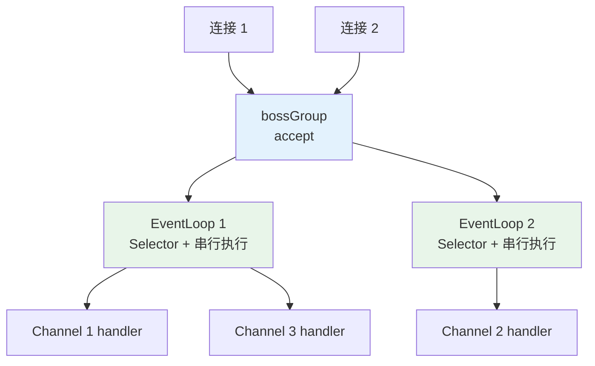
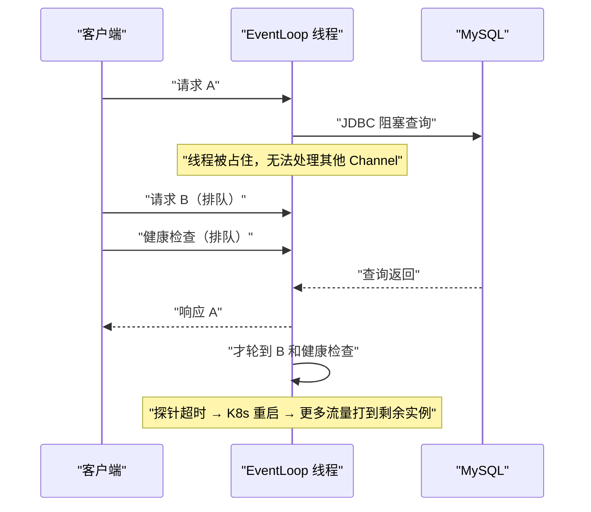

# Spring WebFlux 响应式编程

> 定位：WebFlux 不是「更快的 Spring MVC」，而是换了一套并发模型：用少量 event loop 线程承载大量请求，靠回调与背压替代「一请求一线程」。这篇从 Reactor 的 `Mono`/`Flux` 讲到 Netty 的 Reactor 线程模型，重点回答三个生产问题：为什么在 WebFlux 里调一次 JDBC 就能拖垮整个服务、`subscribeOn` 和 `publishOn` 到底改的是哪一段线程、以及什么场景下你根本不该用 WebFlux。

## 一、为什么需要响应式

先算一笔账。Spring MVC 跑在 Tomcat 上，默认 200 个 worker 线程，一个请求占一个线程直到返回。如果这个请求要调三次下游、每次 100ms，线程就有 300ms 在**等 IO**，期间什么也干不了。QPS 一上来，线程池被打满，新请求在 `Accept` 队列里排队，RT 从 100ms 涨到几秒——这不是 CPU 不够，是**线程被阻塞占满了**。

线程很贵：默认 1MB 栈、上下文切换成本、内存占用随并发线性增长。C10K 之后，业界给出两条路：

1. **加线程**（虚拟线程）：JDK 21 的虚拟线程让阻塞变便宜，这是 Spring MVC 的一条新出路。
2. **换模型**（响应式）：用少量线程 + 事件回调，让「等待」不占线程，这是 WebFlux 的路。

WebFlux 的适用画像很明确：**高并发、IO 密集、下游支持异步**。典型是 API 网关、聚合层、流式推送。反过来，CRUD 为主、全链路 JDBC/MyBatis 的业务系统，上 WebFlux 往往是「用复杂度换不到收益」。

## 二、核心原理

### 2.1 Reactive Streams 与 Reactor

Reactive Streams 是一套只有四个接口的规范，解决的是「异步流 + 背压」的标准问题：

| 接口 | 职责 |
|---|---|
| `Publisher<T>` | 数据源，提供 `subscribe(Subscriber)` |
| `Subscriber<T>` | 消费者，回调 `onSubscribe` / `onNext` / `onError` / `onComplete` |
| `Subscription` | 订阅关系，消费者通过 `request(n)` 要数据、`cancel()` 取消 |
| `Processor<T,R>` | 既是 Publisher 又是 Subscriber，用于中间处理 |

Reactor 是这套规范的实现，对外的两个类型：

- `Mono<T>`：0 或 1 个元素，适合「一次查询返回一个对象」。
- `Flux<T>`：0 到 N 个元素，适合列表、流、事件。

最关键的一点：**Reactor 是惰性的，没有 `subscribe` 就什么都不会发生**。下面这段代码不会发出任何请求：

```java
Mono<Order> mono = webClient.get().uri("/orders/1").retrieve().bodyToMono(Order.class);
// 到这里为止：只是组装了一条流水线，没有任何 IO
mono.subscribe(order -> log.info("got {}", order.getId()));  // 这一行才触发
```

这也解释了为什么在 Controller 里直接返回 `Mono` 是对的——由框架负责订阅；而自己 `subscribe()` 再返回一个普通对象，等于把异步结果丢了。

操作符本质是**装饰器**：`map`、`filter`、`flatMap`、`zip` 都在包装上游 `Publisher`，订阅时从下游往上游逐层建立 `Subscription`，数据再从上游往下游流动。所以「组装」和「执行」是分离的两个阶段。

### 2.2 线程模型：subscribeOn 与 publishOn

这是 WebFlux 最容易搞混的知识点。先记住一句话：**`subscribeOn` 决定「订阅动作」在哪个线程发生（影响上游），`publishOn` 决定「它之后的操作符」在哪个线程执行（影响下游）**。


读图要点：`subscribeOn` 写在链上任何位置，影响的都是**整条上游的订阅线程**（多次写只有最靠近源头的有效）；`publishOn` 是「切换点」，它**下游**的操作符跑在新线程上。图中阻塞查询被安排到 `boundedElastic`，解析留在该线程，之后才切到 `parallel`。

常用调度器：

| 调度器 | 线程数 | 用途 |
|---|---|---|
| `Schedulers.parallel()` | 默认等于 CPU 核数 | CPU 密集型计算、非阻塞操作 |
| `Schedulers.boundedElastic()` | 默认 10 × CPU 核数，队列上限 10 万 | **包装阻塞调用**（JDBC、老 SDK、文件 IO） |
| `Schedulers.single()` | 1 | 需要串行化的轻量任务 |

`boundedElastic` 的名字里带 bounded，就是防止「阻塞任务无限堆积」：线程有上限、队列有上限，满了会拒绝而不是把内存吃光。它不是让你随便阻塞的通行证，只是最后的隔离带。

### 2.3 Netty 的 Reactor 线程模型

WebFlux 默认跑在 Reactor Netty 上。Netty 的线程模型是「boss + worker」：

- **bossGroup**：通常 1 个线程，负责 `accept` 新连接，把 `Channel` 注册到某个 worker。
- **workerGroup**：默认 `2 × CPU` 个 event loop 线程，每个线程一个 `Selector`，轮询自己负责的所有 `Channel` 的读写事件。
- **一个 Channel 一生只绑定一个 EventLoop 线程**，该 Channel 上的所有 handler 串行执行，因此**单个请求内部不需要加锁**。



读图要点：并发能力来自「少量线程各自管理大量连接」，而不是「一连接一线程」。一个 EventLoop 上挂着成百上千个 Channel，**只要其中一个 handler 阻塞，这个线程上的所有 Channel 全部停摆**——这就是下一节要讲的雪崩起点。

### 2.4 为什么一次阻塞 JDBC 调用能拖垮 event loop

假设订单查询接口在 `reactor-http-nio-2` 线程里调用 MyBatis：

```java
@GetMapping("/orders/{id}")
public Mono<OrderVO> detail(@PathVariable Long id) {
    Order order = orderMapper.selectById(id);   // 阻塞 JDBC，占用 event loop
    return Mono.just(toVO(order));
}
```

这一个调用会让 `reactor-http-nio-2` 停下来等数据库。期间它负责的所有连接——包括其他用户的请求、健康检查、甚至同机其他接口——都得不到处理。连锁反应是：



读图要点：阻塞的不是「一个请求」，而是「一个线程上所有连接」。健康检查也在同一批线程上，探针超时后 K8s 判定实例不健康并重启，流量转移到其他实例，其他实例同样被压垮——**级联雪崩**。

正确做法只有两条：换成非阻塞驱动（R2DBC、异步 HTTP 客户端），或者把阻塞调用显式隔离到 `boundedElastic`：

```java
@GetMapping("/orders/{id}")
public Mono<OrderVO> detail(@PathVariable Long id) {
    return Mono.fromCallable(() -> orderMapper.selectById(id))
            .subscribeOn(Schedulers.boundedElastic())
            .map(this::toVO);
}
```

> 注意：隔离只是「不让它污染 event loop」，连接池和线程仍然被占用，吞吐上限依旧受 JDBC 限制。全链路阻塞的系统，用 MVC + 虚拟线程往往比 WebFlux 更划算。

### 2.5 背压：让消费者决定生产速度

响应式流的核心优势之一是背压（backpressure）：消费者通过 `request(n)` 告诉生产者「我还能处理 n 个」。`Flux.range(1, 1_000_000)` 不会一次性把一百万条推给下游，而是按需拉取。

| 策略 | 写法 | 语义 |
|---|---|---|
| 缓冲 | `onBackpressureBuffer(1000)` | 下游慢时先缓存，超过上限报错 |
| 丢弃 | `onBackpressureDrop()` | 处理不过来就丢最新的 |
| 只留最新 | `onBackpressureLatest()` | 只保留最后一个值 |
| 限速请求 | `limitRate(100)` | 向上游按批请求，避免一次要太多 |

背压是**端到端**的：只要中间有一个环节不遵守（例如 `flatMap` 内部自己 `subscribe()`、或者把流写进一个无界队列），背压就断了。WebFlux 的入站请求体天然支持背压，但**出站到数据库/下游 HTTP 时是否支持，取决于驱动**——R2DBC 支持，JDBC 不支持。

### 2.6 Reactor Context 与 ThreadLocal

MVC 里靠 `ThreadLocal` 传递上下文：MDC 里的 traceId、`SecurityContextHolder`、`TransactionSynchronizationManager`。WebFlux 一条链会跨多个线程，`ThreadLocal` 天然失效。

Reactor 提供 `Context`：一个不可变的、随订阅向上游传播的键值容器。

```java
public Mono<OrderVO> detail(Long id) {
    return orderService.findById(id)
            .flatMap(order -> Mono.deferContextual(ctx ->
                    Mono.just(toVO(order, ctx.get("traceId")))))
            .contextWrite(Context.of("traceId", MDC.get("traceId")));
}
```

关键规则：**`contextWrite` 写在链尾，向上游传播**（订阅时从下游往上游可见）；`deferContextual` 在订阅时读取。它不是 `ThreadLocal` 的替代品，而是「显式的参数传递」。

要在日志里恢复 MDC，可以手工在每个切换点 `doOnEach` 里写（繁琐易漏），或引入 Micrometer Context Propagation：Spring Boot 3 集成后开启 `Hooks.enableAutomaticContextPropagation()`，调度器切换时会自动把 Reactor Context 与 `ThreadLocal` 双向同步。

## 三、关键机制与代码

### 3.1 WebFlux 请求处理链路

骨架和 [SpringMVC 请求处理流程](08-SpringMVC请求处理流程.md) 高度一致：`ReactorHttpHandlerAdapter` → `HttpWebHandlerAdapter` → `DispatcherHandler` → `HandlerMapping` → `HandlerAdapter` → `HandlerResultHandler`。区别在于每一步都是异步的：`HandlerAdapter` 返回 `Mono`，框架订阅后才执行，遇到 IO 就注册回调并释放线程。

### 3.2 WebClient：超时、重试、错误处理

`WebClient` 是响应式 HTTP 客户端，生产上必须显式配置超时——Reactor Netty 默认不设响应超时，下游卡住时连接会一直挂着。

```java
@Bean
public WebClient orderWebClient(WebClient.Builder builder) {
    HttpClient httpClient = HttpClient.create()
            .option(ChannelOption.CONNECT_TIMEOUT_MILLIS, 1000)
            .responseTimeout(Duration.ofSeconds(3))                 // 请求发出到收到响应
            .doOnConnected(conn -> conn
                    .addHandlerLast(new ReadTimeoutHandler(3)));      // 两次读之间

    return builder
            .baseUrl("http://order-service")
            .clientConnector(new ReactorClientHttpConnector(httpClient))
            .build();
}

public Mono<OrderDTO> query(Long id) {
    return orderWebClient.get()
            .uri("/orders/{id}", id)
            .retrieve()
            .bodyToMono(OrderDTO.class)
            .timeout(Duration.ofSeconds(4))
            .retryWhen(Retry.backoff(2, Duration.ofMillis(200)).jitter(0.3)
                    .filter(e -> e instanceof TimeoutException))
            .onErrorResume(TimeoutException.class, e -> Mono.empty());
}
```

几个要点：

- `retrieve()` 对 4xx/5xx 抛 `WebClientResponseException`；需要读错误体时用 `exchangeToMono`。
- 只在**幂等**操作上重试，写操作重试要有幂等键。
- `onErrorResume` 返回 `Mono.empty()` 是「静默降级」，必须配合日志或指标；连接池参数用 `ConnectionProvider` 控制 `maxConnections` 与 `pendingAcquireTimeout`。

### 3.3 R2DBC 与响应式事务

R2DBC 是「异步、非阻塞」的数据库访问规范，MySQL、PostgreSQL 都有驱动。它和 JDBC 最大的区别是：**没有 `ThreadLocal` 事务绑定，事务状态放在 Reactor Context 里**。

```yaml
spring:
  r2dbc:
    url: r2dbc:pool:mysql://127.0.0.1:3306/shop
    username: app
    password: ${DB_PASSWORD}
    pool:
      initial-size: 5
      max-size: 20
      max-acquire-time: 3s
      max-idle-time: 30m
```

```java
@Service
public class OrderService {

    private final OrderRepository orderRepository;
    private final InventoryClient inventoryClient;

    // 返回响应式类型时，@Transactional 由 ReactiveTransactionManager 接管
    @Transactional
    public Mono<Order> place(PlaceCommand cmd) {
        return orderRepository.save(Order.create(cmd))
                .flatMap(order -> inventoryClient.deduct(cmd.sku(), cmd.qty())
                        .thenReturn(order));
    }
}
```

必须理解的三点：

1. **整条链必须在同一个订阅里**。如果中途 `subscribe()` 另起一条链、或把操作丢到线程池后不返回 `Mono`，事务上下文就断了。
2. **不能混用 JDBC 事务**。JDBC 的 `@Transactional` 依赖 `ThreadLocal`，R2DBC 依赖 Reactor Context，两者在同一个方法上不会互相感知。
3. **R2DBC 不等于高性能**。它解决的是「不阻塞线程」，SQL 本身慢、索引缺失，照样慢。

### 3.4 调试：checkpoint 与 BlockHound

响应式栈是「组装出来的」，异常栈里全是 `FluxMap`、`FluxFlatMap`，看不到业务代码。三个手段：

```java
return orderRepository.findById(id)
        .checkpoint("after findById")          // 关键节点打 checkpoint
        .flatMap(this::enrich)
        .checkpoint("after enrich");

Hooks.onOperatorDebug();   // 开发/测试期开启操作符调试，生产禁用
BlockHound.install();      // 检测非阻塞线程上的阻塞调用
```

`checkpoint` 只在**错误经过该点**时补充信息，正常路径几乎没有开销，可以保留在关键链路上。`BlockHound` 会在 event loop 线程检测到 `Thread.sleep`、`InputStream.read`、JDBC 调用时直接抛异常，是排查「哪里偷偷阻塞了」的利器；生产也可用采样方式短时开启。

## 四、生产坑点与排查

### 坑点 1：在 event loop 里调 JDBC/同步 HTTP

**现象**：压测时 QPS 上不去，`reactor-http-nio-*` 线程全部处于 `RUNNABLE` 但 CPU 不高；健康检查超时，实例被反复重启。
**原因**：JDBC、`RestTemplate`、文件 IO 都是阻塞调用，占住 event loop 后同线程所有连接停摆。
**解法**：
- 用 BlockHound 定位阻塞点；
- 换 R2DBC / `WebClient`；
- 短期内用 `Mono.fromCallable(...).subscribeOn(Schedulers.boundedElastic())` 隔离，并监控 `boundedElastic` 的队列长度；不要用 `parallel` 调度器跑阻塞任务。

### 坑点 2：随手 `block()`，直接抛异常

**现象**：日志出现 `block()/blockFirst()/blockLast() are blocking, which is not supported in thread reactor-http-nio-2`。
**原因**：Reactor 检测到在非阻塞线程上调用 `block()`，主动拒绝以防止死锁。
**解法**：
- Controller/Service 层永远返回 `Mono`/`Flux`，不要 `block()`；
- 只在测试、`main` 方法、或明确在 `boundedElastic` 线程上才允许 `block()`；
- 需要与同步代码桥接时用 `toFuture()` 并确保不占用 event loop。

### 坑点 3：错误被 `onErrorResume` 或 `subscribe` 吞掉

**现象**：接口返回 200，但数据是空的；或者日志里出现 `Operator called default onErrorDropped`。
**原因**：`onErrorResume(e -> Mono.empty())` 把异常变成了「正常空结果」；在服务里 `subscribe()` 后没有处理 `onError`，错误被丢到全局钩子。
**解法**：
- 降级分支必须打日志/指标，区分「业务空」与「故障降级」；
- 不要在业务代码里裸调 `subscribe()`，让框架订阅；
- 用 `doOnError` / `onErrorMap` 转换异常，保留原始 cause。

### 坑点 4：Context 与 MDC 丢失，日志没有 traceId

**现象**：同一个请求的日志里，部分行的 `traceId` 为空，链路追踪断成几段。
**原因**：线程切换后 `ThreadLocal` 不跟随；Reactor Context 没有正确写入或没有开启自动传播。
**解法**：
- 在链尾 `contextWrite` 写入 traceId，用 `deferContextual` 读取；
- 开启 Micrometer Context Propagation（`Hooks.enableAutomaticContextPropagation()`）；
- 不要在 `flatMap` 内部新起线程后忘记传递 Context。

### 坑点 5：背压被 `flatMap` 并发度悄悄放大

**现象**：下游数据库连接数突增，出现大量超时；上游明明只有一个请求。
**原因**：`flatMap(fn, 1000)` 把并发度开到 1000，一次性向上游请求大量元素，背压形同虚设；或 `flatMap` 内部又用了无界队列。
**解法**：
- 显式设置 `flatMap` 的 `concurrency`（如 8~32），配合 `limitRate`；
- 对下游做信号量限流；
- 用 `concatMap` 替代 `flatMap` 保证顺序与串行。

## 五、选型：WebFlux 与 Spring MVC

| 维度 | Spring MVC | Spring WebFlux |
|---|---|---|
| 编程模型 | 命令式，同步返回 | 声明式，返回 `Mono`/`Flux` |
| 并发模型 | 一请求一线程（或虚拟线程） | 少量 event loop |
| 阻塞库 | 完全支持（JDBC、JPA） | **禁止**，只能隔离 |
| 背压 | 无 | 端到端（取决于下游驱动） |
| 调试难度 | 栈直观 | 栈是操作符拼接，需 checkpoint |
| 生态成熟度 | 最全 | 较好，但部分库仍是阻塞的 |
| 典型场景 | CRUD、事务密集、团队传统 | 网关、聚合层、流式、海量长连接 |

**什么场景不该用 WebFlux：**

1. **全链路 JDBC/MyBatis/JPA**：驱动是阻塞的，套上 WebFlux 只是把阻塞搬了个地方。
2. **CPU 密集型服务**：瓶颈是算力，异步模型帮不上忙，反而增加复杂度。
3. **团队不熟悉 Reactor**：`block()`、`subscribe()` 误用、Context 丢失的排查成本很高。
4. **流量不大**：几百 QPS 的 MVC 完全够用，响应式是纯负担。
5. **依赖大量 ThreadLocal 的库**：某些老 SDK、事务框架、安全框架无法在响应式链里工作。

一个务实判断：**只有当「并发连接数 × 等待时间」明显超过线程模型能承受的上限，且下游能提供非阻塞驱动时，WebFlux 才划算**。否则，Spring MVC + 虚拟线程是更平滑的升级路径——参考 [线程池原理与调优](../02-Java底层与并发/08-线程池原理与调优.md) 理解线程成本，参考 [Netty 原理](../02-Java底层与并发/11-Netty原理.md) 理解事件循环。

## 六、面试高频问法

**Q1：WebFlux 和 Spring MVC 的本质区别是什么？**

**一句话结论**：MVC 是「一请求一线程 + 阻塞等待」，WebFlux 是「少量 event loop + 异步回调 + 背压」；前者用线程换简单，后者用复杂度换并发密度。

展开：

- MVC 的吞吐上限由线程数决定，线程在等 IO 时是浪费的；WebFlux 在等待时释放线程，同样线程数能挂更多连接；
- 代价是编程模型、调试、生态兼容性全面变复杂。

加分点：补一句「WebFlux 不会让单请求更快，它提升的是高并发下的资源利用率」——这是最常见的误解。

**Q2：`Mono` 和 `Flux` 有什么区别？为什么说 Reactor 是惰性的？**

**一句话结论**：`Mono` 表示 0/1 个元素，`Flux` 表示 0..N 个元素；它们只是「流水线的描述」，只有 `subscribe()` 才会真正执行。

展开：

- 组装只构建操作符链、不产生 IO，忘记订阅就什么都不会发生；
- 订阅阶段自下而上建立 `Subscription`，数据自上而下流动。

加分点：说清「Controller 返回 `Mono` 由框架订阅」这个约定，能解释为什么不该在业务代码里手动 `subscribe`。

**Q3：`subscribeOn` 和 `publishOn` 的区别？**

**一句话结论**：`subscribeOn` 影响**订阅动作与上游**在哪个线程执行；`publishOn` 是切换点，影响**它下游**的操作符在哪个线程执行。

展开：

- `subscribeOn` 写在链上任何位置效果一样（多次只有最靠近源头的生效）；
- `publishOn` 可以出现多次，每次切换后续操作符的线程；
- 阻塞调用应放在 `boundedElastic` 上，CPU 计算放 `parallel`。

加分点：画一条链说明「`subscribeOn` 管上游、`publishOn` 管下游」，比背定义更有说服力。

**Q4：为什么在 WebFlux 里调用阻塞 JDBC 会拖垮服务？**

**一句话结论**：因为阻塞的是 event loop 线程，而这个线程上挂着成百上千个连接——一个请求阻塞，同线程所有请求、健康检查全部停摆，进而触发重启与级联雪崩。

展开：

- Netty 一个 Channel 绑定一个 EventLoop，handler 串行执行；
- 健康检查与业务请求共享线程，探针超时导致 K8s 重启，流量转移后其他实例同样被压垮。

加分点：给出两条解法「换 R2DBC」与「隔离到 boundedElastic」，并指出后者只是隔离、不提升吞吐上限。

**Q5：背压是什么？WebFlux 里怎么保证背压？**

**一句话结论**：背压是消费者通过 `request(n)` 控制生产速度的机制；WebFlux 的入站天然支持，但端到端是否成立取决于每一环，尤其是数据库驱动和中间操作符。

展开：

- `Subscription.request(n)` 是规范核心，`onBackpressureBuffer/Drop/Latest`、`limitRate` 是常用手段；
- `flatMap` 并发度、内部 `subscribe()`、无界队列都会破坏背压。

加分点：指出「JDBC 不支持背压，R2DBC 支持」——这直接决定全链路能否真正响应式。

**Q6：Reactor Context 和 ThreadLocal 有什么区别？traceId 怎么传？**

**一句话结论**：ThreadLocal 绑定线程，跨线程即丢；Reactor Context 随订阅传播、不可变，通过 `contextWrite` 写入、`deferContextual` 读取，需要配合 Context Propagation 才能同步回 MDC。

展开：

- `contextWrite` 在链尾，向上游可见；
- 每次线程切换都要显式传播，否则 MDC 为空；Spring Boot 3 可用 Micrometer Context Propagation 自动化。

加分点：说明「不要在 `flatMap` 里 new Thread 后忘记传 Context」，这是 traceId 断裂的常见原因。

**Q7：R2DBC 的事务和 JDBC 有什么不同？**

**一句话结论**：JDBC 事务绑定在 `ThreadLocal` 的连接上，R2DBC 事务绑定在 Reactor Context 上；因此响应式事务要求整条链在同一个订阅内，且不能与 JDBC 事务混用。

展开：

- `@Transactional` 返回 `Mono`/`Flux` 时由 `ReactiveTransactionManager` 接管，中途 `subscribe()` 另起链会丢失上下文；
- R2DBC 只解决非阻塞，不解决 SQL 慢。

加分点：说出「同一个方法里混用 JPA 与 R2DBC，事务不会互相感知」，这是实际迁移时最容易踩的坑。

**Q8：什么情况下不应该用 WebFlux？**

**一句话结论**：全链路阻塞驱动、CPU 密集型、团队不熟 Reactor、流量不大、依赖 ThreadLocal 生态——这五类场景用 MVC（或 MVC + 虚拟线程）更划算。

展开：

- WebFlux 的收益在「高并发 + IO 等待」，不在单请求延迟；改造现有 JDBC 系统的成本远高于收益；
- 响应式的调试与排障门槛需要团队能力兜底。

加分点：给出替代方案「Spring MVC + JDK 21 虚拟线程」，说明它不是非黑即白的选择。

## 小结

- WebFlux 的收益是高并发下的资源利用率，不是单请求更快；`Mono`/`Flux` 惰性执行，只有订阅才产生 IO。
- `subscribeOn` 管上游订阅线程，`publishOn` 管下游执行线程；阻塞调用只能放 `boundedElastic` 隔离。
- Netty 一个 Channel 绑定一个 EventLoop 线程，阻塞一个请求等于阻塞该线程上的所有连接，这是雪崩的起点。
- 响应式事务与上下文都走 Reactor Context，不走 ThreadLocal；跨线程必须显式传播，否则事务与 traceId 都会断。
- 全链路 JDBC、CPU 密集、团队不熟 Reactor 的场景不该用 WebFlux，MVC + 虚拟线程往往是更稳的选择。

## 参考资料

- Reactive Streams 规范：Publisher / Subscriber / Subscription / Processor 四个接口
- Project Reactor 官方文档：Schedulers、Backpressure、Context、Debugging
- Spring Framework 官方文档：Web on Reactive Stack、WebClient、Reactive Transactions
- Spring Boot 官方文档：R2DBC 配置、Micrometer Context Propagation
- 源码类：`reactor.core.publisher.Mono`、`reactor.core.scheduler.Schedulers`、`org.springframework.web.reactive.DispatcherHandler`
