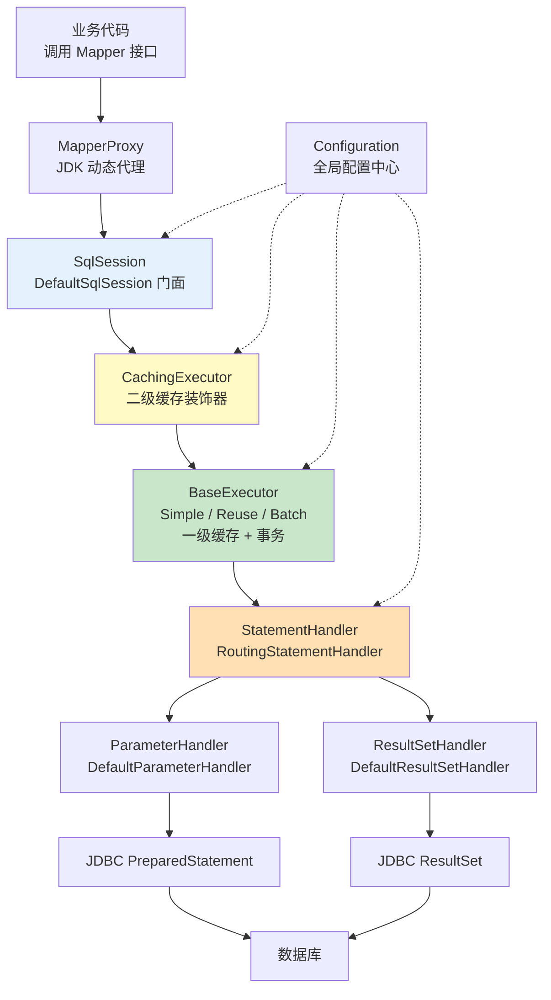
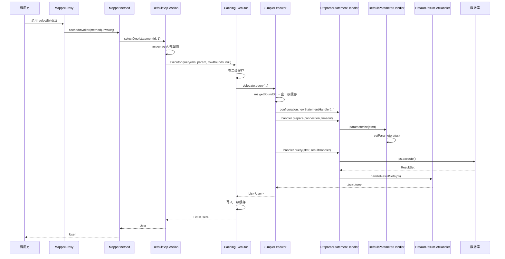
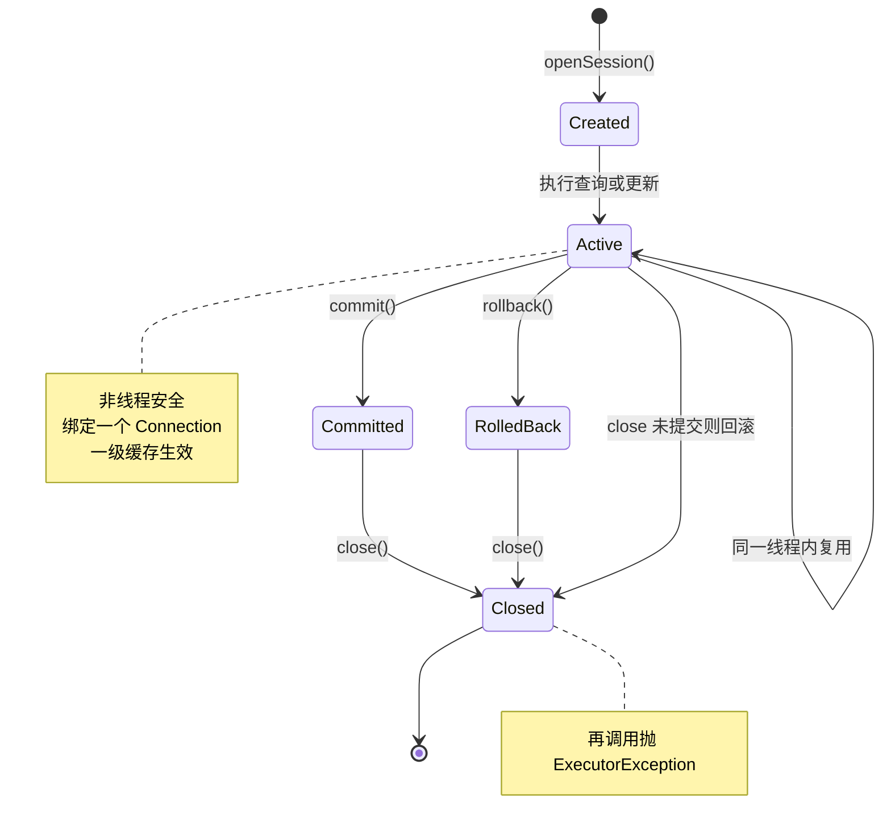

# MyBatis 架构与执行流程

> 定位：MyBatis 是「半自动 ORM」——SQL 由你写，映射交给框架。会用 `@Select` 和 XML 只要半天，但线上连接池耗尽、一级缓存脏读、`Invalid bound statement`、`selectOne` 返回多行这些坑，全都藏在「一次查询到底走了哪些组件」里。这篇从 `SqlSessionFactory` 讲到 `ResultSetHandler`，把 `selectOne` 的完整链路、MapperProxy 的动态代理、Executor 的装饰体系拆到源码级。

## 一、为什么需要 MyBatis

直接写 JDBC 的代码长这样：

```java
Connection conn = null;
PreparedStatement ps = null;
ResultSet rs = null;
try {
    conn = dataSource.getConnection();
    ps = conn.prepareStatement("SELECT id, name, email FROM users WHERE id = ?");
    ps.setLong(1, id);
    rs = ps.executeQuery();
    User user = null;
    if (rs.next()) {
        user = new User();
        user.setId(rs.getLong("id"));
        user.setName(rs.getString("name"));
        user.setEmail(rs.getString("email"));
    }
    return user;
} catch (SQLException e) {
    throw new RuntimeException(e);
} finally {
    if (rs != null) try { rs.close(); } catch (SQLException ignored) {}
    if (ps != null) try { ps.close(); } catch (SQLException ignored) {}
    if (conn != null) try { conn.close(); } catch (SQLException ignored) {}
}
```

一段简单查询，真正表达业务意图的只有 SQL 和映射两行，其余全是样板。JDBC 的痛点可以归为五类：

| 痛点 | 具体表现 | MyBatis 的解法 |
|---|---|---|
| 连接管理 | 手动获取/归还，忘了就泄漏 | `DataSource` + 事务管理 |
| 参数绑定 | 下标从 1 开始，类型要手动设 | `#{}` + `ParameterHandler` + `TypeHandler` |
| 结果映射 | 列名到属性逐个 `getXxx` | `ResultMap` 自动/显式映射 |
| 资源关闭 | `finally` 三层嵌套 | `SqlSession` 统一关闭 |
| 异常转换 | 受检 `SQLException` 污染业务 | `PersistenceException` 统一包装 |

MyBatis 的定位很清晰：**SQL 仍然由开发者掌握，框架只负责参数绑定、执行、结果映射、资源管理和缓存**。这跟 Hibernate 的「全自动 ORM」是两条路线：

| 维度 | MyBatis | Hibernate/JPA |
|---|---|---|
| SQL 控制 | 开发者手写，完全可控 | 框架生成，复杂查询难调优 |
| 学习成本 | 低，会 SQL 就能用 | 高，要懂脏检查、一级/二级缓存、抓取策略 |
| 数据库移植 | 弱，SQL 方言自己处理 | 强，HQL/JPQL 屏蔽方言 |
| 动态 SQL | 内置 `<if>`/`<foreach>`，很强 | Criteria API，较繁琐 |
| 复杂查询 | 直接写 SQL，清晰 | 容易生成低效 SQL |
| 适合场景 | 互联网业务、SQL 调优频繁 | 领域模型复杂、数据库相对固定 |

所以国内互联网公司大量用 MyBatis：**SQL 是性能的第一现场，必须握在自己手里**。

## 二、整体架构与核心组件

MyBatis 的架构可以分三层：

- **接口层**：`SqlSession`，暴露给业务的 CRUD API。
- **核心处理层**：`Configuration`、`Executor`、`StatementHandler`、`ParameterHandler`、`ResultSetHandler`，负责一次 SQL 的完整生命周期。
- **基础支撑层**：`DataSource`、`Transaction`、`TypeHandler`、`Log`、`Plugin`，提供连接、事务、类型转换、日志、拦截能力。



这张图要抓住两条线：**纵向是调用链**（MapperProxy → SqlSession → Executor → StatementHandler → JDBC），**横向是 Configuration 的支撑**（所有组件都从它这里拿配置、MappedStatement、TypeHandler）。下面逐个说。

### 2.1 Configuration：全局配置中心

`org.apache.ibatis.session.Configuration` 是 MyBatis 的「大脑」，一个 `SqlSessionFactory` 对应一个 `Configuration`，生命周期与应用相同。它持有：

| 字段 | 作用 |
|---|---|
| `Environment environment` | 数据源 + 事务工厂 |
| `MapperRegistry mapperRegistry` | Mapper 接口 → MapperProxyFactory |
| `Map<String, MappedStatement> mappedStatements` | 每条 SQL 的完整描述 |
| `Map<String, ResultMap> resultMaps` | 结果映射规则 |
| `TypeHandlerRegistry typeHandlerRegistry` | Java 类型 ↔ JDBC 类型 |
| `InterceptorChain interceptorChain` | 插件链 |
| `boolean cacheEnabled` | 二级缓存总开关 |
| `LocalCacheScope localCacheScope` | 一级缓存作用域 |

`MappedStatement` 是「一条 SQL 的全部元数据」：id、SQL 来源（`SqlSource`）、参数映射、结果映射、语句类型（SELECT/INSERT/UPDATE/DELETE）、缓存配置、超时、`flushCache`/`useCache` 等。后面整条链路都在围绕它转。

### 2.2 SqlSessionFactory：工厂

`SqlSessionFactory` 的核心职责只有一个：**生产 `SqlSession`**。

```java
public interface SqlSessionFactory {
    SqlSession openSession();
    SqlSession openSession(boolean autoCommit);
    SqlSession openSession(Connection connection);
    SqlSession openSession(TransactionIsolationLevel level);
    SqlSession openSession(ExecutorType execType);
    SqlSession openSession(ExecutorType execType, boolean autoCommit);
    SqlSession openSession(ExecutorType execType, TransactionIsolationLevel level);
    SqlSession openSession(ExecutorType execType, Connection connection);
    Configuration getConfiguration();
}
```

实现类是 `DefaultSqlSessionFactory`，`openSession()` 内部会：

1. 从 `Environment` 拿 `TransactionFactory`，创建 `Transaction`（内部持有 `Connection`）。
2. 调用 `configuration.newExecutor(transaction, executorType)` 创建 `Executor`。
3. 用 `new DefaultSqlSession(configuration, executor, autoCommit)` 包装返回。

**工厂是重量级、线程安全的，应用内只建一次**。构建方式：

```java
String resource = "mybatis-config.xml";
try (InputStream in = Resources.getResourceAsStream(resource)) {
    SqlSessionFactory factory = new SqlSessionFactoryBuilder().build(in);
}
```

`SqlSessionFactoryBuilder` 用完即弃，它只负责解析配置、构建 `Configuration`，不持有状态。

### 2.3 SqlSession：门面

`SqlSession` 是给业务用的门面（Facade），把 `Executor`、`Configuration`、事务状态包装成一组易用的 API：

```java
public interface SqlSession extends Closeable {
    <T> T selectOne(String statement);
    <E> List<E> selectList(String statement, Object parameter, RowBounds rowBounds);
    int insert(String statement, Object parameter);
    int update(String statement, Object parameter);
    int delete(String statement, Object parameter);
    void commit();
    void rollback();
    <T> T getMapper(Class<T> type);
    Configuration getConfiguration();
    void close();
}
```

实现类 `DefaultSqlSession` 的字段很少：

```java
public class DefaultSqlSession implements SqlSession {
    private final Configuration configuration;
    private final Executor executor;
    private final boolean autoCommit;
    private boolean dirty;   // 是否执行过写操作但未提交
}
```

注意 `dirty`：执行过 `update/insert/delete` 后置为 true，`commit/rollback` 后复位。如果忘记提交就关闭，MyBatis 不会帮你兜底——这也是「更新不生效」的常见原因之一。

**SqlSession 不是线程安全的**，必须每次请求新建、用完关闭，后面单独一节讲。

### 2.4 Executor：执行器

`Executor` 是真正的「调度中心」，负责：

- 调用 `MappedStatement.getBoundSql()` 拿到最终 SQL 和参数映射。
- 生成 `CacheKey`，查一级/二级缓存。
- 创建 `StatementHandler`，执行 SQL。
- 管理事务（`commit`/`rollback`）和延迟加载。

```java
public interface Executor {
    int update(MappedStatement ms, Object parameter) throws SQLException;
    <E> List<E> query(MappedStatement ms, Object parameter, RowBounds rowBounds,
                      ResultHandler resultHandler) throws SQLException;
    <E> List<E> query(MappedStatement ms, Object parameter, RowBounds rowBounds,
                      ResultHandler resultHandler, CacheKey cacheKey, BoundSql boundSql) throws SQLException;
    <E> Cursor<E> queryCursor(MappedStatement ms, Object parameter, RowBounds rowBounds) throws SQLException;
    List<BatchResult> flushStatements() throws SQLException;
    void commit(boolean required) throws SQLException;
    void rollback(boolean required) throws SQLException;
    Transaction getTransaction();
    void close(boolean forceRollback);
    boolean isClosed();
}
```

`BaseExecutor` 是模板类，把「一级缓存、事务、延迟加载」这些公共逻辑固定下来，只把 `doQuery`/`doUpdate`/`doFlushStatements` 留给子类。具体子类有 `SimpleExecutor`、`ReuseExecutor`、`BatchExecutor`；`CachingExecutor` 是装饰器，负责二级缓存。

### 2.5 StatementHandler：语句处理器

`StatementHandler` 负责 JDBC 层的那一段：**创建 `Statement`、设置超时/抓取大小、绑定参数、执行、把 `ResultSet` 交给 `ResultSetHandler`**。

```java
public interface StatementHandler {
    Statement prepare(Connection connection, Integer transactionTimeout) throws SQLException;
    void parameterize(Statement statement) throws SQLException;
    void batch(Statement statement) throws SQLException;
    int update(Statement statement) throws SQLException;
    <E> List<E> query(Statement statement, ResultHandler resultHandler) throws SQLException;
    <E> Cursor<E> queryCursor(Statement statement) throws SQLException;
    BoundSql getBoundSql();
    ParameterHandler getParameterHandler();
}
```

`RoutingStatementHandler` 根据 `MappedStatement.getStatementType()` 路由到三个实现：

| 实现 | 对应 JDBC | 使用场景 |
|---|---|---|
| `SimpleStatementHandler` | `Statement` | `statementType="STATEMENT"`，无参数，拼接 SQL |
| `PreparedStatementHandler` | `PreparedStatement` | 默认，`#{}` 预编译 |
| `CallableStatementHandler` | `CallableStatement` | 调用存储过程 |

绝大多数情况用的是 `PreparedStatementHandler`。

### 2.6 ParameterHandler 与 ResultSetHandler

`ParameterHandler` 的核心方法是 `setParameters(PreparedStatement ps)`，实现类 `DefaultParameterHandler` 会遍历 `BoundSql` 里的 `ParameterMapping` 列表，用 `TypeHandler` 把 Java 值设到 `?` 上。

`ResultSetHandler` 的核心方法是 `handleResultSets(Statement stmt)`，实现类 `DefaultResultSetHandler` 负责把 `ResultSet` 的每一行按 `ResultMap` 映射成对象，处理自动映射、嵌套映射、延迟加载、类型转换。

| 组件 | 职责 | 创建时机 | 线程安全 |
|---|---|---|---|
| `Configuration` | 全局配置 | 启动时 | 是（只读为主） |
| `SqlSessionFactory` | 生产 SqlSession | 启动时 | 是 |
| `SqlSession` | 门面 | 每次请求 | **否** |
| `Executor` | 执行/缓存/事务 | 每个 SqlSession | **否** |
| `StatementHandler` | JDBC 语句 | 每次 SQL | **否** |
| `ParameterHandler` | 参数绑定 | 每次 SQL | **否** |
| `ResultSetHandler` | 结果映射 | 每次 SQL | **否** |

## 三、一次查询的完整链路

下面以 `userMapper.selectById(1L)` 为例，走一遍完整链路。先看时序图：



这张图信息量很大，建议对照下面的源码逐段看。核心顺序是：**代理 → 门面 → 二级缓存 → 一级缓存 → 语句处理器 → 参数绑定 → JDBC 执行 → 结果映射**。

### 3.1 入口：Mapper 方法到 SqlSession

业务代码调用的是 Mapper 接口，实际执行的是 `MapperProxy`（第五节详解）。`MapperMethod.execute()` 最终会调用 `SqlSession.selectOne()`：

```java
// DefaultSqlSession
@Override
public <T> T selectOne(String statement, Object parameter) {
    List<T> list = this.selectList(statement, parameter);
    if (list.size() == 1) {
        return list.get(0);
    } else if (list.size() > 1) {
        throw new TooManyResultsException(
            "Expected one result (or null) to be returned by selectOne(), but found: " + list.size());
    } else {
        return null;
    }
}

@Override
public <E> List<E> selectList(String statement, Object parameter, RowBounds rowBounds) {
    try {
        MappedStatement ms = configuration.getMappedStatement(statement);
        return executor.query(ms, wrapCollection(parameter), rowBounds, Executor.NO_RESULT_HANDLER);
    } catch (Exception e) {
        throw ExceptionFactory.wrapException("Error querying database.  Cause: " + e, e);
    } finally {
        ErrorContext.instance().reset();
    }
}
```

两个细节：

- `selectOne` 本质是 `selectList` 后判断数量，**多于一条就抛 `TooManyResultsException`**，不是取第一条。
- `wrapCollection(parameter)` 会把单个集合参数包装成 `Map`，key 为 `collection`/`list`/`array`，这样 XML 里可以用 `collection="list"`。这也是 `foreach` 能工作的前提之一。

### 3.2 Executor.query：BoundSql、CacheKey 与一级缓存

`BaseExecutor.query` 是整条链路的中枢：

```java
@Override
public <E> List<E> query(MappedStatement ms, Object parameter, RowBounds rowBounds,
                         ResultHandler resultHandler) throws SQLException {
    BoundSql boundSql = ms.getBoundSql(parameter);
    CacheKey key = createCacheKey(ms, parameter, rowBounds, boundSql);
    return query(ms, parameter, rowBounds, resultHandler, key, boundSql);
}

@Override
public <E> List<E> query(MappedStatement ms, Object parameter, RowBounds rowBounds,
                         ResultHandler resultHandler, CacheKey key, BoundSql boundSql) throws SQLException {
    // ... 省略错误上下文、延迟加载等处理
    List<E> list = resultHandler == null ? (List<E>) localCache.getObject(key) : null;
    if (list != null) {
        handleLocallyCachedOutputParameters(ms, key, parameter, boundSql);
    } else {
        list = queryFromDatabase(ms, parameter, rowBounds, resultHandler, key, boundSql);
    }
    // ... 省略延迟加载处理
    return list;
}

private <E> List<E> queryFromDatabase(MappedStatement ms, Object parameter, RowBounds rowBounds,
                                      ResultHandler resultHandler, CacheKey key, BoundSql boundSql) throws SQLException {
    localCache.putObject(key, EXECUTION_PLACEHOLDER);
    try {
        list = doQuery(ms, parameter, rowBounds, resultHandler, boundSql);
    } finally {
        localCache.removeObject(key);
    }
    localCache.putObject(key, list);
    // ... 省略 output parameter 缓存
    return list;
}
```

这里有三件事：

1. **`BoundSql`**：`ms.getBoundSql(parameter)` 会执行 `SqlSource`，把 `<if>`/`<foreach>` 等动态标签解析成最终 SQL，并生成 `ParameterMapping` 列表（每个 `#{}` 对应一个）。`BoundSql` 里同时持有 `sql`、`parameterMappings`、`parameterObject` 和额外的 `additionalParameters`（`foreach` 的 `__frch_item_0` 就在里面）。
2. **`CacheKey`**：由 `MappedStatement` id、SQL、参数、`RowBounds`、`Environment` id 等组成。参数相同、SQL 相同，key 才相同，缓存才可能命中。
3. **一级缓存**：`localCache` 是 `PerpetualCache`，key 是 `CacheKey`，value 是查询结果。`queryFromDatabase` 先放一个占位符 `EXECUTION_PLACEHOLDER`，防止嵌套查询重复加载；查完替换成真实结果。

`ms.getBoundSql(parameter)` 背后是 `SqlSource`，它决定了 SQL 是「启动时算好」还是「每次调用现算」：

| `SqlSource` 实现 | 触发条件 | 行为 |
|---|---|---|
| `DynamicSqlSource` | 含 `${}` 或 `<if>`/`<foreach>` 等动态标签 | 每次调用解析标签，生成 `BoundSql` |
| `RawSqlSource` | 只有 `#{}`，没有动态标签 | 启动时解析一次，运行时直接取 |
| `StaticSqlSource` | 无参数、无动态标签 | 持有固定 SQL，直接返回 |

所以动态 SQL 越多，`getBoundSql` 的运行时开销越大；高频 SQL 尽量少用不必要的 `<if>`，或者把稳定分支拆成独立的 `MappedStatement`。

如果开了二级缓存，最外层还有 `CachingExecutor`：

```java
@Override
public <E> List<E> query(MappedStatement ms, Object parameterObject, RowBounds rowBounds,
                         ResultHandler resultHandler, CacheKey key, BoundSql boundSql) throws SQLException {
    Cache cache = ms.getCache();
    if (cache != null) {
        flushCacheIfRequired(ms);
        if (ms.isUseCache() && resultHandler == null) {
            ensureNoOutParams(ms, boundSql);
            List<E> list = (List<E>) tcm.getObject(cache, key);
            if (list == null) {
                list = delegate.query(ms, parameterObject, rowBounds, resultHandler, key, boundSql);
                tcm.putObject(cache, key, list);
            }
            return list;
        }
    }
    return delegate.query(ms, parameterObject, rowBounds, resultHandler, key, boundSql);
}
```

所以真实顺序是：**CachingExecutor 查二级缓存 → 未命中交给 BaseExecutor 查一级缓存 → 仍未命中才查库**。

### 3.3 StatementHandler.prepare：创建 PreparedStatement

`SimpleExecutor.doQuery` 负责创建 `StatementHandler` 并执行：

```java
@Override
public <E> List<E> doQuery(MappedStatement ms, Object parameter, RowBounds rowBounds,
                           ResultHandler resultHandler, BoundSql boundSql) throws SQLException {
    Statement stmt = null;
    try {
        Configuration configuration = ms.getConfiguration();
        StatementHandler handler = configuration.newStatementHandler(
            wrapper, ms, parameter, rowBounds, resultHandler, boundSql);
        stmt = prepareStatement(handler, ms.getStatementLog());
        return handler.query(stmt, resultHandler);
    } finally {
        closeStatement(stmt);
    }
}

private Statement prepareStatement(StatementHandler handler, Log statementLog) throws SQLException {
    Connection connection = getConnection(statementLog);
    Statement stmt = handler.prepare(connection, transaction.getTimeout());
    handler.parameterize(stmt);
    return stmt;
}
```

`Configuration.newStatementHandler` 会创建 `RoutingStatementHandler`，并让插件链包一层：

```java
public StatementHandler newStatementHandler(Executor executor, MappedStatement mappedStatement,
        Object parameterObject, RowBounds rowBounds, ResultHandler resultHandler, BoundSql boundSql) {
    StatementHandler statementHandler = new RoutingStatementHandler(
        executor, mappedStatement, parameterObject, rowBounds, resultHandler, boundSql);
    statementHandler = (StatementHandler) interceptorChain.pluginAll(statementHandler);
    return statementHandler;
}
```

`BaseStatementHandler.prepare` 做三件事：

```java
@Override
public Statement prepare(Connection connection, Integer transactionTimeout) throws SQLException {
    ErrorContext.instance().sql(boundSql.getSql());
    Statement statement = null;
    try {
        statement = instantiateStatement(connection);
        setStatementTimeout(statement, transactionTimeout);
        setFetchSize(statement);
        return statement;
    } catch (SQLException e) {
        closeStatement(statement);
        throw e;
    } catch (Exception e) {
        closeStatement(statement);
        throw new ExecutorException("Error preparing statement.  Cause: " + e, e);
    }
}
```

`instantiateStatement` 在 `PreparedStatementHandler` 里就是 `connection.prepareStatement(sql)`，并根据 `keyGenerator` 和 `ResultSetType` 决定是否带 `RETURN_GENERATED_KEYS`、是否指定结果集类型。注意：**这里只是创建语句对象，还没有绑定参数**。

### 3.4 ParameterHandler.setParameters：把 Java 值绑到 ?

`handler.parameterize(stmt)` 会调用 `ParameterHandler.setParameters`：

```java
@Override
public void setParameters(PreparedStatement ps) {
    ErrorContext.instance().activity("setting parameters").object(mappedStatement.getParameterMap().getId());
    List<ParameterMapping> parameterMappings = boundSql.getParameterMappings();
    if (parameterMappings != null) {
        for (int i = 0; i < parameterMappings.size(); i++) {
            ParameterMapping parameterMapping = parameterMappings.get(i);
            if (parameterMapping.getMode() != ParameterMode.OUT) {
                Object value;
                String propertyName = parameterMapping.getProperty();
                if (boundSql.hasAdditionalParameter(propertyName)) {
                    // foreach 等动态标签产生的额外参数
                    value = boundSql.getAdditionalParameter(propertyName);
                } else if (parameterObject == null) {
                    value = null;
                } else if (typeHandlerRegistry.hasTypeHandler(parameterObject.getClass())) {
                    // 参数本身就是简单类型
                    value = parameterObject;
                } else {
                    MetaObject metaObject = configuration.newMetaObject(parameterObject);
                    value = metaObject.getValue(propertyName);
                }
                TypeHandler typeHandler = parameterMapping.getTypeHandler();
                JdbcType jdbcType = parameterMapping.getJdbcType();
                if (value == null && jdbcType == null) {
                    jdbcType = configuration.getJdbcTypeForNull();
                }
                typeHandler.setParameter(ps, i + 1, value, jdbcType);
            }
        }
    }
}
```

关键点：

- `#{}` 在解析阶段被替换成 `?`，同时生成一个 `ParameterMapping`，记录属性名、Java 类型、JDBC 类型、`TypeHandler`。
- 取值优先级：`BoundSql.additionalParameters` → 简单类型直接用 → `MetaObject.getValue(propertyName)` 走属性路径（支持 `user.name`、`list[0]`）。
- `TypeHandler` 决定 `ps.setLong`、`ps.setString`、`ps.setTimestamp` 等具体调用。
- `jdbcTypeForNull` 默认是 `OTHER`，Oracle 等数据库对 null 类型敏感时需要在 `#{name,jdbcType=VARCHAR}` 里显式指定。

### 3.5 JDBC execute：真正打到数据库

参数绑完后，`PreparedStatementHandler.query` 执行：

```java
@Override
public <E> List<E> query(Statement statement, ResultHandler resultHandler) throws SQLException {
    PreparedStatement ps = (PreparedStatement) statement;
    ps.execute();
    return resultSetHandler.handleResultSets(ps);
}
```

`ps.execute()` 是真正的网络往返：驱动把 SQL 和参数发给数据库，数据库解析、执行、返回 `ResultSet`。这一步的耗时由 SQL 本身、索引、锁、网络决定，MyBatis 只是转发。

### 3.6 ResultSetHandler.handleResultSets：映射结果

`DefaultResultSetHandler.handleResultSets` 是结果映射的总入口：

```java
@Override
public List<Object> handleResultSets(Statement stmt) throws SQLException {
    ErrorContext.instance().activity("handling results").object(mappedStatement.getId());

    final List<Object> multipleResults = new ArrayList<>();
    int resultSetCount = 0;
    ResultSetWrapper rsw = getFirstResultSet(stmt);
    List<ResultMap> resultMaps = mappedStatement.getResultMaps();
    int resultMapCount = resultMaps.size();

    while (rsw != null && resultMapCount > resultSetCount) {
        ResultMap resultMap = resultMaps.get(resultSetCount);
        handleResultSet(rsw, resultMap, multipleResults, null);
        rsw = getNextResultSet(stmt);
        cleanUpAfterHandlingResultSet();
        resultSetCount++;
    }
    // ... 省略多结果集、输出参数处理
    return collapseSingleResultList(multipleResults);
}
```

单结果集的处理路径是：

1. `handleResultSet` → `handleRowValues`。
2. 如果没有嵌套 `ResultMap`，走 `handleRowValuesForSimpleResultMap`：`while (rs.next())` 逐行 `getRowValue`。
3. `getRowValue` 创建结果对象（构造器或默认构造），按 `ResultMap` 的 `ResultMapping` 逐个属性赋值：`typeHandler.getResult(rs, columnName)`。
4. 有嵌套 `association`/`collection` 时，走 `handleRowValuesForNestedResultMap`，用 `rowKey` 去重、合并嵌套对象。

自动映射（`resultType`）和显式映射（`resultMap`）的区别就在这一步：

| 方式 | 规则 | 适用 |
|---|---|---|
| `resultType` | 列名 → 属性名，开启 `mapUnderscoreToCamelCase` 后 `user_name` → `userName` | 简单 DTO、列名规范 |
| `resultMap` | 显式 `<id>`/`<result>`/`<association>`/`<collection>` | 字段不一致、嵌套对象、类型转换、构造器注入 |

整条链路可以用一句话概括：**MapperProxy 把方法调用翻译成 statement id，SqlSession 找到 MappedStatement，Executor 负责缓存和调度，StatementHandler 负责 JDBC 语句，ParameterHandler 绑参数，ResultSetHandler 映射结果。**

## 四、SqlSession 生命周期与线程安全

### 4.1 为什么 SqlSession 不是线程安全的

`DefaultSqlSession` 本身没有做任何同步，它持有的 `Executor` 更不是线程安全的：

- `Executor` 持有 `Transaction`，`Transaction` 持有 JDBC `Connection`。**一个 Connection 同一时刻只能被一个线程使用**，多线程共享会导致事务边界混乱、结果错乱。
- `BaseExecutor` 的 `localCache`（一级缓存）是普通 `PerpetualCache`（内部 `HashMap`），多线程并发读写会破坏结构。
- `dirty` 标志、`autoCommit`、事务状态都是实例级可变状态。
- `StatementHandler`、`ParameterHandler` 在每次 SQL 时创建，但它们的 `BoundSql`、参数对象来自共享的 `MappedStatement` 和调用方，跨线程共享参数对象本身也不安全。

所以结论很硬：**SqlSession 必须在单个线程内使用，用完立即关闭**。典型用法：

```java
try (SqlSession session = sqlSessionFactory.openSession()) {
    UserMapper mapper = session.getMapper(UserMapper.class);
    User user = mapper.selectById(1L);
    session.commit();   // 写操作必须提交
}
```

`SqlSession` 实现了 `Closeable`，try-with-resources 会保证 `close()`。`close()` 内部会调用 `executor.close(isCommitOrRollbackRequired(false))`，如果还有未提交的写操作，默认会回滚——所以**忘了 commit 的更新会静默丢失**。

### 4.2 生命周期



生命周期对应的最佳实践：

| 对象 | 作用域 | 说明 |
|---|---|---|
| `SqlSessionFactoryBuilder` | 方法级 | 构建完即可丢弃 |
| `SqlSessionFactory` | 应用级 | 单例，线程安全 |
| `SqlSession` | 请求/方法级 | 非线程安全，必须关闭 |
| `Mapper` 实例 | 绑定到某个 SqlSession | 不要跨线程、跨请求缓存 |

### 4.3 Spring 的 SqlSessionTemplate 怎么保证线程安全

原生 MyBatis 要手动 open/close，Spring 集成后业务只注入 Mapper，背后是 `org.mybatis.spring.SqlSessionTemplate`。它本身是线程安全的，做法是**用一个动态代理包装真实的 SqlSession，每次方法调用都从「当前线程绑定」的上下文里取 session**：

```java
public class SqlSessionTemplate implements SqlSession {
    private final SqlSessionFactory sqlSessionFactory;
    private final ExecutorType executorType;
    private final SqlSession sqlSessionProxy;

    public SqlSessionTemplate(SqlSessionFactory sqlSessionFactory, ExecutorType executorType,
                              PersistenceExceptionTranslator exceptionTranslator) {
        this.sqlSessionFactory = sqlSessionFactory;
        this.executorType = executorType;
        this.exceptionTranslator = exceptionTranslator;
        this.sqlSessionProxy = (SqlSession) Proxy.newProxyInstance(
            SqlSessionFactory.class.getClassLoader(),
            new Class[]{SqlSession.class},
            new SqlSessionInterceptor());
    }

    @Override
    public <T> T selectOne(String statement) {
        return this.sqlSessionProxy.selectOne(statement);
    }

    private class SqlSessionInterceptor implements InvocationHandler {
        @Override
        public Object invoke(Object proxy, Method method, Object[] args) throws Throwable {
            SqlSession sqlSession = getSqlSession(
                SqlSessionTemplate.this.sqlSessionFactory,
                SqlSessionTemplate.this.executorType,
                SqlSessionTemplate.this.exceptionTranslator);
            try {
                Object result = method.invoke(sqlSession, args);
                if (!isSqlSessionTransactional(sqlSession, SqlSessionTemplate.this.sqlSessionFactory)) {
                    sqlSession.commit(true);
                }
                return result;
            } catch (Throwable t) {
                Throwable unwrapped = unwrapThrowable(t);
                if (SqlSessionTemplate.this.exceptionTranslator != null
                        && unwrapped instanceof PersistenceException) {
                    // 关闭 session 并翻译异常
                }
                throw unwrapped;
            } finally {
                if (sqlSession != null) {
                    closeSqlSession(sqlSession, SqlSessionTemplate.this.sqlSessionFactory);
                }
            }
        }
    }
}
```

关键在 `getSqlSession` / `closeSqlSession`（`SqlSessionUtils`）：

```java
public static SqlSession getSqlSession(SqlSessionFactory sessionFactory, ExecutorType executorType,
        PersistenceExceptionTranslator exceptionTranslator) {
    SqlSessionHolder holder = (SqlSessionHolder) TransactionSynchronizationManager.getResource(sessionFactory);
    SqlSession session = sessionHolder(executorType, holder);
    if (session != null) {
        return session;
    }
    session = sessionFactory.openSession(executorType);
    registerSessionHolder(sessionFactory, executorType, exceptionTranslator, session);
    return session;
}

public static void closeSqlSession(SqlSession session, SqlSessionFactory sessionFactory) {
    SqlSessionHolder holder = (SqlSessionHolder) TransactionSynchronizationManager.getResource(sessionFactory);
    if (holder != null && holder.getSqlSession() == session) {
        holder.released();   // 事务中只减引用计数，不真正关闭
    } else {
        session.close();     // 非事务：真正关闭
    }
}
```

这段代码解释了两个常见现象：

1. **在 `@Transactional` 方法里，多次 Mapper 调用共用同一个 SqlSession 和同一个 Connection**。因为 session 被注册到 `TransactionSynchronizationManager` 的 ThreadLocal 资源里，同一线程复用；`closeSqlSession` 只做 `released()`，真正的关闭由事务同步回调在事务结束时执行。这也是一级缓存在事务内生效的原因。
2. **没有事务时，每次 Mapper 调用都是新的 SqlSession**，用完立即关闭。此时一级缓存只在单次调用内有效，跨调用不共享。

`SqlSessionTemplate` 通过「每次调用取当前线程的 session + 用完归还/关闭」实现了线程安全，但**它并没有让 SqlSession 本身变成线程安全**——只是保证每个线程拿到自己的 session。理解这一点，才能解释「为什么事务内一级缓存会命中、事务外不会」。

| 维度 | 原生 `SqlSession` | `SqlSessionTemplate` |
|---|---|---|
| 线程安全 | 否 | 是（代理 + ThreadLocal 绑定） |
| 获取方式 | `factory.openSession()` | 直接注入 Mapper |
| 关闭 | 手动 `close()` | 代理在 finally 中自动关闭/归还 |
| 事务 | 手动 `commit`/`rollback` | 交给 Spring 事务同步 |
| 一级缓存 | session 内有效 | 事务内有效，事务外每次新 session |

## 五、MapperProxy：只写接口为什么能注入

### 5.1 JDK 动态代理

Mapper 接口没有实现类，能调用是因为 MyBatis 在运行时用 JDK 动态代理生成了代理对象。入口在 `MapperRegistry`：

```java
public <T> T getMapper(Class<T> type, SqlSession sqlSession) {
    final MapperProxyFactory<T> mapperProxyFactory = (MapperProxyFactory<T>) knownMappers.get(type);
    if (mapperProxyFactory == null) {
        throw new BindingException("Type " + type + " is not known to the MapperRegistry.");
    }
    try {
        return mapperProxyFactory.newInstance(sqlSession);
    } catch (Exception e) {
        throw new BindingException("Error getting mapper instance. Cause: " + e, e);
    }
}
```

`MapperProxyFactory.newInstance`：

```java
protected T newInstance(MapperProxy<T> mapperProxy) {
    return (T) Proxy.newProxyInstance(
        mapperInterface.getClassLoader(),
        new Class[]{mapperInterface},
        mapperProxy);
}

public T newInstance(SqlSession sqlSession) {
    final MapperProxy<T> mapperProxy = new MapperProxy<>(sqlSession, mapperInterface, methodCache);
    return newInstance(mapperProxy);
}
```

所以：

- 代理类实现了 Mapper 接口，业务可以按接口类型注入。
- `InvocationHandler` 是 `MapperProxy`，所有方法调用都会进它的 `invoke`。
- 代理对象持有 `SqlSession`，所以原生 MyBatis 下 **Mapper 实例的生命周期不能超过创建它的 SqlSession**；Spring 注入的 Mapper 持有的是 `SqlSessionTemplate`，可以做成单例。

### 5.2 MapperProxy.invoke：区分三类方法

```java
@Override
public Object invoke(Object proxy, Method method, Object[] args) throws Throwable {
    try {
        if (Object.class.equals(method.getDeclaringClass())) {
            // toString/hashCode/equals 等，走代理对象自身
            return method.invoke(this, args);
        } else {
            return cachedInvoker(method).invoke(proxy, method, args, sqlSession);
        }
    } catch (Throwable t) {
        throw ExceptionUtil.unwrapThrowable(t);
    }
}
```

`cachedInvoker` 会缓存每个方法的调用器（MyBatis 3.5.6+）：

```java
private MapperMethodInvoker cachedInvoker(Method method) throws Throwable {
    return methodCache.computeIfAbsent(method, m -> {
        if (m.isDefault()) {
            // 接口 default 方法：用 MethodHandle 直接调用
            return new DefaultMethodInvoker(getMethodHandleJava9(m));
        } else {
            // 普通抽象方法：交给 MapperMethod
            return new PlainMethodInvoker(
                new MapperMethod(mapperInterface, method, sqlSession.getConfiguration()));
        }
    });
}
```

三类方法分得很清楚：

| 方法类型 | 处理方式 |
|---|---|
| `Object` 的 `toString`/`hashCode`/`equals` | 直接反射调用 `MapperProxy` 自身 |
| 接口 `default` 方法 | 用 `MethodHandle` 调用默认实现，不查 SQL |
| 普通抽象方法 | 构造 `MapperMethod`，转成 SQL 执行 |

异常会被 `ExceptionUtil.unwrapThrowable` 拆掉 `InvocationTargetException` 包装，保证业务看到的是真实异常（比如 `TooManyResultsException`）。

### 5.3 MapperMethod：把方法调用翻译成 SQL

`MapperMethod` 在构造时解析两样东西：

**`SqlCommand`**：确定这条方法对应哪个 `MappedStatement`、是什么语句类型。

```java
public static class SqlCommand {
    private final String name;
    private final SqlCommandType type;

    public SqlCommand(Configuration configuration, Class<?> mapperInterface, Method method) {
        final String methodName = method.getName();
        final Class<?> declaringClass = method.getDeclaringClass();
        MappedStatement ms = resolveMappedStatement(mapperInterface, methodName, declaringClass, configuration);
        if (ms == null) {
            if (method.getAnnotation(Flush.class) != null) {
                name = null;
                type = SqlCommandType.FLUSH;
            } else {
                throw new BindingException("Invalid bound statement (not found): "
                    + mapperInterface.getName() + "." + methodName);
            }
        } else {
            name = ms.getId();
            type = ms.getSqlCommandType();
            if (type == SqlCommandType.UNKNOWN) {
                throw new BindingException("Unknown execution method for: " + name);
            }
        }
    }
}
```

这就是 `Invalid bound statement (not found)` 的出处：**MyBatis 按「接口全限定名 + 方法名」去找 statement id，找不到就抛这个异常**。常见原因：XML 的 `namespace` 写错、`<select id>` 和方法名不一致、XML 没被扫描到、方法被重载。

**`MethodSignature`**：记录返回类型、是否返回多值、是否 `Optional`、是否有 `ResultHandler`、参数名解析器等。

执行时按 `SqlCommandType` 分发：

```java
public Object execute(SqlSession sqlSession, Object[] args) {
    Object result;
    switch (command.getType()) {
        case INSERT: {
            Object param = method.convertArgsToSqlCommandParam(args);
            result = rowCountResult(sqlSession.insert(command.getName(), param));
            break;
        }
        case UPDATE: {
            Object param = method.convertArgsToSqlCommandParam(args);
            result = rowCountResult(sqlSession.update(command.getName(), param));
            break;
        }
        case DELETE: {
            Object param = method.convertArgsToSqlCommandParam(args);
            result = rowCountResult(sqlSession.delete(command.getName(), param));
            break;
        }
        case SELECT:
            if (method.returnsVoid() && method.hasResultHandler()) {
                executeWithResultHandler(sqlSession, args);
                result = null;
            } else if (method.returnsMany()) {
                result = executeForMany(sqlSession, args);
            } else if (method.returnsMap()) {
                result = executeForMap(sqlSession, args);
            } else if (method.returnsCursor()) {
                result = executeForCursor(sqlSession, args);
            } else {
                Object param = method.convertArgsToSqlCommandParam(args);
                result = sqlSession.selectOne(command.getName(), param);
                if (method.returnsOptional()
                        && (result == null || !method.getReturnType().equals(result.getClass()))) {
                    result = Optional.ofNullable(result);
                }
            }
            break;
        case FLUSH:
            result = sqlSession.flushStatements();
            break;
        default:
            throw new BindingException("Unknown execution method for: " + command.getName());
    }
    if (result == null && method.getReturnType().isPrimitive() && !method.returnsVoid()) {
        throw new BindingException("Mapper method '" + command.getName()
            + "' attempted to return null from a method with a primitive return type (" + method.getReturnType() + ").");
    }
    return result;
}
```

`convertArgsToSqlCommandParam` 由 `ParamNameResolver` 完成，规则：

- 只有一个参数且没有 `@Param`：直接作为参数对象。
- 多个参数或有 `@Param`：封装成 `ParamMap`，key 是 `@Param` 的值或 `param1`/`arg0`。
- 参数里有 `RowBounds`/`ResultHandler`：会被单独识别，不参与 SQL 参数。

这也解释了为什么多参数方法要写 `@Param("name")`——不写的话 XML 里只能用 `param1`、`arg0`，可读性差且容易错。

### 5.4 为什么 Mapper 方法不能重载

`SqlCommand` 解析时只用了 `methodName`，statement id 是 `namespace + "." + methodName`，**不包含参数类型**。所以：

```java
User selectById(Long id);
User selectById(String id);   // 两个方法映射到同一个 statement id
```

两个重载会解析到同一个 statement id，参数映射却按各自的方法签名生成，极易张冠李戴或直接报错。**Mapper 接口禁止重载**，这是 MyBatis 的硬约束，不是风格建议。

## 六、Executor 体系

### 6.1 三种基础执行器

`Configuration.newExecutor` 根据 `ExecutorType` 创建：

```java
public Executor newExecutor(Transaction transaction, ExecutorType executorType) {
    executorType = executorType == null ? defaultExecutorType : executorType;
    executorType = executorType == null ? ExecutorType.SIMPLE : executorType;
    Executor executor;
    if (ExecutorType.BATCH == executorType) {
        executor = new BatchExecutor(this, transaction);
    } else if (ExecutorType.REUSE == executorType) {
        executor = new ReuseExecutor(this, transaction);
    } else {
        executor = new SimpleExecutor(this, transaction);
    }
    if (cacheEnabled) {
        executor = new CachingExecutor(executor);
    }
    executor = (Executor) interceptorChain.pluginAll(executor);
    return executor;
}
```

| 执行器 | 行为 | 优点 | 缺点/注意 |
|---|---|---|---|
| `SimpleExecutor` | 每次查询/更新新建 `Statement`，用完关闭 | 简单、无状态 | 频繁创建语句对象，有开销 |
| `ReuseExecutor` | 用 `Map<String, Statement>` 按 SQL 缓存 `Statement`，同一 session 内复用 | 减少语句创建 | session 关闭才释放；动态 SQL 多时缓存膨胀 |
| `BatchExecutor` | 把多条 update 累积成 JDBC batch，`flushStatements` 时一起执行 | 批量写吞吐高 | 只适合 update；必须手动 flush/commit；无法立刻拿到每条的返回值 |

`ReuseExecutor` 的核心：

```java
private final Map<String, Statement> statementMap = new HashMap<>();

private Statement prepareStatement(StatementHandler handler, Log statementLog) throws SQLException {
    Statement stmt;
    BoundSql boundSql = handler.getBoundSql();
    String sql = boundSql.getSql();
    if (hasStatementFor(sql)) {
        stmt = getStatement(sql);
        applyTransactionTimeout(stmt);
    } else {
        Connection connection = getConnection(statementLog);
        stmt = handler.prepare(connection, transaction.getTimeout());
        putStatement(sql, stmt);
    }
    handler.parameterize(stmt);
    return stmt;
}
```

`BatchExecutor` 的核心是 `doUpdate` 把 `Statement` 和参数累积到 `BatchResult`，`doFlushStatements` 调 `stmt.executeBatch()`。**用 BatchExecutor 时如果忘了 `flushStatements()` 或 `commit()`，数据不会落库**——Spring 下 `SqlSessionTemplate` 会在非事务调用结束时 commit，但批量场景通常要显式控制。

### 6.2 CachingExecutor：二级缓存的装饰器

`CachingExecutor` 是装饰器模式的典型应用：它不直接执行 SQL，而是先查 `MappedStatement` 对应的 `Cache`，未命中再委托给真实 `Executor`。

```java
public class CachingExecutor implements Executor {
    private final Executor delegate;
    private final TransactionalCacheManager tcm = new TransactionalCacheManager();
    // ...
}
```

它有两个关键设计：

1. **事务性缓存**：`tcm.putObject` 不是立刻写入 `Cache`，而是先放进 `TransactionalCache` 的「待提交」列表；只有事务 `commit` 时才真正刷入底层缓存。这样避免「事务回滚了，缓存却写进去了」的脏数据。
2. **`flushCache` 控制**：`<insert>/<update>/<delete>` 默认 `flushCache=true`，执行前会清空对应 namespace 的二级缓存；`<select>` 默认 `useCache=true`、`flushCache=false`。

一级缓存和二级缓存的区别必须分清：

| 维度 | 一级缓存 | 二级缓存 |
|---|---|---|
| 位置 | `BaseExecutor.localCache` | `MappedStatement.cache` + `CachingExecutor` |
| 作用域 | 同一个 `SqlSession` | 同一个 namespace（跨 SqlSession） |
| 默认 | 开启 | 关闭，需 `<cache/>` 显式开启 |
| 存储 | `PerpetualCache`（HashMap） | 可配置 `EhCache`/`Redis` 等 |
| 失效 | `commit`/`rollback`/`update` 清空；`localCacheScope=STATEMENT` 时语句级 | 同 namespace 的写操作清空；跨 namespace 需 `<cache-ref>` |
| 序列化 | 不需要 | `readOnly=false` 时需要对象可序列化 |
| 风险 | 同 session 内读到旧数据 | 多表关联更新导致跨 namespace 脏数据 |

### 6.3 怎么选

| 场景 | 建议 |
|---|---|
| 常规 CRUD | `SimpleExecutor`（默认） |
| 同一 session 内重复执行相同 SQL | `ReuseExecutor` |
| 大批量 insert/update | `BatchExecutor` + 手动 `flushStatements`，MySQL 加 `rewriteBatchedStatements=true` |
| 读多写少、能容忍短暂不一致 | 开二级缓存，优先用 Redis 等集中式缓存 |
| 多表关联频繁更新 | **不要开二级缓存**，或只对单表、不变数据开 |

## 七、配置加载

### 7.1 从 XML 到 Configuration

`SqlSessionFactoryBuilder.build` 的入口：

```java
public SqlSessionFactory build(InputStream inputStream, String environment, Properties properties) {
    try {
        XMLConfigBuilder parser = new XMLConfigBuilder(inputStream, environment, properties);
        return build(parser.parse());
    } catch (Exception e) {
        throw ExceptionFactory.wrapException("Error building SqlSession.", e);
    } finally {
        ErrorContext.instance().reset();
        try { inputStream.close(); } catch (IOException ignored) {}
    }
}

public SqlSessionFactory build(Configuration config) {
    return new DefaultSqlSessionFactory(config);
}
```

`XMLConfigBuilder.parse()` 会检查是否重复解析，然后调用 `parseConfiguration`。解析顺序是有讲究的：

```java
private void parseConfiguration(XNode root) {
    try {
        propertiesElement(root.evalNode("properties"));
        Properties settings = settingsAsProperties(root.evalNode("settings"));
        loadCustomVfs(settings);
        loadCustomLogImpl(settings);
        typeAliasesElement(root.evalNode("typeAliases"));
        pluginElement(root.evalNode("plugins"));
        objectFactoryElement(root.evalNode("objectFactory"));
        objectWrapperFactoryElement(root.evalNode("objectWrapperFactory"));
        reflectorFactoryElement(root.evalNode("reflectorFactory"));
        settingsElement(settings);
        environmentsElement(root.evalNode("environments"));
        databaseIdProviderElement(root.evalNode("databaseIdProvider"));
        typeHandlerElement(root.evalNode("typeHandlers"));
        mapperElement(root.evalNode("mappers"));
    } catch (Exception e) {
        throw new BuilderException("Error parsing SQL Mapper Configuration. Cause: " + e, e);
    }
}
```

为什么是这个顺序：

- `properties` 最先，后面的 `${}` 占位符才能替换。
- `settings` 要在 `environments`、`typeHandlers` 之前生效，因为数据源、类型处理器会读这些配置。
- `mappers` 最后，因为解析 Mapper 时要用到已注册的 `TypeHandler`、`Plugin`、`Environment`。

几个高频配置：

| 配置 | 作用 | 常用值 |
|---|---|---|
| `cacheEnabled` | 二级缓存总开关 | `true`（默认） |
| `lazyLoadingEnabled` | 全局延迟加载 | `false`（默认） |
| `localCacheScope` | 一级缓存作用域 | `SESSION`（默认）/`STATEMENT` |
| `defaultExecutorType` | 默认执行器 | `SIMPLE`/`REUSE`/`BATCH` |
| `mapUnderscoreToCamelCase` | 下划线转驼峰 | `true` |
| `jdbcTypeForNull` | null 的 JDBC 类型 | `OTHER`/`NULL`/`VARCHAR` |
| `defaultStatementTimeout` | 语句超时秒数 | 按业务 |

### 7.2 Mapper XML 的解析

`mapperElement` 支持四种写法：

```xml
<mappers>
    <mapper resource="mapper/UserMapper.xml"/>
    <mapper url="file:///opt/mappers/UserMapper.xml"/>
    <mapper class="com.example.mapper.UserMapper"/>
    <package name="com.example.mapper"/>
</mappers>
```

`resource`/`url` 走 `XMLMapperBuilder.parse()`；`class` 走 `configuration.addMapper()`；`package` 走 `configuration.addMappers()` 扫描包下所有接口。

`XMLMapperBuilder.configurationElement` 的解析顺序：

```java
private void configurationElement(XNode context) {
    try {
        String namespace = context.getStringAttribute("namespace");
        if (namespace == null || namespace.isEmpty()) {
            throw new BuilderException("Mapper's namespace cannot be empty");
        }
        builderAssistant.setCurrentNamespace(namespace);
        cacheRefElement(context.evalNode("cache-ref"));
        cacheElement(context.evalNode("cache"));
        parameterMapElement(context.evalNodes("/mapper/parameterMap"));
        resultMapElements(context.evalNodes("/mapper/resultMap"));
        sqlElement(context.evalNodes("/mapper/sql"));
        buildStatementFromContext(context.evalNodes("select|insert|update|delete"));
    } catch (Exception e) {
        throw new BuilderException("Error parsing Mapper XML. ...", e);
    }
}
```

顺序同样是依赖驱动的：`cache-ref`/`cache` 先建缓存，`resultMap` 先注册（statement 要引用），`sql` 片段先解析（statement 要 `<include>`），最后才构建 statement。

每条 `<select>` 由 `XMLStatementBuilder.parseStatementNode()` 解析，最终通过 `MappedStatement.Builder` 构建，再 `configuration.addMappedStatement(ms)` 注册到 `mappedStatements`。**statement id = namespace + "." + 标签 id**，这个 id 就是 `MapperMethod.SqlCommand` 要找的 key。

接口绑定的另一条路径是注解：`MapperAnnotationBuilder.parse()` 会扫描 `@Select`/`@Insert`/`@Update`/`@Delete`/`@Results` 等注解，生成 `MappedStatement`；同时会尝试加载同名的 XML（`loadXmlResource()`），所以注解和 XML 可以混用，但**同一个方法不要两边都定义**，重复注册同一个 statement id 会报 `already contains value`。

## 八、生产坑点与排查

### 坑点 1：SqlSession 没关，连接池耗尽

**现象**：服务运行一段时间后报 `HikariPool-1 - Connection is not available, request timed out after 30000ms`，数据库连接数打满。

**原因**：手动 `openSession()` 后没有 `close()`，`Connection` 一直不归还；或者把 `SqlSession` 存成成员变量跨请求复用。

**解法**：

```java
try (SqlSession session = sqlSessionFactory.openSession()) {
    // ...
}
```

用 Spring 时不要手动 openSession，注入 Mapper 即可，`SqlSessionTemplate` 会管理生命周期。排查时看连接池活跃连接数、线程栈里卡在 `getConnection` 的位置。

### 坑点 2：一级缓存脏读

**现象**：同一个事务/同一个 SqlSession 内，第一次查到的数据，在别的会话更新后，第二次查询还是旧值。

**原因**：一级缓存默认 `localCacheScope=SESSION`，同一个 `SqlSession` 内相同 `CacheKey` 直接命中缓存，不会重新查库。如果中间有其他事务提交了更新，本 session 感知不到。

**解法**：

- 在 `mybatis-config.xml` 设置 `<setting name="localCacheScope" value="STATEMENT"/>`，让一级缓存只在单条语句内生效。
- 或者每次查询用新的 SqlSession（Spring 非事务调用天然如此）。
- 注意：一级缓存**不能完全关闭**，只能改作用域。

### 坑点 3：二级缓存脏数据

**现象**：开了 `<cache/>` 后，A 表更新了，关联查询 B 表的结果还是旧数据。

**原因**：二级缓存以 namespace 为单位。如果 `UserMapper` 的查询关联了 `orders` 表，而更新发生在 `OrderMapper` 的 namespace，`UserMapper` 的缓存不会被清空，读到脏数据。

**解法**：

- 多表关联查询不要开二级缓存，或只对「单表、几乎不变」的字典数据开。
- 用 `<cache-ref namespace="..."/>` 共享缓存，但会放大锁竞争和脏数据范围。
- 生产更推荐用 Redis 等集中式缓存，显式控制 key 和失效，而不是依赖 MyBatis 二级缓存。
- `readOnly=false` 时缓存对象必须可序列化，否则反序列化失败。

### 坑点 4：Invalid bound statement (not found)

**现象**：启动或调用时报 `BindingException: Invalid bound statement (not found): com.example.mapper.UserMapper.selectById`。

**原因**（按概率排序）：

1. XML 的 `namespace` 不是 Mapper 接口的全限定名。
2. `<select id>` 和方法名不一致，或拼写错误。
3. XML 放在 `src/main/java` 下但 Maven 没配置资源拷贝，编译后 XML 不在 classpath。
4. `mapper-locations` 没配或路径不对（Spring Boot）。
5. Mapper 接口没被 `@MapperScan` 扫描到。
6. `<select id>` 写成了全限定名，最终 id 变成 `namespace.namespace.method`，与接口方法对不上。

**解法**：先确认 `namespace + "." + id` 与报错信息里的全限定名完全一致；再确认 `target/classes` 下有 XML；最后检查扫描配置。这个错误 90% 是路径/命名问题，不是 MyBatis 的 bug。

### 坑点 5：selectOne 返回多行

**现象**：`TooManyResultsException: Expected one result (or null) to be returned by selectOne(), but found: 3`。

**原因**：SQL 的 `where` 条件不唯一，或者关联查询产生重复行（一对多 join 没去重）。`selectOne` 不会自动取第一条，而是严格校验。

**解法**：确认业务上是否应该唯一；不唯一就改 `selectList` 或加 `limit 1`；关联查询用 `distinct` 或 `resultMap` 的 `<id>` 做嵌套去重。

### 坑点 6：#{} 与 ${} 混用导致 SQL 注入

**现象**：安全扫描报 SQL 注入，或者 `order by ${column}` 被传入恶意字符串。

**原因**：`#{}` 会编译成 `?` 并绑定参数，安全；`${}` 是**字符串直接拼接**，不转义。很多人在 `order by`、表名、列名场景图方便用 `${}`，又把用户输入直接传进去。

**解法**：

- 能用 `#{}` 的地方一律用 `#{}`。
- 必须用 `${}` 的场景（动态表名/列名/排序字段），用**白名单**校验，不要直接拼用户输入。
- 排序方向只允许 `ASC`/`DESC` 两个枚举值。

### 坑点 7：批量插入慢

**现象**：循环调用 `insert` 一万次，耗时几分钟。

**原因**：每次 insert 都是一次网络往返 + 一次事务提交（如果自动提交），开销巨大。

**解法**：

- 用 `<foreach>` 拼多值 insert：`INSERT INTO t (a,b) VALUES (?,?),(?,?)...`，注意 SQL 长度和 `max_allowed_packet`。
- 或用 `BatchExecutor` + `flushStatements()`，MySQL JDBC URL 加 `rewriteBatchedStatements=true` 才会真正合并成多值语句。
- 控制每批 500-1000 条，避免大事务。

### 坑点 8：N+1 查询

**现象**：查 100 个订单，又发了 100 条查询查用户，接口 RT 飙升。

**原因**：`<association>`/`<collection>` 用了嵌套查询（`select` 属性），每条主记录触发一次子查询。

**解法**：改用嵌套结果映射（join + `<resultMap>` 的 `<association>`/`<collection>` 直接映射列），一次查询搞定；或者用延迟加载避免不必要的子查询，但根本解还是 join。用 MyBatis 日志或 APM 看 SQL 条数，很容易发现 N+1。

## 九、最佳实践

1. **SqlSessionFactory 单例**，应用启动时构建一次；`SqlSessionFactoryBuilder` 用完即弃。
2. **SqlSession 不跨线程、不跨请求**，try-with-resources 或交给 Spring 管理。
3. **Mapper 接口不要重载**，方法名与 statement id 一一对应。
4. **多参数方法加 `@Param`**，避免 `param1`/`arg0` 的可读性问题。
5. **能用 `#{}` 不用 `${}`**；动态表名/排序列用白名单。
6. **一级缓存保持默认 SESSION**，有脏读场景再改 `STATEMENT`；二级缓存慎用，优先集中式缓存。
7. **批量写用 BatchExecutor 或 foreach**，MySQL 开 `rewriteBatchedStatements=true`，控制批次大小。
8. **关联查询优先 join + resultMap**，避免 N+1；必须嵌套查询时开延迟加载。
9. **`resultMap` 显式声明主键 `<id>`**，嵌套映射的行去重依赖它。
10. **SQL 里不要 `select *`**，列名与 `ResultMap` 对齐，减少不必要的字段传输和映射。
11. **开启 MyBatis 日志**（`logImpl=SLF4J`），排查时能看到 SQL、参数、结果条数；生产注意日志量。
12. **用 `@MapperScan` 明确扫描范围**，避免启动时全包扫描和漏扫。

## 面试高频问法

**Q1：MyBatis 的四大核心组件是什么？各自负责什么？**

**一句话结论**：`SqlSessionFactory` 造会话、`SqlSession` 做门面、`Executor` 管执行和缓存、`StatementHandler` 管 JDBC 语句；另外还有 `ParameterHandler` 和 `ResultSetHandler` 负责参数与结果。

展开：

| 组件 | 职责 |
|---|---|
| `SqlSessionFactory` | 解析配置、生产 `SqlSession`，应用级单例 |
| `SqlSession` | 暴露 CRUD/事务/`getMapper`，非线程安全 |
| `Executor` | 缓存、事务、调度 `StatementHandler` |
| `StatementHandler` | 创建 `Statement`、绑定参数、执行、触发结果映射 |
| `ParameterHandler` | 把 Java 参数设到 `PreparedStatement` |
| `ResultSetHandler` | 把 `ResultSet` 映射成 Java 对象 |

加分点：说「`Configuration` 是隐藏的第五个核心，所有组件都从它拿 `MappedStatement`、`TypeHandler`、`Environment`」。

**Q2：一次 selectOne 的完整执行流程是怎样的？**

**一句话结论**：MapperProxy → MapperMethod → SqlSession.selectOne → CachingExecutor（二级缓存）→ BaseExecutor（一级缓存）→ StatementHandler.prepare → ParameterHandler.setParameters → JDBC execute → ResultSetHandler.handleResultSets。

展开：

1. 代理把方法调用翻译成 `statement id`。
2. `selectOne` 内部调 `selectList`，`executor.query(ms, param, rowBounds, null)`。
3. `CachingExecutor` 查二级缓存，未命中委托 `BaseExecutor`。
4. `BaseExecutor` 用 `ms.getBoundSql()` 生成 SQL 和 `ParameterMapping`，生成 `CacheKey`，查一级缓存。
5. 未命中则 `SimpleExecutor.doQuery` 创建 `StatementHandler`。
6. `prepare` 创建 `PreparedStatement`，`parameterize` 绑定参数。
7. `ps.execute()` 执行，`ResultSetHandler` 映射结果。
8. 结果回填一级/二级缓存。

加分点：说「缓存顺序是二级在前、一级在后；一级缓存在 `BaseExecutor` 里，二级缓存在 `CachingExecutor` 里，两者是装饰关系」。

**Q3：SqlSession 为什么不是线程安全的？Spring 怎么解决？**

**一句话结论**：它持有一个绑定 `Connection` 的 `Executor`，还有非线程安全的 `HashMap` 一级缓存和事务状态；Spring 用 `SqlSessionTemplate` 动态代理 + ThreadLocal 绑定，让每个线程用自己的 session。

展开：

- `DefaultSqlSession` 持有 `Executor`，`Executor` 持有 `Transaction`/`Connection`；一个连接不能被多线程同时使用。
- `localCache` 是 `PerpetualCache`（HashMap），并发读写不安全。
- `dirty`、`autoCommit` 是实例级可变状态。
- `SqlSessionTemplate` 的 `SqlSessionInterceptor` 每次调用 `getSqlSession`，从事务同步管理器取当前线程绑定的 session；事务内复用，事务外新建并关闭。

加分点：说「`SqlSessionTemplate` 本身线程安全，但不代表 `SqlSession` 线程安全；它只是保证每个线程拿到独立的 session」。

**Q4：Mapper 接口没有实现类，为什么能注入并执行 SQL？**

**一句话结论**：JDK 动态代理。`MapperProxyFactory` 用 `Proxy.newProxyInstance` 生成实现接口的代理，`MapperProxy.invoke` 把方法调用交给 `MapperMethod` 翻译成 SQL。

展开：

- `MapperRegistry.getMapper` 从 `knownMappers` 拿到 `MapperProxyFactory`。
- `newInstance(sqlSession)` 创建 `MapperProxy`，作为 `InvocationHandler`。
- `invoke` 区分 `Object` 方法、`default` 方法、普通方法。
- 普通方法构造 `MapperMethod`，解析 `SqlCommand`（statement id + 类型）和 `MethodSignature`（返回类型）。
- `execute` 按 INSERT/UPDATE/DELETE/SELECT/FLUSH 分发到 `SqlSession` 对应方法。

加分点：说「代理对象持有 SqlSession，所以 Mapper 实例不能跨 SqlSession 生命周期；`Invalid bound statement` 就是 `SqlCommand` 按 `namespace.methodName` 找不到 `MappedStatement`」。

**Q5：Mapper 方法为什么不能重载？**

**一句话结论**：MyBatis 用「接口全限定名 + 方法名」作为 statement id，不包含参数类型，重载会映射到同一个 id。

展开：

- `MapperMethod.SqlCommand` 只用 `methodName` 解析 `MappedStatement`。
- 两个重载会解析到同一个 statement，参数映射却按各自的方法签名生成，容易张冠李戴或直接报错。
- 解决：方法名唯一；确实需要不同参数，用不同方法名或一个方法 + `@Param`。

加分点：说「这是 MyBatis 的硬约束，不是风格问题；代码评审时应禁止 Mapper 重载」。

**Q6：SimpleExecutor、ReuseExecutor、BatchExecutor 有什么区别？**

**一句话结论**：Simple 每次新建 Statement；Reuse 按 SQL 复用 Statement；Batch 累积批量执行 update。

展开：

| 执行器 | 行为 | 适用 |
|---|---|---|
| `SimpleExecutor` | 每次 `doQuery` 新建，`finally` 关闭 | 默认，通用 |
| `ReuseExecutor` | `statementMap` 按 SQL 缓存，session 内复用 | 同 session 重复 SQL |
| `BatchExecutor` | `doUpdate` 累积 `BatchResult`，`flushStatements` 批量执行 | 大批量写 |

加分点：说「BatchExecutor 必须手动 `flushStatements()` 或 `commit()`，否则数据不落库；MySQL 还要 `rewriteBatchedStatements=true` 才会合并成多值语句」。

**Q7：一级缓存和二级缓存的区别？各自有什么坑？**

**一句话结论**：一级缓存是 SqlSession 级、默认开启；二级缓存是 namespace 级、默认关闭、跨 session。

展开：

| 维度 | 一级 | 二级 |
|---|---|---|
| 作用域 | 同一个 SqlSession | 同一个 namespace |
| 默认 | 开启 | 关闭，需 `<cache/>` |
| 失效 | commit/rollback/update | 同 namespace 写操作 |
| 序列化 | 不需要 | `readOnly=false` 时需要 |

坑：

- 一级缓存：同 session 内读到其他事务已更新的旧数据；解法 `localCacheScope=STATEMENT`。
- 二级缓存：多表关联更新跨 namespace 不失效，导致脏数据；解法是别开或只对单表开。
- 二级缓存事务未提交不写入，回滚不会污染缓存（`TransactionalCacheManager` 的作用）。

加分点：说「一级缓存不能关闭，只能改作用域；二级缓存的对象必须可序列化，且分布式环境下各节点缓存不一致，生产更推荐 Redis」。

**Q8：#{} 和 ${} 的区别？**

**一句话结论**：`#{}` 是预编译参数占位符，防注入；`${}` 是字符串直接拼接，有注入风险。

展开：

- `#{}` → `?` + `ParameterMapping` + `TypeHandler.setParameter`。
- `${}` → 直接把值拼进 SQL 文本，不转义。
- `${}` 只用于动态表名、列名、`order by` 字段等无法参数化的位置，且必须白名单校验。
- `order by #{column}` 会被编译成 `order by ?`，绑定值只是一个字符串常量，排序失效，这也是误用。

加分点：说「`#{}` 能利用数据库的预编译计划，复用执行计划；`${}` 每次 SQL 文本不同，可能污染 plan cache」。

**Q9：MyBatis 的插件原理是什么？能拦截哪些对象？**

**一句话结论**：基于 JDK 动态代理的拦截器链，可拦截 `Executor`、`StatementHandler`、`ParameterHandler`、`ResultSetHandler` 四个接口的方法。

展开：

- `@Intercepts` + `@Signature` 声明要拦截的类、方法、参数。
- `Plugin.wrap` 用 `Proxy.newProxyInstance` 包装目标对象，`invoke` 里匹配签名后调用 `Interceptor.intercept`。
- `InterceptorChain.pluginAll` 在创建 Executor/StatementHandler 等对象时依次包装。
- 分页插件就是拦截 `Executor.query`，改写 SQL 加 `limit`，再执行 count 查询。

加分点：说「插件会层层代理，注意顺序和性能；不要拦截过深的方法，也不要在插件里做重逻辑」。

**Q10：MyBatis 的配置加载流程是怎样的？**

**一句话结论**：`SqlSessionFactoryBuilder` → `XMLConfigBuilder.parse` → `parseConfiguration` 按顺序解析 properties/settings/typeAliases/plugins/environments/typeHandlers/mappers → `Configuration` → `DefaultSqlSessionFactory`。

展开：

- `properties` 最先，供后续 `${}` 替换。
- `settings` 在 environments/typeHandlers 之前生效。
- `mappers` 最后，解析 XML 时用 `XMLMapperBuilder`，顺序是 cache → resultMap → sql → statement。
- 每条 statement 由 `XMLStatementBuilder` 构建成 `MappedStatement`，注册到 `Configuration.mappedStatements`。

加分点：说「statement id = namespace + '.' + 标签 id；Mapper 接口通过 `MapperRegistry` 注册，注解由 `MapperAnnotationBuilder` 解析」。

**Q11：resultType 和 resultMap 的区别？**

**一句话结论**：`resultType` 走自动映射，列名对属性名；`resultMap` 显式定义映射规则，支持嵌套、构造器、类型转换。

展开：

- `resultType`：适合列名规范、扁平 DTO；开 `mapUnderscoreToCamelCase` 后 `user_name` → `userName`。
- `resultMap`：`<id>`/`<result>`/`<association>`/`<collection>`，适合字段不一致、一对一/一对多、需要 `<constructor>` 的场景。
- `resultMap` 的 `<id>` 很重要，嵌套映射的行去重依赖它。

加分点：说「自动映射只映射存在的列，`select *` 会把无用列也带回来；显式 resultMap 更可控，也更容易发现字段变更」。

**Q12：MyBatis 和 Hibernate/JPA 怎么选？**

**一句话结论**：SQL 要可控、要调优、团队 SQL 能力强选 MyBatis；领域模型复杂、数据库相对固定、想少写 SQL 选 JPA。

展开：

| 维度 | MyBatis | JPA |
|---|---|---|
| SQL 控制 | 手写，完全可控 | 框架生成 |
| 学习成本 | 低 | 高 |
| 移植性 | 弱 | 强 |
| 复杂查询 | 清晰 | 容易低效 |
| 缓存 | 一级/二级，较简单 | 一级/二级 + 查询缓存，更复杂 |

加分点：说「MyBatis 是半自动，适合互联网高频调优场景；JPA 是全自动，适合业务模型稳定、CRUD 为主的系统；两者也可以混用，但事务和缓存边界要理清」。

## 小结

- **四大组件**：`SqlSessionFactory` 造会话、`SqlSession` 做门面、`Executor` 管执行/缓存/事务、`StatementHandler` 管 JDBC；`ParameterHandler` 和 `ResultSetHandler` 分别负责参数与结果。
- **查询链路**：MapperProxy → MapperMethod → SqlSession → CachingExecutor（二级缓存）→ BaseExecutor（一级缓存）→ StatementHandler → ParameterHandler → JDBC → ResultSetHandler。
- **SqlSession 非线程安全**：持有 Connection、HashMap 一级缓存和事务状态；必须一请求一实例、用完关闭；Spring 用 `SqlSessionTemplate` + ThreadLocal 绑定保证线程安全。
- **Mapper 靠 JDK 动态代理**：`MapperProxy.invoke` → `MapperMethod` → `SqlCommand`（statement id + 类型）→ `SqlSession`；方法不能重载。
- **Executor 三种基础实现**：Simple 每次新建、Reuse 按 SQL 复用、Batch 批量写；`CachingExecutor` 是二级缓存的装饰器，事务提交后才写入缓存。
- **配置加载**：`XMLConfigBuilder` 解析全局配置，`XMLMapperBuilder` 解析 Mapper XML，最终都注册到 `Configuration`；`namespace + id` 必须与接口方法严格对应。
