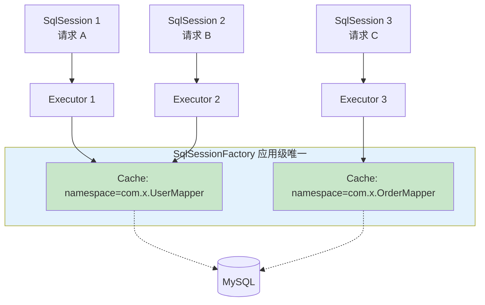
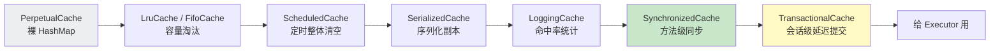
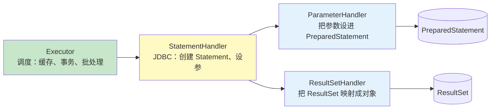
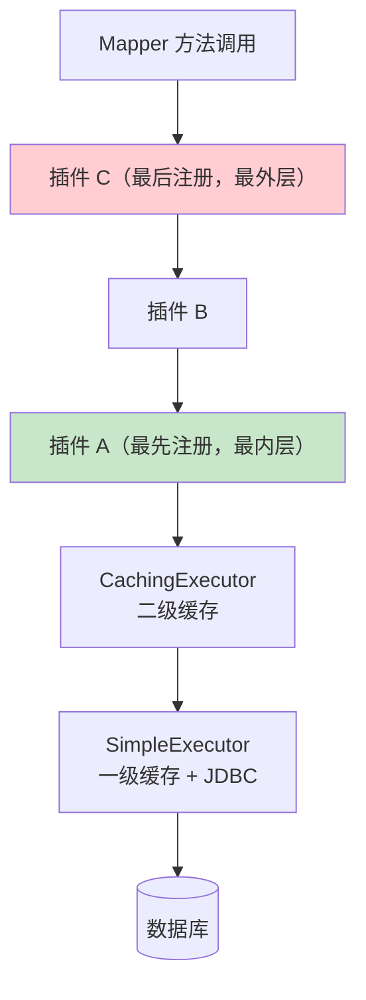

# MyBatis 缓存与插件

> 定位：缓存和插件是 MyBatis 里最容易被"用错"的两块。一级缓存看着默认开启，放到 Spring 里却几乎不生效；二级缓存配一行 `<cache/>` 就能开，开了之后脏读、序列化异常、多节点不一致全来了。插件则是 MyBatis 唯一的扩展点——分页、多租户、SQL 审计、字段加解密全靠它，但 `@Signature` 写错一个参数类型就静默失效，排查半天。这篇从 `BaseExecutor.localCache` 和 `Plugin.wrap` 的源码出发，把两套机制讲透，并给出能直接抄的避坑清单。

## 一、为什么 MyBatis 要设计两层缓存

ORM 框架的缓存本质是在"减少数据库往返"和"数据一致性"之间做权衡。MyBatis 把它拆成两层，是因为这两层的**生命周期**和**一致性边界**完全不同：

- **一级缓存**绑在 `SqlSession` 上，生命周期就是一个会话（一次请求 / 一个事务）。它的作用域小到几乎不会跨线程，所以**不需要考虑并发**，也不需要序列化——直接存对象引用。
- **二级缓存**绑在 `Mapper` 的 `namespace` 上，生命周期跟着 `SqlSessionFactory`（也就是整个应用）。它跨会话、跨线程，所以必须考虑并发、必须考虑序列化、必须考虑多 namespace 之间的数据联动。

一句话概括：**一级缓存是"会话内的工作副本"，二级缓存是"应用级的共享副本"**。前者是 MyBatis 的默认行为你关不掉（只能改作用域），后者是一个需要你显式开启、并且要自己承担一致性责任的开关。

插件则是另一条线。MyBatis 没有提供"AOP 切 SQL"这种高层抽象，它只在四个核心组件上留了拦截点，用 JDK 动态代理包一层。这个设计极其轻量，代价是**所有能力都得靠拦截器自己实现**——包括分页。

## 二、一级缓存：SqlSession 级

### 2.1 存储结构与命中流程

一级缓存就是 `BaseExecutor` 的一个字段：

```java
public abstract class BaseExecutor implements Executor {
    protected PerpetualCache localCache;          // 一级缓存
    protected PerpetualCache localOutputParameterCache;
    protected Configuration configuration;
    protected int queryStack;                     // 查询嵌套深度
}
```

`PerpetualCache` 名字里的 "Perpetual"（永久）是相对于二级缓存那些会被淘汰的装饰器而言的——它本身就是一个裸的 `HashMap`，没有容量上限、没有淘汰策略：

```java
public class PerpetualCache implements Cache {
    private final String id;
    private final Map<Object, Object> cache = new HashMap<>();
}
```

也就是说，**一级缓存不会因为"存太多"而淘汰，只会因为"会话结束"或"显式清理"而消失**。在一个超长事务里疯狂查不同条件，理论上能把堆撑大——这是真实存在的隐患。

命中逻辑在 `BaseExecutor.query()` 里，注意 `queryStack` 这个细节：

```java
public <E> List<E> query(MappedStatement ms, Object parameter, RowBounds rowBounds,
                         ResultHandler resultHandler, CacheKey key, BoundSql boundSql) {
    if (closed) throw new ExecutorException("Executor was closed.");
    // 1. 语句要求 flushCache 且当前不在嵌套查询里 → 先清缓存
    if (queryStack == 0 && ms.isFlushCacheRequired()) {
        clearLocalCache();
    }
    List<E> list;
    try {
        queryStack++;                                   // 2. 进入查询
        list = resultHandler == null ? (List<E>) localCache.getObject(key) : null;
        if (list != null) {
            handleLocallyCachedOutputParameters(ms, key, parameter, boundSql);
        } else {
            list = queryFromDatabase(ms, parameter, rowBounds, resultHandler, key, boundSql);
        }
    } finally {
        queryStack--;                                   // 3. 退出查询
    }
    if (queryStack == 0) {
        for (DeferredLoad deferredLoad : deferredLoads) { deferredLoad.load(); }
        deferredLoads.clear();
        // 4. STATEMENT 作用域：查完就清
        if (configuration.getLocalCacheScope() == LocalCacheScope.STATEMENT) {
            clearLocalCache();
        }
    }
    return list;
}
```

三个关键点：

1. **`queryStack` 是防"缓存穿透自己"的**：嵌套查询（`<association select="..."/>`）在外层查询未结束时触发内层查询，此时 `queryStack > 0`，`flushCache` 不会被误触发，避免把外层刚放进缓存的占位符清掉。
2. **`queryFromDatabase` 先放占位符再查**，这是为了处理循环引用（`resultOrdered` 场景）：

```java
private <E> List<E> queryFromDatabase(MappedStatement ms, Object parameter, RowBounds rowBounds,
                                      ResultHandler resultHandler, CacheKey key, BoundSql boundSql) {
    localCache.putObject(key, EXECUTION_PLACEHOLDER);   // 占位，防止递归查询重复加载
    try {
        list = doQuery(ms, parameter, rowBounds, resultHandler, boundSql);
    } finally {
        localCache.removeObject(key);
    }
    localCache.putObject(key, list);                    // 放真结果
    if (ms.getStatementType() == StatementType.CALLABLE) {
        localOutputParameterCache.putObject(key, parameter);
    }
    return list;
}
```

3. **存的是 `List` 的引用，不是副本**。同一个 `SqlSession` 里两次相同查询返回的是**同一个 List 对象**，调用方 `list.clear()` 或者改元素，下一次查询就直接读到被改过的数据。这一点和二级缓存 `readOnly=false` 时完全不同（后者会反序列化出新对象）。

### 2.2 CacheKey 由什么构成

缓存能不能命中，全看 `CacheKey`。`BaseExecutor.createCacheKey()` 里拼了六类信息：

```java
CacheKey cacheKey = new CacheKey();
cacheKey.update(ms.getId());                    // 1. 语句全限定名 namespace.method
cacheKey.update(rowBounds.getOffset());         // 2. 分页偏移
cacheKey.update(rowBounds.getLimit());          // 3. 分页条数
cacheKey.update(boundSql.getSql());             // 4. 最终 SQL 文本（含 ? 占位）
// 5. 每个 #{ } 参数的实际值（OUT 模式除外）
for (ParameterMapping pm : boundSql.getParameterMappings()) { ... cacheKey.update(value); }
if (configuration.getEnvironment() != null) {
    cacheKey.update(configuration.getEnvironment().getId());   // 6. 环境 id（多数据源区分）
}
```

`CacheKey` 内部维护 `List<Object> updateList`、`int hashcode`、`int checksum`、`int count`，每次 `update` 都做 `hashcode = hashcode * 37 + value.hashCode()`。`equals` 先比 `hashcode` 再比 `updateList`，所以**不会因为哈希碰撞误命中**。

这里能推出两个实用结论：

- **`ORDER BY` 不同、`LIMIT` 不同、参数不同 → 必然不命中**。所以"分页查询一级缓存命中率低"是结构性的，不是配置问题。
- **`${}` 拼进去的值会改变 SQL 文本**，所以 `order by ${col}` 每次换列就是新的 key；而 `#{}` 的值体现在参数列表里。两者都能正确区分。

### 2.3 一级缓存什么时候失效

这是面试必问，但很多人只背了"增删改会清"。完整清单：

| 触发条件 | 源码位置 | 说明 |
|---|---|---|
| 执行 `insert`/`update`/`delete` | `BaseExecutor.update()` 开头 `clearLocalCache()` | 最常见的失效原因 |
| `commit()` / `rollback()` | `BaseExecutor.commit()/rollback()` | 提交或回滚都清，且 `isCommitOrRollback` 为 true 时强制清 |
| 查询语句 `flushCache="true"` | `query()` 里 `ms.isFlushCacheRequired()` | 执行**前**清空整个会话缓存 |
| `localCacheScope=STATEMENT` | `query()` 结尾 `clearLocalCache()` | 每条语句执行完就清，等于关掉一级缓存 |
| 手动 `sqlSession.clearCache()` | `clearLocalCache()` | 代码里显式调用 |
| 换了 `SqlSession` | 不同 `Executor` 实例 | 缓存是 Executor 的字段，天然隔离 |
| `SqlSession` 关闭 | `close()` → `executor.close()` | 缓存对象被 GC |

`BaseExecutor.update()` 的实现很直接：

```java
public int update(MappedStatement ms, Object parameter) throws SQLException {
    ErrorContext.instance().resource(ms.getResource()).activity("executing an update").object(ms.getId());
    if (closed) throw new ExecutorException("Executor was closed.");
    clearLocalCache();          // 无差别清空，不做语句级精确失效
    return doUpdate(ms, parameter);
}
```

注意这是**清空整个会话的所有缓存**，不是只清受影响的表。MyBatis 不做表级依赖分析——它没有 schema 元数据，也不知道这条 update 影响了哪些查询。这个"粗暴"的设计是后面所有一致性问题的根源。

### 2.4 为什么 Spring 集成后一级缓存"几乎失效"

这是最有价值的一个认知点。很多资料说"一级缓存默认开启"，但在 Spring Boot 项目里你会发现：**两次相同的查询，第二次照样打数据库**。

原因在 `SqlSessionTemplate`。你注入的 `Mapper` 背后是 `SqlSessionTemplate`，它的 `SqlSessionInterceptor` 每次都这么干：

```java
public Object invoke(Object proxy, Method method, Object[] args) throws Throwable {
    SqlSession sqlSession = getSqlSession(SqlSessionTemplate.this.sqlSessionFactory,
        SqlSessionTemplate.this.executorType, SqlSessionTemplate.this.exceptionTranslator);
    try {
        Object result = method.invoke(sqlSession, args);
        // 不在事务里 → 立刻提交
        if (!isSqlSessionTransactional(sqlSession, SqlSessionTemplate.this.sqlSessionFactory)) {
            sqlSession.commit(true);
        }
        return result;
    } catch (Throwable t) {
        throw unwrapThrowable(t);
    } finally {
        if (sqlSession != null) {
            closeSqlSession(sqlSession, SqlSessionTemplate.this.sqlSessionFactory);
        }
    }
}
```

拆开看两种场景：

| 场景 | SqlSession 来源 | 一级缓存是否生效 |
|---|---|---|
| **无 `@Transactional`** | `getSqlSession` 每次 `openSession()` 新建，方法结束 `closeSqlSession()` 关闭 | **不生效**。两次查询两个 SqlSession，两个 Executor，两个 `localCache` |
| **有 `@Transactional`** | 第一次从 `TransactionSynchronizationManager` 拿不到，创建后放进 `SqlSessionHolder` 绑定到当前线程；后续复用 | **生效**。同一事务内同一 SqlSession，能命中 |
| 无事务但同一 Mapper 方法内循环查 | 还是一次 `invoke`，一个 SqlSession | 生效（但方法结束就销毁） |

更狠的是：无事务时 `sqlSession.commit(true)` 会走 `BaseExecutor.commit()` → `clearLocalCache()`。**即使**你手动复用了 SqlSession，只要不包事务，每次调用完就清空。

所以准确的说法是：**一级缓存的有效范围 = 一个事务（或一次 Mapper 方法调用）**。它不是一个"跨请求的缓存"，指望它扛读流量是错的。

> 反过来看，这其实是好事：一级缓存的生命周期越短，脏数据窗口越小。真正危险的是**长事务**——一个事务里先查订单、再被别人改了库、再查一次，第二次拿到的还是旧值。这种脏读在一级缓存下是"设计内"的行为，不是 bug。

## 三、二级缓存：namespace 级

### 3.1 开启条件与作用域

二级缓存需要同时满足三个条件：

1. 全局 `cacheEnabled=true`（默认就是 true，它只控制要不要给 `Executor` 套 `CachingExecutor`，关掉只影响二级缓存，一级缓存不受影响）
2. Mapper XML 里写 `<cache/>`（或接口上 `@CacheNamespace`）
3. 语句 `useCache` 不为 false（`<select>` 默认 true）

```xml
<cache eviction="LRU"
       flushInterval="60000"
       size="1024"
       readOnly="false"
       blocking="false"/>
```

| 属性 | 默认值 | 含义 |
|---|---|---|
| `eviction` | `LRU` | 淘汰策略：`LRU`/`FIFO`/`SOFT`/`WEAK` |
| `flushInterval` | 不设置 | 定时**整体清空**（毫秒），不是单条过期 |
| `size` | `1024` | 最多缓存多少个结果对象 |
| `readOnly` | `false` | true 返回同一实例（快，但可被业务改脏）；false 走序列化（安全，要求 `Serializable`） |
| `blocking` | `false` | true 时加 `BlockingCache`，同一 key 只放一个线程去查（防击穿） |

作用域的关键：**一个 namespace 一个 `Cache` 实例**，这个实例由 `Configuration` 持有，所有 `SqlSession` 共享。



图上要看清两件事：二级缓存挂在 `SqlSessionFactory` 下的 `Configuration` 上，和 SqlSession 完全解耦；不同 namespace 之间**默认互不可见**——这正是多表关联脏读的根源。

### 3.2 为什么必须提交事务才写入

这是二级缓存最容易踩的坑：**你查了数据，`SqlSession` 没 commit，第二个会话查同样的 SQL 还是打库**。

原因在 `CachingExecutor` 和 `TransactionalCache` 的配合：

```java
public class CachingExecutor implements Executor {
    private final Executor delegate;
    private final TransactionalCacheManager tcm = new TransactionalCacheManager();

    public <E> List<E> query(MappedStatement ms, Object parameterObject, RowBounds rowBounds,
                             ResultHandler resultHandler, CacheKey key, BoundSql boundSql) {
        Cache cache = ms.getCache();
        if (cache != null) {
            flushCacheIfRequired(ms);
            if (ms.isUseCache() && resultHandler == null) {
                ensureNoOutParams(ms, boundSql);
                List<E> list = (List<E>) tcm.getObject(cache, key);
                if (list == null) {
                    list = delegate.query(ms, parameterObject, rowBounds, resultHandler, key, boundSql);
                    tcm.putObject(cache, key, list);      // 注意：只是暂存，没进真缓存
                }
                return list;
            }
        }
        return delegate.query(ms, parameterObject, rowBounds, resultHandler, key, boundSql);
    }
}
```

`tcm.putObject` 最终落到 `TransactionalCache`：

```java
public class TransactionalCache implements Cache {
    private final Cache delegate;
    private boolean clearOnCommit;
    private final Map<Object, Object> entriesToAddOnCommit;      // 待提交
    private final Set<Object> entriesMissedInCache;

    public void putObject(Object key, Object object) {
        entriesToAddOnCommit.put(key, object);      // 只放内存 Map，不动 delegate
    }

    public Object getObject(Object key) {
        Object object = delegate.getObject(key);
        if (object == null) { entriesMissedInCache.add(key); }
        if (clearOnCommit) { return null; }
        return object;
    }

    public void commit() {
        if (clearOnCommit) { delegate.clear(); }
        flushPendingEntries();                      // 这里才真正写进二级缓存
        reset();
    }
}
```

为什么要这么绕？因为**未提交的数据可能回滚**。如果查询结果直接进二级缓存，事务回滚后这份"从未存在过"的数据会被全应用读到——那就是跨会话的脏读，比一级缓存严重得多。

顺带一个推论：**只读查询也要 commit 才有二级缓存**。这解释了为什么很多人在纯查询接口上开二级缓存"没效果"——Spring 无事务时 `SqlSessionTemplate` 会 `commit(true)`，有事务时靠事务提交；但如果你自己 `openSession()` 且从不 commit，缓存永远是空的。

`flushCacheIfRequired` 则负责写操作后的失效：

```java
private void flushCacheIfRequired(MappedStatement ms) {
    Cache cache = ms.getCache();
    if (cache != null && ms.isFlushCacheRequired()) {
        tcm.clear(cache);        // 标记 clearOnCommit，提交时整体清空
    }
}
```

`<insert>/<update>/<delete>` 的 `flushCache` 默认就是 `true`，所以**任何一条写语句都会清空整个 namespace 的二级缓存**——又是一次"无差别清空"。

### 3.3 缓存装饰器链：一层加一个能力

`<cache/>` 最终产出的不是一个 `PerpetualCache`，而是一串装饰器叠起来的洋葱。构建逻辑在 `CacheBuilder.build()` / `setStandardDecorators()` 里，**从内到外**依次是：



注意方向：**左边是最内层（真正存数据的），右边是最外层（Executor 最先碰到）**。`TransactionalCache` 不在 `CacheBuilder` 里构建，而是 `TransactionalCacheManager` 在运行时按 `(Cache, SqlSession)` 动态包上去的——所以它是"每会话一层"。

| 装饰器 | 加的能力 | 代价 / 坑 |
|---|---|---|
| `PerpetualCache` | 最朴素的 `HashMap` 存储 | 无上限，单靠它会 OOM |
| `LruCache` | 用 `LinkedHashMap(accessOrder=true)` 做 LRU，超 `size` 淘汰最久未用 | 默认 1024；`size` 是**对象个数**不是字节数 |
| `FifoCache` | `LinkedList` 记录插入顺序，超限淘汰最早进入的 | 先进先出，不看访问频率 |
| `SoftCache` / `WeakCache` | 用 `SoftReference`/`WeakReference` 包 value，靠 GC 回收 | 命中率不可控，GC 压力大时形同没有 |
| `ScheduledCache` | 每次读写前检查 `clearInterval`，超时**清空全部** | 是"整体清空"不是"逐条过期"；`flushInterval` 不设则不启用 |
| `SerializedCache` | `put` 时序列化成 `byte[]`，`get` 时反序列化 | 要求 `Serializable`；每次读都反序列化，CPU 换安全 |
| `LoggingCache` | 统计 `requestCount`/`hitCount`，debug 打 `Cache Hit Ratio` | 只有 debug 日志才输出，线上默认看不到 |
| `SynchronizedCache` | 所有方法加 `synchronized` | 单 Cache 实例串行化，高并发下是瓶颈 |
| `BlockingCache` | 未命中时按 key 加锁，其他线程阻塞等待 | 防击穿；锁粒度为 key，需正确 `release`，异常时可能死锁 |
| `TransactionalCache` | 延迟到 commit 才写入 / 清空 | 不 commit 就没缓存 |

这张表就是"二级缓存为什么又慢又容易出错"的答案：**默认配置下，一次命中要过 `SynchronizedCache` 的锁 → `LoggingCache` 计数 → `SerializedCache` 反序列化 → `ScheduledCache` 检查 → `LruCache` 查表**。`readOnly=false` 时还有一次完整的对象反序列化，大对象（比如带 200 个字段的宽表实体）反序列化开销可能超过一次主键查询。

所以经验法则：**二级缓存只适合"极少变更 + 高频读 + 数据量小"的字典类数据**，比如省份、配置项、类目树。业务表开二级缓存，收益通常为负。

## 四、插件机制

### 4.1 四大可拦截对象

MyBatis 只允许拦截四个组件，因为它们是 SQL 执行链上的四个必经环节：



| 对象 | 可拦截方法 | 典型用途 |
|---|---|---|
| `Executor` | `update`、`query`（4 参和 6 参两个重载）、`flushStatements`、`commit`、`rollback`、`getTransaction`、`close`、`isClosed` | 分页、多租户加条件、SQL 改写、读写分离路由 |
| `StatementHandler` | `prepare`、`parameterize`、`batch`、`update`、`query` | 改写 SQL、设置 fetchSize、强制走主库 |
| `ParameterHandler` | `getParameterObject`、`setParameters` | 参数加密、脱敏、自动填充 |
| `ResultSetHandler` | `handleResultSets`、`handleOutputParameters` | 结果解密、字段脱敏、结果二次加工 |

拦截 `Executor` 最常用（能拿到完整 SQL 和参数），拦截 `StatementHandler` 更底层（能改 `Statement` 本身，但拿不到 `MappedStatement` 之外的上下文）。

### 4.2 Plugin.wrap：JDK 动态代理包装

插件不是靠字节码增强，就是标准的 JDK 动态代理：

```java
public class Plugin implements InvocationHandler {
    private final Object target;                                  // 被代理对象
    private final Interceptor interceptor;
    private final Map<Class<?>, Set<Method>> signatureMap;        // 接口 → 方法集合

    public static Object wrap(Object target, Interceptor interceptor) {
        Map<Class<?>, Set<Method>> signatureMap = getSignatureMap(interceptor);
        Class<?> type = target.getClass();
        Class<?>[] interfaces = getAllInterfaces(type, signatureMap);   // 只代理匹配的接口
        if (interfaces.length > 0) {
            return Proxy.newProxyInstance(type.getClassLoader(), interfaces,
                new Plugin(target, interceptor, signatureMap));
        }
        return target;                                            // 没匹配上 → 原样返回
    }

    public Object invoke(Object proxy, Method method, Object[] args) throws Throwable {
        try {
            Set<Method> methods = signatureMap.get(method.getDeclaringClass());
            if (methods != null && methods.contains(method)) {
                return interceptor.intercept(new Invocation(target, method, args));
            }
            return method.invoke(target, args);                   // 不匹配 → 直接透传
        } catch (Exception e) {
            throw ExceptionUtil.unwrapThrowable(e);               // 剥掉 InvocationTargetException
        }
    }
}
```

三个设计细节值得注意：

1. **`getAllInterfaces` 只返回签名里出现过的接口**。所以一个 `Interceptor` 只声明了 `Executor`，它产生的代理对象就只实现 `Executor`，`instanceof StatementHandler` 为 false。
2. **`signatureMap` 的 key 是 `method.getDeclaringClass()`**，也就是 `Executor.class` 这种接口，不是实现类。这解释了为什么 `@Signature(type = ...)` 必须写接口。
3. **没匹配到的方法直接 `method.invoke(target, args)`**，不进 `intercept`。这是"写错 `@Signature` 就静默失效"的机制来源——不报错，只是不拦。

自定义拦截器长这样：

```java
@Intercepts({
    @Signature(type = Executor.class, method = "query",
        args = {MappedStatement.class, Object.class, RowBounds.class, ResultHandler.class})
})
public class SqlCostInterceptor implements Interceptor {
    @Override
    public Object intercept(Invocation invocation) throws Throwable {
        long start = System.nanoTime();
        try {
            return invocation.proceed();          // 放行，进入下一层
        } finally {
            long cost = (System.nanoTime() - start) / 1_000_000;
            MappedStatement ms = (MappedStatement) invocation.getArgs()[0];
            if (cost > 500) {
                log.warn("slow sql: {} cost={}ms", ms.getId(), cost);
            }
        }
    }
}
```

`invocation.proceed()` 是关键：它调用 `method.invoke(target, args)`，而 `target` 可能是**下一个插件的代理对象**，于是形成链。如果图省事写 `method.invoke(realTarget, args)`，就会跳过内层所有插件。

### 4.3 InterceptorChain 与顺序

```java
public class InterceptorChain {
    private final List<Interceptor> interceptors = new ArrayList<>();

    public Object pluginAll(Object target) {
        for (Interceptor interceptor : interceptors) {
            target = interceptor.plugin(target);      // 依次包裹
        }
        return target;
    }
}
```

`Interceptor.plugin()` 是个默认方法，返回 `Plugin.wrap(target, this)`。所以循环下来，**第一个注册的插件在最内层，最后一个注册的在最外层**。

执行顺序正好相反：**最后注册的插件最先执行**。



这个顺序有两个重要推论：

- **插件包在 `CachingExecutor` 外面**（`Configuration.newExecutor` 里先 `new CachingExecutor(executor)` 再 `pluginAll`）。所以插件看到的查询**早于**二级缓存判断。好处是分页插件不会被缓存"骗过"；坏处是缓存命中的查询也要走一遍插件逻辑（分页插件会重复 count）。
- **分页插件应该最后注册（最外层）**。如果分页在内层，它改写的 `limit` 会被外层插件（比如多租户拼 `where`）二次加工，`count` 语句也可能被污染。

`Configuration.newExecutor` 的完整顺序，值得背下来：

```java
public Executor newExecutor(Transaction transaction, ExecutorType executorType) {
    executorType = executorType == null ? defaultExecutorType : executorType;
    executorType = executorType == null ? ExecutorType.SIMPLE : executorType;
    Executor executor;
    if (ExecutorType.BATCH == executorType)      executor = new BatchExecutor(this, transaction);
    else if (ExecutorType.REUSE == executorType) executor = new ReuseExecutor(this, transaction);
    else                                          executor = new SimpleExecutor(this, transaction);
    if (cacheEnabled) { executor = new CachingExecutor(executor); }   // ① 二级缓存
    executor = (Executor) interceptorChain.pluginAll(executor);        // ② 插件最外层
    return executor;
}
```

### 4.4 PageHelper 是怎么改 SQL 的

PageHelper 是最经典的 `Executor` 插件，原理一句话：**拦截 `query`，先从 `ThreadLocal` 取分页参数，执行一次 count，再改写原 SQL 加 `limit`，最后放行**。下面是简化后的骨架（方言生成 SQL 的细节略去，只保留主干）：

```java
@Intercepts({
    @Signature(type = Executor.class, method = "query",
        args = {MappedStatement.class, Object.class, RowBounds.class, ResultHandler.class}),
    @Signature(type = Executor.class, method = "query",
        args = {MappedStatement.class, Object.class, RowBounds.class, ResultHandler.class,
                CacheKey.class, BoundSql.class})
})
public class PageInterceptor implements Interceptor {
    @Override
    public Object intercept(Invocation invocation) throws Throwable {
        Object[] args = invocation.getArgs();
        MappedStatement ms = (MappedStatement) args[0];
        Object parameter = args[1];
        RowBounds rowBounds = (RowBounds) args[2];
        ResultHandler resultHandler = (ResultHandler) args[3];
        Executor executor = (Executor) invocation.getTarget();
        BoundSql boundSql = args.length == 4
            ? ms.getBoundSql(parameter) : (BoundSql) args[5];

        Page<?> page = PageHelper.getLocalPage();          // ThreadLocal
        if (page == null) { return invocation.proceed(); } // 没 startPage → 直接放行

        // 1. 用 CountSqlParser 生成 count SQL（去 order by、select 列换 count(0)）
        String countSql = countSqlParser.getSmartCountSql(boundSql.getSql());
        // 2. 克隆一个 MappedStatement，用同一个 Executor 执行 count
        MappedStatement countMs = ExecutorUtil.newCountMappedStatement(ms, ms.getId() + "_COUNT");
        Long total = ExecutorUtil.executeAutoCount(dialect, executor, countMs, parameter,
                        rowBounds, resultHandler, boundSql, countSql);
        page.setTotal(total);
        if (page.getTotal() <= 0) { return Collections.emptyList(); }

        // 3. 由 Dialect 把原 SQL 改写成带 limit 的分页 SQL（并同步参数映射）
        // 4. 放行，走真正的查询
        return invocation.proceed();
    }
}
```

几个必须知道的点：

- **为什么要在 `finally` 里清 `ThreadLocal`**：`PageHelper.startPage()` 和紧跟的那次查询之间不能插入别的查询，否则分页参数会"串"到别的 SQL 上。所以必须 `startPage` 之后立刻查，且 PageHelper 内部在 `afterAll` 里清理。
- **count 语句是复用的 `Executor`**：所以 count 也会经过缓存、经过其他内层插件。如果 count 走了二级缓存，可能拿到过期总数。
- **count SQL 优化**：PageHelper 的 `CountSqlParser` 会尝试去掉 `order by`、去掉 `left join`（在没有 `where` 引用的情况下），极端 SQL（union、子查询嵌套）容易优化错，可以用 `pageHelper.count` 的 `countSqlParser` 或手写 count 语句规避。
- **`Page` 是 `ArrayList` 子类**，所以 `mapper.selectXxx()` 返回的可以直接强转成 `Page` 拿 `total`。这是"看起来魔法"的地方。

## 五、生产坑点与排查

### 坑点 1：一级缓存读到旧数据（长事务脏读）

**现象**：一个 `@Transactional` 方法里，先 `selectById(1)` 拿到订单，中间调用了外部服务（或别的线程）把订单状态改了，再 `selectById(1)` 还是旧状态。查库确认数据已变。

**原因**：同一个事务 = 同一个 `SqlSession` = 同一个 `localCache`。MyBatis 不知道外部变更，`CacheKey` 也没变，直接命中缓存。

**解法**：
- 事务内需要最新数据时，显式 `sqlSession.clearCache()`（`@Autowired SqlSession` 或 `SqlSessionTemplate`）
- 更彻底：把"需要实时读"的部分移出事务
- 不要试图用 `localCacheScope=STATEMENT` 全局关掉——它会连正常的一级缓存收益一起干掉，而且对嵌套查询有副作用

### 坑点 2：二级缓存多表关联脏读

**现象**：`UserMapper` 里有个 `selectUserWithOrders` 关联查了 `t_order`，开了 `<cache/>`。订单表更新后，这个查询还是返回旧订单列表。

**原因**：二级缓存以 namespace 为界。`OrderMapper` 的写操作只清 `OrderMapper` 的缓存，`UserMapper` 的缓存毫不知情。

**解法**：
- 关联查询的语句加 `useCache="false"`，只让单表查询进缓存
- 或者 `<cache-ref namespace="com.x.OrderMapper"/>` 让两个 namespace 共用一个 Cache（粒度更粗，互相清，命中率下降但一致）
- 生产首选：**业务表不开二级缓存**，用 Redis 做应用层缓存，失效逻辑自己控

### 坑点 3：`readOnly="false"` 报 `NotSerializableException`

**现象**：开二级缓存后，第一次查询正常，第二次命中时抛 `PersistenceException: Error serializing object. Cause: java.io.NotSerializableException`。

**原因**：`readOnly=false`（默认）走 `SerializedCache`，`put` 时要序列化结果对象。实体类没实现 `Serializable`，或者内部有个字段（如 `LocalDateTime` 之外的第三方类型、`InputStream`）不可序列化。

**解法**：
- 实体类 `implements Serializable` 并显式写 `serialVersionUID`
- 检查嵌套对象是否都可序列化
- 确认业务不会修改返回对象时，可设 `readOnly="true"` 省掉序列化（但要知道风险：多线程共享同一实例）

### 坑点 4：插件"配了但没生效"

**现象**：`@Intercepts` 写了，Spring 也注册了 Bean，但 `intercept()` 里的日志一条都没有。

**原因**（按概率排序）：
1. `args` 类型不精确。比如拦截 `StatementHandler.query` 写成 `args = {Statement.class}`，实际签名是 `query(Statement statement, ResultHandler resultHandler)`，少写一个就匹配不上
2. 拦截了实现类而不是接口。`@Signature(type = SimpleExecutor.class)` 永远不生效，因为 `getAllInterfaces` 只认接口
3. 拦截 `Executor.query` 只声明了 4 参重载，但内部调用走的是 6 参重载
4. 插件被 `@Component` 扫到了，但 MyBatis 的 `Configuration` 没拿到（多数据源场景下只配了主数据源的 `SqlSessionFactory`）

**排查**：在 `Plugin.wrap` 上打断点看 `interfaces.length`；或启动后打印 `configuration.getInterceptors()` 确认注册成功；或直接 `System.out` 在 `setProperties` 里打一行，确认 Bean 被 MyBatis 接管。

### 坑点 5：多插件嵌套导致 `getTarget()` 拿到的是代理

**现象**：插件里 `invocation.getTarget()` 强转成 `Executor` 后调用 `getTransaction()`，行为异常或 `ClassCastException`。

**原因**：`getTarget()` 返回的是**下一个代理**（可能是 `Plugin` 实例），不是原始 `Executor`。多层插件时层层套娃。

**解法**：解包到真实对象：

```java
// PageHelper 的 PluginUtils.realTarget 就是这么写的
public static Object realTarget(Object target) {
    if (Proxy.isProxyClass(target.getClass())) {
        MetaObject metaObject = SystemMetaObject.forObject(target);
        return realTarget(metaObject.getValue("h.target"));   // h 是 Proxy 持有的 InvocationHandler
    }
    return target;
}
```

`Plugin` 的 `target` 字段是 private 且没有 getter，所以只能通过 `MetaObject` 反射读。注意别自己去改 MyBatis 源码加 getter——升级会冲突。

### 坑点 6：二级缓存 + 分页，缓存永远不命中

**现象**：分页查询开了二级缓存，命中率接近 0。

**原因**：`CacheKey` 里包含 `RowBounds.offset/limit`，而且 PageHelper 是**改写 SQL**（拼 `limit`），改写后的 SQL 文本进了 `CacheKey` 的 `boundSql.getSql()`。每一页的 key 都不同，同一页第二次才可能命中。

**解法**：接受这个事实——分页查询本来就不适合做二级缓存。要缓存列表，缓存"全量 ID 列表"或"某页的 DTO"，在业务层做。

## 六、最佳实践

### 6.1 三层缓存怎么选

真实项目里通常同时存在 MyBatis 一级缓存、MyBatis 二级缓存、Redis 缓存。它们的定位完全不同，混用是事故高发区：

| 维度 | 一级缓存 | 二级缓存 | Redis / Spring Cache |
|---|---|---|---|
| 作用域 | 单个 SqlSession（一个事务） | 单个 namespace，跨会话 | 跨进程、跨节点 |
| 默认状态 | 开启 | 关闭（需 `<cache/>`） | 需显式接入 |
| 一致性 | 会话内自洽，会话外不可见 | namespace 内自洽，跨表不保证 | 完全靠业务维护 |
| 失效粒度 | 整个会话全清 | 整个 namespace 全清 | key 级，可精确控制 |
| 序列化 | 不需要（存引用） | `readOnly=false` 时必须 | 必须 |
| 适用数据 | 事务内重复查询 | 字典表、配置表 | 热点数据、跨服务共享 |
| 主要风险 | 长事务脏读 | 多表脏读、多节点不一致 | 缓存穿透/击穿/雪崩、双写不一致 |

选型结论很直接：

- **一级缓存不用管**，它是框架行为，你只需要知道"长事务里可能读到旧值"。
- **二级缓存谨慎开**，只在"单表 + 极少变 + 读远多于写"时用，且必须接受 namespace 粒度。
- **跨节点共享一律用 Redis**，别指望二级缓存——默认的 `PerpetualCache` 是 JVM 内的 `HashMap`，两台机器就是两份数据，谁也不知道对方改了啥。要用二级缓存接 Redis 也可以，实现 `Cache` 接口即可，但要自己处理序列化和 key 命名空间，收益通常不如直接用 `@Cacheable`。

一个常见的错误组合是"二级缓存 + Redis 缓存同一份数据"：两层失效时机不同，排查时你永远不知道脏数据是哪一层来的。**同一份数据只缓存一层**，这是条硬规矩。

### 6.2 落地清单

1. **一级缓存别关，但要理解它的边界**：只在事务内有效，长事务里主动 `clearCache()`。不要指望它跨请求。
2. **二级缓存默认不开**。只有"字典表/配置表"这类**极少变更、数据量小、单表查询**的场景才开，并且 `readOnly="true"` + `size` 调小 + `flushInterval` 设短。
3. **开了二级缓存就必须接受"namespace 隔离"**：所有关联查询加 `useCache="false"`，或者用 `cache-ref` 合并 namespace。
4. **分布式部署下别用默认二级缓存**：`PerpetualCache` 是 JVM 内的 `HashMap`，多节点各自为政。要么实现 `Cache` 接口接 Redis，要么直接用 Spring Cache。
5. **插件只做"横切关注点"**：SQL 审计、慢 SQL 统计、多租户、加解密。不要用它做业务逻辑。
6. **插件顺序显式控制**：分页/多租户这类"改写 SQL"的放外层，审计/统计放内层。XML 配置里 `<plugins>` 的顺序就是注册顺序，**越靠后越外层**。
7. **`@Signature` 的 `args` 用 `MappedStatement.class` 这种接口/类字面量**，别手写字符串，别凭记忆，去 IDE 里点进 `Executor` 接口抄方法签名。
8. **监控二级缓存命中率**：`LoggingCache` 只在 debug 输出，生产要自己包一层 `Cache` 打点，或者用 `configuration.getCacheNames()` 遍历统计。

## 七、面试高频问法

**Q1：一级缓存是什么？作用域多大？默认开启吗？**

**一句话结论**：一级缓存是 `SqlSession` 级别的缓存，存在 `BaseExecutor.localCache`（一个 `PerpetualCache`，底层 `HashMap`），默认开启，作用域就是一次会话。

展开：
- 存储位置：`BaseExecutor` 的 `localCache` 字段，`PerpetualCache` 内部是 `HashMap`，无容量上限、无淘汰。
- key 是 `CacheKey`，由 `MappedStatement` id、`RowBounds` 分页参数、最终 SQL 文本、每个 `#{}` 参数值、`Environment` id 组合而成。
- 命中逻辑在 `BaseExecutor.query()`：先查 `localCache`，未命中才 `queryFromDatabase`，查到后放回缓存。

加分点：说"`queryFromDatabase` 会先放一个 `EXECUTION_PLACEHOLDER` 占位符，防止循环引用场景下递归重复加载"，这是读源码才能讲出来的细节。

**Q2：一级缓存什么时候失效？**

**一句话结论**：执行增删改、commit/rollback、`flushCache="true"` 的查询、`localCacheScope=STATEMENT`、手动 `clearCache()`、换 SqlSession。

展开：
- `BaseExecutor.update()` 第一行就 `clearLocalCache()`，无差别清空整个会话，不做表级依赖分析。
- `commit()` / `rollback()` 都会清（`isCommitOrRollback=true` 时强制清）。
- `localCacheScope=STATEMENT` 时，`query()` 结尾清空，等于关闭一级缓存。

加分点：说"这是**全量清空**不是精确失效，因为 MyBatis 没有 schema 元数据，不知道一条 update 影响了哪些查询——这个设计缺陷是所有缓存一致性问题的根源"。

**Q3：为什么 Spring 项目里一级缓存"几乎不生效"？**

**一句话结论**：因为 `SqlSessionTemplate` 在无事务时每次 Mapper 调用都新开一个 `SqlSession`，用完就关；有 `@Transactional` 时才会把 SqlSession 绑定到线程复用。

展开：
- 无事务：`getSqlSession()` 每次 `openSession()` → 新 `Executor` → 新 `localCache` → 方法结束 `closeSqlSession()`。而且还会 `sqlSession.commit(true)`，顺带清缓存。
- 有事务：SqlSession 放进 `SqlSessionHolder` 绑定 `TransactionSynchronizationManager`，同一事务内复用，一级缓存才真正起作用。
- 结论：**一级缓存的实际有效范围 = 一个事务**。

加分点：说"所以'一级缓存默认开启'这句话在 Spring 环境下有误导性；更准确的说法是'事务内开启'。想跨请求缓存必须用二级缓存或 Redis"。

**Q4：二级缓存怎么开启？为什么必须提交事务才写入？**

**一句话结论**：需要 `cacheEnabled=true`（默认）+ Mapper 里 `<cache/>` + 语句 `useCache` 不为 false；写入走 `TransactionalCache`，只有 `commit()` 才 `flushPendingEntries()` 落到真缓存。

展开：
- `CachingExecutor.query` 里 `tcm.putObject` 只是放进 `TransactionalCache.entriesToAddOnCommit` 这个内存 Map。
- `TransactionalCache.commit()` 才遍历这个 Map 写入 `delegate`（真正的二级缓存）。
- 原因：未提交的数据可能回滚，提前写入会造成跨会话脏读。

加分点：说"推论是**纯查询接口也要 commit 才有二级缓存**，自己 `openSession()` 又不 commit 的话缓存永远是空的——这是很多人'开了没效果'的真实原因"。

**Q5：二级缓存有哪些坑？**

**一句话结论**：多表关联脏读、必须 commit、`readOnly=false` 要求序列化、多节点不一致、分页命中率极低、写操作全量清空 namespace。

展开：

| 坑 | 原因 | 解法 |
|---|---|---|
| 多表脏读 | 缓存按 namespace 隔离，B 表更新不清 A 的缓存 | 关联查询 `useCache="false"` 或 `cache-ref` |
| 不 commit 不生效 | `TransactionalCache` 延迟提交 | 确保事务提交 |
| 序列化异常 | `readOnly=false` 走 `SerializedCache` | 实体 `implements Serializable` |
| 多节点不一致 | 默认 `PerpetualCache` 是 JVM 内 HashMap | 自定义 `Cache` 接 Redis |
| 分页不命中 | `CacheKey` 含 limit / SQL 文本含 limit | 分页别用二级缓存 |
| 写操作全清 | `<update flushCache="true">` 默认清空整个 namespace | 接受，或缩小 namespace 粒度 |

加分点：说"二级缓存只适合字典表；业务表开二级缓存，收益通常为负——一次命中要过同步锁 + 反序列化，可能比查主键还慢"。

**Q6：二级缓存的装饰器链是怎样的？每一层加什么能力？**

**一句话结论**：从内到外 `PerpetualCache → LruCache/FifoCache → ScheduledCache → SerializedCache → LoggingCache → SynchronizedCache`，运行时再包一层 `TransactionalCache`。

展开：
- `PerpetualCache`：裸 `HashMap`，只负责存。
- `LruCache`：`LinkedHashMap(accessOrder=true)` 实现 LRU，超 `size`（默认 1024）淘汰。
- `ScheduledCache`：`flushInterval` 到期**整体清空**（不是逐条过期）。
- `SerializedCache`：`readOnly=false` 时序列化存、反序列化取，要求 `Serializable`。
- `LoggingCache`：统计命中率，debug 打 `Cache Hit Ratio`。
- `SynchronizedCache`：方法级 `synchronized`，保证线程安全。
- `TransactionalCache`：会话级延迟提交，`commit` 才落盘。

加分点：说"这是**装饰器模式**的教科书案例——每个类都 `implements Cache` 并持有一个 `delegate`，能力可以任意组合。代价是层层转发，一次命中要过 6 层"。

**Q7：MyBatis 插件能拦截哪些对象？原理是什么？**

**一句话结论**：只能拦 `Executor`、`StatementHandler`、`ParameterHandler`、`ResultSetHandler` 四个；原理是 `Plugin.wrap` 用 JDK 动态代理生成代理对象，`invoke` 里匹配 `@Signature` 后回调 `intercept`。

展开：
- `Interceptor` 接口三个方法：`intercept(Invocation)`、`plugin(Object)`（默认 `Plugin.wrap`）、`setProperties(Properties)`。
- `@Intercepts` + `@Signature(type, method, args)` 声明拦截点，`type` 必须是接口。
- `Plugin.invoke` 用 `method.getDeclaringClass()` 查 `signatureMap`，命中才进 `intercept`，否则直接透传。
- `Invocation` 封装 `target`/`method`/`args`，`proceed()` 调用下一个。

加分点：说"`getAllInterfaces` 只返回签名里出现过的接口，所以一个只声明 `Executor` 的插件生成的代理对象 `instanceof StatementHandler` 是 false——这解释了为什么插件不能'顺便'拦别的类型"。

**Q8：多个插件的执行顺序是怎样的？**

**一句话结论**：注册顺序决定嵌套顺序，**先注册的在最内层，后注册的在最外层；执行时后注册的先执行**。

展开：
- `InterceptorChain.pluginAll` 里 `for` 循环依次 `target = interceptor.plugin(target)`，第一个包的是原始对象，最后一个包的是最外层。
- 调用链：最后注册 → ... → 最先注册 → `CachingExecutor` → `SimpleExecutor` → DB。
- 所以"改写 SQL"的插件（分页、多租户）应放外层，"观测类"（耗时统计、审计）放内层。

加分点：说"插件包在 `CachingExecutor` 外面（`newExecutor` 里先建 `CachingExecutor` 再 `pluginAll`），所以插件早于二级缓存判断——好处是分页不会被缓存骗过，坏处是缓存命中也得走一遍插件"。

**Q9：PageHelper 的分页原理是什么？**

**一句话结论**：拦截 `Executor.query`，从 `ThreadLocal` 取分页参数，先执行一条 count SQL 拿总数，再改写原 SQL 追加 `limit`，最后放行。

展开：
- `PageHelper.startPage(pageNum, pageSize)` 把 `Page` 放进 `ThreadLocal`。
- 拦截器判断 `getLocalPage() != null`，生成 count SQL（去掉 `order by`、`select` 列换 `count(0)`）。
- 用克隆的 `MappedStatement` 执行 count，`page.setTotal()`。
- 改写 `BoundSql` 加 `limit ?,?`，`invocation.proceed()` 执行真查询。
- `finally` 清理 `ThreadLocal`。

加分点：说"`Page` 继承 `ArrayList`，所以返回值能直接强转成 `Page` 拿 `total`；`startPage` 后必须紧跟查询，中间插别的查询会导致分页参数串到别的 SQL 上"。

**Q10：`@Signature` 写了插件却不生效，怎么排查？**

**一句话结论**：九成是 `args` 类型没精确匹配，或 `type` 写成了实现类而不是接口。

展开：
- `Plugin.invoke` 里 `methods.contains(method)` 用的是 `Method.equals`，参数类型、个数、顺序必须完全一致。
- `@Signature(type = SimpleExecutor.class)` 永远不生效，`getAllInterfaces` 只处理接口。
- 拦 `Executor.query` 时注意有 4 参和 6 参两个重载，内部调用可能走 6 参。
- 多数据源场景下，插件只注册到了其中一个 `SqlSessionFactory`。

加分点：说"排查手段是启动后打印 `configuration.getInterceptors()` 确认注册，再在 `Plugin.wrap` 的 `interfaces.length` 上打点；不要靠猜"。

**Q11：插件里怎么拿到被代理的真实对象？**

**一句话结论**：`invocation.getTarget()` 拿到的是下一层代理，要递归解包 `Plugin` 才能拿到原始对象。

展开：
- 多层插件时 `target` 是 `Plugin` 实例，不是 `Executor`。
- 解包方式：`Proxy.getInvocationHandler(target)` 判断是否 `Plugin`，再取内部的 `target` 递归。
- `Plugin` 没有公开 `getTarget()`，PageHelper 用 `SystemMetaObject.forObject(proxy).getValue("h.target")` 反射拿。

加分点：说"这就是'多层代理嵌套'的坑——直接强转会 `ClassCastException`，或者拿到代理后调用又走一遍拦截链，造成逻辑重复执行"。

**Q12：一级缓存会导致脏读吗？怎么避免？**

**一句话结论**：会。同一个 `SqlSession`（同一事务）内，外部已修改的数据，第二次查询仍返回缓存里的旧值。

展开：
- MyBatis 的缓存失效只对**本会话的写操作**敏感，感知不到其他事务/其他节点的变更。
- 典型场景：长事务里"查 → 调 RPC → 再查"，第二次拿到旧值。
- 避免：事务内需要实时数据时 `sqlSession.clearCache()`；或把实时读移出事务；或对该语句设 `flushCache="true"`。

加分点：说"这不是 bug 而是设计取舍——一级缓存假设'会话内数据是稳定的'，这个假设在短事务里成立，在长事务里不成立。所以事务越长，越要小心缓存"。

## 小结

- **一级缓存**在 `BaseExecutor.localCache`，`SqlSession` 级，`HashMap` 无上限；key 由语句 id + 分页参数 + SQL 文本 + 参数值 + 环境 id 组成。
- **失效是"全量清空"不是精确失效**：`update()` 第一行就 `clearLocalCache()`，commit/rollback 也清，`localCacheScope=STATEMENT` 等于关掉。
- **Spring 下无事务就没有一级缓存**：`SqlSessionTemplate` 每次调用新开新关 SqlSession，一级缓存实际有效范围 = 一个事务。
- **二级缓存**按 namespace 隔离，必须 `commit` 才经 `TransactionalCache.flushPendingEntries()` 写入；多表关联脏读、序列化要求、多节点不一致是三大坑。
- **装饰器链**从内到外：`Perpetual → Lru/Fifo → Scheduled → Serialized → Logging → Synchronized`，运行时加 `Transactional`；每层加一个能力，代价是层层转发。
- **插件**只拦四个对象，靠 `Plugin.wrap` 的 JDK 动态代理 + `@Signature` 匹配；先注册在内层、后注册在外层，`@Signature` 的 `args` 差一个类型就静默失效。
- **PageHelper** = 拦截 `Executor.query` + ThreadLocal 分页参数 + 先 count 再 `limit` 改写；`startPage` 后必须紧跟查询。
