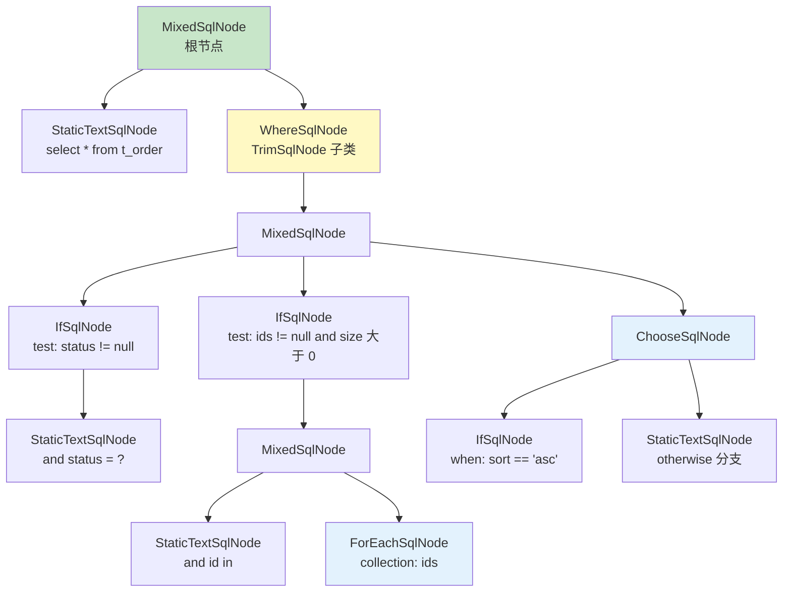
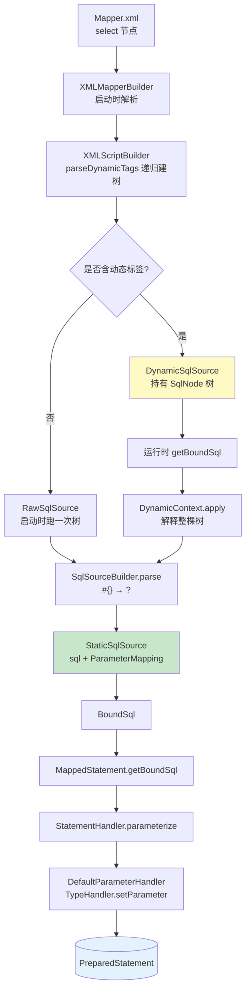
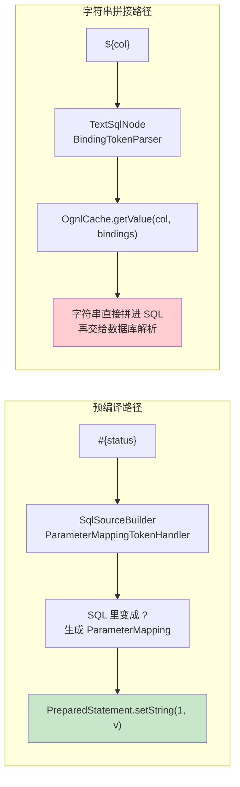
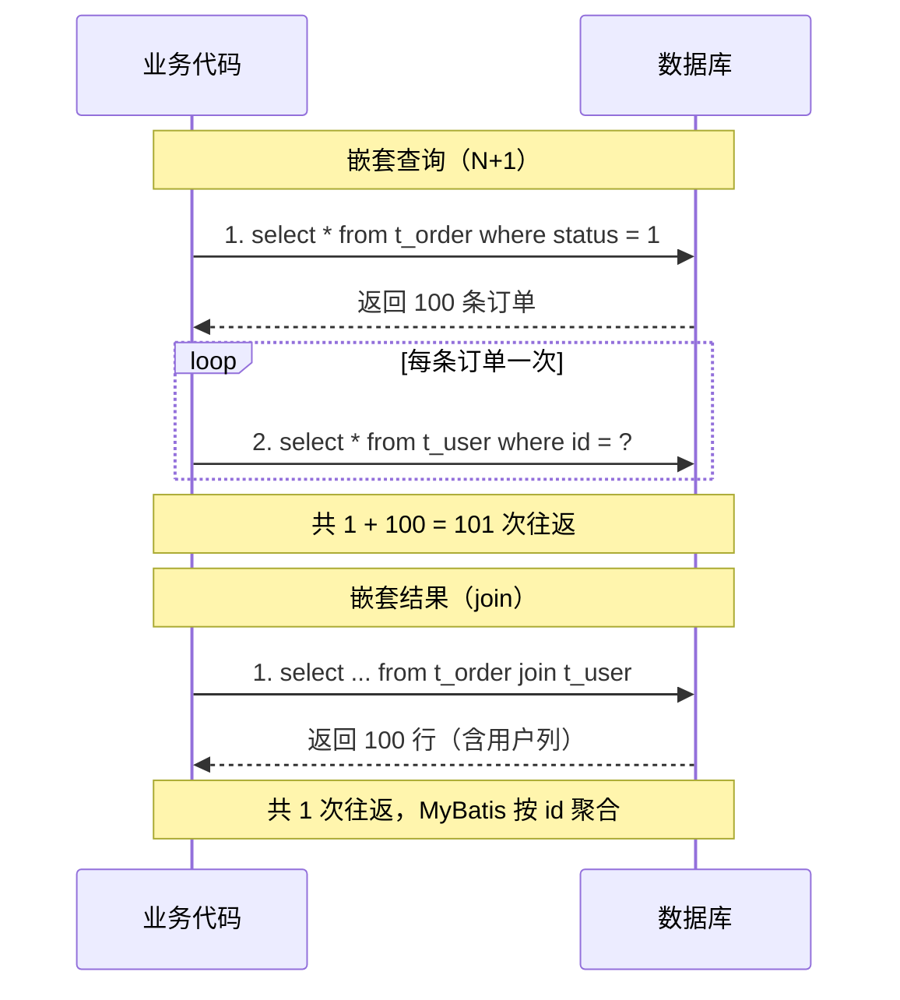

# 动态SQL与SQL解析

> 定位：MyBatis 最核心的价值不是"帮你把 ResultSet 映射成对象"，而是"用 XML 写出可组合的 SQL"。动态 SQL 的实现是一棵 `SqlNode` 树 + 一套 `SqlSource` 解析管线，本质是**组合模式 + 解释器模式**的落地。理解了这条管线，你才能回答：为什么 `<if>` 多了会慢？`#{}` 和 `${}` 到底差在哪一步？`resultMap` 的 `<collection>` 为什么会返回重复的主对象？这篇从 `XMLScriptBuilder` 一路讲到 `DefaultResultSetHandler`，把"XML 到 PreparedStatement"这条链路拆开。

## 一、为什么需要动态 SQL

手写 JDBC 拼接 SQL 的痛苦，每个写过老项目的人都懂：

```java
StringBuilder sql = new StringBuilder("select * from t_order where 1=1");
if (status != null) sql.append(" and status = ?");
if (startTime != null) sql.append(" and create_time >= ?");
if (ids != null && !ids.isEmpty()) {
    sql.append(" and id in (");
    for (int i = 0; i < ids.size(); i++) { sql.append(i == 0 ? "?" : ",?"); }
    sql.append(")");
}
```

问题不是"代码丑"，而是三类硬伤：

1. **拼接错误只在运行时暴露**。多一个 `and`、少一个逗号、`in ()` 空集合，全是 `SQLSyntaxErrorException`，测试覆盖不到就上线炸。
2. **参数绑定和 SQL 文本脱节**。`?` 的个数、顺序、类型全靠人肉对齐，改一个条件就可能错位。
3. **无法复用**。同一张表的查询有十几种条件组合，要么写十个方法，要么写一个巨大的 `if-else`。

MyBatis 的方案是把"条件逻辑"声明成**标签**，在运行时把标签树解释成一棵 SQL 字符串 + 一组参数映射。它不发明新语言，就用 XML 做 DSL——所以你能在 `<if>` 里写 OGNL，在 `<foreach>` 里遍历集合，最终都归约成 `?` 和参数列表。

## 二、SqlNode 组合树

### 2.1 节点类型全景

`SqlNode` 只有一个方法：

```java
public interface SqlNode {
    boolean apply(DynamicContext context);
}
```

`apply` 的语义是"把自己这段 SQL 追加到 `context` 里"，返回值表示"本次是否产生了内容"——只有 `ChooseSqlNode` 真正用到这个返回值（判断 `<when>` 是否命中）。

所有节点：

| 节点 | 对应标签 | 职责 |
|---|---|---|
| `MixedSqlNode` | 任意节点的容器 | 持有一个 `List<SqlNode>`，依次 `apply`，是**组合模式的 Composite** |
| `StaticTextSqlNode` | 纯文本 | 原样 `appendSql`，不做任何解析 |
| `TextSqlNode` | 含 `${}` 的文本 | 用 `GenericTokenParser` 找 `${...}`，OGNL 求值后**字符串替换** |
| `IfSqlNode` | `<if test>` | OGNL 求布尔，true 才 `apply` 子节点 |
| `ChooseSqlNode` | `<choose>/<when>/<otherwise>` | 依次试 `<when>`（内部是 `IfSqlNode`），第一个命中的生效，否则走 default |
| `ForEachSqlNode` | `<foreach>` | 遍历集合，展开 `open/separator/close`，并**重写变量名** |
| `TrimSqlNode` | `<trim>` | 按 `prefix/suffix/prefixOverrides/suffixOverrides` 修剪 |
| `WhereSqlNode` | `<where>` | `TrimSqlNode` 子类，`prefix="WHERE"`，去掉开头多余的 `AND`/`OR` |
| `SetSqlNode` | `<set>` | `TrimSqlNode` 子类，`prefix="SET"`，去掉结尾多余的 `,` |
| `VarDeclSqlNode` | `<bind>` | 把 OGNL 结果放进 `context.bindings` |

这张表就是"组合模式"的目录：`MixedSqlNode` 是容器，其他是叶子或"容器 + 条件"。`WhereSqlNode`/`SetSqlNode` 继承 `TrimSqlNode`，是模板方法——父类控制修剪流程，子类只提供参数。

### 2.2 apply 协议与 DynamicContext

`DynamicContext` 是解释器的"运行时环境"，两个字段就够：

```java
public class DynamicContext {
    public static final String PARAMETER_OBJECT_KEY = "_parameter";
    public static final String DATABASE_ID_KEY = "_databaseId";

    private final ContextMap bindings;                        // OGNL 求值的根
    private final StringJoiner sqlBuilder = new StringJoiner(" ");

    public void appendSql(String sql) { sqlBuilder.add(sql); }
    public String getSql() { return sqlBuilder.toString().trim(); }
    public Map<String, Object> getBindings() { return bindings; }
}
```

注意 `StringJoiner(" ")`——**所有片段之间默认用空格拼接**。这解释了为什么 `<if>` 里的 SQL 片段不需要自己加前导空格，也解释了为什么 `<where>` 要去掉"开头的 AND"：拼接后可能是 `WHERE and status = ?`。

`MixedSqlNode` 的实现简单到极致：

```java
public class MixedSqlNode implements SqlNode {
    private final List<SqlNode> contents;
    public boolean apply(DynamicContext context) {
        for (SqlNode sqlNode : contents) { sqlNode.apply(context); }
        return true;
    }
}
```

`IfSqlNode` 则是"条件 + 委托"：

```java
public class IfSqlNode implements SqlNode {
    private final ExpressionEvaluator evaluator;
    private final String test;
    private final SqlNode contents;

    public boolean apply(DynamicContext context) {
        if (evaluator.evaluateBoolean(test, context.getBindings())) {
            contents.apply(context);
            return true;
        }
        return false;
    }
}
```

`ChooseSqlNode` 靠这个返回值做短路：

```java
public boolean apply(DynamicContext context) {
    for (SqlNode whenSqlNode : whenSqlNodes) {
        if (whenSqlNode.apply(context)) { return true; }     // 第一个命中的生效
    }
    if (defaultSqlNode != null) { defaultSqlNode.apply(context); return true; }
    return false;
}
```

### 2.3 树的形状

一段典型的动态 SQL：

```xml
<select id="search" resultType="Order">
    select * from t_order
    <where>
        <if test="status != null">and status = #{status}</if>
        <if test="ids != null and ids.size() > 0">
            and id in
            <foreach collection="ids" item="id" open="(" separator="," close=")">
                #{id}
            </foreach>
        </if>
        <choose>
            <when test="sort == 'asc'">order by create_time asc</when>
            <otherwise>order by create_time desc</otherwise>
        </choose>
    </where>
</select>
```

编译后是这样一棵树：



看图时注意三点：

1. **树的形状在启动时就固定了**（`XMLScriptBuilder.parseDynamicTags` 递归建树），运行时不改结构，只做 `apply` 遍历。
2. **`<where>` 不是"语法糖"而是真节点**，它在 `apply` 结束时才决定要不要加 `WHERE`、要不要砍掉开头的 `AND`。
3. **`<foreach>` 是唯一会"改变 SQL 片段数量"的节点**，其余节点都是"加或不加"。

### 2.4 ForEachSqlNode 的变量重写

`<foreach>` 是动态 SQL 里最复杂的一个，因为它要解决一个命名冲突问题：循环 5 次，每次 `#{id}` 都要绑定到不同的值，但 `BoundSql` 的参数映射是按 `property` 名字取的。

MyBatis 的做法是**重命名**：第 i 次迭代，把 `#{id}` 改写成 `#{__frch_id_0}` 这样的唯一名字，同时把这些值塞进 `boundSql.additionalParameters`。

```java
public class ForEachSqlNode implements SqlNode {
    public static final String ITEM_PREFIX = "__frch_";

    public boolean apply(DynamicContext context) {
        Map<String, Object> bindings = context.getBindings();
        final Iterable<?> iterable = evaluator.evaluateIterable(collectionExpression, bindings);
        if (!iterable.iterator().hasNext()) { return true; }      // 空集合：什么都不加

        boolean first = true;
        applyOpen(context);
        int i = 0;
        for (Object o : iterable) {
            DynamicContext oldContext = context;
            context = first || separator == null ? new PrefixedContext(context, "")
                                                 : new PrefixedContext(context, separator);
            int uniqueNumber = context.getUniqueNumber();          // 全局自增
            applyIndex(context, i);                                // 暴露 index 变量
            applyItem(context, o);                                 // bindings.put("__frch_id_0", o)
            itemizeItem(context, i);                               // item 名 → __frch_id_0
            contents.apply(new FilteredDynamicContext(configuration, context, item, i));
            first = false;
            ++i;
            context = oldContext;
        }
        applyClose(context);
        context.getBindings().remove(item);
        context.getBindings().remove(index);
        return true;
    }
}
```

`FilteredDynamicContext.appendSql` 里做字符串替换：

```java
public void appendSql(String sql) {
    GenericTokenParser parser = new GenericTokenParser("#{", "}", content -> {
        String newContent = content.replaceFirst("^\\s*" + item + "(?![^.,:\\s])", itemizedItem);
        if (itemIndex != null && newContent.equals(content)) {
            newContent = content.replaceFirst("^\\s*" + itemIndex + "(?![^.,:\\s])", itemizeIndex);
        }
        return "#{" + newContent + "}";
    });
    delegate.appendSql(parser.parse(sql));
}
```

所以 `#{id}` → `#{__frch_id_0}`，`#{id.name}` → `#{__frch_id_0.name}`，而 `__frch_id_0` 这个 key 通过 `boundSql.setAdditionalParameter` 挂到了 `BoundSql` 上。`DefaultParameterHandler` 取值时先查 `boundSql.hasAdditionalParameter(propertyName)`——这就是 `<foreach>` 能工作的完整闭环。

**空集合的处理**：`if (!iterable.iterator().hasNext()) return true;` —— 直接什么都不加，连 `open`/`close` 都不加。所以 `<foreach open="(" close=")">` 遇到空集合，最终 SQL 会变成 `... and id in` 后面什么都没有，直接语法错误。MyBatis **不会**帮你兜底成 `in (null)`。

### 2.5 TrimSqlNode 的三个子类

`TrimSqlNode` 是模板方法的标准实现：

```java
public boolean apply(DynamicContext context) {
    FilteredDynamicContext filteredDynamicContext = new FilteredDynamicContext(context);
    boolean result = contents.apply(filteredDynamicContext);
    filteredDynamicContext.applyAll();      // 修剪 + 加前后缀
    return result;
}

public void applyAll() {
    sqlBuffer = new StringBuilder(sqlBuffer.toString().trim());
    String trimmedUppercaseSql = sqlBuffer.toString().toUpperCase(Locale.ENGLISH);
    if (trimmedUppercaseSql.length() > 0) { applyPrefix(sqlBuffer, trimmedUppercaseSql); }
    delegate.appendSql(sqlBuffer.toString());
}
```

| 子类 | prefix | 覆盖的规则 |
|---|---|---|
| `WhereSqlNode` | `WHERE` | `prefixOverrides = "AND \|OR \|AND\n\|OR\n\|AND\r\|OR\r\|AND\t\|OR\t"` |
| `SetSqlNode` | `SET` | `suffixOverrides = ","` |
| 自定义 `<trim>` | 任意 | 任意 |

两个细节：

- **`WhereSqlNode` 只去掉开头的 `AND`/`OR`，不去掉结尾的**。所以 `<where> status = #{s} and </where>` 会拼出 `WHERE status = ? and`，语法错误。这是"动态 SQL 拼接出语法错误"最常见的形态。
- **`prefixOverrides` 里带空格**（`"AND "` 而不是 `"AND"`），因为它是按"字符串前缀"匹配的。如果你自己写 `<trim prefixOverrides="AND">`，会把 `ANDROID` 这种字段名也砍掉。

`<trim>` 的价值在于处理"批量更新"这类 `<where>`/`<set>` 覆盖不了的场景：

```xml
<update id="batchUpdate">
    update t_order
    <trim prefix="set" suffixOverrides=",">
        <trim prefix="status = case" suffix="end,">
            <foreach collection="list" item="item">
                when id = #{item.id} then #{item.status}
            </foreach>
        </trim>
        <trim prefix="amount = case" suffix="end,">
            <foreach collection="list" item="item">
                when id = #{item.id} then #{item.amount}
            </foreach>
        </trim>
    </trim>
    where id in
    <foreach collection="list" item="item" open="(" separator="," close=")">#{item.id}</foreach>
</update>
```

这里外层 `<trim prefix="set">` 负责加 `SET` 并砍掉最后一个逗号，内层两个 `<trim>` 各自拼一段 `case when`。这种"一条 SQL 批量更新多行多列"的写法，只有 `TrimSqlNode` 能干净地表达——`<set>` 只会砍逗号，加不了 `case` 前缀。

## 三、SqlSource 三种实现

### 3.1 三种对比

`SqlSource` 的职责是"给我参数，还我一个 `BoundSql`"：

```java
public interface SqlSource {
    BoundSql getBoundSql(Object parameterObject);
}
```

| 实现 | 何时产生 | `getBoundSql` 成本 | 典型场景 |
|---|---|---|---|
| `DynamicSqlSource` | 含 `<if>/<foreach>/<where>` 等标签，或含 `${}` | **每次执行都重新遍历树 + 重新解析 `#{}`** | 99% 的业务 SQL |
| `RawSqlSource` | 无任何动态标签、无 `${}` | 启动时解析一次，运行时只 new 一个 `BoundSql` | 简单 CRUD |
| `StaticSqlSource` | 由 `SqlSourceBuilder.parse` 产出，是前两者的"最终形态" | 只组装 `BoundSql` | 内部使用，不直接配置 |

关键认知：**`DynamicSqlSource` 和 `RawSqlSource` 都不是最终形态**，它们内部最终都持有一个 `StaticSqlSource`。区别只在于"什么时候做 `#{}` → `?` 的转换"。

### 3.2 DynamicSqlSource：每次执行重新解析

```java
public class DynamicSqlSource implements SqlSource {
    private final Configuration configuration;
    private final SqlNode rootSqlNode;

    public BoundSql getBoundSql(Object parameterObject) {
        DynamicContext context = new DynamicContext(configuration, parameterObject);
        rootSqlNode.apply(context);                                  // ① 解释整棵树

        SqlSourceBuilder sqlSourceParser = new SqlSourceBuilder(configuration);
        Class<?> parameterType = parameterObject == null ? Object.class : parameterObject.getClass();
        SqlSource sqlSource = sqlSourceParser.parse(context.getSql(), parameterType,
                                                    context.getBindings());   // ② #{} → ?
        BoundSql boundSql = sqlSource.getBoundSql(parameterObject);  // ③ 组装 BoundSql

        for (Map.Entry<String, Object> entry : context.getBindings().entrySet()) {
            boundSql.setAdditionalParameter(entry.getKey(), entry.getValue());  // ④ 挂 foreach/bind 变量
        }
        return boundSql;
    }
}
```

四步里，① 和 ② 都是"每次执行都做"的：

- ① 要遍历整棵树、做 OGNL 求值、字符串拼接。
- ② 要用 `GenericTokenParser` 扫描整个 SQL 字符串找 `#{}`，对每个占位符调 `buildParameterMapping`——里面要解析 `javaType=jdbcType=typeHandler=` 这些属性，还要用 `MetaClass` 反射判断参数类型。

所以一条带 10 个 `<if>` 的 SQL，**每次执行都要付一遍"解释 + 扫描 + 反射"的成本**。这就是"动态 SQL 多了会慢"的准确原因，不是"XML 解析慢"（XML 只在启动解析一次）。

### 3.3 RawSqlSource 与 StaticSqlSource

`RawSqlSource` 在**构造时**就把树跑一遍，把结果解析成 `StaticSqlSource`：

```java
public class RawSqlSource implements SqlSource {
    private final SqlSource sqlSource;      // 实际是 StaticSqlSource

    public RawSqlSource(Configuration configuration, SqlNode rootSqlNode, Class<?> parameterType) {
        this(configuration, getSql(configuration, rootSqlNode), parameterType);
    }

    private static String getSql(Configuration configuration, SqlNode rootSqlNode) {
        DynamicContext context = new DynamicContext(configuration, null);
        rootSqlNode.apply(context);          // 参数传 null，只跑一次
        return context.getSql();
    }

    public BoundSql getBoundSql(Object parameterObject) {
        return sqlSource.getBoundSql(parameterObject);   // 运行时零解析
    }
}
```

`StaticSqlSource` 就是"SQL 字符串 + `List<ParameterMapping>`"的容器：

```java
public class StaticSqlSource implements SqlSource {
    private final String sql;
    private final List<ParameterMapping> parameterMappings;

    public BoundSql getBoundSql(Object parameterObject) {
        return new BoundSql(configuration, sql, parameterMappings, parameterObject);
    }
}
```

`BoundSql` 持有 `sql`、`parameterMappings`、`parameterObject`、`additionalParameters`，是"SQL 执行前的最后一份描述"。

**怎么判断走哪条路**？看 `XMLScriptBuilder.parseScriptNode()`：

```java
public SqlSource parseScriptNode() {
    MixedSqlNode rootSqlNode = parseDynamicTags(context);
    SqlSource sqlSource;
    if (isDynamic) {
        sqlSource = new DynamicSqlSource(configuration, rootSqlNode);
    } else {
        sqlSource = new RawSqlSource(configuration, rootSqlNode, parameterType);
    }
    return sqlSource;
}
```

`isDynamic` 在 `parseDynamicTags` 里被置为 true 的条件只有两个：**遇到任何动态标签**，或者**文本节点里含 `${}`**（`TextSqlNode.isDynamic()` 扫描）。所以：

- `<select>select * from t where id = #{id}</select>` → `RawSqlSource`（启动解析一次）
- `<select>select * from t <where>...</where></select>` → `DynamicSqlSource`
- `<select>select * from t order by ${col}</select>` → `DynamicSqlSource`（因为含 `${}`）

### 3.4 从 XML 到 PreparedStatement 的完整链路



图上最值得看的是 `SqlSourceBuilder.parse` 这个节点：**它被两条路径共用**——`RawSqlSource` 在启动时走一次，`DynamicSqlSource` 在每次执行时走一次。这是"动态 SQL 慢"的成本中心。

### 3.5 启动期与运行期：`MappedStatement` 是怎么来的

很多"为什么启动就报错"的问题，答案都在这条链上。`XMLMapperBuilder` 解析一个 `<select>` 时，会做三件事：

```java
private void buildStatementFromContext(List<XNode> list) {
    for (XNode context : list) {
        final XMLStatementBuilder statementParser =
            new XMLStatementBuilder(configuration, builderAssistant, context, currentNamespace);
        try {
            statementParser.parseStatementNode();
        } catch (IncompleteElementException e) {
            configuration.addIncompleteStatement(statementParser);   // 先挂起，稍后重试
        }
    }
}
```

`parseStatementNode` 里依次解析 `id`、`parameterType`、`resultMap`/`resultType`、`flushCache`/`useCache`、`timeout`、`statementType`，最后调 `languageDriver.createSqlSource(...)` 建 `SqlSource`，再 `builderAssistant.addMappedStatement(...)` 注册进 `Configuration.mappedStatements`（一个 `StrictMap`，重复 id 会直接抛异常）。

两个关键点：

- **`IncompleteElementException` 是"顺序无关"的实现方式**。如果 `<select resultMap="userMap">` 引用的 `resultMap` 还没解析到，MyBatis 不会报错，而是把这条语句挂进 `incompleteStatements`，等所有 mapper 解析完再 `parsePendingStatements()` 重试。所以"启动报 `Could not find result map`"通常是**真的没定义**，不是顺序问题。
- **`<select>` 的 SQL 文本在启动时就被编译成 `SqlSource`**，之后每次执行只调 `getBoundSql`。所以"改 XML 要重启"不是 MyBatis 懒，是它压根没打算热更新。

## 四、`#{}` 与 `${}`

### 4.1 处理链路完全不同

这两个符号长得像，走的是两条完全不同的路：



`#{}` 的转换在 `SqlSourceBuilder` 里：

```java
public SqlSource parse(String originalSql, Class<?> parameterType, Map<String, Object> additionalParameters) {
    ParameterMappingTokenHandler handler =
        new ParameterMappingTokenHandler(configuration, parameterType, additionalParameters);
    GenericTokenParser parser = new GenericTokenParser("#{", "}", handler);
    String sql = parser.parse(originalSql);        // #{xxx} 全部换成 ?
    return new StaticSqlSource(configuration, sql, handler.getParameterMappings());
}
```

`ParameterMappingTokenHandler.handleToken` 返回的就是 `"?"`，同时把 `#{status, jdbcType=VARCHAR}` 这种内容解析成 `ParameterMapping`（属性名、javaType、jdbcType、typeHandler、mode）。

`#{}` 里能写的属性，一共六个：

| 属性 | 作用 | 什么时候必须写 |
|---|---|---|
| `property` | 参数对象的属性路径，如 `user.name` | 必写（`#{}` 里的内容） |
| `javaType` | Java 类型，用于选 `TypeHandler` | 参数是 `Map` 或类型推断不出时 |
| `jdbcType` | JDBC 类型，传给 `ps.setXxx` 的第四个参数 | 值为 null 且数据库挑剔时（Oracle） |
| `typeHandler` | 指定 `TypeHandler` 全限定名 | 自定义类型（JSON、加密字段） |
| `mode` | `IN`/`OUT`/`INOUT`，存储过程用 | 调存储过程 |
| `numericScale` | 小数位数，`BigDecimal` 用 | 需要精确控制精度时 |

`javaType` 和 `jdbcType` 大部分时候可以省略，因为 `SqlSourceBuilder` 会通过 `MetaClass` 反射推断：`buildParameterMapping` 里先 `metaParameters.hasGetter(property)` 判断属性是否存在，存在就 `getGetterType` 拿类型。但如果参数是 `Map<String, Object>`（没有 getter），或者属性是动态 key，推断就会退化成 `Object.class`，这时候必须显式写 `javaType`。

`${}` 的替换在 `TextSqlNode` 里：

```java
public boolean apply(DynamicContext context) {
    GenericTokenParser parser = createParser(new BindingTokenParser(context, injectionFilter));
    context.appendSql(parser.parse(text));
    return true;
}

private static class BindingTokenParser implements TokenHandler {
    public String handleToken(String content) {
        Object parameter = context.getBindings().get("_parameter");
        if (parameter == null) { context.getBindings().put("value", null); }
        else if (SimpleTypeRegistry.isSimpleType(parameter.getClass())) { context.getBindings().put("value", parameter); }
        Object value = OgnlCache.getValue(content, context.getBindings());
        return value == null ? "" : String.valueOf(value);   // 直接转字符串拼进去
    }
}
```

对比表：

| 维度 | `#{}` | `${}` |
|---|---|---|
| 生成物 | `?` 占位符 + `ParameterMapping` | 直接拼成 SQL 字面量 |
| 是否预编译 | 是，`PreparedStatement` 复用执行计划 | 否，每次都是新 SQL |
| SQL 注入 | 天然免疫 | **有风险**，取决于拼进去的内容 |
| 类型处理 | 走 `TypeHandler`，能正确处理日期/枚举/JSON | 靠 `toString()`，格式不可控 |
| 能用索引 | 可以（值不变时执行计划可复用） | 通常不能（SQL 文本每次都变） |
| 适用 | 参数值 | 表名、列名、`order by`、`in` 的括号外结构 |

### 4.2 注入风险与防护

`${}` 的危险在于它把"用户输入"当成"SQL 语法"：

```xml
<!-- 危险：用户传 orderBy = "id; drop table t_order --" -->
<select id="list" resultType="Order">
    select * from t_order order by ${orderBy}
</select>
```

`#{}` 不会有这个问题，因为 `'id; drop table'` 会被当成一个**字符串值**传给 `setString`，数据库只会拿它去比较，不会解析成语句。

`${}` 的安全用法只有一条：**白名单**。

```java
private static final Set<String> ALLOWED_SORT = Set.of("create_time", "amount", "id");

public List<Order> list(String sortBy, String direction) {
    if (!ALLOWED_SORT.contains(sortBy)) { throw new IllegalArgumentException("非法排序字段"); }
    String dir = "asc".equalsIgnoreCase(direction) ? "asc" : "desc";
    return orderMapper.list(sortBy, dir);
}
```

```xml
<select id="list" resultType="Order">
    select * from t_order
    order by ${sortBy} ${direction}
</select>
```

注意白名单要**同时**校验列名和方向。只校验列名、方向直接拼 `asc/desc` 也够，但方向如果是用户传的，同样要收敛到两个值。

还有一类隐蔽注入：`like` 拼接。

```xml
<!-- 错：既慢又不安全 -->
where name like '%${keyword}%'
<!-- 对：把通配符放在参数里 -->
where name like concat('%', #{keyword}, '%')
```

`concat` 是 MySQL 语法，Oracle 用 `'%' || #{keyword} || '%'`，PostgreSQL 用 `||`。

### 4.3 什么场景只能用 `${}`

只有"**SQL 结构的一部分**"才必须用 `${}`，因为 `?` 只能占"值"的位置：

| 场景 | 写法 | 注意 |
|---|---|---|
| 动态表名（分表） | `select * from ${tableName}` | 表名必须来自内部枚举，不能来自请求参数 |
| 动态列名 / 排序 | `order by ${column} ${dir}` | 白名单校验 |
| `in` 的括号结构 | 一般用 `<foreach>`，不用 `${}` | `<foreach>` 会生成多个 `?`，更安全 |
| 动态 `select` 列 | `select ${columns} from ...` | 列名白名单，且要防"select *" 泄漏敏感字段 |
| 数据库关键字/函数 | `order by ${func}(col)` | 函数名白名单 |

判断标准很简单：**这个位置能不能放 `?`**。能放 `?` 就必须用 `#{}`；不能放（因为它是标识符不是值），才用 `${}`，且必须走白名单。

## 五、OGNL 表达式

### 5.1 求值链路

`<if test="...">` 里的字符串是 OGNL 表达式，不是 Java 表达式。求值链路：

```java
public class ExpressionEvaluator {
    public boolean evaluateBoolean(String expression, Object parameterObject) {
        Object value = OgnlCache.getValue(expression, parameterObject);
        if (value instanceof Boolean) { return (Boolean) value; }
        if (value instanceof Number) {
            return new BigDecimal(String.valueOf(value)).compareTo(BigDecimal.ZERO) != 0;
        }
        return value != null;                 // 非空即真
    }
}
```

`OgnlCache` 做了表达式缓存，避免每次 `parseExpression`：

```java
private static final Map<String, Object> expressionCache = new ConcurrentHashMap<>();

public static Object getValue(String expression, Object root) {
    try {
        Map context = Ognl.createDefaultContext(root, MEMBER_ACCESS, CLASS_RESOLVER, null);
        return Ognl.getValue(parseExpression(expression), context, root);
    } catch (OgnlException e) {
        throw new BuilderException("Error evaluating expression '" + expression + "'. Cause: " + e, e);
    }
}
```

`root` 是 `DynamicContext.bindings`，里面至少有 `_parameter`（原始参数对象）和 `_databaseId`。所以 `test="status != null"` 里的 `status` 是从 `_parameter` 里按属性名取的——**前提是参数对象有 `getStatus()`**。如果传的是单个 `String`，`bindings` 里还会有 `value` 这个 key。

### 5.2 五个经典坑

**坑 1：单引号 + 单字符 = char**

```xml
<!-- 如果 status 是 String 类型，这个条件可能永远不成立 -->
<if test="status == 'A'"> and status = #{status} </if>
```

OGNL 里 `'A'` 是 **char 字面量**，`"A"` 才是 String。`String.equals(Character)` 永远 false，某些 OGNL 版本还会抛 `IllegalArgumentException: invalid comparison`。而 `'ACTIVE'`（长度 > 1）OGNL 会当字符串处理——**所以这个坑只在单字符时出现**，特别隐蔽。

```xml
<!-- 正确写法一：双引号（XML 属性用单引号包） -->
<if test='status == "A"'> ... </if>
<!-- 正确写法二：转义 -->
<if test="status == &quot;A&quot;"> ... </if>
<!-- 正确写法三：反过来比较 -->
<if test="'A'.toString() == status"> ... </if>
```

**坑 2：`id != ''` 把 0 过滤掉了**

```xml
<if test="id != null and id != ''"> and id = #{id} </if>
```

如果 `id` 是 `Long`，OGNL 比较 `Long(0) != ''` 时会把空串转成数字 0，结果 `0 != 0` 为 false，**id=0 的记录永远查不出来**。字符串字段才需要判空串，数字字段只判 `!= null`。

**坑 3：`and` / `or` 的优先级**

OGNL 的 `and` 优先级高于 `or`，但可读性差的地方一定要加括号：

```xml
<if test="(a != null and a != '') or b == 1"> ... </if>
```

另外 `test` 里不能用 `&&`——XML 里 `&` 是特殊字符，会解析报错。必须用 `and`/`or`/`not`，或者 `&amp;&amp;`。

**坑 4：多参数时 `bindings` 的结构变了**

```java
List<Order> list(@Param("status") String status, @Param("ids") List<Long> ids);
```

一旦用了 `@Param`，`_parameter` 就不再是单个对象，而是一个 `MapperMethod.ParamMap`（继承 `HashMap`），key 是 `status`、`ids`，同时还有 `param1`、`param2`。所以：

- `test="status != null"` 能用（Map 里有这个 key）。
- `test="ids.size() > 0"` 也能用（OGNL 调 `List.size()`）。
- 但 `test="param1 != null"` 虽然能跑，可读性极差，改参数顺序就废——不要用 `paramN`。

不带 `@Param` 的单参数，`bindings` 里除了 `_parameter` 还会有个 `value` 指向它本身，所以 `test="value != null"` 和 `test="_parameter != null"` 都能用。这也是为什么单个 `String` 参数可以直接写 `test="!= null and != ''"`（OGNL 里省略根对象）——但可读性太差，不建议。

**坑 5：`<if>` 里调用方法可能触发空指针**

`test="ids.size() > 0"` 在 `ids` 为 null 时会抛 NPE（OGNL 调 `null.size()`）。必须写成 `ids != null and ids.size() > 0`，顺序不能反——OGNL 的 `and` 是短路的，左边 false 就不会算右边。这个顺序是硬要求，不是风格问题。

## 六、ResultMap 与 N+1

### 6.1 resultType 还是 resultMap

| 维度 | `resultType` | `resultMap` |
|---|---|---|
| 映射方式 | 按列名 → 属性名自动映射 | 显式声明每一列 |
| 下划线转驼峰 | 依赖 `mapUnderscoreToCamelCase`（默认 false） | 不依赖，手写 `column`/`property` |
| 复杂映射 | 不支持关联、集合 | 支持 `association`/`collection`/`discriminator` |
| 类型处理器 | 走全局注册 | 可逐字段指定 `typeHandler` |
| 可维护性 | 简单查询首选 | 字段多、有关联时必需 |

经验规则：**单表 + 列名规范 → `resultType`；有关联 / 有类型转换 / 列名不规范 → `resultMap`**。两者不要同时写，语义冲突。

`resultType` 的自动映射也有细节：`autoMappingBehavior` 默认 `PARTIAL`（自动映射没有嵌套 resultMap 的字段），`FULL` 会连嵌套的一起映射，`NONE` 关闭。

### 6.2 嵌套查询 vs 嵌套结果

这是 MyBatis 最容易被面试官追问的点，也是 N+1 的源头。

**嵌套查询（nested select）**：主查询只查主表，关联对象靠**再发一条 SQL**。

```xml
<resultMap id="OrderMap" type="Order">
    <id column="id" property="id"/>
    <result column="order_no" property="orderNo"/>
    <association property="user" column="user_id"
                 select="com.x.UserMapper.selectById" fetchType="lazy"/>
    <collection property="items" column="id"
                select="com.x.OrderItemMapper.selectByOrderId" fetchType="lazy"/>
</resultMap>
```

**嵌套结果（nested result）**：一条 join SQL 查完，靠 `resultMap` 的 `<id>` 做去重聚合。

```xml
<resultMap id="OrderMap" type="Order">
    <id column="id" property="id"/>
    <result column="order_no" property="orderNo"/>
    <association property="user" javaType="User">
        <id column="u_id" property="id"/>
        <result column="u_name" property="name"/>
    </association>
    <collection property="items" ofType="OrderItem">
        <id column="i_id" property="id"/>
        <result column="i_price" property="price"/>
    </collection>
</resultMap>

<select id="selectWithJoin" resultMap="OrderMap">
    select o.id, o.order_no, u.id u_id, u.name u_name, i.id i_id, i.price i_price
    from t_order o
    left join t_user u on u.id = o.user_id
    left join t_order_item i on i.order_id = o.id
    where o.id = #{id}
</select>
```



| 维度 | 嵌套查询 | 嵌套结果 |
|---|---|---|
| SQL 条数 | 1 + N | 1 |
| 网络往返 | 多（N+1） | 少 |
| 数据量 | 无冗余 | join 会产生笛卡尔积冗余（一对多时主表字段重复） |
| 分页 | 容易（主表分页） | **难**：`limit` 作用在 join 结果上，分页会错 |
| 延迟加载 | 支持 | 不支持（数据已在结果集里） |
| 适用 | 关联数据量大、只需部分加载 | 关联数据量小、需要一次性拿全 |

**`<id>` 是嵌套结果的命门**。`DefaultResultSetHandler` 靠 `resultMap.getIdResultMappings()` 生成每一行的 `CacheKey`，用 `nestedResultObjects` 这个 Map 做去重。如果 `<collection>` 的 resultMap 里没写 `<id>`，MyBatis 会退化成"用所有映射列做 key"，子表每一行的列值都不同 → **每个子行都被当成新主对象**，最终返回一堆重复的 Order，每个只带一个 item。

```xml
<!-- 错：没有 <id>，collection 会返回重复主对象 -->
<collection property="items" ofType="OrderItem">
    <result column="i_price" property="price"/>
</collection>

<!-- 对：加上 <id>，MyBatis 才知道"哪些行属于同一个 Order" -->
<collection property="items" ofType="OrderItem">
    <id column="i_id" property="id"/>
    <result column="i_price" property="price"/>
</collection>
```

### 6.3 延迟加载

```xml
<settings>
    <setting name="lazyLoadingEnabled" value="true"/>
    <setting name="aggressiveLazyLoading" value="false"/>
    <setting name="lazyLoadTriggerMethods" value="equals,clone,hashCode,toString"/>
</settings>
```

| 配置 | 默认 | 作用 |
|---|---|---|
| `lazyLoadingEnabled` | `false` | 全局开关，开了才会对 `fetchType="lazy"` 的关联生效 |
| `aggressiveLazyLoading` | `false`（3.4.2 起） | `true` 时**任意方法调用**都会加载全部懒加载属性；`false` 时只在调用对应 getter 时加载 |
| `lazyLoadTriggerMethods` | `equals,clone,hashCode,toString` | 调用这些方法会触发加载（避免代理对象行为异常） |
| `fetchType` | 跟随全局 | 单条语句覆盖全局，`lazy`/`eager` |

实现方式是**代理对象**：`DefaultResultSetHandler.createResultObject` 里如果发现需要延迟加载，用 `ProxyFactory`（默认 `JavassistProxyFactory`）生成子类，拦截 getter，第一次调用时通过 `ResultLoader` 发 SQL。

三个生产问题：

1. **序列化会触发全量加载**。JSON 序列化（Jackson/Fastjson）会遍历所有 getter，`lazyLoadingEnabled` 形同虚设，N+1 照旧。要么 DTO 转换时显式控制，要么别用延迟加载。
2. **Session 关闭后触发会炸**。`ResultLoader` 持有一个 `Executor`，`SqlSession` 关闭后再调 getter，抛 `ExecutorException: Executor was closed`（被包成 `PersistenceException`）。Web 层把实体直接返回到视图层时经常踩。
3. **`aggressiveLazyLoading=true` 是老版本的默认值**。升级到 3.4.2+ 后行为变了，如果老代码依赖"访问任意属性就加载全部"，升级后会看到 N+1 变多或变少——这是升级时的隐性变更点。

### 6.4 一对多 + 分页：为什么不能直接 join

这是嵌套结果最大的落地陷阱。假设一个订单平均 5 个明细，你要查"第 1 页，每页 10 个订单"：

```sql
select o.*, i.* from t_order o left join t_order_item i on i.order_id = o.id
limit 0, 10
```

`limit` 作用在 **join 后的行**上，10 行只能覆盖 2 个订单（每个 5 行），你却以为拿到了 10 个。如果反过来把 `limit` 调大，又无法控制订单数。这不是 MyBatis 的问题，是 SQL 语义的问题。

正确做法是**两步查询**：

```java
// 1. 先分页查主表 ID（或主表全字段），此时没有 join，limit 语义正确
List<Long> ids = orderMapper.selectIdsByPage(offset, size);

// 2. 用 ID 集合一次性查明细，在内存里按 orderId 分组
List<OrderItem> items = itemMapper.selectByOrderIds(ids);
Map<Long, List<OrderItem>> grouped = items.stream()
    .collect(Collectors.groupingBy(OrderItem::getOrderId));

// 3. 组装
List<Order> orders = orderMapper.selectByIds(ids);
orders.forEach(o -> o.setItems(grouped.getOrDefault(o.getId(), List.of())));
```

总共 3 次 SQL，与页大小无关。代价是要自己写组装逻辑，收益是**分页正确 + 没有 N+1 + 没有 join 冗余**。这也是为什么很多团队在列表场景干脆不用 `resultMap` 的 `collection`，而是查 DTO 后手工组装。

顺带说 `resultOrdered="true"`：它告诉 MyBatis"结果集已经按主对象排好序了，同一个主对象的行是连续的"，于是可以提前释放上一个主对象的引用，减少内存占用。**它只对嵌套结果有效，且要求 SQL 里 `order by` 主表 id**，写错了会丢数据。

## 七、TypeHandler

`TypeHandler` 负责"Java 类型 ↔ JDBC 类型"的双向转换，是 `#{}` 能正确处理日期、枚举、JSON 的底层支撑。

```java
public interface TypeHandler<T> {
    void setParameter(PreparedStatement ps, int i, T parameter, JdbcType jdbcType) throws SQLException;
    T getResult(ResultSet rs, String columnName) throws SQLException;
    T getResult(ResultSet rs, int columnIndex) throws SQLException;
    T getResult(CallableStatement cs, int columnIndex) throws SQLException;
}
```

一般继承 `BaseTypeHandler<T>`，它把 null 判断和异常包装都做了，你只需实现四个方法：

```java
@MappedTypes(UserProfile.class)
@MappedJdbcTypes(value = JdbcType.VARCHAR, includeNullJdbcType = true)
public class JsonTypeHandler extends BaseTypeHandler<UserProfile> {
    private static final ObjectMapper MAPPER = new ObjectMapper();

    @Override
    public void setNonNullParameter(PreparedStatement ps, int i, UserProfile parameter, JdbcType jdbcType)
            throws SQLException {
        try { ps.setString(i, MAPPER.writeValueAsString(parameter)); }
        catch (JsonProcessingException e) { throw new SQLException("序列化失败", e); }
    }

    @Override
    public UserProfile getNullableResult(ResultSet rs, String columnName) throws SQLException {
        return parse(rs.getString(columnName));
    }
    @Override
    public UserProfile getNullableResult(ResultSet rs, int columnIndex) throws SQLException {
        return parse(rs.getString(columnIndex));
    }
    @Override
    public UserProfile getNullableResult(CallableStatement cs, int columnIndex) throws SQLException {
        return parse(cs.getString(columnIndex));
    }

    private UserProfile parse(String json) throws SQLException {
        if (json == null || json.isEmpty()) { return null; }
        try { return MAPPER.readValue(json, UserProfile.class); }
        catch (IOException e) { throw new SQLException("反序列化失败", e); }
    }
}
```

注册方式（Spring Boot）：

```yaml
mybatis:
  type-handlers-package: com.x.mybatis.handler
```

或手动：

```java
@Bean
public ConfigurationCustomizer typeHandlerCustomizer() {
    return configuration -> configuration.getTypeHandlerRegistry()
        .register(UserProfile.class, JdbcType.VARCHAR, new JsonTypeHandler());
}
```

**枚举的默认行为**：`EnumTypeHandler` 存 `name()`，`EnumOrdinalTypeHandler` 存 `ordinal()`。默认是前者。用 ordinal 是反模式——枚举顺序一改，历史数据全错。要存自定义 code，就自己写一个 `BaseTypeHandler<OrderStatus>`。

**自定义 TypeHandler 不生效的三个原因**：

1. **`jdbcType` 为 null 时匹配不到**。注册时写了 `@MappedJdbcTypes(JdbcType.VARCHAR)`，但 `#{}` 里没指定 `jdbcType`，`TypeHandlerRegistry.getTypeHandler(javaType, null)` 会拿 `NullJdbcType` 去匹配，匹配不上就回退到默认 handler。解法：加 `includeNullJdbcType = true`，或在 `#{}` 里显式写 `jdbcType=VARCHAR`。
2. **泛型擦除导致 javaType 推断失败**。`BaseTypeHandler<T>` 的 `T` 在运行时拿不到，`@MappedTypes` 必须显式写。
3. **`resultType` 自动映射不走自定义 handler**。自动映射按"列类型 → Java 类型"选 handler，自定义 handler 需要 `<resultMap>` 里显式 `typeHandler="..."` 才能保证命中。

`TypeHandlerRegistry` 的查找顺序也值得知道：先按 `(javaType, jdbcType)` 精确匹配 → 再按 `(javaType, null)` 匹配 → 再沿类的继承链向上找父类注册的 handler（`getJdbcHandlerMap` 会遍历 superclass）→ 最后回退到 `UnknownTypeHandler`（按运行时值的实际类型再找一次，还找不到就用 `ObjectTypeHandler` 的 `ps.setObject`）。所以"注册了但没生效"，往往是前几步都没命中，直接掉到兜底 handler——行为上"看起来能用"（`setObject` 大多数时候不报错），但类型转换全错。

排查手段很土但有效：在 `setNonNullParameter` 里打一行日志，看有没有进来。没进来就是没命中，不是逻辑错。

## 八、生产坑点与排查

### 坑点 1：`<foreach>` 空集合拼出 `in ()`

**现象**：`select * from t where id in ()` 报 `SQLSyntaxErrorException`。

**原因**：`ForEachSqlNode` 对空集合直接 `return true`，`open`/`close` 都不加，SQL 里留下 `in`。

**解法**：

```xml
<if test="ids != null and ids.size() > 0">
    and id in
    <foreach collection="ids" item="id" open="(" separator="," close=")">#{id}</foreach>
</if>
<if test="ids == null or ids.size() == 0">
    and 1 = 0
</if>
```

`1=0` 的写法比"不加条件"安全——不加条件会变成全表扫描，`1=0` 明确返回空。

### 坑点 2：`<if test="status == 'A'">` 永远不成立

**现象**：传 `status="A"`，日志里的 SQL 却没有 `and status = ?`。

**原因**：OGNL 把 `'A'` 当 char，与 String 比较不等（或抛 `invalid comparison`）。

**解法**：`test='status == "A"'`，或 `test="'A'.equals(status)"`。同时排查所有单字符比较，`'Y'/'N'`、`'0'/'1'` 都是高发区。

### 坑点 3：`<where>` 不去掉尾部的 `AND`

**现象**：`WHERE status = ? and` 语法错误。

**原因**：`WhereSqlNode` 只配了 `prefixOverrides`，没有 `suffixOverrides`。

**解法**：把 `and` 写在每个条件**前面**（`<if>and xxx</if>`），而不是后面。这是 MyBatis 动态 SQL 的书写惯例，不是风格偏好。

### 坑点 4：Oracle 下插入 null 报"无效的列类型: 1111"

**现象**：`#{remark}` 传 null 时，Oracle 抛 `ORA-17004: 无效的列类型: 1111`。MySQL 正常。

**原因**：`#{}` 没指定 `jdbcType`，值为 null 时 `DefaultParameterHandler` 用 `configuration.getJdbcTypeForNull()`，默认是 `JdbcType.OTHER`（1111）。Oracle 驱动不认识这个类型。

**解法**：

```yaml
mybatis:
  configuration:
    jdbc-type-for-null: 'NULL'
```

或每个可能为 null 的参数写 `#{remark,jdbcType=VARCHAR}`。前者更省事，后者更精确。

### 坑点 5：`<collection>` 返回重复主对象

**现象**：一个订单有 3 个明细，查询返回 3 个 Order，每个只带 1 个 item。

**原因**：嵌套结果的 `<collection>` 里没写 `<id>`，MyBatis 无法判断"哪些行属于同一个主对象"。

**解法**：`<collection>` 和 `<association>` 的 resultMap 里都加 `<id>`。主表的 `<id>` 也必须写——它是聚合的第一层 key。

### 坑点 6：动态 SQL 报错但日志里看不到真实 SQL

**现象**：线上报 `SQLSyntaxErrorException`，日志里只有 `Preparing: select ... where 1=1`，看不出拼错在哪。

**原因**：MyBatis 默认日志打的是 `?` 占位版 SQL，参数在下一行 `Parameters:`，两者要自己拼。

**解法**：
- 开 debug：`logging.level.com.x.mapper=debug`，能看到 `Preparing` + `Parameters` + `Total`
- 用 p6spy / datasource-proxy 打出"参数已填充"的完整 SQL
- 排查动态 SQL 时，把 `BoundSql.getSql()` 打出来（在拦截器里 `invocation.getArgs()` 取 `BoundSql`），这是"拼装后的真实 SQL"

### 坑点 7：`<include>` 里的 `${}` 传不进运行时参数

**现象**：写了一个公共片段，想通过 `<include>` 传参数控制列名，结果 SQL 里永远是字面量 `${columns}` 或报错。

**原因**：`<include>` 的 `<property name="columns" value="id,name"/>` 替换发生在**解析期**（`XMLIncludeTransformer`），走的是 `PropertyParser`，只能替换**配置文件里已知的值**，拿不到运行时参数。它和 `TextSqlNode` 的运行时 `${}` 是两套机制，只是语法长得一样。

**解法**：

```xml
<!-- 可以：值是解析期常量 -->
<sql id="baseColumns">id, order_no, status</sql>
<select id="list">select <include refid="baseColumns"/> from t_order</select>

<!-- 不行：value 里放 #{} 或运行时变量 -->
<include refid="cols"><property name="columns" value="${runtimeVar}"/></include>
```

要在运行时动态选列，只能把 `${columns}` 写进 `<select>` 正文（走 `TextSqlNode`），并做白名单校验。别指望 `<include>` 能当模板引擎用。

## 九、最佳实践

1. **能静态就静态**：没有 `<if>` 的 SQL 走 `RawSqlSource`，启动解析一次，运行时零成本。把"永远存在的条件"写死在 SQL 里，别包 `<if>`。
2. **`#{}` 是默认，`${}` 是例外**：只有标识符（表名、列名、排序、函数名）才用 `${}`，且必须白名单。
3. **`<if>` 判断数字只判 null**，判断字符串才判空串；单字符比较用双引号。
4. **`and` 写在条件前面**，配合 `<where>`/`<trim>` 的 `prefixOverrides`。
5. **`<foreach>` 外层必判空**，空集合用 `1=0` 兜底。
6. **嵌套结果必写 `<id>`**，`<collection>` 的 `ofType` 和 `<association>` 的 `javaType` 别写反。
7. **列表查询用嵌套结果 + join，详情查询可以用嵌套查询 + 延迟加载**；列表场景绝不能用嵌套查询（N+1 会打爆数据库）。
8. **`resultMap` 的列别名统一加前缀**（`u_id`、`i_id`），避免 join 时同名列互相覆盖。
9. **自定义 TypeHandler 显式指定 `jdbcType`** 或加 `includeNullJdbcType = true`。
10. **`<sql>` + `<include>` 复用片段**，但注意 `<include>` 里的 `${}` 属性替换是启动时做的，不能传运行时参数。

## 十、面试高频问法

**Q1：MyBatis 动态 SQL 的底层是怎么实现的？**

**一句话结论**：启动时把 XML 解析成一棵 `SqlNode` 树（组合模式），运行时 `DynamicContext` 遍历树做 OGNL 求值和字符串拼接，再用 `SqlSourceBuilder` 把 `#{}` 转成 `?`，产出 `BoundSql`。

展开：
- `XMLScriptBuilder.parseDynamicTags` 递归建树，`MixedSqlNode` 是容器，`IfSqlNode`/`ForEachSqlNode`/`TrimSqlNode` 是节点。
- `SqlNode.apply(DynamicContext)` 是统一协议，节点往 `StringJoiner(" ")` 里追加片段。
- `DynamicSqlSource.getBoundSql` 每次执行都跑一遍树，再解析 `#{}`。

加分点：说"这是**组合模式 + 解释器模式**——`SqlNode` 是抽象表达式，`DynamicContext` 是解释器上下文，`apply` 就是 `interpret`。设计模式篇里提到的 `MixedSqlNode` 组合，落地就在这里"。

**Q2：`#{}` 和 `${}` 的区别？**

**一句话结论**：`#{}` 生成 `?` 走 `PreparedStatement` 预编译，`${}` 直接字符串拼接；前者防注入，后者有注入风险。

展开：

| 维度 | `#{}` | `${}` |
|---|---|---|
| 生成物 | `?` + `ParameterMapping` | SQL 字面量 |
| 预编译 | 是 | 否 |
| 注入 | 免疫 | 有风险 |
| 类型处理 | `TypeHandler` | `toString()` |

- `#{}` 的转换在 `SqlSourceBuilder.ParameterMappingTokenHandler`，`handleToken` 返回 `"?"`。
- `${}` 的转换在 `TextSqlNode.BindingTokenParser`，OGNL 求值后 `String.valueOf` 拼进去。

加分点：说"`${}` 不是'性能更好'，它连执行计划都复用不了——SQL 文本每次都变，数据库要重新硬解析。所以除了标识符场景，没有任何理由用 `${}`"。

**Q3：`${}` 什么场景必须用？怎么防注入？**

**一句话结论**：只有"SQL 结构的一部分"（表名、列名、`order by`、函数名）必须用，因为这些位置放不了 `?`；防护手段是白名单。

展开：
- 能放 `?` 的位置一律用 `#{}`。
- 表名分片：`${tableName}` 必须来自内部枚举，不能来自请求参数。
- 排序：列名 + 方向都要白名单，`Set.of("create_time","amount")` + `asc/desc` 收敛。
- `like` 不要用 `'%${kw}%'`，用 `concat('%', #{kw}, '%')`。

加分点：说"白名单要放在**服务端常量**里，不能查库拿表名再拼——攻击者如果能控制库里的表名，白名单也救不了"。

**Q4：SqlSource 有哪几种？有什么区别？**

**一句话结论**：`DynamicSqlSource`（含动态标签/`${}`，每次执行重新解析）、`RawSqlSource`（静态 SQL，启动解析一次）、`StaticSqlSource`（最终形态，只装 SQL + 参数映射）。

展开：
- `DynamicSqlSource.getBoundSql`：`rootSqlNode.apply` → `SqlSourceBuilder.parse` → `StaticSqlSource.getBoundSql`。
- `RawSqlSource` 构造时就 `apply` 一遍树并 `parse`，运行时只 new `BoundSql`。
- `StaticSqlSource` 是前两者的内部产物，不直接对外配置。

加分点：说"判断走哪条路看 `XMLScriptBuilder.isDynamic`——遇到任何动态标签或文本含 `${}` 就是 dynamic。所以一条 SQL 里只要有一个 `<if>`，整条就变成每次重新解析"。

**Q5：`<if test>` 里的表达式怎么解析？有什么坑？**

**一句话结论**：用 OGNL 解析，`OgnlCache` 缓存表达式 AST，`root` 是 `DynamicContext.bindings`；坑主要是单引号 char、数字判空串、`&&` 不能直接写。

展开：
- `ExpressionEvaluator.evaluateBoolean`：Boolean 直接返回，Number 非零为真，其他非 null 为真。
- `OgnlCache` 用 `ConcurrentHashMap` 缓存 `parseExpression` 的结果，避免重复解析。
- 坑：`'A'` 是 char 不是 String；`id != ''` 会把 `0` 过滤掉；`&&` 要写 `and` 或 `&amp;&amp;`。

加分点：说"OGNL 的 `'A'` 是 char、`'ACTIVE'` 是 String——所以单字符比较的 bug 特别隐蔽，`'Y'/'N'`、`'0'/'1'` 是重灾区"。

**Q6：`resultType` 和 `resultMap` 怎么选？**

**一句话结论**：单表、列名规范用 `resultType`（自动映射）；有关联、有类型转换、列名不规范用 `resultMap`（显式映射）。

展开：
- `resultType` 依赖 `mapUnderscoreToCamelCase`（默认 false）做列名 → 属性名映射。
- `resultMap` 支持 `association`/`collection`/`discriminator`，可逐字段指定 `typeHandler`。
- `autoMappingBehavior` 默认 `PARTIAL`，只自动映射没有嵌套 resultMap 的字段。

加分点：说"`resultType` 内部也会被包装成一个 `ResultMap`（`autoMapping=true`），所以两者不是两套机制，是同一套的两种配置方式"。

**Q7：嵌套查询和嵌套结果的区别？N+1 怎么解决？**

**一句话结论**：嵌套查询是"主查 + N 次子查"（N+1 次往返），嵌套结果是"一次 join + 内存聚合"；列表查询必须用嵌套结果。

展开：
- 嵌套查询：`<association select="...">`，每条主记录触发一次子查询，100 条就是 101 次。
- 嵌套结果：join 一次拿全，靠 `resultMap` 的 `<id>` 在 `nestedResultObjects` 里做去重聚合。
- N+1 的解法：改嵌套结果为 join；或批量加载（`IN` 查询后手动组装）；或延迟加载 + 业务层控制（只适合详情页）。

加分点：说"嵌套结果做分页会错——`limit` 作用在 join 后的行上，一个订单 3 个明细就占 3 行，`limit 10` 可能只拿到 4 个订单。所以'一对多 + 分页'要先分页主表 ID，再查明细"。

**Q8：`<collection>` 为什么返回重复的主对象？**

**一句话结论**：`<collection>` 的 resultMap 里没写 `<id>`，MyBatis 无法识别"哪些行属于同一个主对象"，只能每行都新建一个。

展开：
- `DefaultResultSetHandler` 用 `resultMap.getIdResultMappings()` 生成行 key，存进 `nestedResultObjects`。
- 没有 `<id>` 时退化成"所有映射列参与 key"，子表每行列值不同 → 每行都是新对象。
- 主表的 `<id>` 也必须写，它是聚合的第一层 key。

加分点：说"这是嵌套结果最常见的 bug，现象是'一个订单有 3 个明细，返回 3 个订单'；排查时先看 resultMap 有没有 `<id>`，再看 `ofType` 有没有写错"。

**Q9：延迟加载的原理？`aggressiveLazyLoading` 是什么？**

**一句话结论**：用 Javassist/CGLIB 生成代理子类，拦截 getter，第一次调用时通过 `ResultLoader` 发 SQL；`aggressiveLazyLoading=true` 时任意方法调用都会加载全部懒加载属性。

展开：
- `lazyLoadingEnabled` 默认 false，是总开关；`fetchType="lazy"` 是单条覆盖。
- `aggressiveLazyLoading` 在 3.4.2 之前默认 true，之后默认 false——升级时的隐性行为变更。
- `lazyLoadTriggerMethods` 默认 `equals,clone,hashCode,toString`，调用这些会触发加载。

加分点：说"延迟加载有三个坑：JSON 序列化会遍历 getter 导致全量加载；Session 关闭后触发抛 `Executor was closed`；列表场景下延迟加载只是把 N+1 推迟到视图层，总量没变"。

**Q10：TypeHandler 是什么？怎么自定义？**

**一句话结论**：`TypeHandler` 负责 Java 类型 ↔ JDBC 类型的双向转换，自定义时继承 `BaseTypeHandler<T>`，加 `@MappedTypes`/`@MappedJdbcTypes`，然后注册到 `TypeHandlerRegistry`。

展开：
- 四个方法：`setParameter` + 三个 `getResult` 重载。
- 枚举默认 `EnumTypeHandler` 存 `name()`；存 `ordinal()` 是反模式。
- JSON 字段：`@MappedJdbcTypes(value = JdbcType.VARCHAR, includeNullJdbcType = true)`，否则 `jdbcType` 为 null 时匹配不到。

加分点：说"自定义 handler 不生效，九成是 `jdbcType` 匹配问题——`TypeHandlerRegistry.getTypeHandler(javaType, null)` 会用 `NullJdbcType` 去找，注册时只写了 `JdbcType.VARCHAR` 就找不到，必须加 `includeNullJdbcType = true`"。

**Q11：`<foreach>` 集合为空为什么会报错？怎么解决？**

**一句话结论**：`ForEachSqlNode` 对空集合直接返回，`open`/`close` 都不输出，SQL 里留下 `in` 后面空括号。

展开：
- 源码：`if (!iterable.iterator().hasNext()) { return true; }`，连括号都不加。
- 解法一：外层 `<if test="ids != null and ids.size() > 0">` 包住整个 `in`。
- 解法二：加 `<if test="ids == null or ids.size() == 0">and 1 = 0</if>` 兜底，避免变成全表扫描。

加分点：说"`collection` 的属性名也有坑：List 默认叫 `list`、数组叫 `array`、用了 `@Param` 就必须用 `@Param` 的名字，写错会报 `There is no getter for property named 'xxx'`"。

**Q12：MyBatis 怎么防 SQL 注入？**

**一句话结论**：靠 `#{}` 的预编译——值走 `PreparedStatement.setXxx`，永远不参与 SQL 语法解析；`${}` 是唯一的缺口，必须白名单。

展开：
- `#{}` → `?` + `ParameterMapping` → `DefaultParameterHandler.setParameters` → `TypeHandler.setParameter`。
- `${}` → `TextSqlNode` 直接拼字符串，用户输入变成 SQL 语法的一部分。
- 额外防护：`order by` 白名单、`like` 用 `concat`、表名走内部枚举。

加分点：说"OGNL 本身也有注入面——`${}` 的内容会被 OGNL 求值，理论上能构造表达式读环境变量（老版本 MyBatis 有过相关 CVE）。所以 `${}` 不只是 SQL 注入，还是表达式注入"。

## 小结

- **SqlNode 树**是组合模式 + 解释器模式：`MixedSqlNode` 组合，`apply(DynamicContext)` 解释，`StringJoiner(" ")` 拼片段。
- **三种 SqlSource**：`DynamicSqlSource` 每次执行重新遍历树 + 解析 `#{}`；`RawSqlSource` 启动解析一次；`StaticSqlSource` 是共同终点。
- **`#{}` 走预编译**（`?` + `ParameterMapping` + `TypeHandler`），**`${}` 走字符串拼接**（`TextSqlNode` + OGNL）；`${}` 只能用于标识符且必须白名单。
- **OGNL 坑**：`'A'` 是 char 不是 String；数字别判空串（`0` 会被过滤）；`&&` 要写 `and`。
- **ResultMap**：单表用 `resultType`，关联用 `resultMap`；列表查询用嵌套结果（join），`<collection>` 必须写 `<id>` 否则主对象重复。
- **N+1 的本质**是"主查 + 每行一次子查"，解法是 join 聚合或批量 `IN`；延迟加载只是把 N+1 推迟，不消除。
- **TypeHandler** 是 `#{}` 的底层，自定义要解决 `jdbcType` 匹配（`includeNullJdbcType`）和泛型擦除（`@MappedTypes`）两个问题。
