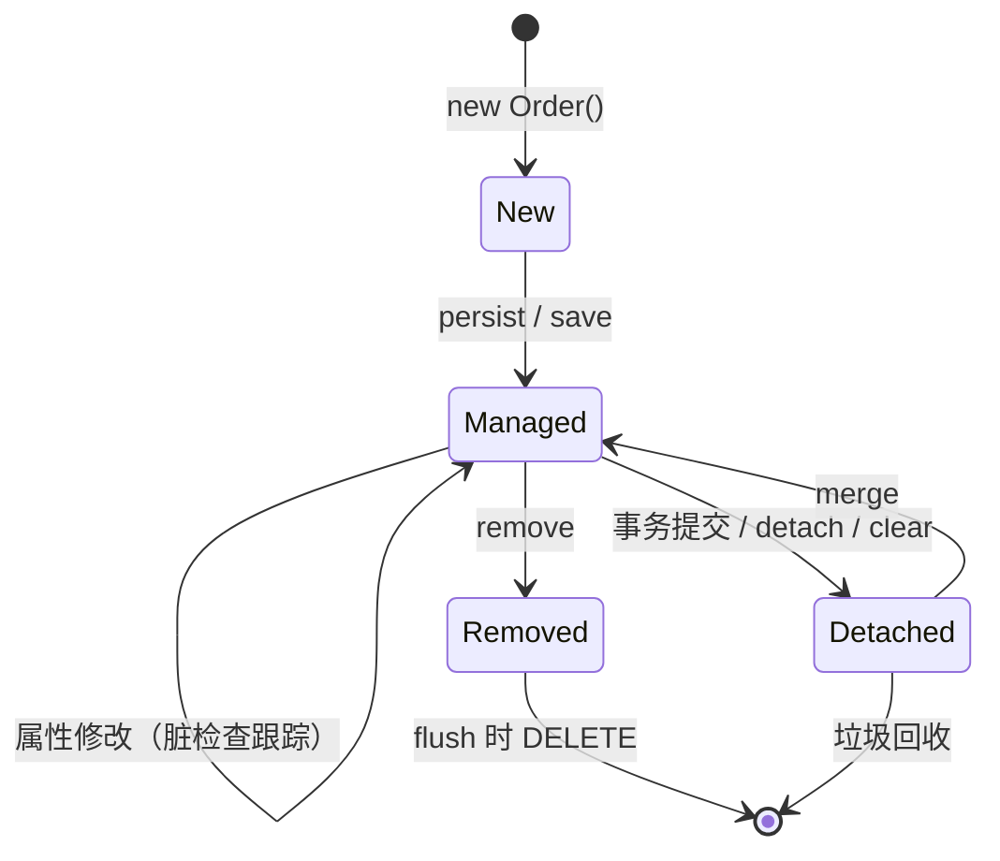
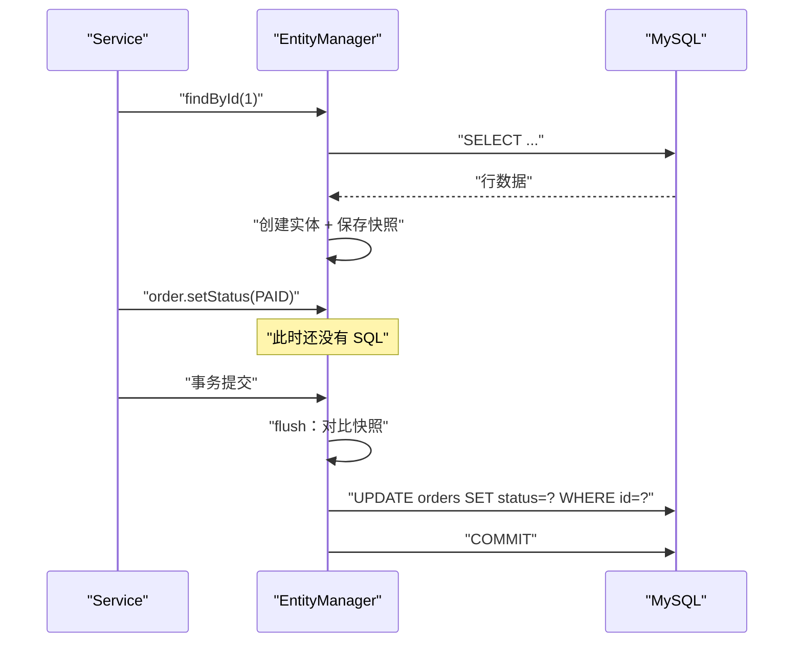
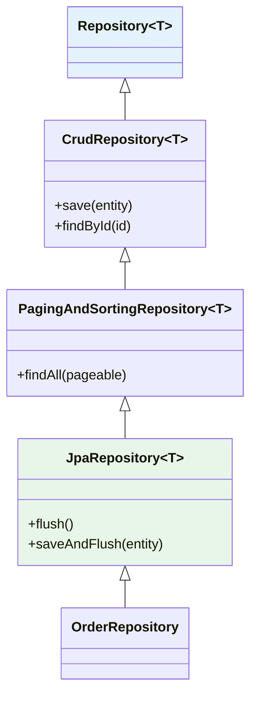

# JPA、Hibernate 与 ORM 选型

> 定位：`orderRepository.findByStatus("PAID")` 一行代码就能查库，但「SQL 什么时候发、为什么发了 101 条、为什么改一个字段却更新全表、为什么事务提交后还能查数据」决定了你是会用 JPA 还是被 JPA 坑。这篇讲透持久化上下文、一级缓存、脏检查、flush 时机、N+1、懒加载代理，最后给出 JPA、MyBatis、jOOQ 的选型边界。

## 一、为什么需要理解 JPA 的运行时

Spring Data JPA 的入门体验极好：声明接口、按约定写方法名，查询就出来了。

```java
public interface OrderRepository extends JpaRepository<Order, Long> {
    List<Order> findByUserIdAndStatus(Long userId, OrderStatus status);
}
```

但「简单」有代价：**ORM 把 SQL 藏起来了，也把执行时机藏起来了**。线上常见的四类困惑：

1. 查 10 个订单，日志里却有 101 条 SQL——N+1。
2. 只改了 `status`，`UPDATE` 却带上所有字段。
3. 事务提交后，Controller 里访问 `order.getItems()` 还能查到数据——Open Session in View。
4. 没调 `save()`，只改了对象属性，数据却更新了——脏检查。

要解释这些，必须理解 JPA 的**持久化上下文（Persistence Context）**。JPA 是规范，Hibernate 是实现，Spring Data JPA 是在 Hibernate 之上再包一层 Repository：

| 层 | 角色 | 你接触到的 |
|---|---|---|
| JPA（Jakarta Persistence） | 规范：注解、`EntityManager`、JPQL、事务契约 | `@Entity`、`@Id`、`EntityManager` |
| Hibernate 6.x | 实现：SQL 生成、脏检查、缓存、方言 | `Session`、`hibernate.*` 配置 |
| Spring Data JPA | Repository 抽象：派生查询、分页、事务集成 | `JpaRepository`、`@Query`、`Pageable` |

## 二、核心原理

### 2.1 EntityManager 与持久化上下文

`EntityManager` 不是线程安全的，**一个事务一个实例**。生命周期有两种：

| 类型 | 获取方式 | 生命周期 | 场景 |
|---|---|---|---|
| 容器管理（事务作用域） | `@PersistenceContext` 注入代理 | 随事务开始/结束 | Spring 管理的 Service |
| 应用管理 | `EntityManagerFactory.createEntityManager()` | 手动 `close()` | 批处理、测试 |

注入进来的是**代理**，真正绑定当前事务的持久化上下文；事务结束上下文关闭，实体变游离态（detached）。

持久化上下文本质是「实体身份映射表」：同一个 `(实体类型, 主键)` 在同一个上下文里**只有一个 Java 实例**。这就是一级缓存。



读图要点：只有 `Managed` 状态受脏检查管理；`Detached` 后改属性**不会**同步数据库，必须 `merge`。这解释了「事务外改对象没生效」和「`save` 游离对象多发一次 SELECT」。

### 2.2 一级缓存：一个事务里同一条记录只有一个对象

```java
@Transactional
public void demo(Long id) {
    Order a = orderRepository.findById(id).orElseThrow();
    Order b = orderRepository.findById(id).orElseThrow();
    System.out.println(a == b);   // true，第二次不发 SQL
}
```

三个推论：

- **同一事务内看不到别人刚提交的修改**：对象已在上下文里，JPA 不再查库；需要最新值用 `refresh` 或新事务。
- **一级缓存不能关闭**，它是 JPA 语义的一部分；能清的是 `clear()` / `detach()`。
- **批量处理要手动清理**：上下文会越来越大，脏检查越来越慢，每 N 条 `flush()` + `clear()`。

> 一级缓存是事务级身份映射；二级缓存是跨事务共享缓存，默认关闭，两者不是一回事。

### 2.3 脏检查与 flush：UPDATE 什么时候发出

实体加载时，Hibernate 保存一份**属性快照**（`loadedState`）。`flush` 时逐字段对比，不一致就生成 `UPDATE`。所以不需要调 `save()`。



读图要点：**改实体不产生 SQL，flush 才产生**。默认 `AUTO` 的触发点是：事务提交前、执行可能受影响的 JPQL 查询前、显式 `flush()`。

| FlushMode | 行为 | 场景 |
|---|---|---|
| `AUTO`（默认） | 提交前 + 查询前自动 flush | 绝大多数业务 |
| `COMMIT` | 只在提交前 flush | 减少查询前刷脏数据 |
| `MANUAL` | 只在显式 `flush()` | 只读事务、批处理 |

`@Transactional(readOnly = true)` 会把 flush 模式设为 `MANUAL` 并把连接设为只读，查询接口应该加。默认 `UPDATE` 带所有映射字段，`@DynamicUpdate` 可只更新变化列，但会失去语句复用，只在宽表频繁部分更新时考虑。

### 2.4 N+1：ORM 最著名的性能陷阱

```java
List<Order> orders = orderRepository.findByUserId(userId);   // 1 条 SQL
for (Order o : orders) {
    o.getItems().size();                                      // 每个订单 1 条 SQL
}
```

一个列表查询 + N 次关联查询 = N+1。根因是**关联默认懒加载**，错在「在循环里触发」。三种解法：

**① fetch join**：一条 SQL 带回关联。

```java
@Query("select distinct o from Order o join fetch o.items where o.userId = :userId")
List<Order> findWithItems(@Param("userId") Long userId);
```

`distinct` 用于去掉 join 产生的重复主表行；分页 + fetch join 会让 Hibernate 在内存中分页（启动告警），数据量大时很危险。

**② `@EntityGraph`**：声明式抓取，不改 JPQL。

```java
@EntityGraph(attributePaths = {"items"})
List<Order> findByUserId(Long userId);
```

**③ 批量抓取**：把 N 次查询合成少量 `IN` 查询。

```java
@BatchSize(size = 100)
private List<OrderItem> items;
```

```yaml
spring.jpa.properties.hibernate.default_batch_fetch_size: 100
```

`@BatchSize` 适合「不确定哪些关联会被访问」，fetch join 适合「明确只需要这组关联」。不要在一个查询里 fetch join 多个集合，笛卡尔积会爆炸。

### 2.5 懒加载代理与 LazyInitializationException

懒加载的关联不是 `null`，而是**代理对象**（Hibernate 6 用 ByteBuddy 生成子类），访问非主键属性时触发初始化 SQL。代理需要打开的 Session，事务结束 Session 关闭后再访问就抛：

```
org.hibernate.LazyInitializationException: could not initialize proxy - no Session
```

Spring Boot 默认开 **Open Session in View（OSIV）**，把 Session 延长到整个 HTTP 请求，于是 Controller 里序列化实体还能懒加载。这看似方便，实则有害：连接被占用到视图渲染结束、N+1 被藏到序列化阶段、事务边界与 Session 边界不一致。

正确做法是 Service 内把数据取够并返回 DTO：

```java
public record OrderVO(Long id, String status, List<ItemVO> items) {}

@Transactional(readOnly = true)
public OrderVO detail(Long id) {
    Order order = orderRepository.findWithItems(id).orElseThrow();
    return new OrderVO(order.getId(), order.getStatus().name(),
            order.getItems().stream().map(ItemVO::from).toList());
}
```

生产建议显式 `spring.jpa.open-in-view: false`，懒加载问题会在开发期立刻暴露。

### 2.6 锁与批量：并发和吞吐的两条线

**乐观锁**：`@Version` 让 `UPDATE` 带上版本条件，冲突时抛 `OptimisticLockException`（Spring 转成 `ObjectOptimisticLockingFailureException`）。

```java
@Version private Long version;
// UPDATE account SET balance=?, version=version+1 WHERE id=? AND version=?
```

影响行数为 0 即冲突，适合读多写少、可重试的业务。**悲观锁**用 `@Lock(LockModeType.PESSIMISTIC_WRITE)` 生成 `SELECT ... FOR UPDATE`，适合库存扣减，但要注意锁范围与死锁，参考 [MySQL 锁机制](../06-数据库体系/03-MySQL锁机制.md)。

**批量写入**：

```yaml
spring.jpa.properties.hibernate:
  jdbc.batch_size: 50
  order_inserts: true
  order_updates: true
  batch_versioned_data: true
```

MySQL 还要在连接串加 `rewriteBatchedStatements=true`，否则驱动仍逐条发送。关键限制：**`GenerationType.IDENTITY` 会禁用批量插入**，因为 Hibernate 必须逐行取回自增主键；想批量插入应用 `SEQUENCE`（Hibernate 6 有 pooled 优化器）或 `TABLE`，MySQL 无原生序列时可在批量场景改用 JDBC/MyBatis。

## 三、关键机制与代码

### 3.1 实体与 Repository 抽象

```java
@Entity
@Table(name = "orders")
public class Order {
    @Id @GeneratedValue(strategy = GenerationType.IDENTITY)
    private Long id;

    @Enumerated(EnumType.STRING)          // 必须显式 STRING，默认是 ORDINAL
    private OrderStatus status;

    @OneToMany(mappedBy = "order", cascade = CascadeType.ALL, orphanRemoval = true)
    private List<OrderItem> items = new ArrayList<>();

    @Version private Long version;
}
```



读图要点：`JpaRepository` 在 `CrudRepository` 之上加了 `flush`、`saveAndFlush` 等；真正实现是 `SimpleJpaRepository`，方法名派生查询由 `PartTree` 解析成 JPQL/Criteria。派生查询适合简单条件，方法名超过三四个条件或涉及多表、子查询时应改用 `@Query` 或 Specification。

### 3.2 分页与投影

```java
// Page 会额外执行 count 查询
Page<Order> page = orderRepository.findByStatus(PAID, PageRequest.of(0, 20, Sort.by("createdAt").descending()));

// 接口投影：只查需要的列，避免加载整个实体
public interface OrderSummary { Long getId(); String getStatus(); }
List<OrderSummary> findByUserId(Long userId);
```

只关心「有没有下一页」时用 `Slice`，它靠多取一条判断，不发 count；`Page` 适合需要总页数的后台列表。

### 3.3 选型：JPA、MyBatis、jOOQ

| 维度 | JPA / Hibernate | MyBatis | jOOQ |
|---|---|---|---|
| SQL 控制力 | 中（JPQL/Criteria） | 高（手写 SQL） | 高（类型安全 DSL） |
| 开发效率 | 高（CRUD 零 SQL） | 中（写 SQL/XML） | 中（写 DSL） |
| 动态查询 | Criteria 较繁琐 | `<if>`/`<foreach>` 自然 | DSL 天然支持 |
| 复杂报表/多表 | 弱 | 强 | 强 |
| 领域模型 | 强（聚合、级联、生命周期） | 弱 | 弱 |
| 典型场景 | 领域驱动、CRUD 为主 | 复杂查询、存量系统 | SQL 复杂且要类型安全 |

**什么场景不该用 JPA：**

1. **报表、多表联合、窗口函数密集**：JPQL 表达力有限，最后还是 native query，不如 MyBatis/jOOQ。
2. **动态条件非常多**：Specification 比 MyBatis 动态 SQL 啰嗦得多。
3. **团队不理解持久化上下文**：N+1、OSIV、脏检查会持续制造线上问题。
4. **超大批量写入**：`IDENTITY` + 脏检查的组合不适合百万级导入。
5. **SQL 需要精细调优（hint、索引提示）**：ORM 生成的 SQL 不易干预。

反过来，领域模型复杂、实体关系多、以 CRUD 为主、希望方言可移植时，JPA 的抽象收益更大。MyBatis 的执行链路见 [MyBatis 架构与执行流程](01-MyBatis架构与执行流程.md)，连接池参数与会话预算见 [连接池原理-HikariCP与Druid](04-连接池原理-HikariCP与Druid.md)。

## 四、生产坑点与排查

### 坑点 1：OSIV 默认开启，连接被占用到视图渲染

**现象**：连接池 active 偏高但慢 SQL 不多；返回大对象时 RT 明显变长。
**原因**：`spring.jpa.open-in-view` 默认 true，Session/连接从进 Controller 持有到响应写完，序列化触发懒加载还会额外查库。
**解法**：显式设 `false`；Service 内取够数据返回 DTO；用 `@Transactional(readOnly = true)` 缩小事务范围。

### 坑点 2：N+1 在序列化阶段爆发

**现象**：Service 只有一条 SQL，接口一返回列表就出现几十上百条查询。
**原因**：返回实体给 Jackson 序列化，序列化器访问懒加载集合，每条记录触发一次查询；OSIV 让行为「能跑通」，更难发现。
**解法**：DTO 投影；需要关联时用 fetch join / `@EntityGraph` / `@BatchSize`；把「一次请求 SQL 条数」纳入回归测试。

### 坑点 3：`@Enumerated` 默认 ORDINAL，改枚举顺序就错乱

**现象**：新增枚举值后，历史数据含义整体错位。
**原因**：JPA 的 `@Enumerated` 默认 `ORDINAL`，存的是下标；中间插入枚举会让后续下标全部变化。
**解法**：一律显式 `EnumType.STRING`；已有 ORDINAL 数据要迁移；对稳定性要求高的枚举用 `@Converter` 存自定义 code。

### 坑点 4：复合主键的 equals/hashCode 写错

**现象**：同一复合主键的实体在集合里出现两份，`findById` 行为异常。
**原因**：`@IdClass` / `@EmbeddedId` 的主键类没有正确实现 `equals`/`hashCode`，身份映射失效。
**解法**：主键类实现 `Serializable` 并正确重写；实体用业务键实现 `equals`/`hashCode`；优先考虑代理主键，复合主键只用于映射遗留表。

### 坑点 5：级联删除与 orphanRemoval 误删数据

**现象**：删父对象时子表被清空，或更新集合时意外删除子记录。
**原因**：`CascadeType.ALL` + `orphanRemoval = true` 表示「父删子删、集合移除即删」，语义很强。
**解法**：级联只配真正属于聚合内部的实体；删除前确认外键与业务语义；共享实体禁用 `REMOVE` 级联。

### 坑点 6：`ddl-auto` 与批量配置在生产的误用

**现象**：生产库结构被应用自动修改；或开了 `batch_size` 却没有效果。
**原因**：`ddl-auto=update` 会在启动时改表；批量插入因 `IDENTITY` 被禁用，或 MySQL 没开 `rewriteBatchedStatements`。
**解法**：生产固定 `validate`/`none`，结构变更走 Flyway/Liquibase；批量场景换 `SEQUENCE` 或 JDBC 批处理；用 SQL 日志确认是否真批量发送。

## 五、调优与最佳实践

**实体设计：**

1. 关联默认 `LAZY`，尤其检查 `@ManyToOne` 是否被设成 EAGER。
2. 枚举一律 `EnumType.STRING` 或自定义 `Converter`。
3. 用 `@Version` 做乐观锁，冲突在上层重试。
4. 大字段拆表或 `@Basic(fetch = LAZY)`，避免每次查询都拖上。
5. 实体 `equals`/`hashCode` 用业务键，不用自增 ID。

**查询与事务：**

1. 查询接口 `@Transactional(readOnly = true)`。
2. 列表查询用 DTO 投影，不返回实体。
3. 分页优先 `Slice`，确需总数才用 `Page`。
4. 批量处理每 N 条 `flush()` + `clear()`，控制上下文大小。
5. 复杂查询用 `@Query` 或 native query，别硬套 Criteria。

**配置基线（Boot 3 / Hibernate 6）：**

```yaml
spring:
  jpa:
    open-in-view: false
    hibernate.ddl-auto: validate
    properties.hibernate:
      jdbc.batch_size: 50
      order_inserts: true
      order_updates: true
      default_batch_fetch_size: 100
      query.in_clause_parameter_padding: true
```

## 六、面试高频问法

**Q1：EntityManager 的生命周期是怎样的？一级缓存是什么？**

**一句话结论**：容器管理的 `EntityManager` 是代理，随事务创建/关闭，一个事务一个持久化上下文；一级缓存就是这个上下文里的身份映射，保证同一条记录只有一个 Java 实例。

展开：

- 事务结束上下文关闭，实体变 detached；同一事务内两次 `findById` 只发一次 SQL；
- 一级缓存不可关闭，只能 `clear`/`detach`；它导致同一事务看不到别人刚提交的修改。

加分点：指出「需要最新数据时用 `refresh` 或新事务」，这是排查「改了库但读不到」的第一反应。

**Q2：JPA 的脏检查是怎么实现的？**

**一句话结论**：加载实体时保存属性快照，flush 时逐字段对比，有差异就生成 `UPDATE`；所以不调 `save()` 也会更新。

展开：

- 快照存在持久化上下文，实体越多，内存与对比成本越高；
- `@DynamicUpdate` 只更新变化列，但牺牲语句复用；只读事务应设 `FlushMode.MANUAL`。

加分点：解释「批量处理为什么要定期 clear」——上下文膨胀会让脏检查变慢甚至 OOM。

**Q3：flush 在什么时候发生？和 commit 有什么区别？**

**一句话结论**：默认 `AUTO`——事务提交前、执行可能受影响的 JPQL 查询前、显式 `flush()` 时；flush 只把 SQL 发给数据库，commit 才提交事务，flush 后仍可回滚。

展开：

- 查询前 flush 是为了让查询看到未提交的修改；
- `readOnly=true` 会切到 `MANUAL`，避免无谓 flush。

加分点：强调「flush ≠ commit」，这是很多人面试时的失分点。

**Q4：N+1 是怎么产生的？怎么解决？**

**一句话结论**：查主表 1 条 SQL，循环访问 N 个实体的懒加载关联又发 N 条；用 fetch join、`@EntityGraph`、`@BatchSize`/`default_batch_fetch_size` 解决，根本方案是 DTO 投影。

展开：

- fetch join 一条 SQL 取回，注意 `distinct` 与分页限制；
- `@BatchSize` 把 N 次合成少量 `IN` 查询；序列化阶段触发的最隐蔽，必须关 OSIV。

加分点：提醒「不要同时 fetch join 多个集合」，笛卡尔积会让结果集爆炸。

**Q5：LazyInitializationException 为什么发生？OSIV 是好是坏？**

**一句话结论**：懒加载代理需要打开的 Session，事务结束后 Session 关闭，再访问就抛异常；OSIV 把 Session 延长到整个请求，能「避免」异常但把问题藏得更深，生产建议关闭。

展开：

- OSIV 让连接持有到视图渲染，增加池压力；
- 懒加载被推迟到序列化，N+1 更隐蔽；正确做法是 Service 内取够数据并转 DTO。

加分点：说出「OSIV 是止痛药不是解药」，并指出 Boot 启动日志本来就有警告。

**Q6：JPA 的乐观锁和悲观锁怎么用？**

**一句话结论**：乐观锁用 `@Version`，`UPDATE ... WHERE version=?` 冲突时抛异常，适合读多写少；悲观锁用 `@Lock(PESSIMISTIC_WRITE)` 生成 `FOR UPDATE`，适合强竞争但要注意死锁。

展开：

- 乐观锁需要上层重试，不能吞异常；
- 悲观锁持有到事务结束，事务必须短。

加分点：强调「乐观锁不是锁，是冲突检测」，它不阻塞任何人。

**Q7：JPA 怎么做批量插入？为什么有时不生效？**

**一句话结论**：开 `hibernate.jdbc.batch_size` + `order_inserts`，MySQL 加 `rewriteBatchedStatements=true`；但 `IDENTITY` 主键会强制逐条插入，必须换 `SEQUENCE`/`TABLE` 生成器。

展开：

- 批量还要定期 `flush()` + `clear()` 控制上下文；超大导入建议绕过 ORM，用 JDBC/MyBatis。

加分点：点出「IDENTITY 需要逐行拿自增主键」这个根因，比背配置更有说服力。

**Q8：JPA 和 MyBatis 怎么选？**

**一句话结论**：领域模型复杂、CRUD 为主、团队懂 ORM 选 JPA；SQL 复杂、动态条件多、需要精细调优选 MyBatis；SQL 复杂又想要类型安全选 jOOQ。

展开：

- JPA 的优势是实体生命周期与关系管理，不是复杂查询；MyBatis 的优势是 SQL 完全可控，适合报表与存量库，两者可按模块共存。

加分点：给出「不推荐场景」——报表密集型系统硬上 JPA、领域模型硬上 MyBatis，都会很痛苦。

## 小结

- JPA 是规范、Hibernate 是实现、Spring Data JPA 是 Repository 抽象；理解层次才能定位问题。
- 持久化上下文 = 一级缓存 + 身份映射，事务级、不可关闭；实体状态决定修改是否同步。
- 修改实体不产生 SQL，flush 才产生；`AUTO` 在提交前和查询前触发，`readOnly` 会切到 `MANUAL`。
- N+1 的根因是循环触发懒加载，解法是 fetch join、`@EntityGraph`、批量抓取，根本方案是 DTO 投影 + 关闭 OSIV。
- ORM 选型看 SQL 复杂度与团队能力：领域模型选 JPA，复杂查询选 MyBatis/jOOQ，不要用一种工具硬套所有场景。

## 参考资料

- Jakarta Persistence 规范（JPA 3.1）：EntityManager、Persistence Context、FlushModeType、LockModeType
- Hibernate ORM 6.x 用户指南：Flushing、Fetching、Batching、Locking
- Spring Data JPA 官方文档：Query Methods、Projections、EntityGraph、Transactions
- 源码类：`org.springframework.data.jpa.repository.support.SimpleJpaRepository`、`org.springframework.data.repository.query.parser.PartTree`、`org.hibernate.engine.spi.PersistenceContext`
