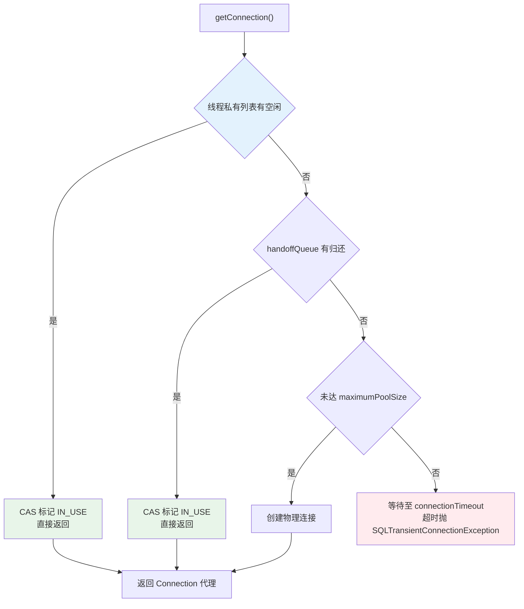
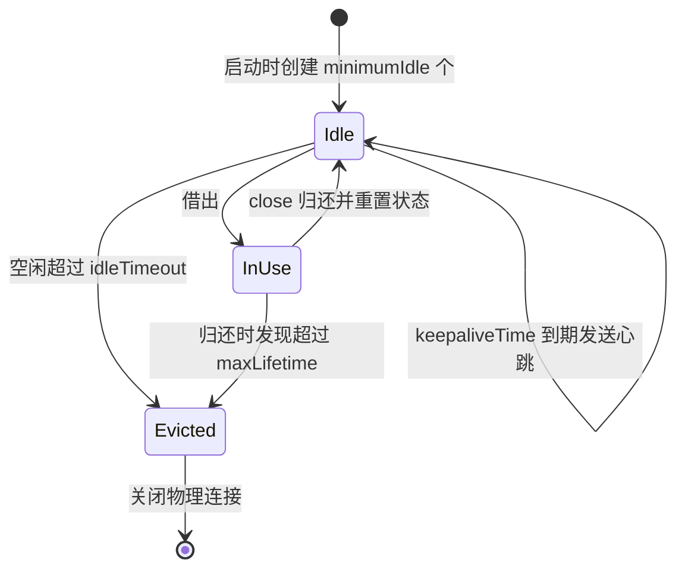
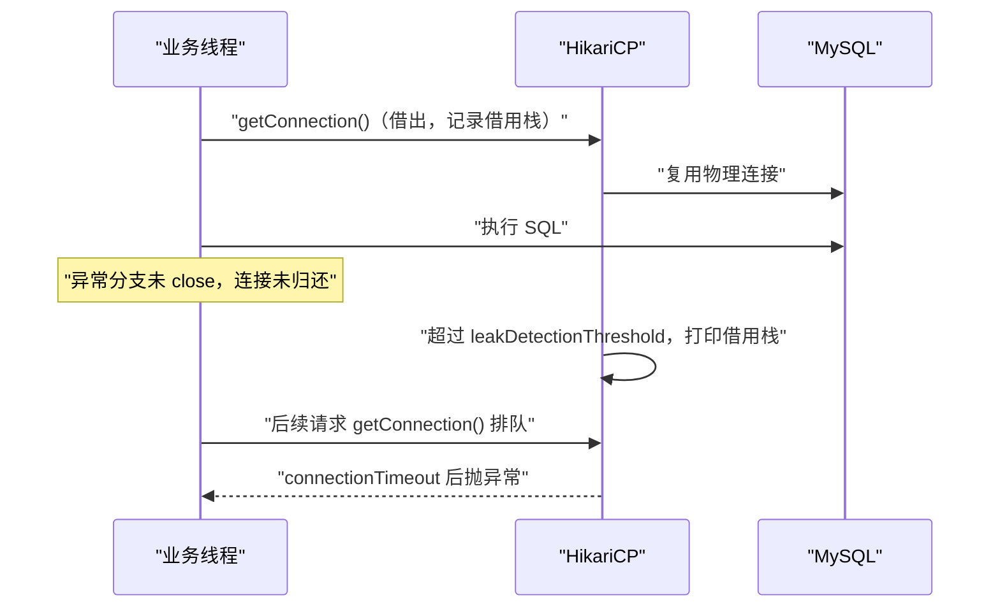

# 连接池原理：HikariCP 与 Druid

> 定位：连接池是「看不见的容量瓶颈」。接口 RT 突然变高、日志里冒出 `Connection is not available, request timed out`、数据库 `max_connections` 被打满，根因往往不是 SQL 慢，而是池子配错或连接没归还。这篇把 HikariCP 的 `ConcurrentBag`、连接生命周期、六个核心参数的默认值讲透，再对比 Druid 的监控与 SQL 防火墙，最后给出「池多大、副本怎么算、泄漏怎么查」的可操作结论。

## 一、为什么需要连接池

一次数据库访问的成本不只是 SQL 执行：

| 环节 | 成本 |
|---|---|
| TCP 三次握手 | 一个 RTT，跨机房可能几毫秒 |
| 数据库认证 | 权限校验、SSL 握手，开销远大于一次普通查询 |
| 会话初始化 | 设置字符集、时区、隔离级别 |
| 连接对象与缓冲区 | 每个连接在数据库侧占内存与一个线程/进程 |

如果每个请求都 `DriverManager.getConnection()`，QPS 1000 就意味着每秒上千次握手与认证，数据库光建连接就忙不过来。连接池的作用是：**预先建立一批连接，借出/归还复用，把「建连成本」摊薄到启动时**。MyBatis 的 `SqlSession` 生命周期与连接归还时机见 [MyBatis 架构与执行流程](01-MyBatis架构与执行流程.md)。

代价是引入了新的容量约束。线上三类典型事故：

1. **池耗尽**：慢 SQL 或事务里做远程调用，连接被长期占用，后来的请求在 `getConnection()` 上排到超时。
2. **连接泄漏**：异常分支没 `close()`，连接只借不还，池子越来越小，最终全站不可用。
3. **打爆数据库**：每个 Pod 配 50 个连接，20 个副本就是 1000 个，超过 `max_connections`，数据库直接拒绝新连接。

## 二、核心原理

### 2.1 HikariCP 为什么快

HikariCP 的性能优势不来自「黑科技」，而是**把热路径上的锁和分配都去掉了**。核心是 `ConcurrentBag`：

```java
// 简化示意，非源码原文
public class ConcurrentBag<T extends IConcurrentBagEntry> {
    private final CopyOnWriteArrayList<T> sharedList;              // 全池共享
    private final ThreadLocal<List<WeakReference<T>>> threadList;  // 线程私有
    private final SynchronousQueue<T> handoffQueue;                // 直接交接
}
```

借连接的顺序是四步，绝大多数请求在第 1、2 步就返回，完全不碰全局锁：



读图要点：`ThreadLocal` 缓存让「刚归还的连接」被同一线程立刻复用；`SynchronousQueue` 让「归还」与「借用」直接配对，不经过队列；只有前两步都失败才去扫 `sharedList`，并用 CAS 把 `PoolEntry` 状态从 `NOT_IN_USE` 改为 `IN_USE`。整个热路径没有 `synchronized`。

除此之外还有三处优化：

- **代理对象**：HikariCP 用 Javassist/ByteBuddy 在启动时生成 `Connection`、`Statement`、`ResultSet` 的代理类，`close()` 被改写为「归还池」而不是关闭物理连接，同时追踪未关闭的 Statement。
- **精简字节码**：内部用 `FastList` 替代 `ArrayList` 存放 Statement，去掉范围检查；用 `AtomicInteger` 等轻量结构做计数，避免重量级同步器。
- **状态位重置**：连接归还时只重置「脏」的状态（autoCommit、readOnly、隔离级别、未提交事务），用 dirty bits 记录，避免每次都全量 reset。

### 2.2 连接生命周期与后台线程



读图要点：`maxLifetime` 是「连接从创建开始的最长寿命」，到期后**不是立刻杀掉**，而是在归还时淘汰，避免误杀正在执行的查询；`idleTimeout` 只作用于空闲连接；`keepaliveTime` 用于在空闲期发心跳，防止中间网络设备把长连接静默断开。

HikariCP 有一个 `HouseKeeper` 后台任务（默认 30 秒一次，`housekeepingPeriodMs`），负责：

- 淘汰超过 `maxLifetime` 的连接；
- 回收超过 `idleTimeout` 的空闲连接；
- 补足 `minimumIdle`；
- 对超过 `keepaliveTime` 的空闲连接发校验。

### 2.3 六个核心参数与默认值

| 参数 | 默认值 | 作用 | 常见误配 |
|---|---|---|---|
| `maximumPoolSize` | 10 | 池内最大连接数 | 盲目调到 100，打爆数据库 |
| `minimumIdle` | 等于 max | 最小空闲连接数 | 与 max 差太大，流量突增时频繁建连 |
| `connectionTimeout` | 30000ms | 借连接的最长等待 | 设成 0（无限等），故障时线程全挂 |
| `idleTimeout` | 600000ms | 空闲连接回收时间 | 小于数据库超时，连接被两头踢 |
| `maxLifetime` | 1800000ms | 连接最长寿命 | 大于 DB `wait_timeout`，拿到死连接 |
| `leakDetectionThreshold` | 0（关闭） | 借出超时后打印持有者栈 | 设得比慢 SQL 还短，日志刷屏 |

两个约束必须记住：

1. **`maxLifetime` 必须小于数据库/中间件的连接超时**。MySQL 的 `wait_timeout` 默认 28800 秒（8 小时），云数据库常调到几分钟到几十分钟；`maxLifetime` 默认 30 分钟通常安全，但如果被改成 0（永不过期）或大于 `wait_timeout`，就会拿到已被服务端关闭的连接。
2. **`leakDetectionThreshold` 必须大于最慢 SQL 的耗时**，否则正常的慢查询也会被当成泄漏；同时它应小于 `maxLifetime`，HikariCP 在超过时会告警。

### 2.4 池子该多大：小池更好

先给结论：**池大小不是越大越好，通常 10~20 就够，先算再调**。

两个估算工具：

**利特尔法则**：`并发连接数 = 每秒请求数 × 单次持有连接的时间`。例如 1000 QPS、平均持有 5ms，理论并发约 5 个连接；考虑突发与长尾，留 2~4 倍余量，10~20 个足够。

**HikariCP 官方 wiki 的经验公式**（面向 PostgreSQL，仅作起点）：

```
connections = (CPU 核数 × 2) + 有效磁盘数
```

4 核 + 1 块 SSD，得到约 9 个连接。这不是定律，但说明「几十个连接已经很多」。

为什么小池反而更好：

- 数据库每个连接都要占内存、参与调度，连接越多，上下文切换与锁竞争越重；
- 连接数超过 CPU 并行度后，多出来的连接只是在数据库内部排队，吞吐不升反降；
- 小池能让请求在应用侧排队，压力更早暴露，而不是把数据库压垮。

> 反例：把 `maximumPoolSize` 从 10 调到 100，压测 QPS 没涨，P99 反而升高——数据库 CPU 花在连接调度上，真正的查询得不到执行。

### 2.5 Druid 的定位：监控与 SQL 防火墙

Druid 是国内常用的连接池，它的差异化不在「借还速度」，而在**可观测性与 SQL 治理**：

| 能力 | 实现 | 价值 |
|---|---|---|
| SQL 监控 | `StatFilter` 采集执行次数、耗时、慢 SQL、并发数 | 定位慢 SQL、发现异常 SQL |
| SQL 防火墙 | `WallFilter` 解析 SQL 语法并拦截 | 防注入、阻断全表删除/无 WHERE 更新 |
| Web 监控台 | `StatViewServlet` + `WebStatFilter` | 浏览器查看数据源、SQL、URI 统计 |
| 连接泄漏回收 | `removeAbandoned` | 强制回收超时未归还连接（危险） |

代价是：`StatFilter` 有统计开销，SQL 解析也耗 CPU；`WallFilter` 误杀合法 SQL 的情况并不少见。**纯性能优先选 HikariCP，需要 SQL 审计/防火墙/可视化再选 Druid**——这也是 Spring Boot 默认用 HikariCP 的原因。

## 三、关键机制与配置

### 3.1 HikariCP 配置

```yaml
spring:
  datasource:
    url: jdbc:mysql://mysql:3306/shop?useSSL=false&serverTimezone=Asia/Shanghai
    username: app
    password: ${DB_PASSWORD}
    hikari:
      pool-name: order-pool
      maximum-pool-size: 15
      minimum-idle: 15                # 与 max 接近，避免流量突增时频繁建连
      connection-timeout: 3000        # 借连接最多等 3 秒，快速失败
      idle-timeout: 600000            # 10 分钟
      max-lifetime: 1200000           # 20 分钟，必须小于 DB wait_timeout
      leak-detection-threshold: 20000 # 20 秒未归还则打印栈
```

`connection-timeout` 设短一点（3~5 秒）是有意为之：池耗尽时快速失败，让上游熔断/降级，而不是把 Tomcat 线程全部挂死。设成 30 秒会让故障期间线程堆积，健康检查也过不去。

### 3.2 Druid 配置（Boot 3）

Boot 3 需要 Jakarta 版本 starter，注意坐标：

```xml
<dependency>
    <groupId>com.alibaba</groupId>
    <artifactId>druid-spring-boot-3-starter</artifactId>
    <version>1.2.23</version>
</dependency>
```

```yaml
spring:
  datasource:
    type: com.alibaba.druid.pool.DruidDataSource
    druid:
      initial-size: 5
      min-idle: 5
      max-active: 20
      max-wait: 3000
      validation-query: SELECT 1
      test-while-idle: true
      test-on-borrow: false
      time-between-eviction-runs-millis: 60000
      min-evictable-idle-time-millis: 600000
      filters: stat,wall,slf4j
      connection-properties: druid.stat.mergeSql=true;druid.stat.slowSqlMillis=3000
      filter:
        wall:
          enabled: true
          config:
            multi-statement-allow: false
            delete-where-alway-true-check: true
            update-where-alway-true-check: true
```

> `alway` 是 Druid 的历史拼写，按官方文档写即可。`filters: stat,wall` 会带来额外开销，压测时要单独评估。

### 3.3 泄漏检测与现场取证

HikariCP 的 `leakDetectionThreshold` 只**打印日志**，不会回收连接——这是它和 Druid `removeAbandoned` 的关键区别。开启后，超过阈值未归还的连接会输出借用点栈：

```
Connection leak detection triggered for com.mysql.cj.jdbc.ConnectionImpl@..., stack trace follows
    at com.example.order.OrderService.query(OrderService.java:42)
    at com.example.order.OrderController.detail(OrderController.java:28)
```

排查连接泄漏的完整路径：

1. **看池指标**：`hikaricp.connections.active` 持续上升、`pending` 大于 0、`timeout` 增长，说明借出多、归还少。
2. **看数据库会话**：MySQL `SHOW FULL PROCESSLIST` 或查 `information_schema.processlist`，按 `Host`（Pod IP）和 `Time` 找长时间 `Sleep`/`Query` 的会话；PostgreSQL 查 `pg_stat_activity` 的 `state`、`query_start`、`wait_event`。
3. **抓线程栈**：`jstack <pid>` 搜 `HikariPool.getConnection` 或 JDBC 读 socket 的线程，看它卡在哪个业务方法。
4. **对照借用栈**：开 `leakDetectionThreshold` 拿到代码行，重点查「手动 `getConnection()` 未在 finally 关闭」「事务里调用远程服务」。



读图要点：泄漏的可怕之处不是「一个连接没还」，而是**每次请求都泄漏一个**，池子在线性缩小；等到 `pending` 堆积时，业务已经大面积超时。

### 3.4 容量换算：副本数 × 池大小

数据库的 `max_connections` 是**全局预算**，必须把所有消耗方加起来：

```sql
-- MySQL：查看当前上限与使用量
SHOW VARIABLES LIKE 'max_connections';
SHOW STATUS LIKE 'Threads_connected';
SHOW STATUS LIKE 'Threads_running';
```

| 消耗方 | 估算 |
|---|---|
| 业务 Pod | 副本数 × `maximumPoolSize` |
| 定时任务/批处理 | 各自池大小 |
| 数据同步/CDC | 独立连接数 |
| 监控/运维/DB 客户端 | 预留 10%~20% |

例：`max_connections=500`，订单服务 20 副本 × 10 = 200，库存服务 10 × 10 = 100，报表与运维预留 100，总计 400，留 100 缓冲——这才是一个安全的预算。如果上了 HPA，要按**最大副本数**算，而不是当前副本数。

## 四、生产坑点与排查

### 坑点 1：maxLifetime 大于数据库 wait_timeout，拿到死连接

**现象**：低峰期后第一批请求报 `Communications link failure`、`No operations allowed after connection closed`，重试后又正常。
**原因**：连接在池里空闲的时间超过了数据库/负载均衡的空闲超时，服务端已单方面关闭，池子却以为它可用。
**解法**：
- `maxLifetime` 比数据库 `wait_timeout`（以及云 LB 的空闲超时）小 30 秒以上；
- 开启 `keepaliveTime` 发心跳维持连接状态，且不要设 `maxLifetime=0`。

### 坑点 2：连接未归还，池子缓慢枯竭

**现象**：`hikaricp.connections.active` 单调上升，`pending` 出现，几小时后全站 `Connection is not available`。
**原因**：手动 `dataSource.getConnection()` 后异常分支没 `close()`；或 `ResultSet`/`Statement` 未关闭导致连接无法释放；或代码里把 `Connection` 存进了缓存。
**解法**：
- 一律用 try-with-resources，或交给 Spring/MyBatis 管理；
- 开 `leakDetectionThreshold` 定位借用点，并在代码评审中盯住「手动获取连接」的路径。

### 坑点 3：池配得太大，反而打爆数据库

**现象**：扩容后 QPS 没涨，数据库 CPU 打满、`Threads_running` 飙高，应用侧 P99 变差。
**原因**：每个 Pod 的池都很大，总连接数超过数据库处理能力，连接之间争抢 CPU 与锁。
**解法**：
- 按「副本数 × 池大小 ≤ max_connections × 70%」做预算；
- 先把池降到 10~20 压测看拐点，必要时用 PgBouncer/ProxySQL 做连接复用。

### 坑点 4：事务里做远程调用，连接被长时间占用

**现象**：下游接口慢时，本服务连接池迅速耗尽，但慢 SQL 监控里看不到慢查询。
**原因**：`@Transactional` 方法里调用了 HTTP/RPC，事务未提交，连接一直被持有；远程调用 3 秒，连接就被占 3 秒。
**解法**：
- 把远程调用移到事务外，先查/算，再开短事务写；
- 用 [Spring 事务原理与失效场景](../05-Spring体系源码/04-Spring事务原理与失效场景.md) 检查大事务，并给远程调用设超时。

### 坑点 5：误用 leakDetection / removeAbandoned 掩盖问题

**现象**：开了 `removeAbandoned=true` 后不再报错，但偶尔出现「连接已被关闭」的随机异常。
**原因**：Druid 的强制回收会把**正在使用**的连接也关掉（它无法区分「泄漏」与「慢」），只是把症状压下去。
**解法**：
- 优先用 `leakDetectionThreshold` 打日志定位，而不是强制回收；
- 若必须用 `removeAbandoned`，阈值要远大于最慢 SQL，并只作为兜底；
- 根因仍然是代码里的未关闭路径。

### 坑点 6：启动即连库，数据库抖动导致 CrashLoopBackOff

**现象**：数据库短时不可用，Pod 启动失败退出，K8s 反复重启，流量全丢。
**原因**：HikariCP 默认 `initializationFailTimeout=1`，启动时拿不到连接就快速失败；在容器编排里这会变成重启循环。
**解法**：
- 启动阶段允许重试：把 `initializationFailTimeout` 设为负值（无限重试）或较大值；
- 用 readiness 探针控制流量，而不是让进程启动失败；
- 数据库恢复后池子会自动补连接，不必重启应用。

## 五、选型与调优清单

| 维度 | HikariCP | Druid | DBCP2 | Tomcat JDBC |
|---|---|---|---|---|
| 性能 | 最高（无锁热路径） | 中（监控有开销） | 中低 | 中 |
| 监控 | Micrometer 指标 | 内置 SQL/URI 监控台 | 弱 | 弱 |
| SQL 防火墙 | 无 | `WallFilter` | 无 | 无 |
| 依赖体积 | 极小 | 较大 | 小 | 小 |
| Spring Boot 默认 | 是 | 需显式指定 type | 否 | 否 |
| 适用 | 绝大多数互联网服务 | 需要审计/防火墙/可视化 | 老项目 | Tomcat 生态 |

**什么场景不该用 Druid：**

1. 纯性能敏感、不需要 SQL 审计的服务；
2. 团队没有维护监控台的习惯，`StatFilter` 只是白付开销；
3. SQL 复杂、动态拼接多，`WallFilter` 误杀风险高；
4. 已经用 Micrometer + APM 做可观测，不需要内置控制台。

**连接池调优 checklist：**

1. 先算容量：`副本数 × 池大小 < max_connections × 70%`。
2. `maximumPoolSize` 从 10~20 起，压测找拐点，不盲目调大。
3. `maxLifetime` 小于数据库与 LB 的空闲超时，开 `keepaliveTime`。
4. `connectionTimeout` 设 3~5 秒，快速失败优于长时间排队；生产开 `leakDetectionThreshold`，阈值大于最慢 SQL。
5. 监控四个指标：`active`、`idle`、`pending`、`timeout`；`pending` 持续大于 0 就是容量或泄漏信号。

## 六、面试高频问法

**Q1：为什么需要数据库连接池？**

**一句话结论**：建连要 TCP 握手、认证、会话初始化，成本远高于一次查询；连接池预建连接并复用，把建连成本摊到启动时，同时限制并发连接数保护数据库。

展开：

- 不复用会导致每秒上千次握手与认证，数据库光建连就过载；
- 池化后借还都在内存完成，热路径接近零成本；代价是池耗尽、泄漏、总连接数超限。

加分点：补一句「连接池不只是性能优化，更是**数据库侧的限流器**」——这个视角能解释为什么池不能配太大。

**Q2：HikariCP 为什么比别的连接池快？**

**一句话结论**：热路径无锁——`ThreadLocal` 缓存刚归还的连接、`SynchronousQueue` 直接交接、`sharedList` 用 CAS 抢状态；再叠加代理类、`FastList`、精简字节码与状态位重置。

展开：

- 借连接四步：线程私有列表 → 交接队列 → 共享列表 CAS → 新建；
- 绝大多数请求在前两步返回，不产生全局竞争；代理对象把 `close()` 改写成归还，并追踪未关闭的 Statement。

加分点：说清「不是用了什么神奇数据结构，而是把 `synchronized` 从热路径上拿掉了」，比背结论更有说服力。

**Q3：连接池大小怎么定？**

**一句话结论**：用利特尔法则算下限（QPS × 持有时间），再用 HikariCP 经验公式 `CPU×2 + 磁盘数` 做起点，通常 10~20 足够，靠压测找拐点。

展开：

- 1000 QPS × 5ms ≈ 5 个并发连接，留 2~4 倍余量；
- 池大小还要受 `max_connections` 与副本数约束，连接数超过数据库并行度后吞吐不升反降。

加分点：给出「先小后大、以压测为准」的方法论，而不是报一个固定数字。

**Q4：为什么说「小连接池更好」？**

**一句话结论**：数据库每个连接都要占资源并参与调度，连接数超过 CPU 并行度后只是增加上下文切换与锁竞争；小池让请求在应用侧排队，压力更早暴露。

展开：

- 多出来的连接在数据库内部排队，不提升吞吐；
- 连接越多，内存、调度、锁竞争成本越高；小池配合快速失败与熔断，故障隔离更好。

加分点：举反例「池从 10 调到 100，QPS 没涨、P99 升高」，说明这是实测结论而非理论。

**Q5：`maxLifetime`、`idleTimeout`、`leakDetectionThreshold` 分别管什么？**

**一句话结论**：`maxLifetime` 管连接最长寿命（防拿到服务端已关闭的死连接）；`idleTimeout` 管空闲回收；`leakDetectionThreshold` 只管**打印借用栈**，不回收连接。

展开：

- `maxLifetime` 到期在归还时淘汰，不会误杀执行中的查询；
- `idleTimeout` 只作用于空闲连接并受 `minimumIdle` 约束；泄漏检测阈值要大于最慢 SQL、小于 `maxLifetime`。

加分点：强调「leakDetectionThreshold 只告警不回收」，与 Druid 的 `removeAbandoned` 形成对比。

**Q6：线上连接池耗尽，怎么排查？**

**一句话结论**：先看池指标（active 高、pending 增长），再查数据库会话（谁占了连接、占了多久），然后抓线程栈与借用栈，最后回到代码找未关闭或长事务。

展开：

- 指标：`hikaricp.connections.active/pending/timeout`；
- 数据库：MySQL `information_schema.processlist`、PG `pg_stat_activity`；线程栈 `jstack` 搜 `HikariPool.getConnection`；借用栈看 `leakDetectionThreshold` 输出的业务行号。

加分点：区分「泄漏」（只借不还，active 单调上升）与「长事务」（active 高但会回落），两者解法不同。

**Q7：应用副本数和连接池大小、数据库 max_connections 怎么换算？**

**一句话结论**：把所有消耗方相加——`Σ(副本数 × 池大小) + 定时任务 + 同步工具 + 运维预留 ≤ max_connections × 70%`；HPA 场景按最大副本数算。

展开：

- 例：20 副本 × 10 = 200，其他服务 200，预留 100，总计 500；
- 扩容前必须重算，HPA 场景按最大副本数算；连接复用中间件（PgBouncer/ProxySQL）可降低后端真实连接数。

加分点：提醒「云数据库的 max_connections 常按规格给，不是无限大」，扩容应用前先看数据库规格。

**Q8：Druid 的 WallFilter 有什么用？有什么风险？**

**一句话结论**：`WallFilter` 基于 SQL 语法解析做防护，可拦截多语句、无 WHERE 的删除/更新、恒真条件等；风险是**误杀合法动态 SQL**，且解析本身有 CPU 开销。

展开：

- 适合有审计/合规要求、SQL 相对可控的系统；
- 动态拼接多、SQL 复杂的系统容易误杀，必须用真实 SQL 回归，不能只开不测。

加分点：说出「Druid 的监控台和防火墙是它的核心价值，性能不是」，这就是选型的分水岭。

**Q9：为什么在事务里做远程调用会拖垮连接池？**

**一句话结论**：事务开启即持有连接，远程调用期间事务不提交，连接一直被占用；下游变慢时，连接持有时间被放大，池子迅速耗尽。

展开：

- 连接持有时间 = SQL 时间 + 业务计算 + 远程调用时间；
- 下游 3 秒超时，等于每个请求占连接 3 秒；池子耗尽后，与数据库本身无关的请求也开始超时。

加分点：给出解法「远程调用移出事务、缩短事务边界、给下游设超时」，并链接事务传播行为。

## 小结

- 连接池的价值是复用建连成本并限制数据库并发；它同时是性能组件和限流器。
- HikariCP 快在热路径无锁：线程私有缓存、交接队列、共享列表 CAS，外加代理与精简结构。
- 参数记住三条硬约束：`maxLifetime` 小于 DB 空闲超时、`connectionTimeout` 快速失败、`leakDetectionThreshold` 大于最慢 SQL。
- 池大小先算后调，10~20 通常够；「副本数 × 池大小」必须纳入 `max_connections` 预算。
- 连接泄漏靠指标 + 数据库会话 + 线程栈 + 借用栈四步定位；强制回收只是掩盖症状。
