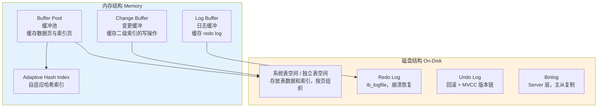
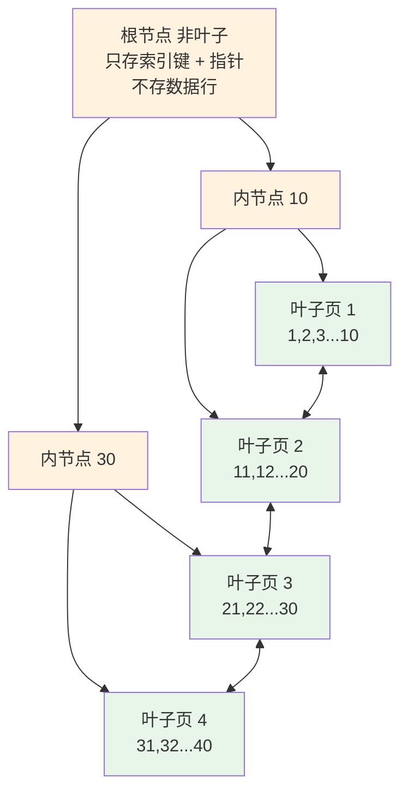
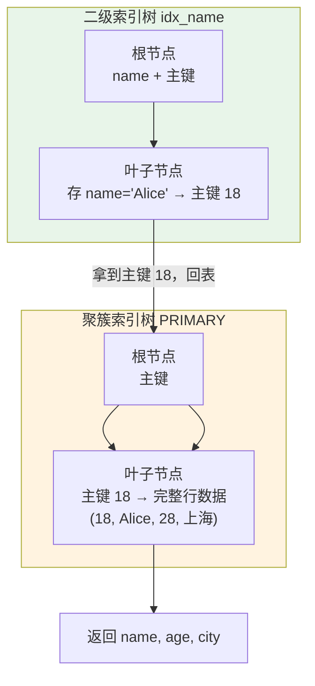

# InnoDB 与索引

> 定位：搞清楚 MySQL 最常用的存储引擎 InnoDB 到底怎么组织数据、B+树索引为什么长成这样、一条 SQL 查数据究竟走了几次磁盘 IO。这是慢 SQL 优化、索引设计、锁与事务理解的公共地基——很多人背了一堆「索引要遵循最左前缀」，却讲不清回表和覆盖索引的区别，根子就在不懂 InnoDB 的存储结构。

## 一、为什么必须深入 InnoDB 与索引

线上两类最常见的数据库问题，几乎都砸在这块地基上：

- **慢查询**：一条 SQL 从 20ms 突然变成 20s，DBA 看了一眼说「索引失效了」，你却不知道为什么失效、怎么改回来。
- **索引选择困难**：建了一堆索引，写入越来越慢、磁盘越来越大，查询却没快多少。到底该建哪些、不该建哪些？

要回答这些问题，靠背八股是不够的。你必须能在脑子里画出这样一张图：**一条记录物理上存在哪个页、B+树怎么一步步定位到它、走二级索引为什么还要「回表」、Buffer Pool 命中时根本不产生磁盘 IO**。这一篇就把这张图刻进你的脑子。

> 说明：以下内容以 MySQL 8.0 / InnoDB 默认配置为主，具体参数默认值请以你使用的版本为准。

## 二、核心原理

### 2.1 InnoDB 整体架构：内存 + 磁盘

InnoDB 是**行存储引擎**，采用「内存缓冲 + 磁盘持久化」的架构。所有数据操作都先在内存里完成，再异步刷回磁盘。理解这一点，才能理解为什么索引设计、Buffer Pool 大小对性能影响如此之大。



这张图读者要抓住两条主线：

1. **读路径**：查数据先去 Buffer Pool 找页，命中就直接返回（零磁盘 IO），未命中才从磁盘 `.ibd` 文件读入。
2. **写路径**：写操作先进 Log Buffer（redo log）和 Buffer Pool，后台线程再异步「脏页刷盘」。这是 WAL（Write-Ahead Logging）思想——**先写日志，再写数据**，保证崩溃后能恢复。

### 2.2 页：InnoDB 磁盘管理的最小单位

InnoDB 按「页（Page）」管理存储，**默认页大小 16KB**（参数 `innodb_page_size`，可设为 4K/8K/16K/32K/64K）。表文件 `.ibd` 就是由一个个页组成的。

一个数据页内部被切成多个区域：

| 区域 | 大小 | 作用 |
|---|---|---|
| File Header | 38 字节 | 页的通用信息（页号、上下页指针、校验和） |
| Page Header | 56 字节 | 页的状态信息（记录数、槽数、最大事务 ID 等） |
| Infimum / Supremum | 固定 | 两个虚拟的「最小/最大」记录，作为链表哨兵 |
| User Records | 动态 | 真正存放的行记录 |
| Free Space | 动态 | 尚未使用的空间 |
| Page Directory | 动态 | 页内记录的「槽」，支持页内二分查找 |
| File Trailer | 8 字节 | 校验页是否完整（防止写坏） |

关键点：

- 页内的记录用**单向链表**串起来，按主键顺序排列；Page Directory 把记录分组，每组最后一个记录的地址作为一个「槽（Slot）」，所以**页内查找用二分法**，不用从头遍历。
- 页与页之间通过 File Header 里的 `PAGE_NEXT` / `PAGE_PREV` 组成**双向链表**——这正是 B+树叶子节点能做范围扫描的物理基础。

### 2.3 为什么是 B+树

索引的本质是「用空间换时间」的数据结构。数据库场景有三个硬约束，决定了普通数据结构都不合适：

1. **数据量大，索引放不进内存，必须存在磁盘上**。
2. **磁盘 IO 代价极高**（一次随机 IO 约几毫秒，比内存访问慢 10 万倍量级），所以核心目标是**尽量减少树的高度**——树高就是一次查询的磁盘 IO 次数。
3. **范围查询频繁**（`WHERE id BETWEEN 100 AND 200`、`ORDER BY`），要求高效支持。

逐一排除：

| 数据结构 | 为什么不适合 |
|---|---|
| 哈希表 | O(1) 等值查询很快，但**无法做范围查询**，也无法排序 |
| 二叉查找树 / 红黑树 | 是二叉树，1000 万数据树高约 20 层，就是 20 次磁盘 IO，太慢 |
| B 树 | 多路平衡，树高降下来了，但**每个节点都存数据行**，导致一个页里能放的索引项变少，树会更高；且范围查询需要中序遍历跨层 |
| **B+树** | 非叶子节点**只存索引键+指针不存数据**，一个 16KB 页能塞下更多索引项，树更矮；所有数据都在叶子节点且用链表相连，**范围查询极高效** |

**算出 B+树到底能存多少行**（这是面试经典题）：

- 非叶子节点存「主键 + 指向子页的指针」。假设主键是 `bigint`（8 字节），指针 6 字节，一个索引项约 14 字节。一个 16KB 页约能放 `16384 / 14 ≈ 1170` 个索引项。
- 叶子节点存整行数据。假设一行约 1KB，一个页约存 16 行。
- 高度为 3 的 B+树：根节点 1170 个指针 → 第二层 1170×1170 个指针 → 叶子 1170×1170×16 ≈ **2200 万行**。
- 高度为 4：约 260 亿行。

结论：**千万级数据的表，B+树高度也就 3-4 层，一次查询只需 3-4 次磁盘 IO**——如果 Buffer Pool 命中，连这几次都省了。这就是为什么 InnoDB 选择 B+树。



这张图要看两点：**上层非叶子节点只放索引键（橙色）**，所以扇出大、树矮；**所有数据都在叶子节点（绿色）且用双向链表相连**，所以 `WHERE id > 25` 只要定位到 21 那一页，然后顺着链表往后扫即可，不用回到上层。

### 2.4 聚簇索引与二级索引

InnoDB 的索引都是 B+树，但分两类：

**聚簇索引（Clustered Index）**——「索引即数据，数据即索引」：

- 以**主键**构建的 B+树，叶子节点存的是**完整的行数据**。
- 所以「按主键查询」直接在这棵树上走到叶子就能拿到整行，不用再查别的地方。
- 一张表**有且只有一个**聚簇索引。如果你没定义主键，InnoDB 会选第一个非空唯一索引；再没有，就自动生成一个 6 字节的隐藏列 `DB_ROW_ID` 当聚簇索引。

**二级索引（Secondary Index）**——也叫辅助索引、非聚簇索引：

- 用普通列（如 `name`、`phone`）构建的 B+树，叶子节点**只存索引列的值 + 对应的主键值**，不存整行数据。
- 所以通过二级索引查到主键后，如果还要查其他列，必须**拿着主键回到聚簇索引再查一次**——这一步叫**回表**。



这张图演示了 `SELECT age, city FROM user WHERE name='Alice'` 的过程：先在二级索引树找到 name 对应的主键 18（绿），再回聚簇索引树（橙）取出整行。这就是两次 B+树查找。

### 2.5 覆盖索引：干掉回表

如果查询的列**恰好都在二级索引里**，就不需要回表了，这叫**覆盖索引（Covering Index）**。

```sql
-- 假设有联合索引 idx_name_age(name, age)
SELECT age FROM user WHERE name = 'Alice';  -- 覆盖索引，无需回表
SELECT city FROM user WHERE name = 'Alice'; -- city 不在索引里，需要回表
```

判断方法：看 `EXPLAIN` 的 `Extra` 列，出现 `Using index` 就是走了覆盖索引。覆盖索引是极重要的优化手段——**少一次回表就少一次 B+树查找，随机 IO 直接减半**。这也是为什么「不要 `SELECT *`」是条铁律：多查一个不在索引里的列，就可能从覆盖索引退化成回表。

## 三、关键机制与参数

### 3.1 最左前缀原则与索引下推

**最左前缀原则**：联合索引 `(a, b, c)` 是一棵按 a→b→c 顺序排序的 B+树，查询条件必须从最左边的列开始、且不跳过中间列，才能用上索引。

| 查询条件 | 能否用索引 | 说明 |
|---|---|---|
| `WHERE a=1` | 用上 a | 满足最左前缀 |
| `WHERE a=1 AND b=2` | 用上 a,b | 连续 |
| `WHERE a=1 AND b=2 AND c=3` | 用上 a,b,c | 完整 |
| `WHERE b=2` | 用不上 | 跳过了 a |
| `WHERE a=1 AND c=3` | 只用上 a | c 用不上（b 断档） |
| `WHERE a>1 AND b=2` | 只用上 a | 范围条件右边的列无法用索引继续定位 |

**索引下推（Index Condition Pushdown, ICP）**——MySQL 5.6 引入的优化：

没有 ICP 时，二级索引查出主键后**每条都回表**，回表后再筛 `WHERE` 里剩下的条件。有 ICP 时，存储引擎**在遍历二级索引时就把索引列包含的条件先过滤一遍**，只把满足条件的记录拿来回表，大幅减少回表次数。

```sql
-- 联合索引 (name, age)
SELECT * FROM user WHERE name LIKE 'Ali%' AND age = 28;
-- 有 ICP：在索引树上就过滤 age=28，只回表满足的
-- 无 ICP：所有 name LIKE 'Ali%' 的都回表，再过滤 age
```

`EXPLAIN` 的 `Extra` 出现 `Using index condition` 表示用上了 ICP。ICP 对**like 前缀 + 范围过滤**这类场景提升明显。

### 3.2 Buffer Pool：把热数据留在内存

**Buffer Pool 是 InnoDB 最重要的内存组件**，默认 128MB（参数 `innodb_buffer_pool_size`），专门缓存数据页和索引页。

- **读**：查询时页已在 Buffer Pool → 直接返回（内存速度）；不在 → 从磁盘读入并缓存。
- **写**：修改页时先改内存中的页，该页变成「脏页」，由后台线程异步刷盘。
- **命中率**：生产环境应保证 Buffer Pool 命中率 99% 以上，看 `SHOW ENGINE INNODB STATUS` 里的 `Buffer pool hit rate`。

经验法则：**专用数据库服务器，Buffer Pool 设为物理内存的 60%-80%**。太小会导致频繁磁盘 IO，太大可能挤占操作系统和其他进程内存、引发 swap。

缓冲池用 **LRU（最近最少使用）变体**管理，并做了「冷热分离」优化（参数 `innodb_old_blocks_pct`，默认 37%），防止一次全表扫描把热点数据全冲掉。

### 3.3 Change Buffer：把随机写变顺序写

**Change Buffer**（旧称 Insert Buffer）缓存的是**对二级索引的修改操作**。它的价值在于：当要修改的二级索引页不在 Buffer Pool 里时，不立刻去磁盘读页（一次随机 IO），而是先把「往某页插入/更新/删除某记录」这个动作缓存在 Change Buffer 里，等以后该页因为别的原因被读进内存时，再一次性合并（merge）进去。

- 把**大量离散的随机写**，攒成**少量批量合并**，对写多读少、二级索引多的场景提升巨大。
- 由参数 `innodb_change_buffer_max_size` 控制，默认占 Buffer Pool 的 **25%**，上限 50%。
- **聚簇索引的修改不走 Change Buffer**（因为聚簇索引是主键，通常唯一且需要立即读页校验唯一性）。

> 典型坑：一台写密集、二级索引很多的机器，如果把 change buffer 关掉或设太小，写性能会断崖式下跌。反之，读密集且数据很快被读到的场景，change buffer 意义不大。

### 3.4 自适应哈希索引（AHI）

InnoDB 会**自动监控**二级索引的查询模式，当发现某个索引页被频繁以相同条件访问时，就在 Buffer Pool 里为它建一个**哈希索引**，加速等值查询。这就是 **Adaptive Hash Index**。

- 由 `innodb_adaptive_hash_index` 控制，默认开启。
- 它是**自增、自适应的**，DBA 无法直接干预，哈希索引占 Buffer Pool 空间。
- 高并发下，AHI 的闩锁（latch）竞争有时会成为瓶颈——遇到这种极端情况会考虑关闭它（需压测验证，以版本为准）。

### 3.5 事务与 MVCC 的存储支撑

InnoDB 之所以支持事务，靠的是行记录里的隐藏列 + undo log：

- 每行记录有隐藏列 `DB_TRX_ID`（最后修改它的事务 ID）、`DB_ROLL_PTR`（回滚指针，指向 undo log 中的旧版本）。
- 一个行会被多次修改，每次修改生成一条 undo log，用 `DB_ROLL_PTR` 串成**版本链**——这是 MVCC（多版本并发控制）的物理基础。这块在下一篇《事务隔离与 MVCC》里展开。

### 3.6 redo log 与 binlog 的分工

| 日志 | 层次 | 作用 | 特点 |
|---|---|---|---|
| **redo log** | InnoDB 引擎层 | 崩溃恢复，保证事务持久性 | 物理日志，循环写，固定大小 |
| **binlog** | MySQL Server 层 | 主从复制、数据归档、时间点恢复 | 逻辑日志，追加写 |

「两阶段提交」保证两者一致——这是后面主从复制和高可用的基础。

## 四、生产坑点与排查

### 坑点 1：`SELECT *` 导致覆盖索引失效，慢查询暴增

**现象**：同样条件，改成 `SELECT *` 后接口从 30ms 涨到 800ms。
**原因**：原本查询的列都在联合索引里（覆盖索引），改成 `SELECT *` 后多出了不在索引里的列，每条记录都要回表，从「一次索引扫描」变成「索引扫描 + N 次回表」。
**解法**：
- 只查需要的列，杜绝 `SELECT *`。
- 若确实要查这些列，考虑把高频查询列纳入联合索引（权衡写入成本和索引体积）。
- 用 `EXPLAIN` 看 `Extra`：出现 `Using index` 是覆盖索引，出现 `Using index condition` 是用索引下推但仍可能回表。

### 坑点 2：联合索引顺序建反，最左前缀用不上

**现象**：建了 `(age, name)` 索引，`WHERE name='Alice' AND age=28` 却很慢，DBA 说索引失效。
**原因**：条件从 `name` 开始，但索引最左列是 `age`，跳过了最左列，整棵索引树用不上。
**解法**：
- 把等值查询且区分度高的列放左边；范围查询列放右边（范围列右侧无法再用索引定位）。
- 用 `SHOW INDEX FROM user` 看 `Cardinality`（基数），区分度越高越适合放前面。
- 用 `EXPLAIN` 的 `key_len` 字段判断到底用上了索引的几列。

### 坑点 3：Buffer Pool 太小，磁盘 IO 打满

**现象**：机器 CPU 不高但 `iostat` 显示磁盘 `%util` 长期 100%，查询慢。
**原因**：Buffer Pool 默认才 128MB，数据远大于它，缓存命中率低，几乎每次查询都要读磁盘。
**解法**：
- 专用库把 `innodb_buffer_pool_size` 调到物理内存的 60%-80%，并观察 `SHOW ENGINE INNODB STATUS` 的 `Buffer pool hit rate`。
- 大内存下启用多实例 `innodb_buffer_pool_instances`（默认 8），减少并发争用。
- 避免用 `SELECT *` 和大字段把 Buffer Pool「污染」。

### 坑点 4：无主键表导致写入热点与复制变慢

**现象**：一张没有显式主键的表，高并发插入时性能差，主从延迟大。
**原因**：没有主键时 InnoDB 用隐藏的 `DB_ROW_ID` 当聚簇索引，所有插入按全局自增的 row_id 顺序写到 B+树最右侧，形成**热点页争用**；row_id 是全局共享的，还可能成为复制瓶颈。
**解法**：每张表都显式定义主键，优先用业务无关的自增 `bigint`（有序、避免页分裂），而非随机 UUID（无序插入会导致频繁页分裂、碎片化）。

### 坑点 5：用 UUID 当聚簇索引，插入越来越慢、文件越来越大

**现象**：主键用 UUID 后，随着数据增多，插入性能下降，`.ibd` 文件远大于数据实际大小。
**原因**：UUID 无序，插入时随机落到 B+树中间，导致频繁的**页分裂**和大量磁盘碎片，且二级索引叶子存的是较长的主键，浪费空间。
**解法**：
- 用自增主键或有序的雪花 ID（时间高位有序）。
- 必须用 UUID 时，可存成 `BINARY(16)` 并用 `UUID_TO_BIN(uuid, 1)` 的时间低位交换技巧让高位有序（MySQL 8.0 支持，以版本为准）。

## 五、调优、选型与最佳实践

**索引设计 checklist：**

1. **每张表都要有主键**，优先自增 `bigint`，不用业务字段。
2. **联合索引把高频等值列放左、范围列放右**，控制索引数量（单表一般不超过 5-6 个），因为每个索引都拖慢写入、占空间。
3. **优先用覆盖索引**消灭回表和 `SELECT *`。
4. **区分度低的列（如性别）不要单独建索引**——用 `Cardinality/总行数` 评估，低于 10% 意义不大。
5. **长字符串用前缀索引**，如 `INDEX idx_email (email(20))`，兼顾区分度和体积。
6. **定期清理冗余/重复索引**：`(a,b)` 已存在时，`(a)` 就是冗余的。

**关键参数速查：**

| 参数 | 默认值 | 建议 |
|---|---|---|
| `innodb_buffer_pool_size` | 128MB | 专用库设物理内存 60%-80% |
| `innodb_page_size` | 16KB | 一般不动；OLTP 可保持默认 |
| `innodb_change_buffer_max_size` | 25% | 写密集可调到 30%-50%，读密集可减小 |
| `innodb_buffer_pool_instances` | 8 | 大 Buffer Pool 配多实例减少争用 |
| `innodb_adaptive_hash_index` | ON | 默认开启，出现闩锁竞争再压测决定 |

**排查工具：**

- `EXPLAIN` / `EXPLAIN ANALYZE`（MySQL 8.0）：看执行计划和真实耗时。
- `SHOW INDEX FROM t`：看索引基数、基数。
- `SHOW ENGINE INNODB STATUS`：看 Buffer Pool 命中率、死锁、事务。
- `information_schema.INNODB_BUFFER_PAGE`：分析 Buffer Pool 里缓存了什么。

## 六、面试高频问法

> 这一节的答案按「面试时能讲透」的标准写：先给一句结论，再展开机制、原因和坑点。建议先自己答一遍，再对照补全。

**Q1：为什么 MySQL 索引用 B+树，而不用 B 树、红黑树或哈希表？**

**一句话结论**：B+树非叶子节点只存索引键、不存数据，扇出大、树矮、磁盘 IO 少；叶子节点用链表相连，范围查询极高效——这两点正好命中数据库「数据量大、磁盘 IO 贵、范围查询多」的核心约束。

展开讲三个排除理由和一个选择理由：

1. **哈希表**：等值查询 O(1) 很快，但无法做范围查询和排序（`WHERE id>25`、`ORDER BY` 都歇菜），而数据库范围查询极频繁。
2. **红黑树 / 二叉查找树**：是二叉树，1000 万数据的树高约 20 层，就是约 20 次磁盘 IO。一次随机磁盘 IO 约几毫秒，比内存慢 5 个数量级，树高必须压到 3-4 层。
3. **B 树**：多路平衡让树变矮了，但**每个节点都存完整数据行**，一个 16KB 页能放的索引项变少，树反而比 B+树高；且范围查询要跨层做中序遍历。
4. **B+树**：非叶子只存「键 + 指针」，一个页约能放 1170 个索引项；数据全在叶子且双向链表相连，范围查询定位到起点后顺着链表扫即可，不用回上层。

加分点：能算出「千万级数据 B+树只有 3-4 层、3-4 次磁盘 IO，Buffer Pool 命中时连这几次都省了」，用数字说话，面试官很吃这一套。

**Q2：聚簇索引和二级索引有什么区别？什么是回表？**

**一句话结论**：聚簇索引的叶子节点存**完整行数据**，一张表有且只有一个；二级索引的叶子只存**索引列 + 主键值**，用它查到主键后还要回聚簇索引再查一次整行，这一步叫**回表**。

展开：

- **聚簇索引**：以主键构建的 B+树，「索引即数据、数据即索引」。没定义主键时，InnoDB 选第一个非空唯一索引；再没有就自动生成 6 字节隐藏列 `DB_ROW_ID` 当聚簇索引。按主键查询在这棵树上走到叶子就能拿到整行。
- **二级索引**：用普通列（如 `name`）构建的 B+树，叶子只存 `name` 值和对应主键，不存整行。
- **回表过程**：`SELECT age,city FROM user WHERE name='Alice'`，先走 `idx_name` 拿到主键 18，再拿 18 回聚簇索引查整行——**两次 B+树查找**。

加分点：主动说「回表的本质是第二次 B+树查找，随机 IO 翻倍，所以覆盖索引和 `SELECT` 具体列才那么重要」——把这个问题接到优化上，体现知识是成体系的。

**Q3：什么是覆盖索引？为什么强烈推荐使用？**

**一句话结论**：查询需要的所有列**恰好都在同一个索引里**，直接在索引树就能返回结果、无需回表，这叫覆盖索引；`EXPLAIN` 的 `Extra` 列出现 `Using index` 就说明命中了它。

为什么推荐：

1. **消灭回表**：少一次 B+树查找，随机 IO 直接减半。原本「索引扫描 + N 次回表」变成「一次索引扫描」，这是 `SELECT *` 慢查询的根源解药。
2. **判断方法**：看 `EXPLAIN` 的 `Extra`——`Using index` 是覆盖索引（好事），`Using index condition` 是用索引下推但仍可能回表。
3. **典型用法**：有联合索引 `idx_name_age(name,age)` 时，`SELECT age FROM user WHERE name='Alice'` 是覆盖索引；多查一个 `city` 就从覆盖退化成回表。

加分点：补一句「覆盖索引也解释了为什么『不要 SELECT *』是铁律——多查一个不在索引里的列，就可能让一次覆盖查询退化成几万次回表」，落地到生产经验。

**Q4：联合索引 `(a,b,c)`，`WHERE b=2 AND c=3` 能用上索引吗？为什么？**

**一句话结论**：用不上。这违反了**最左前缀原则**——联合索引是按 a→b→c 顺序排好序的一棵 B+树，跳过最左列 a，就没有办法在树里定位，只能全表扫描。

展开：

- **能用索引的条件**：查询必须从最左边的列开始，且不跳过中间列。`WHERE a=1` 用上 a；`WHERE a=1 AND b=2` 用上 a、b；`WHERE a=1 AND b=2 AND c=3` 全用上。
- **不能用的情况**：`WHERE b=2` 跳过了 a，用不上；`WHERE a=1 AND c=3` 只用上 a（b 断档，c 用不上）；`WHERE a>1 AND b=2` 只用上 a——范围条件右边的列无法再用索引继续定位。
- **解法**：按实际查询建 `(b,c)` 索引，或调整查询条件让 a 出现。

加分点：能说出「`EXPLAIN` 的 `key_len` 字段可以看联合索引用上了几列——比如 `key_len` 只算了一列的长度，就说明只有 a 生效」，这是验证最左前缀的硬手段。

**Q5：B+树到底能存多少行数据？怎么算？（经典计算题）**

**一句话结论**：以 16KB 页、bigint 主键估算，一棵 3 层 B+树约能存 **2200 万行**，4 层约 260 亿行——这就是「千万级表查询只要 3-4 次 IO」的由来。

计算过程（MySQL 8.0 / InnoDB 默认值，以版本为准）：

1. **非叶子节点**：存「主键 + 指向子页的指针」。主键 bigint 占 8 字节，指针约 6 字节，一个索引项约 14 字节。一个 16KB 页能放 `16384 / 14 ≈ 1170` 个索引项，即扇出约 1170。
2. **叶子节点**：存整行数据。假设一行约 1KB，一个页约存 16 行。
3. **累计**：3 层树 = 根 1170 个指针 → 第二层 `1170×1170` 个指针 → 叶子 `1170×1170×16 ≈ 2200 万行`；4 层再乘 1170，约 260 亿行。

加分点：补一句「所以 B+树是『矮胖』结构，树高几乎不随数据量增长而暴涨——这是它相比二叉树的核心优势，也是聚簇索引要用自增有序主键的原因（减少页分裂）」。

**Q6：为什么推荐自增主键而不是 UUID 做聚簇索引？**

**一句话结论**：自增主键**有序**，插入时顺序追加到 B+树最右侧，页分裂少、空间紧凑；UUID **无序随机**插入，频繁触发页分裂和碎片，还让二级索引叶子存更长的主键、浪费空间。

展开：

- **无主键更糟**：没显式主键时 InnoDB 用全局隐藏的 `DB_ROW_ID` 当聚簇索引，高并发插入全写到 B+树最右侧热点页，形成争用，还可能成为复制瓶颈。
- **UUID 的问题**：随机值落到 B+树中间，页满了就分裂，产生大量磁盘碎片，`.ibd` 文件远大于实际数据；且 UUID 是 36 字符串，二级索引叶子都要存一份，索引体积膨胀。
- **解法**：用自增 bigint 或趋势有序的雪花 ID（时间高位有序）。必须用 UUID 时，存成 `BINARY(16)` 并用 `UUID_TO_BIN(uuid,1)` 的时间低位交换技巧让高位有序（MySQL 8.0 支持，以版本为准）。

加分点：点出「聚簇索引有序 ≠ 分布式场景不能用 Snowflake——Snowflake 的时间高位有序，作为聚簇索引插入也相对顺序，兼顾了全局唯一和有序」，把两篇知识点串起来。

**Q7：Change Buffer 和 Buffer Pool 有什么区别？**

**一句话结论**：Buffer Pool 缓存的是**数据页/索引页本身**，加速读写；Change Buffer 缓存的是**对二级索引的写操作**，把离散随机写攒成批量合并——两者缓存的东西完全不同。

展开：

| 对比 | Buffer Pool | Change Buffer |
|---|---|---|
| 缓存内容 | 数据页、索引页 | 二级索引的 INSERT/UPDATE/DELETE 操作 |
| 目的 | 减少磁盘读写（页命中即内存速度） | 把随机写合并，避免读页的随机 IO |
| 生效范围 | 聚簇、二级索引都缓存 | 只缓存二级索引的修改 |
| 参数 | `innodb_buffer_pool_size`（默认 128MB） | `innodb_change_buffer_max_size`（默认占 BP 25%，上限 50%） |

关键机制：修改二级索引时，若该页不在 Buffer Pool，不立刻读盘（一次随机 IO），而是先把「往某页插入/更新/删除某记录」缓存进 Change Buffer，等该页以后因别的原因被读入内存时再一次性 merge。**聚簇索引的修改不走 Change Buffer**（主键唯一，需立即读页校验）。

加分点：说出生产坑「写密集、二级索引多的机器若把 change buffer 关掉或设太小，写性能会断崖式下跌；读密集且数据很快被读到的场景则意义不大」。

**Q8：`innodb_buffer_pool_size` 设多大合适？命中率怎么看？**

**一句话结论**：专用数据库服务器设为**物理内存的 60%-80%**；命中率看 `SHOW ENGINE INNODB STATUS` 里的 `Buffer pool hit rate`，生产应长期保持 **99% 以上**。

展开：

- **为什么是这个比例**：太小则热数据放不下、频繁磁盘 IO；太大则挤占 OS 和其他进程内存、引发 swap，反而更慢。留 20%-40% 给操作系统页缓存和连接内存。
- **命中率判断**：`Buffer pool hit rate 998/1000` 表示 99.8% 的页请求在内存命中。低于 99% 就要警惕，`iostat` 看磁盘 `%util` 是否长期打满。
- **配套优化**：大内存下配多实例 `innodb_buffer_pool_instances`（默认 8），减少并发争用；用 LRU 冷热分离（参数 `innodb_old_blocks_pct`，默认 37%）防止一次全表扫描把热点数据冲掉。

加分点：提一句「Buffer Pool 是 InnoDB 最重要的内存组件，绝大多数『数据库慢』先查命中率而不是先加索引——顺序错了会做很多无用功」，体现排查思路。

**Q9：什么是索引下推（ICP）？它解决了什么问题？**

**一句话结论**：索引下推（Index Condition Pushdown）是 MySQL 5.6 引入的优化——存储引擎**在遍历二级索引时就把索引列包含的条件先过滤一遍**，只把满足条件的记录拿回表，从而大幅减少回表次数，`Extra` 显示 `Using index condition`。

展开：

- **没有 ICP**：二级索引查出主键后每条都回表，回表后再由 server 层筛 `WHERE` 里剩下的条件。比如 `SELECT * FROM user WHERE name LIKE 'Ali%' AND age=28`，所有 `name LIKE 'Ali%'` 的记录都要回表，哪怕 age 不等于 28。
- **有 ICP**：`age` 也在联合索引 `(name,age)` 里，引擎在索引树上就先判断 `age=28`，只把真正满足的拿回表——回表次数可能从几万降到几百。
- **适用场景**：对「like 前缀 + 范围过滤」「联合索引部分列过滤」提升尤其明显。

加分点：区分清楚「ICP 过滤的是索引里已有的列；如果条件列不在索引里，照样得回表才能判断」——这说明你理解它的边界，而不是把它当成万能优化。

**Q10：什么是页分裂？为什么它会影响写入性能？**

**一句话结论**：页分裂是 B+树插入时目标页已满、必须拆成两个页并移动一半记录的操作；它带来额外的磁盘 IO 和碎片，是随机主键（UUID）写入越来越慢的根因。

展开：

1. **触发过程**：InnoDB 页默认 16KB，插入新记录时若页内空间不够，就申请新页，把原页约一半记录搬过去，并更新父节点的指针。一次分裂涉及多次页读写和链表指针调整。
2. **为什么随机主键更严重**：自增主键总插在最右侧，页顺序填满、分裂少且顺序；UUID 随机插到中间，页频繁分裂，导致页利用率下降（碎片）、B+树变高、二级索引也跟着膨胀。
3. **缓解**：用自增/趋势有序主键； innodb 提供 `innodb_page_size` 可调但一般不改；定期 `OPTIMIZE TABLE` 可重整碎片（以版本为准，生产慎用）。

加分点：把页分裂和前面的知识点串起来——「这也是为什么『聚簇索引有序』是设计铁律：它直接决定了插入是顺序追加还是随机分裂」，体现你能从现象看到存储层本质。

**Q11：一条 SQL 查数据，究竟经历几次磁盘 IO？Buffer Pool 命中时呢？**

**一句话结论**：未命中 Buffer Pool 时，一次主键等值查询约等于 **B+树高度次（3-4 次）磁盘 IO**；命中时页已在内存，**零磁盘 IO**——所以命中率比什么都重要。

展开：

1. **读路径**：先去 Buffer Pool 找目标页。命中→直接返回（内存速度，无磁盘 IO）；未命中→从 `.ibd` 文件把页读入 Buffer Pool 再返回，读一个页算一次 IO。
2. **走几层**：3 层 B+树要从根→内节点→叶子，各读一个页，约 3 次 IO；叶子拿到整行（聚簇索引）即返回。若走二级索引且要回表，则二级树 3 次 + 聚簇树 3 次，约翻倍。
3. **写路径不同**：写操作先进 Log Buffer（redo）和 Buffer Pool，页变脏后由后台线程异步刷盘——即 WAL「先写日志、再写数据」，不是同步写数据页。

加分点：点出「覆盖索引为什么快——它把『二级树 3 次 + 回表 3 次』压成『二级树 3 次』，随机 IO 直接减半」，用 IO 次数把覆盖索引的价值量化，非常有说服力。

## 小结

- InnoDB 是「内存缓冲 + 磁盘持久化」架构，读走 Buffer Pool、写走 WAL（先 redo 后数据）。
- 索引是 B+树：非叶子只存键、树矮 IO 少，叶子链表相连、范围查询快；千万级仅 3-4 层。
- 聚簇索引叶子存整行（每表一个），二级索引叶子存键+主键，查其他列要**回表**；覆盖索引消灭回表。
- 联合索引遵循**最左前缀**，ICP 在索引侧提前过滤减少回表；无主键/UUID 主键会引发页分裂和热点。
- Buffer Pool 命中率与大小是性能命脉，生产设为物理内存 60%-80%；Change Buffer 把二级索引随机写变批量合并。
