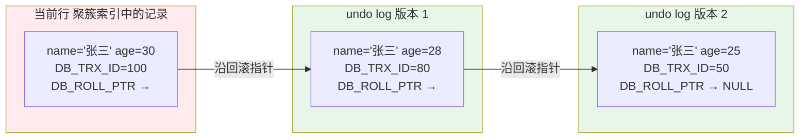
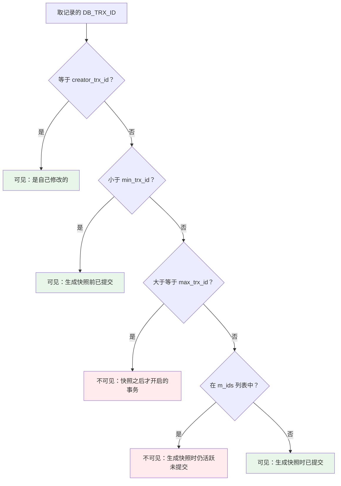
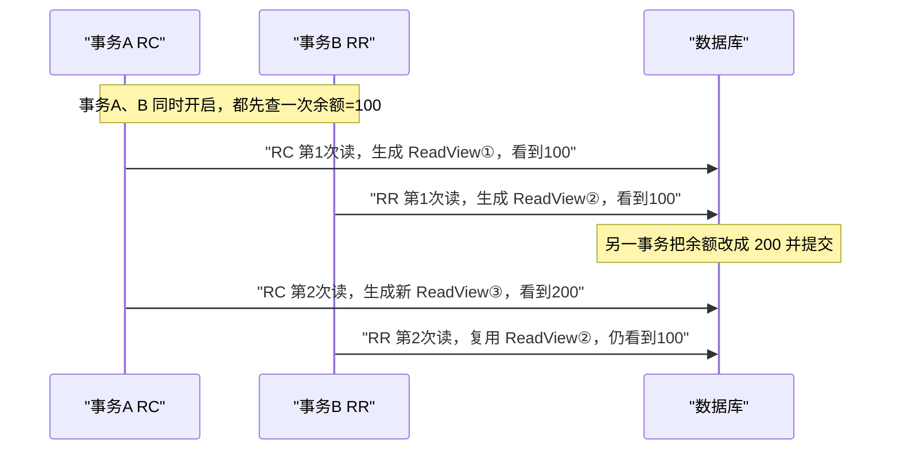

# 事务隔离与 MVCC

> 定位：搞清楚事务 ACID 的四个特性分别靠什么实现、四种隔离级别到底隔离了什么、MVCC 为什么能让「读写不互斥」。这是理解 InnoDB 并发行为的核心——很多人背得出「RR 解决不可重复读、Serializable 解决幻读」，却讲不清 ReadView 是什么、RC 和 RR 的差别只在「一条语句」还是「整个事务」，更解释不了线上「明明是 RR 却出现了幻读」的诡异现象。

## 一、为什么需要事务隔离与 MVCC

数据库要同时服务成百上千个并发请求，如果没有隔离机制，会出各种乱子：

- 你转账时读到对方「未提交」的余额，结果他回滚了——你读到的是脏数据（脏读）。
- 你在一个报表事务里两次查同一行，中间被人改了，两次结果不一样——数据「不可重复」。
- 你统计订单数，两次查同一范围，中间有人插入了新订单，行数变了——「幻读」。

最粗暴的解决办法是**所有操作串行执行**（Serializable），但并发性能归零。MVCC（Multi-Version Concurrency Control，多版本并发控制）的价值就在于：**让「读」和「写」不互相阻塞**——读事务读的是历史快照，写事务改的是最新版本，各走各的，大幅提高并发。这一篇就把它讲透。

## 二、核心原理

### 2.1 ACID 分别靠什么实现

事务的四个特性，不是靠单一机制，而是各有支撑：

| 特性 | 含义 | 实现机制 |
|---|---|---|
| **A 原子性** | 事务要么全做，要么全不做 | **undo log**：失败时按日志反向回滚 |
| **C 一致性** | 事务前后数据满足完整性约束 | 由 A、I、D 共同保证 + 应用层约束 |
| **I 隔离性** | 并发事务互不干扰 | **锁机制 + MVCC** |
| **D 持久性** | 提交后数据永久保存 | **redo log**：崩溃后重做已提交事务 |

记住这张表，面试问「ACID 怎么实现」就能逐条对答。本篇聚焦 **I（隔离性）**，它的两大实现手段是**锁**（下一篇讲）和 **MVCC**（本篇重点）。

### 2.2 三种并发问题

| 问题 | 现象 | 关注点 |
|---|---|---|
| **脏读** | 读到其他事务**未提交**的数据 | 读到了「脏」数据 |
| **不可重复读** | 同一事务内两次读**同一行**，值变了 | 针对**同一行**的 UPDATE/DELETE |
| **幻读** | 同一事务内两次查**同一范围**，行数变了 | 针对**新插入**的行 INSERT |

一个生活化类比：你查银行账户。
- 脏读：同伴正在存钱但还没确认，你却看到了那笔钱；结果他取消了。
- 不可重复读：你第一次查余额 100，第二次查变成 50——有人取走了钱并提交了。
- 幻读：你查「今天交易记录」有 3 条，再查变成 4 条——有人刚插入了一笔新交易。

### 2.3 四种隔离级别

SQL 标准定义了四种隔离级别，隔离程度和并发性能是权衡关系：

| 隔离级别 | 脏读 | 不可重复读 | 幻读 | 并发性能 |
|---|---|---|---|---|
| 读未提交 Read Uncommitted | 可能 | 可能 | 可能 | 最高 |
| 读已提交 Read Committed（RC） | 不可能 | 可能 | 可能 | 高 |
| 可重复读 Repeatable Read（RR） | 不可能 | 不可能 | 可能 | 中 |
| 串行化 Serializable | 不可能 | 不可能 | 不可能 | 最低 |

**MySQL InnoDB 默认是 RR**（`transaction_isolation = REPEATABLE-READ`），但注意：**InnoDB 在 RR 下靠 Next-Key Lock 已经在很大程度上解决了幻读**（下一篇讲锁时展开），这一点比 SQL 标准要求的更强。

查看/设置隔离级别：

```sql
SELECT @@transaction_isolation;               -- 查看当前级别
SET SESSION transaction_isolation = 'READ-COMMITTED';  -- 设置会话级别
```

### 2.4 MVCC 的三大支柱

MVCC 不是某一个东西，而是**隐藏列 + undo log 版本链 + ReadView** 三者配合的结果。

#### 支柱一：隐藏列

InnoDB 每一行记录除了你定义的列，还有几个隐藏列：

| 隐藏列 | 大小 | 作用 |
|---|---|---|
| `DB_TRX_ID` | 6 字节 | 最后修改这行的事务 ID |
| `DB_ROLL_PTR` | 7 字节 | 回滚指针，指向 undo log 中的上一个版本 |
| `DB_ROW_ID` | 6 字节 | 隐藏主键（无显式主键时才有） |

#### 支柱二：undo log 版本链

同一行被多个事务先后修改，每次修改都会生成一条 undo log 记录旧值，并用 `DB_ROLL_PTR` 把各个版本串成一条**版本链**，链头是最新版本。



这张图要这样读：这行 `name='张三'` 被事务 50、80、100 依次改过。当前最新值是 age=30（事务 100 改的），顺着 `DB_ROLL_PTR` 能找到 age=28（事务 80）、age=25（事务 50）的历史版本。**MVCC 就是让不同事务沿这条链「各取所需」——读到自己该看到的那个版本。**

> 补充：undo log 不仅服务 MVCC，也服务回滚（事务失败时沿链恢复旧值）。当没有事务需要访问某个旧版本时，purge 线程才会清理它——这也是「长事务会导致 undo log 堆积」的原因。

#### 支柱三：ReadView

**ReadView（读视图）**是事务在做「快照读」时生成的一个「可见性判断快照」，它记录了生成瞬间系统的活跃事务状态。它有四个关键字段：

| 字段 | 含义 |
|---|---|
| `m_ids` | 生成 ReadView 时，仍处于活跃状态（未提交）的事务 ID 列表 |
| `min_trx_id` | `m_ids` 中最小的事务 ID |
| `max_trx_id` | 生成 ReadView 时，系统下一个将要分配的事务 ID（不是 `m_ids` 最大值） |
| `creator_trx_id` | 创建这个 ReadView 的事务自己的 ID |

**可见性判断规则**：当事务要读某行时，拿这行的 `DB_TRX_ID` 和 ReadView 比较：



这张图是 MVCC 的「灵魂」：沿着判断树走，就能确定版本链上哪个版本对当前事务可见。如果某个版本被判定不可见，就沿 `DB_ROLL_PTR` 往前找下一个版本，直到找到可见的为止——这就是**快照读**的完整过程。

## 三、关键机制：RC 与 RR 的本质差异

RC 和 RR 都能防止脏读，都能看到「已提交」的数据。那它们到底差在哪？**答案只有一个：ReadView 的生成时机不同。**

### 3.1 RC：每条 SELECT 语句都生成新的 ReadView

在 RC 隔离级别下，**事务中每一条快照读语句都会重新生成一个新的 ReadView**。

后果：事务里两次查同一行，中间如果有其他事务提交了修改，第二次生成的 ReadView 就能看到新值 → **不可重复读**。

### 3.2 RR：事务第一次快照读才生成 ReadView，之后复用

在 RR 隔离级别下，**事务中第一次快照读生成 ReadView，后续所有快照读都复用这同一个 ReadView**。

后果：整个事务从头到尾看到的都是「第一次读时的那个快照」，别人后来提交的修改对它不可见 → **可重复读**。



这张时序图把差异讲得很直白：**同样两次读，RC 看到 100→200，RR 看到 100→100**。差别不在数据，而在「ReadView 是每次新建还是全程复用」。

### 3.3 快照读 vs 当前读

理解 MVCC，必须分清两类读：

| 读类型 | 典型语句 | 是否走 MVCC | 是否加锁 |
|---|---|---|---|
| **快照读**（一致性非锁定读） | 普通 `SELECT ...` | 是，读历史版本 | 不加锁 |
| **当前读**（锁定读） | `SELECT ... FOR UPDATE`、`SELECT ... LOCK IN SHARE MODE`、`UPDATE`、`DELETE`、`INSERT` | 否，读最新版本 | 加锁（可能加 Next-Key Lock） |

**关键坑点**：在 RR 下，快照读看到的是历史快照，当前读看到的是最新数据。如果在一个事务里**混用两者**，就会出现诡异现象：

```sql
-- 事务内，RR 级别
SELECT * FROM t WHERE id > 10;        -- 快照读，看到 3 行
UPDATE t SET name='x' WHERE id > 10;  -- 当前读，可能更新到 4 行（别人刚插入的第4行）
SELECT * FROM t WHERE id > 10;        -- 快照读，仍看到 3 行
-- 结果：更新了 4 行，但自己查询只看到 3 行 —— 这就是「幻读」的一种表现
```

所以严格说：**InnoDB 的 RR 靠 MVCC 快照读 + Next-Key Lock 当前读，两者配合才基本解决幻读；一旦混用快照读与当前读，仍可能出现幻读现象**。

### 3.4 顺带一提：Google 的隔离级别

分布式数据库 Google Spanner 提出了比 Serializable 更强的 **External Consistency（外部一致性，也叫 Strict Serializability）**：事务不仅在逻辑上可串行，而且**在真实时间上也与外部观察顺序一致**——事务 T2 在 T1 提交之后才开始，那么 T2 一定排在 T1 后面。它靠 **TrueTime API**（利用 GPS + 原子钟给出有时间误差区间的全球时间）和提交等待实现。这超出了 MySQL 的范畴，但说明「隔离级别」在分布式场景下还有更强的语义。面试聊到「Serializable 之上还有吗」时可以提这句。

## 四、生产坑点与排查

### 坑点 1：长事务导致 undo log 堆积、磁盘爆涨

**现象**：数据库磁盘空间持续增长，`.ibd` 或系统表空间的 undo 段很大，purge 跟不上。
**原因**：MVCC 下只要有长事务一直没提交，它依赖的旧版本就不能被 purge 线程清理；同时它也会阻塞 DDL。典型场景是「一个事务里查完数据后去调外部接口/等用户操作，迟迟不提交」。
**解法**：
- 短事务原则：事务里只放数据库操作，远程调用、文件处理移到事务外。
- 监控长事务：`SELECT * FROM information_schema.INNODB_TRX ORDER BY trx_started`，关注运行时间长的。
- 设置 `innodb_undo_log_truncate = ON`（默认开启），让 undo 表空间可回收。

### 坑点 2：以为 RR 就不会幻读，结果线上出现「更新了但查不到」

**现象**：RR 隔离级别下，`UPDATE ... WHERE range` 影响的行数比 `SELECT` 看到的多，或出现「更新后自己查不到刚改的数据」。
**原因**：混用了快照读（普通 SELECT）和当前读（UPDATE），两者读的版本不同——如上文 3.3 的例子。
**解法**：
- 需要「读到的就是要改的」时，统一用当前读：`SELECT ... FOR UPDATE` 把要改的行锁住，再基于它操作。
- 或者把隔离级别改成 RC（幻读本来就是 RC 允许的，避免错觉）。
- 报表类只读场景用快照读没问题，但要清楚它的「快照」语义。

### 坑点 3：RC 下做「先查后改」引发并发数据错乱

**现象**：两个事务都先 `SELECT` 查库存 > 0，再扣减，结果库存被扣成负数。
**原因**：RC 下两次读是不同快照，且「先查后改」中间没有锁，两个事务都判定库存充足，属于典型的**检查与更新非原子**。
**解法**：
- 用单条原子 SQL：`UPDATE stock SET num = num - 1 WHERE id=1 AND num > 0`，用 `affected_rows` 判断是否成功。
- 或用当前读 `SELECT ... FOR UPDATE` 锁住行，再改。
- 这是一种「乐观锁/CAS」与「悲观锁」的取舍，详见下一篇锁机制。

### 坑点 4：用 RR 做报表，读到的是「旧数据」被业务质疑

**现象**：一个长报表事务跑几分钟，期间别人改了数据，报表结果与「实时数据」对不上，被误认为数据错误。
**原因**：RR 的快照读设计就是保证「事务内看到一致的历史快照」，跑得越久，快照越旧。
**解法**：
- 报表场景如果要求「尽量新」，用 RC 级别。
- 如果是统计一致性快照，这是正确行为，向业务解释清楚即可。
- 避免在一个事务里做超长时间的汇总。

## 五、调优、选型与最佳实践

**隔离级别选型决策表：**

| 场景 | 推荐级别 | 理由 |
|---|---|---|
| 普通 OLTP 业务 | RC 或 RR（默认） | RC 并发更高、加锁更少；RR 一致性更强，按业务选 |
| 金融/账务强一致 | RR + 当前读/锁 | 需要可重复读和严格并发控制 |
| 对账/报表统计 | RR 快照读 或 RC | 前者要一致性快照，后者要新数据 |
| 高并发、冲突少、能容忍不可重复读 | RC | 减少 gap lock，降低死锁概率 |
| 追求最强语义（分布式） | Serializable / 外部一致性 | 性能代价高，特殊场景 |

**实践 checklist：**

1. 默认用 InnoDB 的 RR 没问题，但要清楚快照读/当前读的差别。
2. 判断「读一致性 vs 并发性能」的取舍后再决定是否改成 RC——很多大厂把隔离级别设为 RC 以减少间隙锁和死锁。
3. 事务尽量短，避免在事务内做 RPC、循环、大批量处理。
4. 用 `information_schema.INNODB_TRX` 和 `SHOW ENGINE INNODB STATUS` 监控长事务与锁等待。
5. 「先查后改」一律改成原子 UPDATE 或当前读加锁。

## 六、面试高频问法

> 这一节的答案按「面试时能讲透」的标准写：先给一句结论，再展开机制、原因和坑点。建议先自己答一遍，再对照补全。

**Q1：事务的 ACID 分别靠什么实现？**

**一句话结论**：A（原子性）靠 **undo log** 回滚，I（隔离性）靠**锁 + MVCC**，D（持久性）靠 **redo log** 崩溃恢复，C（一致性）是 A、I、D 共同作用的结果加上应用层约束——四者各有支撑，不是靠单一机制。

逐条展开：

| 特性 | 含义 | 实现机制 |
|---|---|---|
| A 原子性 | 事务要么全做，要么全不做 | undo log 记录反向操作，失败时按日志回滚 |
| C 一致性 | 事务前后数据满足完整性约束 | A、I、D 共同保证 + 应用层约束 |
| I 隔离性 | 并发事务互不干扰 | 锁机制（写-写）+ MVCC（读-写） |
| D 持久性 | 提交后数据永久保存 | redo log，崩溃后重做已提交事务 |

追问「一致性靠什么」时的答法：一致性是**目标**，不是某个具体组件——原子性保证不出现「半截事务」，隔离性保证并发不互相污染，持久性保证提交不丢，三者合起来才让数据从一个一致状态转移到另一个一致状态。

加分点：点出「很多人把 C 和 A/I/D 并列当成独立技术，其实 C 是『结果』，A/I/D 是『手段』」——这个视角能让面试官觉得你是真懂而不是背表格。

**Q2：脏读、不可重复读、幻读有什么区别？四种隔离级别分别解决哪个？**

**一句话结论**：脏读读到了**未提交**数据；不可重复读是同事务两次读**同一行**值变了（针对 UPDATE/DELETE）；幻读是两次查**同一范围**行数变了（针对 INSERT）——隔离级别从低到高逐级消除这三类问题。

展开：

- **四种级别与问题的能力**（SQL 标准）：RU 三种都可能；RC 解决脏读；RR 解决脏读 + 不可重复读；Serializable 全部解决。
- **生活化类比**：脏读＝同伴存钱没确认你就看到了，结果他取消；不可重复读＝第一次查余额 100，第二次变 50；幻读＝查「今天交易」3 条，再查变 4 条。
- **感知重点**：不可重复读针对**同一行的修改**，幻读针对**新插入的行**——这是两者最本质的区别，也是为什么 RR 要引入 Next-Key Lock 专门治幻读。

加分点：必须补一句「InnoDB 的 RR 比 SQL 标准更强——靠 MVCC 快照读 + Next-Key Lock 当前读，已经在很大程度上解决了幻读」，这点不提容易被误以为你只背了标准结论。

**Q3：MVCC 的原理是什么？三大支柱是什么？**

**一句话结论**：MVCC（多版本并发控制）靠三样东西配合——**隐藏列 + undo log 版本链 + ReadView**，让「读」去读历史快照、「写」去改最新版本，从而**读写不互斥**，大幅提升并发。

展开三大支柱：

1. **隐藏列**：每行有 `DB_TRX_ID`（最后修改它的事务 ID）、`DB_ROLL_PTR`（回滚指针，指向 undo log 旧版本）、`DB_ROW_ID`（无显式主键时的隐藏主键）。
2. **undo log 版本链**：同一行被多次修改，每次生成一条 undo log 记录旧值，用 `DB_ROLL_PTR` 串成链，链头是最新版本。MVCC 就是让不同事务沿链「各取所需」，读到自己该看到的版本。
3. **ReadView**：事务做快照读时生成的「可见性快照」，记录 `m_ids`（活跃未提交事务列表）、`min_trx_id`、`max_trx_id`（下一个待分配事务 ID）、`creator_trx_id`。

可见性判断：拿记录的 `DB_TRX_ID` 和 ReadView 比——等于自己的 ID 可见；小于 `min_trx_id` 可见（快照前已提交）；大于等于 `max_trx_id` 不可见（快照后才开启）；在 `m_ids` 里不可见（快照时未提交）；否则可见。不可见就沿 `DB_ROLL_PTR` 往前找下一个版本，直到找到可见的。

加分点：补一句「undo log 一物两用——既服务 MVCC 的版本链，也服务事务回滚；没有事务需要的旧版本才会被 purge 线程清理，这就是长事务导致 undo 堆积的原因」。

**Q4：RC 和 RR 在 MVCC 上的区别是什么？本质差异在哪？**

**一句话结论**：唯一本质是 **ReadView 的生成时机不同**——RC 每条 SELECT 语句都重新生成 ReadView（所以不可重复读），RR 在事务第一次快照读时生成、之后全程复用同一个（所以可重复读）。

展开：

- **RC（读已提交）**：事务中每一条快照读都新建一个 ReadView。两次查同一行，中间若有其他事务提交，新 ReadView 就能看到新值 → 不可重复读。
- **RR（可重复读）**：事务第一次快照读生成 ReadView，后续所有快照读复用它。别人后来提交的修改对它不可见 → 可重复读。
- **时序对比**：事务 A、B 同时开，都先查余额=100；另一事务改成 200 提交；RC 第二次读看到 200，RR 第二次读仍是 100。差别不在数据，而在「ReadView 每次新建还是全程复用」。

加分点：说清「RC 下每条语句一个快照，所以一条 SQL 内部如果多次读（比如 join 或某些子查询），理论上仍可能看到不同快照；RR 用事务级快照彻底消除了这个问题」——体现对「快照粒度」的理解。

**Q5：什么是快照读和当前读？为什么混用会出现幻读？**

**一句话结论**：快照读是普通 `SELECT`，走 MVCC 读历史版本、不加锁；当前读是 `SELECT ... FOR UPDATE`、`UPDATE` 等，读最新版本、加锁。RR 下快照读看历史、当前读看最新，混用会导致「改了 4 行但只查到 3 行」的诡异现象。

展开：

| 读类型 | 典型语句 | 走 MVCC | 加锁 |
|---|---|---|---|
| 快照读 | 普通 `SELECT ...` | 是，读历史版本 | 否 |
| 当前读 | `SELECT ... FOR UPDATE`、`LOCK IN SHARE MODE`、UPDATE/DELETE/INSERT | 否，读最新版本 | 是（可能 Next-Key Lock） |

**混用的经典坑**（RR 下）：

```sql
SELECT * FROM t WHERE id > 10;        -- 快照读，看到 3 行
UPDATE t SET name='x' WHERE id > 10;  -- 当前读，可能更新到 4 行（别人刚插了第 4 行）
SELECT * FROM t WHERE id > 10;        -- 快照读，仍看到 3 行
```

结果：更新了 4 行，自己查询却只看到 3 行——这就是幻读的一种表现。严格说：**InnoDB RR 靠「快照读 MVCC + 当前读 Next-Key Lock」配合才基本解决幻读，混用二者仍可能出问题。**

加分点：给出解法——「需要『读到的就是要改的』时统一用当前读 `FOR UPDATE` 锁住目标行，或干脆切 RC 避免快照/当前读不一致的错觉」，把原理落到生产做法。

**Q6：MVCC 的 ReadView 可见性判断规则具体是怎样的？**

**一句话结论**：把记录的 `DB_TRX_ID` 和 ReadView 的四个字段按规则逐条比对，命中「可见」就返回该版本，否则沿 `DB_ROLL_PTR` 往前找下一个版本——这是快照读的核心算法。

展开判断树（按顺序判断）：

1. `DB_TRX_ID == creator_trx_id` → **可见**（是自己修改的）。
2. `DB_TRX_ID < min_trx_id` → **可见**（生成快照前该事务已提交）。
3. `DB_TRX_ID >= max_trx_id` → **不可见**（快照之后才开启的事务）。
4. `DB_TRX_ID` 在 `m_ids` 列表中 → **不可见**（生成快照时仍活跃未提交）。
5. 以上都不满足（在 `min_trx_id` 和 `max_trx_id` 之间、且不在 `m_ids`）→ **可见**（生成快照时已提交）。

找到不可见版本就沿版本链继续往前，直到找到可见版本或链尾（链尾还没有则说明该行对当前事务不可见，不返回）。

加分点：强调「`max_trx_id` 是**下一个将分配的事务 ID**，不是 `m_ids` 里的最大值」——这是很多人背错的点，能纠正它说明你是真理解了 ReadView 的构造。

**Q7：长事务有什么危害？怎么排查和处理？**

**一句话结论**：长事务是 undo 堆积和锁问题的万恶之源——它依赖的旧版本不能被 purge 线程清理、阻塞 DDL、长期占用连接和锁资源，甚至拖垮整个实例。

展开：

- **undo log 堆积**：MVCC 下只要长事务没提交，它可能需要访问的版本链上的旧版本就不能被清理，undo 段持续膨胀，磁盘暴涨。
- **阻塞 DDL / 元数据锁**：长事务持有 MDL，导致改表结构卡住。
- **锁资源与连接占用**：长事务迟迟不提交，持有的行锁不释放，其他事务大量锁等待甚至超时。
- **排查**：`SELECT * FROM information_schema.INNODB_TRX ORDER BY trx_started` 看运行时长；`SHOW ENGINE INNODB STATUS` 看事务和锁等待。
- **处理**：坚持短事务原则——事务里只放数据库操作，远程调用、文件处理移到事务外；开启 `innodb_undo_log_truncate = ON`（默认）让 undo 表空间可回收。

加分点：点出典型事故场景「一个事务里查完数据去调外部 HTTP 接口、迟迟不提交」——这是生产最常见的一类长事务，面试官很爱听这种落地经验。

**Q8：RC 下做「先查后改」为什么会引发并发错乱？怎么改？**

**一句话结论**：因为「先查」和「后改」之间既没有锁、两次读又属于不同快照，两个事务可能都判定条件成立，导致超卖/库存扣成负数——典型的**检查与更新非原子**问题。

展开：

```sql
-- 危险：两个事务都先查到 num>0，再各自扣减
SELECT num FROM stock WHERE id=1;   -- 都读到 num=1
UPDATE stock SET num = num - 1 WHERE id=1;
-- 结果：num 变成 -1
```

**两种改法**：

1. **单条原子 SQL（推荐）**：`UPDATE stock SET num = num - 1 WHERE id=1 AND num > 0`，用 `affected_rows` 判断是否成功——把「检查」和「更新」合并成一条原子的当前读。
2. **当前读加锁**：`SELECT ... FOR UPDATE` 锁住行，再基于它修改。

加分点：把它上升到「乐观锁/CAS vs 悲观锁」的取舍——单条原子 UPDATE 是乐观思路（冲突了就失败重试），FOR UPDATE 是悲观思路（先上锁再操作），这正是下一篇锁机制的核心议题。

**Q9：为什么 InnoDB 的 RR 被称为「比 SQL 标准更强」？它真的完全解决了幻读吗？**

**一句话结论**：SQL 标准里 RR 允许幻读，但 InnoDB 的 RR 用「MVCC 快照读 + Next-Key Lock 当前读」把幻读基本消除了，所以更强；但它并非「完全、无条件」解决——混用快照读和当前读时仍会出现幻读现象。

展开：

- **强在哪**：纯快照读场景下，ReadView 是事务级的，多次读同一范围看到的行数一致（不会凭空多出新行）；纯当前读场景下，Next-Key Lock 锁住查询范围和间隙，别的事务插不进幻影行。两条路径各自都防住了幻读。
- **仍会出问题的场景**：如 Q5 的混用例子——先快照读看到 3 行，再用当前读 `UPDATE ... WHERE 范围` 更新了别人新插的第 4 行，最后快照读仍只看到 3 行。
- **结论表述**：面试时说「基本解决、但混用读写模式仍有例外」是最准确的，不要断言「完全解决」。

加分点：能说出「想彻底避免这类诡异现象，要么全程当前读，要么把隔离级别降到 RC 让快照语义变简单」——这是很多公司线上改用 RC 的深层原因之一。

**Q10：MySQL 的隔离级别怎么查看和设置？改隔离级别有什么代价？**

**一句话结论**：用 `SELECT @@transaction_isolation` 查看、`SET SESSION transaction_isolation='READ-COMMITTED'` 设置会话级别；InnoDB 默认是 RR（`REPEATABLE-READ`）。改成 RC 能减少间隙锁和死锁，但会失去事务级一致性快照。

展开：

```sql
SELECT @@transaction_isolation;                          -- 查看当前级别
SET SESSION transaction_isolation = 'READ-COMMITTED';    -- 设置会话级别
-- 设置全局：SET GLOBAL transaction_isolation = 'READ-COMMITTED';（需新连接生效）
```

**改级别的取舍**：

- **改 RC 的收益**：大部分场景没有 Gap Lock，锁冲突和死锁概率下降，并发更高——这是很多大厂线上改 RC 的动机。
- **改 RC 的代价**：每次读生成新 ReadView，失去「事务内可重复读」的一致性快照；某些依赖 RR 快照的报表逻辑要重新审视。
- **注意**：设置要在事务开始前生效，事务执行中改级别不影响当前事务。

加分点：补一句「隔离级别是会话/全局级的工程决策，不是单条 SQL 能调的；改之前要评估全链路对『可重复读』语义的依赖」，体现生产决策的严谨性。

**Q11：听说过 Serializable 之上的隔离级别吗？**

**一句话结论**：有——Google Spanner 提出的 **External Consistency（外部一致性，也叫 Strict Serializability）**，比 Serializable 更强：事务不仅在逻辑上可串行，在真实时间上也要和外部观察顺序一致。

展开：

- **强在哪**：Serializable 只要求事务「逻辑上」可串行（等价于某个顺序执行）；外部一致性额外要求：如果事务 T2 在 T1 **提交之后**才开始，那么 T2 一定排在 T1 后面——现实时间的先后和事务顺序一致。
- **靠什么实现**：Spanner 的 **TrueTime API**——利用 GPS + 原子钟给出「带误差区间的全球时间」，通过提交等待（commit wait）确保事务时间戳真实反映先后顺序。这超出了单机 MySQL 的范畴。
- **意义**：说明「隔离级别」在分布式场景还有更强语义，单调 Serializable 并非终点。

加分点：面试聊到「Serializable 之上还有吗」时抛出这点非常加分，能体现你视野不止于 MySQL、了解分布式数据库前沿。

## 小结

- ACID 各有支撑：A→undo log，I→锁+MVCC，D→redo log，C 是综合结果。
- MVCC 三支柱：隐藏列（DB_TRX_ID/DB_ROLL_PTR）+ undo log 版本链 + ReadView 可见性判断。
- RC 与 RR 的唯一本质是 ReadView 生成时机：RC 每条语句新建（不可重复读），RR 事务首次生成并复用（可重复读）。
- 快照读读历史版本不加锁，当前读读最新版本加锁；RR 下混用二者仍可能幻读。
- 长事务是 undo 堆积和锁问题的万恶之源，坚持短事务、原子 UPDATE、监控 INNODB_TRX。
