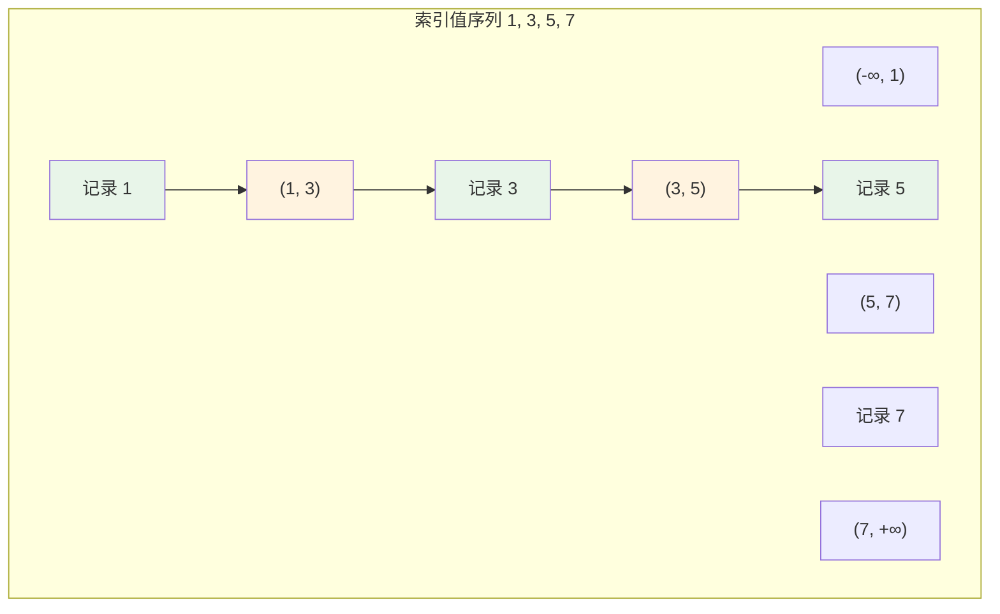
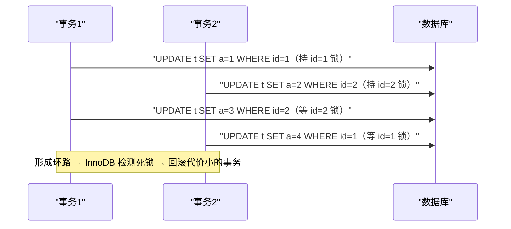

# MySQL 锁机制

> 定位：搞清楚 InnoDB 到底有哪些锁、一条 UPDATE 语句会锁住哪些行、为什么「没加索引的 UPDATE 会锁全表」、Next-Key Lock 怎么解决幻读、死锁怎么排查。这是线上「锁等待超时」「死锁回滚」类故障的排查地图——很多人只会把 `innodb_lock_wait_timeout` 调大，却不知道锁到底是怎么加上的。

## 一、为什么需要锁

上一篇讲的 MVCC 解决了「读-写」不互斥的问题，但**写-写**并发必须加锁——两个事务同时改同一行，必须有先后，否则数据就乱了。

线上三类典型的「锁事故」：

1. 一条没走索引的 `UPDATE`，把整张表锁住，全站卡死。
2. 两个事务互相等对方释放锁，直接死锁，一个被回滚。
3. 明明只改一行，却因为间隙锁锁住了一大片区间，导致别的插入被阻塞。

要排查这些，你必须能回答：「这条语句到底加了什么锁、锁住了哪些范围、锁为什么不释放」。这一篇就把 InnoDB 的锁体系拆开讲。

## 二、核心原理

### 2.1 锁的两个维度：粒度与兼容性

**按粒度分：**

| 锁类型 | 加锁对象 | 特点 |
|---|---|---|
| **表锁** | 整张表 | 开销小、加锁快、并发度低；MyISAM 默认，InnoDB 也会用 |
| **页锁** | 一页（16KB） | 介于表锁和行锁之间，Berkeley DB 用，InnoDB 基本不用 |
| **行锁** | 单行索引记录 | 开销大、加锁慢、并发度高；InnoDB 的核心优势 |

**按兼容性分：**

| 锁类型 | 符号 | 含义 | 兼容关系 |
|---|---|---|---|
| **共享锁** | S（Shared） | 读锁，多个事务可同时持有 | 与 S 兼容，与 X 互斥 |
| **排他锁** | X（Exclusive） | 写锁，同一时刻只能一个事务持有 | 与 S、X 都互斥 |

一张兼容性矩阵秒懂：

| 当前持有 \ 请求 | S | X |
|---|---|---|
| S | 兼容 | 互斥 |
| X | 互斥 | 互斥 |

### 2.2 意向锁：表锁与行锁共存的关键

问题来了：事务 A 持有某行的行锁，事务 B 想加表锁，数据库怎么快速判断「表里有没有行锁，能不能加表锁」？逐行扫描检查？太慢。

**意向锁（Intention Lock）** 就是干这个的——它是**表级锁**，表示「我准备/正在对表里某些行加行锁」：

| 意向锁 | 含义 |
|---|---|
| **IS**（意向共享锁） | 事务打算给某些行加 S 锁 |
| **IX**（意向排他锁） | 事务打算给某些行加 X 锁 |

规则：事务在加行锁之前，先加对应的意向锁（加 S 行锁前先加 IS 表锁，加 X 行锁前先加 IX 表锁）。这样其他事务想加表锁时，只要看表上的意向锁就能快速判断冲突，不用逐行扫。

> 意向锁之间互不冲突（IS、IX 可以共存），它只和「表级 S/X 锁」冲突。

### 2.3 三种行锁：Record / Gap / Next-Key

InnoDB 的行锁是**加在索引上的**（不是加在行记录本身），具体实现有三种：

| 锁类型 | 锁住什么 | 是否阻止插入 | 典型场景 |
|---|---|---|---|
| **Record Lock（记录锁）** | 单条索引记录 | 否 | 唯一索引等值查询 |
| **Gap Lock（间隙锁）** | 索引记录之间的**开区间** | 是 | RR 下防止插入幻影行 |
| **Next-Key Lock** | Record + Gap，**左开右闭区间** | 是 | RR 下默认的行锁，解决幻读 |



这张图把索引上的「记录」和「间隙」画了出来：

- **Record Lock**：只锁住绿色的「记录 3」这条索引项。
- **Gap Lock**：只锁住橙色的开区间，比如 `(3,5)`，锁住这段「不允许别人插入」（但 3 和 5 这两条记录本身不锁）。
- **Next-Key Lock**：锁住「记录 + 它前面的间隙」，比如 `(3,5]` 或 `(1,3]`——这就是 InnoDB RR 下的默认加锁单位。

### 2.4 Next-Key Lock 怎么解决幻读

幻读的定义是「同一事务两次范围查询，行数变多」——本质是别的事务在你的查询范围内**插入了新行**。Gap Lock 的作用就是**锁住查询范围对应的间隙，让别人插不进来**，从而避免幻读。

```sql
-- RR 隔离级别，事务 A
SELECT * FROM orders WHERE amount BETWEEN 100 AND 200 FOR UPDATE;
-- 当前读，会在 (100,200] 这个范围加 Next-Key Lock
-- 此时事务 B 执行 INSERT INTO orders(amount) VALUES(150) 会被阻塞
```

这就是 RR 比标准更强的点：**MVCC 的快照读让「读」看到一致性视图，Next-Key Lock 的范围锁让「当前读」期间别人插不进幻影行**，两者配合基本消除幻读。

> 代价：Gap Lock 降低了并发——它锁的是「区间」而不是「具体行」，即便那个区间里现在没有数据，别人也插不进去。这正是很多「明明只改一行却阻塞了别人插入」的根因，也是很多公司把隔离级别改成 RC 的原因（RC 下大部分场景没有 Gap Lock）。

## 三、关键机制：加锁规则、死锁、锁等待

### 3.1 InnoDB 的加锁规则（经典四条）

结合大量实践，InnoDB 在 RR 下的加锁可以总结为几条规则（以主流版本行为为准，细节以版本为准）：

1. **加锁基本单位是 Next-Key Lock（左开右闭区间）**。
2. **查找过程中访问到的索引对象才会加锁**——没被访问的行/索引不加锁。
3. **索引等值查询：给唯一索引加锁时，Next-Key Lock 退化为 Record Lock**（只锁那一行，因为唯一性保证不会插入重复值，无需 Gap Lock）。
4. **索引等值查询：向右遍历且最后一个值不满足条件时，Next-Key Lock 退化为 Gap Lock**。

理解这些规则，你就能解释「为什么唯一索引等值更新只锁一行，而普通索引等值更新会多锁一个间隙」。

### 3.2 哪些情况会「退化为表锁」

严格说 InnoDB 的行锁不会「升级成表锁」，但有几种情况效果等同于锁全表：

| 场景 | 为什么锁全表 |
|---|---|
| **UPDATE/DELETE 的 WHERE 不走索引** | 无法用索引定位，只能全表扫描，扫描到的所有行都会被加锁（RR 下连间隙一起锁） |
| **索引区分度极低**（如性别列） | 优化器判断走索引不如全表扫描，放弃索引 → 全表加锁 |
| **对非索引列做范围更新** | 同上，全表扫描加锁 |
| **显式 `LOCK TABLES`** | 直接加表锁 |

这是线上最致命的一类事故：**一条 `UPDATE t SET status=1 WHERE type='x'`（type 没索引），在高并发下把整张表锁死**。

> 判断方法：执行前先 `EXPLAIN`，看 `key` 列是否为空、`type` 是否为 `ALL`。

### 3.3 死锁：产生、排查、避免

**死锁产生**：两个或多个事务互相持有对方需要的锁，形成环路，谁都无法继续。



这张图是死锁的经典形成过程：**两个事务以相反顺序访问两行，各自持有一把锁又去要对方的锁**，形成死锁。InnoDB 的死锁检测（`innodb_deadlock_detect`，默认 ON）发现环路后，会回滚「代价较小」的事务来打破死锁。

**排查死锁**：

```sql
SHOW ENGINE INNODB STATUS\G
-- 看 LATEST DETECTED DEADLOCK 段，能看到两个事务各自的 SQL、持有的锁、等待的锁
```

MySQL 8.0 还可以看 `performance_schema.data_lock_waits` 和 `sys.innodb_lock_waits`。

**关键参数**：

| 参数 | 默认值 | 作用 |
|---|---|---|
| `innodb_deadlock_detect` | ON | 死锁检测，检测到环路主动回滚 |
| `innodb_lock_wait_timeout` | 50 秒 | 锁等待超时时间，超时回滚等待方 |
| `innodb_rollback_on_timeout` | OFF | 超时是否回滚整个事务（默认只回滚最后一条语句） |

> 注意：高并发下死锁检测本身也有成本（大量线程互相等待时，检测是 O(n²) 级别），极端场景 MySQL 官方建议可关掉检测、靠超时兜底（需谨慎压测，以版本为准）。

**避免死锁**：

1. **固定访问顺序**：所有事务按相同顺序访问资源（比如都先锁 id 小的行），消除环路。
2. **大事务拆小**：事务越短、锁的范围越小、持有时间越短，冲突概率越低。
3. **走索引**：确保 WHERE 走索引，避免锁全表。
4. **降低隔离级别**：能接受的话用 RC，减少 Gap Lock 导致的锁冲突。
5. **避免交互式事务**：不要在事务里等用户输入/远程调用。

### 3.4 锁等待的排查路径

一个请求卡住，怀疑是锁等待：

1. `SHOW ENGINE INNODB STATUS\G` → 看 `TRANSACTIONS` 段，找 `WAITING FOR THIS LOCK TO BE GRANTED`。
2. MySQL 8.0：`SELECT * FROM sys.innodb_lock_waits` → 直接看到「谁在等谁」、阻塞者的 `blocking_pid`。
3. 必要时 `KILL <thread_id>` 终止阻塞者。
4. 回头查阻塞者的 SQL 为什么长时间不提交（往往是长事务或未捕获的异常）。

## 四、生产坑点与排查

### 坑点 1：无索引 UPDATE 锁全表，全站阻塞

**现象**：一条 `UPDATE` 执行后，所有写操作卡住，大量 `Lock wait timeout exceeded`。
**原因**：WHERE 条件列没有索引， InnoDB 全表扫描并逐行加锁，等效锁全表。
**解法**：
- 执行任何 UPDATE/DELETE 前先 `EXPLAIN` 确认走索引。
- 给 WHERE 条件列补索引。
- 大批量更新用 LIMIT 分批，每批提交，避免一次锁太多行太久。

### 坑点 2：Gap Lock 导致「插入被莫名其妙阻塞」

**现象**：RR 下，事务 A 更新一个范围，事务 B 往这个范围插一条新数据被阻塞，明明 A 没锁这条数据（它当时还不存在）。
**原因**：A 的 Next-Key Lock 锁住了间隙，Gap Lock 的目的就是阻止幻影行插入。
**解法**：
- 确认业务是否需要 RR 的幻读防护；不需要可切 RC 减少 Gap Lock。
- 缩小更新范围，让间隙锁范围更小。
- 确保 WHERE 走唯一索引——唯一索引等值查询会退化为 Record Lock，不加 Gap Lock。

### 坑点 3：死锁频发，业务报「Deadlock found」

**现象**：高并发下频繁出现 `ERROR 1213 (40001): Deadlock found`。
**原因**：多个事务交叉更新多行，访问顺序不一致，形成环路。
**解法**：
- 排查 `SHOW ENGINE INNODB STATUS` 的 deadlock 日志，找出互相冲突的 SQL。
- 统一访问顺序（按主键排序后批量更新）。
- 拆大事务、缩短锁持有时间。
- 应用层加死锁重试（捕获 1213 后重试整个事务）。

### 坑点 4：`innodb_lock_wait_timeout` 被盲目调大，故障放大

**现象**：出现锁等待后，有人把超时从 50s 调到 300s，结果请求堆积、线程池耗尽，服务雪崩。
**原因**：调大超时只让请求等更久，不解决锁冲突根因，反而让线程长期挂起。
**解法**：
- 超时值保持合理（默认 50s 通常够），关键是定位并消除阻塞源。
- 用 `sys.innodb_lock_waits` 快速找到阻塞者并 KILL。
- 从代码层面修复长事务和访问顺序。

## 五、调优、选型与最佳实践

**锁优化 checklist：**

1. **所有 UPDATE/DELETE 的 WHERE 必须走索引**——先 `EXPLAIN` 再执行。
2. **按主键/固定顺序访问多行**，消除死锁环路。
3. **事务尽量短小**，锁的粒度和持有时间都最小化。
4. **能用唯一索引等值更新就不用普通索引**——前者退化为 Record Lock，锁得更少。
5. **大批量写分批提交**：`UPDATE ... LIMIT 1000` 循环，每批独立事务。
6. **读多写少的强一致场景**用 RC，减少 Gap Lock 提升并发。
7. **应用层做死锁重试**：捕获 1213/1205 后有限次数重试。

**监控命令速查：**

| 命令/视图 | 用途 |
|---|---|
| `SHOW ENGINE INNODB STATUS\G` | 看事务、锁等待、最近死锁 |
| `sys.innodb_lock_waits` | 直接看「谁阻塞谁」 |
| `performance_schema.data_locks` | 看当前持有的锁（8.0） |
| `information_schema.INNODB_TRX` | 看活跃事务、长事务 |
| `SELECT @@innodb_lock_wait_timeout` | 看锁等待超时设置 |

## 六、面试高频问法

> 这一节的答案按「面试时能讲透」的标准写：先给一句结论，再展开机制、原因和坑点。建议先自己答一遍，再对照补全。

**Q1：InnoDB 有哪些锁？共享锁和排他锁的兼容关系是什么？**

**一句话结论**：按粒度有表锁、页锁、行锁（InnoDB 核心是行锁）；按兼容性有 S 锁（共享/读锁）和 X 锁（排他/写锁）——**S-S 兼容，S-X、X-X 互斥**；另有 IS/IX 意向锁解决表锁与行锁共存的判断效率问题。

展开：

| 维度 | 类型 | 特点 |
|---|---|---|
| 粒度 | 表锁 / 页锁 / 行锁 | 表锁开销小并发低；行锁开销大并发高，InnoDB 的优势 |
| 兼容性 | S（Shared）/ X（Exclusive） | S-S 兼容；S-X、X-X 互斥 |
| 意向 | IS / IX（表级） | 表示「打算给某些行加 S/X 锁」，意向锁之间互不冲突 |

兼容性矩阵：

| 当前持有 \ 请求 | S | X |
|---|---|---|
| S | 兼容 | 互斥 |
| X | 互斥 | 互斥 |

加分点：说清「意向锁是表级锁，只和表级 S/X 锁冲突、意向之间互不冲突」——很多人误以为意向锁之间会打架，纠正这点能体现理解深度。

**Q2：什么是意向锁？为什么需要它？**

**一句话结论**：意向锁（IS/IX）是表级锁，表示「事务准备/正在对表里某些行加行锁」，作用是让加表锁时**不用逐行扫描**就能快速判断表里有没有行锁冲突——它是表锁与行锁高效共存的关键。

展开：

- **问题背景**：事务 A 持有某行的行锁，事务 B 想加表锁。数据库怎么判断「表里有没有行锁、能不能加」？逐行扫描太慢。
- **解决**：事务加行锁之前，先加对应的意向锁——加 S 行锁前先加 IS 表锁，加 X 行锁前先加 IX 表锁。其他事务想加表锁时，只要看表上的意向锁就能快速判断冲突。
- **兼容规则**：IS、IX 之间互不冲突（可以共存），它们只和「表级 S/X 锁」冲突。

加分点：用「图书馆占座」类比——意向锁相当于在门口挂个牌子说「里面有人占座了」，后来者不用逐个座位去查，看牌子就知道，面试官会觉得你把抽象概念讲活了。

**Q3：Record Lock、Gap Lock、Next-Key Lock 有什么区别？**

**一句话结论**：Record Lock 锁**单条索引记录**；Gap Lock 锁**索引记录之间的开区间**、阻止插入；Next-Key Lock 是前两者结合、锁**左开右闭区间**，是 InnoDB RR 下的默认加锁单位，用来解决幻读。

展开（假设索引值序列 1、3、5、7）：

| 锁类型 | 锁住什么 | 阻止插入 | 典型场景 |
|---|---|---|---|
| Record Lock | 记录 3 本身 | 否 | 唯一索引等值查询 |
| Gap Lock | 开区间 (3,5) | 是 | RR 下防幻影行 |
| Next-Key Lock | (3,5] 或 (1,3] | 是 | RR 默认行锁，解决幻读 |

关键点：

- **行锁加在索引上**，不是加在行记录本身——没有索引的列无法加行锁。
- **Next-Key Lock = Record + Gap**，既锁记录又锁它前面的间隙，所以别人既改不了这条记录、也插不进这个区间。

加分点：说出「RR 下 Next-Key Lock 是默认加锁单位，但**唯一索引等值查询会退化为 Record Lock**（不锁间隙）——因为唯一性保证不会插入重复值，无需 Gap Lock」，这正好接上下一道题。

**Q4：RR 是怎么解决幻读的？为什么说「基本解决」而不是「完全解决」？**

**一句话结论**：MVCC 快照读让「读」看到一致性视图（多次读行数不变），Next-Key Lock 让当前读期间别人插不进幻影行——两条路径配合基本消除幻读；但**混用快照读和当前读**仍会出现幻读现象，所以是「基本解决」。

展开：

- **纯快照读**：ReadView 是事务级的，两次 `SELECT` 看到同一份快照，行数自然一致。
- **纯当前读**：`SELECT ... FOR UPDATE` / `UPDATE ... WHERE 范围` 会在范围内加 Next-Key Lock，锁住间隙，别人插入被阻塞。
- **混用的漏洞**：`SELECT`（快照读）看到 3 行 → `UPDATE ... WHERE 范围`（当前读）更新了别人新插的第 4 行 → 再 `SELECT` 仍看到 3 行，出现「改了 4 行却只查到 3 行」。

加分点：补上「想彻底一致就统一用当前读，或者切 RC 让快照语义简单化」——这也是很多公司线上用 RC 的深层动机，体现原理与生产的连接。

**Q5：为什么一条没加索引的 UPDATE 会锁全表？**

**一句话结论**：WHERE 条件列没有索引，InnoDB 只能**全表扫描**，扫描到的所有行都会被加锁（RR 下连间隙一起锁），效果等同于锁全表——这是线上最致命的一类锁事故。

展开：

- **行锁加在索引上**：没有索引就无法用索引定位具体行，只能逐行扫描，扫到哪锁到哪。
- **RR 下更严重**：不仅锁扫描到的行，连行之间的间隙也锁住，等于把整张表锁死。
- **典型事故**：`UPDATE t SET status=1 WHERE type='x'`（type 没索引），高并发下瞬间锁死全表，所有写请求 `Lock wait timeout`。
- **防线**：任何 UPDATE/DELETE 执行前先 `EXPLAIN`，看 `key` 列是否为空、`type` 是否为 `ALL`；给 WHERE 条件列补索引；大批量更新用 `LIMIT` 分批提交。

加分点：点出「严格说 InnoDB 行锁不会『升级成表锁』，但『全表扫描逐行加锁』的效果等同锁表——面试时用词准确，别直接说『升级为表锁』」。

**Q6：哪些情况会让 UPDATE 的锁范围变大（退化成锁全表）？**

**一句话结论**：除了「WHERE 无索引」，还有**索引区分度极低**（优化器放弃索引转全表扫描）、**对非索引列做范围更新**、**显式 LOCK TABLES**——本质都是「无法用索引精准定位」，只能锁更多行。

展开：

| 场景 | 为什么锁范围变大 |
|---|---|
| WHERE 不走索引 | 全表扫描，逐行加锁 |
| 索引区分度极低（如性别） | 优化器判断走索引不如全表扫，放弃索引 |
| 对非索引列做范围更新 | 同上，全表扫描加锁 |
| 显式 `LOCK TABLES` | 直接加表锁 |

判断方法：`EXPLAIN` 看 `key` 是否为空、`type` 是否为 `ALL`、`possible_keys` 是否非空但 `key` 为 NULL（优化器放弃了候选索引）。

加分点：说出「区分度用 `Cardinality/总行数` 评估，低于 10% 意义不大——这也是『性别列不要单独建索引』的原因」，把索引设计和锁范围两个知识点打通。

**Q7：InnoDB 在 RR 下的加锁规则有哪些？（经典四条）**

**一句话结论**：加锁基本单位是 Next-Key Lock；只锁**访问到的索引对象**；唯一索引等值查询时 Next-Key Lock **退化为 Record Lock**；等值查询向右遍历、最后一个值不满足条件时退化为 Gap Lock。

展开四条规则（以主流版本行为为准，细节以版本为准）：

1. **基本单位 Next-Key Lock**（左开右闭区间）。
2. **只锁访问到的索引**——没被访问的行/索引不加锁。
3. **唯一索引等值查询**：Next-Key Lock → **Record Lock**（只锁那一行，因为唯一性保证不会插入重复值）。
4. **等值查询向右遍历、最后一个值不满足**：Next-Key Lock → **Gap Lock**（锁住间隙即可，不必锁记录）。

理解这些规则，就能解释「为什么唯一索引等值更新只锁一行，而普通索引等值更新会多锁一个间隙」。

加分点：主动说明「这些是实践总结的经验规则、细节随版本演进（如 MySQL 8.0 对部分场景有调整），面试时说『以主流版本行为为准』更严谨」。

**Q8：死锁是怎么产生的？怎么排查和避免？**

**一句话结论**：两个事务以**相反顺序**访问资源、互相持有对方需要的锁形成环路 → InnoDB 死锁检测发现后回滚「代价较小」的事务；排查看 `SHOW ENGINE INNODB STATUS` 的 deadlock 日志，避免靠固定访问顺序、短事务、走索引、应用重试。

展开：

**产生过程**（经典场景）：事务1 更新 id=1 持锁 → 事务2 更新 id=2 持锁 → 事务1 要 id=2、事务2 要 id=1 → 形成环路。

**排查**：

```sql
SHOW ENGINE INNODB STATUS\G
-- 看 LATEST DETECTED DEADLOCK 段：两个事务各自的 SQL、持有的锁、等待的锁
```

MySQL 8.0 还可看 `performance_schema.data_lock_waits`、`sys.innodb_lock_waits`。

**避免五招**：① 固定访问顺序（都按主键从小到大）；② 大事务拆小、缩短锁持有时间；③ WHERE 走索引避免锁全表；④ 能接受就用 RC 减少 Gap Lock；⑤ 应用层捕获 1213 错误后有限次数重试。

加分点：说「死锁无法 100% 避免，应用必须做重试兜底」——这是成熟系统的必备设计，很多候选人只会说「固定顺序」而漏掉重试。

**Q9：`innodb_lock_wait_timeout` 和 `innodb_deadlock_detect` 有什么区别和关系？**

**一句话结论**：`innodb_deadlock_detect`（默认 ON）主动检测死锁环路并立即回滚代价小者；`innodb_lock_wait_timeout`（默认 50s）是**兜底**——等锁超时就回滚等待方。前者主动、后者被动兜底，盲目调大超时不解决根因还会放大故障。

展开：

| 参数 | 默认值 | 作用 |
|---|---|---|
| `innodb_deadlock_detect` | ON | 检测环路，主动回滚代价小的事务 |
| `innodb_lock_wait_timeout` | 50 秒 | 等锁超时，回滚等待方 |
| `innodb_rollback_on_timeout` | OFF | 超时是否回滚整个事务（默认只回滚最后一条语句） |

关键细节：

- 死锁能被**立即检测**，所以通常轮不到超时；超时主要应对「死锁检测没覆盖的长时间锁等待」。
- 注意 `innodb_rollback_on_timeout` 默认 OFF——超时只回滚**最后一条语句**，整个事务可能还持有之前的锁，容易让人误判。
- 高并发下死锁检测本身有成本（大量线程互等时检测接近 O(n²)），极端场景官方建议关检测靠超时兜底（需压测，以版本为准）。

加分点：说出生产事故「出现锁等待后有人把超时从 50s 调到 300s，结果请求堆积、线程池耗尽、服务雪崩」——调大只让请求等更久，不消除阻塞源。

**Q10：一个请求卡住怀疑锁等待，排查路径是什么？**

**一句话结论**：先看 `SHOW ENGINE INNODB STATUS\G` 的 TRANSACTIONS 段找「WAITING FOR THIS LOCK」，再用 MySQL 8.0 的 `sys.innodb_lock_waits` 直接看「谁阻塞谁」，必要时 `KILL` 阻塞者，最后回头查阻塞者为何长时间不提交。

展开四步：

1. `SHOW ENGINE INNODB STATUS\G` → TRANSACTIONS 段找 `WAITING FOR THIS LOCK TO BE GRANTED`，能看到等锁的 SQL 和事务。
2. MySQL 8.0：`SELECT * FROM sys.innodb_lock_waits` → 直接看到阻塞关系、阻塞者的 `blocking_pid`。
3. 必要时 `KILL <thread_id>` 终止阻塞者，先恢复服务。
4. **根因排查**：阻塞者为什么长时间不提交？往往是长事务、未捕获的异常导致连接未归还、或在事务里做了远程调用。

加分点：强调「KILL 只是止血，必须找到阻塞源的代码问题（长事务/异常未回滚）」——能区分「应急止血」和「根因修复」是资深工程师的标志。

**Q11：Gap Lock 为什么会降低并发？为什么很多公司改用 RC？**

**一句话结论**：Gap Lock 锁的是**区间**而不是具体行，哪怕区间里当前没有数据别人也插不进去，降低了并发；RC 下大部分场景没有 Gap Lock，所以很多公司把隔离级别改成 RC 来减少锁冲突和死锁。

展开：

- **现象**：RR 下事务 A 更新一个范围，事务 B 往这个范围插新数据被阻塞——明明 A 没锁这条数据（它当时还不存在）。这就是 Gap Lock 在起作用，目的是阻止幻影行插入。
- **代价**：锁区间比锁行粗放，并发度下降；也是很多「明明只改一行却阻塞别人插入」投诉的根因。
- **改用 RC 的收益**：大部分场景没有 Gap Lock，锁冲突和死锁概率明显下降。代价是失去事务级一致性快照（呼应 MVCC 篇）。

加分点：给出「缩小更新范围、确保 WHERE 走唯一索引（退化为 Record Lock、不加 Gap Lock）」作为「不改隔离级别也能缓解」的折中方案——体现你不会只会一刀切。

## 小结

- 锁按粒度分表/页/行锁，按兼容性分 S/X 锁，意向锁 IS/IX 让表锁与行锁高效共存。
- 行锁加在索引上：Record 锁记录、Gap 锁间隙、Next-Key 锁左开右闭区间（RR 默认，解决幻读）。
- 唯一索引等值查询退化为 Record Lock；不带索引的 DML 全表扫描、等效锁全表——`EXPLAIN` 是防线。
- 死锁源于交叉访问形成环路，靠固定顺序、短事务、走索引、应用重试来避免；排查看 `SHOW ENGINE INNODB STATUS`。
- 锁等待超时别盲目调大，先用 `sys.innodb_lock_waits` 定位阻塞源并消除长事务。
