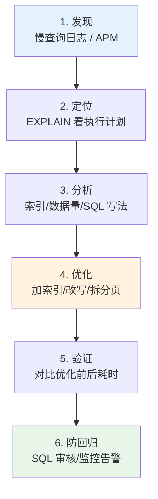

# SQL 优化与执行计划

> 定位：掌握一套「慢 SQL 从发现到治理」的完整方法论，能读懂 EXPLAIN 的每个字段、知道索引为什么不生效、会做分页和 join 优化。这是 DBA 之外每个后端都必须具备的技能——线上 80% 的数据库性能问题，最终都落到「一条写得不好的 SQL」上，而 EXPLAIN 是你唯一的听诊器。

## 一、为什么需要 SQL 优化与执行计划

同样的表、同样的数据，两条逻辑等价的 SQL，性能可能相差几百倍：

```sql
-- 慢：可能全表扫描 + 回表几百万次
SELECT * FROM orders WHERE DATE(create_time) = '2026-11-22';
-- 快：走索引范围扫描
SELECT * FROM orders WHERE create_time >= '2026-11-22 00:00:00'
                       AND create_time < '2026-11-23 00:00:00';
```

差别就一个「对索引列做了函数」。人眼看 SQL 看不出性能，必须靠**执行计划（EXPLAIN）**——它是优化器告诉你「我打算怎么执行这条 SQL」的窗口。会看执行计划，你才能从「凭感觉优化」升级到「有证据优化」。这一篇就给你这套方法论。

## 二、核心原理：一条 SQL 的执行流程与 EXPLAIN

### 2.1 SQL 执行流程

理解 EXPLAIN 输出什么，先要理解 SQL 在 MySQL 内部走过哪些阶段：


这张图里最关键的是**优化器**——它的职责是在众多可行的执行方案里选一个「成本最低」的。它决定用哪个索引、多表 join 谁驱动谁。**EXPLAIN 展示的就是优化器选出来的方案**。注意「优化器选错索引」也是慢 SQL 的常见原因（后面统计信息部分讲）。

### 2.2 EXPLAIN 全字段详解

执行 `EXPLAIN SELECT ...`，会返回一张表，逐列解读：

| 字段 | 含义 | 重点关注 |
|---|---|---|
| `id` | SELECT 的序号 | 越大越先执行；相同 id 从上到下 |
| `select_type` | 查询类型 | SIMPLE 简单查询；PRIMARY 外层；SUBQUERY 子查询；DERIVED 派生表；UNION 联合 |
| `table` | 访问的表名 | 派生表显示 `<derived2>` |
| `partitions` | 匹配的分区 | 分区表才有 |
| **`type`** | **访问类型** | **最重要，见下表** |
| `possible_keys` | 可能用到的索引 | 优化器候选 |
| **`key`** | **实际用到的索引** | 为 NULL 说明没走索引 |
| `key_len` | 实际用到的索引字节数 | 判断联合索引用了几列 |
| `ref` | 与索引比较的列/常量 | const 表示常量 |
| **`rows`** | **预估需要扫描的行数** | 越小越好 |
| `filtered` | 引擎返回后经 WHERE 过滤的百分比 | 估算值 |
| **`Extra`** | **额外信息** | 见下表，含金量极高 |

**`type` 访问类型**（从好到差，这是判断 SQL 好坏的第一指标）：

| type | 含义 | 性能 |
|---|---|---|
| `system` | 表只有一行（系统表特例） | 最好 |
| `const` | 主键/唯一索引等值，最多匹配一行 | 极快 |
| `eq_ref` | join 时被驱动表按主键/唯一索引匹配一行 | 快 |
| `ref` | 普通索引等值匹配 | 较快 |
| `range` | 索引范围扫描（`BETWEEN`、`>`、`IN`） | 可接受 |
| `index` | 遍历整棵索引树（索引覆盖但全扫） | 慢 |
| `ALL` | 全表扫描 | 最慢，重点优化对象 |

> 经验线：生产 SQL 至少要到 `range` 级别，`index` 和 `ALL` 都要重点排查。

**`Extra` 常见值**（读懂它，优化方向就清楚了）：

| Extra | 含义 | 应对 |
|---|---|---|
| `Using index` | 覆盖索引，无需回表 | 好事 |
| `Using index condition` | 用了索引下推 | 较好 |
| `Using where` | 存储引擎返回后再由 server 层过滤 | 看是否能走索引 |
| `Using filesort` | 额外排序（可能用磁盘） | 重点优化：给排序字段建索引 |
| `Using temporary` | 用临时表（GROUP BY/DISTINCT 常见） | 重点优化 |
| `Using join buffer` | join 没走索引，用连接缓冲 | 给被驱动表 join 列建索引 |
| `Range checked for each record` | 索引不理想，逐行重新评估 | 通常要优化 |

MySQL 8.0 还提供 `EXPLAIN ANALYZE`：真正执行 SQL 并显示实际耗时和行数，比 `EXPLAIN` 的估算更准——**排查「优化器估算和实际差很多」的问题时用它**。

## 三、关键机制：从索引设计到慢 SQL 治理

### 3.1 索引设计原则

（与《InnoDB 与索引》一脉相承，这里从「写 SQL 时怎么选索引」角度再强化）

1. **给 WHERE、ORDER BY、GROUP BY、JOIN 涉及的列建索引**——这些是索引的主战场。
2. **联合索引遵循最左前缀，高区分度列靠左，范围列靠右**。
3. **能用覆盖索引就别回表**——`SELECT` 的列尽量都在索引里。
4. **区分度太低（如性别）不要单独建索引**：`Cardinality/总行数` 低时优化器可能直接放弃。
5. **长字符串用前缀索引**：`INDEX idx_email (email(20))`。
6. **控制索引数量**：单表一般 5-6 个以内，索引越多写入越慢、占空间越大。
7. **定期删冗余索引**：有了 `(a,b)` 就不必再单独建 `(a)`。

### 3.2 常见「索引失效」场景

这是面试和实战的高频区，逐条记牢：

| 场景 | 失效示例 | 正确写法 |
|---|---|---|
| **对索引列做函数/运算** | `WHERE DATE(create_time)='2026-11-22'` | `WHERE create_time>='...00:00:00' AND create_time<'...23:59:59'` |
| **隐式类型转换** | phone 是 varchar，`WHERE phone=13800138000` | `WHERE phone='13800138000'` |
| **like 以 % 开头** | `WHERE name LIKE '%阿里'` | 用全文索引或 Elasticsearch |
| **违反最左前缀** | 索引 `(a,b)`，`WHERE b=2` | 补 `(b)` 索引或调整条件 |
| **使用 != / not in** | `WHERE status != 1` | 改写为 `IN` 具体值（视情况） |
| **OR 连接非索引列** | `WHERE a=1 OR b=2`（b 无索引） | 给 b 建索引，或改 UNION |
| **字符串与数字比较** | 列是字符串，传数字 | 传字符串字面量 |
| **优化器判断全表更快** | 小表、或回表代价高 | `ANALYZE TABLE`、强制索引 `FORCE INDEX` |

> 关键认知：索引「失效」很多时候不是索引坏了，而是**优化器认为走索引的成本比全表扫描更高**（比如要回表几百万次），主动放弃了。理解了这点，你就不会盲目加索引，而会去分析成本。

### 3.3 慢 SQL 治理流程

一套可落地的六步法：



**第 1 步：发现**。开启慢查询日志：

```sql
SET GLOBAL slow_query_log = ON;
SET GLOBAL long_query_time = 1;   -- 超过 1 秒算慢查询，按业务调整
```

配合 `mysqldumpslow` 或 pt-query-digest 工具聚合分析。生产更推荐 APM（如 SkyWalking、Arthas）直接定位到具体接口和 SQL。

**第 2-4 步**：就是前面讲的 `EXPLAIN` + 索引分析 + 改写。

**第 5 步**：用 `EXPLAIN ANALYZE` 看真实耗时，对比优化前后。

**第 6 步**：上线 SQL 审核（如 Yearning、GoInception）拦住没走索引的 SQL，加慢查询告警防回归。

### 3.4 分页优化：LIMIT 大偏移

经典慢 SQL：

```sql
SELECT * FROM orders ORDER BY id LIMIT 1000000, 20;
-- 需要先扫描并丢弃前 100 万行，只取 20 行 —— 极慢
```

两种优化：

**方案一：基于主键的游标分页（推荐）**——记录上次的最大 id，下次从它开始：

```sql
SELECT * FROM orders WHERE id > 1000000 ORDER BY id LIMIT 20;
-- 走主键索引，直接定位，秒级变毫秒级
```
缺点：不支持跳到任意页，适合「加载更多」场景。

**方案二：延迟关联（Deferred Join）**——先用覆盖索引在索引树上取主键，再回表取整行：

```sql
SELECT * FROM orders o
INNER JOIN (
    SELECT id FROM orders ORDER BY create_time LIMIT 1000000, 20
) tmp ON o.id = tmp.id;
-- 子查询只在索引上扫描、不回表，外层只回表 20 次
```

### 3.5 JOIN 优化

**核心原则：小表驱动大表，被驱动表 join 列建索引。**

- MySQL 的 join 算法是 Nested Loop Join：驱动表每行都去被驱动表查一次。所以**驱动表要小**、**被驱动表的 join 列必须有索引**（否则每行都全表扫被驱动表，O(n×m)）。
- `LEFT JOIN` 左边是驱动表，`INNER JOIN` 优化器自动选小表驱动。
- join 的表数控制在 3-4 张以内；表太多考虑拆查询。
- 确保 join 两边字段**类型和字符集一致**，否则隐式转换导致索引失效。

### 3.6 大事务拆分

大事务会长时间持有锁、产生大量 undo、阻塞 DDL、崩溃恢复慢。批量操作要拆：

```sql
-- 反例：一次更新 100 万行，事务巨大
UPDATE orders SET status = 2 WHERE status = 1;

-- 正解：分批，每批独立提交
-- 循环执行：UPDATE orders SET status = 2 WHERE status = 1 LIMIT 1000;
-- 直到 affected_rows = 0
```

每批之间可加短暂 sleep 减少对线上写的影响。

### 3.7 统计信息与优化器选错索引

优化器靠**统计信息**估算成本。如果统计信息过时，可能选错索引。

```sql
-- 查看索引基数（Cardinality）
SHOW INDEX FROM orders;
-- 更新统计信息
ANALYZE TABLE orders;
```

`Cardinality` 是索引列不同值的估算个数。如果它严重偏离实际（比如实际有 100 万个不同值，估算只有 10 个），优化器就会误判。遇到「明明有索引却全表扫描」且上面几条都排查过了，试试 `ANALYZE TABLE`。

相关参数：`innodb_stats_persistent`（默认 ON，统计信息持久化）、`innodb_stats_sample_pages`（采样页数，默认 20，越大统计越准但更新成本越高，以版本为准）。

## 四、生产坑点与排查

### 坑点 1：对索引列用函数，索引直接失效

**现象**：`WHERE DATE(create_time)='2026-11-22'`，百万表查询要几秒，`EXPLAIN` 显示 `type=ALL`。
**原因**：对索引列施加函数 `DATE()`，B+树里存的是原始时间戳，函数计算后的值无法与索引比较，优化器放弃索引。
**解法**：把运算挪到常量侧，改成范围查询（见 3.2 示例）。

### 坑点 2：LIMIT 大偏移导致接口超时

**现象**：管理后台翻到第 5000 页时接口直接超时。
**原因**：`LIMIT 50000, 20` 要扫描并丢弃 5 万行。
**解法**：改游标分页或延迟关联（见 3.4）。同时产品上限制「只能翻前 N 页」。

### 坑点 3：隐式类型转换导致索引失效

**现象**：`WHERE phone=13800138000`（phone 是 varchar），查询极慢。
**原因**：phone 是字符串列，传数字时 MySQL 会把列隐式转成数字比较，相当于对列做了 `CAST(phone AS number)`，索引失效。
**解法**：传字符串 `WHERE phone='13800138000'`。这类问题极隐蔽，要养成「字符串列必加引号」的习惯。

### 坑点 4：优化器选错索引

**现象**：`EXPLAIN` 显示有 `possible_keys`，但 `key` 选了另一个更差的索引，甚至 `ALL`。
**原因**：统计信息过时，优化器低估了某个索引的区分度；或优化器认为回表代价太高。
**解法**：
- `ANALYZE TABLE` 更新统计信息。
- 用 `FORCE INDEX(index_name)` 强制走某索引（谨慎，数据分布变化后可能反噬）。
- 检查 `key_len` 确认联合索引用了几列。

### 坑点 5：ORDER BY 出现 Using filesort

**现象**：`EXPLAIN` 的 `Extra` 出现 `Using filesort`，数据量大时排序很慢甚至用磁盘临时文件。
**原因**：排序字段没有可用索引，或 WHERE 与 ORDER BY 的索引无法同时满足。
**解法**：建「WHERE 列 + ORDER BY 列」的联合索引，如 `WHERE a=1 ORDER BY b` 建 `(a,b)`；确保排序方向一致。

## 五、调优、选型与最佳实践

**SQL 编写 checklist：**

1. 不写 `SELECT *`，只查需要的列（利于覆盖索引）。
2. WHERE 条件不破坏索引列（不做函数、不隐式转换、不用前置 %）。
3. 大分页用游标分页或延迟关联。
4. 多表 join 控制数量、小表驱动大表、被驱动表 join 列建索引。
5. 批量写分批提交，避免大事务。
6. 用 `EXPLAIN` 养成习惯，`type` 至少到 `range`，消灭 `Using filesort`/`Using temporary`。

**优化优先级（投入产出比从高到低）：**

| 优先级 | 手段 | 收益 |
|---|---|---|
| P0 | 消灭无索引的全表扫描（加索引/改 SQL） | 极大 |
| P1 | 覆盖索引消灭回表 | 大 |
| P2 | 分页优化、join 优化 | 大 |
| P3 | 拆大事务、减少锁冲突 | 中 |
| P4 | 调参数（Buffer Pool、统计信息） | 中 |

**工具箱：**

- `EXPLAIN` / `EXPLAIN ANALYZE`：看执行计划
- 慢查询日志 + `mysqldumpslow` / `pt-query-digest`：发现热点 SQL
- `SHOW INDEX FROM t`：看索引基数
- `ANALYZE TABLE t`：更新统计信息
- APM / Arthas：线上定位慢调用
- SQL 审核工具：防劣质 SQL 上线

## 六、面试高频问法

> 这一节的答案按「面试时能讲透」的标准写：先给一句结论，再展开机制、原因和坑点。建议先自己答一遍，再对照补全。

**Q1：一条 SQL 在 MySQL 内部经历哪些阶段？优化器在其中做什么？**

**一句话结论**：客户端 → 连接器（鉴权/管连接）→ 分析器（词法/语法分析）→ 优化器（选索引、定 join 顺序）→ 执行器（调存储引擎接口）→ 存储引擎（InnoDB 读写数据）；**优化器负责在众多可行方案里挑成本最低的**，EXPLAIN 展示的就是它选出来的方案。

展开：

- **查询缓存**：MySQL 5.7 及以前有，但命中率低、维护成本高，**8.0 已移除**（以版本为准）。
- **优化器的职责**：决定用哪个索引、多表 join 谁驱动谁、是否用临时表/排序。它基于成本估算（cost）做决策。
- **EXPLAIN 的由来**：EXPLAIN 显示的就是优化器选出的执行计划；所以「优化器选错索引」也是慢 SQL 的常见原因。

加分点：说清「EXPLAIN 只是『优化器打算怎么做』，不一定等于实际执行；MySQL 8.0 的 `EXPLAIN ANALYZE` 才真正执行并给出实际耗时和行数」——这个区分很加分。

**Q2：EXPLAIN 主要看哪些字段？各自什么含义？**

**一句话结论**：重点看五个——`type`（访问类型，至少到 range、避免 ALL）、`key`（实际用的索引，NULL 就是没走）、`key_len`（联合索引用了几列）、`rows`（预估扫描行数）、`Extra`（`Using index` 好，`Using filesort`/`Using temporary` 要优化）。

展开：

| 字段 | 含义 | 关注点 |
|---|---|---|
| `id` | SELECT 序号 | 越大越先执行；相同从上到下 |
| `select_type` | 查询类型 | SIMPLE/PRIMARY/SUBQUERY/DERIVED/UNION |
| `type` | 访问类型 | 最重要，见下题 |
| `possible_keys` | 候选索引 | 优化器可选 |
| `key` | 实际用的索引 | NULL = 没走索引 |
| `key_len` | 用到的索引字节数 | 判断联合索引用几列 |
| `rows` | 预估扫描行数 | 越小越好 |
| `Extra` | 额外信息 | 含金量极高 |

加分点：指出「`possible_keys` 有值但 `key` 为 NULL，说明优化器评估后**主动放弃**了候选索引（多半觉得回表/全表更便宜），这时该去查统计信息和成本，而不是盲目加索引」。

**Q3：`type` 访问类型从好到差的顺序是什么？生产标准线在哪？**

**一句话结论**：`system > const > eq_ref > ref > range > index > ALL`——前几个是等值/索引精确查找，`range` 是范围扫描，`index` 是遍历整棵索引树，`ALL` 是全表扫描；生产 SQL **至少要到 `range`，`index` 和 `ALL` 都要重点排查**。

展开：

| type | 含义 | 性能 |
|---|---|---|
| system | 表只有一行（系统表特例） | 最好 |
| const | 主键/唯一索引等值，最多一行 | 极快 |
| eq_ref | join 时被驱动表按主键/唯一索引匹配一行 | 快 |
| ref | 普通索引等值匹配 | 较快 |
| range | 索引范围扫描（BETWEEN/>/IN） | 可接受 |
| index | 遍历整棵索引树（覆盖但全扫） | 慢 |
| ALL | 全表扫描 | 最慢，重点优化对象 |

加分点：能说出「`index` 和 `ALL` 的区别是：index 扫的是索引树（可能覆盖索引、无需回表），ALL 扫的是聚簇索引整棵树叶（全表数据）——所以 index 有时比 ALL 快，但都说明索引没起到『精准定位』作用，仍需优化」。

**Q4：Extra 里常见的值有哪些？哪些是「好事」哪些要警惕？**

**一句话结论**：`Using index`（覆盖索引，好）、`Using index condition`（索引下推，较好）是正面信号；`Using filesort`（额外排序）、`Using temporary`（临时表）、`Using join buffer`（join 没走索引）是重点优化对象。

展开：

| Extra | 含义 | 应对 |
|---|---|---|
| `Using index` | 覆盖索引，无需回表 | 好事 |
| `Using index condition` | 用了索引下推 | 较好 |
| `Using where` | 引擎返回后 server 层再过滤 | 看能否走索引 |
| `Using filesort` | 额外排序（可能用磁盘） | 给排序字段建索引 |
| `Using temporary` | 用临时表（GROUP BY/DISTINCT 常见） | 重点优化 |
| `Using join buffer` | join 没走索引，用连接缓冲 | 给被驱动表 join 列建索引 |
| `Range checked for each record` | 索引不理想，逐行重估 | 通常要优化 |

加分点：强调「`Using filesort` 名字里有 files，但不等于一定用了磁盘文件——数据量小可能在内存排序；真正危险的是数据量大时退回磁盘临时文件，所以看到它就该评估排序字段的索引」。

**Q5：哪些情况会导致索引失效？**

**一句话结论**：对索引列**做函数/运算**、**隐式类型转换**、**like 以 % 开头**、**违反最左前缀**、**用 != / not in**、**OR 连接非索引列**、以及**优化器判断全表更快**（统计信息过时）——这些都是索引失效的高频场景。

展开（失效示例 → 正确写法）：

| 场景 | 失效示例 | 正确写法 |
|---|---|---|
| 对列做函数 | `WHERE DATE(create_time)='2026-11-22'` | 改成 create_time 的范围查询 |
| 隐式类型转换 | phone 是 varchar，`WHERE phone=13800138000` | `WHERE phone='13800138000'` |
| like 前置 % | `WHERE name LIKE '%阿里'` | 用全文索引或 ES |
| 违反最左前缀 | 索引 `(a,b)`，`WHERE b=2` | 补 `(b)` 索引 |
| != / not in | `WHERE status != 1` | 视情况改写为 IN 具体值 |
| OR 连非索引列 | `WHERE a=1 OR b=2`（b 无索引） | 给 b 建索引或改 UNION |
| 优化器判断全表快 | 小表、回表代价高 | `ANALYZE TABLE`、`FORCE INDEX` |

关键认知：**索引「失效」很多时候不是索引坏了，而是优化器认为走索引成本比全表更高**（比如要回表几百万次），主动放弃了。

加分点：说出「隐式转换最隐蔽——字符串列传数字会让 MySQL 把列隐式转成数字比较，相当于 `CAST(phone AS number)`，养成『字符串列必加引号』的习惯就能避开」。

**Q6：`LIMIT 1000000, 20` 为什么慢？怎么优化？**

**一句话结论**：MySQL 要先**扫描并丢弃前 100 万行**、只取 20 行，所以极慢；优化用「基于主键的游标分页」（`WHERE id > last_id LIMIT 20`）或「延迟关联」（子查询先在索引上取主键再 join 回表）。

展开两种方案：

**方案一：游标分页（推荐）**

```sql
SELECT * FROM orders WHERE id > 1000000 ORDER BY id LIMIT 20;
-- 走主键索引直接定位，秒级变毫秒级
```

缺点：不支持跳到任意页，适合「加载更多」场景。

**方案二：延迟关联（Deferred Join）**

```sql
SELECT * FROM orders o
INNER JOIN (SELECT id FROM orders ORDER BY create_time LIMIT 1000000, 20) tmp
ON o.id = tmp.id;
-- 子查询只在索引上扫描、不回表，外层只回表 20 次
```

加分点：指出「延迟关联的本质是『先在小索引上分页，再用主键回表取整行』——把『100 万次回表』压成『20 次回表』」，用数字量化收益。再补一句「产品上应限制『只能翻前 N 页』，深分页交给 ES/离线数仓」。

**Q7：多表 JOIN 怎么优化？为什么小表驱动大表？**

**一句话结论**：核心原则是**小表驱动大表，被驱动表的 join 列必须有索引**——MySQL 的 join 算法是 Nested Loop Join，驱动表每行都去被驱动表查一次，所以驱动表要小、被驱动表 join 列要走索引，否则退化成 O(n×m) 全表扫。

展开：

- **Nested Loop Join**：驱动表一行 → 去被驱动表按索引查一行 → 匹配。驱动表 n 行就查 n 次被驱动表，所以被驱动表 join 列**必须有索引**（否则每次都全表扫被驱动表）。
- **谁做驱动表**：`LEFT JOIN` 左边是驱动表；`INNER JOIN` 优化器自动选小表驱动。可用 `STRAIGHT_JOIN` 强制顺序（谨慎）。
- **其他要点**：join 表数控制在 3-4 张以内；两边字段**类型和字符集一致**，否则隐式转换导致索引失效。

加分点：说出「`EXPLAIN` 结果里靠前的表是驱动表（`id` 相同从上到下），可以用它验证优化器是否按预期选了小表驱动」——把 EXPLAIN 和 join 优化串起来。

**Q8：优化器为什么会选错索引？怎么办？**

**一句话结论**：因为优化器靠**统计信息（Cardinality）**估算成本，统计信息过时或采样偏差会让它误判索引区分度、低估回表代价，从而选了更差的索引甚至全表扫描；对策是 `ANALYZE TABLE` 更新统计信息，必要时 `FORCE INDEX`，并检查索引设计。

展开：

- **Cardinality**：索引列不同值的估算个数。若实际有 100 万个不同值、估算只有 10 个，优化器就会误判。查看：`SHOW INDEX FROM orders`。
- **更新统计**：`ANALYZE TABLE orders`。相关参数 `innodb_stats_persistent`（默认 ON）、`innodb_stats_sample_pages`（采样页数，默认 20，越大越准但更新成本越高，以版本为准）。
- **强制索引**：`FORCE INDEX(index_name)` 手工干预（谨慎——数据分布变化后可能反噬）。
- **治本**：检查索引设计是否合理，是否有冗余/重复索引干扰优化器。

加分点：强调「`FORCE INDEX` 是最后手段，不是常规优化——它把选择权从优化器手里拿走，数据分布一变就可能由利变害、反而拖慢查询；先做 `ANALYZE TABLE` 和索引设计审查」。

**Q9：ORDER BY 出现 `Using filesort` 怎么优化？联合索引怎么配合排序？**

**一句话结论**：`Using filesort` 表示排序用不到现成索引、需要额外排序（数据量大时可能落磁盘）；优化方法是建「WHERE 列 + ORDER BY 列」的联合索引，让索引顺序直接满足排序要求，并确保排序方向一致。

展开：

- **产生原因**：排序字段没有可用索引，或 WHERE 与 ORDER BY 需要的索引无法同时满足。比如 `WHERE a=1 ORDER BY b` 只有 `(a)` 索引时，取完 a=1 的行还要对 b 排序。
- **优化**：建联合索引 `(a,b)`——a 用于等值过滤，b 在索引里天然有序，直接按索引顺序取就是排好序的，无需额外排序。
- **方向一致**：`ORDER BY a ASC, b DESC` 需要索引 `(a,b)` 且方向匹配（8.0 支持降序索引，以版本为准）；混用升降序可能导致 filesort。
- **最左前缀仍适用**：ORDER BY 也要从联合索引最左列开始，跳过列就用不上。

加分点：点出「group by 同理——`Using temporary` 也可以通过建合适的联合索引让分组走索引有序性来消除」，把排序和分组两类问题归并为一类思路。

**Q10：慢 SQL 治理的完整流程是什么？**

**一句话结论**：六步法——**发现（慢查询日志/APM）→ 定位（EXPLAIN 看执行计划）→ 分析（索引/数据量/SQL 写法）→ 优化（加索引/改写/拆分页）→ 验证（对比前后耗时）→ 防回归（SQL 审核/监控告警）**。

展开：

1. **发现**：`SET GLOBAL slow_query_log=ON; SET GLOBAL long_query_time=1;`（超 1 秒算慢查询，按业务调）；用 `mysqldumpslow` / `pt-query-digest` 聚合，生产更推荐 APM（SkyWalking/Arthas）定位到具体接口。
2. **定位**：`EXPLAIN` 看 type/key/rows/Extra。
3. **分析**：判断是索引失效、返回数据量过大、还是 SQL 写法问题。
4. **优化**：P0 消灭无索引全表扫描 → P1 覆盖索引消回表 → P2 分页/join 优化 → P3 拆大事务 → P4 调参数。
5. **验证**：`EXPLAIN ANALYZE` 看真实耗时，对比优化前后。
6. **防回归**：SQL 审核工具（Yearning、GoInception）拦无索引 SQL，加慢查询告警。

加分点：强调「优化要有证据、要能量化——『感觉快了』不算数，用 `EXPLAIN ANALYZE` 的实际耗时和 rows 对比说话」，这是从「凭感觉」到「有证据」的分水岭。

**Q11：大事务为什么要拆？怎么拆？**

**一句话结论**：大事务会长时间持有锁、产生大量 undo、阻塞 DDL、崩溃恢复慢——要把批量操作拆成小批、每批独立提交，避免一次锁太多行太久。

展开：

```sql
-- 反例：一次更新 100 万行，事务巨大
UPDATE orders SET status = 2 WHERE status = 1;

-- 正解：分批，每批独立提交
-- 循环执行：UPDATE orders SET status = 2 WHERE status = 1 LIMIT 1000;
-- 直到 affected_rows = 0
```

- **为什么要拆**：大事务锁范围大、锁持有时间长 → 并发阻塞、锁超时、死锁概率上升；undo log 堆积（呼应 MVCC 长事务）；崩溃恢复要重做/回滚海量日志。
- **怎么拆**：用 `LIMIT` 控制每批行数，每批一个独立事务、独立提交；每批之间可加短暂 sleep 减少对线上写的影响。
- **注意**：拆批后要保证业务上可中断续跑（记录处理进度），失败能重试。

加分点：把大事务和前面的知识点串起来——「拆大事务同时缓解了锁等待（锁机制篇）、undo 堆积（MVCC 篇）、主从延迟（复制篇）三个问题，是性价比极高的通用优化」。

## 小结

- EXPLAIN 是慢 SQL 听诊器：重点看 `type`（≥range）、`key`、`rows`、`Extra`。
- 索引失效的元凶：函数、隐式转换、前置 %、违反最左前缀、优化器成本误判。
- 慢 SQL 治理六步：发现→定位→分析→优化→验证→防回归。
- 大分页用游标分页或延迟关联；JOIN 小表驱动大表、被驱动表建索引。
- 大事务分批提交，统计信息靠 `ANALYZE TABLE` 保鲜，别忘 `EXPLAIN ANALYZE` 看真实耗时。
